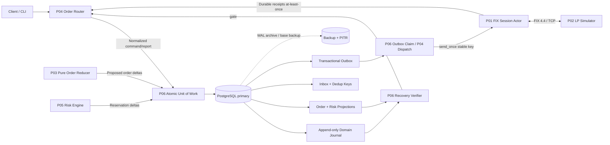
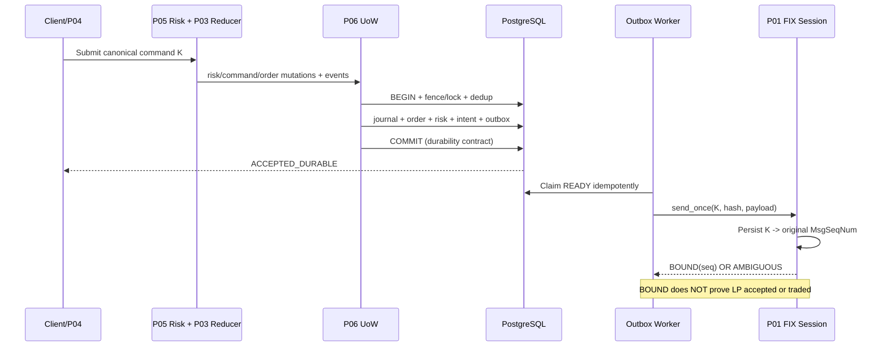
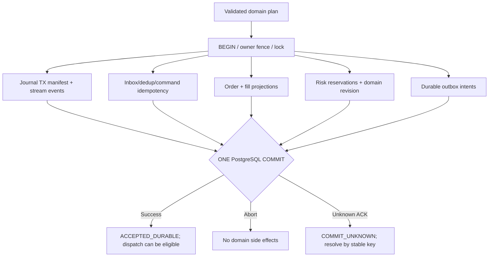
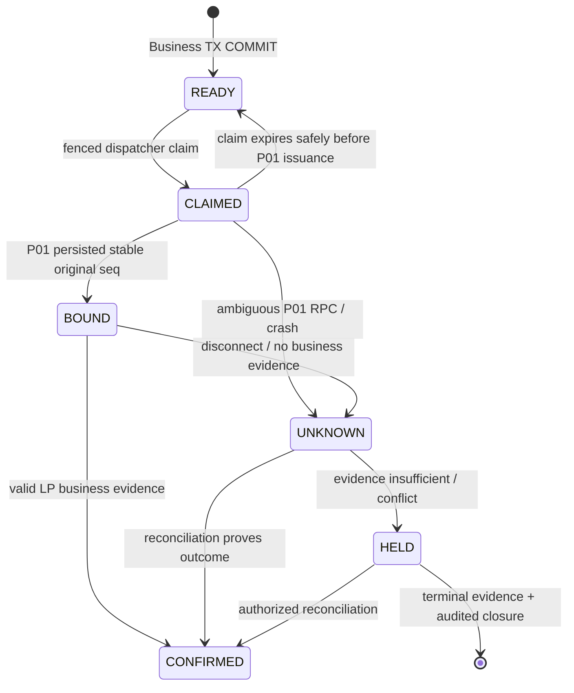
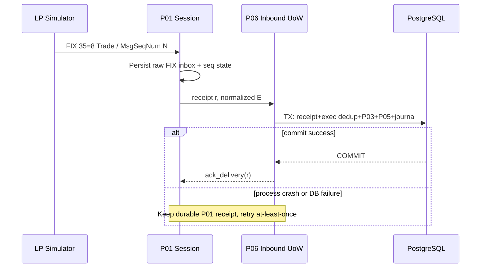
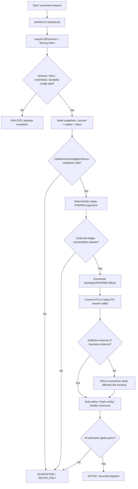
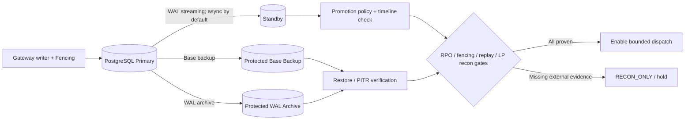
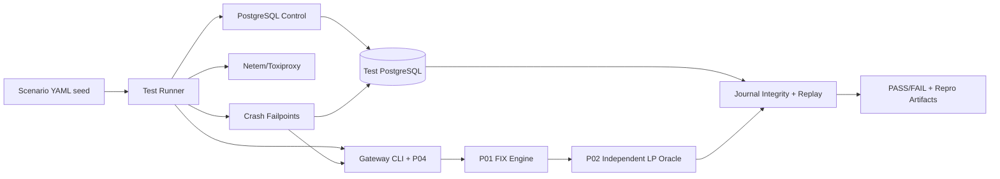

# Project 06 — FX/CFD Durable Journaling & Recovery Engine

> **Tài liệu System Design + Failure Model + What-if Test Catalog**  
> **Phiên bản:** 1.0 (thiết kế đề xuất) · **Ngày:** 2026-10-30  
> **Stack:** C++20 · Linux · PostgreSQL 17 (tham chiếu) · Docker · FIX 4.4 (tích hợp P01)  
> **Liên kết:** P01 FIX Session Engine · P02 LP Simulator · P03 Order State Machine · P04 Order Router · P05 Risk Engine · P07 Low Latency · P08 Integration  
> **Trạng thái:** DESIGN / NOT IMPLEMENTED / TESTS NOT EXECUTED

**Phân biệt nguồn:** CV có đề cập *durable journaling và recovery* trong dự án FX/CFD, cùng stack C++20 / FIX 4.4 / PostgreSQL / Linux / Docker và các tình huống partial fill, lost acknowledgment, cancel/replace races. CV **không** mô tả schema, công nghệ cụ thể của journal, transaction topology, WAL settings, fencing hay chiến lược HA. Tất cả cấu trúc, chỉ tiêu, giao diện và test trong tài liệu này là **đề xuất để tái dựng**, không phải kiến trúc được xác nhận từ công ty cũ.

**Mục tiêu an toàn:** Không làm biến mất sự kiện giao dịch đã commit; không thay đổi outcome sau replay; không tái phát lệnh New ngoài ý muốn; không phóng thích risk khi kết quả LP chưa rõ; và **fail-closed** nếu độ bền/trật tự dữ liệu không thể chứng minh.

**Điều quan trọng:** Không thể bao quát “mọi what-if” của một hệ thống phân tán hữu hạn. Catalog 480 tình huống + model-based/property testing + fault injection có chủ đích tăng mạnh độ tin cậy, nhưng chỉ kết quả test thực tế, chaos drills và đo đạc trên môi trường triển khai mới chứng minh được các tiêu chí.

## Mục lục

1. Phạm vi và yêu cầu; 2. Durability model và thuật ngữ; 3. Threat model; 4. Safety invariants; 5. Context architecture; 6. Ranh giới module P01–P08; 7. Data model/identity; 8. PostgreSQL schema; 9. Atomic transaction patterns; 10. Outbox + FIX send ambiguity; 11. Inbound inbox; 12. Deterministic replay; 13. Snapshots; 14. Startup recovery; 15. Crash windows; 16. Isolation và fencing; 17. PostgreSQL WAL/backup/HA; 18. Corruption/tamper; 19. Backpressure; 20. C++20 interfaces; 21. Config & repository; 22. SLO/observability; 23. Test methodology; 24. What-if matrix; 25. Fault-injection playbooks; 26. Test harness; 27. Release gates; 28. Roadmap; 29. Decision log; 30. Sources và giới hạn.

## 1. Mục tiêu, phạm vi, yêu cầu

### 1.1. Nhiệm vụ của P06

P06 không quyết định một lệnh có hợp lệ về nghiệp vụ (P03), không định tuyến một lệnh (P04) và không tính toán risk (P05). P06 cung cấp **một storage authority cho giao dịch nguyên tử**, persistence adapter và cơ chế recovery đã được xác minh. Mọi thay đổi trạng thái và side effects do P03/P04/P05 đề xuất phải đi qua commit boundary của P06.

**Functional requirements (FR):**

| ID | Yêu cầu kiểm chứng được |
|---|---|
| FR-01 | Append-only event journal có stream version và integrity metadata. |
| FR-02 | Ghi nguyên tử inbox dedup, journal event, order/fill projection, risk reservation, command intent và outbox theo từng business transaction. |
| FR-03 | Idempotent apply cho command, receipt và execution theo namespace đúng. |
| FR-04 | Phục hồi deterministic từ trusted checkpoint + journal tail hoặc full replay. |
| FR-05 | Lưu original outbound intent; không issue original FIX request lần hai khi ambiguous. |
| FR-06 | Phân biệt DB commit ACK với LP application evidence. |
| FR-07 | Snapshot verified; không dùng snapshot như bằng chứng duy nhất. |
| FR-08 | Fencing để ngăn hai writers cùng quản lý risk domain/order chain/session. |
| FR-09 | Khả năng query/reconcile các lệnh outcome chưa biết khi restart/failover. |
| FR-10 | Backup/PITR restore drills, kiểm chứng dữ liệu lưu và RPO/RTO thực tế. |
| FR-11 | Audit log có provenance, schema/policy/algorithm version và checksum. |
| FR-12 | Cơ chế fail-closed, bounded retries và operator escalation. |
| FR-13 | Fault-injection hooks deterministic và post-recovery integrity verifier. |
| FR-14 | Retention/compaction với chứng minh không làm mất dedup/resend/replay evidence. |

**Non-goals v1:** không viết database engine/WAL riêng; không đưa Kafka vào consistency core; không có 2PC với LP qua FIX; không cam kết exactly-once end-to-end qua mạng; không auto-correct corrupted journal; không tự xử lý trade bust/correction nếu P03 chưa hỗ trợ; không tự động phát New sau restore PITR.

### 1.2. Định nghĩa kết quả

- **ACCEPTED_DURABLE:** P06 đã xác nhận COMMIT theo durability settings đã pin; không đồng nghĩa LP accepted hoặc filled.
- **COMMIT_UNKNOWN:** client mất kết nối/timeout khi COMMIT; phải query theo idempotency key trước khi quyết định retry; cùng key retry an toàn chỉ nếu DB constraints và canonical request hash đúng.
- **OUTCOME_UNKNOWN:** business effect phía LP có thể tồn tại mà hệ thống chưa đủ evidence; giữ risk hold và mở reconciliation.
- **QUARANTINED:** phát hiện integrity/identity/lineage contradiction; không dispatch side effect mới từ đối tượng liên quan.
- **RECON_ONLY:** đọc, replay/đối soát được, **không** nhận New chưa có bằng chứng an toàn.
- **FAIL_CLOSED:** ngừng admission/dispatch nếu risk/durability/ownership không an toàn; vẫn cho phép vận hành read-only điều tra trong phạm vi kiểm soát.

## 2. Durability model và thuật ngữ

| Thuật ngữ | Ý nghĩa trong P06 | Điều KHÔNG đảm bảo |
|---|---|---|
| Event journal | Log bất biến các chuyển đổi miền nghiệp vụ | Không phải PostgreSQL physical WAL |
| PostgreSQL WAL | Log vật lý hỗ trợ crash consistency/backup/replication | Không tự chống gửi lệnh trùng ở LP |
| Durable inbox | Receipt đã được lưu trước khi business apply | Không tự suy ra ExecID unique toàn cầu |
| Transactional outbox | Lưu ý định side effect trong cùng business commit | Không bảo đảm LP xử lý đúng một lần |
| Stream version | Số phiên bản liên tiếp trong một aggregate đã khóa writer | Không phải global commit order |
| DB commit ACK | Transaction đã commit theo DB contract | Không phải broker application ACK |
| FIX session resend | Replay FIX session theo MsgSeqNum/PossDup | Không phải gửi lại business New với ClOrdID mới |
| Projection | View materialized từ journal/reducer | Có thể stale/lỗi nếu logic reducer hỏng |
| Snapshot | Checkpoint tăng tốc replay; checksum+schema-verified | Không được mất journal tail |
| Fencing token | Thế hệ writer được DB cấp để chặn stale actors | Không bảo vệ tài nguyên ngoài DB nếu chúng không kiểm token |
| RPO | Lượng dữ liệu được phép mất theo topology | RPO=0 không mặc định đúng với async replica |
| RTO | Thời gian khôi phục tới trạng thái phục vụ an toàn | Không bao gồm tự động “đoán” LP outcome |

**Atomicity domain v1:** cùng một PostgreSQL primary, một transaction chứa *tất cả* state cần giữ nhất quán. Các modules logic P03/P04/P05 gọi chung `IAtomicStore::apply()`; không có P03, P04, P05 databases riêng trong MVP. Bất kỳ mở rộng sang nhiều DB phải thiết kế lại consistency contract, không kế thừa claim atomicity này.

**Durability prerequisites:** bảng trọng yếu là LOGGED; `fsync=on`, `full_page_writes=on`, `synchronous_commit=on` cho lab local commit; tin cậy phần cứng/storage flush path và filesystem; permission/role chặn bảng bị sửa tay. Định nghĩa `ACCEPTED_DURABLE` chỉ đúng trong những giả định đó. Async replica có thể thiếu acknowledged commit nếu failover sớm. Với zero RPO qua failover, cần synchronous replica được pin và kiểm chứng failover target cùng fencing.

## 3. Threat model và failure taxonomy

| Nguồn lỗi | Ví dụ | Ưu tiên phản ứng |
|---|---|---|
| Process/crash | SIGKILL, OOM, segfault, mid-commit | Restart gated + inspect durable markers |
| DB/transaction | Deadlock, serialization abort, unknown commit, stale read | Idempotent retry/resolve; không phát lệnh khi chưa xác định |
| Storage/power | ENOSPC, I/O error, lying fsync, torn sectors, block corruption | Fail-closed, restore verified, quarantine nếu mất bằng chứng |
| Network | App ↔ DB disconnect, Gateway ↔ LP disconnect, asymmetric partition | Phân biệt DB outcome và LP outcome |
| Concurrency | Two writer owners, delayed callback, ABA, stale fencing epoch | Reject stale owner; stop dispatch |
| Data semantics | Conflicting ExecID, broken lineage, fill ledger mismatch | Freeze affected chain, reconcile |
| HA/backup | Async lag, wrong promotion, PITR cutoff, divergent timeline | Chặn dispatch; compare recovery lineage; operator approval |
| Code/config | Incompatible serializer, new reducer logic, migration partial | Version gate, shadow replay, rollback safely |
| Security/operator | Stolen credentials, row edits, WAL archive replacement, bad cleanup | Least privilege, protected audit, offline restore evidence |
| Load | Hot account, WAL growth, outbox backlog, snapshot storm | Bounded admission, backpressure, prioritized recovery |

**Trust boundaries:** P01 có thể gửi raw FIX receipts **at least once**; P02 có thể adversarial; OS/socket không cung cấp thông tin “LP đã thực thi”; DB commit không liên kết atomically với LP; backup có thể cũ; privileged DBA/storage layer có thể sửa dữ liệu nên hash chain cùng DB không đủ để chống kẻ có toàn quyền.

## 4. Safety invariants — `JI-01..JI-40`

- JI-01 — Từng stream `(tenant, stream_id)` có version liên tiếp 1..N, không có duplicate/skip trong committed history.

- JI-02 — Journal events committed là immutable; correction là event mới có provenance, không UPDATE/DELETE lịch sử.

- JI-03 — Atomic TX: inbox receipt accepted ⇔ business events/projection/ledger/outbox tương ứng đã commit hoặc được đánh dấu NOOP/QUARANTINE trong cùng TX.

- JI-04 — Không phát bất kỳ original outbound request nếu command intent và risk approval chưa commit bền vững.

- JI-05 — Same `(tenant, command_id)` + same canonical hash chỉ tạo một command effect; khác hash là CONFLICT.

- JI-06 — Same normalized `(counterparty_scope, ExecID)` + same business fingerprint không tạo fill effect lần hai.

- JI-07 — Same business key + different fingerprint phải QUARANTINE, không chọn một bản ngẫu nhiên.

- JI-08 — `CumQty`, `LeavesQty`, fill ledger và order projection phù hợp quy tắc P03; không overfill.

- JI-09 — Risk projection và reservation changes cùng transaction với accepted order/fill effects; không over-release.

- JI-10 — PendingCancel/PendingReplace/Unknown không được tự động release risk hoặc coi terminal.

- JI-11 — Mọi reducer apply từ event stream có kết quả deterministic theo version pin, seed, policy và schema.

- JI-12 — Nếu replay từ journal+trusted snapshot khác projection đã commit thì no-trade và báo integrity incident.

- JI-13 — Snapshot high watermark không được vượt committed stream head; snapshot thiếu tail không được thay journal.

- JI-14 — Retention không xóa event/receipt/exec key còn cần thiết cho live order hoặc resend/recovery horizon.

- JI-15 — `COMMIT_UNKNOWN` không được diễn dịch thành rollback và cũng không diễn dịch thành LP accepted.

- JI-16 — DB commit ACK không được diễn dịch thành TCP send ACK hoặc LP business acknowledgement.

- JI-17 — Socket write ACK không bao giờ là bằng chứng LP chưa/đã xử lý đủ lệnh.

- JI-18 — Durable P01 `send_once` map `(session,command_id,payload_hash)->original seq` không đổi trong session epoch.

- JI-19 — Không tự cấp original seq thứ hai do outbox retry; protocol resend reuse session history.

- JI-20 — Unresolved outbound ambiguity => HOLD/RECON, tuyệt đối không regenerate new `ClOrdID` tự động.

- JI-21 — Fencing token của owner cũ không được commit mutation hoặc dispatch sau failover.

- JI-22 — Không hai active writers cùng sở hữu một risk domain/order chain/session đối với side effects.

- JI-23 — Không suy diễn global commit order từ sequence/BIGSERIAL IDs cấp trước COMMIT.

- JI-24 — Recovery chỉ phát tác dụng mới sau integrity gate, fencing gate và reconciliation gate.

- JI-25 — Recovery scan outbox không làm mất hoặc nhân đôi một business command.

- JI-26 — Inbox durable receipt không bị mất vì consumer ACK/offset được lưu trước business commit.

- JI-27 — Mọi retry của transaction là replay cùng idempotency key và request hash, không sinh command ID mới.

- JI-28 — Transaction SERIALIZABLE/deadlock abort hoàn toàn không để lại domain mutation đã commit.

- JI-29 — Storage error, checksum mismatch, missing range, invalid schema => FAIL_CLOSED thay vì “best effort dispatch”.

- JI-30 — Hệ thống chỉ trả thành công commit sau khi PostgreSQL confirmed commit theo cấu hình durability pin.

- JI-31 — Restore backup/PITR không được tự động tiếp tục outbound dispatch trước LP/session reconciliation.

- JI-32 — Không failover sang async standby và claim RPO=0 khi chưa kiểm chứng losslessness.

- JI-33 — Mỗi execution, reservation và command có tenant/account/counterparty namespace rõ; cross-tenant apply bị chặn.

- JI-34 — Không log credentials hoặc full sensitive FIX payload ở unprotected metrics/logs.

- JI-35 — Archived history và audit evidence được bảo vệ từ ngoài trust domain writer, retention theo chính sách.

- JI-36 — Queue và resource bounded: quá tải dẫn tới backpressure, không drop silently safety-critical items.

- JI-37 — Không accept schema/policy evolution nếu không thể replay events cũ bằng version đã pin/upcaster tested.

- JI-38 — Không gửi Cancel/Replace từ stale lineage hoặc post-terminal state sau recovery.

- JI-39 — Integrity verifier lỗi trên bất kỳ safety-critical aggregate => no new orders trong impacted risk domain.

- JI-40 — Khi không thể chứng minh LP business outcome, operator/reconciliation quyết định; không tự tạo fill hay zero-fill.

## 5. Architecture context và state ownership



### 5.1. Quyền sở hữu / boundaries

| Concern | Owner of logic | Owner of durability | Contract |
|---|---|---|---|
| FIX wire session, MsgSeqNum, resend | P01 | P01 stable history; ideally same cluster, separate tables/namespace | `StableSendV1`; never blind retransmit D/F/G |
| Order transitions / quantity accounting | P03 | P06 | Reducer returns new state + events; P06 commits |
| Routing / IDs / reconciliation | P04 | P06 | Intent/outbox/inbox/recon cases |
| Exposure / reservation / policy | P05 | P06 | Atomic risk reservation + command intent |
| Business event journal / snapshots / replay | P06 | P06 | Event hash + version + projection verification |
| LP test oracle | P02 | P02 independent data store | Isolated simulator does not share P03/P06 reducers |
| Benchmark / chaos | P07/P08 | N/A | Metrics and fault-injection hooks |

### 5.2. Single store không đồng nghĩa single writer

- P03 single-owner per chain và P05 one-owner per risk domain vẫn phải có DB `FOR UPDATE`/fencing/version compare; in-memory mutex không bảo vệ khi nhiều instances.
- Lock theo thứ tự cố định: tenant/risk domain → account → order chain → dedup key → outbox claim, để giảm deadlocks. Tuân thủ yêu cầu nghiệp vụ khi tính shared firm limit.
- Multi-tenant isolation: tất cả PK/FK của nguồn canonical gồm `tenant_id`; role chỉ có quyền tới tenant hợp lệ theo auth context.
- Cho phép concurrent writes của các risk domains độc lập; không giả định global event_seq phản ánh thứ tự COMMIT.

## 6. Contract tích hợp P01–P05, P07–P08

| Contract đề xuất | Producer → Consumer | Kiểm tra tích hợp |
|---|---|---|
| `FixInboundV1(session, epoch, durable_receipt_id, raw_hash, raw_ref)` | P01 → P04/P06 | At-least-once, stable receipt identity; P06 commit business apply rồi ACK P01 |
| `StableSendV1(session, command_id, hash, original FIX)` | P04/P06 → P01 | P01 persist stable mapping+sequence before socket write; same key idempotent |
| `OrderReducerV1(state, normalized_event, reducer_version)` | P03 → P06 | Pure deterministic reducer with stable event/schema identifiers |
| `RiskMutationV1(domain_revision, reservation_delta, policy_version)` | P05 → P06 | Same DB TX with accepted command/fill ledger |
| `AtomicApplyV1(command/receipt, expected_versions, patches, effects)` | P03/04/05 → P06 | No external calls inside transaction; all-or-nothing commit |
| `RecoveryGateV1(replay_status, recon_status, owner_fence)` | P06 → P04 | Dispatch disabled until all mandatory gates pass |
| `FaultHookV1(failpoint, seed, target_tx)` | P08 test harness → P06 | Test-only, disabled in production |

**Open integration blocker:** Nếu P01 session store tách khỏi P06 DB, không được cam kết one-transaction atomicity giữa journal business và FIX original sequence. Điều bắt buộc tối thiểu là P01 có `send_once` bền vững, stable mapping và protocol resend; nếu thiếu contract này, P04/P06 phải HOLD original NEW sau ambiguous send. Không dùng distributed transaction giả định giữa PostgreSQL và TCP/LP.

## 7. Domain entities, identity và thứ tự sự kiện

```text
TenantId + AccountId           tenant boundary + risk scope
CommandId                       stable client API idempotency key
OrderChainId                    immutable xuyên New/Replace
ClOrdID / OrigClOrdID           scoped FIX identity/lineage
LP OrderID                       external identity, có thể đến muộn
BusinessExecKey                  theo counterparty scope đã xác nhận
P01 ReceiptId + session epoch    durable session ingress identity
StreamId + StreamVersion        total order CHỈ trong một aggregate
JournalEventId                   unique event identity, không phải commit-order clock
OutboxId + CommandId            side effect intent identity
FencingToken                     monotonic owner epoch in DB
PolicyVersion, ReducerVersion   deterministic replay provenance
SnapshotVersion + hash          checkpoint integrity
```

**Cảnh báo `BIGSERIAL`:** PostgreSQL sequence cấp ID trước commit; nếu TX A lấy ID=10 nhưng bị chậm, TX B ID=11 commit sớm, một worker chốt watermark 11 có thể bỏ sót A khi A commit. Không dùng `MAX(journal_id)` như “all previous committed done” để replay/consume. V1 dùng per-stream version theo row lock và outbox polling `FOR UPDATE SKIP LOCKED` (không tạo global correctness checkpoint). Nếu thật sự cần global commit log, phải chọn thiết kế commit-order mechanism riêng và test với interleaved concurrent commits.

### 7.1. Khóa dedup khác nhau

1. **Transport receipt:** `(tenant, session_key, epoch, receipt_id)` nhận nhiều lần vẫn cùng inbound payload hash; nếu hash khác thì integrity conflict.
2. **Business execution:** `(tenant, LP namespace, semantic ExecID)` chỉ dùng cho event thực sự có ExecID unique theo ROE; `ExecID=0`/status snapshot không dùng làm fill dedup key.
3. **Client command:** `(tenant, account_id, client_command_id)` giữ request hash, result và created epoch; compare-and-return.
4. **FIX original send:** `(session_identity, command_id, canonical_fix_hash)` map một lần sang original MsgSeqNum theo P01.
5. **Replay journal event:** `(tenant, stream_id, stream_version)` bảo đảm mỗi transition version đúng một lần.

### 7.2. Append journal vs mutable projections

Business journal chỉ `INSERT`. `orders`, `fills`, `risk_reservations`, `outbox` và `recon_cases` là projections/intent records có version, được cập nhật trong cùng transaction. Khi cần sửa lỗi sự kiện đã commit, append correction event với manual authorization/reconciliation; không lén UPDATE journal.

## 8. PostgreSQL schema (conceptual, runnable skeleton)

Đây là bản DDL mẫu cần hoàn thiện migrations, FK/RLS, partitioning, typing và query plans trước production. **Không triển khai song song schema rời của P03/P04/P05**; hợp nhất migration tại P06. Lược đồ giả định PostgreSQL 17 và chỉ các bảng LOGGED.

```sql
CREATE TABLE stream_heads (
  tenant_id text NOT NULL,
  stream_id text NOT NULL,
  current_version bigint NOT NULL DEFAULT 0 CHECK (current_version >= 0),
  state_hash bytea NOT NULL,
  fencing_token bigint NOT NULL,
  PRIMARY KEY (tenant_id, stream_id)
);
CREATE TABLE journal_transactions (
  tenant_id text NOT NULL,
  tx_id uuid NOT NULL,
  expected_event_count int NOT NULL CHECK (expected_event_count > 0),
  members_digest bytea NOT NULL,
  created_at timestamptz NOT NULL DEFAULT now(),
  PRIMARY KEY (tenant_id, tx_id)
);
CREATE TABLE journal_events (
  tenant_id text NOT NULL,
  stream_id text NOT NULL,
  stream_version bigint NOT NULL CHECK (stream_version > 0),
  event_id uuid NOT NULL,
  tx_id uuid NOT NULL,
  event_ordinal int NOT NULL CHECK (event_ordinal >= 0),
  event_type text NOT NULL,
  schema_version int NOT NULL CHECK (schema_version > 0),
  reducer_version text NOT NULL,
  policy_version bigint NOT NULL,
  payload jsonb NOT NULL,
  canonical_hash bytea NOT NULL,
  prev_state_hash bytea NOT NULL,
  state_hash bytea NOT NULL,
  created_at timestamptz NOT NULL DEFAULT now(),
  PRIMARY KEY (tenant_id, stream_id, stream_version),
  UNIQUE (tenant_id, event_id),
  UNIQUE (tenant_id, tx_id, event_ordinal),
  FOREIGN KEY (tenant_id, tx_id)
    REFERENCES journal_transactions(tenant_id, tx_id)
);
CREATE TABLE inbox_receipts (
  tenant_id text NOT NULL,
  session_key text NOT NULL,
  session_epoch bigint NOT NULL,
  receipt_id bigint NOT NULL,
  payload_hash bytea NOT NULL,
  apply_state text NOT NULL CHECK (apply_state IN ('APPLIED','NOOP','QUARANTINED')),
  tx_id uuid NOT NULL,
  PRIMARY KEY (tenant_id, session_key, session_epoch, receipt_id)
);
CREATE TABLE command_intents (
  tenant_id text NOT NULL,
  account_id text NOT NULL,
  command_id text NOT NULL,
  order_chain_id text NOT NULL,
  canonical_hash bytea NOT NULL,
  risk_reservation_id text,
  decision text NOT NULL,
  created_tx uuid NOT NULL,
  PRIMARY KEY (tenant_id, account_id, command_id)
);
CREATE TABLE command_outbox (
  outbox_id uuid PRIMARY KEY,
  tenant_id text NOT NULL,
  account_id text NOT NULL,
  command_id text NOT NULL,
  session_key text NOT NULL,
  original_payload_hash bytea NOT NULL,
  original_payload bytea NOT NULL,
  state text NOT NULL CHECK (state IN
    ('READY','CLAIMED','BOUND','UNKNOWN','CONFIRMED','HELD')),
  p01_original_seq bigint,
  claim_owner text,
  claim_token bigint,
  claim_expires_at timestamptz,
  attempts int NOT NULL DEFAULT 0,
  created_tx uuid NOT NULL,
  UNIQUE (tenant_id, account_id, command_id),
  FOREIGN KEY (tenant_id, account_id, command_id)
    REFERENCES command_intents(tenant_id, account_id, command_id)
);
CREATE INDEX idx_outbox_ready ON command_outbox (state, claim_expires_at);
CREATE TABLE business_exec_keys (
  tenant_id text NOT NULL,
  lp_namespace text NOT NULL,
  semantic_exec_id text NOT NULL,
  fingerprint bytea NOT NULL,
  order_chain_id text NOT NULL,
  applied_tx uuid NOT NULL,
  PRIMARY KEY (tenant_id, lp_namespace, semantic_exec_id)
);
CREATE TABLE recovery_cases (
  tenant_id text NOT NULL,
  case_id uuid NOT NULL,
  order_chain_id text NOT NULL,
  reason_code text NOT NULL,
  evidence_hash bytea,
  status text NOT NULL,
  PRIMARY KEY (tenant_id, case_id)
);
CREATE TABLE owner_fences (
  tenant_id text NOT NULL,
  domain_id text NOT NULL,
  token bigint NOT NULL CHECK (token > 0),
  lease_owner text NOT NULL,
  lease_until timestamptz NOT NULL,
  PRIMARY KEY (tenant_id, domain_id)
);
CREATE TABLE snapshots (
  tenant_id text NOT NULL,
  stream_id text NOT NULL,
  stream_version bigint NOT NULL,
  schema_version int NOT NULL,
  reducer_version text NOT NULL,
  serialized_state bytea NOT NULL,
  content_hash bytea NOT NULL,
  state_hash bytea NOT NULL,
  journal_anchor_hash bytea NOT NULL,
  verified boolean NOT NULL DEFAULT false,
  verified_at timestamptz,
  created_at timestamptz NOT NULL DEFAULT now(),
  PRIMARY KEY (tenant_id, stream_id, stream_version)
);
-- Integrate P03 order/filled projections, P05 risk domain + reservations
-- in this SAME transaction boundary, with composite FK/tenant scoping.
-- DB permissions/RLS/migration versioning must be added before production.
```

**Một số ràng buộc còn lại phải thiết kế ở service layer và migration:** (1) journal is immutable bằng quyền DB và trigger chỉ để tăng phòng vệ, không chống superuser; (2) per-stream contiguous version/prev-hash sau khi lock `stream_heads`; (3) `state_hash` canonical bytes bao gồm semantic reducer version; (4) `outbox.claim_token` phải được kiểm bằng owner fence tại thời điểm mutating; (5) FK tenant-aware ở tất cả bảng còn lại, không chỉ schema minh họa; (6) `journal_transactions.expected_event_count` + `members_digest` phải được tính từ các member events canonical trong cùng TX, verify sau commit; (7) `snapshots.verified=true` chỉ được đặt sau readback/checksum/anchor check; (8) `created_at` chỉ phục vụ audit, **không** quyết định replay order.

### 8.1. Nếu muốn audit cryptographic

Hash chain `H(prev_hash || canonical_event_bytes || stream_id || version || reducer_version)` có thể phát hiện thay đổi ngoài ý muốn nếu verify và neo định kỳ tới một kho **bất biến nằm ngoài quyền truy cập của DB writer**. Hash không thay thế access control, backups và restore verification. Không append bằng cách đọc event tail rồi insert trong các transaction song song mà không lock stream head.

## 9. Atomic transaction workflows



### 9.0. Atomic write-set — tuyệt đối không tách commit



### 9.1. New order admission pseudocode

```text
applyNew(command K, account A, expected_risk_rev V, fence F):
  canonicalize and validate BEFORE transaction (no side effects)
  BEGIN (SERIALIZABLE; bounded retry on 40001/40P01)
    lock owner_fences for risk domain and verify F
    lock risk_domain and order_chain rows in fixed order
    lookup command_intents(K)
    if exists and hash == H: return its previous durable result
    if exists and hash != H: CONFLICT + no mutation
    check policy/market snapshot version and reserve risk (P05)
    reduce order intent (P03) and validate invariants
    insert command_intents + journal_events + stream_heads
    insert/update order projection + risk reservations + ledger
    insert command_outbox with original stable command key K
  COMMIT
  if COMMIT success: return ACCEPTED_DURABLE
  if connection/timeout at commit: return COMMIT_UNKNOWN and resolve by K
  if SQLSTATE retryable: re-enter with EXACT same K/hash, bounded backoff
```

**Không có RPC/tcp send trong SQL transaction.** Một transaction giữ row locks và chờ socket có thể gây deadlocks, retention pressure và không giải quyết external atomicity.

### 9.2. Inbound execution apply pseudocode

```text
applyReceipt(P01 receipt R, normalized report E):
  BEGIN
    assert active fencing token, source identity, schema/policy version
    insert inbox_receipts(R, hash, tx) ON CONFLICT detect
    if duplicate same R/hash: return existing durable result
    if duplicate different hash: QUARANTINE + alert
    correlate E to order_chain and exec namespace (P04)
    insert semantic ExecID key if valid; compare existing fingerprint
    run P03 pure reducer (or quarantine contradictory report)
    update order/fill ledger + risk reservation/projection (P05)
    append domain journal events; create recon/audit/outbox intents
    update stream_head/version using locked row
  COMMIT
  then ACK receipt to P01 delivery queue (not FIX wire ACK)
```

**Negative/contradictory reports:** Không phản hồi là “applied” rồi bỏ mất chứng cứ: durable `QUARANTINED` receipt + recon case/audit, chặn account/chain theo policy. Scope của ExecID và trade correct/bust phải theo ROE; không bao giờ coi `ExecID=0` như một trade key.

### 9.3. `READ COMMITTED` vs `SERIALIZABLE`

- Baseline: **one writer per risk domain + row locking/version CAS**, hoặc `SERIALIZABLE` + retry toàn bộ TX với unique constraints. `SERIALIZABLE` một mình **không** xử lý external side effect nếu dispatch trước COMMIT.
- `40001` serialization failure; `40P01` deadlock: retry *exact same idempotency key*, với max attempts, jitter và alert. DB failover/unknown commit là loại riêng, không tự retry như chắc chắn abort.
- Với Postgres sequence IDs, không lấy thứ tự ID được cấp làm thứ tự commit; scan `SKIP LOCKED` cho queue, per-stream `stream_version` cho replay.

## 10. Outbox, FIX issue-once và unknown outcome



**Cực quan trọng:** CLAIMED timeout không chứng minh chưa gửi. Worker chỉ được gọi lại **cùng** `send_once(command_id, payload_hash)`; P01 phải trả lại original seq cũ hoặc chuyển UNKNOWN. Nếu `StableSendV1` chưa được chứng minh durable, **không dispatch retry**, chuyển `HELD/RECON_ONLY`. `BOUND` chỉ biểu thị FIX original seq đã được persist trong P01; không đồng nghĩa peer nhận đầy đủ TCP frame.

| Thời điểm crash | DB/P01 durable evidence | Hành động an toàn sau restart |
|---|---|---|
| Trước TX business commit | Không có intent | Retry K idempotently sau xác nhận K chưa commit |
| Business COMMIT, chưa claim | READY | Dispatch cùng K sau gating |
| Claim, chưa gọi P01 | CLAIMED | Lease reclaim + call stable send K |
| P01 persisted original seq, chưa write | P01 K→N | Reconcile FIX resend/peer session theo protocol; không issue N' |
| P01 đã write nhưng callback lost | Có thể peer đã xử lý | UNKNOWN; dùng session history + LP business evidence |
| LP đã fill nhưng inbound chưa apply | P01 durable inbox raw (nếu contract), hoặc LP evidence | Deliver at-least-once, dedup business ExecID |
| ACK `COMMIT` mất sau journal write | Check by K/event receipt | Không gửi New mới; query durability |

### 10.1. Không có “exactly once network” từ Postgres

PostgreSQL transaction đảm bảo atomic *local mutations*. TCP write, FIX peer interpretation và LP matching engine nằm ngoài transaction. Muốn business exactly-once về thực tế phải kết hợp stable IDs, peer idempotency rules (không giả định nếu ROE chưa xác nhận), full FIX session recovery, reconciliation evidence và operator workflow khi thiếu evidence.

## 11. Durable inbox, replay và acknowledge hierarchy

- P01 ghi raw receipt/session sequence trước khi giao đến P04; P06 khi nhận và commit `inbox_receipts` phải đồng thời apply domain ledger. Sau P06 commit mới ACK **application delivery receipt** cho P01; không nhầm với `Heartbeat`, `ExecutionReport` hay TCP ACK.
- Nếu P01 crash sau raw persisted, trước deliver: replay receipt cùng `receipt_id`; P06 dedup.
- Nếu P06 commit xong nhưng ACK delivery về P01 thất bại: P01 sẽ deliver lại; P06 trả `already_applied` cho đúng fingerprint.
- Nếu P01 sử dụng store riêng, ranh giới này là **at-least-once delivery**, không atomic 2 DB. Cần journal receipt durable ở P01, retention đầy đủ và không truncate raw trước P06 ACK.
- Nếu FIX peer gửi duplicate application report với MsgSeqNum khác, chỉ P04/P03 business ExecID dedup mới bảo vệ đúng. Ngược lại, `PossDupFlag=Y` không mặc nhiên bỏ business event nếu nó chưa được applied.



## 12. Deterministic replay algorithm

**Nguồn chân lý:** immutable committed journal + reducer/policy/schema versions + được xác minh integrity, không phải cache/order projection. Replay không gọi live FIX, không phát side effects, không query price feed hiện tại thay valuation snapshot lịch sử.

```text
replay(stream S, snapshot optional):
  verify storage version and tenant/session ownership
  choose newest snapshot with verified checksum, schema and journal anchor
  initialize state = snapshot state or deterministic empty state
  expected_version = snapshot.version + 1
  read committed events for S ORDER BY stream_version
  for event e:
     if e.version != expected_version: QUARANTINE missing/duplicate version
     if e.prev_state_hash != hash(state): QUARANTINE chain mismatch
     decode event using event.schema_version; require pinned upcaster
     state = pure_reducer_version(e.reducer_version)(state, e.payload)
     verify hash(state) == e.state_hash
     expected_version++
  verify final version/hash == stream_heads(S)
  compare replayed P03/P05 projection checksum to DB projection
  if any mismatch: FAIL_CLOSED for affected domain + evidence bundle
  return RECOVERY_VERIFIED (side effects still disabled)
```

**Causal boundaries:** Các events của cùng stream version phải complete; cross-stream business transaction có `tx_id` và `event_ordinal` để integrity-verify members. Không được suy global causality từ thời gian máy, `bigserial`, `created_at` hoặc truy vấn không có thứ tự xác định. Risk domain stream version có thể làm serialization anchor cho shared risk; order streams chỉ xác nhận per-order order.

**Migrations:** Với bug fix reducer, duy trì original reducer để historical deterministic replay, hoặc deploy explicitly-versioned correction/rebuild với fixtures; không silently replay historical events bằng thuật toán hiện tại rồi ghi đè projections.

## 13. Snapshots, checkpoints và compaction

Snapshot **không** phải một “bản backup thay journal”; ghi sau khi có committed journal head, nội dung phải kèm `(tenant, stream_id, stream_version, reducer_version, schema_version, content_hash, state_hash, journal anchor)`.

```mermaid
sequenceDiagram
  participant W as Snapshot Worker
  participant DB as PostgreSQL
  participant V as Integrity Verifier
  W->>DB: Read stream head/version in consistent view
  DB-->>W: State + hash + journal anchor
  W->>DB: INSERT snapshot verified=false
  W->>DB: Read back persisted snapshot
  W->>V: Verify checksum, schema, version, anchor
  alt verified
    V->>DB: Set verified=true with evidence
  else failed
    V->>DB: Keep unusable; alert
  end
```

**Snapshot lifecycle:** `READ verified head → serialize immutable consistent view → compute digest → INSERT snapshot → verify readback → mark usable`. Nếu snapshot được tạo với state từ nhiều streams, phải có manifest/version vector hoặc consistent transaction snapshot để tránh “torn snapshot” của risk/order. Snapshot không tạo side effects. Không dùng snapshot có hash mismatch hoặc cao hơn journal head. Fallback snapshot cũ + tail *chỉ khi journal đầy đủ và verified*.

**Compaction/retention:** V1 không xóa journal. Tương lai chỉ archive theo chính sách pháp lý/ROE, sau restore drill và audit anchor; không xóa receipt/exec dedup TTL khi order còn active, FIX resend window chưa hết hoặc có unknown/recon case. Khi archival làm mất khả năng full replay thì phải công bố rõ recovery contract thay đổi, không tuyên bố nguồn chân lý bất biến còn đầy đủ.

**Điểm cần test:** snapshot chụp giữa fill và risk commit (TX phải atomic); snapshot cùng version hash khác; snapshot cũ với journal đã xóa; incremental backup thiếu WAL; snapshot format migrate; crash trước mark-usable; concurrent snapshot/cleanup.

## 14. Recovery supervisor: startup, standby, failover



**Các pha runtime:** `STOPPED → ACQUIRE_FENCE → VERIFY_STORAGE → REPLAY_LOCAL → VERIFY_PROJECTIONS → RECONCILE_REMOTE → RECON_ONLY → READY/FAULTED`. Recovery không được set READY chỉ vì process lắng nghe cổng TCP hoặc DB ping thành công.

```mermaid
stateDiagram-v2
  [*] --> STORAGE_CHECK
  STORAGE_CHECK --> QUARANTINE: Missing/invalid journal or schema
  STORAGE_CHECK --> LOCAL_REPLAY: Verified committed history
  LOCAL_REPLAY --> QUARANTINE: Hash/ledger mismatch
  LOCAL_REPLAY --> RECON_ONLY: Local state valid; LP state uncertain
  RECON_ONLY --> ACTIVE: LP evidence + owner fence + policy gates pass
  RECON_ONLY --> MANUAL_HOLD: No independent LP evidence
  MANUAL_HOLD --> RECON_ONLY: Authorized evidence provided
  ACTIVE --> RECON_ONLY: Owner lost / critical health breach
```



**Có hai kiểu restart khác nhau:**

- *Process crash; DB primary vẫn nguyên và WAL durable:* có thể replay tail và tiếp tục sau remote reconciliation. Với FIX original send UNKNOWN phải xử lý riêng.
- *Restore từ backup/PITR hoặc promote replica có thể lag:* local history có thể thiếu transaction mà LP đã thực thi. Bắt buộc `DISPATCH OFF`, restore lineage/audit compare, LP reconciliation; nếu không có bằng chứng không được cho resumed New.

**Operator runbook (ngắn):** Freeze dispatch; preserve logs/PG WAL/LP raw evidence; verify DB timeline and source; acquire fencing; rebuild projections read-only; compare risk/orders/exec history; close recon cases bằng evidence+dual approval; chạy gate tests; mở lại theo từng tenant/domain với monitoring.

## 15. 24 crash windows — fault boundaries

| Window | Fault point | Expected oracle |
|---|---|---|

| `W01` | Trước nhận request canonical | Không có durable intent; retry theo key K |

| `W02` | Sau validate trước BEGIN | Không có side effect |

| `W03` | Sau BEGIN trước lock | Rollback sạch; no outbox |

| `W04` | Sau claim fence/lock trước dedup read | Rollback; old owner không dispatch |

| `W05` | Sau dedup insert trước journal append | TX rollback; dedup không orphan |

| `W06` | Sau journal append trước stream_heads update | TX rollback; không journal hở |

| `W07` | Sau order projection update trước risk reservation update | Rollback cả hai; không split ledger |

| `W08` | Sau risk reservation trước command intent | Rollback cả risk; không leaked reserve |

| `W09` | Sau command intent trước outbox insert | Không intent-only commit |

| `W10` | Sau outbox insert trước COMMIT | Không outbox-only commit |

| `W11` | During PostgreSQL COMMIT, ACK lost | Return COMMIT_UNKNOWN; resolve idempotency K |

| `W12` | Sau COMMIT trước API durable response | Query K trả durable previous result |

| `W13` | Sau claim outbox trước P01 call | Same K eligible after lease, fence checked |

| `W14` | P01 persisted original seq trước socket write | Do not allocate new original seq |

| `W15` | Trong TCP partial write | UNKNOWN; session resend/recon |

| `W16` | Socket write hoàn tất trước callback | UNKNOWN; never infer LP effect |

| `W17` | LP fill before local receipt stored | Recovery relies P01/LP business evidence |

| `W18` | P01 raw receipt persisted before P06 apply | Retry same receipt at least once |

| `W19` | P06 inbox inserted before business projection | TX rollback no ack to P01 |

| `W20` | P06 business journal appended before ExecID dedup ledger | TX rollback no double fill |

| `W21` | P06 COMMIT success before P01 delivery ack | Redelivery + same fingerprint NOOP |

| `W22` | Snapshot data persisted before usable marker | Ignore incomplete snapshot |

| `W23` | Primary loss after commit before async replica receive | Possible data loss; no RPO=0 assertion |

| `W24` | Promotion during old owner dispatch | Old owner fenced; no dual original issue |

**Test discipline:** Mỗi window có các biến thể `SIGKILL`, DB kill -9, network cut, injected I/O exception và recovery with/without ack; một window ở mạng không thể chứng minh peer state từ local log. Test phải kiểm side-effect count ở LP/P02 độc lập, ngoài việc so sánh DB rows.

## 16. Fencing, parallel writers và isolation correctness

**Fencing:** lease-based lock bằng thời gian chỉ là điều kiện liveness, không đủ làm safety. Trên từng mutation, DB cần kiểm tra `fencing_token` mới nhất trong cùng transaction. Tại P01, session owner cũng cần fenced để callback/socket cũ không tiếp tục gửi khi owner mới được bầu. Network partition có thể để old process tiếp tục sống và tin mình là primary: chỉ fencing at resource boundary ngăn side effects.

**Rủi ro high priority:** pooled connection stale after failover; lease expired while slow transaction; delayed ACK from former primary; row locks held arbitrarily long; server clock skew; ABA command version; two active processes processing same outbox; `SKIP LOCKED` reader starvation; deadlock cycle risk→order vs order→risk; phantom/aggregate limit breach under READ COMMITTED; read-only replica incorrectly used as admission source.

**Reconciliation across account/firm exposure:** các scopes shared limit phải được locked hoặc serializable in one DB consistency domain. Một projection được replay đúng theo order chain nhưng tổng exposure cấp firm sai vẫn là release blocker.

## 17. PostgreSQL WAL, backup, PITR và HA semantics

### 17.1. PostgreSQL durability profile đề xuất (lab)

```ini
fsync = on
full_page_writes = on
synchronous_commit = on
wal_level = replica
archive_mode = on                  # only if archive command+monitoring configured
# archive_command = '...'         # MUST be safe & check return statuses
# max_wal_size / wal_keep_size    # size per measured load, not constants
```

- Không dùng `synchronous_commit=off`, `fsync=off`, `UNLOGGED` tables hoặc `full_page_writes=off` cho business critical data và vẫn nhận là durable.
- `synchronous_commit=on` local commit flush khi **không** có synchronous standby; synchronous standby durability semantics phụ thuộc configured synchronous replication và `synchronous_standby_names`. `remote_write` không tương đương remote disk flush; `remote_apply` còn đợi apply/visibility. Nên pin một durability profile duy nhất và test failover điều kiện thiếu standby. Cần đọc chính xác phiên bản PostgreSQL chọn trước triển khai.
- Tối ưu WAL/checkpoints chỉ sau khi proving correctness; hardware và filesystem phải thật sự honor flush. VM fault injection có thể không tái hiện đầy đủ power-loss corruptions của thiết bị thật.

### 17.1b. Topology HA và không đồng bộ với LP



### 17.2. Backup/PITR/restore contract

- Lấy **base backup + WAL archive** hoàn chỉnh; lưu manifest/checksum và archive ngoài fault domain. Chạy restore drill thường kỳ, không chỉ kiểm “backup job success”.
- Với PITR về trước một lệnh đã gửi ra LP, backup state sẽ **không biết** business effect có thể đã xảy ra: bắt buộc reconcile với LP và không tự dispatch old READY.
- Khi archive thiếu WAL segment/backup manifest sai/timeline diverged, stop recovery; không rebuild bằng cách “giả định lệnh không tồn tại”.
- `pg_basebackup`/restore và timeline selection phải được ghi vào operator runbook, kèm kiểm chứng restore LSN/recovery target. Archive overwrite khác nội dung phải bị từ chối.

### 17.3. Failover matrix (chính sách)

| Topology | Có thể claim | Không thể claim mặc định |
|---|---|---|
| Single-node Postgres fsync on | Committed local TX survives normal process/OS crash nếu thiết bị lưu bền vững thực sự | Không chịu được mất hoàn toàn ổ đĩa/site |
| Async streaming replica | Usually low-lag failover, RPO may be >0 | RPO=0 / no missing external effects |
| Sync replica with correct commit mode | Có thể đạt zero-data-loss theo topology failover đã kiểm thử | Zero RTO / zero split-brain / TCP exactly-once |
| PITR from base backup+WAL | Restore DB tới điểm hợp lệ trong dữ liệu có sẵn | Automatic knowledge of LP orders after restore cutoff |
| Two active primaries (misconfigured) | Không có safety guarantee | Không tự reconcile divergence bằng merge SQL |

**Test bắt buộc:** acked commit trên primary rồi force failover vào lagged replica; old primary returns; old writer fires callback; two-node split-brain; restore to historical timeline; archive gap; rebootstrap from wrong base backup; standby election while recovery in progress. Fail-closed là PASS khi không thể chứng minh losslessness.

## 18. Integrity, corruption, tamper evidence và security

**Integrity levels:** (1) DB constraints (PK/FK/CHECK), (2) per-stream version/hash, (3) projection-vs-replay equivalence, (4) cross-stream `tx_id` membership checks, (5) offsite immutable audit anchor, (6) LP independent execution history. Bảo vệ nhiều lớp vì mỗi lớp có thể cùng lỗi hoặc bị privileged attacker sửa.

- Hỏng snapshot chỉ có thể fallback journal full nếu journal verified và không có gap; journal corrupt cần QUARANTINE, không tự “bỏ dòng xấu”.
- Tối thiểu: credentials lưu secret manager/runtime secrets; TLS/auth for DB; TLS/cert/ROE for FIX peer; least privilege; tablespace/file ownership; audit truy cập thay đổi; no raw sensitive payload in prometheus labels.
- Kế hoạch khôi phục ransomware/operator deletion: cô lập nguồn, bảo toàn forensic evidence, restore offline từ protected backups, đối chiếu LP và risk before reopen.
- Hash digest SHA-256 (ví dụ) chỉ là integrity detection khi nonce/serialization canonical được chốt; keyless hash lưu cùng database không chống privileged rewrite. Cần external immutable anchoring + signed manifests nếu yêu cầu adversarial tamper resistance.
- Expired idempotency keys không thể xóa tùy tiện: nếu client gửi lại `CommandId` cũ sau TTL, có thể làm lệnh hai lần; phải có account+epoch policy và retained tombstone hoặc reject/hold.

## 19. Capacity, bounded memory và graceful degradation

| Resource | Đo và guardrail v1 (lab defaults, cần benchmark) | Response khi quá tải |
|---|---|---|
| Ingress receipt queue | bounded by count/bytes, alert at 70%/90% | Pause upstream receipt delivery, P01 retain durable raw |
| SQL connection pool | bounded, per-class reservations | Protect recovery + reconciliation connections |
| Outbox READY/UNKNOWN | monitor age/count per tenant and LP | Stop new admission at hard limit, no drop |
| Journal/snapshot storage | disk free %, WAL/archive lag | Prevent new writes if unable to commit safely |
| Replay | max events/stream/batch; bounded memory | Stream chunks, run recovery slower but correct |
| Snapshot jobs | rate limit, off critical path | Defer snapshot, never block business commit |
| DB TX latency | p95/p99 and max lock wait | Backpressure/retry bounded, no unbounded lock holding |
| Fencing lease | monitored monotonic DB fencing epoch | Fail-closed on unknown owner |
| Backup retention | measured WAL generation, restore speed | Halt unsafe pruning, capacity escalation |

**Sample targets, NOT CV numbers:** 0 committed missing events in controlled crash tests; 0 duplicate LP fills after replay; RPO 0 for protected single-primary local crash when durability assumptions hold; RTO lab < 2 minutes for 100k events (stretch goal, measured), 99.9% of committed receipts replay under 30s (stretch); recovery hash consistency 100%; crash campaign 10,000 injection iterations per release gate. Targets phải tính lại từ tốc độ DB/host thực tế, tránh gắn nhãn SLO mà chưa đo.

### 19.1. Latency budget: không đánh tráo p99 in-process với durable commit

CV ghi **p99 receive-to-route 310 → 95 µs ở 50k msg/s** trong in-process 8-core Linux replay của dự án lớn; đây **không** phải benchmark P06 và không bao gồm network round trip/LP execution hay PostgreSQL durable COMMIT. Bắt buộc đo riêng: (A) receive→route CPU path, (B) risk check→DB COMMIT, (C) COMMIT→stable-send binding, (D) outbound FIX→business report, (E) replay rate/RTO. Synchronous WAL flush có thể làm tăng latency; không được ACK durable trước flush chỉ để đạt mục tiêu CPU path. Tối ưu sau correctness: pool connections, batch **noncritical** monitoring/snapshots, prepared statements, bounded allocations, partition journal by tenant/stream và theo dõi lock contention; test chứng minh không thay đổi invariants.

## 20. C++20 API contracts và implementation sketch

```cpp
struct CanonicalKey { TenantId tenant; AccountId account; CommandId command; };
struct CommitOutcome { enum Kind { Committed, Replayed, Conflict, Unknown, Rejected } kind; TxId tx; };
struct AppendEvent { StreamId stream; uint64_t expected_version; EventType type;
                     SchemaVersion schema; ReducerVersion reducer; Bytes canonical_payload; };
struct TxPlan { CanonicalKey idempotency; Hash request_hash; Fence owner;
                std::vector<AppendEvent> events; OrderMutation order;
                RiskMutation risk; std::vector<OutboxIntent> effects; };
struct RecoveryReport { bool storage_valid, projections_valid, fencing_valid;
                        bool external_reconciliation_required; std::vector<Incident> incidents; };

class IAtomicStore {
public:
  virtual ~IAtomicStore() = default;
  virtual CommitOutcome apply(const TxPlan&, StopToken) = 0;
  virtual Result<TxReceipt> lookup(const CanonicalKey&) const = 0;
};
class IJournalReader {
public:
  virtual Result<EventPage> readStream(TenantId, StreamId, uint64_t from, size_t max) = 0;
};
class IRecoverySupervisor {
public:
  virtual RecoveryReport verifyAndReplay(RecoveryMode mode, StopToken) = 0;
  virtual bool mayDispatch(TenantId, RiskDomainId) const = 0;
};
class IStableFixSend { // P01 adapter, not raw socket
public:
  virtual SendBinding sendOnce(SessionIdentity, CommandId, Hash, OriginalFixPayload) = 0;
};
```

**Phân tách code:** `libs/journal/{domain,store_pg,integrity,replay,snapshot,recovery,outbox,claim,fencing}`, `tests/{unit,sql_txn,crash,ha,restore,model,chaos}`, `apps/{replay_verify,recon_cli,backup_verify,stress_runner}`. Tất cả C++ interfaces là sketches, chưa phải code đã compile. Có thể dùng libpqxx hoặc libpq sau khi pin version; không phụ thuộc thư viện cho tính đúng của replay.

**Exception strategy:** transaction object dùng RAII để rollback an toàn; never swallow SQL exceptions; typed error mapping (`40001/40P01`, ambiguous network, `23505` unique violation, corruption, permission); per-command trace ID; no catch-and-continue for integrity failures.

## 21. Repository, deployment và configuration

```text
fx-fix-gateway/
├── apps/
│   ├── gateway/
│   ├── recovery_cli/
│   ├── replay_verify/
│   └── journal_bench/
├── libs/
│   ├── journal/include/journal/{event,hash,stream,uow}.hpp
│   ├── journal/src/{pg_store,replay,snapshot,integrity}.cpp
│   ├── recovery/{supervisor,gate,recon}.cpp
│   └── outbox/{claimer,dispatcher}.cpp
├── migrations/0001_core.sql
├── configs/recovery.yaml
├── tests/{unit,atomicity,failpoints,replay,backup,ha,chaos}/
├── fixtures/{canonical_events,golden_state,postgres_failover}/
├── scripts/{run_unit,run_matrix,run_crash_campaign,restore_drill}.sh
├── docs/{architecture,contracts,runbooks,threat_model}.md
└── docker-compose.yml
```

```yaml
storage:
  pg_version_major: 17
  require_fsync: true
  require_full_page_writes: true
  require_synchronous_commit: "on"
  max_transaction_retries: 5    # lab assumption, tuned from real tests
  statement_timeout_ms: 2000  # lab only, not a safe universal constant
  lock_timeout_ms: 500
recovery:
  dispatch_default: disabled
  verify_journal_hashes: true
  verify_projections: true
  verify_outbox_receipts: true
  max_replay_batch_events: 1000
  on_unknown_lp_outcome: hold_and_reconcile
  on_data_mismatch: quarantine
outbox:
  claim_limit: 100
  safe_retry_requires_p01_stable_send: true
  default_ambiguous_action: unknown
backup:
  require_restore_drill: true
  block_unsafe_wal_pruning: true
```

## 22. Observability, alerts và operational runbooks

| Metric / evidence | SLI/alert | Response |
|---|---|---|
| `journal_append_failures_total` / `db_commit_unknown_total` | > 0 sustained | Stop admission, idempotent lookup |
| `recovery_integrity_fail_total` | ANY P0 | FAULTED/QUARANTINE |
| `journal_version_gap_total` | ANY | Freeze affected domain |
| `projection_replay_mismatch_total` | ANY | Freeze and bundle evidence |
| `outbox_unknown_count`, `outbox_oldest_age` | Age/volume threshold | Reconciliation escalation |
| `receipt_unacked_age`, `receipt_redelivery_total` | Service-specific | Verify P01 raw inbox retention |
| `owner_fence_rejections_total` | Sudden spike | Investigate stale writer/split-brain |
| `pg_wal_archive_lag`, `pg_replication_replay_lag` | Above RPO budget | No unsafe failover; capacity action |
| `backup_restore_drill_last_success` | Over SLA | Deployment blocked |
| `risk_reservation_ledger_diff` | Nonzero | Close admission in affected scope |
| `deadlock_total`, `serialization_retries` | Increasing | Trace lock hierarchy |
| `snapshot_checksum_failure` | Any | Ignore snapshot; verify journal |

**Runbooks phải có:** DB outage; uncertain COMMIT; disk full/archiver failure; bad snapshot; missing ExecID/history; duplicate original outbound; failover split-brain; backup restore/PITR; schema migration rollback; cleanup/retention pause; operator manual release (requires evidence + approvals).

**Logging:** log correlation IDs, stream version, tx ID, policy/reducer version, fence, hash prefixes, failure classification; không ghi unmasked FIX credentials, private account data hoặc full message payload lên shared logs.

## 23. Test strategy, oracle và coverage axes

**Không coi “process sống” là PASS.** Test oracle phải độc lập và kiểm cả DB và external effects:

- DB diff: event journal, projection, dedup, risk, outbox cùng TX consistent; không có orphan.
- Replay oracle: từ empty state + exact versioned events cho ra state_hash và fill ledger expected; P02 independent fills prove no duplication.
- Identity oracle: same key same request → at most one logical command/fill; different hash → conflict.
- Recovery oracle: old owner fenced; no external order dispatched prior to gates; stale/lagging restore triggers RECON_ONLY.
- Storage oracle: WAL/snapshot/backup verification, corruption triggers quarantine, no silent truncation.
- Performance oracle: latency percentiles and disk growth under load, bounded memory/queue, no safety breach.

**Test layers:** (a) reducer/unit/property, (b) PostgreSQL TX integration, (c) process/DB SIGKILL failpoints, (d) P01–P02 end-to-end, (e) replica failover+PITR+archive restore, (f) randomized state-machine fuzz, (g) soak/traffic+chaos, (h) operator runbooks dry-run. Use fixed seeds for deterministic reproduction; randomized fuzz must save shrinking trace and state hashes.

**Coverage axes để kết hợp:** command New/Cancel/Replace × order status × accepted/rejected/partial fill × FIX session state × DB commit phase × crash type × replica lag × owner epoch × storage availability × dedup status × schema version × account/risk scope. Full Cartesian product bất khả thi; pairwise/3-wise với targeted P0 interleavings và bounded model checker. Mỗi discovered counterexample trở thành regression test mới.

**Priority:** P0 = vi phạm safety, integrity, owner, unknown outcome hoặc recovery gate; P1 = hiệu suất/khả dụng/operations nhưng phải pass trước production theo policy. Sau đây catalog 24 nhóm × 20 tình huống = **480 distinct scenarios**. Mỗi ID gồm Stimulus/Failure Injection → Pass oracle (tối thiểu); script test sẽ bổ sung fixtures cụ thể, seed và artifacts.

## 24. Detailed what-if matrix — 480 scenarios

**Cách đọc:** `Trigger / Fault` là tình huống tái hiện. `PASS oracle` là điều kiện cần kiểm bằng database assertions, replay hashes và LP Simulator độc lập; không phải kết quả đã chạy.

### G01 — Event journal: append-only, integrity và version ordering (19 P0 / 1 P1)

| Test ID | Priority | Trigger / Fault | PASS oracle |
|---|---|---|---|

| `G01-01` | P0 | Append event đầu tiên vào empty stream với version=1 | Committed head=1; replay hash matches payload và state. |

| `G01-02` | P0 | Append event version=2 với expected head=1 | Chỉ một record v2 và đúng prev_state_hash. |

| `G01-03` | P0 | Insert event version=2 trong khi v1 chưa commit | Wait/retry CAS; không có gap committed. |

| `G01-04` | P0 | Hai writers cùng append expected_version=7 | Một thắng; một nhận conflict/retry chứ không tạo hai v8. |

| `G01-05` | P0 | Insert v9 khi head v7 | Reject expected-version mismatch; không ghi event thiếu v8. |

| `G01-06` | P0 | Insert lại cùng event_id cùng payload | Idempotent NOOP, không tăng stream version. |

| `G01-07` | P0 | Insert lại cùng event_id nhưng payload mới | CONFLICT, quarantine và audit. |

| `G01-08` | P0 | Attempt UPDATE payload đã commit | DB role từ chối; verifier ghi tamper incident. |

| `G01-09` | P0 | Attempt DELETE journal version cũ | Permission/immutable guard chặn; bản chính giữ nguyên. |

| `G01-10` | P0 | Mất `prev_state_hash` khi decode | FAIL_CLOSED; replay không skip hash validation. |

| `G01-11` | P0 | Preimage/canonical JSON field order thay đổi | Canonical codec cho hash ổn định; không tạo phantom mismatch. |

| `G01-12` | P0 | Số nguyên/fixed-point vượt range trong payload | Reject trước journal commit; không overflow âm thầm. |

| `G01-13` | P0 | Same event_id ở hai tenants | Tenant scope hợp lệ, không cross-tenant apply. |

| `G01-14` | P0 | Same stream_id hai tenants khác nhau | Hai streams cô lập, hashes/state không lẫn. |

| `G01-15` | P0 | Row stream_head state_hash khác event cuối | Recovery checker freeze domain trước dispatch. |

| `G01-16` | P0 | Payload JSON có unknown required field | Upcaster/schema gate reject; không silently ignore. |

| `G01-17` | P0 | Out-of-order append của event ordinal cùng tx | Committed event set đúng tx manifest; replay deterministic. |

| `G01-18` | P1 | Clock jump backward khi append | Không ảnh hưởng ordering theo stream_version. |

| `G01-19` | P0 | Audit hash length/schema không đúng | Reject mutation/mark corruption và dừng writer liên quan. |

| `G01-20` | P0 | Massive stream version near BIGINT overflow | Reject admission an toàn; không wrap/reuse version. |


### G02 — Atomic business transactions và cross-projection constraints (20 P0 / 0 P1)

| Test ID | Priority | Trigger / Fault | PASS oracle |
|---|---|---|---|

| `G02-01` | P0 | Journal insert thành công nhưng order update lỗi | Whole transaction rollback, không có orphan journal. |

| `G02-02` | P0 | Risk update thành công nhưng outbox insert lỗi | Whole transaction rollback, reservation không leaked. |

| `G02-03` | P0 | Outbox insert thành công nhưng audit insert lỗi | Rollback; không dispatch lệnh thiếu audit. |

| `G02-04` | P0 | Dedup insert trước fill insert gặp constraint failure | Không giữ dedup key nếu fill chưa commit. |

| `G02-05` | P0 | Fill ledger ghi nhưng order projection fail | Rollback fill ledger, `CumQty` không lệch. |

| `G02-06` | P0 | Order changed nhưng risk domain revision CAS thất bại | Abort tất cả domain changes, không vượt firm limit. |

| `G02-07` | P0 | Transaction gồm 2 stream events một event sai version | Không stream nào commit; không half-event. |

| `G02-08` | P0 | Một TX apply cho 2 risk domains và crash | All-or-nothing hoặc abort theo explicit cross-domain TX policy. |

| `G02-09` | P0 | Read after COMMIT từ primary | Trả đầy đủ journal+projections, không thấy trạng thái nửa vời. |

| `G02-10` | P0 | Read trong TX B khi TX A uncommitted | Không đọc dirty projection đã ghi dở. |

| `G02-11` | P0 | Business reducer ném exception trước COMMIT | RAII rollback; no side effects. |

| `G02-12` | P0 | SQL lock timeout sau journal insert | Transaction aborted; retry cùng key, không stale row. |

| `G02-13` | P0 | FK tenant mismatch giữa intent và outbox | Reject TX; no cross-tenant outbox. |

| `G02-14` | P0 | Violation CHECK quantity/risk domain revision | Database abort và service phân loại permanent validation. |

| `G02-15` | P0 | DB trigger bất ngờ fail sau partial writes | Atomic rollback toàn bộ tables. |

| `G02-16` | P0 | Multiple external RPC calls requested within TX | Architecture test rejects RPC-before-commit; no socket effect. |

| `G02-17` | P0 | Rollback savepoint sau selected mutation | Never commit unverified partial domain effect. |

| `G02-18` | P0 | Client closes connection while transaction uncommitted | DB rolls back hoặc outcome resolved; không claim durable. |

| `G02-19` | P0 | Wrong transaction isolation injected | Gate test detects configuration divergence and refuses write. |

| `G02-20` | P0 | History checksum passes nhưng P03/P05 projection mismatch | Recovery gate QUARANTINE, no dispatch. |


### G03 — Inbox, FIX raw receipt và application ACK boundary (18 P0 / 2 P1)

| Test ID | Priority | Trigger / Fault | PASS oracle |
|---|---|---|---|

| `G03-01` | P0 | P01 delivers receipt r lần đầu | P06 commits receipt+business apply before ack to P01. |

| `G03-02` | P0 | P01 delivers receipt r hai lần same raw hash | Lần hai NOOP; exec ledger không nhân đôi. |

| `G03-03` | P0 | P01 delivers same receipt id different raw hash | Conflict/quarantine; reject mutating data. |

| `G03-04` | P0 | Crash P01 after raw receipt persisted before deliver | P01 restart delivers r; P06 applies once. |

| `G03-05` | P0 | Crash P06 after delivery before BEGIN | P01 retains r; redelivery eventually commits. |

| `G03-06` | P0 | Crash P06 after inbox insert before business reducer | TX rollback; redelivery applies once. |

| `G03-07` | P0 | Crash P06 after business state update before COMMIT | No partial state; retry safe. |

| `G03-08` | P0 | Crash P06 after COMMIT before ack receipt | Redelivered r produces NOOP and ack. |

| `G03-09` | P0 | P01 purges raw before P06 ack | Retention contract test blocks purge and raises critical alert. |

| `G03-10` | P0 | P01 queue full while DB slow | Durable raw kept; apply delayed; no drop. |

| `G03-11` | P0 | Application event arrives with FIX `PossDup=Y` unseen ExecID | Apply exactly once; not ignored solely due PossDup. |

| `G03-12` | P0 | Same business fill arrives different FIX session receipt | Business dedup avoids second fill. |

| `G03-13` | P0 | FIX GapFill crosses missing business message | P01/P04 recovery marks gap unknown; never invent fill. |

| `G03-14` | P0 | Receipt epoch changed on legal session reset | Session receipt identity scoped; business dedup still works. |

| `G03-15` | P0 | Receipt delivered while local owner fencing stale | Reject/hold; new owner recovers raw receipt. |

| `G03-16` | P0 | Malformed normalized report with durable raw | Quarantine receipt+evidence; P01 ack application delivery only after durable disposition. |

| `G03-17` | P0 | Unmatched LP OrderID with no local chain | Durable orphan/recon case, not silently dropped. |

| `G03-18` | P0 | P01 reports input frame but no durable raw ref | Contract violation; do not advance business checkpoint. |

| `G03-19` | P1 | Receive stream burst 100k while reducer slow | Backpressure bounded, receipt order preserved per session. |

| `G03-20` | P1 | ACK delivery RPC arrives twice at P01 | Idempotent ack; no raw deletion before retention horizon. |


### G04 — Outbox intent, claim và issue-once across P01 boundary (18 P0 / 2 P1)

| Test ID | Priority | Trigger / Fault | PASS oracle |
|---|---|---|---|

| `G04-01` | P0 | New command approved with no outbox record yet | Atomic transaction inserts intent and outbox before accepted response. |

| `G04-02` | P0 | Outbox READY dispatched first time | P01 binds same command key to one original seq and persists. |

| `G04-03` | P0 | Two dispatchers claim same READY concurrently | Only one valid fenced claim; other does no external send. |

| `G04-04` | P0 | Claim lease expires before first P01 call | Reclaimer uses same send_once key; no fresh ClOrdID. |

| `G04-05` | P0 | P01 returns original seq N after retry same payload hash | Outbox persists N and no second original assignment. |

| `G04-06` | P0 | Same command ID with changed FIX bytes | Hard conflict; original payload immutable. |

| `G04-07` | P0 | P01 temporarily unavailable | Outbox remains durable READY/HELD; no blind alternate send. |

| `G04-08` | P0 | P01 loses database with original seq mapping | Stop retry; unknown until manual FIX/LP reconciliation. |

| `G04-09` | P0 | Crash immediately after P01 persisted binding before socket send | Same original seq is recoverable, no N+1 as original. |

| `G04-10` | P0 | Crash during partial TCP write | Record unknown; protocol resend as allowed, never new business intent. |

| `G04-11` | P0 | P01 RPC timeout after socket write complete | Classify ambiguous; not mark guaranteed accepted. |

| `G04-12` | P0 | LP confirms New after outbox marked UNKNOWN | Durable correlation transitions to CONFIRMED without duplicate. |

| `G04-13` | P0 | LP sends fill without New ACK | Fill evidence applied; no reissue of New. |

| `G04-14` | P0 | Outbox receives Cancel while New UNKNOWN | Route policy defers/handles per confirmed identity, no orphan Cancel. |

| `G04-15` | P1 | Outbox reaches hard queue cap | New admission backpressure; all existing intents preserved. |

| `G04-16` | P0 | Worker process returns after fence revoked | Stale worker cannot mark/send command on old session. |

| `G04-17` | P0 | Original seq map returns mismatched FIX session identity | Reject mapping; force recon and session operator check. |

| `G04-18` | P1 | Outbox rows scanned with SKIP LOCKED under contention | Every row eventually eligible; no global watermark loss. |

| `G04-19` | P0 | Manual operator retries HELD command by new command ID | Guardrail requires evidence+approval, not bypass stable identity. |

| `G04-20` | P0 | TTL deletes outbox before resolving UNKNOWN | Retention gate denies deletion; no lost ambiguity evidence. |


### G05 — Client commit acknowledgments, retries và idempotency (19 P0 / 1 P1)

| Test ID | Priority | Trigger / Fault | PASS oracle |
|---|---|---|---|

| `G05-01` | P0 | COMMIT succeeds and API returns 200 ACCEPTED_DURABLE | Exactly one command intent persisted; no LP success inferred. |

| `G05-02` | P0 | COMMIT succeeds but TCP response to client lost | Same K retry returns prior durable result without new risk reservation. |

| `G05-03` | P0 | COMMIT in progress and DB connection drops | Response COMMIT_UNKNOWN; query by K after reconnect. |

| `G05-04` | P0 | COMMIT aborts and ACK is lost | Lookup K absent; retry same key using guarded transaction. |

| `G05-05` | P0 | Client retries identical K 10k times | Exactly one durable effect and one original outbox intent. |

| `G05-06` | P0 | Client retries K with different quantity | CONFLICT; old command untouched. |

| `G05-07` | P0 | Client retries same command under another account | Namespace policy differentiates; no cross-account mutation. |

| `G05-08` | P0 | API times out before DB BEGIN | No assumed accepted; query K then retry same key. |

| `G05-09` | P0 | App retries SQLSTATE 40001 | Entire transaction retried same K/hash, not partial writes. |

| `G05-10` | P0 | App retries SQLSTATE 40P01 | Deadlock retry bounded; no multiple business effects. |

| `G05-11` | P0 | Unique violation after concurrent K insert | Fetch existing key/hash, return canonical result or CONFLICT. |

| `G05-12` | P0 | PG connection pool retries after async failover | Verify new writer fence and durable key before mutate. |

| `G05-13` | P0 | Read replica stale lookup returns K absent | Idempotency resolve must query authoritative writable primary. |

| `G05-14` | P0 | Long-running commit exceeds HTTP timeout | Client sees UNKNOWN, not “rejected by LP”. |

| `G05-15` | P0 | Client disconnects after ACCEPTED_DURABLE | Stored command/outbox remains; dispatch gates manage effect. |

| `G05-16` | P0 | Malformed request hash canonicalization version shift | Reject incompatible retry, do not reinterpret same key. |

| `G05-17` | P1 | Retries with same K but different JSON property order | Canonical hash matches equivalent semantic request. |

| `G05-18` | P0 | Retries with noncanonical fixed-point decimal | Normalize or reject according pinned codec; no duplicate. |

| `G05-19` | P0 | Idempotency tombstone expired while open order still active | Do not reuse K; require new epoch/explicit policy. |

| `G05-20` | P0 | Concurrent clients racing same K | Exactly one created, others replay/CONFLICT deterministically. |


### G06 — Crash windows: atomic TX và external effects (W01–W20) (20 P0 / 0 P1)

| Test ID | Priority | Trigger / Fault | PASS oracle |
|---|---|---|---|

| `G06-01` | P0 | W01 crash before canonical request receipt | No durable intent; same K retry safe. |

| `G06-02` | P0 | W02 crash after validation before BEGIN | No journal/outbox side effect. |

| `G06-03` | P0 | W03 crash after BEGIN before locking | Rollback leaves zero domain rows changed. |

| `G06-04` | P0 | W04 crash after fence validation before dedup lookup | Old ownership does not survive restart; new owner checks fence. |

| `G06-05` | P0 | W05 crash after dedup key insert before journal append | No orphan dedup after restart. |

| `G06-06` | P0 | W06 crash after journal event insert before head update | No orphan event or version gap. |

| `G06-07` | P0 | W07 crash after order projection before risk mutation | Projection and risk both rollback. |

| `G06-08` | P0 | W08 crash after risk reservation before command intent | Reservation rolls back; no budget leak. |

| `G06-09` | P0 | W09 crash after intent write before outbox | Either both committed or neither committed. |

| `G06-10` | P0 | W10 crash after outbox write before COMMIT | No durable READY row without committed risk/intent. |

| `G06-11` | P0 | W11 kill DB client during COMMIT / ACK unknown | Query K distinguishes committed vs absent, never send new identity. |

| `G06-12` | P0 | W12 crash after COMMIT before API response | Retry K returns one canonical durable result. |

| `G06-13` | P0 | W13 crash after outbox claim before P01 call | Lease reclaim uses same send_once(K/hash). |

| `G06-14` | P0 | W14 crash after P01 original seq binding | Recovered mapping is identical; no second seq original. |

| `G06-15` | P0 | W15 crash during TCP frame write | Mark ambiguous; session resend + reconciliation. |

| `G06-16` | P0 | W16 crash after kernel send success but before callback | No assumption of LP acceptance; no fresh New. |

| `G06-17` | P0 | W17 LP fill occurs while local P01 raw receipt absent | Recon uses LP external evidence; no invented fill. |

| `G06-18` | P0 | W18 crash P01 after inbound raw durable before P06 apply | Redelivery r; business effect exactly once. |

| `G06-19` | P0 | W19 crash P06 after inbox insert before projection | Atomic rollback; P01 retains unacked receipt. |

| `G06-20` | P0 | W20 crash after business journal before dedup insert | TX rollback, retry execution exactly once. |


### G07 — FIX session history, resend và business recovery (17 P0 / 3 P1)

| Test ID | Priority | Trigger / Fault | PASS oracle |
|---|---|---|---|

| `G07-01` | P0 | P01 FIX reconnect with same session epoch and seq history | No reuse of original MsgSeqNum; application order keys stable. |

| `G07-02` | P0 | Peer requests resend range covering FIX D | P01 uses stored original message with PossDup semantics per RoE. |

| `G07-03` | P1 | Peer requests resend range covering admin heartbeat | Legal GapFill vs replay decision per FIX rules; business effects unchanged. |

| `G07-04` | P0 | Peer returns duplicate ExecutionReport with same ExecID | P06 dedup business event once despite new MsgSeqNum. |

| `G07-05` | P0 | Peer returns duplicate session message without business key | Session layer handles; P06 remains unchanged. |

| `G07-06` | P0 | Gap in inbound MsgSeqNum before critical trade | P01 does not deliver invalid order; recovery preserves missing evidence. |

| `G07-07` | P1 | ResendRequest includes high EndSeqNo=0 | P01 handles protocol; no unbounded business reissue. |

| `G07-08` | P0 | LP resets sequence without negotiated reset policy | Session FAULTED; P06 holds external dispatch. |

| `G07-09` | P0 | P01 stores seq N but loses serialized original payload | StableSend contract fails; disable reconnect dispatch, reconcile. |

| `G07-10` | P0 | Two sessions share SenderCompID/TargetCompID unexpectedly | Detect collision; prevent cross-session outbox replay. |

| `G07-11` | P0 | Peer uses `PossDup=Y` with mutated trade fields | Business conflict quarantined; no double apply. |

| `G07-12` | P0 | Peer uses valid `PossResend` for application report | Treat as possible duplicate with business dedup, not automatic drop. |

| `G07-13` | P0 | Heartbeat lapse while outbox BOUND | Hold as UNKNOWN; no new command identity issued. |

| `G07-14` | P0 | Logout arrives while report receipt P06 pending | Finish durable inbox/recovery; no silent disappearance. |

| `G07-15` | P0 | Sequence reset during day boundary with pending orders | Preserve business dedup across epochs and pending reconciliation. |

| `G07-16` | P0 | FIX session history retention shorter than requested resend | Block session recovery/alert; avoid fake gap fill over business message. |

| `G07-17` | P0 | Delayed FIX frame from old socket after reconnect | P01 old epoch fence rejects callback; P06 cannot mutate stale session. |

| `G07-18` | P0 | LP emits OrdStatus snapshot but missing fill details | Reconciliation marks incomplete history; not fabricate fill events. |

| `G07-19` | P1 | Admin gapfill changes application-facing event continuity | Verify session spec/ROE; application history gap is flagged. |

| `G07-20` | P0 | P01 and P06 use separate DBs and P01 ACK after P06 commit lost | At-least-once deliver and dedup; no cross-DB atomicity claim. |


### G08 — ExecID, fill ledger, duplicate/replay và correction (19 P0 / 1 P1)

| Test ID | Priority | Trigger / Fault | PASS oracle |
|---|---|---|---|

| `G08-01` | P0 | Trade ExecID E100 arrives first time | One ledger row and one P03/P05 business effect. |

| `G08-02` | P0 | Trade E100 resent same canonical fingerprint | NOOP; CumQty and exposure unchanged. |

| `G08-03` | P0 | Trade E100 resent with different LastQty | QUARANTINE + incident; do not pick last writer. |

| `G08-04` | P0 | Trade E100 resent with different LastPx | QUARANTINE, no average price drift. |

| `G08-05` | P0 | Same E100 string from different LP namespace | Scope according ROE; do not falsely collide. |

| `G08-06` | P0 | Duplicate status report with ExecID=0 | Do not treat `0` as unique trade ID; no fill ledger mutation. |

| `G08-07` | P0 | Fill arrives before New acknowledgment | Correlate via safe lineage/evidence, apply once or hold. |

| `G08-08` | P0 | Fill for unknown OrderID and no ClOrdID | Quarantine orphan; require reconciliation. |

| `G08-09` | P0 | Fill leads `CumQty` > `OrderQty` | Reject inconsistent mutation and escalate. |

| `G08-10` | P0 | Negative LastQty arrives | Invalid business payload; no ledger mutation. |

| `G08-11` | P0 | Zero LastQty on confirmed Trade when forbidden by ROE | Reject or quarantine according schema, never invent execution. |

| `G08-12` | P0 | Partial fill while cancel pending | Apply fill; keep remaining reservation until terminal evidence. |

| `G08-13` | P0 | Replace accepted with pre-replace fill received later | Versioned lineage resolves; no double accounting. |

| `G08-14` | P0 | Late trade after order terminal with valid evidence | Quarantine/reconcile semantics per ROE; never silently discard or double count. |

| `G08-15` | P0 | Trade correction on unsupported P03 reducer version | Durable unsupported evidence and hold; no unsafe recalculation. |

| `G08-16` | P0 | Trade bust/cancel references unknown prior trade | Hold until history complete, don't subtract arbitrary quantity. |

| `G08-17` | P0 | Two ExecIDs refer to same broker trade ID conflicting | Domain evidence check; prevent duplicated economic effect if ROE defines equivalence. |

| `G08-18` | P0 | Invalid fixed-point price scale for symbol | Reject mutation; old ledger unchanged. |

| `G08-19` | P1 | Risk balance after repeated resend of 100 fills | Exactly equal to unique verified trades only. |

| `G08-20` | P0 | Stream replay after snapshot+tail of fills | Recomputed ledger hash and quantities match committed projection. |


### G09 — P05 risk reservation, limits và atomic exposure recovery (20 P0 / 0 P1)

| Test ID | Priority | Trigger / Fault | PASS oracle |
|---|---|---|---|

| `G09-01` | P0 | Risk reserve New accepted but process crashes before COMMIT | No durable reservation and no outbound intent. |

| `G09-02` | P0 | Risk reserve New commits with order intent | Both reconstruct from journal with same tx ID. |

| `G09-03` | P0 | Two orders race for remaining same firm-level budget | At most one approved when combined exposure exceeds limit. |

| `G09-04` | P0 | Risk reserve with stale domain revision | Transaction abort/retry; no budget double-spend. |

| `G09-05` | P0 | Partial fill updates position and pending quantity | Conserved exposure envelope remains within policy. |

| `G09-06` | P0 | Duplicate fill arrives after P01 resend | Risk delta applied once only. |

| `G09-07` | P0 | Cancel requested and LP not yet confirmed | Risk hold remains, despite local PendingCancel flag. |

| `G09-08` | P0 | Cancel accepted and terminal leaves=0 | Release unfilled exposure exactly once, after evidence. |

| `G09-09` | P0 | Cancel rejected after partial fill | Keep appropriate pending exposure, no release. |

| `G09-10` | P0 | Replace increases quantity while another New races | Reserve worst-case before routing; shared limit respected. |

| `G09-11` | P0 | Replace decreases quantity but pending LP approval | Do not prematurely release budget. |

| `G09-12` | P0 | Replace rejected with pending proposal | Restore prior effective reservation, no negative hold. |

| `G09-13` | P0 | UNKNOWN New after DB PITR restore | Block new orders and preserve/rebuild conservative risk hold. |

| `G09-14` | P0 | Recovery finds fill ledger greater than risk position | Freeze account/domain, reconcile not force-fit. |

| `G09-15` | P0 | Policy version used at original reservation unavailable | Fail replay; require versioned migration, not current policy substitution. |

| `G09-16` | P0 | FX price snapshot missing from historical valuation event | Deterministic replay fails closed; no live price backfill. |

| `G09-17` | P0 | Trade from account A applied to account B due ID bug | Tenant/account ownership validation rejects. |

| `G09-18` | P0 | Operator attempts manually set reservation=0 | Require auditable correction evidence+approval, cannot silent UPDATE. |

| `G09-19` | P0 | Recovery risk domain stream version behind order stream | Detect cross-stream atomic manifest mismatch, block affected domain. |

| `G09-20` | P0 | Kill switch activated just before pending dispatch after restart | Enforce persisted newer policy; no new outward effect. |


### G10 — Cancel/Replace/fill races và journal state fidelity (20 P0 / 0 P1)

| Test ID | Priority | Trigger / Fault | PASS oracle |
|---|---|---|---|

| `G10-01` | P0 | New acknowledged; Cancel request durable; crash before send | Pending cancel intent retained, original send issue once after safe gate. |

| `G10-02` | P0 | Cancel F issued but LP fills remainder | Fill recorded and exposure updated; eventual CancelReject reconciled. |

| `G10-03` | P0 | Cancel accepted after partial fills | Remaining leaves released only after valid cancel report. |

| `G10-04` | P0 | Cancel rejected because already filled | Order remains Filled; no phantom canceled state. |

| `G10-05` | P0 | Two Cancel requests same chain with new command IDs | P03/P04 pending policy prevents invalid duplicate racing side effects. |

| `G10-06` | P0 | Cancel retry same command ID after lost ACK | Stable original request mapping reused, no new orig seq. |

| `G10-07` | P0 | Replace G proposed qty lower than CumQty | Reject before dispatch; no state mutation. |

| `G10-08` | P0 | Replace G proposed qty higher than limit | Risk blocks; old accepted version remains. |

| `G10-09` | P0 | Replace pending then fill on old accepted qty | Preserve old accepted chain and fill ledger, pending proposal still tracked. |

| `G10-10` | P0 | Replace accepted but ACK lost | Reconcile before sending another G; no blind reissue. |

| `G10-11` | P0 | Replace rejected while additional fill arrives | Keep old accepted order config; fill applied once. |

| `G10-12` | P0 | Cancel and Replace simultaneously pending | Deterministic policy serializes/holds unsupported combination. |

| `G10-13` | P0 | LP sends ExecType PendingReplace then Trade | ExecType event vs OrdStatus precedence followed by P03. |

| `G10-14` | P0 | LP sends PendingCancel then Trade | State/reducer reconciles trade even while pending. |

| `G10-15` | P0 | Order Filled and delayed CancelReject arrives | No regression from Filled to New/Unfilled. |

| `G10-16` | P0 | Replace accepted with changed price then crash | Journal contains version lineage+price scale; recovery same state. |

| `G10-17` | P0 | Original ClOrdID reused across session epochs under wrong ROE | Identity collision triggers hold, no fake alias. |

| `G10-18` | P0 | Cancel with unknown original ClOrdID after PITR | No outbound until lineage verified. |

| `G10-19` | P0 | Partial fill and risk release TX interleaving | Atomic update preserves exposure, no over-release. |

| `G10-20` | P0 | Replay cancel/replace side effects accidentally re-dispatch | Replay-mode effect suppression rejects all network calls. |


### G11 — Snapshots, replay correctness và reducer versioning (19 P0 / 1 P1)

| Test ID | Priority | Trigger / Fault | PASS oracle |
|---|---|---|---|

| `G11-01` | P0 | No snapshot; replay all journal events | Identical state hash to committed head. |

| `G11-02` | P0 | Valid snapshot at v100 with tail v101–v120 | Replay tail gives exactly same final projection as full replay. |

| `G11-03` | P0 | Snapshot checksum mismatch | Snapshot ignored; fallback only if journal complete. |

| `G11-04` | P0 | Snapshot v120 but journal stream head v119 | Quarantine impossible future snapshot. |

| `G11-05` | P0 | Snapshot v80 while journal starts at v90 | Missing v81–v89 blocks recovery. |

| `G11-06` | P0 | Snapshot created during concurrent fill transaction | Consistent head/version used; no torn state. |

| `G11-07` | P0 | Crash while writing snapshot blob | Unusable snapshot ignored, journal intact. |

| `G11-08` | P0 | Crash after snapshot write before usable marker | Snapshot not selected until verified. |

| `G11-09` | P0 | Two snapshots same stream/version with unequal hash | Integrity incident; no random selection. |

| `G11-10` | P0 | Snapshot compressed payload corruption | Decompression/hash failure; no dispatch. |

| `G11-11` | P0 | Change serializer field order without version bump | Golden replay hash test catches regression. |

| `G11-12` | P0 | Change reducer logic for historical event silently | Version manifest mismatch blocks replay. |

| `G11-13` | P0 | Old event schema with registered upcaster | Replay matches verified golden-state fixture. |

| `G11-14` | P0 | Unknown event schema in middle of journal | Stop at event, preserve evidence, no skip. |

| `G11-15` | P0 | Reducer uses wall clock inside replay | Determinism/property test fails; remove nondeterministic dependency. |

| `G11-16` | P0 | Reducer uses unordered-map iteration for output hash | Cross-run/cross-host hash must match canonical order. |

| `G11-17` | P1 | Replay same journal 10 times different thread scheduling | All hashes and state outputs identical. |

| `G11-18` | P0 | Snapshot of position stream without risk version vector | Cross-stream manifest consistency check blocks unsupported snapshot. |

| `G11-19` | P0 | Snapshot cleanup races replay reader | Retention/lease policy preserves required snapshot/tail. |

| `G11-20` | P0 | Snapshot size extreme with decompression bomb | Resource-bounded load rejects before exhaustion. |


### G12 — Cross-stream ordering, BIGSERIAL pitfalls và transaction manifests (19 P0 / 1 P1)

| Test ID | Priority | Trigger / Fault | PASS oracle |
|---|---|---|---|

| `G12-01` | P0 | TX A allocates journal_id 10 then blocks; B id11 commits | Consumer does not checkpoint 11 and skip later committed 10. |

| `G12-02` | P0 | Two order streams commit concurrently | Per-stream ordering maintained without inventing global order. |

| `G12-03` | P0 | Risk domain stream records one transaction spanning 3 order streams | Commit manifest verifies all members or none. |

| `G12-04` | P0 | Event ordinal repeated within same tx | Reject/integrity incident; replay cannot reorder arbitrarily. |

| `G12-05` | P0 | Event ordinal missing middle value | Manifest validation fails before READY. |

| `G12-06` | P0 | Event created_at out of order due host clock | Replay uses stream version, not timestamp. |

| `G12-07` | P0 | Event inserted after snapshot but ID lower than later-committed event | Per-stream tail query still recovers it. |

| `G12-08` | P0 | Outbox poller uses MAX(outbox_id) cursor | Test detects skip under concurrent commits; design prohibits cursor. |

| `G12-09` | P0 | `SKIP LOCKED` poller sees holes in committed queue | Retry scanning eligibility, no terminal loss. |

| `G12-10` | P0 | Two threads hash events before acquiring stream lock | Recalculate anchored prev hash after lock; reject stale hash. |

| `G12-11` | P0 | Transaction updates risk domain then order stream in reverse lock order | Deadlock retry bounded; no partial commit. |

| `G12-12` | P0 | Competing cross-stream writes with CAS expected-version | One retries with new state, no reorder at aggregate level. |

| `G12-13` | P0 | Repeatable-read query across projections in different snapshots | Recovery uses explicit consistent snapshot/manifest, not mixed head. |

| `G12-14` | P0 | Read replica lag shows partial-looking projection relative primary | Never declare inconsistency solely from mixed DB snapshots; compare authoritative consistent view. |

| `G12-15` | P0 | Global hash chain crosses streams without global commit scheduler | Feature disabled; no false order proof. |

| `G12-16` | P0 | Cross-stream transaction aborts after writing one stream | No committed fragment, manifest unchanged. |

| `G12-17` | P0 | Replay scans by stream but applies cross-stream risk side effect twice | Use unique tx/event identities; reducers are pure, side effects suppressed. |

| `G12-18` | P1 | Event timestamp identical across two commits | No collision in ordering; stream versions authoritative. |

| `G12-19` | P0 | Partitioned journal event chunks returned out of SQL order | Explicit ORDER BY stream_version; verify contiguous versions. |

| `G12-20` | P0 | Manifest references non-existing stream event | QUARANTINE, do not fabricate missing event. |


### G13 — Concurrency, isolation, row locks và SQL retries (18 P0 / 2 P1)

| Test ID | Priority | Trigger / Fault | PASS oracle |
|---|---|---|---|

| `G13-01` | P0 | Two writers concurrently reserve last 10 units of shared budget | SERIALIZABLE/row locks permit at most one full approval. |

| `G13-02` | P0 | Lost update with two writers reading same risk revision | Version CAS rejects stale writer. |

| `G13-03` | P0 | Serialization failure 40001 after long calculation | Retry entire TX same command ID; bounded attempts. |

| `G13-04` | P0 | Deadlock 40P01 due different lock order | Bounded retry and lock-order regression test; no partial effect. |

| `G13-05` | P0 | Read committed phantom causes firm limit breach in unsafe baseline | Safety test must fail unsafe implementation, pass corrected owner/serializable policy. |

| `G13-06` | P0 | Row lock waits beyond timeout | Reject/backpressure without dispatch. |

| `G13-07` | P0 | DB client cancellation during query | Transaction rolled back and typed retry result returned. |

| `G13-08` | P0 | Nested retry accidentally generates fresh UUID command | Stable original idempotency identity preserved. |

| `G13-09` | P0 | Two outbox pollers select same READY row | Exactly one fenced claim; no duplicated P01 original issue. |

| `G13-10` | P0 | Slow worker holds claimed row past lease | New worker checks P01 stable mapping and DB fence; no duplicate original. |

| `G13-11` | P1 | 1000 concurrent unique orders same risk domain | No over-limit and bounded p99 queue time with backlog. |

| `G13-12` | P1 | 1000 concurrent orders different risk domains | Independence maintained, no cross-account blocking beyond DB budgets. |

| `G13-13` | P0 | Transaction waits while owner fence changes | Validate token within mutating TX; stale one cannot commit. |

| `G13-14` | P0 | ABA: risk revision cycles/reused after restart | Revision monotonic never reused; stale expected version rejected. |

| `G13-15` | P0 | Lock acquired in one thread, mutation applied in another without token | Enforce thread/transaction ownership, fail violation. |

| `G13-16` | P0 | SQL statement timeout during journal append | Whole TX outcome handled; no half-committed mutation. |

| `G13-17` | P0 | Pool reuses transaction-bound connection after exception | Connection reset/rollback proven before reuse. |

| `G13-18` | P0 | Replica read used for admission while lagging | Rejected; evaluate against authoritative primary revision. |

| `G13-19` | P0 | Thread pool exhaustion queues callbacks indefinitely | Bounded fail-closed, no delivery ACK ahead of commit. |

| `G13-20` | P0 | Hot stream version near limits under many writers | No wrap; admission rejection safe and auditable. |


### G14 — Fencing, leadership failover, stale callbacks và split-brain (20 P0 / 0 P1)

| Test ID | Priority | Trigger / Fault | PASS oracle |
|---|---|---|---|

| `G14-01` | P0 | Old process keeps running after new owner acquired higher fence | Old mutating TX rejected by DB token check. |

| `G14-02` | P0 | Old P01 socket still live after gateway promotion | Old session writer cannot send, independently verified via session fencing. |

| `G14-03` | P0 | Lease expires due long GC pause but process resumes | Stale owner fails fence check before commit/send. |

| `G14-04` | P0 | Two processes start at same millisecond | Only one active lease/token for risk domain. |

| `G14-05` | P0 | Old process holds DB connection open during promotion | Fencing/DB read-only transition prevents old mutations. |

| `G14-06` | P0 | Old writer receives delayed successful COMMIT response | Verify tx ID/idempotency; never infer current ownership. |

| `G14-07` | P0 | Old dispatcher finishes socket callback after takeover | Callback ignored by epoch/fence; no DB state regression. |

| `G14-08` | P0 | Concurrent promotion of two standby nodes | Promotion gate detects dual primary, blocks dispatch. |

| `G14-09` | P0 | Network partition isolates writer from coordination but not LP | External session fencing/kill-switch stops stale LP sends. |

| `G14-10` | P0 | Network partition isolates DB but old writer caches risk limits | No admission from cache; fail-closed. |

| `G14-11` | P0 | Clock skew makes lease_until appear valid on stale host | Fencing uses DB monotonic token, not trusting host clock alone. |

| `G14-12` | P0 | Failover moves account owner while outbox CLAIMED | Claimer eligibility+fence prevents duplicate original send. |

| `G14-13` | P0 | Failover moves order-chain owner during partial fill | New actor replays same event once, old actor fenced. |

| `G14-14` | P0 | Stale session identity mapping restored from old backup | Cross-validate P01 epoch/LP ROE; block automatic dispatch. |

| `G14-15` | P0 | Operator manually clears owner fence table | Protected operation; no auto-open; incident and repair. |

| `G14-16` | P0 | Fence token mistakenly reset from 90 to 1 | Monotonicity check/manifest detects rollback and blocks writes. |

| `G14-17` | P0 | DB primary returns after network split with divergent timeline | Do not merge automatically; isolate and reconcile outside safety path. |

| `G14-18` | P0 | Two risk domains share firm limit but separate owner fences | Global shared risk boundary requires common lock/fence or serializable discipline. |

| `G14-19` | P0 | Active owner restart reuses process ID but new generation | Epoch not PID determines callback validity. |

| `G14-20` | P0 | Lease-renewal DB failure while outbound callback pending | Disable outward dispatch until valid fence reestablished. |


### G15 — PostgreSQL WAL, disk, fsync, checkpoint và power failures (20 P0 / 0 P1)

| Test ID | Priority | Trigger / Fault | PASS oracle |
|---|---|---|---|

| `G15-01` | P0 | Power loss after ACKed local COMMIT with fsync on | Reboot retains durable TX if storage honors flush contract. |

| `G15-02` | P0 | Power loss during uncommitted TX | Atomic rollback; no partial journal/outbox. |

| `G15-03` | P0 | `fsync=off` slipped into production config | Startup/config gate refuses readiness. |

| `G15-04` | P0 | `synchronous_commit=off` enabled silently | Durability profile mismatch blocks ACCEPTED_DURABLE claim. |

| `G15-05` | P0 | `full_page_writes=off` under assumed profile | Startup gate fails; no unsafe durability claim. |

| `G15-06` | P0 | Critical table created UNLOGGED accidentally | Schema check fails before business writes. |

| `G15-07` | P0 | Disk full during WAL segment allocation | DB refuses commit; service backpressure/fail-closed. |

| `G15-08` | P0 | Disk full during archive upload but primary still writing | WAL growth alert; stop unsafe traffic before volume fills. |

| `G15-09` | P0 | Filesystem suddenly read-only after active operation | No new acceptance; unknown commit cases resolved by K. |

| `G15-10` | P0 | I/O error during COMMIT | Classify unknown/failed as evidence permits; no guessed rollback. |

| `G15-11` | P0 | Storage device reports flush success but drops writes | Failure may defeat assumptions; chaos/hardware validation flags limitation. |

| `G15-12` | P0 | Torn page after abrupt power failure | PostgreSQL WAL recovery or integrity failure; no silent missing data. |

| `G15-13` | P0 | Corrupted WAL segment required for recovery | Restore fails closed; keep forensic evidence. |

| `G15-14` | P0 | Checkpoint occurs during multi-table business commit | After crash, either whole TX visible or none. |

| `G15-15` | P0 | WAL archiver repeatedly fails and queue grows | Alert and admission cap, no unbounded disk exhaustion. |

| `G15-16` | P0 | `pg_wal` on separate volume fills | DB may PANIC; gateway freezes safely without lost committed data assumption beyond hardware. |

| `G15-17` | P0 | PostgreSQL server killed while async client COMMIT in flight | Use durable lookup and local transaction outcome reconciliation. |

| `G15-18` | P0 | Unsafe host filesystem cache setting after benchmark tuning | Config drift detection blocks release. |

| `G15-19` | P0 | Rapid restart loop with partial WAL recovery | No dispatch until DB recovery fully finished and verify gates pass. |

| `G15-20` | P0 | Physical disk lost with no protected backup | Report possible permanent data loss; never claim system recovered all orders. |


### G16 — Backup, WAL archive, PITR và restore drills (18 P0 / 2 P1)

| Test ID | Priority | Trigger / Fault | PASS oracle |
|---|---|---|---|

| `G16-01` | P0 | Base backup captured while orders/fills are committing | Restored consistent database plus archived WAL passes replay verifier. |

| `G16-02` | P0 | Base backup exists but required WAL segment missing | Restore fails, no dispatch on incomplete history. |

| `G16-03` | P0 | Backup manifest hash mismatch | Reject backup and raise incident, do not auto-promote it. |

| `G16-04` | P0 | WAL archive command fails nonzero continuously | Monitor alerts before WAL volume fills; freeze unsafe admission. |

| `G16-05` | P0 | Archive destination contains same WAL filename with different bytes | Reject overwrite, tamper/integrity incident. |

| `G16-06` | P0 | Archive retry sees identical previously persisted WAL file | Idempotent archive success as PostgreSQL policy allows. |

| `G16-07` | P0 | Restore backup to time before LP filled order | Mark LP outcome unknown, full external reconciliation before resume. |

| `G16-08` | P0 | PITR cutoff between risk reservation and TCP send | State consistent locally but external send ambiguity reconciled. |

| `G16-09` | P0 | Wrong PostgreSQL timeline selected after failover | Detect lineage mismatch and stop recovery. |

| `G16-10` | P0 | Restore latest base backup but omit tablespace files | Integrity gate rejects, no partial serving. |

| `G16-11` | P1 | Backup encryption key unavailable in disaster | Report RTO impact, no false readiness. |

| `G16-12` | P0 | Incremental backup dependency chain missing base | Restore drill fails; retention prohibits pruning needed ancestor. |

| `G16-13` | P0 | Restored backup from wrong trading environment | Environment/tenant/session identity validation blocks dispatch. |

| `G16-14` | P0 | Backups stored on same failed disk as primary | Disaster test exposes no recoverability; require separate fault domain. |

| `G16-15` | P0 | Recovery target timestamp ambiguous due clock skew | Use named restore point/LSN evidence as appropriate; require operator verification. |

| `G16-16` | P0 | Restore cluster while old primary still serving | Fence old writer/session and prevent dual active dispatch. |

| `G16-17` | P0 | Backup succeeds but replayed risk totals mismatch LP | RECON_ONLY, backup success != trading recovery. |

| `G16-18` | P1 | Periodic restore drill exceeds RTO budget | Release gate fails and capacity/runbook must improve. |

| `G16-19` | P0 | WAL retention cleanup removes segment needed by standby/backup | Monitor/retention guard prevents pruning; else no promotion. |

| `G16-20` | P0 | Operator restores using unvalidated third-party script | Runbook approvals and post-restore integrity gates mandatory. |


### G17 — Replication, failover, RPO/RTO và divergent primary (18 P0 / 2 P1)

| Test ID | Priority | Trigger / Fault | PASS oracle |
|---|---|---|---|

| `G17-01` | P0 | Async replica 500 ms behind and primary crashes | No RPO=0 claim; promotion enters RECON_ONLY with external evidence check. |

| `G17-02` | P0 | Acked TX exists primary but not promoted async standby | Detect missing idempotency key after failover and block blind reissue. |

| `G17-03` | P0 | Sync replica configured but sync acknowledgment missing | Commit policy blocks/returns unknown per timeout; no false durable success. |

| `G17-04` | P0 | Synchronous standby link drops mid-critical commit | Throughput degrades/fail-closed according pinned sync policy. |

| `G17-05` | P0 | `remote_write` configured but standby disk loses data | Test documents it is not remote flush guarantee. |

| `G17-06` | P1 | `remote_apply` mode enabled and lag grows | Commit/latency SLO measured; safety preserved. |

| `G17-07` | P0 | Promotion targets wrong/lagging standby | Gate compares durable lineage/LSNs/evidence and stops dispatch. |

| `G17-08` | P0 | Standby receives WAL but not replayed before promotion | Recovery replays available WAL and verifies projection before readiness. |

| `G17-09` | P0 | Primary returns after standby promoted | Old primary fenced/isolated; no two active session writers. |

| `G17-10` | P0 | Two available replicas with different replay positions | Only safe candidate accepted according RPO and policy; otherwise hold. |

| `G17-11` | P0 | Replay after promotion finds outbox READY without old P01 sequence map | Hold potential ambiguous command; no newly allocated original seq. |

| `G17-12` | P0 | Failover during P06 COMMIT_ACK_UNKNOWN | New primary lookup K may be inconclusive if async loss; reconciliation required. |

| `G17-13` | P0 | Failover while risk-domain lease active on old primary | New fencing epoch mandated before new admission. |

| `G17-14` | P0 | Replication slot retains WAL indefinitely due dead standby | WAL growth alert, capacity/backpressure safeguards. |

| `G17-15` | P0 | Replication slot accidentally deleted and standby misses WAL | Rebuild standby from verified backup; don't pretend lag is zero. |

| `G17-16` | P0 | Network partition old primary can still contact LP | P01 session fencing/kill-switch proves old original sends stop. |

| `G17-17` | P0 | Primary and standby have divergent DB timelines | Both quarantined until authorized safe recovery path selected. |

| `G17-18` | P0 | Standby promotion races base backup restore | No writer until recovery target/timeline verified. |

| `G17-19` | P1 | High failover frequency under 100k events/second | No missing fills/double issue; RTO measured per cycle. |

| `G17-20` | P0 | Entire region lost including synchronous replica | Admit design cannot preserve RPO=0 without independent region backup; halt trading. |


### G18 — Schema migrations, serialization và compatibility (19 P0 / 1 P1)

| Test ID | Priority | Trigger / Fault | PASS oracle |
|---|---|---|---|

| `G18-01` | P0 | New journal event schema version introduced | Old events still decode via pinned upcaster and golden fixtures. |

| `G18-02` | P0 | Reducer compiled with changed business algorithm but same version string | Build/deployment verification blocks silent semantic drift. |

| `G18-03` | P0 | Migration adds nullable field | Historical replay default explicit and canonical; no false hash changes. |

| `G18-04` | P0 | Migration changes amount from integer to float | Reject loss of fixed-point semantics/precision. |

| `G18-05` | P0 | Migration changes ExecID namespace strategy | Dedup migration with proof; no duplicate fill after rollout. |

| `G18-06` | P0 | Partial migration fails after DDL but before backfill | Migration transaction/rollback policy restores consistency. |

| `G18-07` | P0 | Rolling update old/new binaries concurrently | Schema compatibility matrix prevents unsupported readers/writers. |

| `G18-08` | P0 | New binary sees event_type unknown from future writer | Quarantine/fail-readiness, don't skip. |

| `G18-09` | P0 | Old binary receives new snapshot format | Reject snapshot but can replay old canonical journal only if compatible. |

| `G18-10` | P0 | Backfill rebuilds projections while live traffic ongoing | Consistent snapshot/dual verification with atomic cutover. |

| `G18-11` | P0 | Migration reassigns command IDs | Reject; immutable idempotency identity preserved. |

| `G18-12` | P0 | Migration rewrites journal bytes without immutable audit | Not allowed; append correction/versioned transformation with manifest. |

| `G18-13` | P1 | PostgreSQL major upgrade changes query plans | Lock/latency tests rerun, storage invariants remain. |

| `G18-14` | P0 | Column precision shrink truncates historical prices | Migration fails validation before production. |

| `G18-15` | P0 | Rollback to older reducer after new event version committed | Block until compatible reader available; no data loss by downgrade. |

| `G18-16` | P0 | Schema hash manifest missing in release artifact | Release gate fails. |

| `G18-17` | P0 | Mixed schema versions in same stream | Explicit per-event decode/upcast produces deterministic hash. |

| `G18-18` | P0 | JSON canonicalizer locale/Unicode behavior changes | Cross-platform golden fingerprint test rejects drift. |

| `G18-19` | P0 | Migration introduces unlogged staging table used by real outbox | Integrity/schema gate blocks non-durable critical path. |

| `G18-20` | P0 | Archive reader version not compatible with old compressed snapshots | Restore drill catches missing decoder, no unsafe pruning. |


### G19 — Retention, compaction, partitioning và long-term audit (17 P0 / 3 P1)

| Test ID | Priority | Trigger / Fault | PASS oracle |
|---|---|---|---|

| `G19-01` | P0 | Operator deletes journal partition with active order events | Retention guard denies or marks unrecoverable, no silent READY. |

| `G19-02` | P0 | Prune inbox receipts before P01 delivery ACK horizon | Retention policy rejects removal. |

| `G19-03` | P0 | Prune exec dedup keys while open order still live | Tombstone/hold prevents duplicate fill after resend. |

| `G19-04` | P0 | Prune outbox UNKNOWN cases older than TTL | No deletion until operator evidence-based closure. |

| `G19-05` | P0 | Archive journal before verifying snapshot/replay | Job aborts until checksum and restore drill pass. |

| `G19-06` | P0 | Archive uploaded with wrong compression dictionary | Verified restore fails; original retained. |

| `G19-07` | P0 | Archive remote store temporarily unavailable | Postpone pruning, alert capacity. |

| `G19-08` | P0 | WAL archive reused file name with different contents | Refuse overwrite and audit incident. |

| `G19-09` | P0 | Partition boundary crosses midnight during active FIX session | Stream version continuity unaffected by time partition. |

| `G19-10` | P0 | Session reset day boundary with still-active executions | Business dedup retention spans required horizon. |

| `G19-11` | P0 | GDPR/privacy removal request for audit-related data | Apply lawful redaction strategy with lineage/retention compliance, never undetected mutation. |

| `G19-12` | P1 | High cardinality tenant partitions 100k | Resource and migration pressure measured; bounded query plans. |

| `G19-13` | P0 | Compaction runs concurrently with replay verifier | Snapshot pin/lease preserves required data. |

| `G19-14` | P1 | Index rebuild during heavy commit volume | Query/lock tests ensure no missed or invalid outbox claims. |

| `G19-15` | P0 | Orphan archive manifest points to missing segment | Treat recovery as incomplete and block promotion. |

| `G19-16` | P0 | Tombstone command ID archived but new client retries K | Long-lived identity lookup/reject prevents second order. |

| `G19-17` | P0 | Disaster recovery from archive with no dedup history | Do not re-dispatch; reconciliation required. |

| `G19-18` | P0 | Audit hash anchors stored only in same DB as journal | Adversarial tamper threat not satisfied; external anchor required. |

| `G19-19` | P0 | Archive retention period shorter than regulatory/business needs | Policy check prevents unsafe cleanup. |

| `G19-20` | P1 | Disk usage skyrockets after retention paused for unknown cases | Admission backpressure before space exhaustion. |


### G20 — Load, backpressure, slow DB và resource exhaustion (14 P0 / 6 P1)

| Test ID | Priority | Trigger / Fault | PASS oracle |
|---|---|---|---|

| `G20-01` | P0 | DB unavailable for 60 seconds while clients submit New | Fail-closed admission; no non-durable accepted ACK. |

| `G20-02` | P0 | P01 raw inbox grows under slow P06 reducer | Bounded flow control, durable raw retention, no silent loss. |

| `G20-03` | P1 | Outbox reaches one million rows pending | Pagination/indexing bounded; no memory load-all. |

| `G20-04` | P1 | 100 hot order chains generate continuous fills | Per-stream ordering and bounded queuing; no dedup breach. |

| `G20-05` | P0 | 1000 tenants submit at firm-limit boundary | Isolation and shared risk constraints hold under load. |

| `G20-06` | P0 | WAL write bandwidth saturated | Latency/throughput degrade; no loss of ACKed commits. |

| `G20-07` | P0 | Snapshot jobs compete with critical commit workload | Rate-limit snapshot; preserve order admission SLO and safety. |

| `G20-08` | P1 | Replay million events after restart | Stream in bounded batches, verify all hashes, measure RTO. |

| `G20-09` | P0 | DB connection pool exhausted by runaway report queries | Reserved recovery slots; new admission backpressure. |

| `G20-10` | P1 | Long lock waits from analyst SELECT | Timeouts/index/connection separation prevent indefinite queues. |

| `G20-11` | P0 | Large raw FIX receipt exceeds configured frame limits | P01 rejects before unbounded allocation; P06 not polluted. |

| `G20-12` | P0 | Abnormal JSON payload causes decompression/parse bomb | Resource-bound parser rejects/quarantines before state mutation. |

| `G20-13` | P0 | Outbox worker crashes repeatedly on one poison row | Row quarantined after bounded attempts; other rows progress. |

| `G20-14` | P0 | Full disk from diagnostic logs rather than WAL | Monitoring/rotation preserves DB critical capacity or fail-closed. |

| `G20-15` | P0 | OOM killer chooses DB process while journal COMMIT active | Recovery or COMMIT_UNKNOWN resolution; no partial rows. |

| `G20-16` | P0 | CPU throttling makes fencing lease expire mid-transaction | DB fencing catches stale owner; no double send. |

| `G20-17` | P1 | 48-hour soak with 50k events/s synthetic traffic | No safety invariant violations, bounded memory and recorded p99. |

| `G20-18` | P0 | Power cut during maximum WAL/checkpoint pressure | Recovery validates full committed set under hardware assumptions. |

| `G20-19` | P1 | Outbox fairness starves one tenant indefinitely | Per-tenant age SLA; no false dropped status. |

| `G20-20` | P0 | Network storm of retries after DB reconnection | Dedup and admission throttles prevent thundering-herd double effect. |


### G21 — Security, tampering, credentials và tenant isolation (20 P0 / 0 P1)

| Test ID | Priority | Trigger / Fault | PASS oracle |
|---|---|---|---|

| `G21-01` | P0 | Unprivileged service tries UPDATE committed journal | DB grants/immutable guard deny mutation. |

| `G21-02` | P0 | Unprivileged service tries DELETE old audit rows | Permission denied and security alert. |

| `G21-03` | P0 | DB superuser rewrites journal and rehashes in place | External immutable anchor detects divergence; local hash alone insufficient. |

| `G21-04` | P0 | Stolen API token from tenant A submits tenant B command | Authorization denies cross-tenant mutation. |

| `G21-05` | P0 | Connection to wrong PostgreSQL instance via poisoned DNS | Cluster identity/certificate/environment validation prevents readiness. |

| `G21-06` | P0 | TLS verification disabled in production config | Deployment gate rejects misconfiguration. |

| `G21-07` | P0 | DB credential rotated during active transaction | Reconnect with scoped secrets; unknown commit resolved by key. |

| `G21-08` | P0 | PII/account secrets included in Prometheus label | Log/metric schema sanitization test blocks leak. |

| `G21-09` | P0 | FIX username/password accidentally journaled raw | Secret-field masking/redaction enforced; only required business evidence stored protected. |

| `G21-10` | P0 | Attacker floods huge command IDs to exhaust unique index | Length/rate limits block before DB mutation. |

| `G21-11` | P0 | SQL injection in account_id or stream_id | Parameterized SQL, no arbitrary statement execution. |

| `G21-12` | P0 | Payload hash collision deliberately simulated | Strong canonical hash + semantic compare; collision policy rejects mismatched payload. |

| `G21-13` | P0 | Ransomware deletes primary and accessible backups | Recovery cannot claim success; offsite immutable backups required. |

| `G21-14` | P0 | Operator executes unapproved retention override | Role/dual control prevents; audit alert. |

| `G21-15` | P0 | Recovery CLI run without appropriate role | Authorization enforced; no destructive actions. |

| `G21-16` | P0 | Snapshot imported from another tenant/environment | Tenant/source and signature manifest validation rejects. |

| `G21-17` | P0 | Audit logs shipped to public bucket by mistake | Policy scanner/permissions gate prevents sensitive exposure. |

| `G21-18` | P0 | Unexpected journal replay run in production writable mode | Tool only read-only by default; write mode gated and audited. |

| `G21-19` | P0 | Malicious LP sends contradictory valid FIX report identities | P04/P06 quarantine with evidence; risk stays conservative. |

| `G21-20` | P0 | Key management service unavailable during restore | No insecure plaintext fallback; RTO incident raised. |


### G22 — Operations, alerts, audit evidence và human recovery (16 P0 / 4 P1)

| Test ID | Priority | Trigger / Fault | PASS oracle |
|---|---|---|---|

| `G22-01` | P0 | First journal checksum mismatch occurs at 3am | Critical alert + automatic dispatch freeze; evidence preserved. |

| `G22-02` | P0 | `COMMIT_UNKNOWN` counter spikes after DB failover | Incident trigger; idempotency lookup and no blind client retry. |

| `G22-03` | P0 | Outbox UNKNOWN aged beyond threshold | Reconciliation case escalates to operator with LP evidence checklist. |

| `G22-04` | P0 | Backup job succeeded but restore drill never run | Release gate fails until verified restore completed. |

| `G22-05` | P0 | Operator chooses wrong recovery target timestamp | Dry-run manifest comparison flags wrong timeline before activation. |

| `G22-06` | P0 | Operator closes unknown case without execution evidence | Dual approval/evidence policy rejects unsafe closure. |

| `G22-07` | P0 | Manual risk release requested while PendingCancel | Requires terminal broker evidence; no arbitrary override. |

| `G22-08` | P0 | Runbook procedure omits P01 sequence history verification | Checklist gate blocks ACTIVE status. |

| `G22-09` | P0 | Alert flood during disk full hides critical mismatches | Prioritized alerts dedup with critical invariant signal preserved. |

| `G22-10` | P0 | Recovery status UI says READY while guard disabled | Integration test fails; truth from gate state not HTTP health only. |

| `G22-11` | P1 | Metrics exporter down during trading | Service continues cautiously, liveness alert; audit stored independently. |

| `G22-12` | P0 | Audit trail missing request provenance for one accepted command | Integrity gate blocks new acceptance in impacted domain. |

| `G22-13` | P1 | Restored DB primary has no `pg_stat` history | Reconstruct metrics from durable journal/backup manifest; no presumed clean state. |

| `G22-14` | P0 | Operator accidentally replays old scenario fixtures on production endpoint | Environment guard and credentials prevent test traffic dispatch. |

| `G22-15` | P0 | One tenant held for contradiction, others healthy | Isolation policy preserves unaffected domains with explicit shared-firm limit checks. |

| `G22-16` | P0 | Incident bundle has full unmasked credentials | Evidence collector sanitizes before upload. |

| `G22-17` | P1 | On-call runs replay verifier against stale standby | Tool labels source/timeline and forbids authoritative PASS on lagged replica. |

| `G22-18` | P1 | Disaster drill has no contact to LP reconciliation channel | RTO blocked; explicit operational dependency documented. |

| `G22-19` | P0 | Change retention threshold without approval | Config diff audit and version gate prevent unsafe deletion. |

| `G22-20` | P0 | RTO exceeded while safety gates still failed | Remain FAIL_CLOSED; SLA breach logged, never bypass correctness. |


### G23 — Clock, config drift, lifecycle và environment differences (14 P0 / 6 P1)

| Test ID | Priority | Trigger / Fault | PASS oracle |
|---|---|---|---|

| `G23-01` | P0 | System wall clock jumps backward during transaction | Stream version/DB TX order used; no replay ordering regression. |

| `G23-02` | P0 | System wall clock jumps forward one hour | Snapshot timestamps not treated as stream heads. |

| `G23-03` | P1 | Timezone/DST transition during trading day | FIX session calendar separate; journal ordering stable. |

| `G23-04` | P1 | Leap second/NTP slew during broker reconnect | Monotonic timers and pinned FIX timestamps prevent false dedup. |

| `G23-05` | P0 | Container restarts with lost writable data volume | DB durability identity check fails, no empty-state trading. |

| `G23-06` | P0 | Docker Compose starts Gateway before PostgreSQL readiness | Exponential backoff; never ACK non-durable order. |

| `G23-07` | P0 | Restore on machine with different locale | Canonical serialization/hash fixtures still match. |

| `G23-08` | P1 | Restore on different endianness/architecture | Stable wire/canonical persisted types decode identically. |

| `G23-09` | P0 | Process crashes while parsing config YAML | No partial runtime switch; last committed config remains. |

| `G23-10` | P0 | Two pods use conflicting durability config | Readiness check rejects incompatible instance. |

| `G23-11` | P0 | Risk policy changed during recovery replay | Replay uses historical version; post-recovery gating uses current approved policy. |

| `G23-12` | P0 | P01 session reset configured while open orders exist | Requires ROE-approved coordinated reset and external reconciliation. |

| `G23-13` | P1 | PostgreSQL minor update changes query behavior under concurrent load | Integration regression runs before deployment. |

| `G23-14` | P1 | Kernel page cache settings differ from benchmark host | Performance claims not copied; correctness invariant independent. |

| `G23-15` | P1 | Filesystem clock far ahead affects lease expiry | DB token validation prevents stale ownership; readiness clock health checked. |

| `G23-16` | P0 | Build deployed without migrations but with new events | Schema gate blocks write/replay ambiguity. |

| `G23-17` | P0 | Restore copied raw event files without file ownership | Refuse insecure permissions or inaccessible storage; no startup auto-fix bypass. |

| `G23-18` | P0 | Process receives SIGTERM during clean shutdown | Drain safely, leave durable outbox, release ownership only after no pending dispatch. |

| `G23-19` | P0 | SIGKILL vs SIGTERM produces different application cleanup | Safety invariants hold identically, liveness may differ. |

| `G23-20` | P0 | P01/P06 API contract versions incompatible after rolling deploy | Fail handshake with explicit contract mismatch, no traffic. |


### G24 — End-to-end chaos, adversarial sequencing và performance (17 P0 / 3 P1)

| Test ID | Priority | Trigger / Fault | PASS oracle |
|---|---|---|---|

| `G24-01` | P0 | New K commit, crash, reconnect, LP trade, crash again | Exactly one economic trade recorded; risk reconciles, no fresh New. |

| `G24-02` | P0 | Cancel pending, partial fill, DB failover, delayed CancelReject | Final P03/P05 state matches unique LP events; no over-release. |

| `G24-03` | P0 | Replace pending, P01 resend, duplicate fills, restore snapshot | Same accepted order lineage/ledger as independent P02 history. |

| `G24-04` | P0 | Two active routers race while LP disconnects | Single fenced original issue; all ambiguous commands held. |

| `G24-05` | P0 | PostgreSQL async failover loses an acknowledged intent after LP accepted | Detect unknown LP effect; RECON_ONLY, no blind resubmission. |

| `G24-06` | P0 | PITR restore to before fill then LP returns status only | Do not invent fill ledger; require trade history evidence. |

| `G24-07` | P0 | Disk fills while 10k receipts pending and P01 reconnects | No raw receipt loss; admission blocked; backlog recoverable. |

| `G24-08` | P0 | ExecID conflict, corrupt snapshot, schema migration all in one run | QUARANTINE; no automatic repair by skipping conflicts. |

| `G24-09` | P1 | Burst 50k msg/s with periodic SIGKILL of Gateway | Measure recovery RTO/latency, invariants never violated. |

| `G24-10` | P0 | Crash at every W01–W24 failpoint with same deterministic seed | After restart, local state and P02 side effects satisfy oracles. |

| `G24-11` | P0 | 100 random seeds of New/Cancel/Replace/fill delivery permutations | Model oracle matches final allowed states; divergent trace shrunk and stored. |

| `G24-12` | P0 | Chaos adds 200 ms DB latency during pending cancel storm | Bounded queues and conservative risk holds maintained. |

| `G24-13` | P0 | Network partition between Gateway–DB and Gateway–LP simultaneously | No new unsafe dispatch; pending evidence retained. |

| `G24-14` | P0 | Operator starts recovery CLI twice on same tenant | One owner/fence, no duplicate side effect. |

| `G24-15` | P0 | Backup restore + post-restore reconnect under peer seq gap | No fabricated resend payload, no duplicate application fill. |

| `G24-16` | P1 | 48h soak with snapshot jobs and WAL archives enabled | Stable disk growth, archive lag, hash verification and bounded memory. |

| `G24-17` | P1 | Repeated HA promotions (100 rounds) while New orders stream | No two active writers, no unverified automatic reissue. |

| `G24-18` | P0 | Adversarial peer repeats 1 million valid duplicate ExecutionReports | One applied trade per semantic ID; bounded dedup throughput/memory. |

| `G24-19` | P0 | Partial corrupted archived WAL discovered only during offline restore | Recovery fails loudly, production admission policy uses backup health gate. |

| `G24-20` | P0 | Release gate with one P0 safety failure remaining | Release blocked; no override claiming full fault tolerance. |


**Summary:** 24 nhóm × 20 = 480 scenarios; **439 P0**, **41 P1**. Không có test nào được đánh dấu là đã PASS; đây là test specifications.

## 25. P0 fault-injection playbooks — thực hiện được trong lab

**Baseline fixture cho mọi PB:** PostgreSQL primary + P01 Session Engine durable raw inbox + P02 LP Simulator độc lập + P03 order reducer + P04 router + P05 risk reducer; account `A1` risk limit 150,000 units, order `O1` BUY 100,000 EURUSD limit 1.08500, `K1` unique, 1 risk domain `FIRM-1`; event seed cố định. Nếu một module chưa được triển khai, chạy với fake deterministic được ghi rõ và **không** tuyên bố E2E PASS. Snapshot DB/LP cùng test seed trước mỗi PB; dùng sandbox environment, không gửi real broker.

**Fault injection implementation:** các failpoints `FP_*` chỉ compile trong test builds, gated by allowlist, ghi trace `tx_id/fence/command_id`. Công cụ `kill -9`, `docker kill`, `iptables`/`tc netem`, pgbench/client disconnect, tắt archiver trên môi trường test; tránh làm các hành động phá hủy trên máy production. Mỗi playbook có setup, inject, expected oracle, recovery sequence và artifacts cần lưu.

### PB-01 — Partial business TX rollback at every write boundary

**Mapped:** `W05–W10; G02-01..10; G06-05..10`

1. **Setup:** Tạo K1, cho TX ghi dedup→journal→order→risk→intent→outbox; kiểm pre-state rỗng.

2. **Inject:** SIGKILL ngay sau mỗi INSERT/UPDATE nhưng trước COMMIT; chạy từng vị trí riêng.

3. **PASS:** Không tồn tại orphan event/dedup/reservation/outbox; không có LP order; stream version liên tiếp.

4. **Recovery:** Restart DB/app, cùng K1 retry; một TX commit đầy đủ; replay P03/P05 match.

5. **Evidence artifacts:** SQL snapshot trước/sau, WAL recovery log, replay hash, P02 order count=0 trước retry.


### PB-02 — Unknown COMMIT after DB connection loss

**Mapped:** `W11; G05-03/04; G06-11`

1. **Setup:** Client gửi K1; network proxy trước PostgreSQL; có hai run: COMMIT lands và transaction aborts.

2. **Inject:** Drop DB client connection đúng lúc COMMIT; app không nhận ACK.

3. **PASS:** API trả COMMIT_UNKNOWN; không gọi P01; lookup K1 trên authoritative primary xác định outcome khi có thể.

4. **Recovery:** Nếu K1 committed → return result; nếu absent and safe → retry same key/hash; không issue ID mới.

5. **Evidence artifacts:** K1 count, outbox count, SQL TXIDs, proxy trace, P01 stable-send log.


### PB-03 — Crash after durable commit before API reply

**Mapped:** `W12; G05-02; G06-12`

1. **Setup:** K1 admitted với risk reservation 100k và outbox READY.

2. **Inject:** SIGKILL sau DB COMMIT ACK nhưng trước HTTP/CLI response.

3. **PASS:** Client retry same K1 nhận ACCEPTED_DURABLE canonical, không ghi thêm reserve/journal duplicate.

4. **Recovery:** Restart P04; verify K1 count 1, original FIX send controlled by outbox gate.

5. **Evidence artifacts:** Command intent hash, reservation balances, journal stream version, duplicate API requests.


### PB-04 — Claimed outbox worker dies before P01 send

**Mapped:** `W13; G04-04; G06-13`

1. **Setup:** K1 READY, two dispatchers configured with different fence token.

2. **Inject:** SIGKILL owner worker sau claim nhưng trước RPC P01.

3. **PASS:** Claim reclaimed under fresh fence; same K1/hash; at most one original bind.

4. **Recovery:** Restart owner, wait configured claim expiry, dispatch once via stable adapter.

5. **Evidence artifacts:** Outbox claim token history, P01 seq mapping, LP accepted count.


### PB-05 — P01 stable binding persisted before socket write

**Mapped:** `W14; G04-09; G06-14`

1. **Setup:** P01 available with stable send mapping store; LP listener paused.

2. **Inject:** Crash after P01 map K1→original MsgSeqNum=N durable, before socket send.

3. **PASS:** Retry never assigns N+1 original; stored payload and N consistent.

4. **Recovery:** Reconnect FIX and apply legal session resend/peer status reconciliation.

5. **Evidence artifacts:** P01 persistent history, session trace, `K1→N` proof before/after restart.


### PB-06 — Partial TCP write of FIX NewOrderSingle

**Mapped:** `W15; G04-10; G06-15`

1. **Setup:** P01 connected to P02; configure artificial small TCP write chunks.

2. **Inject:** SIGKILL P01 after prefix of frame sent; vary cut byte positions including BodyLength/Checksum boundary.

3. **PASS:** P02 may discard partial frame; P06 marks UNKNOWN; no fresh D/ClOrdID minted.

4. **Recovery:** Reconnect/resend per FIX; compare LP accepted orders and P04 reconciliation evidence.

5. **Evidence artifacts:** TCP capture, P01 sequence history, LP wire parse log, outbox state transitions.


### PB-07 — Kernel write success but callback lost

**Mapped:** `W16; G04-11; G06-16`

1. **Setup:** K1 BOUND; P02 LP can accept New and generate valid ExecutionReport.

2. **Inject:** Crash P01 immediately after successful write while app callback blocked.

3. **PASS:** No inference “LP did not receive”; no second original send; risk reservation kept.

4. **Recovery:** Restart; reconcile FIX session and LP order by ClOrdID/OrderID/evidence.

5. **Evidence artifacts:** LP event count, P01 mapping K1, P04 unknown case, accepted New order count.


### PB-08 — LP fill when inbound business receipt temporarily missing

**Mapped:** `W17; G03-13; G06-17`

1. **Setup:** P02 accepts K1 and fills 40k, but link to P01 fails before full report receipt durable.

2. **Inject:** Partition immediately after P02 ledger commit and before P01 durable receipt.

3. **PASS:** P06 does not invent 40k fill; K1 marked incomplete/unknown and reservation remains conservative.

4. **Recovery:** Use LP historical ExecIDs/order status supported by fixture, recover actual 40k event exactly once.

5. **Evidence artifacts:** P02 independent trade ledger, P01 raw receipts, P06 risk ledger and recon case.


### PB-09 — Crash P01 with raw inbox durable but not delivered

**Mapped:** `W18; G03-04; G06-18`

1. **Setup:** Send valid trade receipt R100 from P02, let P01 persist raw event.

2. **Inject:** SIGKILL P01 before delivering R100 to P04/P06.

3. **PASS:** After restart R100 delivered; one business ExecID and one fill effect.

4. **Recovery:** Restore session, deliver at-least-once, ACK P01 receipt only after P06 commit.

5. **Evidence artifacts:** P01 raw hash, session epoch/receipt ID, P06 inbox row, fill count 1.


### PB-10 — P06 crashes after durable inbox insert before projection

**Mapped:** `W19–W20; G03-06; G06-19/20`

1. **Setup:** P01 raw receipt R100 pending; P06 begins normalized Trade apply.

2. **Inject:** Kill P06 after receipt INSERT and after journal INSERT in separate runs before COMMIT.

3. **PASS:** Neither partial receipt nor projection is committed; redelivery applies exactly once.

4. **Recovery:** Restart P06; P01 redelivers R100, P06 commits all ledger/risk data.

5. **Evidence artifacts:** Transaction trace, receipt rows, journal head, order CumQty, risk budget.


### PB-11 — Business commit succeeds before inbound delivery ACK

**Mapped:** `W21; G03-08; G08-02`

1. **Setup:** R100 trade 40k, P06 completes business transaction.

2. **Inject:** SIGKILL after COMMIT but before ACK-to-P01 delivery call.

3. **PASS:** P01 redelivers; P06 NOOP same raw fingerprint; total CumQty remains 40k.

4. **Recovery:** Restart all, run replay verify and compare with P02 actual 40k trade.

5. **Evidence artifacts:** Receipt count=1, business ExecID count=1, replay hash same, P01 pending clears.


### PB-12 — Snapshot crash before usable marker

**Mapped:** `W22; G11-07/08`

1. **Setup:** Journal head v100, snapshot job creating state v100.

2. **Inject:** SIGKILL after snapshot bytes persisted but before commit/verified usable marker.

3. **PASS:** Unverified snapshot never selected; trusted snapshot or full replay yields hash v100.

4. **Recovery:** Restart snapshot service; verify journal tail and create new verified checkpoint.

5. **Evidence artifacts:** Snapshot flags/bytes, stream head and replay hash, corruption log.


### PB-13 — Acked commit lost on asynchronous standby failover

**Mapped:** `W23; G17-01/02; G24-05`

1. **Setup:** Primary commits K1 and P02 may have received original D; async standby purposely lagging.

2. **Inject:** Stop primary before WAL reaches standby, promote lagging standby in isolated lab.

3. **PASS:** Missing K1 detected; **no** automatic issue K1 again; RECON_ONLY until LP evidence and ledger rebuild policy.

4. **Recovery:** Identify divergent timeline/last safe history; reconcile LP order + risk with operator.

5. **Evidence artifacts:** Primary K1 receipt proof, standby replay LSN, P02 trade ledger, operator incident bundle.


### PB-14 — Split-brain during promotion

**Mapped:** `W24; G14-01/08/09; G17-09`

1. **Setup:** Old primary app and promoted new app both live; two P01 sockets possible in test.

2. **Inject:** Network partition coordination only; allow old process to attempt a delayed dispatch.

3. **PASS:** Old DB writes rejected by fence; P01 old session cannot issue outbound original; at most one LP original New.

4. **Recovery:** Kill/fence old instance, verify new token, reconcile before ACTIVE.

5. **Evidence artifacts:** Fence history, socket capture, DB rejected stale TXs, P02 count.


### PB-15 — Duplicate receipt same key different payload

**Mapped:** `G03-03; G01-07`

1. **Setup:** P01 sends receipt (session S, epoch E, id R1, raw hash H1).

2. **Inject:** Resubmit same key R1 with bytes hash H2 != H1.

3. **PASS:** No business mutation from H2; receipt conflict incident with complete evidence.

4. **Recovery:** Quarantine affected source; investigate identity/session corruption.

5. **Evidence artifacts:** Two raw frame digests, inbox row count, absence of second reducer invocation.


### PB-16 — Semantic ExecID collision with altered trade

**Mapped:** `G08-03/04; G21-19`

1. **Setup:** One 40k trade E100 committed, position and risk updated.

2. **Inject:** P02 sends E100 again with LastQty=60k or changed LastPx.

3. **PASS:** Reject conflict; CumQty stays 40k; risk not adjusted; chain held for reconciliation.

4. **Recovery:** Request LP trade history and resolve under explicit correction protocol.

5. **Evidence artifacts:** Original vs conflicting normalized payload hashes, ledger state, alerts.


### PB-17 — Cancel × fill × crash interleaving

**Mapped:** `G10-02/03/04; G24-02`

1. **Setup:** O1 New 100k; partial fill 40k; pending Cancel F.

2. **Inject:** Schedule another 60k fill vs cancel ack in both orders, kill after LP commits each variant.

3. **PASS:** No overfill or double release; only valid terminal evidence sets leaves zero.

4. **Recovery:** Replay remaining reports; compare P02 authoritative fills and P05 risk.

5. **Evidence artifacts:** Event trace, P03 hash, P05 exposure before/after, LP execution history.


### PB-18 — Replace × partial fill × crash interleaving

**Mapped:** `G10-09/10/11; G24-03`

1. **Setup:** Accepted New 100k, CumQty=40k; proposed Replace 150k.

2. **Inject:** P02 sends fill and replace ack/reject in adversarial order with crash at commit.

3. **PASS:** Old accepted version remains until replace accepted; no duplicate fills; worst-case risk reserved.

4. **Recovery:** Reconstruct order versions and reconcile valid LP messages.

5. **Evidence artifacts:** Versioned ClOrdID chain, proposed/accepted state and risk ledger.


### PB-19 — Two accounts double-spend firm risk budget

**Mapped:** `G09-03; G13-01`

1. **Setup:** Firm shared exposure cap 150k, account A and B each submit New 100k.

2. **Inject:** Race two workers behind a barrier at risk domain read before reservation.

3. **PASS:** At most one New admitted; projection never exceeds cap, even under DB retries.

4. **Recovery:** Use fencing/serializable lock and repeat 10,000 seeded runs.

5. **Evidence artifacts:** Risk domain revisions, approved commands count, SQL retry logs.


### PB-20 — PITR to before external LP trade

**Mapped:** `G16-07/08; G24-06`

1. **Setup:** K1 committed and sent; P02 fills 40k; take backup/PITR to before local receipt.

2. **Inject:** Restore DB from earlier target then bring gateway up with session disconnected.

3. **PASS:** Recovery enters RECON_ONLY; no old READY outbox blindly re-sent; risk conservative.

4. **Recovery:** Query LP independent trade history, repair using audited correction/rebuild process.

5. **Evidence artifacts:** PITR target/timeline, external trade ledger, discrepancies and approvals.


### PB-21 — Disk full while WAL/outbox transaction runs

**Mapped:** `G15-07/16; G20-14`

1. **Setup:** Generate high journal volume on bounded test volume and critical New transactions.

2. **Inject:** Fill pg_wal filesystem or simulate ENOSPC before/during COMMIT.

3. **PASS:** No ACK unless durable; DB errors typed; pending orders preserved/reconciled.

4. **Recovery:** Stop admission; free capacity safely according PG runbook; recover and replay.

5. **Evidence artifacts:** Disk metrics, PG logs, K1 commit lookup, replay and LP counts.


### PB-22 — Corrupted required WAL / physical pages

**Mapped:** `G15-12/13; G16-02`

1. **Setup:** Prepare full verified base backup and WAL archive in disposable environment.

2. **Inject:** Corrupt a required WAL segment or stored block in a clone, then attempt restore.

3. **PASS:** Restore refuses missing/corrupt evidence; Gateway never becomes dispatch-ready.

4. **Recovery:** Restore from another verified copy if available; manual data loss declaration otherwise.

5. **Evidence artifacts:** Checksums, restore logs, recovery gate state, archive manifest.


### PB-23 — Missing archive range during offline restore

**Mapped:** `G16-02/04/05; G19-15`

1. **Setup:** Create base backup plus WAL segments covering 100 committed commands.

2. **Inject:** Remove one middle required segment from disposable archive.

3. **PASS:** Recovery failure explicit; no skip/assume zero trade; operator alert.

4. **Recovery:** Recover missing WAL from separate protected copy or stop release.

5. **Evidence artifacts:** Archive inventory, failed segment name, partial recovery proof.


### PB-24 — Corrupted snapshot with valid journal

**Mapped:** `G11-03/10; G13-20`

1. **Setup:** Create valid journal v1..v100 and verified snapshot v80.

2. **Inject:** Flip snapshot payload byte; leave full journal intact.

3. **PASS:** Snapshot rejected, full replay reaches same v100 hash, no silent snapshot use.

4. **Recovery:** Restore only trusted checkpoints; record fallback time and alert.

5. **Evidence artifacts:** Snapshot hash mismatch, full replay state hash, outbox unchanged.


### PB-25 — Journal stream version gap / bad hash chain

**Mapped:** `G01-04/15; G11-05; G12-20`

1. **Setup:** Create journal v1..v100, projection matches v100.

2. **Inject:** In disposable DB copy, remove or mutate v57 bypassing normal service role.

3. **PASS:** Replay fails at v57, domain QUARANTINED; no auto-skip.

4. **Recovery:** Compare external signed audit and protected backup; restore verified history or escalate.

5. **Evidence artifacts:** Expected/actual version chain, hash prefixes, recovery gate output.


### PB-26 — Sequence IDs allocated out of commit order

**Mapped:** `G12-01/08`

1. **Setup:** Use two concurrent SQL transactions A/B with `BIGSERIAL`/identity IDs.

2. **Inject:** A allocates 10 and stalls; B allocates 11 commits; poller sees 11; then A commits.

3. **PASS:** Both effects eventually consumed; no `MAX(id)=11` skip of 10.

4. **Recovery:** Replace unsafe watermark with eligible-row polling/per-stream version logic.

5. **Evidence artifacts:** SQL schedules, committed rows, consumer processed identities.


### PB-27 — Serialization failures under 1000 concurrent commands

**Mapped:** `G13-01/03/04; G20-05`

1. **Setup:** Configure 1000 barrier-aligned New orders with shared firm limit and stable IDs.

2. **Inject:** Force contention/deadlocks and 40001/40P01 with low lock timeouts.

3. **PASS:** Never admit above risk cap; retries bounded; no duplicate outbox issue.

4. **Recovery:** Replay whole TX with same idempotency key and after-load verifier.

5. **Evidence artifacts:** Approved ID set, risk head, retry histogram, P02 New count.


### PB-28 — Schema upgrade breaks historical reducer compatibility

**Mapped:** `G18-01/02/15/17`

1. **Setup:** Seed journal with event codec v1 and golden hash fixtures.

2. **Inject:** Deploy v2 reader without v1 upcaster or change reducer semantics with same version tag.

3. **PASS:** Migration/replay gate fails closed; never silently rewrite existing history.

4. **Recovery:** Rollback code or provide verified v1 upcaster, then shadow replay.

5. **Evidence artifacts:** Golden-fixture hash diff, migration ledger, binary/reducer manifests.


### PB-29 — Poison outbox row + backlog overload

**Mapped:** `G20-03/13/19`

1. **Setup:** Seed 1M READY/UNKNOWN outbox rows including one invalid FIX payload.

2. **Inject:** Start 4 dispatchers with low memory cap; inject per-row encoder exception.

3. **PASS:** Poison row held/quarantined; other eligible rows eventually progress; no unbounded memory.

4. **Recovery:** Restart workers, run replay/ownership check, document backlog drain rate.

5. **Evidence artifacts:** RSS, queue length, oldest age, error count, accepted LP count.


### PB-30 — Synchronous standby unavailable during COMMIT

**Mapped:** `G17-03/04/05; G15-04`

1. **Setup:** Configure controlled synchronous replication and pinned remote durability profile.

2. **Inject:** Disconnect synchronous standby while a critical transaction tries to commit.

3. **PASS:** No false durable ACK and no silent downgrade to async; trade admission policy fail-closed.

4. **Recovery:** Reconnect standby, verify commit result by K and RPO policy before resuming.

5. **Evidence artifacts:** PostgreSQL commit waits, synchronous_standby_names, replay/flush LSN evidence.


### PB-31 — Unsafe operator risk release / stale UNKNOWN command

**Mapped:** `G09-14/18; G22-06/07`

1. **Setup:** K1 may have reached LP, risk 100k remains reserved, no ExecutionReport confirmed.

2. **Inject:** Operator tries to manually release reservation and reopen New admission.

3. **PASS:** Policy blocks absent LP terminal/economic evidence and authorization trail.

4. **Recovery:** Open reconciliation; require dual control and separate evidence file before any correction.

5. **Evidence artifacts:** Operator audit log, block reason, risk totals and external status query.


### PB-32 — Malicious payload & tenant boundary attack

**Mapped:** `G21-04/10/11/19`

1. **Setup:** Prepare tenants A/B with separate risk domains and active streams.

2. **Inject:** Submit forged tenant ID, invalid quote/ExecID, SQL injection strings, oversized binary event.

3. **PASS:** No cross-tenant rows mutated; parse bounded; quarantine conflicts; no injection executed.

4. **Recovery:** Rotate compromised credentials in test, verify all projections and audit.

5. **Evidence artifacts:** Authz decisions, SQL parameter traces, resource caps, tenant state hashes.


### PB-33 — Retention pruning while open order/history unresolved

**Mapped:** `G19-01/02/03/04/05`

1. **Setup:** Order O1 pending; P01 resend window open; an UNKNOWN outbox remains.

2. **Inject:** Run aggressive prune/partition drop job with tiny retention limit.

3. **PASS:** Critical event/receipt/exec tombstone/history stays recoverable or prune job fails closed.

4. **Recovery:** Run full restore drill after archive and verify resend capability.

5. **Evidence artifacts:** Retention eligibility report, archived manifest, latest replay digest.


### PB-34 — 48-hour mixed chaos soak with deterministic replay

**Mapped:** `G24-09/10/11/12/16`

1. **Setup:** Synthetic order/partial fill/cancel/replace mix, P02 controls economic truth, snapshots+WAL archival on.

2. **Inject:** Seeded random crashes, DB slowdowns, network losses, duplicate ExecIDs and periodic restart across 48h.

3. **PASS:** Zero P0 safety violations; 100% verified replay of accepted local durable effects; unknown LP effects held.

4. **Recovery:** Run final full replay and reconcile every LP trade/risk domain, report p99 and RTO distributions.

5. **Evidence artifacts:** Seeds, shrink traces, DB snapshots, P02 ledger, all invariant assertions, performance stats.


### PB-35 — Repeated failover with fenced dispatch

**Mapped:** `G17-09/19; G24-17`

1. **Setup:** Two Postgres nodes, two app workers and P01/LP Simulator; deterministic stable keys.

2. **Inject:** Promote 100 cycles while commands and executions in flight; include old primary delayed callbacks.

3. **PASS:** No two active original send writers, no double fill, no unverified post-failover dispatch.

4. **Recovery:** After each round verify stream hashes and LP history; assert follower promotion policy.

5. **Evidence artifacts:** Promotion timeline, fence tokens, FIX sessions, committed command set, RPO/RTO.


### PB-36 — Disaster restore / no independent execution history

**Mapped:** `G16-17; G17-20; G22-18`

1. **Setup:** Simulate region loss with only surviving backup/WAL and no immediate LP access.

2. **Inject:** Restore to latest verified target and intentionally disable LP reconciliation endpoint.

3. **PASS:** System remains RECON_ONLY/hold affected unknowns; no claim all fills restored.

4. **Recovery:** Restore cluster, collect external evidence when available, operator authorizes bounded reopen only after gates.

5. **Evidence artifacts:** Restore timeline/manifest, missing evidence cases, manual approval and release decision.


## 26. Test harness, scenario DSL và verification SQL

### 26.1. Mô hình scenario runner



**Example (test DSL, not an existing executable):**

```yaml
id: PB-11
seed: 20261030
fixture: partial_fill_40k
services: [postgres, gateway, fix_session, lp_simulator]
steps:
  - client_command: {id: K1, kind: NEW, qty: 100000, symbol: EURUSD}
  - lp_emit: {exec_id: E100, exec_type: TRADE, last_qty: 40000}
  - wait_for_failpoint: after_p06_commit_before_p01_ack
  - kill: gateway
  - restart: gateway
  - p01_redeliver: R100
assertions:
  - sql: "business_exec_count(E100) == 1"
  - sql: "order_cum_qty(O1) == 40000"
  - sql: "risk_ledger_equals_unique_lp_fills(A1)"
  - replay: "journal_hash_equals_projection_hash"
  - lp: "economic_trade_count(E100) == 1"
  - dispatch: "new_original_issue_count(K1) <= 1"
```

**Các SQL assertions mẫu (cần điền tenant/stream theo fixture; không đủ tự chứng minh LP effect):**

```sql
-- 1) No duplicate stream versions: PK enforces; sanity sample
SELECT tenant_id, stream_id, stream_version, count(*)
FROM journal_events
GROUP BY 1,2,3 HAVING count(*) <> 1;

-- 2) Outbox must have a canonical command intent (FK also guards)
SELECT o.outbox_id FROM command_outbox o
LEFT JOIN command_intents c
  ON c.tenant_id=o.tenant_id AND c.account_id=o.account_id
 AND c.command_id=o.command_id
WHERE c.command_id IS NULL;

-- 3) Unknown effects must be enumerated and escalated
SELECT tenant_id, command_id, state, attempts
FROM command_outbox
WHERE state IN ('UNKNOWN','HELD')
ORDER BY tenant_id, command_id;

-- 4) Each idempotency key is unique (PK); do semantic replay comparison
SELECT tenant_id, account_id, command_id, canonical_hash, decision
FROM command_intents WHERE command_id = 'K1';

-- 5) Note: contiguous streams, prev hash, cross-TX event manifest,
--    risk/ledger conservation REQUIRE independent verifier logic.
--    SQL existence checks are not sufficient release gates.
```

### 26.2. Test execution commands — examples for *future* scripts

```bash
# The scripts below are names proposed for implementation, not included.
./scripts/run_unit.sh
./scripts/run_matrix.sh --priority P0 --seed 20261030
./scripts/run_crash_campaign.sh --windows W01-W24 --iterations 10000
./scripts/run_ha_drill.sh --standby-mode async --expect-recon-only
./scripts/run_restore_drill.sh --backup manifest-20261030.json
./scripts/run_soak.sh --hours 48 --seed 20261030
```

**Artifacts per test:** scenario YAML + seed; exact git commit and migrations; PostgreSQL config and DB timeline; canonical request/event digests; P01 raw FIX records/seq mapping; P02 independent trade ledger; snapshots and replay state hashes; resource metrics; failure trace; final PASS/FAIL and incident owner. No test marked PASS without executed artifacts.

### 26.3. Differential/Property testing

1. Generate legal and adversarial event sequences with a small reference model (not code-shared with SUT), shrink counterexamples.
2. Enumerate partial-order reductions for Fill × Cancel × Replace × crash; preserve FIX causal constraints.
3. Simulate transaction outcomes `ABORT/COMMIT/ACK_LOST` as nondeterminism and demand invariant preservation.
4. Simulate network unknown for LP effect: oracle accepts only two safe answers—verified outcome or HOLD/RECON.
5. Inject storage errors at every SQL statement and C++ exception boundary; compare expected durable rows/side effects.
6. Fuzz schema/version transitions, canonical hashes and external identity collisions.
7. Run model checker for bounded 2 writers × 2 orders × 2 risk domains × 2 LP outcomes to find rare races.
8. Compare replay from empty journal vs valid snapshot+tail vs post-restart live projection.

## 27. Release gates và nghiệm thu

| Gate | Tiêu chí PASS để mở tiếp giai đoạn | Nếu fail |
|---|---|---|
| A — Atomicity | W01–W12, G01/G02/G05/G06 P0 đều pass; no orphan | No business admission |
| B — Replay | Full replay và snapshot+tail hashes match; không version gaps | QUARANTINE |
| C — FIX boundary | P01 `send_once` stable + inbound at-least-once verified under crash | Không dispatch auto NEW |
| D — Risk/business | P03/P05 ledger match unique verified P02 ExecIDs under races | Hold affected risk domain |
| E — Fencing/HA | Old owner fails writes/sends after promotion; sync/async RPO policies verified | No failover dispatch |
| F — Backup/PITR | Protected backup+WAL restored successfully; reconciliation cases preserved | No production readiness |
| G — Security | Tenant isolation/permissions/tamper control pass | Reject deployment |
| H — Stress/Chaos | No P0 invariant break in targeted matrix + crash campaign; SLO measured not invented | Remediate and rerun |
| I — Operations | Alert routing, on-call runbooks, approval evidence and no unsafe override demonstrated | Do not activate trading |

**Acceptance criteria:** 100% P0 test specifications mapped to executable checks and passed in declared lab topology; all P1 prioritized according deployment gates; zero unapproved manual overrides; all UNKNOWN outcomes either externally reconciled or actively held in gated scope; full replay produces equal hashes; snapshots and backups restored in timed drill; store and session roles fenced under forced failover.

**Caveat:** 0 errors in N trials is not proof against all possible hardware, network or business failures. Production requires repeatable independent evidence, change management and continuous monitoring; do not claim real-world broker exactly-once without confirmed ROE/execution history.

## 28. Roadmap triển khai — từ MVP đến HA

| Milestone | Phạm vi | Demo / exit criteria |
|---|---|---|
| M1 — Event schema & pure replay | Canonical events, stream heads, version hashes, golden fixtures | Replay v1..N deterministic, gap test fails closed |
| M2 — Transactional atomic store | Journal + P03 projections + P05 risk + P04 intent/outbox | Kill at W01–W12 yields all-or-nothing |
| M3 — Inbox/dedup | P01 durable receipt adapter, ExecID dedup and conflict | Crash W18–W21, one unique trade effect |
| M4 — StableSend/outbox | P01 send_once binding, claimed outbox, UNKNOWN/HELD | Crash W13–W16 never mints second original send |
| M5 — Snapshots & integrity | Snapshot checkpoint + stream hash verifier | Corrupt snapshot fallback; corrupt journal quarantine |
| M6 — Recovery supervisor | Fencing, no-dispatch startup, reconciliation cases | READY only after local+remote evidence gates |
| M7 — Backup/PITR drills | Base backup, WAL archive, restore manifests | Restore with valid/missing WAL; explicit RPO/RTO results |
| M8 — HA/failover | Replica policy, timeline checks, stale-owner fencing | Async-loss blocks dispatch; sync profile tested |
| M9 — Chaos/performance | 480 catalog, PB-01..PB-36, long soak, profiling | P0 all green, perf report with actual environment |

**Recommended delivery order:** M1→M2→M3→M4→M5→M6→M7→M8→M9. Không tối ưu journal write throughput bằng asynchronous unsafe ACK trước khi G01–G17 P0 được chứng minh. M1–M4 tạo MVP hữu dụng; M5–M9 hướng tới khả năng phục hồi và vận hành.

## 29. Decision log — decisions và trade-offs còn mở

| Decision | Chọn cho MVP | Alternative / tradeoff | Trigger revisit |
|---|---|---|---|
| Canonical persistence | PostgreSQL logged tables, one DB transaction | Multiple DB/saga: extra complexity/no local atomicity | Cross-region scale requirements |
| Journal order | Per-aggregate contiguous version | Global order requires explicit commit scheduler | Need global deterministic event stream |
| Replay | Pure versioned reducer + hashes | Snapshot-only recovery faster but unsafe without tail | Huge history, proven archive plan |
| Snapshot | Optional, opportunistic, verified | Full replay simpler but higher RTO | Tested replay duration exceeds budget |
| Inbox | At-least-once delivery + business dedup | Exactly-once network unsupported | ROE proves stronger peer semantics |
| Outbound | Transactional intent + P01 stable send_once | Direct socket send unsafe under crash | Never bypass FIX mapping |
| Leadership | DB fence + P01 socket fencing | Time lease only unsafe for split brain | HA and multiple active instances |
| SQL isolation | Owner/locks or SERIALIZABLE+retry | READ COMMITTED alone unsafe for shared limits | Benchmark proves need to optimize |
| Durability | Local flush on, explicit HA RPO | Async RPO>0 faster; must reconcile | Formal zero-RPO failover requirement |
| Unknown LP outcome | HOLD/RECON_ONLY | Blind resend risks duplicate economic effect | LP independent evidence/policy |
| Audit | DB hash + external immutable anchor for tamper threat | DB-local hash cannot defeat superuser | Regulatory/adversarial requirements |
| Retention | No journal deletion in MVP | Archival/compaction only after restore drills | Disk/regulatory constraints |

## 30. Standards, references và giới hạn chứng minh

**Official references (consulted for the proposed design):**

1. [PostgreSQL 17 — Reliability and WAL](https://www.postgresql.org/docs/17/wal-reliability.html): committed durability assumptions, flush/storage failure boundaries.
2. [PostgreSQL 17 — Write Ahead Log configuration](https://www.postgresql.org/docs/17/runtime-config-wal.html): `fsync`, `full_page_writes`, `synchronous_commit`.
3. [PostgreSQL 17 — Transaction Isolation](https://www.postgresql.org/docs/17/transaction-iso.html): serializable behavior and retries under concurrency.
4. [PostgreSQL 17 — SELECT FOR UPDATE / SKIP LOCKED](https://www.postgresql.org/docs/17/sql-select.html): queue claims; not a global commit-order guarantee.
5. [PostgreSQL 17 — WAL archiving and PITR](https://www.postgresql.org/docs/17/continuous-archiving.html): base backups, WAL segments, recovery timelines and failure modes.
6. [PostgreSQL 17 — Log-Shipping Standby Servers](https://www.postgresql.org/docs/17/warm-standby.html): async/sync replication and failover characteristics.
7. Internal alignment artifacts: `FIX_Session_Engine_System_Design.md` (P01), `LP_Simulator_System_Design.md` (P02), `Order_State_Machine_System_Design.md` (P03), `Order_Routing_Execution_Reconciliation_System_Design.md` (P04), `Pretrade_Risk_Exposure_Reservation_System_Design.md` (P05).

**Clarifications that must be decided with a real broker/LP:** FIX 4.4 Rules of Engagement (CompIDs/session reset, ExecID scope, resend policy), business reconciliation APIs, canonical ClOrdID uniqueness, trade correction/bust semantics, required backup/legal retention, actual tolerance for failover data loss and recovery-time objective.

**Honest status at creation:** This document is a design and executable test specification, **not an implemented, benchmarked or certified system**. No tests or HA drills have been executed by generating this Markdown. Its safety claims are conditional on verified P01–P05 contracts, correct PostgreSQL configuration/storage and observed PASS evidence after implementation.
