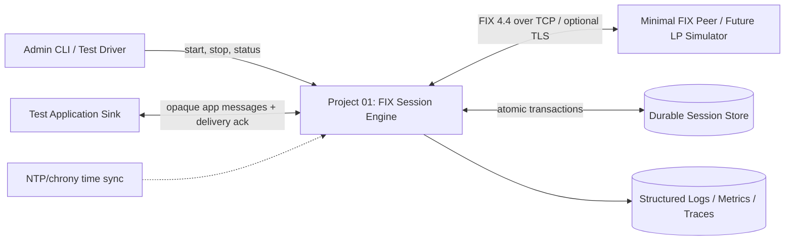
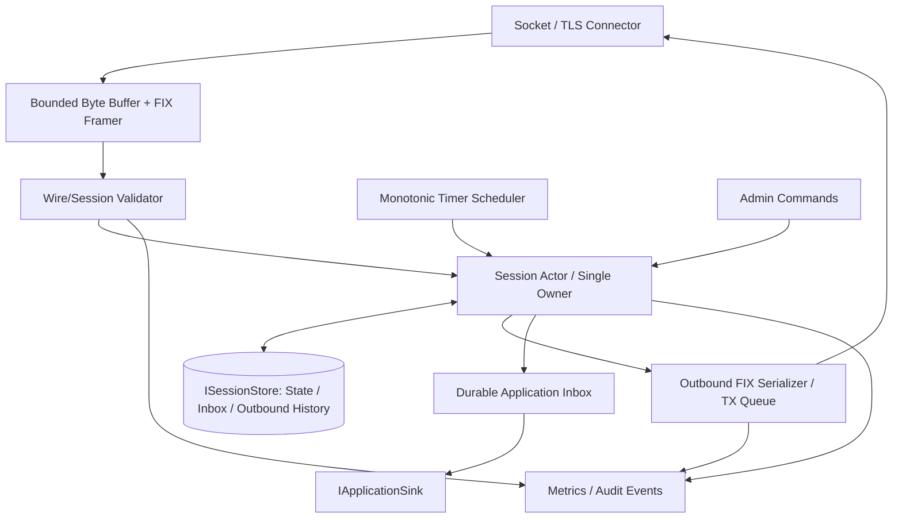
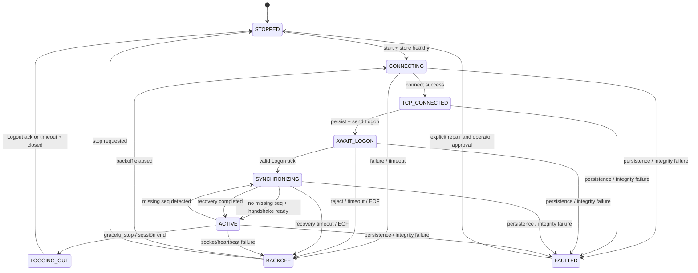
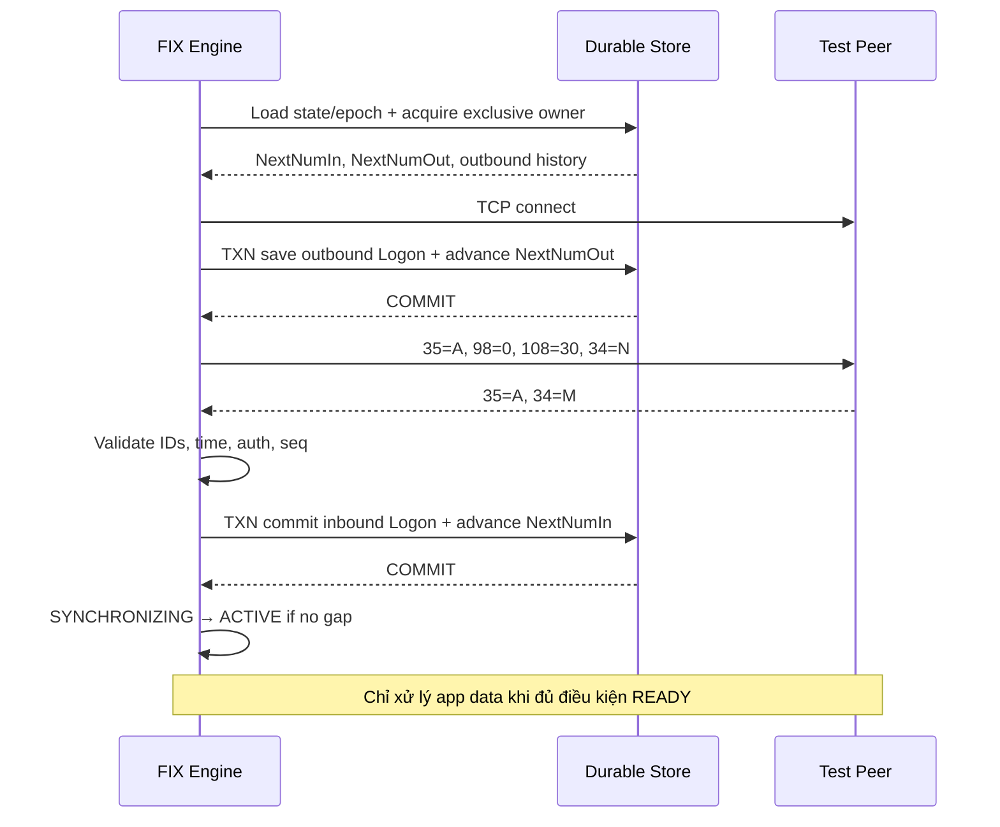
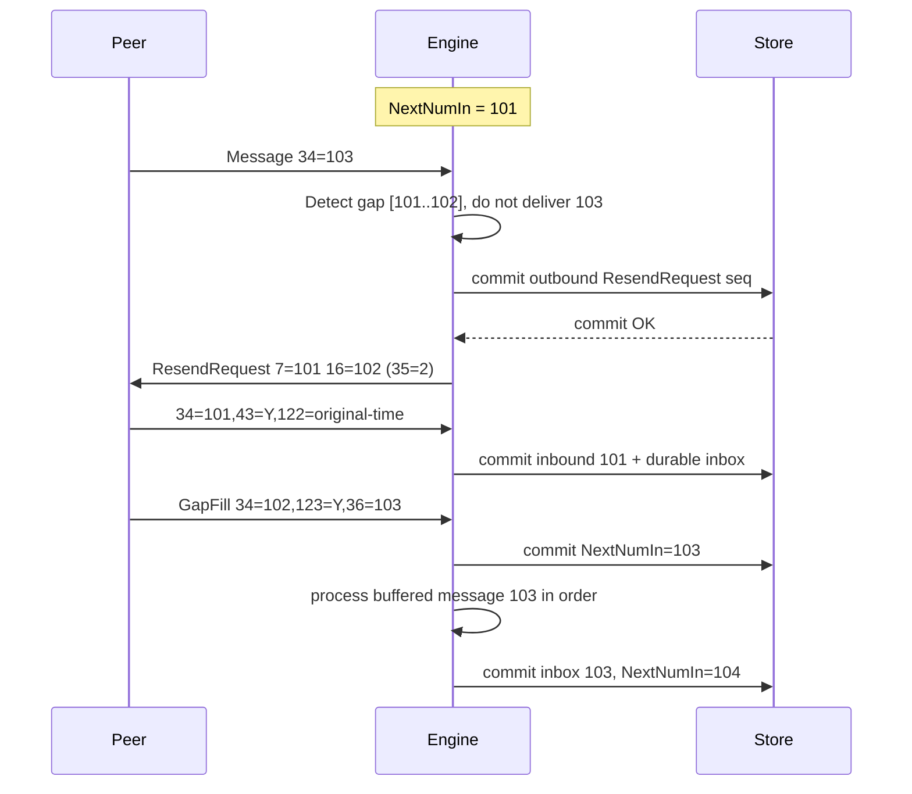
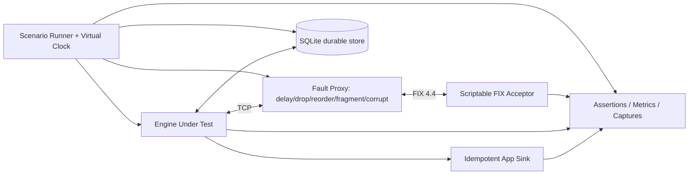

# Project 01 — FIX 4.4 Session Engine

> **System Design · Implementation Blueprint · Threat/Failure Modeling · What-if Test Plan**  
> **Ngôn ngữ triển khai:** C++20 · **Nền tảng:** Linux · **Vai trò FIX:** Initiator · **Phiên bản:** 1.0 · **Trạng thái:** Thiết kế đề xuất, **chưa triển khai/chưa đo kiểm**  
> **Phạm vi:** 01 FIX session tại một thời điểm; thiết kế có đường mở rộng thành nhiều session.

## Mục lục

1. [Mục đích, căn cứ và giới hạn](#1-mục-đích-căn-cứ-và-giới-hạn)
2. [Requirement, SLO và giả định](#2-requirement-slo-và-giả-định)
3. [Ranh giới và context diagram](#3-ranh-giới-và-context-diagram)
4. [Kiến trúc logic và quyền sở hữu state](#4-kiến-trúc-logic-và-quyền-sở-hữu-state)
5. [FIX 4.4 messages, wire format](#5-fix-44-messages-wire-format)
6. [Session state machine](#6-session-state-machine)
7. [Chi tiết các luồng nghiệp vụ](#7-chi-tiết-các-luồng-nghiệp-vụ)
8. [Sequence numbers, resend và GapFill](#8-sequence-numbers-resend-và-gapfill)
9. [Durability, crash consistency và startup recovery](#9-durability-crash-consistency-và-startup-recovery)
10. [Timeout, clock và scheduling](#10-timeout-clock-và-scheduling)
11. [Resource limits, backpressure và security](#11-resource-limits-backpressure-và-security)
12. [C++20 component/API sketch](#12-c20-componentapi-sketch)
13. [Configuration](#13-configuration)
14. [Observability và vận hành](#14-observability-và-vận-hành)
15. [What-if test matrix](#15-what-if-test-matrix)
16. [P0 fault-injection playbooks](#16-p0-fault-injection-playbooks)
17. [Test harness và quy trình chạy](#17-test-harness-và-quy-trình-chạy)
18. [Acceptance criteria và release gates](#18-acceptance-criteria-và-release-gates)
19. [Roadmap triển khai, backlog](#19-roadmap-triển-khai-backlog)
20. [Design decisions, trade-offs, rủi ro còn lại](#20-design-decisions-trade-offs-rủi-ro-còn-lại)
21. [Tài liệu tham chiếu](#21-tài-liệu-tham-chiếu)

---

## 1. Mục đích, căn cứ và giới hạn

### 1.1. Điều CV thực sự mô tả

Dự án lớn **FX/CFD FIX Gateway and Execution Engine** trong CV nêu: sử dụng **C++20, FIX 4.4, PostgreSQL, Linux, Docker**, xây dựng **liquidity-provider adapters** và xử lý **FIX logon / heartbeat / reconnect / sequence persistence / resend / gap-fill**. CV còn mô tả order state machine, pre-trade risk, journaling và tối ưu low-latency, nhưng **các chức năng đó thuộc những mini-project sau**, không được giả định đã có trong Project 01.

### 1.2. Điều tài liệu này tự thiết kế thêm

- Một **FIX 4.4 initiator session engine tự phát triển bằng C++20** để hiểu protocol đến tầng bytes/state machine. Có thể dùng **QuickFIX/C++ làm implementation tham chiếu/đối tác kiểm thử**, không mặc định là source của engine tự xây.
- **Local durable store** (đề xuất **SQLite WAL, `synchronous=FULL` cho baseline correctness**) sau một giao diện `ISessionStore`; **PostgreSQL** là adapter sau này. Việc CV nêu PostgreSQL **không chứng minh** session sequence store ban đầu sử dụng PostgreSQL.
- **Một FIX peer giả lập tối thiểu** phục vụ testing (fixture), **không** xây LP simulator với matching/fills — đó là Project 02.
- **Fail-closed first**: khi không bảo đảm sequence/persistence, ngừng truyền message, báo động, không tự ý reset số thứ tự.

### 1.3. In scope

TCP initiation/reconnection; FIX parser/serializer; Logon/Logout; heartbeat/TestRequest; identity/time validation; expected incoming/outgoing sequence; resend requests; retransmission + GapFill; session recovery; bounded buffering; durable metadata/message store; metrics/traces; deterministic and fault-injection tests.

### 1.4. Out of scope

ExecutionReport business logic, order matching, routing New/Cancel/Replace, exposure, positions, market data pipeline, HA active-active, multi-region, real-money trading, web dashboard. Với application messages, engine chỉ **nhận, bảo toàn thứ tự và chuyển tiếp qua durable inbox** tới `IApplicationSink`; chưa diễn giải business semantics.

### 1.5. Mô hình rủi ro

Đây là hệ thống mô phỏng/nghiên cứu. **Không kết nối tiền thật hoặc production LP** trước khi có security review, interop/certification với counterparty, audit trail, quy trình manual reconciliation và kiểm soát vận hành.

---

## 2. Requirement, SLO và giả định

### 2.1. Functional requirements

| ID | Yêu cầu | Mức | Tiêu chí kiểm tra |
|---|---|---|---|
| FR-01 | Initiate TCP và FIX Logon hợp lệ | MUST | Kết nối + chuyển sang `ACTIVE` sau khi logon được peer xác nhận và đồng bộ |
| FR-02 | Validate FIX framing/required header/comp IDs | MUST | Malformed/unauthorized không tạo side effect ở application |
| FR-03 | Heartbeat khi outbound idle; TestRequest khi inbound idle | MUST | Peer chết bị phát hiện và connection được đóng khi quá hạn |
| FR-04 | Reconnect có backoff + jitter | MUST | Không reconnect storm; giữ session sequence continuity |
| FR-05 | Persist `NextNumIn`, `NextNumOut` và outbound resend history | MUST | Crash/restart không phát lại bằng seq mới/seq cũ tùy tiện |
| FR-06 | Detect high/low incoming `MsgSeqNum(34)` | MUST | High → recovery; low không `43=Y` → logout/disconnect theo chuẩn |
| FR-07 | ResendRequest(35=2), replay, GapFill(35=4,123=Y) | MUST | Không bỏ sót range và không retransmit admin messages bị cấm |
| FR-08 | Duplicate handling (`43=Y`, `122`) | MUST | Không forward lặp app event đã commit |
| FR-09 | Ordered delivery to durable inbox | MUST | Không deliver N+1 trước N; restart vẫn tiếp tục được |
| FR-10 | Graceful Logout, unexpected EOF/reset/timeout | MUST | State/metric/sequence nhất quán |
| FR-11 | Session schedule và reset policy **explicit** | MUST | Không silent reset trên disconnect/logon |
| FR-12 | Observability, test harness và fault injection | MUST | Có audit/test artifact, có alert cho critical failures |
| FR-13 | Multi-session/HA | LATER | Không thuộc v1; ghi rõ vùng rủi ro |

### 2.2. Safety invariants — không được vi phạm

1. **I-01** — Tại mỗi thời điểm chỉ **một owner** được thay đổi một FIX session state. Không có hai active writers cho cùng session identity.
2. **I-02** — `NextNumIn` và `NextNumOut` **không giảm** trong một `session epoch`; reset chỉ bằng quy trình được đồng ý, có kiểm toán.
3. **I-03** — Không có **application delivery** cho message chưa qua validation/framing, auth/session identity, sequencing và durable commit.
4. **I-04** — Application messages được deliver theo thứ tự `MsgSeqNum(34)`; duplicate cùng sequence/epoch không tạo **bản ghi inbox mới**.
5. **I-05** — Không dùng sequence number lần thứ hai cho **original outbound** trong cùng epoch. Retransmission dùng **cùng original sequence**, `43=Y`, `122=original SendingTime`, và kiểm tra checksum/length mới.
6. **I-06** — Nếu không thể commit `outbound(seq, payload, next_out)` theo transaction, **không viết message đó ra socket**.
7. **I-07** — Nếu không thể commit `inbound(seq, inbox record, next_in)` theo transaction, **không xác nhận message đó là processed**; chuyển sang `FAULTED`/đóng connection nếu không thể phục hồi an toàn.
8. **I-08** — Không âm thầm GapFill qua **application message quan trọng**; phải theo policy đã chấp thuận cùng peer, nếu không → quarantine/manual reconciliation.
9. **I-09** — Mọi queue và buffer đều có hard cap; vượt cap phải có hành vi xác định, **không OOM vô hạn**.
10. **I-10** — `ACTIVE` chỉ khi hoàn tất Logon và đồng bộ session; `TCP_CONNECTED != FIX_READY`.
11. **I-11** — Không coi FIX session recovery đồng nghĩa application-level exactly-once; business consumer phải idempotent theo semantic key.
12. **I-12** — Không tự động đổi/reset session state chỉ vì khởi động lại tiến trình, đổi hostname, đổi ngày hoặc nhận sequence mismatch.

### 2.3. Non-functional targets — **giả định thiết kế**, không phải số đo trong CV

| Mục | Target cho lab | Cách hiểu |
|---|---|---|
| Durability | 0 lần rollback sequence trong toàn bộ crash test | Sau restart, kiểm tra `I-02`, `I-05` |
| Correctness | 100% test P0 pass; không có duplicate inbox entry | Điều kiện release, không phải bảo đảm tuyệt đối ngoài test |
| Detection | Silent peer được phát hiện trong timeout đã cấu hình | Phụ thuộc heartbeat/liveness policy |
| Memory | RSS plateau dưới giới hạn cấu hình (gợi ý lab 128 MiB/session) | Cần đo với sanitizer/heap profiler |
| File descriptors | Không tăng liên tục qua ≥10.000 reconnect cycles | So sánh FD baseline với cuối test |
| Throughput | Đo 1k / 10k / 50k messages/s | Chỉ benchmark; không cam kết mức production |
| Latency | Báo cáo p50/p95/p99 `bytes received → durable inbox committed` | **Khác** p99 receive-to-route 95µs của dự án lớn |
| Restart | Restart + reconnect + sync hoàn tất trong target do test environment quy định | Không hứa một số cố định cho mọi mạng/peer |

### 2.4. Assumptions phải xác nhận khi có counterparty thật

`SenderCompID/TargetCompID`, lịch reset (daily/weekly/nonstop), `HeartBtInt`, IP/port, TLS/mTLS/VPN, credentials trong Logon, SendingTime tolerance, time zone, max frame size, resend policy (end=0 hay range), application message replay policy, clock/DR procedure, session ownership/failover, các custom fields (Rules of Engagement). **FIX 4.4 không tự quyết mọi chính sách bilateral.**

---

## 3. Ranh giới và context diagram



**Data plane:** bytes ↔ FIX framing ↔ session protocol.  
**Control plane:** settings, start/stop, reset approval, monitoring.  
**Trust boundary:** peer TCP không tin cậy; FIX bytes luôn phải được validate trước khi tác động state.

---

## 4. Kiến trúc logic và quyền sở hữu state



### 4.1. Components và trách nhiệm

| Component | Trách nhiệm | Không được làm |
|---|---|---|
| `TcpConnector` | DNS/resolve, connect, EOF, timeout, reconnect policy, non-blocking I/O | Không tự cấp sequence number |
| `FixFramer` | Phân đoạn TCP stream thành FIX frames, kiểm kích thước, `8/9/10` | Không suy luận 1 `recv()` = 1 message |
| `FixCodec` | Parse fields, validate BodyLength/Checksum, serialize SOH `0x01` | Không log plaintext secret |
| `SessionActor` | State machine, `NextNumIn/Out`, timers, decisions, one writer | Không block chờ network/DB ngay trong hot read loop vô hạn |
| `SessionStore` | Transactional persistence: state, outbound history, inbound inbox, epoch | Không tự reset state khi mở DB |
| `ResendPlanner` | Tạo sorted resend sequence và coalesce GapFill | Không replay Logon/Heartbeat/... như original |
| `AppInboxDispatcher` | Deliver FIFO tới app sink và retry, idempotent record key | Không tự cho rằng FIX seq đủ cho business dedup xuyên epoch |
| `Metrics/Audit` | Emit state transitions, counters, durability faults | Không chặn session vô hạn vì metrics exporter chậm |

### 4.2. Concurrency model

- v1 sử dụng **1 session actor** (single owner) với event loop; I/O completions và timers đưa vào **bounded event queue**.
- Mọi tác vụ chỉnh `NextNumIn/Out`, trạng thái liveness/recovery, outbound serialization đều được **serialized** bởi actor.
- DB I/O có thể chạy trên worker, nhưng worker chỉ trả kết quả `CommitSucceeded/Failed`; **actor không gửi tới peer trước commit thành công**.
- Socket partial writes phải giữ **thứ tự byte/message**; không cho 2 thread cùng `write()` không phối hợp.
- Lần reconnect mới có `connection_generation_id`: callback từ socket cũ không được cập nhật kết nối mới.

**Tại sao không lock-free ngay?** Mục tiêu Project 01 là protocol correctness. Lock-free queues, pool tuning và CPU affinity sẽ được tối ưu có đo lường tại Project 07.

---

## 5. FIX 4.4 messages, wire format

### 5.1. Các FIX session messages bắt buộc cho v1

| MsgType / tag 35 | Tên | Các tag liên quan | Ý nghĩa |
|---|---|---|---|
| `A` | Logon | `98`, `108`, optional `141`, `553/554` nếu peer yêu cầu | Bắt đầu/auth session |
| `0` | Heartbeat | `112` nếu phản hồi TestRequest | Keepalive |
| `1` | TestRequest | `112` | Chủ động kiểm tra peer |
| `2` | ResendRequest | `7`, `16` | Yêu cầu retransmit range |
| `3` | Reject | `45`, `371/372/373`, `58` | Session-level validation errors |
| `4` | SequenceReset | `123`, `36` | GapFill/Reset |
| `5` | Logout | `58` | Graceful termination / error |

`35=D/F/G/8` **không được triển khai logic nghiệp vụ trong Project 01**; khi test có thể gửi payload app giả lập qua inbox để xác minh ordering/retransmit policy.

### 5.2. Frame/field rules

- Raw delimiter là byte **SOH = `0x01`**, không phải ký tự `|` (chỉ dùng `|` khi in ví dụ).
- `8=FIX.4.4` là field đầu; `9=BodyLength` là field thứ hai; `35=MsgType` là field thứ ba; `10=CheckSum` là field cuối.
- `BodyLength(9)` tính số **bytes** từ ngay sau delimiter của tag `9` đến và **bao gồm** delimiter ngay trước tag `10`.
- `CheckSum(10)` là checksum 3 chữ số của tổng byte trước `10=` **modulo 256**.
- Không parse dựa trên newline/`recv()`; TCP có fragmentation và coalescing.
- Các tags trọng tâm: `34` seq, `49/56` session IDs, `52` SendingTime UTC, `43` PossDupFlag, `122` OrigSendingTime, `141` reset policy, `108` HB interval.
- Strict decode: numeric overflow, malformed ASCII/token/tag value, duplicate required fields, missing tag và vượt max frame đều là lỗi cần xử lý có giới hạn.

Ví dụ **minh họa cú pháp** (ký tự `|` tượng trưng SOH; `9` và `10` dưới đây chỉ là placeholder, **không được dùng làm wire packet thật**):

```text
8=FIX.4.4|9=<CALCULATED>|35=A|49=CLIENT|56=SIMLP|34=1|52=20261030-05:00:00.000|98=0|108=30|10=<CALCULATED>|
```

**Test requirement:** Serializer phải tự tính `BodyLength`/`CheckSum`; unit tests dùng known-good binary fixtures với byte `0x01` thật, không so chuỗi placeholder.

---

## 6. Session state machine



**Phân biệt:**

- `ACTIVE`: đồng bộ đủ để xử lý app messages.
- `SYNCHRONIZING`: có gap hoặc recovery chưa kết thúc; **không** chuyển app data đến business consumer ngoài thứ tự.
- `BACKOFF`: lỗi transport/logon recoverable; **không reset session epoch/seq**.
- `FAULTED`: integrity/storage/split-brain/corrupt state hoặc policy breach; **không auto-retry vô hạn với state không tin cậy**.

State diagram là kiến trúc ứng dụng; tiêu chí phản hồi từng MsgType khi `seq high` phải triển khai theo bảng FIX Session Layer về **special handling for session messages**, không áp dụng quy tắc buffer chung một cách mù quáng.

---

## 7. Chi tiết các luồng nghiệp vụ

### 7.1. Happy path: connect / Logon / active



**Lưu ý:** Một số peer có cơ chế logon/resynchronization riêng, cần test bằng Rules of Engagement. **Không cho gửi app messages chỉ vì TCP connect thành công.**

### 7.2. Heartbeat / liveness

```mermaid
sequenceDiagram
    participant E as Engine
    participant P as Peer
    Note over E,P: HeartBtInt = H, timer monotonic
    E->>P: Heartbeat(35=0) if no outbound activity for H
    Note over E: No valid inbound for configured threshold
    E->>P: TestRequest(35=1,112=unique-id)
    P-->>E: Heartbeat(35=0,112=same-id)
    E->>E: clear outstanding test request
    Note over E: If no valid matched response before deadline
    E--xP: close socket; enter BACKOFF
```

**Định nghĩa liveness:** TCP connected **không** chứng minh peer FIX processing còn sống. Heartbeat thông thường không thay thế vô điều kiện cho yêu cầu trả lời đúng `TestReqID` đang pending.

### 7.3. Sequence gap & retransmission



Nếu message 103 là session-level type có quy tắc đặc biệt, **phải áp dụng nhánh spec tương ứng**, không chỉ buffer máy móc.

### 7.4. Graceful Logout

1. Dừng nhận yêu cầu app outbound mới; drain hoặc reject queue theo policy.
2. Persist/send Logout(35=5) với original sequence number mới; timer chờ Logout ack.
3. Nếu có gap trong Logout response, xử lý theo spec và hoàn thành recovery khi có thể; không đóng sớm gây mất đồng bộ.
4. Nhận ack hoặc hết hạn → đóng socket; **không reset seq** chỉ vì logout (reset theo session schedule đã thỏa thuận).

### 7.5. Reconnect

1. Socket EOF/RST/heartbeat timeout → đánh dấu unavailable, vô hiệu hóa `connection_generation_id` cũ.
2. Load/confirm state, không tự `NextIn/NextOut=1`.
3. Backoff exponential + jitter + circuit breaker cho lỗi cấu hình/credentials, phân biệt transient và permanent.
4. Reopen transport, Logon bằng **outgoing sequence tiếp theo**, xử lý peer logon high/low theo tiêu chuẩn/Rules of Engagement, recovery theo ResendRequest.
5. Chỉ giải phóng app flow sau synchronized.

---

## 8. Sequence numbers, resend và GapFill

### 8.1. State definitions

- `NextNumIn`: **số thứ tự incoming tiếp theo** kỳ vọng từ peer.
- `NextNumOut`: **số thứ tự original outgoing tiếp theo** sẽ sử dụng.
- Mỗi hướng tăng độc lập; bắt đầu từ 1 khi session epoch mới được hai bên thống nhất.
- Kết nối TCP có thể tạo/đóng nhiều lần trong **cùng một FIX session epoch**; disconnect ≠ reset.

### 8.2. Inbound decision table (mức thiết kế)

| Điều kiện | Xử lý | Không làm |
|---|---|---|
| `seq == NextNumIn` & valid | Transaction commit inbound, update `NextNumIn`, deliver qua durable inbox; drain buffer theo thứ tự | Không forward trước commit |
| `seq > NextNumIn` | Detect gap; request resend; giữ/bỏ message theo bounded recovery strategy và **special rule của MsgType** | Không cho app event seq cao vượt trước |
| `seq < NextNumIn` & `43=Y` | Đã xử lý → ignore duplicate; validate `122` khi cần, audit | Không double-deliver |
| `seq < NextNumIn` & `43!=Y` | Logout(reason seq too low) rồi close, theo chuẩn | Không tự set `NextNumIn=seq+1` |
| `SequenceReset` `123=Y` | Validate allowed gap range, `36=NewSeqNo` phải forward-only; advance expected tới `NewSeqNo` khi hợp lệ | Không cho rewind hoặc skip app bất hợp lệ |
| `SequenceReset` reset `123=N` | Xử lý theo FIX spec **và** bilateral policy/authorization; alert/reconcile | Không tự chấp nhận reset bất ngờ mà không đánh giá rủi ro |

**Ngoại lệ quan trọng:** Incoming **Logon, Logout, ResendRequest và SequenceReset** có quy tắc recovery riêng khi `MsgSeqNum` cao; tham chiếu [FIX Session Layer §4.8.8](#21-tài-liệu-tham-chiếu).

### 8.3. ResendRequest semantics

- `35=2`, `7=BeginSeqNo`, `16=EndSeqNo`; `EndSeqNo=0` là mở đến các message sau đó (tùy agreement; phổ biến trong chuẩn).
- Trả lời `ResendRequest` bằng **retransmitted application messages** hoặc `SequenceReset-GapFill` cho đoạn được phép skip.
- Retransmission giữ **original seq**, đặt `43=Y`; `52` là SendingTime mới, `122` là SendingTime gốc; tính lại `9`/`10`.
- **Không retransmit trực tiếp** `Logon`, `Logout`, `ResendRequest`, `Heartbeat`, `TestRequest`, `SequenceReset`; dùng GapFill. `Reject` có quy tắc riêng (có thể retransmit theo chuẩn).
- Coalesce nhiều admin messages liên tục thành một GapFill `34=first_skipped,36=last_skipped+1`, nhưng **không gap-fill qua required app messages**.
- Khi không còn outbound history cần thiết, **không nói dối rằng đã replay thành công**; fail closed/escalate và xử lý theo agreement.

### 8.4. Những thứ dễ nhầm

- **TCP retransmission ≠ FIX ResendRequest**: TCP che lỗi packet khi còn một kết nối hoạt động; FIX khôi phục message continuity qua nhiều connection.
- **FIX retransmission (`43=Y`, original `34`) ≠ app-level resend (`97=Y`, sequence mới)**. Project 01 không tự làm app-level resend của order.
- **GapFill không chứng minh business event đã được recover**. Nếu một ExecutionReport bị skip, order state ở mini-project khác vẫn phải reconcile.
- **Không mặc định `ResetOnLogon=Y`**: dễ che mất sequence gap và khiến reconciliation không đáng tin.

---

## 9. Durability, crash consistency và startup recovery

### 9.1. Storage schema (đề xuất, không phải schema công ty)

```text
session_state(
  session_id PK, epoch, next_in, next_out,
  last_good_connection_generation, version, updated_at_utc,
  integrity_checksum
)
outbound_history(
  session_id, epoch, seq, msg_type,
  canonical_payload, original_sending_time,
  created_at_utc, tx_state,
  PRIMARY KEY(session_id, epoch, seq)
)
inbound_inbox(
  session_id, epoch, seq, msg_type,
  canonical_payload, delivery_state, created_at_utc,
  PRIMARY KEY(session_id, epoch, seq)
)
recovery_audit(
  event_id PK, session_id, epoch, event_type,
  seq_from, seq_to, reason, created_at_utc
)
```

- `epoch` chỉ thay đổi khi tiến hành **coordinated reset**. Idempotency key `(session_id, epoch, seq)` dành cho session layer, **không** thay thế business idempotency key.
- Dùng unique/primary keys để chặn duplicate record; transaction commit state cùng message archive.
- SQLite WAL + `synchronous=FULL` cho baseline; bật integrity-check khi khởi động, kiểm tra lỗi disk/permission. Với PostgreSQL adapter, cần transaction isolation/unique constraints tương đương.
- Retention phải đủ phục vụ resend windows đã cam kết; không xóa history chưa qua đủ chính sách hoặc có open recovery request.

### 9.2. Outbound exactly-once illusion — các cửa sổ crash

```mermaid
sequenceDiagram
    participant A as SessionActor
    participant D as DurableStore
    participant W as Socket
    A->>D: TXN insert history(seq=N) + next_out=N+1
    alt commit failed
      D-->>A: failure
      A->>A: FAULTED; never send N
    else committed
      D-->>A: COMMIT
      A->>W: write serialized message N
      alt process crashes before/during write
        Note over A,W: Peer may have 0 bytes, partial bytes or full frame
        Note over A,D: Restart: same stored seq N; reconcile via peer/session resend
      else write returns success
        Note over A,W: Still NOT proof peer processed message N
      end
    end
```

**Guarantee có thể đạt:** không reuse seq sai, có lịch sử để peer yêu cầu replay (khi policy cho phép). **Không thể cam kết exactly-once business execution** chỉ vì `send()` thành công. Đây là lý do dự án Order Routing cần idempotent IDs/reconciliation riêng.

### 9.3. Inbound atomicity

`decode + validate + seq check → TXN(insert inbox if app, update NextNumIn, audit) → commit → async deliver`. Nếu chết sau commit nhưng trước deliver, restart dispatch từ durable inbox; nếu chết sau deliver trước khi đánh dấu `delivered`, sink có thể nhận lại → sink phải idempotent.

### 9.4. Restart algorithm

1. Acquire exclusive ownership lock; nếu bị giữ bởi process khác → **không khởi động writer thứ hai**.
2. Open store, integrity check, schema version check, xác minh session identity/epoch và bất biến `next_* >= 1`.
3. Scan outbound/inbound pending and log incomplete operations; reconstruct in-memory index trong giới hạn.
4. Không giả định TX socket state tồn tại sau crash; reconnect và **protocol resynchronization**.
5. Rebuild pending inbox dispatch; không để app inbox gây cản trở session sequencing ngoài bounded policy.
6. Nếu store corrupt, seq conflict, rollback/snapshot restore không được đồng bộ → `FAULTED`, operator investigation.

### 9.5. Failure classification

| Loại | Ví dụ | Hành động mặc định |
|---|---|---|
| Transient transport | DNS timeout, TCP reset, server restart | `BACKOFF`, retry bounded, giữ seq |
| Peer protocol recoverable | Gap, resend, valid delayed message | `SYNCHRONIZING`, recover |
| Peer contract failure | Sai CompID, wrong FIX version, inconsistent reset | Logout/close, alert và khóa reconnect khi thích hợp |
| Local resource | Disk full, DB lock timeout, memory queue hard cap | Fail closed, metrics + alert; không silently drop app |
| State integrity | Corrupt WAL, sequence rollback, split brain | `FAULTED`, manual repair/peer coordination |

---

## 10. Timeout, clock và scheduling

- `HeartbeatInt` giả định lab: **30 giây**, phải nằm trong chính sách mà peer chấp thuận.
- Đo timeout bằng `steady_clock`/monotonic time; `SendingTime(52)` dùng UTC synchronized wall-clock.
- Gợi ý policy lab: nếu không có **valid inbound FIX frame** trong `H`, phát `TestRequest`; chờ **matched TestReqID** tối đa `max(H, configured_test_timeout)`; khi vượt → close/reconnect. Thời hạn và chính sách reset timer được cấu hình và benchmark, tránh cả false positives lẫn phát hiện quá chậm.
- Outbound idle ≥ `H` → Heartbeat; outbound app/admin hợp lệ có thể thay keepalive.
- Timer xử lý starvation: timers có priority hợp lý, nhưng không vượt qua durable ordering.
- `SendingTime` lệch quá tolerance (lab đề xuất ±120 giây, **không phải bắt buộc của mọi counterparty**) → reject/logout tùy Rules of Engagement.
- Session start/end/scheduled reset phải dùng timezone rõ ràng, xử lý DST, weekends, clock jumps, leap seconds/format precision, restart đúng thời điểm cutover; nếu policy chưa thỏa thuận, **disable auto reset**.

---

## 11. Resource limits, backpressure và security

### 11.1. Guardrails ban đầu (configurable lab defaults)

| Tài nguyên | Giới hạn gợi ý | Khi vượt |
|---|---|---|
| Maximum FIX frame | `64 KiB` | Reject protocol/close; không allocate theo untrusted `9` vô hạn |
| Socket receive buffer | `128 KiB` | Stop read/backpressure; nếu peer không hồi phục → disconnect |
| Out-of-order replay buffer | `256 messages`, tổng `1 MiB` | Chuyển sang mode không buffer tương lai; yêu cầu replay từ first missing hoặc close/resync |
| Event queue | `4,096 events` | Throttle producers, không drop seq-bearing messages |
| Application inbox pending | `10,000 messages` | Stop accepting outbound app work, isolate slow sink; cap chặt, có alert |
| Resend chunk | `1,000 seq numbers/request` | Chia range theo RoE để tránh peer overload |
| Reconnect backoff | 1s → 60s, jitter ±20% | Circuit-breaker cho persistent auth/config failures |
| Max manual retries | Theo runbook, không infinite busy loop | Quarantine/alert khi vượt |

**Các giá trị trên là starting points**, phải thử với kích thước FIX message, disk throughput, counterparty policy thật và fault injection; không lấy chúng làm protocol requirements.

### 11.2. Security requirements

- Prefer VPN/TLS hoặc mTLS theo counterparty; FIX 4.4 over plain TCP tự nó **không mã hóa** traffic.
- Với Logon credentials, lấy từ secret store/env được bảo vệ, **không** commit vào Git; redaction `553/554` và custom secret tags trong logs, traces, crash dump.
- Chặn peer không tin cậy bằng allowlist/mTLS + CompID validation; **CompID một mình không phải xác thực mạnh**.
- Chống oversized frame, integer overflow, malformed tag flood, slowloris, replay storms, loop resend, unbounded disk growth.
- Expose admin/metrics chỉ trên restricted interface; admin reset cần dual control/audit, không default button reset.
- Sanitizers (ASan/UBSan/TSan), libFuzzer/AFL++ cho parser, dependency scanning, drop privileges, container filesystem permissions.

---

## 12. C++20 component/API sketch

```cpp
using SessionId = std::string;
using SeqNum = std::uint64_t;

enum class SessionState {
    Stopped, Connecting, TcpConnected, AwaitLogon,
    Synchronizing, Active, LoggingOut, Backoff, Faulted
};

struct SessionKey {
    std::string begin_string{"FIX.4.4"};
    std::string sender_comp_id;
    std::string target_comp_id;
    std::string qualifier;
};

struct PersistedSessionState {
    std::uint64_t epoch;
    SeqNum next_in;
    SeqNum next_out;
};

struct FixEnvelope {
    SeqNum seq;
    char msg_type; // real implementation supports full MsgType string
    bool poss_dup;
    std::vector<std::byte> raw;
};

class ISessionStore {
public:
    virtual ~ISessionStore() = default;
    // Must be atomic: original message history + next_out update.
    virtual bool commit_outbound(const SessionKey&, std::uint64_t epoch,
                                 const FixEnvelope&, SeqNum next_out) = 0;
    // Must be atomic: durable inbox (if app) + next_in update.
    virtual bool commit_inbound(const SessionKey&, std::uint64_t epoch,
                                const FixEnvelope&, SeqNum next_in) = 0;
};

class SessionEngine {
public:
    void on_connected(std::uint64_t connection_generation);
    void on_bytes(std::span<const std::byte> bytes,
                  std::uint64_t connection_generation);
    void on_timer(std::chrono::steady_clock::time_point now);
    void on_disconnect(std::uint64_t connection_generation);
    void request_graceful_stop();
};
```

**Đây là interface sketch, chưa phải code chạy được.** Production implementation cần error type rõ ràng, async durability completions, complete FIX fields/types, secure memory, multi-buffer parsing, cancellation, metrics và testability.

### 12.1. File layout

```text
fix-session-engine/
├── CMakeLists.txt
├── README.md
├── docs/FIX_Session_Engine_System_Design.md
├── config/session.example.toml
├── include/fix/{framer,codec,session_actor,store,resend_planner}.hpp
├── src/{framer,codec,session_actor,sqlite_store,resend_planner}.cpp
├── apps/{fix_client,fix_test_acceptor,fix_admin_cli}/
├── tests/{unit,protocol,scenario,crash,fuzz,benchmark}/
├── fixtures/{valid,invalid,gap,retransmission}/
├── scripts/{run_lab,inject_fault,run_matrix,collect_metrics}/
└── .github/workflows/ci.yml
```

### 12.2. Interface với mini-project khác

`SessionEngine` xuất `SessionEvent` (connection state, recovered gap, fault) và `AppMessageEnvelope` được durable commit; nhận `SendAppMessage` **chỉ khi ACTIVE** và chính sách resend được khai báo bởi app. Project 03/04 mới chịu trách nhiệm order lifecycle/order routing. Không để Order State Machine trực tiếp sửa `NextNumIn/Out`.

---

## 13. Configuration

```toml
# CONFIG EXAMPLE ONLY — adjust to actual counterparty agreement
[session]
begin_string = "FIX.4.4"
sender_comp_id = "CLIENT_SIM"
target_comp_id = "LP_SIM"
qualifier = "DEV"
heartbeat_seconds = 30
allow_reset_on_logon = false
allow_reset_on_disconnect = false
allow_unsolicited_seq_reset = false
sending_time_tolerance_seconds = 120
session_schedule = "24x7-lab"  # NOT a bilateral production contract

[network]
host = "127.0.0.1"
port = 9878
connect_timeout_ms = 3000
reconnect_initial_ms = 1000
reconnect_max_ms = 60000
reconnect_jitter_percent = 20
max_frame_bytes = 65536
max_read_buffer_bytes = 131072

[recovery]
max_future_messages = 256
max_future_bytes = 1048576
resend_chunk_size = 1000
allow_gapfill_application_messages = false
resend_mode = "bounded_range" # may switch to end=0 per peer agreement

[persistence]
backend = "sqlite"
database_path = "./state/session.db"
sqlite_journal_mode = "WAL"
sqlite_synchronous = "FULL"

[security]
tls_enabled = false  # local-only test; production requires reviewed transport
redact_secret_fields = true
```

**Config validation at startup:** reject blank CompIDs, invalid message/queue caps, non-positive heartbeat, max < initial backoff, inconsistent TLS config, unsafe storage directory, missing secret, duplicate session instance, unsupported reset schedule; do not silently use unsafe defaults.

---

## 14. Observability và vận hành

### 14.1. Metrics

- **State/health:** `fix_session_state`, `fix_connected`, `fix_logon_attempts_total`, `fix_logon_rejects_total`, `fix_reconnects_total`, `fix_time_in_synchronizing_seconds`.
- **Sequence:** `fix_next_in`, `fix_next_out`, `fix_gap_detected_total`, `fix_resend_requests_sent_total`, `fix_resend_messages_total`, `fix_gapfill_ranges_total`, `fix_duplicate_inbound_total`, `fix_unresolved_gaps`.
- **Timer:** `fix_heartbeat_sent_total`, `fix_test_requests_total`, `fix_test_request_timeouts_total`, `fix_rx_idle_seconds`, `fix_tx_idle_seconds`.
- **Durability:** `fix_store_commit_latency_seconds`, `fix_store_errors_total`, `fix_unflushed_transactions`, `fix_inbox_pending_messages`, `fix_outbound_history_bytes`.
- **Resource/performance:** `fix_rx_buffer_bytes`, `fix_recovery_buffer_messages`, `fix_event_queue_depth`, `fix_frame_parse_latency_seconds`, `fix_inbound_commit_latency_seconds`, `fix_process_rss_bytes`.

### 14.2. Structured audit fields

`timestamp_utc`, `monotonic_elapsed`, `session_id`, `epoch`, `connection_generation`, `state_from`, `state_to`, `msg_type`, `msg_seq_num`, `next_in`, `next_out`, `gap_begin/end`, `trace_id`, `error_code`, `policy_decision`; **không log password hay toàn bộ raw FIX message có secret**.

### 14.3. Alerts & runbooks

| Alert | Dấu hiệu | Hành động |
|---|---|---|
| `SESSION_FAULTED` | Integrity/storage/owner failure | Stop sending, page on-call, preserve store/logs |
| `SEQ_DIVERGENCE` | Persistent high/low seq, repeated resend loop | Quarantine, compare counterpart logs, no blind reset |
| `LIVENESS_LOST` | TestRequest timed out | Reconnect with backoff, investigate network/peer |
| `STORAGE_NEAR_FULL` | DB/disk quota high | Expand storage/retention plan, do not purge replay history blindly |
| `REPLAY_BACKLOG` | Pending > threshold/time | Pause app routing, rate-limit, investigate missing seq |
| `AUTH_REJECT_STORM` | Repeated bad Logon | Circuit breaker, validate secrets/allowlist |

---

## 15. What-if test matrix

### 15.1. Cách sử dụng

- **P0 / Release-blocking:** nếu fail, engine **không được** quảng bá là safe. **P1:** test trước khi diễn tập end-to-end / chuẩn bị staging. **P2:** hardening và khả năng tương thích mở rộng.
- Cột **Expected** diễn giải hành vi an toàn mong muốn, **không** phải kết quả đã quan sát. Cột **How to inject** mô tả cách tái hiện tự động.
- Mỗi scenario cần chạy với deterministic `seed`, initial `epoch/NextIn/NextOut`, xác định expected outbound FIX frames, expected DB state và metrics.
- Mọi P0 phải assert **I-01...I-12**, quét file descriptor, memory bounds và lưu log/test artifact.
- Không có danh sách hữu hạn nào bao trùm toàn bộ thứ tự xen kẽ sự kiện, thay đổi thời gian hoặc lỗi phần cứng; kết hợp matrix này với **property-based tests, fuzzing, state-machine model checking và fault injection ở các atomicity boundaries**.

### 15.2. A — Network / connection lifecycle

| Test ID | What if? | Expected behavior / pass oracle | How to inject | Priority |
|---|---|---|---|---|
| `A-01` | DNS trả NXDOMAIN | Backoff; không cấp seq/sent message | Resolver stub trả NXDOMAIN | P1 |
| `A-02` | DNS timeout rồi thành công | Retry có jitter; connect 1 lần active | Resolver stub timeout 3 lần | P1 |
| `A-03` | IP resolve đổi sau reconnect | Dùng endpoint mới, giữ session seq | DNS record rotate | P1 |
| `A-04` | Port bị từ chối (ECONNREFUSED) | Backoff; không busy-loop | Peer tắt listener | **P0** |
| `A-05` | SYN timeout/blackhole | Hết connect deadline, không treo | DROP SYN bằng firewall | **P0** |
| `A-06` | Connect thành công nhưng peer im lặng | Logon timeout → close/backoff | Acceptor không trả Logon | **P0** |
| `A-07` | Peer gửi FIN trước Logon | Đóng và retry, không chuyển ACTIVE | Inject EOF sau connect | **P0** |
| `A-08` | Peer gửi FIN khi ACTIVE | Mark disconnected, giữ state | Inject EOF giữa session | **P0** |
| `A-09` | Peer gửi RST ngay giữa frame | Discard incomplete frame; reconcile after restart | RST sau N bytes | **P0** |
| `A-10` | Network partition nhưng TCP socket vẫn báo connected | TestRequest timeout phát hiện | DROP all packets 2 chiều | **P0** |
| `A-11` | Peer đứt mạng một chiều | Liveness/recovery hoạt động, không giả READY | DROP ingress hoặc egress | **P0** |
| `A-12` | Mạng flap 1000 lần | Backoff + 1 owner + không FD leak | Toggle interface/socket | P1 |
| `A-13` | Socket write() partial | TX loop viết tiếp đúng bytes, đúng thứ tự | send-cap 1–7 bytes/call | **P0** |
| `A-14` | Socket trả EAGAIN/EINTR | Retry đúng kiểu, không duplicate frame | Wrapped syscall faults | **P0** |
| `A-15` | Reconnect trước khi callback socket cũ về | Ignore stale generation callbacks | Delay old completion | **P0** |
| `A-16` | Stop command trong CONNECTING | Hủy connect sạch; store nhất quán | Signal graceful stop giữa connect | P1 |
| `A-17` | Hết ephemeral ports hoặc quá nhiều sockets | Circuit backoff, không OOM | uLimit/namespace stress | P1 |
| `A-18` | Có hai địa chỉ IPv4/IPv6 nhưng một cái chết | Fallback theo connect policy | Resolver trả 2 addresses | P2 |
| `A-19` | TLS handshake timeout/fail (nếu bật) | Không phát plaintext FIX; backoff/circuit | Invalid cert/TLS blackhole | **P0** |

### 15.3. B — Framing / codec / input validation

| Test ID | What if? | Expected behavior / pass oracle | How to inject | Priority |
|---|---|---|---|---|
| `B-01` | Một FIX message cắt qua 100 recv() | Ghép đúng 1 frame | Fragment random 1..N bytes | **P0** |
| `B-02` | 100 FIX messages trong 1 recv() | Parse đủ 100, không ghép nhầm | Batch 100 frames | **P0** |
| `B-03` | Recv kết thúc đúng giữa 8=/9=/10= | Không parse sớm, buffer bounded | Split at each byte offset | **P0** |
| `B-04` | BodyLength(9) nhỏ hơn số byte thực | Reject/close theo policy; không lệch sync | Mutate 9 = real-1 | **P0** |
| `B-05` | BodyLength(9) lớn hơn thực rồi EOF | Không treo, timeout/free partial | Mutate 9 = real+100 | **P0** |
| `B-06` | BodyLength âm, rỗng, ký tự chữ | Reject trước allocate | Inject -1/abc/empty | **P0** |
| `B-07` | BodyLength overflow 64-bit | Không integer overflow/OOM | Inject 999...999 | **P0** |
| `B-08` | BodyLength vượt max_frame | Early reject, RSS bounded | Inject 9=100000000 | **P0** |
| `B-09` | CheckSum(10) sai | Không side effect state/app | Flip random byte | **P0** |
| `B-10` | Checksum không đủ đúng 3 chữ số | Reject malformed | 10=2 / 10=1234 | P1 |
| `B-11` | Tag 10 xuất hiện giữa payload | Chỉ kết thúc tại computed frame boundary | Data field chứa 10= | **P0** |
| `B-12` | Header thiếu 8 hoặc 9 | Reject malformed | Delete first/second tag | **P0** |
| `B-13` | Tag 35 không nằm vị trí thứ ba | Reject hoặc xử lý theo strict profile | Swap header fields | P1 |
| `B-14` | Thiếu tag bắt buộc 34/49/56/52 | Session reject/logout policy; no app delivery | Drop tags one by one | **P0** |
| `B-15` | Trùng tag 34/49/56 hoặc 10 | Không ambiguous parse; reject | Duplicate mandatory tag | **P0** |
| `B-16` | FIX version khác 4.4 | Reject logon/message phù hợp | 8=FIX.4.2 | **P0** |
| `B-17` | Delimiter dùng ASCII vertical bar (0x7C) thay SOH | Reject, không chấp nhận display notation | Send literal ASCII pipe | P1 |
| `B-18` | Invalid UTF-8/non-ASCII trong tag ASCII | Reject/validate encoding policy | Mutate bytes >127 | P1 |
| `B-19` | Unknown optional field hợp lệ | Theo dictionary/profile, không crash | Inject custom tag noncritical | P1 |
| `B-20` | Unknown MsgType trái profile | Session reject hay app sink reject theo loại | Inject 35=Z... | P1 |
| `B-21` | Tag number lớn / tràn int | Không overflow, không CPU spike | Fuzz 300-digit tag ID | **P0** |
| `B-22` | Too many tags trong frame hợp kích thước | Giới hạn tag count/time parse | 10k tiny tags | P1 |
| `B-23` | Malformed timestamp 52 | Reject, không đổi seq trái policy | Bad date/leap day | **P0** |
| `B-24` | Serializer tự sinh message có 9/10 sai | Property test bắt lỗi trước socket | Golden byte frames | **P0** |
| `B-25` | Checksum modulo 256 ở biên 0/255 | Đúng 3 digits và modulo | Fixture sum=0,255 | P1 |
| `B-26` | Random garbage trước valid frame | Không silent skip nếu policy strict | Inject prefix junk | P1 |

### 15.4. C — Logon / auth / session identity

| Test ID | What if? | Expected behavior / pass oracle | How to inject | Priority |
|---|---|---|---|---|
| `C-01` | Logon đúng config và seq expected | Chuyển SYNCHRONIZING rồi ACTIVE | Golden Logon handshake | **P0** |
| `C-02` | Peer không gửi Logon ack | Timeout + reconnect | Suppress peer Logon | **P0** |
| `C-03` | Peer Logout ngay khi Logon | Close, báo reason, không ACTIVE | Send 35=5 instead of ack | **P0** |
| `C-04` | Peer trả wrong SenderCompID | Reject/close, audit | Swap 49 to attacker | **P0** |
| `C-05` | Peer trả wrong TargetCompID | Reject/close, audit | Swap 56 | **P0** |
| `C-06` | Credential sai/expired | Không retry spam; circuit-breaker | Test bad password | **P0** |
| `C-07` | Credential đúng nhưng unauthorized CompID | Không ACTIVE | ACL mismatch | **P0** |
| `C-08` | Duplicate Logon khi ACTIVE | Reject/close hoặc theo peer RoE, không reset seq | Inject second 35=A | P1 |
| `C-09` | App data đến trước valid Logon | Không deliver | Send app frame pre-logon | **P0** |
| `C-10` | TestRequest/Heartbeat đến trước Logon | Không coi như authenticated session | Inject admin pre-logon | P1 |
| `C-11` | Peer Logon seq lớn hơn expected | Logon handshake + ResendRequest theo spec | Logon 34=next+5 | **P0** |
| `C-12` | Peer Logon seq nhỏ hơn expected không PossDup | Logout/close theo spec | Logon 34=next-1 | **P0** |
| `C-13` | Local Logon 141=Y ngoài lịch | Blocked; không silent reset | Config vs wire assertion | **P0** |
| `C-14` | Peer yêu cầu reset không nằm trong RoE | Quarantine/manual, không tùy tiện mất history | Unsolicited 141=Y | **P0** |
| `C-15` | HeartBtInt=0/trái dải thỏa thuận | Reject config/logon | 108=0 or huge | **P0** |
| `C-16` | Logon có credentials trong error logs | Secret luôn masked | Capture log/trace | **P0** |
| `C-17` | Reboot trong Logon handshake | Recovery không reuse original seq sai | kill -9 after Logon commit | **P0** |
| `C-18` | Một session identity được mở 2 lần | Instance thứ 2 fail ownership lock | Launch 2 processes same DB | **P0** |
| `C-19` | Rules of Engagement đòi tag custom | Config/validator fail rõ, không giả hỗ trợ | Mock mandatory custom tag | P1 |

### 15.5. D — Heartbeat / TestRequest / timeout

| Test ID | What if? | Expected behavior / pass oracle | How to inject | Priority |
|---|---|---|---|---|
| `D-01` | Outbound idle đúng H | Heartbeat được phát và có seq mới | Virtual clock H+epsilon | **P0** |
| `D-02` | Có outgoing traffic thường xuyên | Không heartbeat dư | Continuous app/control traffic | P1 |
| `D-03` | Inbound idle đúng ngưỡng | Gửi TestRequest kèm unique 112 | Virtual time jump H | **P0** |
| `D-04` | Peer trả 35=0 với 112 khớp | Clear outstanding request | Echo TestReqID | **P0** |
| `D-05` | Peer trả 35=0 với 112 sai | Không clear outstanding pending test | Wrong 112 | **P0** |
| `D-06` | Peer trả HB không có 112 khi test pending | Không nhầm với explicit response | Heartbeat background only | **P0** |
| `D-07` | Peer trả heartbeat sau deadline | Timeout policy nhất quán; callback cũ không resurrect | Delay ack beyond limit | **P0** |
| `D-08` | Peer gửi TestRequest không có 112 | Reject theo spec, không phản hồi bừa | 35=1 missing 112 | **P0** |
| `D-09` | Peer gửi TestRequest hợp lệ | Heartbeat trả chính xác 112 | Inject 35=1 | **P0** |
| `D-10` | 2 TestRequests có IDs khác nhau | Reply mỗi request hợp lệ; không mix IDs | Burst two 35=1 | P1 |
| `D-11` | Timer fires trễ vì CPU starvation | Detect lag; liveness không stuck/false state | Pause actor scheduling | P1 |
| `D-12` | NTP clock nhảy về quá khứ | Monotonic liveness không trục trặc | Fake wall clock -1h | **P0** |
| `D-13` | Peer gửi valid app messages liên tục | Inbound traffic reset idle timer | Send regular app fixtures | P1 |
| `D-14` | Peer chỉ gửi invalid frames liên tục | Không coi traffic invalid là liveness | Malformed frame flood | **P0** |
| `D-15` | Peer bị treo FIX logic nhưng TCP vẫn alive | TestRequest xác nhận FIX responsiveness | Peer TCP reads but ignores FIX | **P0** |

### 15.6. E — Sequence ordering / duplicates / gap handling

| Test ID | What if? | Expected behavior / pass oracle | How to inject | Priority |
|---|---|---|---|---|
| `E-01` | Seq incoming đúng expected | Commit next_in+1 đúng một lần | Send seq N | **P0** |
| `E-02` | Seq high N+1, thiếu N | Resend missing N; không deliver N+1 | Skip seq N | **P0** |
| `E-03` | Seq high N+100000 | Không allocate future gap khổng lồ | Send seq huge | **P0** |
| `E-04` | Seq thấp không 43=Y | Logout/close, không rewind | Resend old seq as new | **P0** |
| `E-05` | Seq thấp 43=Y, đã processed | Ignore duplicate, count metric | Replay processed frame | **P0** |
| `E-06` | Seq thấp 43=Y, 122 thiếu/invalid | Validate theo RoE, không blind trust | Strip/alter 122 | **P0** |
| `E-07` | Seq high có 43=Y | Vẫn recovery/order; không skip missing | Retransmission arrives ahead | **P0** |
| `E-08` | App messages đến đảo thứ tự | Deliver theo msg seq increasing | Deliver order [N+2,N,N+1] | **P0** |
| `E-09` | Duplicate 35=0 heartbeat | Không gây state side effect lặp | Replay 35=0 43=Y | P1 |
| `E-10` | Duplicate session admin 43=Y | Không xử lý side effect admin lần hai | Replay admin with PossDup | **P0** |
| `E-11` | Message bị gap sau reconnect | Resend và sync trước ACTIVE | Disconnect skip seq | **P0** |
| `E-12` | Gap và frame bị corrupt cùng lúc | Không process corrupt; recovery bounded | Bad checksum at missing N | **P0** |
| `E-13` | Hai gap rời nhau trong một buffer | Recovery xử lý range, không lặp loop | Deliver N+2, N+5 | P1 |
| `E-14` | Out-of-order buffer đầy | Không OOM; switch safe recovery/close | Send >max_future_messages | **P0** |
| `E-15` | Low seq trên Logon vs app | Đúng quy tắc type-specific | Generate case per MsgType | **P0** |
| `E-16` | High seq trên Logout | Recover theo special rule trước Logout ack | Logout seq=N+2 | **P0** |
| `E-17` | High seq trên ResendRequest | Service request rồi request missing per spec | 35=2 seq high | **P0** |
| `E-18` | High seq trên SequenceReset | Áp dụng riêng GapFill/Reset policy | 35=4 seq high | **P0** |
| `E-19` | Sequence counter sát uint64 max | Không wrap; fail closed/manual rollover | Seed next_in near max | P1 |
| `E-20` | Same seq nhưng payload khác | Detect inconsistency; quarantine/alert | Replay N with mutated payload | **P0** |

### 15.7. F — ResendRequest / replay / GapFill

| Test ID | What if? | Expected behavior / pass oracle | How to inject | Priority |
|---|---|---|---|---|
| `F-01` | Peer yêu cầu range tồn tại hoàn toàn | Replay theo seq tăng, 43=Y | Request 7=10,16=20 | **P0** |
| `F-02` | Peer yêu cầu end=0 | Resolve theo high-water policy | Request 7=10,16=0 | **P0** |
| `F-03` | BeginSeqNo=0/âm/không hợp lệ | Reject request, no invalid scan | Inject 7=0/-1 | **P0** |
| `F-04` | EndSeqNo<BeginSeqNo và !=0 | Reject session-level malformed | 7=20,16=10 | **P0** |
| `F-05` | EndSeqNo vượt last outbound | Theo RoE: clamp/reject, không OOB | 7=10,16=huge | P1 |
| `F-06` | Range có Logon/Heartbeat/TestReq | GapFill thay vì replay admin | Build mixed archive | **P0** |
| `F-07` | Range có nhiều admin liên tục | Coalesce GapFill đúng NewSeqNo | 5 adjacent admin events | **P0** |
| `F-08` | Range xen app/admin/app | Replay app, GapFill admin, replay app | Fixture A-admin-B | **P0** |
| `F-09` | Resend app message | Same 34,43=Y,122 original 52 | Request original app | **P0** |
| `F-10` | Resend không recalculated 9/10 | Test phát hiện lỗi serializer | Validate replay bytes | **P0** |
| `F-11` | Request qua chunk boundary | Không bỏ/nhân đôi seq | Range >chunk_size | **P0** |
| `F-12` | Peer gửi duplicate ResendRequest | Idempotent handling; không infinite recursion | Repeat same 35=2 | **P0** |
| `F-13` | Peer gửi overlapping resend ranges | Coalesce/rate-limit; history consistency | Ranges [10,20],[15,30] | P1 |
| `F-14` | Hai bên đồng thời phát ResendRequest | Không deadlock/resend storm | Symmetric peer faults | **P0** |
| `F-15` | ResendRequest message high seq | Special admin handling đúng FIX | Send 35=2 ahead seq | **P0** |
| `F-16` | Outbound archive thiếu 1 original app message | Fail closed/escalate, không tự GapFill order | Delete history entry in fixture | **P0** |
| `F-17` | Archived message corrupted | Do not resend corrupt; FAULTED | Flip DB payload byte | **P0** |
| `F-18` | GapFill NewSeqNo == current expected | Reject/no non-progress loop | 36=next_in | **P0** |
| `F-19` | GapFill NewSeqNo < current expected | Không roll back | 36=next_in-1 | **P0** |
| `F-20` | GapFill NewSeqNo nhảy qua app seq đáng ra cần recover | Policy reject/manual reconciliation | Send malicious overshoot | **P0** |
| `F-21` | SequenceReset Reset 123=N bất ngờ | Policy gate + audit, không silent accept | Unsolicited 35=4 123=N | **P0** |
| `F-22` | SequenceReset GapFill có MsgSeqNum high | Request preceding gap / special handling | 35=4 123=Y 34=next+3 | **P0** |
| `F-23` | Unexpected 141 reset sau session sync | Không làm session reset trái RoE | Send renegotiation mid-day | **P0** |
| `F-24` | Resend chain không kết thúc | Timeout/attempt caps, alert & quarantine | Peer intentionally never fills gap | **P0** |
| `F-25` | Replay with OrigSendingTime > SendingTime | Invalid replay reject/quarantine theo policy | Set 122 in future | P1 |
| `F-26` | Resent app payload có tag 97=Y cùng 43=Y | Distinguish session replay vs app resend | Inject both flags | P1 |

### 15.8. G — Persistence / crash / recovery

| Test ID | What if? | Expected behavior / pass oracle | How to inject | Priority |
|---|---|---|---|---|
| `G-01` | Crash trước outbound TXN | Không send, NextOut không tăng | kill -9 before commit | **P0** |
| `G-02` | Crash ngay sau outbound TXN trước write | Không reuse seq; reconcile on reconnect | failpoint after commit | **P0** |
| `G-03` | Crash giữa partial socket write | Reconnect/replay không double-original | failpoint after 1..N written bytes | **P0** |
| `G-04` | Crash sau write success trước log/metric | State persisted; metrics loss không ảnh hưởng seq | failpoint before telemetry | **P0** |
| `G-05` | Crash trước inbound TXN | Không advance NextIn, peer can resend | kill -9 before inbox commit | **P0** |
| `G-06` | Crash sau inbound TXN trước delivery | Inbox replay trên restart, không mất event | failpoint after commit | **P0** |
| `G-07` | Crash sau delivery trước delivery-ack | Consumer idempotent; may receive again | kill after sink call | **P0** |
| `G-08` | Crash giữa writing WAL record | Atomic rollback/recovery, no partial state | kill at store write failpoint | **P0** |
| `G-09` | OS power-loss simulated | Durable guarantee theo fsync config | VM abrupt poweroff | **P0** |
| `G-10` | Disk full khi commit outbound | Không send; FAULTED/blocked | Fill filesystem | **P0** |
| `G-11` | Disk full khi commit inbound | Không advance NextIn; fail closed | Quota before inbound TXN | **P0** |
| `G-12` | Disk I/O EIO/permission revoked | Stop safe; alert | Inject EIO/chmod | **P0** |
| `G-13` | SQLite lock contention/timeout | Bounded wait then safe failure | Hold write lock | **P0** |
| `G-14` | Corrupt session_state checksum | Không tự tạo DB mới; FAULTED | Corrupt DB page | **P0** |
| `G-15` | Schema migration incomplete | Reject incompatible schema, rollback safe | Crash during migration | P1 |
| `G-16` | DB snapshot restore stale | Detect epoch/seq rollback, manual reconciliation | Restore old snapshot | **P0** |
| `G-17` | Outbox history retained nhưng NextOut sai | Detect inconsistency before Logon | Tamper next_out value | **P0** |
| `G-18` | Inbound inbox record nhưng NextIn cũ | Atomic constraint/integrity check | Tamper test DB | **P0** |
| `G-19` | WAL grows unbounded | Alert/quota/retention safe; no OOM | Long-running load | P1 |
| `G-20` | History purged before peer resend | Missing history → fail closed and alert | Premature retention job | **P0** |
| `G-21` | Concurrent process starts same session | Exactly one writer / other refuses | Launch process A+B | **P0** |
| `G-22` | Stale ownership lock after crash | Recover only if safe & no active writer | SIGKILL then restart | **P0** |
| `G-23` | Cold restart with 10k pending inbox | Ordered replay bounded with backpressure | Preseed inbox backlog | P1 |
| `G-24` | Store latency spikes x100 | Heartbeat scheduling & queue limits measured | Delay commit 10ms→seconds | P1 |
| `G-25` | Connection drops while DB commit in-flight | Generation-safe completion; no stale send | Disconnect before commit reply | **P0** |

### 15.9. H — Clocks / calendar / session schedule

| Test ID | What if? | Expected behavior / pass oracle | How to inject | Priority |
|---|---|---|---|---|
| `H-01` | Wall clock jumps forward 1 hour | Liveness unaffected, SendingTime policy surfaces | Fake clock jump +1h | **P0** |
| `H-02` | Wall clock jumps backward 1 hour | No negative idle time, no premature reset | Fake clock jump -1h | **P0** |
| `H-03` | NTP drift outside peer tolerance | Alert/logout policy, no silent stale msgs | Set offset +5m | **P0** |
| `H-04` | Timestamp has 0/3/6/9 decimal precision | Parser follows configured FIX profile | Timestamp precision fixtures | P1 |
| `H-05` | Leap day/invalid date | Valid leap date accepted; invalid rejected | 2028-02-29 vs 2027-02-29 | P1 |
| `H-06` | DST transition at session schedule | Schedule uses explicit zone and no double reset | Timezone test clock | **P0** |
| `H-07` | UTC midnight with nonstop session | No auto reset unless agreed | Run through 00:00 UTC | **P0** |
| `H-08` | Weekend market closure | Configured schedule honored, seq retained | Virtual Friday→Monday | P1 |
| `H-09` | Reset time coincides with reconnect | One coordinated reset, never two epochs | Fault at reset boundary | **P0** |
| `H-10` | Clock changes while peer uses old time | Controlled time violation handling | Inject peer 52 skew | P1 |
| `H-11` | Monotonic timer wraps/large delta | No signed overflow or infinite wait | Time point boundary fixture | P2 |

### 15.10. I — Backpressure / performance / resource exhaustion

| Test ID | What if? | Expected behavior / pass oracle | How to inject | Priority |
|---|---|---|---|---|
| `I-01` | App sink stops consuming | Bounded inbox, pause/alert; no memory growth | Pause sink 10min | **P0** |
| `I-02` | Peer sends faster than parser | Bounded receive, flow control/close safe | 10x target input rate | **P0** |
| `I-03` | Store slower than incoming rate | Queue limit, no uncommitted delivery | Throttle disk | **P0** |
| `I-04` | Event queue at capacity | No silent drop of seq-bearing event | Flood timers+socket completions | **P0** |
| `I-05` | Out-of-order buffer at capacity | Bounded recovery and reconnection policy | Gap then 100k future msgs | **P0** |
| `I-06` | Huge resend range 1M seq numbers | Chunk/rate limit; no full in-memory copy | Request 7=1,16=1e6 | **P0** |
| `I-07` | Heartbeat under sustained 50k msg/s | No unnecessary HB, responsiveness tested | Load generator 50k/s | P1 |
| `I-08` | Parsing 99th percentile spikes | Metrics expose latency and root cause | Perf sampling | P1 |
| `I-09` | Allocator returns bad_alloc | Fail closed, no partial state | Constrained cgroups | **P0** |
| `I-10` | Disk reaches warning threshold | Alert before writes fail, no unsafe purge | FS quota 80–99% | P1 |
| `I-11` | FD count grows over reconnect cycles | No leak; plateau | 10k reconnect test | P1 |
| `I-12` | Thread count grows with reconnects | No unbounded worker creation | Observe /proc tasks | P1 |
| `I-13` | CPU 100% by garbage messages | Rate limiting, no unbounded parse loop | Malformed frame flood | **P0** |
| `I-14` | Metrics backend unreachable | No impact on sequencing; buffer/drop telemetry bounded | Block exporter | P1 |
| `I-15` | Logging disk full | Independent logging policy; do not corrupt state | Fill log partition | P1 |
| `I-16` | Small max frame configured accidentally | Startup config validation / clear fault | Set 128 bytes | P2 |

### 15.11. J — Security / adversarial peer

| Test ID | What if? | Expected behavior / pass oracle | How to inject | Priority |
|---|---|---|---|---|
| `J-01` | Client connects to impostor peer | TLS identity/allowlist failure, no credential leak | MITM cert in lab | **P0** |
| `J-02` | CompID spoof without TLS | Do not claim authentication; operator warning | Peer with matching CompIDs | **P0** |
| `J-03` | Credentials leak via error/trace | Redacted all sinks incl core dump policy | Scan logs for password | **P0** |
| `J-04` | Large 9= length memory attack | Reject before allocation | Fuzz huge body length | **P0** |
| `J-05` | Slowloris: 1 byte/s partial FIX | Frame read deadline, buffer bounded | Drip bytes over 5min | **P0** |
| `J-06` | ResendRequest amplification attack | Rate limit and max range/resource cap | Resend flood | **P0** |
| `J-07` | ResetSeqNumFlag forgery | Not reset without policy/authorization | Inject unauthorized 141=Y | **P0** |
| `J-08` | Replay old authenticated Logon | Sequence/timing detects replay | Replay captured 35=A | **P0** |
| `J-09` | Remote arbitrary plaintext into logs | Structured escape/size cap, no log injection | Tag 58 newline/control chars | P1 |
| `J-10` | Parser fuzz random input 1M iterations | No crash/UB/OOM within limits | libFuzzer/AFL corpus | **P0** |
| `J-11` | Integer edge values in seq/len/tag | No wrap, bounds checked | Property boundary generator | **P0** |
| `J-12` | Malicious many small FIX messages | CPU/rate caps, state consistent | 100k msgs burst | P1 |
| `J-13` | Invalid certificate chain/expired cert | Fail TLS, never fallback plaintext | Rotated bad certs | **P0** |
| `J-14` | Secrets file world-readable | Startup warning/failure, CI catches | chmod 0644 credentials | P1 |
| `J-15` | Admin reset command unauthenticated | Reject + audit; no epoch change | Unauth admin CLI access | **P0** |

### 15.12. K — Concurrency / lifecycle / operability

| Test ID | What if? | Expected behavior / pass oracle | How to inject | Priority |
|---|---|---|---|---|
| `K-01` | Timer and disconnect fire at same time | Actor serializes, one state transition | Same-tick event scheduling | **P0** |
| `K-02` | ResendRequest arrives while closing | Defined state-specific handling; no ghost send | Inject during LOGGING_OUT | **P0** |
| `K-03` | SIGTERM during durability commit | Graceful bounded shutdown; integrity after restart | Send SIGTERM on failpoint | **P0** |
| `K-04` | SIGKILL during durability commit | Crash-safe on restart | SIGKILL exact stage | **P0** |
| `K-05` | Two threads try to reserve seq | Single owner; no duplicate or reorder | Thread stress harness | **P0** |
| `K-06` | Network callback after session epoch reset | Generation+epoch prevents stale mutation | Delayed async callback | **P0** |
| `K-07` | Hot config reload changes CompID | Reject until controlled new session | Reload 49/56 | **P0** |
| `K-08` | Hot config reload changes heartbeat | Only safe policy at defined boundary | Reload H mid-session | P1 |
| `K-09` | Health check says ready during recovery | Readiness false in SYNCHRONIZING | Induce gap and query status | **P0** |
| `K-10` | Operator restarts service repeatedly | No seq reset/data loss across 100 cycles | Restart stress | **P0** |
| `K-11` | Admin tries reset without peer agreement | Require explicit approval/audit | Call reset forbidden | **P0** |
| `K-12` | Metrics counter overflow or negative | Safe numeric types, avoid undefined behavior | Seed near max counters | P2 |
| `K-13` | Container killed by OOM | Restart yields safe recovery, alarms | cgroup OOM kill | **P0** |
| `K-14` | Misconfigured duplicate service deployment | Fencing/ownership prevents split brain | Deploy 2 replicas same store | **P0** |

### 15.13. L — Interoperability / application boundary / end-to-end

| Test ID | What if? | Expected behavior / pass oracle | How to inject | Priority |
|---|---|---|---|---|
| `L-01` | Interop with QuickFIX acceptor happy path | Logon/HB/logout pass two implementations | Run QuickFIX test acceptor | **P0** |
| `L-02` | QuickFIX peer asks resend after restart | Reply with compliant 43/122/GapFill | Force peer seq gap | **P0** |
| `L-03` | QuickFIX sends higher Logon seq | Recovery completes | Seed peer sequence ahead | **P0** |
| `L-04` | Peer chooses end=0 mode vs bounded range | Honor negotiated resend mode | Toggle test acceptor behavior | P1 |
| `L-05` | Peer does not support requested TLS feature | Reject/migrate per RoE, not silent downgrade | Disable TLS on server | **P0** |
| `L-06` | App inbox sink delivery succeeds but ack lost | Retry at-least-once; consumer idempotent | Drop ack from sink | **P0** |
| `L-07` | Downstream wants send while SYNCHRONIZING | Reject/queue bounded, no unsequenced send | Submit app command in recovery | **P0** |
| `L-08` | App requests order resend after timeout | Session must not invent new business order | Fake app retry request | **P0** |
| `L-09` | Raw message 43=Y but business duplication | Session dedup separate from order-id dedup | Replay same order with new 34 | **P0** |
| `L-10` | Peer sent valid message but business rejects | Session seq advances; app error handled separately | Sink returns domain rejection | P1 |
| `L-11` | Test peer ACK implies full order guarantee | Documentation avoids misclaim exactly-once | Review test assertions | **P0** |
| `L-12` | Compatibility after library/toolchain upgrade | Golden FIX fixtures and interop tests unchanged | Build 2 compilers / dependency versions | P1 |
| `L-13` | Deploy without durable store volume | Fail startup, not in-memory silent fallback | Remove volume mount | **P0** |
| `L-14` | Restart after peer daily sequence reset | Only pre-agreed reset creates new epoch | Virtual session cutover | **P0** |

### 15.14. Tổng kết coverage

- **220** failure scenarios; trong đó **P0 = 165**, **P1 = 51**, **P2 = 4**.
- Coverage trải từ TCP, FIX wire protocol, Logon/auth, heartbeat, sequence/gap, replay, GapFill, crash-consistency, time/schedule, resource/backpressure, security, concurrency đến interoperability.
- **Tất cả đều là test cases đề xuất, chưa được chạy.** Chỉ đánh dấu `PASS` sau khi có trace, assert và bằng chứng (artifact) từ CI/lab.

## 16. P0 fault-injection playbooks

Những test dưới đây là **kịch bản chạy cụ thể**. Khi triển khai phải ghi `initial store snapshot`, `wire capture (sanitized)`, `final store snapshot`, `state transitions`, `assertion report`. Mỗi test chạy lặp lại với nhiều random seeds để thay đổi thứ tự scheduling.

### PB-01 — Crash sau outbound commit nhưng trước socket write

**Initial:** `epoch=1`, `NextNumOut=10`, `NextNumIn=20`, peer kỳ vọng seq 10; engine `ACTIVE`.

1. App/test driver yêu cầu gửi một app fixture `M`.
2. Engine transaction persist outbound `(seq=10,M)` + `NextNumOut=11`; faultpoint ngay sau COMMIT.
3. `SIGKILL` engine **trước** khi socket được ghi byte nào.
4. Restart và reconnect; peer tiếp tục mong đợi seq 10. Peer có thể yêu cầu resend seq 10 (hoặc logon high seq cần recovery).
5. Engine tìm được archived seq 10; retransmit theo resend policy (original seq, `43=Y`, `122`), hoặc fail closed nếu không thể safely replay.

**PASS:** Không phát original seq=10 lần 2 với identity mới; `NextNumOut >= 11` ở epoch 1; không silently GapFill app fixture required; no duplicate inbound inbox.

### PB-02 — Crash giữa partial TCP write

**Initial:** outbound app fixture seq 50, persisted.

1. Test socket wrapper chỉ cho ghi 1..`payload_length-1` bytes rồi kill process.
2. Peer nhận partial frame, không bao giờ được coi là valid complete FIX message.
3. Restart engine, reconnect và khôi phục session theo peer expected sequence.
4. Lặp tại **mọi offset** của frame trong test bounded-size.

**PASS:** Parser peer không deliver partial message; engine không reuse original seq, có recovery đường ra hợp lệ; không treo hoặc loop reconnect/resend vô hạn.

### PB-03 — Crash giữa inbound commit và application delivery

**Initial:** `NextNumIn=300`, sink chưa nhận seq 300.

1. Peer gửi message hợp lệ seq=300.
2. Engine transaction `INSERT inbox(300)` + `NextNumIn=301`; kill ngay sau COMMIT.
3. Restart, recover inbox và dispatch seq=300.
4. Replay peer message seq=300 với `43=Y` sau reconnect.

**PASS:** inbox có **đúng 1 bản ghi** `(session,epoch,300)`; `NextNumIn=301`; sink nhận event qua at-least-once channel. Nếu sink nhận trùng do ack loss thì idempotent consumer chặn side effect trùng.

### PB-04 — Disk full đúng lúc inbound/outbound transaction

1. Lập lại hai nhánh: disk full **trước** và **trong** mỗi DB transaction.
2. Inject `ENOSPC`, `EIO`, `SQLITE_FULL`, write-lock timeout.
3. Theo dõi socket writes, `NextNumIn/Out`, inbox/outbox, state.

**PASS:** Không phát outbound frame khi chưa commit; không tăng inbound seq khi chưa commit inbox; `FAULTED` hoặc blocked mode theo policy; restart không mất integrity.

### PB-05 — Gap và message out of order

**Initial:** `NextNumIn=100`.

1. Peer gửi valid app `34=102`, sau đó `34=104` (buffered, chưa deliver).
2. Engine gửi `ResendRequest` cho missing range; giả lập peer trả `34=100` và `34=101`, rồi `34=103`.
3. Theo dõi delivery order bằng sink append-only.

**PASS:** Thứ tự delivered chính xác `100,101,102,103,104`, không phát `102/104` trước `100/101`; không có extra duplicate.

### PB-06 — Replayed app + GapFill qua admin

**Initial:** peer requested `[10..15]`; outbound history gồm `10=app`, `11=Heartbeat`, `12=TestRequest`, `13=app`, `14=Logout`, `15=app`.

**Expected outbound replay plan:**

1. Replay app `34=10,43=Y,122=<original52>`.
2. Một `SequenceReset-GapFill` có `34=11,123=Y,36=13`.
3. Replay app `34=13,43=Y,122=<original52>`.
4. Một `SequenceReset-GapFill` có `34=14,123=Y,36=15`.
5. Replay app `34=15,43=Y,122=<original52>`.

**PASS:** Gaps bao trùm chính xác sequence admin bị skip; checksum/bodylength từng frame hợp lệ; replay app giữ seq gốc, không làm tăng `NextNumOut` như original sends.

### PB-07 — Malicious GapFill skip qua required application event

**Initial:** `NextNumIn=500`, chờ required app event 500.

1. Peer gửi GapFill `34=500,123=Y,36=510`, dù event 500 chưa thể phục hồi.
2. Policy `allow_gapfill_application_messages=false` và test metadata đánh dấu 500 là required.

**PASS:** Engine phát alert/quarantine/manual reconciliation, không tuyên bố application consistency; **không** silently coi 500 đã được delivered. Lưu ý: session-layer protocol có thể cho phép gapfill; điều kiện không skip event required là **ràng buộc của hệ thống** và cần bilateral contract/application reconciliation, không phải một kiểm tra mà session header tự chứng minh được.

### PB-08 — Liveness khi TCP “still connected”

1. Logon/ACTIVE với `H=30s`; peer mở socket và đọc TCP nhưng ngừng xử lý FIX.
2. Engine không nhận valid frames trong `H`; gửi TestRequest với `112=t1`.
3. Peer trả heartbeat thường không có `112` hoặc `112=other`.
4. Chờ deadline của pending test.

**PASS:** `112=other` không clear pending; đúng deadline engine close/reconnect; không duy trì readiness giả, không lặp TestRequest vô hạn.

### PB-09 — Duplicate engine / split brain cùng Session ID

1. Start process A với store volume và lock/lease.
2. Start process B **cùng** `(BeginString, SenderCompID, TargetCompID, qualifier)` và cùng session state.
3. B thử TCP connect + gửi Logon.

**PASS:** B không acquire ownership, **không gửi** FIX message, không mutate seq; A duy nhất là session owner. Với nhiều host, file lock local là **không đủ**; HA cần external fencing/lease và counterparty failover agreement (ngoài scope).

### PB-10 — Old socket callback gây corruption sau reconnect

1. Socket generation `g1` có pending `on_read` và pending DB completion.
2. Disconnect, reconnect thành công với `g2`.
3. Cho callback g1 chạy muộn, mang một message hợp lệ cùng seq/different contents.

**PASS:** Actor phát hiện stale generation, không commit old callback vào g2, không lùi state/seq; giữ audit event cho stale operation.

### PB-11 — Resend storm không kết thúc

1. Peer liên tục báo thiếu cùng range, phản hồi engine thì peer tiếp tục resend request, hàng nghìn lần.
2. Cài deterministic `max_resend_cycles`, `max_recovery_duration`, `rate_limit`.

**PASS:** Không infinite recursion, không CPU spin/FD leak, không memory blowup; cuối cùng quarantine/reconnect/manual escalation với lý do và range cụ thể. Hạn mức cần config, không dựa vào số tuyệt đối không được peer phê duyệt.

### PB-12 — Unauthorized sequence reset tại session rollover

1. Preseed session active với `NextNumIn=1001`, `NextNumOut=900`.
2. Trong ngày, peer gửi Logon reset/SequenceReset reset không nằm trong RoE.
3. Đồng thời trigger virtual UTC midnight và reconnect.

**PASS:** Không tạo epoch mới khi chưa được đồng thuận, không set next_* về 1, audit đầy đủ; chuyển sang fail-closed/manual coordination khi có xung đột chính sách.

### PB-13 — Replay an toàn không đồng nghĩa order exactly-once

1. Cho app fixture mang business id `ORDER-123` gửi qua session seq 700; peer nhận đủ nhưng TCP reset xảy ra trước khi sender biết.
2. Peer yêu cầu retransmit; sender replay `seq=700,43=Y`.
3. Ngoài ra test app gửi **một order mới** `ORDER-123` với sequence 701 (app-level duplicate).

**PASS:** Session replay 700 được dedup theo FIX seq; duplicate business id ở 701 **không** bị engine giả vờ giải quyết — phải báo contract downstream/Project 04 chịu trách nhiệm. Không claim FIX transport có end-to-end exactly-once.

---

## 17. Test harness và quy trình chạy

### 17.1. Lab topology



**Lưu ý:** TCP **không** tự reorder bytes trong một connection; test “reorder” phải cố tình thay đổi **thứ tự FIX messages mà peer phát**, hoặc mô phỏng loss qua disconnect/reconnect, không giả định packet-level reorder sẽ đảo byte stream TCP mà ứng dụng nhìn thấy.

### 17.2. Scenario DSL (gợi ý YAML)

```yaml
name: inbound-gap-with-recovery
seed: 20261030
initial:
  session_epoch: 1
  next_in: 100
  next_out: 50
  state: ACTIVE
peer_actions:
  - send_fix: { msg_type: "U1", seq: 102, payload: "opaque-app-102" }
  - expect_outbound: { msg_type: "2", begin_seq_no: 100, end_seq_no: 101 }
  - send_fix: { msg_type: "U1", seq: 100, poss_dup: true, orig_sending_time: "20261030-05:00:00" }
  - send_fix: { msg_type: "U1", seq: 101, poss_dup: true, orig_sending_time: "20261030-05:00:01" }
assertions:
  next_in: 103
  app_delivered_sequences: [100, 101, 102]
  duplicate_inbox_rows: 0
  unresolved_gaps: 0
  invariants: [I-01, I-02, I-03, I-04, I-08]
```

`U1` là message type giả lập trong **custom test dictionary**; **không coi là FIX 4.4 standard application message**. Trình phát scenario phải tự bổ sung tag bắt buộc, `BodyLength(9)`, `CheckSum(10)` và SOH raw bytes, trừ khi test cố ý gửi malformed frames.

### 17.3. Test layers

1. **Unit/golden fixtures:** `FixFramer`, checksum/body length, codec, timer, resend planner, SQL transactional store, ownership logic.
2. **Stateful model-based:** một reference model ngắn với `(state,epoch,NextIn,NextOut,received_set,pending_gap)`; generated events `{connect, logon, receive, timer, disconnect, crash}`; so invariant mỗi bước.
3. **Property-based:** random valid/invalid FIX frame sequences; byte fragmentation arbitrary; tương đương xử lý khi cùng byte stream được chia `recv` khác nhau.
4. **Fuzz:** libFuzzer/AFL++ vào `parse_frame`, `decode_tags`, `on_incoming_message`, `resend_range_planner`; ASan/UBSan; đầu vào được cap để tránh fuzz vô hạn.
5. **Crash-injection:** đặt failpoints ngay trước/sau `BEGIN`, `INSERT outbound`, `UPDATE next_out`, `COMMIT`, `socket.write`, `INSERT inbox`, `UPDATE next_in`, `sink.deliver`, delivery ack.
6. **Interop:** ít nhất một **QuickFIX/C++ acceptor** và một test acceptor tự điều khiển sequence/faults. Peer tự xây không thể tự chứng minh protocol compliance.
7. **Chaos/soak:** 10k reconnect cycles; run 24–72 giờ với network faults + disk pressure + random kill/restart (thời gian là **đề xuất kiểm thử**).
8. **Benchmark:** throughput/CPU/RSS/queue depths và p50/p95/p99 phân tách parse, store commit, inbound delivery. Chạy với và không `fsync`, ghi rõ trade-off; không báo benchmark khi sanitizer đang bật như latency production.

### 17.4. Test oracle: không chỉ “process không crash”

Mỗi test phải xác minh **đồng thời**:

- **Wire correctness:** đúng tags, sequence, checksum, BodyLength, SOH, ordering, 43/122.
- **State correctness:** state transition, timers, `NextIn/NextOut`, epoch, connection generation.
- **Durability correctness:** same result sau restart; inbox/outbound history consistent với commit boundaries.
- **Business boundary:** không app delivery từ message invalid, unordered hoặc chưa durable; không hứa exactly-once.
- **Resource correctness:** bounded memory/CPU/FD/disk growth; graceful failure khi vượt ngưỡng.
- **Operational correctness:** alert/audit/metric chính xác; manual intervention policy rõ ràng.

### 17.5. Pass criteria cho property-based tests

```text
for each generated event trace T:
    reset deterministic store + peer
    execute T against reference model and engine
    assert each state transition is allowed
    assert NextNumIn / NextNumOut never regress within same epoch
    assert each committed inbox key is unique
    assert app delivered seq ordering is increasing
    assert no uncommitted outbound original message reaches socket
    assert no socket message is transmitted after FAULTED
    assert all buffers stay <= hard cap
    on crash: restart, resynchronize, re-check invariants
```

**Điểm cần tránh:** property `every outbound frame increments NextNumOut` là **sai** với retransmission và GapFill replay. Chỉ **original outbound FIX messages** cấp số thứ tự mới; resend messages dùng original sequence.

### 17.6. Build/test examples sau khi đã có source code

```bash
cmake -S . -B build -DCMAKE_BUILD_TYPE=Debug
cmake --build build -j
ctest --test-dir build --output-on-failure

# Hướng triển khai cho những script tương lai — chưa có script trong file này:
# ./scripts/run_matrix.sh --priority P0
# ./scripts/run_crash_fuzz.sh --iterations 1000 --seed 20261030
# ./scripts/run_interop.sh --peer quickfix-cpp
# ./scripts/run_soak.sh --hours 24
```

Đây là **command plan**, không phải bằng chứng repository/script đã được tạo hoặc có thể chạy ngay.

---

## 18. Acceptance criteria và release gates

### Gate A — Parser & wire safety

- [ ] All framing/validation P0 tests pass với golden binary fixtures.
- [ ] 0 sanitizer reports trong fuzz corpus + bounded iterations.
- [ ] Unsupported/malformed input không phát app side effect.
- [ ] BodyLength/checksum golden property pass; fragmentation/coalescing invariant pass.

### Gate B — Session protocol correctness

- [ ] Logon/Logout/Heartbeat/TestRequest pass với scripted peer và QuickFIX/C++.
- [ ] High/low seq, special admin handling, `43/122`, ResendRequest, GapFill pass.
- [ ] `ACTIVE` không xuất hiện trước đủ auth + sync; pending test req cần matched 112.
- [ ] Reset policy tuân thủ RoE và fail closed khi không được phép.

### Gate C — Crash consistency

- [ ] Tất cả outbound/inbound crash windows trong PB-01..PB-04 pass.
- [ ] Disk full, corrupt DB, stale restore không phá `I-01...I-12`.
- [ ] Exclusive ownership test pass; không split brain 2 local processes.
- [ ] Restart giữ session epoch/seq nếu chưa coordinated reset.

### Gate D — Security & bounded resources

- [ ] Không ghi secrets vào logs/crash report/CI artifact.
- [ ] Fuzz + slowloris + oversized frame + resend storm không gây OOM/unbounded CPU.
- [ ] Queue/backpressure/disk retention được test bằng thresholds định lượng.
- [ ] TLS verification được test nếu chọn TLS; **không fallback plaintext im lặng**.

### Gate E — System demonstration

- [ ] Demo TCP connect → Logon → Heartbeat → peer TestRequest → client Heartbeat đúng ID.
- [ ] Demo missing seq → ResendRequest → app replay + GapFill → ACTIVE.
- [ ] Demo kill -9 → restart → safe reconnection and replay.
- [ ] Có artifacts: test report P0/P1, wire capture sanitized, DB state diff, resource profile, latency histograms.

**Release condition:** chỉ coi `Project 01 complete` khi **100% P0** pass; P1 pass hoặc có documented exception/risk owner; không critical unresolved defect. Không tuyên bố production-ready chỉ vì project lab đạt gates này.

---

## 19. Roadmap triển khai, backlog

| Milestone | Scope | Demo output | Exit criterion |
|---|---|---|---|
| M01 | CMake, logging, config, `ISessionStore` interface | Service start/stop, validated config | Unit tests compile/CI green |
| M02 | FIX byte framer, parser, serializer | Parse raw FIX.4.4 fixtures | Parser fuzz/golden P0 pass |
| M03 | TCP + Logon, identity validation | Kết nối được QuickFIX acceptor | Handshake P0 pass |
| M04 | Timer, Heartbeat, TestRequest, Logout | Detection và graceful disconnect | Liveness P0 pass |
| M05 | Durable seq/outbound/inbound + idempotent inbox | Restart giữ state | Atomicity P0 pass |
| M06 | High/low seq, resend, replay, GapFill | Force gap và recover | Special handling P0 pass |
| M07 | Resource caps, security, metrics | Fault injection demo | Resource/security P0 pass |
| M08 | Model testing, fuzz, soak, benchmarking | Demo + CI test report | Gates A–E pass |

### Thứ tự phát triển có kiểm soát

- **Ưu tiên correctness hơn performance.** Không sử dụng memory-only sequence store trong phiên bản cần chứng minh crash safety.
- **Tách wire protocol khỏi business logic.** App model chỉ nhận opaque events khi đã safe.
- **Dùng fake clock + virtual socket từ ngày đầu.** Nếu gắn trực tiếp toàn bộ code vào real time và socket thật, test interleaving sẽ rất khó viết.
- **Inject faultpoint từ ngày đầu.** Không đợi đến cuối mới tìm vị trí crash.
- **Mỗi milestone đều thêm negative tests**, không chỉ happy path.

---

## 20. Design decisions, trade-offs, rủi ro còn lại

| ADR | Chọn | Vì sao | Giá/giới hạn |
|---|---|---|---|
| ADR-01 | Custom C++20 session engine để học; QuickFIX làm conformance peer | Có thể chứng minh hiểu sequence/recovery thực chất | Dễ mắc protocol bugs; không production-ready nếu thiếu certification |
| ADR-02 | Single-owner actor | Tránh data races, thứ tự thay đổi state xác định | Throughput 1 session giới hạn theo owner/DB |
| ADR-03 | SQLite WAL + FULL cho lab, `ISessionStore` abstraction | Atomic local transactions dễ triển khai/crash test | fsync overhead; HA/shared storage phức tạp; full-system power-loss guarantee phụ thuộc FS/hardware |
| ADR-04 | Persist original message trước socket write | Không mất history cần replay, không reuse seq | Crash giữa commit và send tạo ambiguous delivery — phải resync |
| ADR-05 | Durable inbox + idempotent sink | Không mất event do restart giữa seq advance và app delivery | App delivery at-least-once; business exactly-once ngoài scope |
| ADR-06 | No automatic seq reset | Ngăn mất khả năng đối soát | Cần manual peer coordination khi state hỏng |
| ADR-07 | Fixed bounded buffers + circuit breaker | Ngăn OOM/reconnect storm | Có thể giảm availability khi peer quá tải; ưu tiên integrity |
| ADR-08 | Fail closed khi app replay history missing | Không silently skip event quan trọng | Availability thấp hơn, cần operator/counterparty runbook |
| ADR-09 | UTC wall clock cho tag 52; monotonic timers | Chịu clock drift/jump | Vẫn cần NTP/chrony và policy tolerance |
| ADR-10 | No HA active-active v1 | Tránh split brain khó kiểm chứng | Single-node downtime; failover tương lai cần fencing + peer RoE |

### 20.1. Các câu hỏi chưa thể trả lời chỉ bằng CV

1. LP cụ thể là ai, có bao nhiêu session, lịch khởi tạo/reset nào?
2. Có FIX engine thư viện sẵn hay tự phát triển? QuickFIX/C++ có được dùng không?
3. Credentials và TLS/VPN theo RoE nào?
4. Outbound message store giữ bao lâu? Order app messages được gapfill hay bắt buộc replay?
5. Journal nằm trên PostgreSQL, local WAL, file store hay storage khác?
6. Khi crash, peer báo trạng thái session/ứng dụng như thế nào? Có drop copy hoặc reconcile API không?
7. Delay và throughput thực tế của phần **FIX Session** khi tách khỏi routing pipeline là bao nhiêu?

Cần xác nhận những điểm này trước khi cố tái tạo **y hệt** hệ thống doanh nghiệp. Tài liệu hiện tại là **một blueprint kỹ thuật độc lập, có đánh dấu giả định**.

### 20.2. Những giới hạn không thể loại bỏ bằng unit tests

- Network split brain và double application execution khi peer không cho reconcile.
- Correlated power loss làm hỏng disk/controller và backup cùng lúc.
- Bất đồng giữa hai bên về session reset/gapfill business policy.
- Thay đổi FIX dictionary/Rules of Engagement không có version pinning.
- Market-specific risk logic và regulatory requirements (ngoài Project 01).
- Việc 220 what-if tests pass **không chứng minh** hệ thống chịu được mọi tổ hợp vô hạn của event interleavings; muốn tăng độ tin cậy cần model-checking, long-running soak, interop certification, operator drills và independent review.

---

## 21. Tài liệu tham chiếu

**Nguồn dự án:** CV `NguyenHoangMinh_CV_Trading.docx` (Professional Experience — FX/CFD FIX Gateway and Execution Engine). Những khái niệm `FIX logon, heartbeat, reconnect, sequence persistence, resend/gap-fill` là từ CV; phần architecture/targets/tests bên trên là thiết kế mới đề xuất.

**Nguồn tiêu chuẩn & triển khai tham chiếu (truy cập 2026-10-30):**

1. FIX Trading Community — [FIX Session Layer overview](https://fixtrading.org/standards/fixsession/). Phân biệt session vs connection và vai trò reliable ordered stream.
2. FIX Trading Community — [FIX Session Layer Technical Standard (June 2020, PDF)](https://www.fixtrading.org/wp-content/uploads/download-manager-files/FIX_Session_Layer_June_2020.pdf). Đặc biệt §4.3 Logon/synchronization, §4.5 Heartbeat/validation, §4.6 Logout, §4.8 ResendRequest/GapFill/PossDup và type-specific sequence gap handling.
3. QuickFIX/C++ — [Configuration](https://quickfixengine.org/c/documentation/getting-started/configuration.html). Tham chiếu về session identity/settings, `PersistMessages`, `ResetOnLogon`, `ResetOnDisconnect`, `RefreshOnLogon`, store.
4. QuickFIX/C++ — [Creating Your Application](https://quickfixengine.org/c/documentation/getting-started/creating-your-application.html). Tham chiếu callback boundaries `onCreate/onLogon/onLogout/fromAdmin/fromApp/toAdmin/toApp`.
5. B2BITS FIX 4.4 dictionary — [Session Messages](https://www.b2bits.com/fixopaedia/fixdic44/session_messages_by_msgtype_.html). Tra cứu tag 35 và ngữ nghĩa admin messages.
6. FIX 4.4 standard header — [B2BITS Standard Message Header](https://www.b2bits.com/fixopaedia/fixdic44/block_Standard_Message_Header_.html). Tra cứu `43` vs `97`, `52/122`.

> **Status:** Tài liệu là thiết kế và kế hoạch kiểm thử; chưa kèm source code, kết quả benchmark hoặc biên bản chạy test. Không được gán nhãn `PASS` trước khi thực thi.
