# Project 08 — FX/CFD Integration, Deterministic Replay & Failure Testing

> **System Design + Integration/Chaos Test Master Plan** | C++20 · Linux · FIX 4.4 · PostgreSQL · Docker Compose · GitHub Actions  
> **Document status:** DESIGN / TEST PLAN — NOT IMPLEMENTED, NOT EXECUTED.  
> **Scope:** tích hợp **P01 FIX Session**, **P02 LP Simulator**, **P03 Order State Machine**, **P04 Order Router/Reconciliation**, **P05 Pre-trade Risk**, **P06 Durable Journal/Recovery**, **P07 Low-Latency Engine**.  
> **Safety principle:** *No lost/duplicated business effect; when outcome cannot be proven, fail closed / RECON_ONLY rather than blindly retry*.  
> **Nguồn:** CV gốc chỉ xác nhận các thành phần FIX 4.4, single-owner state machine, reservation, durable journaling/recovery, memory pools, SPSC/CPU pinning, perf/GDB và p99 receive-to-route **310 → 95 µs ở 50k msg/s trên 8-core Linux in-process replay**. Tất cả kiến trúc, target SLO, test cases, scripts trong tài liệu này là **đề xuất tái xây dựng/lab**, không phải kiến trúc chính thức của Larion hay kết quả test đã chạy.

---

## Mục lục

1. Phạm vi, định nghĩa thành công, không-mục-tiêu
2. Bảng tích hợp P01–P07, owner và contract gates
3. Functional requirements, safety-first quality attributes
4. Safety invariants `EI-01..EI-56`
5. Workloads, lab SLO và benchmark boundaries
6. Architecture tổng thể và trust boundaries
7. Deployment topology, failure domains, Docker Compose
8. Test Orchestrator, control plane và test isolation
9. Event model, identity, time, trace, fixture manifest
10. Replay model: deterministic và live/recovery khác nhau thế nào
11. Independent business oracle và reconciliation proofs
12. Scenario DSL, failpoint API, causal triggers
13. Test life-cycle & run-state machine
14. FIX/TCP faults, protocol and LP simulation contract
15. Atomic persistence, lost ACK và send uncertainty
16. 32 crash/fault/scheduling windows
17. Resource limits, backpressure, graceful degradation
18. Performance testing: open-loop, percentiles, coordinated omission
19. Security, secrets, isolation và anti-live-trading guardrails
20. Metrics, traces, logs, artifacts và evidentiary quality
21. CI/CD matrix, release gates, operator approval
22. Repo layout, commands, pseudocode, configuration examples
23. Model-based, fuzz/property và coverage design
24. What-if catalog: **600 scenarios / 30 groups**
25. **40 actionable fault-injection playbooks**
26. Multi-fault campaign và combinatorial selection
27. Benchmark profiles và report template
28. Operational incident / restore / reconciliation runbooks
29. Execution roadmap & definition of done
30. Limitations, open questions, bibliography

---

## 1. Phạm vi, định nghĩa thành công, không-mục-tiêu

### 1.1. Mục đích

- Tạo **một reproducible laboratory** có thể khởi chạy gateway + LP simulator + PostgreSQL, phát New / Cancel / Replace, nhận ExecutionReport, quan sát luồng trạng thái và dừng/khôi phục an toàn.
- Chạy **deterministic scripted events** nhiều lần và so sánh ảnh chụp trạng thái chuẩn hóa, độc lập với thứ tự wall-clock logs.
- Chủ động tiêm network faults, process crash, storage faults, partial failure, resource overload, concurrency races, restart, failover; thu bằng chứng kiểm định cụ thể.
- Cung cấp **release gate**: test nào chặn merge/release; trường hợp nào phải `RECON_ONLY`, `QUARANTINE`, `HALTED`.
- Tách `functional correctness`, `safety under fault`, `availability`, `performance`: không được gộp thành một tỷ lệ “success” thiếu ý nghĩa.

### 1.2. In scope

- FIX 4.4 Initiator ↔ Acceptor; test FIX session và application end-to-end; profile FIX spec + Rules of Engagement (RoE) lab được version-pin.
- Pure order reducer, fixed-point math, fill ledger, command lineage; risk envelope và conservative reservation.
- DB transaction (journal + inbox + projections + risk + outbox), unknown-commit recovery, replay, snapshot, fencing/HA.
- LP deterministic script và adversarial mode; independent reference oracle; fault scheduler, proxy, load generator, chaos controller.
- CI unit/contract/property/E2E/chaos/perf; artifacts, observability, security/isolation.

### 1.3. Out of scope

- Không giao dịch tiền thật; không kết nối broker live; không chứng nhận market/exchange compliance, broker RoE tùy biến, production-grade HA chỉ bằng Docker Compose.
- Không tuyên bố **exactly once delivery** qua TCP/FIX/PostgreSQL; chỉ chứng minh idempotent business effects ở phạm vi mô hình, phối hợp reconciliation khi outcome unknown.
- Không mặc định LP cung cấp OrderStatusRequest, mass status query, day-order rules hoặc duplicate ClOrdID behavior; capability phải chốt trong RoE.
- Không cam kết chịu được *mọi* lỗi. Không thể kiểm hết mọi interleaving/cấu hình/firmware; dùng exhaustive **trong mô hình bị chặn**, risk-directed, fuzz + regression từ counterexample.

### 1.4. Định nghĩa PASS

**Một test chỉ `PASS`** khi fault được chứng minh đã kích hoạt, thời điểm/kết quả cùng seed/replay được ghi vào artifacts; hệ thống thỏa tất cả invariants có liên quan, state business đối chiếu oracle, không có side effect không mong muốn, và chạy đúng safety mode. **Process còn sống, TCP reconnect thành công hoặc p99 thấp không đủ để kết luận PASS.** Test không chạy: `NOT_RUN`; thiếu dependency: `BLOCKED`; quan sát thiếu: `INCONCLUSIVE`; sai điều kiện: `FAIL`.

---

## 2. Bảng tích hợp P01–P07, owner và contract gates

| Project | Thành phần hệ thống | State/logic sở hữu | Contract mà P08 phải kiểm thử | Gate trước E2E |
|---|---|---|---|---|
| P01 | FIX Session Engine | TCP/FIX session; sequence, resend, gapfill; wire receipt | `SessionEvent`, `StableSend`, `RecvWithAck`, session epoch, explicit backpressure | FIX 4.4 parser/session fixtures, sequence persistence, crash cases |
| P02 | LP Simulator | LP orders, liquidity fills, outgoing reports, LP durable state | Scripted fill plan, independent `lp_exec_ledger`, fault trigger API | No overfill, replay idempotency, FIX acceptor conformance |
| P03 | Order State Machine | Per-order aggregate, lineage, fill ledger | Pure `Apply(event, state)->decision`, canonical ledger serialization | Status precedence, cancel/replace race property tests |
| P04 | Order Router / Reconciliation | Command IDs, FIX mappings, correlation, unknown outcome | `Submit`, `Reconcile`, `RouteState`, `NoBlindRetry` | Idempotency+reconciliation test against P02 |
| P05 | Risk Engine | Risk budget, exposure/reservations | `Reserve/Resize/Release`, policy version, kill switch | Worst-case exposure and concurrency atomicity |
| P06 | Journal / Recovery | Journal, durable inbox/outbox, DB txn, checkpoints, fencing | `AtomicApply`, `RecoveryGate`, `OwnerEpoch`, `CommitUnknown` | Durable transaction / replay tests, restore oracle |
| P07 | Low-Latency Engine | Queue/pool/thread execution and measurement | `Submit/TryPush`, `BoundedResource`, `LatencySpan` | SPSC ownership/TSAN/ASAN; no bypass of P06 |
| **P08** | **Harness / release evidence** | Test seeds, scripts, failpoint traces, manifests, scores | `Run`, `Inject`, `Capture`, `Assert`, `Report` | Independent oracle + artifacts; never mutate business state behind modules |

**Boundary discipline:** P08 chỉ điều khiển môi trường và đưa synthetic commands; không “sửa” journal/LP ledger ngoài một **fault profile đã ghi nhận**. P01 không xác nhận New order đã được LP nhận; P04 không tự thay đổi P03 status; P07 không skip P05/P06 để cải thiện latency; P06 commit không chứng minh LP executed.

**Cross-project ambiguity contract**:

1. `INTENT_RECORDED` = command + reservation + outbox được commit; chưa có bằng chứng đã gửi.
2. `FIX_QUEUED` = P01 nhận message để dispatch; chưa chứng minh peer nhận.
3. `SOCKET_WRITTEN` = bytes được kernel chấp nhận; **không** chứng minh peer nhận hay xử lý.
4. `LP_ACCEPTED` = trusted LP acknowledgment/ExecutionReport đã correlation + persisted.
5. `EXECUTED` = durable unique fill evidence (`ExecID` theo scope RoE), reconciled to LP.
6. `UNKNOWN_OUTCOME` = có thể LP đã nhận/thực thi nhưng chưa có evidence; cấm tạo một original New mới dựa trên timeout.

**Compatibility matrix:** pin module commit hashes, schema migration version, event codec version, FIX dictionary, RoE, price scale, account/symbol policy, FIX session identity, test harness version. Mismatch → `BLOCKED` hoặc fail closed, không “best effort deserialize”.

---

## 3. Functional requirements, safety-first quality attributes

| ID | Requirement | Bằng chứng cần có |
|---|---|---|
| FR-01 | `docker compose up` khởi động môi trường lab không chạm endpoint live | Manifest DNS/IP allowlist, readiness probes |
| FR-02 | New/Cancel/Replace qua FIX 4.4 tới P02 | Raw FIX trace redacted, ledger state, IDs |
| FR-03 | deterministic scripted partial fills, race, reject | Same seed + normalized hash invariant across replay |
| FR-04 | fault injection chính xác theo `event_id` / commit phase | Proof trigger fired, timestamp + correlation ID |
| FR-05 | crash/restart không nhân đôi business effects | Independent ledger diff, outbox counts |
| FR-06 | unknown outcome triggers reconciliation/fail closed | Mode transitions, zero new original send |
| FR-07 | bounded load/stress, no silent loss | Accepted/rejected/deferred/unknown accounting |
| FR-08 | failure diagnosis reproducible | Per-run artifact package + shrinkable trace |
| FR-09 | golden FIX conformance against independent peer | Interop pass with RoE-pinned behavior |
| FR-10 | security, config tamper & isolation tests | Incident log, no real credentials or endpoints |
| FR-11 | CI matrix + release gate enforcing zero unresolved P0 | Signed report + gate rationale |
| FR-12 | operator-safe rollback/restoration demo | Restore/PITR + reconciliation checklist |

Priority order: **business safety > durability/consistency > observability/proof > bounded availability > p99 performance**. An intentional halt may be an expected `PASS` under an unsafe scenario.

---

## 4. Safety invariants — `EI-01..EI-56`

Các invariant là assertion liên tục (state step, DB committed boundary, restart, after-reconciliation). P08 phải chạy test để tìm phản ví dụ; không phải tuyên bố engine đã thỏa.

| ID | Bất biến cần được chứng minh |
|---|---|
| EI-01 | Chỉ FIX session có session identity/epoch hợp lệ mới dispatch application message. |
| EI-02 | FIX inbound sequence advances theo P01 rules; gap không được giả vờ đã xử lý. |
| EI-03 | FIX retransmission (`PossDupFlag`) và business retries có khóa idempotency **khác nhau**. |
| EI-04 | TCP write/ack không được coi là business acknowledgment. |
| EI-05 | SequenceReset/GapFill không âm thầm xóa business effect đã commit. |
| EI-06 | Logon/reset-policy phải version-pin RoE; reset không tự đặt order lifecycle về empty. |
| EI-07 | Malformed FIX frame không đi vào P03/P05/P06 như valid event. |
| EI-08 | LP response phải correlation đến session/route/account/order đúng scope. |
| EI-09 | Một accepted logical command ID chỉ tạo một original business intent. |
| EI-10 | Retry cùng key+payload trả same logical result; key+payload khác là conflict. |
| EI-11 | Mỗi execution duy nhất chỉ apply fill một lần, kể cả sau resend/replay/restart. |
| EI-12 | `CumQty + LeavesQty` và terminal state thỏa P03 semantics khi đủ evidence. |
| EI-13 | CumQty không giảm không có correction/bust hợp lệ (ngoài v1 → quarantine). |
| EI-14 | Không thể overfill order theo quantity bound khi chưa có rules đặc biệt. |
| EI-15 | `AvgPx`/price/qty tính fixed-point chính xác, overflow/scale mismatch phải reject. |
| EI-16 | Pending Cancel không đồng nghĩa Canceled; fill trong pending được hạch toán. |
| EI-17 | Pending Replace không thay accepted order terms trước LP acknowledgment. |
| EI-18 | Mỗi command chain giữ nguyên `ClOrdID/OrigClOrdID/OrderID/ExecID` lineage. |
| EI-19 | Orphan/conflicting ExecutionReport → quarantine/reconciliation, không apply đoán. |
| EI-20 | Unknown outcome không được tạo original New mới chỉ vì timeout. |
| EI-21 | Tổng exposure worst-case không vượt allowed risk budget tại thời điểm admission. |
| EI-22 | Reservation + command intent + outbox phát hành được ghi nguyên tử. |
| EI-23 | Partial fill chuyển đúng portion reserved sang executed exposure; không double-count. |
| EI-24 | Pending cancel/replace giữ conservative headroom cho possible fills. |
| EI-25 | Không release risk chỉ vì session disconnect, timeout hay unknown status. |
| EI-26 | Risk policy version và quotes/FX inputs phải traceable, valid/fresh theo P05. |
| EI-27 | Firm/account/symbol limits không bị double-spend do concurrent admissions. |
| EI-28 | Kill switch chặn New/unsafe Replace trước outbound dispatch; safe handling có policy. |
| EI-29 | Journal append, projections, inbox, risk ledger và outbox tuân thủ atomic write-set P06. |
| EI-30 | Không có business mutation không có durable event evidence. |
| EI-31 | DB rollback/commit unknown không được biến staged state thành accepted state. |
| EI-32 | Crash/replay tạo canonical committed business state giống oracle trước crash (theo dữ liệu đã bền vững). |
| EI-33 | Restore backup/replica stale không tự động cho phép gửi order mới. |
| EI-34 | Outbox có trạng thái `UNKNOWN` thì không blind resend original New. |
| EI-35 | Journal gaps/hash mismatch/corrupted checkpoint → halt/recon, không skip để mở trade. |
| EI-36 | Inbox/processdedup survives restart và khử duplicate ứng dụng. |
| EI-37 | Owner fencing ngăn stale writer phát original messages/mutate durable state sau failover. |
| EI-38 | Recovery reopen yêu cầu gate evidence + operator sign-off theo môi trường. |
| EI-39 | Postgres durability settings phù hợp semantic; async commit không dùng cho “durably accepted” nếu có external effect. |
| EI-40 | Backups/WAL/PITR restore phải gắn timeline + reconcile với LP trước mở lại. |
| EI-41 | Mỗi order aggregate chỉ có one effective owner/epoch tại một thời điểm. |
| EI-42 | SPSC queue chỉ có một producer/consumer; nếu khác phải chặn hoặc đổi queue contract. |
| EI-43 | Pool/queue full có explicit reject/defer/backpressure, không silent drop. |
| EI-44 | Không UAF/ABA/dangling frame khi buffer/pool slot tái sử dụng. |
| EI-45 | Accepted command count = terminal/active/unknown-with-proof count (không biến mất). |
| EI-46 | Không nhân đôi side effect khi xử lý lại duplicate callback/DB completion. |
| EI-47 | Thread starvation/deadlock phát hiện và chuyển safety mode theo runbook. |
| EI-48 | Resource exhaustion phải bounded; không gây lỗi dữ liệu chỉ để “giữ throughput”. |
| EI-49 | Mỗi latency span có cùng start/end boundary across variants; không tráo in-process cho end-to-end. |
| EI-50 | Báo cáo latency kèm total/accepted/rejected/timeout/unknown counts và raw distribution. |
| EI-51 | Benchmark invalid khi clock/timestamp/config/CPU manifest không đủ tin cậy. |
| EI-52 | Test random/chaos có seed/trace/fault activation proof để tái hiện. |
| EI-53 | Test pass không dùng chính implementation under test làm *sole* oracle. |
| EI-54 | P0 scenario `NOT_RUN/BLOCKED/INCONCLUSIVE` không được coi là PASS trong release gate. |
| EI-55 | Test environment tuyệt đối không được dùng credentials hoặc endpoint giao dịch live. |
| EI-56 | Telemetry, health, CI failure không được giả mạo trạng thái ACTIVE hoặc che incident critical. |

**Checkpoints:** assertions tại *sau mỗi pure reducer step*, *sau từng transaction commit/rollback*, *sau reconnect*, *sau recovered replay*, *sau LP reconciliation*, *sau chaos run*; event-order oracle giữ causal order, không chỉ so final totals.

---

## 5. Workloads, lab SLO và benchmark boundaries

| Profile | Synthetic workload | Mục đích | Điều kiện bắt buộc |
|---|---|---|---|
| W0 smoke | 10 orders / 1 account / 1 symbol | build & connectivity | zero failed invariants |
| W1 functional | 1k orders, 10 accounts, 3 symbols, mixed fills/cancel/replaces | correctness & idempotency | zero duplicated fills / unresolved contradictions |
| W2 replay | 100k deterministic events từ cố định seeds | replay-equivalence | identical canonical hashes, exact effect counts |
| W3 stress | target 50k FIX **messages/s** in-process where hardware supports | compare CV benchmark domain | report p50/p95/p99/p99.9 + 100% outcome accounting |
| W4 saturation | load until one declared queue/pool/DB bound | policy & failure behavior | explicit shed/defer, no silent accepted loss |
| W5 soak | 6–24h ở 50–80% **measured** sustainable lab capacity | leaks & recovery | stable memory/latency and no invariant failures |
| W6 chaos | W1/W2 + scheduled kills/netem/DB outages | fault tolerance | safe halt/reconciliation + exact recovery proofs |
| W7 restore | base backup + WAL + PITR + independent LP history | disaster recovery | no unsafe release; divergence detected |

Đây là **lab targets ban đầu, chưa đo**; chỉnh theo CPU, kernel, SSD/fsync, topology và capacity thực tế. 50k msg/s và p99 95 µs từ CV chỉ thuộc **in-process receive-to-route replay** trên Linux 8-core. P08 sẽ đo thêm `client→gateway admission`, `FIX receive→route`, `durable commit`, `socket dispatch`, `LP ack`, `full business round-trip`. Không tuyên bố một chỉ số tương đương nếu measurement boundaries khác. Thời gian recovery/RTO và dữ liệu tối đa có thể mất/RPO phải ghi thành requirements riêng, không giả định bằng 0 cho failover async replication.

### 5.1. Latency sample contract

- Dùng `CLOCK_MONOTONIC_RAW`/hardware counters theo kiểm định clock; record `planned_arrival_ns`, `actual_arrival_ns`, `accepted_ns`, `db_commit_ack_ns`, `socket_write_ns`, `lp_ack_ns`, `terminal_ns` (optional/null khi không đạt tới phase).
- Benchmark chạy cả **open-loop** (scheduled arrivals, account for queue wait/coordinated omission) và closed-loop diagnostic; cùng seed/config cho baseline/optimized.
- Các quantile theo **complete population** hoặc histogram được kiểm định, không đo chỉ các lệnh đã ACK và loại bỏ timeout/unknown. Giữ hai bảng: latency của processed subset và failure/timeout outcomes.
- Profiling, sanitizers, docker/cgroup, perf, CPU isolation, thermal throttling có thể thay đổi latency: mỗi report pin environment manifest, không so p99 của build instrumented với release build như cùng điều kiện.

---

## 6. Architecture tổng thể và trust boundaries

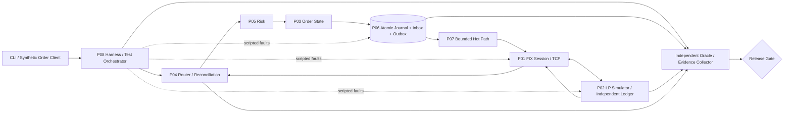

**Trust boundary:** P02 là peer có thể lỗi/độc hại; FIX frames và business reports từ peer đều cần validate. P08 có quyền debug/failpoints trong lab riêng nhưng **không** sử dụng các quyền đó để quyết định expected business outcomes; oracle độc lập được cấp copies read-only. Bất cứ kịch bản cố ý phá record phải bắt đầu từ snapshot được fingerprint và được log **tamper action**.

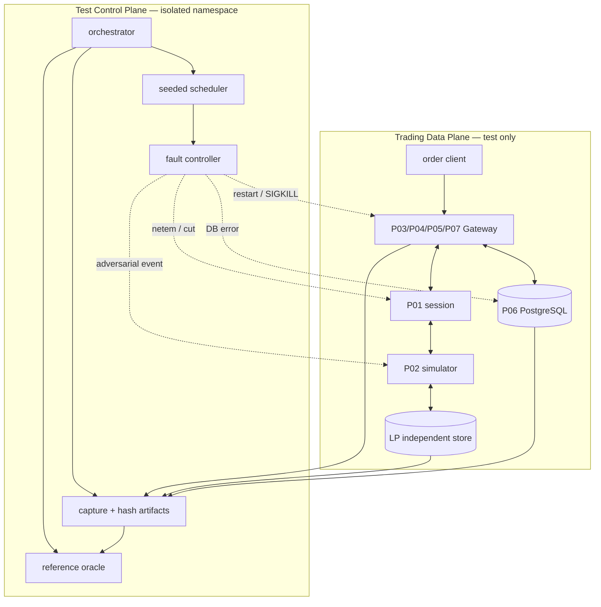

### 6.1. Ownership and writes

- Command enters P04 → P05 checks; accepted command mutation and outbox commit **in one P06 transaction**. P07 processes committed work or staged computation with no uncommitted external effects; P01 dispatches committed outbox payload only.
- Inbound FIX receipt → P04 validates/correlates → P03 reducer → P05 updates risk → P06 atomically stores inbox+ledger+projections; then acknowledge ingress.
- P02 creates independent LP execution journal; P08 compares its truth with gateway view using only trusted test simulator snapshots, never granting production assumption about real LP.

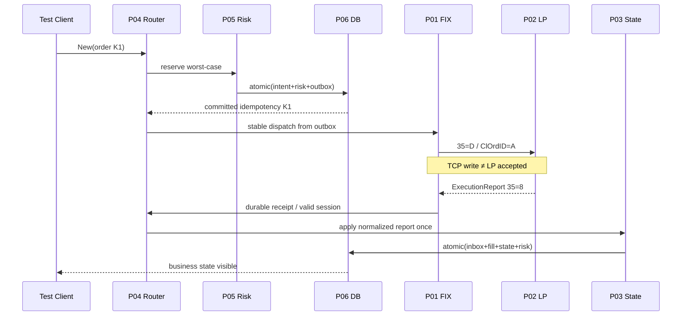

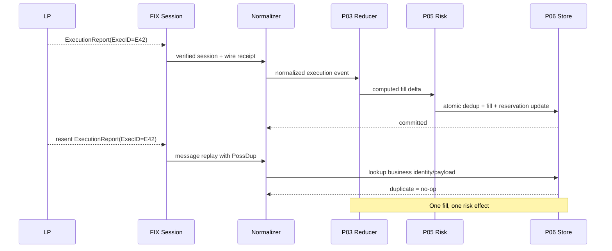

---

## 7. Deployment topology, failure domains, Docker Compose

**Lab topology:** separate network for `client`, `gateway`, `lp`, `gateway_db`, `lp_db`, `fault_proxy`, `metrics`, `harness`. Keep P02 ledger in a separate DB/container to avoid making both sides vanish at once in a “single DB crash” test. For PITR/HA add optional profile `ha` with independent PostgreSQL replica or dedicated ephemeral nodes; **Docker Compose startup order/healthcheck is not HA**.

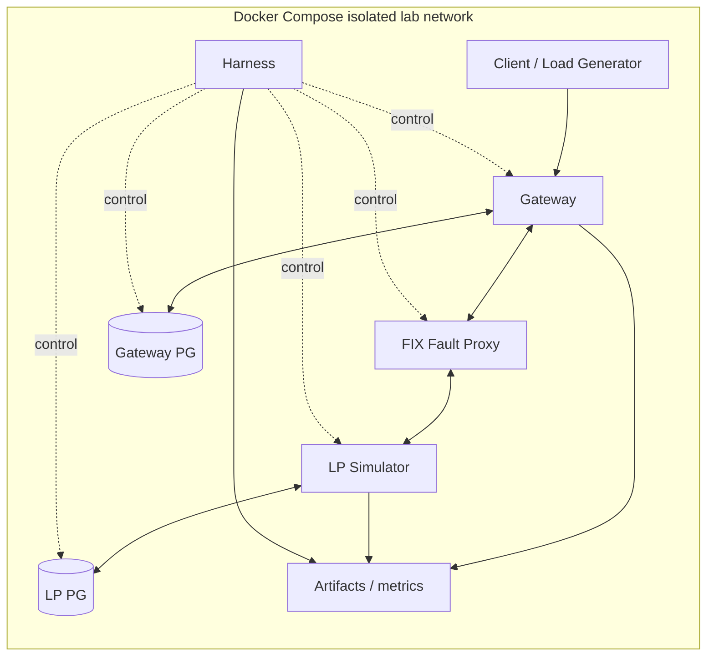

**Compose excerpt (template, cần chỉnh build paths/binaries khi P01–P07 triển khai):**

```yaml
name: fx-lab
services:
  gateway_db:
    image: postgres:18
    environment:
      POSTGRES_USER: gateway
      POSTGRES_DB: trading_lab
      POSTGRES_PASSWORD_FILE: /run/secrets/gateway_db_password
    secrets: [gateway_db_password]
    command: ["postgres", "-c", "fsync=on", "-c", "synchronous_commit=on"]
    healthcheck:
      test: ["CMD-SHELL", "pg_isready -U gateway -d trading_lab"]
      interval: 2s
      timeout: 2s
      retries: 30
    networks: [lab]
    volumes: [gateway_pg_data:/var/lib/postgresql]
  lp_db:
    image: postgres:18
    environment:
      POSTGRES_USER: lp
      POSTGRES_DB: lp_lab
      POSTGRES_PASSWORD_FILE: /run/secrets/lp_db_password
    secrets: [lp_db_password]
    healthcheck:
      test: ["CMD-SHELL", "pg_isready -U lp -d lp_lab"]
      interval: 2s
      timeout: 2s
      retries: 30
    networks: [lab]
    volumes: [lp_pg_data:/var/lib/postgresql]
  gateway:
    build: {context: ., dockerfile: docker/gateway.Dockerfile}
    depends_on: {gateway_db: {condition: service_healthy}}
    environment: {TRADING_MODE: SIM_ONLY, FIX_PEER_HOST: lp, DB_HOST: gateway_db}
    networks: [lab]
    read_only: true
    tmpfs: [/tmp]
  lp:
    build: {context: ., dockerfile: docker/lp.Dockerfile}
    depends_on: {lp_db: {condition: service_healthy}}
    networks: [lab]
  harness:
    build: {context: ., dockerfile: docker/harness.Dockerfile}
    profiles: [test]
    networks: [lab]
  # Fault controller runs via an explicitly isolated test namespace/profile.
  # Do not grant privileged capabilities to production workloads.
networks:
  lab: {internal: true}
volumes:
  gateway_pg_data: {}
  lp_pg_data: {}
secrets:
  gateway_db_password: {file: ./secrets/gateway_db_password.txt}
  lp_db_password: {file: ./secrets/lp_db_password.txt}
```

**Portability warning:** Đây là skeleton, **chưa chạy Compose**. Pin digest/image versions trong repo thực tế. `postgres:18` có layout data-directory khác major versions; xác nhận volume mount qua image docs trong CI. `internal: true` ngăn egress qua network đó nhưng runner/container capabilities, bridge networks bổ sung, host routes vẫn phải audit; test endpoint allowlist bắt buộc. Docker `service_healthy` chỉ đảm bảo startup health probe chứ không chứng minh application ready/fencing/reconciliation. Không mount source secrets vào CI public jobs.

---

## 8. Test Orchestrator, control plane, test isolation

### 8.1. Thành phần

| Component | Interface | Trách nhiệm | Failure behavior |
|---|---|---|---|
| Run Controller | `start(run_manifest)` | reserve exclusive lab, seed clock, start order generator | abort with immutable partial artifacts |
| Scenario Scheduler | `after(event_predicate, action)` | deterministic event/tick schedule, causal event IDs | no fire → `INCONCLUSIVE`, not PASS |
| Fault Controller | `inject(fault_id, target, phase, duration)` | SIGSTOP/SIGKILL, proxy block, DB failpoint, LP adversarial | records injection proof and rollback |
| Wire Proxy | byte-level + FIX-message-level modes | split/hold/release/drop/duplicate whole FIX app message in lab | never confuse TCP packet effects with FIX semantics |
| Independent Oracle | pure reference + LP ledger | compares expected causal effects, risk and identities | conflicting evidence → FAIL/QUARANTINE |
| Evidence Collector | append-only run artifacts | traces, SQL snapshots, model hash, metrics, environment | missing proof → `INCONCLUSIVE` |
| Gate Evaluator | `evaluate(results, policy)` | no P0 bypass, sign-off, scoped exclusions | deny release on missing evidence |

### 8.2. Time and reproducibility

- `logical_tick`: monotonic integer assigned by scheduler to script events; `causal_parent_id` tracks what triggered what. Do **not** assume same wall-clock ordering across processes/containers.
- Controlled virtual clock only for deterministic internal scheduling; **do not fake live TCP heartbeat timeouts** without an explicit time abstraction. Integration runs use real monotonic time and capture nondeterminism in trace.
- Use host monotonic clock for local durations. Cross-host latencies require clock synchronization/error budget or separate spans; do not subtract unsynchronized wall clocks as precise RTT.
- Seed PRNG and match event predicate to exact IDs/phase, not `sleep(100ms)`; log model step and fault actually armed/fired/disarmed.

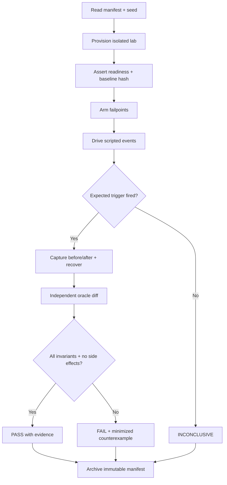

---

## 9. Event model, identity, time, trace, fixture manifest

**Canonical event envelope** (conceptual, không khẳng định là schema P01–P07 nguyên bản):

```json
{
  "run_id": "r-20261030-0001",
  "logical_tick": 17,
  "event_id": "evt-000017",
  "causal_parent_id": "evt-000015",
  "kind": "LP_EXECUTION_REPORT",
  "session_key": "FIX44:GW->LP:lab-session-1",
  "session_epoch": 4,
  "order_key": "acctA/order-0004",
  "command_id": "cmd-0004",
  "cl_ord_id": "A0004",
  "exec_id": "EX-0006",
  "event_schema_version": 1,
  "payload_sha256": "<computed SHA256 hex>"
}
```

**Identity scopes**:

- `run_id`: unique per test execution; never use as business idempotency identity.
- `command_id`: unique per logical client command in configured tenant/account namespace.
- `session_key` + epoch; FIX `MsgSeqNum` for ordering of transport session only.
- `ClOrdID` lineage, LP `OrderID`, LP `ExecID` with versioned RoE uniqueness scope; per-order event stream `stream_version`.
- `owner_epoch` for fencing; `db_commit_id/LSN/timeline` for recovery proofs; `snapshot_hash` + schema_version.

**Canonical hash pipeline:** stable UTF-8 byte encoding, fixed-point decimal representation, stable field ordering, explicit schema/ROE version and tenant scoping. Exclude wall-clock fields, randomized tracing IDs and transport-specific attempts from *business state hash*, but retain in evidence. Hash full `orders`, `fills`, `risk`, `outbox`, `inbox`, `journal stream heads` **separately** plus one manifest hash: a single `total_filled` summary can hide compensating errors.

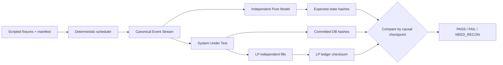

---

## 10. Replay model: deterministic vs live/recovery

### 10.1. Ba kiểu replay, **không được đánh đồng**

1. **Model replay**: feed identical normalized event list to independent reference reducer; assert same ordered decisions/hashes.
2. **P06 journal recovery replay**: reconstruct committed gateway state from durable journal, duplicates suppressed, verify against stored projections/outbox/ledger.
3. **FIX session resend replay**: P01 retransmits messages under FIX 4.4 session rules (`PossDupFlag`, `OrigSendingTime`, GapFill); its semantic **không** cho phép tự kết luận business command effect only once.

### 10.2. Algorithm

```text
Input: manifest M, canonical fixture F, seed S, pinned module/schema/RoE versions
1. Validate SHA256(M,F) and lab-only endpoint allowlist.
2. Start gateway+LP from declared clean DB snapshots; validate initial checksums.
3. Replay F in causal order using scheduler; resolve explicit conflicting races by seed.
4. After every committed event: read normalized order/risk/ledger/inbox/outbox and compare
   with reference model; hash checkpoint; require LP evidence for execution states.
5. At selected tick t: execute fault injection; record proof that correct failpoint fired.
6. Restart/restore according to scenario; detect unknown external outcome and run recon.
7. Compare post-recovery state to oracle, and check unique LP executions.
8. Repeat N seeds x K runs; compare stable business hash while capturing timing separately.
9. Persist counterexample (seed, minimized event sequence, raw FIX frames redacted,
   transaction phase, owner epoch, code/config/build hashes).
```

**Nondeterministic external events** (real kernel scheduling, fsync, TCP windows) are not magically deterministic; harness records the exact observed event order and **replays the captured trace** for controlled regression. Replay equivalence only holds for matching fixture semantics and persisted inputs; don't guarantee byte-identical transient session traffic/timestamps.

---

## 11. Independent business oracle và reconciliation proofs

### 11.1. Không dùng cùng một implementation để tự kiểm chính nó

- Oracle A: **small reference model**, đơn luồng, big integer/fixed-point, không share code paths với P03/P05/P06 reducers; chứng minh order transitions và exposure algebra trong model assumptions.
- Oracle B: **LP independent store**, append-only execution IDs, original command IDs, LP accepted order terms và fill legs. Captures **what LP actually did** trong test simulator.
- Oracle C: **Gateway DB committed** inbox/journal/order/fill/risk/outbox, including pending unknown outcomes and owner epochs.
- Oracle D: **Transport transcript** từ proxy, đối chiếu message-level send/resend and exact FIX Session semantics. Không dùng network packet capture để xác nhận application executed.

### 11.2. Test-side reconciliation algorithm

For each `account/order lineage`: (a) map original commands ↔ LP accepted orders; (b) match unique LP execution evidence ↔ gateway fill ledger, no 1-to-many duplicate; (c) recompute CumQty/LeavesQty/AvgPx fixed-point and worst-case risk; (d) validate pending/terminal semantics; (e) compare gateway durable stream and independent model; (f) evaluate unresolved unknown conservatively. Any difference → `FAIL/QUARANTINE`, never silently synthesize fill rows to make totals match. `RECON_ONLY` safety mode may itself be a **correct PASS** while outcomes remain unknown if the scenario expects an unresolved case.

| Oracle key | Query / comparison | Failure signal |
|---|---|---|
| A1 | number of accepted original intents = distinct `command_id` | duplicated original sends |
| A2 | unique execution legs by `(lp, scope, ExecID)` and payload | duplicate/different-payload duplicate |
| A3 | `sum(fill.qty)` vs `CumQty` and cumulative VWAP | missing/overfill ledger |
| A4 | P05 worst-case exposure including all UNKNOWN | under-reservation |
| A5 | journal `stream_version` contiguous with commit order | phantom/lost mutation |
| A6 | outbox state vs dispatcher emitted originals | send before commit/unsafe retry |
| A7 | owner epoch monotonic and fencing token current | split-brain mutable output |
| A8 | restored state hash = replay hash; LP diff explains unknown | bad recovery |
| A9 | all accepted attempts have accounted outcomes | silent drop under overload |
| A10 | mode transitions consistent with runbook and incident flags | unsafe ACTIVE after fault |

---

## 12. Scenario DSL, failpoint API và causal triggers

A test scenario must define: setup state, command/script, failpoint, trigger predicate, expected safety mode, exact oracle assertions, timeout policy and evidence. **Timeout alone is not evidence of a fault.**

```yaml
scenario_id: E2E-FAIL-DB-ACK-LOST-001
version: 1
seed: 89031
requires: [p01-stablesend-v1, p06-atomicapply-v1, p02-ledger-v1]
initial_fixture: fixtures/partial-fill-cancel-v3.yaml
start_mode: ACTIVE
steps:
  - submit: {command_id: K1, account: A1, symbol: EURUSD, side: BUY, qty: 100000, price: "1.08500"}
  - arm_fault:
      id: fi-001
      target: gateway-db-proxy
      trigger: {event: db.commit.persisted, command_id: K1, occurrence: 1}
      action: drop_commit_response
  - expect:
      condition: {event: gateway.commit_outcome_unknown, command_id: K1}
      within_logical_steps: 20
  - restart: gateway
  - reconcile: {command_id: K1, against: lp_ledger}
assert:
  - exact_count: {table: gateway.intents, where: {command_id: K1}, value: 1}
  - exact_count: {table: lp.original_orders, where: {logical_command_id: K1}, max: 1}
  - invariant_set: [EI-09, EI-22, EI-29, EI-31, EI-34]
  - allowed_final_modes: [ACTIVE, RECON_ONLY]
artifacts: [trigger-proof, redacted-wire, db-snapshot, lp-ledger, hashes, metrics]
```

**Important:** `drop_commit_response` mô phỏng mất ACK **sau khi transaction đã bền vững**, không được khẳng định đã commit nếu không có PG/proxy evidence. Scenario template chỉ minh họa, không phải CLI/backend thật đã viết. Một lệnh có thể đã commit mà chưa hề gửi đến LP; oracle phân biệt `intents=1`, `outbox=1`, `LP originals=0` là hợp lệ nếu chưa dispatch.

**Faultpoint contract** (conceptual):

```cpp
struct FaultTrigger {
  std::string_view fault_id;
  std::string_view event_type;
  std::string_view causal_id;
  uint64_t occurrence;
};
struct FaultActivationProof {
  uint64_t logical_tick;
  uint64_t owner_epoch;
  std::string event_digest;
  std::string injection_action;
};
// Lab-only compile flag + allowlisted controller; absent in production builds.
```

---

## 13. Test life-cycle & run-state machine

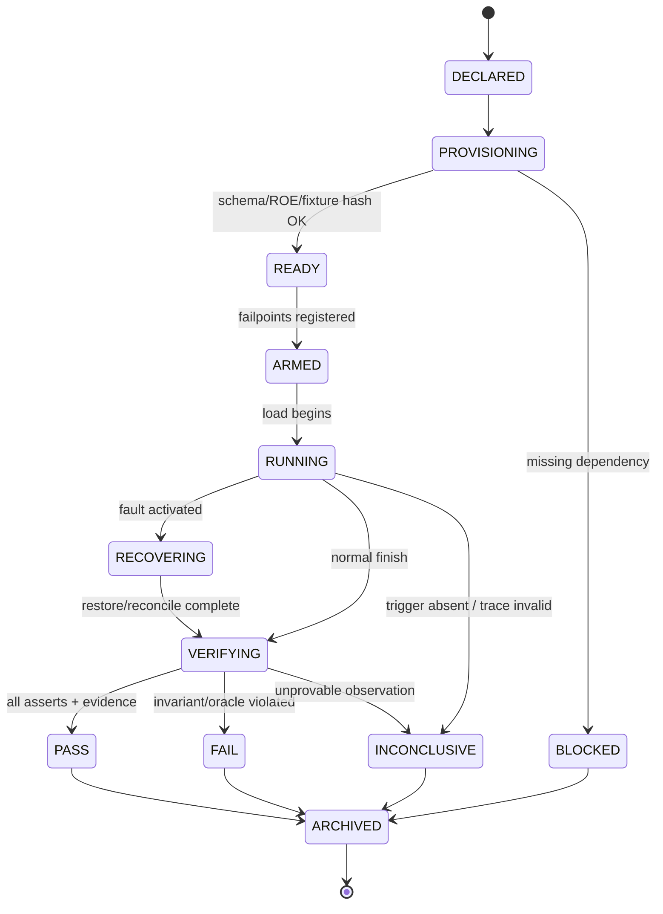

**Run-level results:** `PASS`, `FAIL`, `NOT_RUN`, `BLOCKED`, `INCONCLUSIVE`; optional outcome `EXPECTED_SAFE_HALT` is **not** a result type—it is an expected state that must satisfy PASS assertions. `RECON_ONLY` is an engine mode, not a test failure by itself. Always record every skipped sub-test as NOT_RUN.

---

## 14. FIX/TCP faults, protocol and LP simulation contract

| Fault level | Tool | What it tests | What it **does not** prove |
|---|---|---|---|
| TCP byte stream | proxy split/hold/close | partial frames, half-close, read/recv, EOF | peer business execution |
| Kernel packets | `tc netem` | latency/jitter/loss/reorder of **packets** | duplicate FIX application messages (TCP dedups/reorders bytes) |
| FIX message | message-aware lab proxy / P02 | duplicate `35=8`, seq gap, `PossDup=Y`, broken tag | real network behavior |
| LP business | deterministic P02 script | partial fills, cancel/replace race, rejects, lost reports | arbitrary real LP RoE |
| Session | P01 controlled state | Logout, Logon, TestRequest, ResendRequest, GapFill | historical unknown fills without reconciliation |

FIX 4.4 session recovery uses ResendRequest and can GapFill messages not chosen for retransmission; retransmitted messages use `PossDupFlag(43)=Y`. Application retries (`PossResend(97)`) and business idempotency are distinct. Business dedup/reconciliation remain necessary. See FIX 4.4 [StandardHeader/PossDup](https://fix.dev/organizations/fix-standards/specs/1000001/components/StandardHeader) and [SequenceReset/GapFill](https://fix.dev/organizations/fix-standards/specs/1000001/messages/4). Under TCP, duplicating a **packet** via netem does not imply a duplicate FIX message at the application level. Use an explicit protocol-level fault for that. `tc netem` supports delay/loss/corrupt/dup/reorder at the packet layer and has timing/topology limitations ([manual](https://man7.org/linux/man-pages/man8/tc-netem.8.html)).

```mermaid
sequenceDiagram
  participant GW as Gateway
  participant PR as Wire Proxy
  participant LP as LP Simulator
  GW->>PR: NewOrderSingle (35=D), seq=42
  PR->>LP: Forward whole FIX message
  LP->>LP: Persist accepted order
  LP-->>PR: ExecutionReport (35=8), seq=88
  Note over PR: Drop complete report (lab fault)
  PR--xGW: not delivered
  GW->>GW: timeout => UNKNOWN_OUTCOME
  GW->>LP: Reconnect + FIX session recovery
  LP-->>GW: Resent report / reconciliation evidence
  GW->>GW: Dedup by business identity; one state effect
```

---

## 15. Atomic persistence, lost ACK, send uncertainty

**Four distinct failure questions**:

- `Was it committed?` Must query P06 by idempotency key / committed stream head, not infer from a timed-out driver call.
- `Was it written to socket?` P01 transport evidence cannot establish LP application receive.
- `Did LP accept/execute it?` Only explicit LP trusted evidence/reconciliation can establish the answer.
- `Can this order be retried?` Retry **same logical command** only through well-defined idempotency mechanism with stable identifiers/ROE; never auto-create new original order solely after timeout.

P06 write-set should make **journal event + inbox/dedup + order projection + fill ledger + risk state + outbox** atomic for each applicable transition. Missing optional rows must be expressly defined in transaction schema, not half-committed. PostgreSQL asynchronous commit can report success before WAL flush, which is inappropriate for external actions relying on durability ([PostgreSQL WAL docs](https://www.postgresql.org/docs/current/wal-async-commit.html)). After PITR/restore, DB internal consistency **does not** establish external LP consistency: reconcile first ([PITR docs](https://www.postgresql.org/docs/current/continuous-archiving.html)).

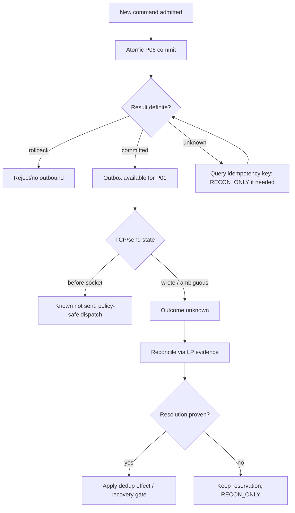

---

## 16. 32 crash/fault/scheduling windows — execute each with controlled failpoint

| CW | Target fault boundary | Expected safety assertion |
|---|---|---|
| CW-01 | Before admission validation | no reservation/outbox/send |
| CW-02 | After validation, before reservation calculation | no state mutated |
| CW-03 | After compute reservation in memory, before DB BEGIN | no visible accepted command |
| CW-04 | After DB BEGIN, before journal append | rollback all staged effects |
| CW-05 | After journal insert, before risk reservation insert | rollback journal and risk |
| CW-06 | After risk insert, before outbox insert | rollback; no orphan reservation |
| CW-07 | After outbox insert, before COMMIT request | zero external send |
| CW-08 | During DB COMMIT processing (outcome ambiguous) | query by key; no blind original dispatch |
| CW-09 | After durable commit, before driver ACK | persisted command discoverable; exactly one intent |
| CW-10 | After ACK, before outbox scanner wakes | outbox remains safely dispatchable |
| CW-11 | After outbox lease claim, before FIX enqueue | stale lease revalidated; no lost intent |
| CW-12 | After FIX framing, before sequence persisted | no untracked on-wire original send |
| CW-13 | After sequence persisted, before socket write | P01 recovery semantics, no sequence reuse |
| CW-14 | During partial `send()`/kernel buffering | no assumption peer accepted; reconcile if ambiguous |
| CW-15 | After full `send()` return, before dispatcher ack | delivery ambiguity preserved, not blind retry |
| CW-16 | LP receives New, before LP durable order commit | LP either rejects/does not execute or recovers committed effect |
| CW-17 | LP commits New, before generating ACK | gateway unknown resolved by LP evidence |
| CW-18 | LP commits first partial fill, before report outbox | LP ledger durable, eventual report or safe reconciliation |
| CW-19 | LP reports fill but gateway TCP connection drops | P01 resend + P04 dedup; exactly one fill |
| CW-20 | P01 validates ExecutionReport, before inbound durable handoff | replay safe, no irreversible business update |
| CW-21 | P04 correlates report, before P03 reducer | no partial state update |
| CW-22 | P03 computes fill delta, before P05 exposure update | atomic effect or rollback; no risk drift |
| CW-23 | P05 computes release, before P06 COMMIT | no premature risk release |
| CW-24 | After inbound COMMIT, before P01 receipt acknowledge | duplicate report is idempotent |
| CW-25 | Cancel submitted while partial fill queued | linearizable causal resolution; correct leaves |
| CW-26 | Replace accepted risk upgrade, before LP replace ACK | conservative old/proposed exposure policy |
| CW-27 | Outbound queue full while cancel pending | no silent drop; maintain safety state |
| CW-28 | Owner fenced immediately before stale callback | zero old-owner durable mutation/send |
| CW-29 | Primary crashes after local flush, replica lagging | failover may require recon; no automatic unsafe ACTIVE |
| CW-30 | PITR restores earlier timeline while LP holds newer fill | detect external divergence; RECON_ONLY |
| CW-31 | Recovery replay hits missing/corrupt journal event | HALTED/QUARANTINE; no gap skipping |
| CW-32 | Recovery check passes but before ACTIVE promotion LP changes | revalidate reconciliation fence/epoch; no stale reopen |

**Mechanics:** `SIGKILL` at process boundary, internal compiled-in lab failpoint for transaction phases, DB proxy for response drop, SIGSTOP for scheduling pause, TCP/FIX proxy for message hold/drop, P02 event-script for LP crash. Tests validate that the fault actually hits the intended boundary. Controlled crash at post-DB-commit requires evidence from DB; a mere client timeout cannot label a commit successful.

### 16.1. Traceability: crash windows → planned failpoints → test anchors

**Dấu vết dưới đây là kế hoạch triển khai, không phải kiểm thử đã chạy.** `related` nghĩa scenario đánh vào hậu quả gần nhất nhưng vẫn phải viết thêm precise failpoint để tuyên bố CW đã được kiểm. Một CW chỉ `COVERED` khi fault activation proof ở đúng phase tồn tại, evidence trước/sau đủ và oracle PASS.

| Crash window | Exact lab-only failpoint / trigger | Catalog / playbook anchor | Required proof |
|---|---|---|---|
| CW-01 | `admission.before_validation` | `E2E-241` | zero durable changes |
| CW-02 | `admission.after_validation.before_risk` | `E2E-242` | zero reservation |
| CW-03 | `risk.computed.before_db_begin` | `E2E-243` | no accepted intent |
| CW-04 | `db.tx.after_begin.before_journal` | `E2E-244` | rollback proof |
| CW-05 | `db.tx.after_journal.before_risk` | `E2E-245`, `PB-21` | no event head advance |
| CW-06 | `db.tx.after_risk.before_outbox` | `E2E-246`, `PB-02` | no orphan risk |
| CW-07 | `db.tx.after_outbox.before_commit` | `E2E-247` | no wire original |
| CW-08 | `db.tx.commit_inflight` | `E2E-248`, `PB-01` (different ACK branch) | classify commit result |
| CW-09 | `db.tx.persisted.before_driver_ack` | `E2E-249`, `PB-01` | one intent by key |
| CW-10 | `outbox.ready.before_scanner` | `E2E-250` | recover pending outbox |
| CW-11 | `outbox.lease_acquired.before_fix_enqueue` | `E2E-251` | lease fencing |
| CW-12 | `fix.frame_encoded.before_seq_durable` | `E2E-252` | no untracked wire send |
| CW-13 | `fix.seq_durable.before_socket_send` | `E2E-253` | no sequence reuse |
| CW-14 | `socket.partial_write` | `E2E-254` | ambiguous external outcome |
| CW-15 | `socket.sent.before_dispatch_ack` | `E2E-255`, `PB-03` | no blind resend |
| CW-16 | `lp.new_received.before_lp_commit` | `E2E-256` | LP rollback semantics |
| CW-17 | `lp.new_committed.before_ack_outbox` | `E2E-257` | LP durable proof |
| CW-18 | `lp.fill_committed.before_report` | `E2E-258`, `PB-04` | unique LP fill |
| CW-19 | `proxy.lp_report_after_lp_commit.drop` | `E2E-087`, `PB-04` (related) | re-report/recon once |
| CW-20 | `fix.inbound_validated.before_durable_handoff` | `E2E-204` (related; exact failpoint required) | zero premature apply |
| CW-21 | `router.correlated.before_reducer` | `E2E-204` (related; exact failpoint required) | no half-applied state |
| CW-22 | `order.delta_computed.before_risk` | `E2E-205` (related; exact failpoint required) | atomic fill + risk |
| CW-23 | `risk.release_computed.before_commit` | `E2E-195` (related; exact failpoint required) | no premature release |
| CW-24 | `inbox.commit_persisted.before_receipt_ack` | `E2E-259`, `PB-22` | idempotent resend |
| CW-25 | `scheduler.cancel_and_fill_barrier` | `E2E-143`, `PB-11` | exact CumQty/reserved |
| CW-26 | `replace.risk_added.before_lp_ack` | `E2E-148`, `PB-12` | old/proposed envelope |
| CW-27 | `queue.full_during_pending_cancel` | `E2E-324`, `PB-31` | no silent loss |
| CW-28 | `owner.fenced.before_stale_callback` | `E2E-302`, `PB-27` | zero stale owner writes |
| CW-29 | `primary.crash_replica_behind` | `E2E-306`, `PB-26` | RPO divergence/recon |
| CW-30 | `pitr.restored_before_known_lp_fill` | `E2E-284`, `PB-24` | LP-vs-PG diff |
| CW-31 | `journal.corrupt_during_replay` | `E2E-260`, `PB-23` | HALTED, no dispatch |
| CW-32 | `recovery_gate.pass_before_active_change` | `E2E-577` (related; exact failpoint required) | revalidate current epoch/outcomes |

---


## 17. Resource limits, backpressure, graceful degradation

| Condition | Initial mode | Allowed work | Exit evidence |
|---|---|---|---|
| P07 inbound queue > configured high-watermark | `SHED_NEW` | safe cancel/recovery traffic under explicit policy | occupancy below low watermark & invariant scan |
| P07 pool exhaustion / producer contract breach | `SHED_NEW` or `HALTED` if corruption | no unsafe new accept | allocation/generation proof |
| P06 DB latency spike, durable commits unavailable | `RECON_ONLY` | read-only diagnostics/reconciliation where possible | DB + unknown commit resolved |
| P01 session offline, LP outcome unknown | `RECON_ONLY` | recon; not blind New | session and LP evidence |
| P05 risk data stale or policy mismatch | `SHED_NEW` | cancel per policy; no unsafe risk increase | new policy/quota version verified |
| P02 ledger conflict / orphan ExecID | `QUARANTINE` per affected order/domain | others if isolation proven | LP evidence + audit correction |
| DB/journal hash corruption or double writer | `HALTED` | read-only incident analysis | restore + fencing + sign-off |
| Logging/Prometheus unavailable | `DEGRADED_OBSERVABILITY` | business only if essential audit durable | telemetry restored & gap acknowledged |
| Performance clock invalid | `BENCHMARK_INVALID` | operational trading simulation may continue safely | recalibrated measurement/report rerun |

Define queue and memory limits in config; no unbounded retry/sleep loop; administrative FIX liveness has dedicated budget so New saturation does not automatically cause session death. Count `SUBMITTED`, `ACCEPTED_DURABLE`, `REJECTED`, `DEFERRED`, `UNKNOWN`, `EXECUTED`, `CANCELED` separately—these counters are not additive across different lifecycle states; every distinct command must have exactly one current lifecycle bucket.

---

## 18. Performance testing & measurement validity

### 18.1. Experiment protocol

1. Pin hardware/CPU/governor/microcode, OS/kernel, compiler, sanitizer flags, CPU affinity, Docker resources, DB disk/cache, cgroup limits, network model, fixture seed.
2. Warm up measured hot paths; report cold-start separately. Set **open-loop** rate schedule independently of completion time; capture `planned arrival` to avoid coordinated omission.
3. Run baseline and optimized binaries on identical workloads, with comparable durability/risk settings and no skipped validations.
4. Record `n_total/n_accepted/n_rejected/n_unknown/n_timed_out`, p50/p95/p99/p99.9, max, queue occupancy, CPU, RSS, allocations, context switches, DB fsync/lock wait, net errors, LP response distribution.
5. Repeat runs, report confidence ranges/bootstrap if desired; a p99 with few samples or missing clock calibration is `INCONCLUSIVE`.
6. Under overload, correctness must pass regardless of p99 SLO; performance gate can mark target missed but must not mask safety.

### 18.2. Latency spans

| Name | Start → End | Includes | Excludes |
|---|---|---|---|
| `receive_to_route` | P01 inbound validated recv → P04 routing decision | internal business path | PG commit, LP RTT if not inside span |
| `admission_durable` | CLI arrival → P06 durable ACCEPTED acknowledgment | risk + transaction | LP execution |
| `dispatch_time` | committed outbox eligible → socket write completion | queue/scheduler/session | LP acceptance |
| `order_ack_roundtrip` | CLI New request → durable accepted LP report | network, LP, DB inbound | later fills unless ack includes them |
| `recovery_to_safe` | fault detection → reconciled safety mode | failover/replay | time to unproven ACTIVE |

Observe input and output counters, not just percentile; for histograms see [Prometheus histogram practices](https://prometheus.io/docs/practices/histograms/). `50k msg/s` is a target *profile* not guaranteed capacity. Independently label CPU-bound, DB-bound and LP-bound runs.

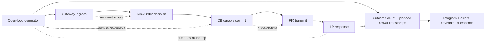

---

## 19. Security, secrets, isolation and anti-live-trading guardrails

- FIX/IP endpoints must resolve only within isolated lab allowlist; refuse startup when outbound peer host/IP not allowlisted or `TRADING_MODE != SIM_ONLY`; block egress at network/host firewall, not merely app flag.
- Synthetic account/order identities; mask FIX username/password, certificates, credentials, config secrets, PII in traces. Test harness may store checksums but no real secrets.
- Limit privilege: do not use privileged containers by default. For netem/cgroups/SIGKILL use separate dedicated test runner or narrow `NET_ADMIN` controls in disposable namespace; never target production.
- CI signed artifacts, branch protections, pinned dependencies/containers; prohibit arbitrary operator commands as test payload without allowlist.
- Adversarial FIX parser fuzz with memory/CPU/time limits; no remote code execution/SQL injection via tags; reject malformed UTF-8/oversize fields.
- DB roles for harness: read-only oracle role, fault-injection privileged ephemeral role, app minimal mutation role; prevent accidental DROP/write in non-disposable environments.
- Reconciliation operator action requires approved change ticket/incident ID, immutable before/after snapshots and owner epoch.

---

## 20. Metrics, traces, logs and evidentiary quality

**Per-test immutable artifact manifest**:

```json
{
  "test_id": "E2E-001",
  "run_id": "r-000001",
  "seed": 89031,
  "result": "NOT_RUN",
  "source_commit": "<git_sha>",
  "build_id": "<container_digest>",
  "schema_version": "<version>",
  "roe_hash": "<sha256>",
  "fixture_hash": "<sha256>",
  "clock_profile": "<measured metadata>",
  "environment": {"cpu": "<model>", "kernel": "<release>", "postgres": "<version>"},
  "fault": {"armed": false, "fired": false, "activation_proof": null},
  "assertion_results": [],
  "lp_business_hash": null,
  "gateway_business_hash": null,
  "oracle_hash": null,
  "artifacts": ["redacted_fix.log", "journal.jsonl", "lp_ledger.jsonl", "metrics.json", "fault_trace.jsonl"]
}
```

**Minimum metrics**: `commands_submitted_total`, `commands_accepted_durable_total`, `commands_rejected_total{reason}`, `commands_unknown_current`, `executions_unique_total`, `duplicate_exec_suppressed_total`, `risk_reservation_total`, `outbox_pending_current`, `outbox_unknown_current`, `fix_sequence_gap_total`, `fix_reconnect_total`, `queue_occupancy`, `pool_alloc_failures_total`, `journal_integrity_failures_total`, `owner_fence_rejections_total`, `fault_activated_total{fault_id}`, `test_invariant_failure_total{id}`, `latency_histogram{span}`, `lp_reconciliation_mismatch_current`. Label cardinality: never use order_id/exec_id as Prometheus metric labels; detailed IDs belong in traces.

**Evidence integrity:** SHA-256 every fixture/manifest/report, record UTC for human correlation plus logical tick and monotonic duration, redact raw FIX tags carrying secrets, store original binary trace only in restricted test artifacts. Failure analysis must retain *first diverging checkpoint*, not just final hashes.

---

## 21. CI/CD matrix, release gates and operator approval

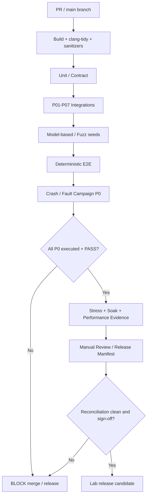

| Stage | Cadence | Target |
|---|---|---|
| C0 compile/check | every PR | GCC/Clang C++20, format, static analysis, basic unit |
| C1 property/sanitizers | every PR/nightly | reducer & risk model, ASAN/UBSAN/TSAN **in separate compatible jobs** |
| C2 deterministic E2E | every PR | W0/W1, golden FIX + contracts, at least targeted P0 |
| C3 crash matrix | nightly | CW-01..CW-32, fixed seeds + reproducible artifacts |
| C4 protocol fuzz + differential | nightly | bounded randomized fuzz, failure shrinking |
| C5 stress/soak/perf | scheduled on controlled hardware | W3/W4/W5, compare to baseline; never count unavailable PMU as PASS |
| C6 restore/failover | weekly/pre-release | PITR/replica/owner fencing and LP divergence |
| C7 release gate | pre-release | all required P0 scenarios = PASS, no unresolved integrity/unknown exposure; exceptions cannot bypass safety |

**Avoid fake green:** tests registered but skipped, fault not fired, missing LP oracle, unavailable PG replication harness or invalid latency clock are `BLOCKED/INCONCLUSIVE/NOT_RUN`, **not PASS**. P1 policy may permit scoped signed waiver with documented risk—never for P0 safety or missing evidence. CI green is bounded evidence, **not production certification**.

---

## 22. Repository, commands, configuration

```text
fx-fix-gateway/
├── apps/
│   ├── gateway/                 # P01 + P03/P04/P05/P06/P07
│   ├── lp_simulator/            # P02 independent simulator
│   └── test_order_client/
├── libs/{fix_session,order_core,router,risk,journal,low_latency}/
├── harness/
│   ├── orchestrator/            # scenario runner / fixture loading
│   ├── fault_controller/        # isolated lab fault adapter
│   ├── fix_proxy/               # byte and message modes
│   ├── reference_model/         # independent oracle implementation
│   ├── artifacts/               # run manifest and integrity
│   └── checkers/                # SQL, LP, protocol, resource
├── fixtures/
│   ├── fix44/{logon,new,cancel,replace,fill,session_replay}/
│   ├── scenarios/{happy,partial,cancel,replace,unknown,crash,restore}/
│   └── snapshots/{gateway,lp}/
├── tests/{unit,contract,model,e2e,chaos,perf,security}/
├── docker/{gateway.Dockerfile,lp.Dockerfile,harness.Dockerfile}
├── compose.yaml
├── ci/
├── scripts/{lab-up.sh,lab-reset.sh,run-scenario.sh,collect.sh,verify.sh}
├── configs/{roe-lab.yaml,limits-lab.yaml,latency-profile.yaml}
└── docs/Integration_Replay_Failure_Testing_System_Design.md
```

**CLI contract sketch (NOT an existing executable):**

```bash
cmake -S . -B build -DCMAKE_BUILD_TYPE=Debug -DFX_LAB_FAULTS=ON
cmake --build build --parallel
ctest --test-dir build --output-on-failure

docker compose --profile test up -d --build
./build/bin/fx-test-runner --scenario fixtures/scenarios/partial-cancel.yaml --seed 89031 \
  --artifacts ./artifacts/run-89031
./build/bin/fx-oracle-verify --artifacts ./artifacts/run-89031 --strict
# Faults and stress test should be run only in a disposable isolated environment.
docker compose --profile test down
```

**CI/runner detail:** `--strict` means missing oracle/fault proof blocks PASS. Always isolate test DB volumes per run or snapshot; `down -v` is destructive and must be *explicitly opt-in* and verify environment ID before execution. SIGKILL and netem permissions must never be attached to production runner credentials.

---

## 23. Model-based, fuzz/property and coverage strategy

### 23.1. Layered verification

1. **Unit and golden fixture**: FIX parser/serializer, pure order transitions, risk math, bounded queues, hash/canonical codec.
2. **Contract test**: P01 StableSend, P02 deterministic ExecID, P03 normalizer, P05 reserve/release, P06 atomic store, P07 queue ownership.
3. **Reference-model E2E**: commit-by-commit independent model and LP truth comparisons.
4. **Concurrency exploration**: single-owner actor interleavings, cancel vs fill, replace vs fill, conflicting commits, stale epoch; schedule explorer bounded by steps.
5. **Protocol/property fuzz**: malformed FIX tags, checksum/bodylength, large fields, duplicate/gapfill, parser/resource limits.
6. **Chaos/failpoints**: 32 precise windows and 40 playbooks; ensure fault activation proof; replay/shrink failing event trace.
7. **Performance and operations**: open-loop throughput/tails + safe overload/restore evidence.

### 23.2. Orthogonal coverage dimensions

| Axis | Representative values |
|---|---|
| Command | New, Cancel, Replace, duplicate, conflicting retry |
| Order state | New, partial, pending cancel, pending replace, filled, canceled, rejected, unknown |
| FIX session | active, heartbeat missed, gap/resend, logout, reconnect, reset policy mismatch |
| LP behavior | ack, partial, full, delay, duplicate, reject, orphan, conflicting exec |
| Risk | available, at limit, stressed, stale quote, kill switch, concurrent domain |
| Durability | commit, rollback, unknown ACK, disk full, corrupt journal, restore stale |
| Fault timing | CW-01..CW-32 |
| Load | 1, 1k, 50k/s benchmark target, saturation, soak |
| Ownership | 1 instance, failover, stale owner, simultaneous writer |
| Environment | x86_64, ARM64 optional, Docker, bare-metal benchmark, kernel/CPU/config variants |
| Oracle evidence | all present, one missing, inconsistent, stale, forged |

**Combinatorial strategy:** directed P0 edge sequences first; pairwise/3-wise covering arrays over remaining dimensions; property-based generators shrinking to minimal reproducer; mutation testing (intentionally weaken invariants / skip dedup / swap events) to verify that the oracle actually catches faults. Full cartesian product of all time/concurrency parameters is impossible; gaps must be tracked in coverage report.

### 23.3. Scenario catalog format

`E2E-xxx | P0/P1 | inject/stimulus | exact PASS criterion | oracle tags`. `F`=FIX/session, `B`=business/ledger, `R`=risk, `D`=durability, `C`=concurrency, `P`=performance, `S`=safety-mode, `O`=ops/security, `E`=evidence integrity. **Global assertion EI-01..EI-56** applies as relevant. All 600 cases are planned and **NOT_RUN** until actual harness exists.

---

### 23.4. Traceability: test group → module → safety invariants

| Group | Modules of primary concern | EI invariant assertion IDs | Minimum independent evidence |
|---|---|---|---|
| G01 | P01–P07 config/ROE | EI-06, EI-26, EI-38, EI-55, EI-56 | pinned build/config/schema manifest |
| G02 | P02–P06 full order | EI-08, EI-09, EI-11, EI-22, EI-29 | LP originals, order/risk/outbox rows |
| G03 | P01 FIX session | EI-01, EI-02, EI-03, EI-05, EI-06 | wire transcript and seq persistence |
| G04 | P01 parser + P03 | EI-07, EI-08, EI-12, EI-15 | raw byte fixture, parser and ledger |
| G05 | P01/P02 proxy | EI-04, EI-05, EI-20, EI-34 | TCP vs FIX-level capture, LP ledger |
| G06 | P02 LP vs P03 ledger | EI-11, EI-14, EI-19, EI-36 | LP unique fills and gateway fills |
| G07 | P03 reducer | EI-11, EI-12, EI-13, EI-14, EI-16 | reference model per event |
| G08 | P03/P04/P05 | EI-16, EI-17, EI-18, EI-24 | command lineage, risk snapshots |
| G09 | P01/P04/P06 | EI-09, EI-10, EI-11, EI-18, EI-36 | identity namespace + dedup keys |
| G10 | P05 pricing/risk | EI-21, EI-22, EI-24, EI-26, EI-28 | deterministic risk oracle |
| G11 | P03/P04/P05/P06 atomic writes | EI-21, EI-22, EI-27, EI-29, EI-31, EI-36 | transaction outcomes, risk/ledger/outbox SQL |
| G12 | P01/P04/P06 outbox/unknown | EI-04, EI-09, EI-20, EI-29, EI-31, EI-34 | FIX proxy, outbox lease and LP originals |
| G13 | P01/P02/P06 crash cuts | EI-30, EI-31, EI-33, EI-34, EI-38 | failpoint proof + LP DB |
| G14 | P03/P05/P06 recovery | EI-31, EI-32, EI-34, EI-35, EI-36, EI-38 | journal/checkpoint hash and risk state |
| G15 | P06 backup/PITR | EI-32, EI-33, EI-35, EI-39, EI-40 | WAL, timeline, LP diff |
| G16 | P01/P04/P06 HA/fencing | EI-33, EI-37, EI-38, EI-40, EI-41, EI-46 | old/new epoch and LP originals |
| G17 | P01/P07 resource pressure | EI-43, EI-45, EI-47, EI-48, EI-56 | queue high-watermark, admission buckets |
| G18 | P03/P05/P07 concurrency | EI-27, EI-37, EI-41, EI-42, EI-44, EI-46 | causal schedule, sanitizer and DB locks |
| G19 | P07 latency methodology | EI-49, EI-50, EI-51, EI-52 | raw planned arrivals and all outcomes |
| G20 | P07 CPU/memory | EI-42, EI-44, EI-47, EI-48 | ASAN/TSAN, topology/perf and pool leases |
| G21 | P06/P08 replay | EI-32, EI-52, EI-53 | ordered canonical hashes and first divergence |
| G22 | P02/P03/P05/P08 independent oracle | EI-11, EI-21, EI-32, EI-53 | distinct reference model vs LP vs gateway |
| G23 | P08 fault controller | EI-52, EI-54, EI-55 | fault armed/fired trace and cleanup |
| G24 | P01/P04/P08 security | EI-08, EI-54, EI-55, EI-56 | egress/secret/auth policy proof |
| G25 | P08 metrics/alerts | EI-49, EI-50, EI-52, EI-56 | alert + source metric + audit trail |
| G26 | P08 CI/release | EI-51, EI-52, EI-54, EI-55 | pipeline results + artifact digest |
| G27 | P01/P04/P05 identity/ROE | EI-06, EI-08, EI-18, EI-21, EI-26 | versioned tenant/price/policy mapping |
| G28 | P02/P06/P07 long-run scale | EI-43, EI-45, EI-48, EI-49 | soak resources, exact outcome counters |
| G29 | P06/P08 operator recovery | EI-20, EI-34, EI-35, EI-37, EI-38 | runbook approvals and before/after hashes |
| G30 | P01–P08 compound campaign | EI-20, EI-21, EI-29, EI-32, EI-34, EI-37, EI-54 | four independent source diffs |

**Coverage query for automation:** mỗi implemented test khai báo `invariant_ids`, `module_contract_versions`, `fault_activation_assertions` và `evidence_requirements`. CI xuất coverage hai chiều: invariant không có test nào → `COVERAGE_GAP`; test không có asserted invariant/oracle → `SPEC_INCOMPLETE`. Nhóm liên quan không thay thế obligation từng case.

---


## 24. Detailed what-if catalog — 600 concrete scenarios (30 groups × 20)
**Tất cả 600 tests là thiết kế/NOT_RUN.** Cột Then là điều kiện PASS **cần được automation kiểm**, không phải kết quả test đã chạy. `P0` là release-blocking safety/integrity; `P1` là important robustness/performance/ops. Mỗi test cần fixture, seed, fault activation proof (nếu tiêm lỗi), DB + LP + independent-model oracle và immutable run artifacts. Test ID stable để viết trong CI.
### G01 — Bootstrap, schema, endpoint & RoE compatibility
**Tags:** `O,E,S` · **20 tests** · **P0=18**, **P1=2**. Mỗi test assert thêm tất cả EI-* liên quan tại boundary.
| Test ID | Priority | What-if / fault stimulus | Then — exact PASS criteria | Oracles |
|---|---|---|---|---|
| `E2E-001` | **P0** | Gateway starts with correct P01–P07 commit hashes and schema versions | Start ACTIVE only after every required dependency passes its readiness/contract gate. | `O,E,S` |
| `E2E-002` | **P0** | P03 event codec version differs from P06 journal reader | Reject startup with version reason; do not truncate or silently upcast unknown payload. | `O,E,S` |
| `E2E-003` | **P0** | FIX dictionary configured as FIX 4.2 while lab RoE requires FIX 4.4 | Session fails readiness; zero outbound New messages. | `O,E,S` |
| `E2E-004` | **P0** | Gateway points to a DNS name resolving outside lab allowlist | Refuse startup before any socket connection to that IP. | `O,E,S` |
| `E2E-005` | **P0** | LP Simulator ready but its independent ledger DB unavailable | E2E test is BLOCKED; gateway cannot declare end-to-end ready. | `O,E,S` |
| `E2E-006` | **P0** | Gateway DB healthcheck passes but schema migration still running | Application readiness remains false; no admission before schema ready. | `O,E,S` |
| `E2E-007` | **P0** | Risk policy checksum differs from committed policy version | SHED_NEW; no new reservation with mixed policy inputs. | `O,E,S` |
| `E2E-008` | **P0** | Session CompIDs reversed between initiator and acceptor | Logon fails explicitly; no accepted application order. | `O,E,S` |
| `E2E-009` | **P0** | Symbol price scale mismatch between LP and gateway | Fail contract validation before order dispatch; no auto rounding. | `O,E,S` |
| `E2E-010` | **P0** | Outbox has rows from a newer schema than dispatcher | Halt affected outbox dispatch; retain rows and audit mismatch. | `O,E,S` |
| `E2E-011` | **P0** | Mounted volume belongs to a previous run ID and test expects clean state | Reject fixture reset; no test mixes old orders with new run. | `O,E,S` |
| `E2E-012` | **P0** | Gateway reports ACTIVE while P06 RecoveryGate is RECON_ONLY | Harness flags EI-38 failure; zero fresh originals. | `O,E,S` |
| `E2E-013` | **P0** | LP reports unsupported CancelReplace capability disabled in RoE | Replace scenario BLOCKED or explicit reject, not fabricated FIX success. | `O,E,S` |
| `E2E-014` | **P0** | Docker starts gateway before PostgreSQL accepts connections | bounded retry and explicit NOT_READY; zero dropped accepted intents. | `O,E,S` |
| `E2E-015` | **P0** | Postgres major version change alters data directory/volume layout | Startup check detects mismatch; no destructive initdb on existing volume. | `O,E,S` |
| `E2E-016` | **P0** | Test fixture has an invalid SHA-256 digest | Reject fixture and archive error; no trade command generated. | `O,E,S` |
| `E2E-017` | **P0** | Half the services use stale run_id from a previous test | Reject cross-run event/correlation and mark test invalid. | `O,E,S` |
| `E2E-018` | **P0** | Health endpoint responds before FIX Logon is complete | Separate process health from trading readiness; no ACTIVE until session + recovery gates. | `O,E,S` |
| `E2E-019` | **P1** | Configuration explicitly chooses alternate legal RoE session reset policy | Capture selected policy in manifest and run only compatible test fixture. | `O,E,S` |
| `E2E-020` | **P1** | Artifact directory missing optional screenshot/pretty report only | Core evidence still present; record optional artifact omission without masking state checks. | `O,E,S` |

### G02 — End-to-end New Order, ACK and terminal lifecycle
**Tags:** `B,F,D,R,E` · **20 tests** · **P0=17**, **P1=3**. Mỗi test assert thêm tất cả EI-* liên quan tại boundary.
| Test ID | Priority | What-if / fault stimulus | Then — exact PASS criteria | Oracles |
|---|---|---|---|---|
| `E2E-021` | **P0** | Single New LIMIT BUY EURUSD is accepted and LP sends New ACK | Exactly one committed intent, one matching ClOrdID and valid New state; risk held. | `B,F,D,R,E` |
| `E2E-022` | **P0** | Single New LIMIT SELL EURUSD is fully filled | Unique fill sum equals order qty; terminal state Filled; risk recomputed once. | `B,F,D,R,E` |
| `E2E-023` | **P0** | New order is rejected by LP due to configured price band | Persist reject evidence, terminal Rejected, correct reservation release. | `B,F,D,R,E` |
| `E2E-024` | **P0** | New order rejected by pre-trade risk before FIX | Zero original FIX sends and zero active reservation for rejected command. | `B,F,D,R,E` |
| `E2E-025` | **P0** | New submitted twice using same command ID and identical payload | Same logical response; exactly one outbox original and one LP original. | `B,F,D,R,E` |
| `E2E-026` | **P0** | New submitted twice with same command ID but changed price | Conflict response and zero additional LP original. | `B,F,D,R,E` |
| `E2E-027` | **P0** | Two independent New orders same symbol/account are processed | Distinct IDs and ledger lines; combined risk within shared limit. | `B,F,D,R,E` |
| `E2E-028` | **P0** | New receives two partial fills then final fill | CumQty monotonic with each checkpoint; no overfill and exact AvgPx. | `B,F,D,R,E` |
| `E2E-029` | **P0** | New expires without fills under P02 scripted TIF behavior | Correct terminal Expired according to RoE; release unused reservation. | `B,F,D,R,E` |
| `E2E-030` | **P0** | New GTC remains working across FIX reconnect | Order remains outstanding; reconnect does not reset P03 order. | `B,F,D,R,E` |
| `E2E-031` | **P0** | New rejected due to unsupported symbol from LP | Rejection mapped without mistaken fill; order/risk reconciled. | `B,F,D,R,E` |
| `E2E-032` | **P0** | New routed while LP response delayed by one heartbeat interval | Remains pending/unknown per policy; no duplicate original send. | `B,F,D,R,E` |
| `E2E-033` | **P0** | Original New passes to LP but ACK is withheld by proxy | Gateway retains UNKNOWN until trusted report/status evidence; no retry with new ClOrdID. | `B,F,D,R,E` |
| `E2E-034` | **P0** | New and unrelated Cancel submitted in one batch | Business ordering/lineage validated separately; no cross-order cancel. | `B,F,D,R,E` |
| `E2E-035` | **P0** | New with allowed zero fractional scale precision boundary | Serialized exact FIX decimals and reconstructed exact fixed-point value. | `B,F,D,R,E` |
| `E2E-036` | **P0** | New partially filled and then canceled | Final CumQty+LeavesQty semantics correct; risk releases only evidenced unfilled part. | `B,F,D,R,E` |
| `E2E-037` | **P0** | New rejected after a previous invalid client attempt with different command key | No reused ClOrdID; invalid attempt has no external effect. | `B,F,D,R,E` |
| `E2E-038` | **P1** | New accepted with additional valid custom FIX tags allowed by pinned RoE | Tags preserved/normalized correctly without altering core business state. | `B,F,D,R,E` |
| `E2E-039` | **P1** | New script contains a 3-second synthetic LP delay | Response latency reflects delay and no timeout masquerades as filled. | `B,F,D,R,E` |
| `E2E-040` | **P1** | New client requests order summary while workflow in progress | Returned state has version/checkpoint evidence; no invented terminal status. | `B,F,D,R,E` |

### G03 — FIX sessions, heartbeats and sequence recovery
**Tags:** `F,D,S` · **20 tests** · **P0=17**, **P1=3**. Mỗi test assert thêm tất cả EI-* liên quan tại boundary.
| Test ID | Priority | What-if / fault stimulus | Then — exact PASS criteria | Oracles |
|---|---|---|---|---|
| `E2E-041` | **P0** | TCP session starts with valid Logon and matching CompIDs | P01 becomes ACTIVE with persisted proper incoming/outgoing sequence heads. | `F,D,S` |
| `E2E-042` | **P0** | LP sends Logon rejection with wrong password | Session remains not active; no application sends; credentials not logged. | `F,D,S` |
| `E2E-043` | **P0** | Peer heartbeat arrives at normal interval | No false liveness timeout; sequence progression correct. | `F,D,S` |
| `E2E-044` | **P0** | Peer stops responding to TestRequest | Timeout transitions safely, outbound originals gated as disconnected. | `F,D,S` |
| `E2E-045` | **P0** | TestRequest ID differs from heartbeat response ID | Liveness not falsely acknowledged; follow session policy. | `F,D,S` |
| `E2E-046` | **P0** | Disconnect immediately after FIX Logon ACK | Reconnect reuses persisted session state, not default seq=1. | `F,D,S` |
| `E2E-047` | **P0** | Incoming MsgSeqNum jumps ahead by 3 | Issue appropriate ResendRequest; do not apply missing business events out of order. | `F,D,S` |
| `E2E-048` | **P0** | Peer retransmits missing ExecutionReport with PossDup=Y | Fill applies once and sequence gap closes correctly. | `F,D,S` |
| `E2E-049` | **P0** | Peer replies with GapFill for administrative message range | Update expected sequence without inventing a business fill. | `F,D,S` |
| `E2E-050` | **P0** | Peer returns Reset mode where RoE disallows it | Fail closed / reject or Logout per session policy; never truncate business ledger. | `F,D,S` |
| `E2E-051` | **P0** | Local outbound sequence persistence fails during dispatch | Do not produce untracked original wire message; surface durable failure. | `F,D,S` |
| `E2E-052` | **P0** | SenderCompID is correct but TargetCompID is wrong | Reject message/session; zero cross-session order state changes. | `F,D,S` |
| `E2E-053` | **P0** | Reconnect storm repeats 50 times during open orders | Monotonic session sequence and bounded reconnect work; no extra fills. | `F,D,S` |
| `E2E-054` | **P0** | Two session engines claim same SessionKey in one namespace | Fencing/lease only one ACTIVE outbound sender. | `F,D,S` |
| `E2E-055` | **P0** | Logout arrives while Cancel is pending | Keep cancel outcome unknown until reconciled; do not mark canceled. | `F,D,S` |
| `E2E-056` | **P0** | FIX ResendRequest spans a mixture of admin and application messages | Retransmit permissible application messages or GapFill per RoE; no new business originals. | `F,D,S` |
| `E2E-057` | **P0** | ResendRequest replays a previously applied complete fill | P03/P06 dedup returns no-op while session recovery completes. | `F,D,S` |
| `E2E-058` | **P1** | HeartbeatTimer equals minimum lab-supported threshold | Liveness behavior matches manifest; no busy spin. | `F,D,S` |
| `E2E-059` | **P1** | Session reconnect uses exponential capped backoff and jitter | Retry count/interval bounded and all attempts visible in metrics. | `F,D,S` |
| `E2E-060` | **P1** | FIX timestamps differ from test wall clock by configured but tolerated skew | Accepted only within RoE boundaries, with clock skew evidence captured. | `F,D,S` |

### G04 — FIX parser, wire corruption and session/application semantics
**Tags:** `F,O,E,S` · **20 tests** · **P0=18**, **P1=2**. Mỗi test assert thêm tất cả EI-* liên quan tại boundary.
| Test ID | Priority | What-if / fault stimulus | Then — exact PASS criteria | Oracles |
|---|---|---|---|---|
| `E2E-061` | **P0** | FIX frame checksum invalid by one byte | Discard corrupt frame; upon subsequent valid seq detect/recover gap per FIX rules; zero business mutation. | `F,O,E,S` |
| `E2E-062` | **P0** | FIX BodyLength shorter than actual frame | Decoder rejects or resynchronizes safely within bound; no spurious execution. | `F,O,E,S` |
| `E2E-063` | **P0** | FIX BodyLength exceeds configured maximum | Parser rejects before unbounded allocation. | `F,O,E,S` |
| `E2E-064` | **P0** | Missing MsgType(35) in frame | Protocol error; no business mutation. | `F,O,E,S` |
| `E2E-065` | **P0** | Header contains duplicate required tag with contradictory values | Invalid frame fails validation; not silently choose one value. | `F,O,E,S` |
| `E2E-066` | **P0** | ExecutionReport has ExecType=F and OrdStatus=1 (partially filled) | Treat event as trade and status as current order state, not interchange them. | `F,O,E,S` |
| `E2E-067` | **P0** | ExecutionReport has ExecType 150=4 rather than 35=F | Decode 35=8 correctly; no cancel request inferred from ExecType. | `F,O,E,S` |
| `E2E-068` | **P0** | FIX message has negative LastQty | Quarantine invalid execution, no negative fill ledger. | `F,O,E,S` |
| `E2E-069` | **P0** | LastPx has excessive fractional precision for symbol | Reject/Quarantine; no silent floating-point rounding. | `F,O,E,S` |
| `E2E-070` | **P0** | ExecutionReport CumQty > OrderQty without supported correction rules | Quarantine; no order overfill state. | `F,O,E,S` |
| `E2E-071` | **P0** | Invalid PossDupFlag without required contextual resend fields | Apply P01 protocol validation; no unverified report insertion. | `F,O,E,S` |
| `E2E-072` | **P0** | SequenceReset NewSeqNo lower than expected in GapFill mode | Follow FIX rule for invalid regression; never move sequence backward. | `F,O,E,S` |
| `E2E-073` | **P0** | FIX SOH separator split across multiple TCP reads | Frame reassembled correctly without accidental lost bytes. | `F,O,E,S` |
| `E2E-074` | **P0** | Single TCP recv contains three full FIX frames and half a fourth | Process first three in order; retain bounded remainder. | `F,O,E,S` |
| `E2E-075` | **P0** | Incoming FIX frame includes embedded delimiter inside unsupported data field | Respect BodyLength/length-prefixed data rules or reject safely. | `F,O,E,S` |
| `E2E-076` | **P0** | ExecID uses legally configured special characters/string length | Idempotency identity preserved exactly within accepted RoE. | `F,O,E,S` |
| `E2E-077` | **P0** | Malformed SendingTime / OrigSendingTime in resend | Session rejects invalid resend, business ledger unchanged. | `F,O,E,S` |
| `E2E-078` | **P1** | Unknown optional application tag under permissive RoE | Preserve/ignore per pinned policy; no parser crash. | `F,O,E,S` |
| `E2E-079` | **P1** | Peer sends redundant admin Heartbeat at high rate | Handle boundedly; metrics show flood without business side effects. | `F,O,E,S` |
| `E2E-080` | **P0** | Fuzzed FIX corpus includes non-UTF8 bytes in data field | Byte-safe parsing or specified rejection; no UB/crash/out-of-bounds. | `F,O,E,S` |

### G05 — Transport impairments, proxy failures and TCP realities
**Tags:** `F,D,S,O` · **20 tests** · **P0=17**, **P1=3**. Mỗi test assert thêm tất cả EI-* liên quan tại boundary.
| Test ID | Priority | What-if / fault stimulus | Then — exact PASS criteria | Oracles |
|---|---|---|---|---|
| `E2E-081` | **P0** | Proxy inserts 100ms network delay on FIX stream | Timeouts follow configured policy; no duplicated original order. | `F,D,S,O` |
| `E2E-082` | **P0** | Proxy adds 30ms jitter during New + partial fill | Causal ordering remains safe; latency counts include queue waits. | `F,D,S,O` |
| `E2E-083` | **P0** | Netem drops 1% IP packets while TCP reconnect allowed | No silent FIX message omission; gap/reconnect evidence explains eventual state. | `F,D,S,O` |
| `E2E-084` | **P0** | Netem reorders packets but TCP app bytes remain ordered | Never assert application message reorder solely from packet capture. | `F,D,S,O` |
| `E2E-085` | **P0** | Netem duplicates a packet carrying ExecutionReport bytes | Do not assert two app-level reports without message-layer fault; test oracle distinguishes levels. | `F,D,S,O` |
| `E2E-086` | **P0** | Application proxy intentionally duplicates complete 35=8 message | Exactly one fill business effect with duplicate counter. | `F,D,S,O` |
| `E2E-087` | **P0** | Application proxy drops complete LP 35=8 after LP durable fill | Gateway unknown resolved by resend/reconciliation, no synthetic fill. | `F,D,S,O` |
| `E2E-088` | **P0** | Proxy splits FIX frame into one-byte TCP writes | Complete valid frame decoded without quadratic parser memory growth. | `F,D,S,O` |
| `E2E-089` | **P0** | Proxy sends two frames back-to-back without gap | Exactly two sequence/accounted messages. | `F,D,S,O` |
| `E2E-090` | **P0** | Proxy stalls outbound after socket handshake | No indefinite hot-path block; bounded queue plus safety mode. | `F,D,S,O` |
| `E2E-091` | **P0** | Peer half-closes TCP write direction while receiving gateway data | EOF handled; no assumption peer still can ACK. | `F,D,S,O` |
| `E2E-092` | **P0** | Peer sends RST after receiving full New but before ACK | Unknown outcome stays safe; LP ledger queried. | `F,D,S,O` |
| `E2E-093` | **P0** | TCP connection loses route for 10 seconds (blackhole) | Heartbeat/TestRequest timeout and bounded recovery. | `F,D,S,O` |
| `E2E-094` | **P0** | DNS of LP rotates during reconnect to unallowlisted address | Refuse new connection; alert rather than bypass allowlist. | `F,D,S,O` |
| `E2E-095` | **P0** | Proxy restarts while FIX session ACTIVE | Session reconnect/resend works; outstanding business state unchanged. | `F,D,S,O` |
| `E2E-096` | **P0** | FIN arrives inside partially decoded FIX frame | Incomplete frame discarded/quarantined; no partial business event applied. | `F,D,S,O` |
| `E2E-097` | **P0** | Network partition ends while DB remains unavailable | No premature ACTIVE; P06 gate still controls admission. | `F,D,S,O` |
| `E2E-098` | **P1** | Packet MTU reduced and fragmentation increases | Wire framing unaffected; report throughput/tail impact separately. | `F,D,S,O` |
| `E2E-099` | **P1** | Network bandwidth cap causes send queue high watermark | Backpressure explicit; do not infer reject from mere delay. | `F,D,S,O` |
| `E2E-100` | **P1** | Proxy collects truncated pcap due to rotation | Protocol evidence marked incomplete/INCONCLUSIVE; do not assert positive pass without alternate trace. | `F,D,S,O` |

### G06 — LP simulator behaviors and independent execution truth
**Tags:** `B,F,D,E` · **20 tests** · **P0=19**, **P1=1**. Mỗi test assert thêm tất cả EI-* liên quan tại boundary.
| Test ID | Priority | What-if / fault stimulus | Then — exact PASS criteria | Oracles |
|---|---|---|---|---|
| `E2E-101` | **P0** | LP acknowledges New then fills at a deterministic later logical tick | Gateway state matches LP ledger by tick; no early fill. | `B,F,D,E` |
| `E2E-102` | **P0** | LP rejects order without ever allocating LP OrderID | Preserve rejection and correlation according to configured RoE. | `B,F,D,E` |
| `E2E-103` | **P0** | LP fills 40% then 60% with different LastPx | Recompute CumQty and weighted AvgPx correctly. | `B,F,D,E` |
| `E2E-104` | **P0** | LP reports same ExecID+same payload twice | One fill in gateway and LP unique ledger. | `B,F,D,E` |
| `E2E-105` | **P0** | LP reports same ExecID with changed LastQty | Conflict/Quarantine, never silently overwrite first fill. | `B,F,D,E` |
| `E2E-106` | **P0** | LP sends delayed fill after gateway requested Cancel | Fill reflected before valid cancel outcome; no premature release. | `B,F,D,E` |
| `E2E-107` | **P0** | LP reports cancellation before pending Cancel request arrives | Treat unsolicited status per RoE; no fabricated client request chain. | `B,F,D,E` |
| `E2E-108` | **P0** | LP accepts replace then sends partial fill referencing prior ClOrdID version | Correlate allowed version lineage; preserve accepted terms chronology. | `B,F,D,E` |
| `E2E-109` | **P0** | LP sends fill referencing unrelated known OrderID | Quarantine as cross-order identity mismatch. | `B,F,D,E` |
| `E2E-110` | **P0** | LP sends ExecutionReport with unknown OrderID and unknown ClOrdID | Orphan captured for investigation; no new order auto-created. | `B,F,D,E` |
| `E2E-111` | **P0** | LP ledger contains fill never emitted on FIX due to crash | Reconciliation discovers missing report; no guessed fill until trusted evidence is imported per policy. | `B,F,D,E` |
| `E2E-112` | **P0** | LP simulator's own DB crashes after fill commit before report outbox | On restart report survives; no second liquidity consumption. | `B,F,D,E` |
| `E2E-113` | **P0** | LP reconnects using stale session sequence snapshot while business DB is current | Session policy handles gap/reset without losing LP business truth. | `B,F,D,E` |
| `E2E-114` | **P0** | LP availability/quote feed goes stale before scripted match | Apply declared rejection/suspend policy; never execute using silently stale prices. | `B,F,D,E` |
| `E2E-115` | **P0** | LP fails between accepted New and cancel processing | Pending cancel unresolved, original order still accounted. | `B,F,D,E` |
| `E2E-116` | **P0** | LP simultaneously receives duplicate original FIX New with same ClOrdID after resend | Business idempotency ensures ≤1 LP order and fills. | `B,F,D,E` |
| `E2E-117` | **P0** | LP ignores unsupported status query capability | Gateway remains RECON_ONLY if no other trusted proof, no false success. | `B,F,D,E` |
| `E2E-118` | **P0** | LP supports configured OrderStatusRequest and replies with status-only snapshot | Status alone cannot invent missing individual execution IDs/fill ledger. | `B,F,D,E` |
| `E2E-119` | **P0** | LP emits many distinct partial fills to one order at high rate | No overfill, deterministic fill order and bounded outbox processing. | `B,F,D,E` |
| `E2E-120` | **P1** | LP simulates quote slippage under explicit permitted parameters | Applied LastPx values follow deterministic script; benchmark captures parameter. | `B,F,D,E` |

### G07 — P03 state transitions, partial fills and terminal evidence
**Tags:** `B,D,R` · **20 tests** · **P0=20**, **P1=0**. Mỗi test assert thêm tất cả EI-* liên quan tại boundary.
| Test ID | Priority | What-if / fault stimulus | Then — exact PASS criteria | Oracles |
|---|---|---|---|---|
| `E2E-121` | **P0** | PartiallyFilled arrives before New ACK due to allowed LP ordering | Reducer records valid fill/implicit order state safely per contract, no duplicate state. | `B,D,R` |
| `E2E-122` | **P0** | Filled report arrives twice via session resend and app retransmission | Single final fill, stable terminal state and no extra risk release. | `B,D,R` |
| `E2E-123` | **P0** | New followed by Canceled with CumQty=0 | Terminal Canceled; zero executed exposure; reservation released once. | `B,D,R` |
| `E2E-124` | **P0** | New followed by Rejected after already partially filled | Contradiction quarantined; cannot erase historic fills. | `B,D,R` |
| `E2E-125` | **P0** | Fill qty 0 with ExecType=Trade | Reject/quarantine nonsensical trade per RoE; ledger unchanged. | `B,D,R` |
| `E2E-126` | **P0** | Trade with LastQty larger than remaining quantity | Overfill rejected/quarantined; no derived negative LeavesQty. | `B,D,R` |
| `E2E-127` | **P0** | Partial fills with prices differing by one tick | Fixed-point VWAP exact at declared scale and rounding convention. | `B,D,R` |
| `E2E-128` | **P0** | New report's OrdStatus conflicts with CumQty field | Halt affected aggregate/Quarantine, no silent status coercion. | `B,D,R` |
| `E2E-129` | **P0** | A later status-only snapshot reports lower CumQty than fill ledger | Detect stale/contradictory snapshot; do not reverse fills. | `B,D,R` |
| `E2E-130` | **P0** | Status-only report reports Filled but gateway has missing fills | Reconcile execution history; do not synthesize ExecIDs. | `B,D,R` |
| `E2E-131` | **P0** | Filled order receives CancelReject for delayed cancel | Preserve Filled, associate reject with cancel request lineage. | `B,D,R` |
| `E2E-132` | **P0** | Canceled order receives delayed legitimate fill that predates cancel | Apply only if causal evidence/ROE allows; otherwise quarantine for reconciliation. | `B,D,R` |
| `E2E-133` | **P0** | OrderQty=1 at smallest supported quantity increment fills fully | No underflow/rounding, terminal exact. | `B,D,R` |
| `E2E-134` | **P0** | OrderQty near max signed fixed-point value and fill addition would overflow | Checked math rejects before mutation. | `B,D,R` |
| `E2E-135` | **P0** | New with negative zero/unsupported numeric encoding in FIX price | Normalize only if explicit RoE; otherwise reject invalid event. | `B,D,R` |
| `E2E-136` | **P0** | Two fills have same quantity and price but different ExecIDs | Count both if each has distinct valid business execution identity. | `B,D,R` |
| `E2E-137` | **P0** | Fill correction/bust message unsupported by v1 arrives | Quarantine and request manual reconciliation; no ad-hoc negative fill. | `B,D,R` |
| `E2E-138` | **P0** | Order state queried at committed version 7 while version 8 is pending | Return version 7 as authoritative, clearly indicate pending staged work. | `B,D,R` |
| `E2E-139` | **P0** | Duplicate callback to P03 reducer after committed fill | Pure reducer replay result identical/no second committed effect. | `B,D,R` |
| `E2E-140` | **P0** | Finite-state model detects transition impossible under current lineage | Emit structured violation, minimize counterexample, do not crash test runner. | `B,D,R` |

### G08 — Cancel/Replace races, lineage and possible executions
**Tags:** `B,R,D,F` · **20 tests** · **P0=18**, **P1=2**. Mỗi test assert thêm tất cả EI-* liên quan tại boundary.
| Test ID | Priority | What-if / fault stimulus | Then — exact PASS criteria | Oracles |
|---|---|---|---|---|
| `E2E-141` | **P0** | Cancel submitted before New has obtained accepted ClOrdID | Defer/reject with explicit policy; never route Cancel to nonexistent lineage. | `B,R,D,F` |
| `E2E-142` | **P0** | Cancel submitted immediately after New committed but not dispatched | Resolve known-not-sent vs ambiguous correctly; no duplicate New. | `B,R,D,F` |
| `E2E-143` | **P0** | Cancel pending while first partial fill arrives | Fill counted; reservation retained for remainder until cancel final. | `B,R,D,F` |
| `E2E-144` | **P0** | Cancel ACK arrives after order already fully filled | Preserve Filled and audit late cancel report/CancelReject. | `B,R,D,F` |
| `E2E-145` | **P0** | Cancel rejected due to unknown original OrderID | Preserve working order/risk and initiate reconciliation. | `B,R,D,F` |
| `E2E-146` | **P0** | Cancel retry same command ID and same target chain | Single logical Cancel intent; no duplicate side-effect. | `B,R,D,F` |
| `E2E-147` | **P0** | Cancel retry same ID but changed OrigClOrdID | Idempotency conflict, no rerouting to different order. | `B,R,D,F` |
| `E2E-148` | **P0** | Replace increases quantity while remaining risk limit is insufficient | Reject Replace before FIX; keep old order and reservation. | `B,R,D,F` |
| `E2E-149` | **P0** | Replace decreases quantity while previous unfilled old qty could still execute | Maintain conservative envelope until acknowledged; no premature release. | `B,R,D,F` |
| `E2E-150` | **P0** | Replace changes price only; LP accepts | New accepted version linked to previous; risk and VWAP calculations consistent. | `B,R,D,F` |
| `E2E-151` | **P0** | Replace pending while fill arrives against old version | Fill accounted on accepted old terms, proposed version not applied early. | `B,R,D,F` |
| `E2E-152` | **P0** | Replace ACK arrives after cancel request submitted | Resolve serialized command policy or quarantine race, not two competing active versions. | `B,R,D,F` |
| `E2E-153` | **P0** | Fill wins race against Replace reducing qty below cumulative fill | Reject/quarantine unsafe replacement; no negative LeavesQty. | `B,R,D,F` |
| `E2E-154` | **P0** | Two Replace commands back-to-back without prior acknowledgment | Enforce one-in-flight policy or valid RoE queueing; no broken chain. | `B,R,D,F` |
| `E2E-155` | **P0** | Cancel and Replace submitted simultaneously by two client threads | Deterministic owner ordering; one coherent lineage and risk budget. | `B,R,D,F` |
| `E2E-156` | **P0** | Partial fill then CancelReject then final fill | Final Filled; CancelReject does not prematurely terminalize order. | `B,R,D,F` |
| `E2E-157` | **P0** | Replace changes symbol to unsupported instrument | Reject per P04/P05 policy; old order remains authoritative. | `B,R,D,F` |
| `E2E-158` | **P0** | LP sends ReplaceReject with original order still partially filled | Restore/preserve current accepted order terms and reservation. | `B,R,D,F` |
| `E2E-159` | **P1** | Client closes connection during Cancel pending | Cancel command remains durable and eventual outcome discoverable after reconnect. | `B,R,D,F` |
| `E2E-160` | **P1** | Replay captured race with forced scheduling order swapped | Each schedule matches reference model; divergent outcomes explained by causal order. | `B,R,D,F` |

### G09 — Identity, namespace, deduplication and ACK hierarchy
**Tags:** `B,D,F,E` · **20 tests** · **P0=17**, **P1=3**. Mỗi test assert thêm tất cả EI-* liên quan tại boundary.
| Test ID | Priority | What-if / fault stimulus | Then — exact PASS criteria | Oracles |
|---|---|---|---|---|
| `E2E-161` | **P0** | Two accounts use identical client order ID under scope permitting duplicates | Identity namespaces isolate orders; no cross-account mutation. | `B,D,F,E` |
| `E2E-162` | **P0** | Same ClOrdID reused within forbidden FIX session scope | Reject collision before send; no ambiguous correlation. | `B,D,F,E` |
| `E2E-163` | **P0** | Two LPs produce same ExecID for different orders | Dedup keys include correct LP/session scope; both valid fills may count. | `B,D,F,E` |
| `E2E-164` | **P0** | Same LP ExecID collision inside guaranteed unique scope | Quarantine conflict rather than merge unrelated events. | `B,D,F,E` |
| `E2E-165` | **P0** | Retry same business command after gateway process restart | Same durable command ID maps to original intent/outbox. | `B,D,F,E` |
| `E2E-166` | **P0** | Application retries New using a brand-new command ID after timeout | Policy treats as new requested exposure only after explicit reconciliation/user intent, not implicit retry. | `B,D,F,E` |
| `E2E-167` | **P0** | Two FIX resends of an already applied ExecutionReport differ only in transport headers | Business fingerprint normalization treats them as same effect. | `B,D,F,E` |
| `E2E-168` | **P0** | Two reports same ExecID but different LastQty/LastPx | Reject identity conflict; preserve first committed payload and alert. | `B,D,F,E` |
| `E2E-169` | **P0** | OrigClOrdID references stale/unknown version | No guessing target based on newest order; recon or reject. | `B,D,F,E` |
| `E2E-170` | **P0** | LP OrderID changes unexpectedly mid-order without allowed renumbering | Quarantine and mark identity contradiction. | `B,D,F,E` |
| `E2E-171` | **P0** | Gateway command_id collisions across tenants | Tenant-aware keys prevent cross-tenant idempotency outcome leakage. | `B,D,F,E` |
| `E2E-172` | **P0** | Outbox row marked SENT before socket delivery is established | On crash remains ambiguous, not assumed LP accepted. | `B,D,F,E` |
| `E2E-173` | **P0** | TCP ACK received for bytes containing New | Do not transition to LP_ACCEPTED absent business report. | `B,D,F,E` |
| `E2E-174` | **P0** | LP New ACK received but P06 commit ACK to gateway lost | Query durable inbox by ExecID, avoid duplicate order status event. | `B,D,F,E` |
| `E2E-175` | **P0** | Session MessageSeqNum reuse after sequence reset allowed by RoE | Identity remains session-epoch aware; never confuse transport with order IDs. | `B,D,F,E` |
| `E2E-176` | **P0** | Message received from unconfigured SenderCompID with known ClOrdID | Reject as foreign session, no order update. | `B,D,F,E` |
| `E2E-177` | **P0** | External audit trace redacts IDs differently on resend | Hash canonical business IDs before redaction; dedup unaffected. | `B,D,F,E` |
| `E2E-178` | **P1** | Deterministic tests generate order IDs near configured length limit | Enforce collision-free encoding or explicit reject; record codepoint/byte lengths. | `B,D,F,E` |
| `E2E-179` | **P1** | Unknown duplicate status report with no trade ExecID arrives | Do not insert uniqueness key ExecID=0; status logic remains separate. | `B,D,F,E` |
| `E2E-180` | **P1** | Distinct original New orders share timestamp to microsecond | IDs not timestamp-only; both routed uniquely. | `B,D,F,E` |

### G10 — Risk admission, conservative reservations and pricing
**Tags:** `R,B,D` · **20 tests** · **P0=17**, **P1=3**. Mỗi test assert thêm tất cả EI-* liên quan tại boundary.
| Test ID | Priority | What-if / fault stimulus | Then — exact PASS criteria | Oracles |
|---|---|---|---|---|
| `E2E-181` | **P0** | New order exactly equals account risk limit | Admit once if limit policy inclusive; reservation = exact bound. | `R,B,D` |
| `E2E-182` | **P0** | New order exceeds account limit by smallest fixed-point unit | Reject before outbox; no rounding underflow admits it. | `R,B,D` |
| `E2E-183` | **P0** | Two New orders each fit alone but exceed shared firm budget together | Only one or reduced allowed set admitted atomically, sum never exceeds firm limit. | `R,B,D` |
| `E2E-184` | **P0** | A partial fill occurs and order remains working | Risk recomputed executed+remaining worst-case; no budget gap. | `R,B,D` |
| `E2E-185` | **P0** | Cancel submitted for working order but acknowledgment never arrives | Keep exposure reserved for still-executable quantity. | `R,B,D` |
| `E2E-186` | **P0** | Replace raises quantity while account has insufficient headroom | No FIX Replace sent; accepted terms unchanged. | `R,B,D` |
| `E2E-187` | **P0** | Replace lowers quantity but LP delays acknowledgment | Do not release headroom until LP acceptance evidence. | `R,B,D` |
| `E2E-188` | **P0** | Risk quote is stale beyond configured threshold | SHED_NEW for affected instrument; no stale-price admission. | `R,B,D` |
| `E2E-189` | **P0** | FX conversion rate becomes unavailable mid-transaction | No nondeterministic fallback to 1.0; deny new risk increase. | `R,B,D` |
| `E2E-190` | **P0** | Broker account currency scale differs from quote currency scale | Exact fixed-point conversion and rounding conservative. | `R,B,D` |
| `E2E-191` | **P0** | Two accounts share firm limit while one rejects due to margin | No accidental loss of firm budget from rejected transaction. | `R,B,D` |
| `E2E-192` | **P0** | Concurrent New and risk policy reduction race | Serialized versioned decision; accepted orders remain traceable and new policy gates following requests. | `R,B,D` |
| `E2E-193` | **P0** | Kill switch activated while committed outbox still pending | Prevent unsafe dispatch per explicit kill-switch contract; preserve audit. | `R,B,D` |
| `E2E-194` | **P0** | Kill switch activated after LP has accepted New | Do not claim undo; initiate cancel/close-only policy with reconciled exposure. | `R,B,D` |
| `E2E-195` | **P0** | Risk reservation release callback duplicates after cancel | Idempotent release, no negative reserved exposure. | `R,B,D` |
| `E2E-196` | **P0** | Unknown outcome order coexists with second valid New request | Reserved unknown exposure counted; second only admitted if safe headroom. | `R,B,D` |
| `E2E-197` | **P0** | Account balance becomes zero while working orders exist | Stop new increases, preserve and reconcile existing risk. | `R,B,D` |
| `E2E-198` | **P1** | Scheduled symbol risk limit changes at market boundary | Version-pin policy and timestamp evidence; no mid-order silent retrofit. | `R,B,D` |
| `E2E-199` | **P1** | Exposure dashboard reads snapshot during ongoing commit | Observes consistent committed version, never staged half update. | `R,B,D` |
| `E2E-200` | **P1** | Risk stress workload uses 1M synthetic positions | Bounded memory and measured calculation time; no arithmetic overflow or silently skipped accounts. | `R,B,D` |

### G11 — Cross-project transaction atomicity and isolation
**Tags:** `D,B,R` · **20 tests** · **P0=20**, **P1=0**. Mỗi test assert thêm tất cả EI-* liên quan tại boundary.
| Test ID | Priority | What-if / fault stimulus | Then — exact PASS criteria | Oracles |
|---|---|---|---|---|
| `E2E-201` | **P0** | New accepted but journal insert fails before reservation | Roll back all staged writes; zero outbox/LP sends. | `D,B,R` |
| `E2E-202` | **P0** | New reservation insert succeeds but outbox insert fails | Entire transaction rolls back, no orphan reservation. | `D,B,R` |
| `E2E-203` | **P0** | Outbox persisted but corresponding command intent is missing | Integrity checker HALTED; never dispatch outbox. | `D,B,R` |
| `E2E-204` | **P0** | ExecutionReport inbox insert commits but fill ledger fails within same transaction | Transaction rollback; report eligible for replay, no partial effect. | `D,B,R` |
| `E2E-205` | **P0** | Fill ledger insert commits but risk update is attempted outside transaction | Guard/test rejects non-atomic API; database invariants cannot expose split state. | `D,B,R` |
| `E2E-206` | **P0** | Transaction deadlocks against concurrent account risk update | One rolled back/retried by key; no double reservation or lost fill. | `D,B,R` |
| `E2E-207` | **P0** | Two writers update same order stream version using compare-and-swap | Exactly one wins; loser retries or fenced without duplicate events. | `D,B,R` |
| `E2E-208` | **P0** | DB isolation level allows write skew on shared firm limit | Test detects over-admission; required stronger locking/serialized owner passes. | `D,B,R` |
| `E2E-209` | **P0** | Foreign key to order aggregate fails on inbound orphan | No phantom order created; quarantine record/incident retained appropriately. | `D,B,R` |
| `E2E-210` | **P0** | DB constraint rejects duplicate inbox event_id | Idempotent committed no-op; business fill not reapplied. | `D,B,R` |
| `E2E-211` | **P0** | DB connection pool exhausted during inbound report | Bounded queue/defer and safe mode; no acknowledged-but-unpersisted event. | `D,B,R` |
| `E2E-212` | **P0** | DB transaction lock wait exceeds safety deadline | Caller knows outcome uncertain vs definite rollback; no blind dispatch. | `D,B,R` |
| `E2E-213` | **P0** | Disk full between journal insert and COMMIT | No positive durable ACK, transaction atomic rollback/uncertainty resolution. | `D,B,R` |
| `E2E-214` | **P0** | WAL fsync fails after server claims transaction begun | No accepted side effects without durable commit proof. | `D,B,R` |
| `E2E-215` | **P0** | Application times out COMMIT, transaction actually committed | Query stable key discovers one committed transition, no second mutation. | `D,B,R` |
| `E2E-216` | **P0** | Application times out COMMIT, transaction actually rolled back | Re-attempt only same idempotent transaction under concurrency guard; no external send before commit. | `D,B,R` |
| `E2E-217` | **P0** | Transaction callback delivered twice from async DB library | Exactly one committed outbox and projection version. | `D,B,R` |
| `E2E-218` | **P0** | Transaction callback arrives after newer event committed | Validate expected stream version; no stale projection overwrites. | `D,B,R` |
| `E2E-219` | **P0** | Schema migration creates side-effect trigger duplicating journal events | Migration compatibility test fails before ACTIVE; no dual append. | `D,B,R` |
| `E2E-220` | **P0** | Large journal transaction spans many order events across accounts | Atomic all-or-nothing set with bounded timeout; no half-applied mixed positions. | `D,B,R` |

### G12 — Outbox dispatch, send ambiguity and reconciliation
**Tags:** `D,F,B,S` · **20 tests** · **P0=19**, **P1=1**. Mỗi test assert thêm tất cả EI-* liên quan tại boundary.
| Test ID | Priority | What-if / fault stimulus | Then — exact PASS criteria | Oracles |
|---|---|---|---|---|
| `E2E-221` | **P0** | Outbox intent committed but dispatcher never wakes | Recovery scanner rediscovers pending command; no loss. | `D,F,B,S` |
| `E2E-222` | **P0** | Dispatcher acquires lease then dies before FIX enqueue | Lease expiry/fencing permits safe continuation with unchanged original identity. | `D,F,B,S` |
| `E2E-223` | **P0** | P01 persists sequence but dies before writing socket | Restart applies P01 sequence/gap semantics without reusing unsafe original ID. | `D,F,B,S` |
| `E2E-224` | **P0** | Socket send returns success but proxy drops LP ACK | Unknown outcome; gateway performs recon, never generates second original command. | `D,F,B,S` |
| `E2E-225` | **P0** | Socket send returns EPIPE after partial bytes | Uncertain peer receipt; no blind New retry. | `D,F,B,S` |
| `E2E-226` | **P0** | Proxy duplicates original whole FIX New after LP accepted once | LP business idempotency yields ≤1 original order and ≤1 set of fills. | `D,F,B,S` |
| `E2E-227` | **P0** | LP accepted New but dropped all ExecutionReports | Unknown stays reserved until trusted reconciliation evidence, possibly RECON_ONLY. | `D,F,B,S` |
| `E2E-228` | **P0** | Outbox row state SENT while LP ledger has zero original orders | Evidence separates sent-vs-accepted; reason remains ambiguous unless no-send proven. | `D,F,B,S` |
| `E2E-229` | **P0** | Outbox row PENDING while LP has already filled order | Reconciliation sees external effect and forbids new original send. | `D,F,B,S` |
| `E2E-230` | **P0** | Outbox lease owner epoch changed after failover | Stale dispatcher cannot publish new FIX frame using old lease. | `D,F,B,S` |
| `E2E-231` | **P0** | Two dispatchers scan same pending row concurrently | Lease/fencing allows one valid attempt; exactly one logical original. | `D,F,B,S` |
| `E2E-232` | **P0** | Outbox duplicate rows share same command_id due to restoration error | Unique constraint/integrity checker detects; no second original. | `D,F,B,S` |
| `E2E-233` | **P0** | Outbox payload mutates after original acceptance | Integrity hash mismatch; halt send and investigate, no altered retry. | `D,F,B,S` |
| `E2E-234` | **P0** | Outbox retry uses same ClOrdID but new FIX MsgSeqNum under RoE | Session replay and application semantics accounted separately; no double LP order. | `D,F,B,S` |
| `E2E-235` | **P0** | Outbox marked delivered because peer ACKed a heartbeat | No false business ACK; unknown remains. | `D,F,B,S` |
| `E2E-236` | **P0** | ExecutionReport ACK arrives before outbox dispatcher persists send completion | Correlate safely, late callback cannot downgrade accepted outcome. | `D,F,B,S` |
| `E2E-237` | **P0** | Cancel outbox pending while original New outcome unknown | Resolve original lineage/LP evidence first; no blind Cancel of wrong OrderID. | `D,F,B,S` |
| `E2E-238` | **P0** | Replace outbox pending when LP sends final fill | Reassess intended replacement and risk against terminal state, no blind Replace. | `D,F,B,S` |
| `E2E-239` | **P0** | Reconciliation process crashes during per-order comparison | Idempotent resume; unknown state preserved and no report loss. | `D,F,B,S` |
| `E2E-240` | **P1** | LP cannot provide trusted execution history during outage | Keep RECON_ONLY and current reservations; report unresolved with escalation evidence. | `D,F,B,S` |

### G13 — 32 crash windows, process kill and deterministic cut points
**Tags:** `D,S,B,R` · **20 tests** · **P0=20**, **P1=0**. Mỗi test assert thêm tất cả EI-* liên quan tại boundary.
| Test ID | Priority | What-if / fault stimulus | Then — exact PASS criteria | Oracles |
|---|---|---|---|---|
| `E2E-241` | **P0** | Kill Gateway at CW-01 before admission validation | No durable/LP effect; restart readiness normal. | `D,S,B,R` |
| `E2E-242` | **P0** | Kill Gateway at CW-02 after validation before risk compute | No reservation/outbox; identical retry safe. | `D,S,B,R` |
| `E2E-243` | **P0** | Kill Gateway at CW-03 after in-memory risk compute before BEGIN | No durable admission; original client receives no false accepted ack. | `D,S,B,R` |
| `E2E-244` | **P0** | Kill Gateway at CW-04 after BEGIN before event append | DB rollback confirms no journal event or outbound original. | `D,S,B,R` |
| `E2E-245` | **P0** | Kill Gateway at CW-05 after journal staged before risk insert | Atomic rollback leaves no orphan journal head. | `D,S,B,R` |
| `E2E-246` | **P0** | Kill Gateway at CW-06 after risk staged before outbox insert | Reservation not visible on restart; no double-spend. | `D,S,B,R` |
| `E2E-247` | **P0** | Kill Gateway at CW-07 after outbox insert before COMMIT | All rollback, no P01 original sent. | `D,S,B,R` |
| `E2E-248` | **P0** | Kill Gateway at CW-08 while COMMIT is processing | Resolve by idempotency key, forbid blind original send. | `D,S,B,R` |
| `E2E-249` | **P0** | Kill Gateway at CW-09 after DB commit but before client ACK | Discover committed command and reuse same response/intent. | `D,S,B,R` |
| `E2E-250` | **P0** | Kill Gateway at CW-10 after ACK before outbox scanner | Pending outbox survives recovery and respects kill switch. | `D,S,B,R` |
| `E2E-251` | **P0** | Kill Gateway at CW-11 after outbox lease but before FIX enqueue | Lease recovery without second logical order. | `D,S,B,R` |
| `E2E-252` | **P0** | Kill Gateway at CW-12 after FIX frame encode before seq persist | No untracked outbound message on restart. | `D,S,B,R` |
| `E2E-253` | **P0** | Kill Gateway at CW-13 after seq persist before socket write | P01 recovery handles gap/resend rules with correct business ambiguity. | `D,S,B,R` |
| `E2E-254` | **P0** | Kill Gateway at CW-14 mid partial `send()` | No assumption peer got full FIX frame; recover via session and LP recon. | `D,S,B,R` |
| `E2E-255` | **P0** | Kill Gateway at CW-15 after full socket write, before dispatch ACK | Outcome unknown; zero blind original retry. | `D,S,B,R` |
| `E2E-256` | **P0** | Kill LP at CW-16 after New accepted in memory before durable commit | LP recovery consistent with transaction result; no phantom execution. | `D,S,B,R` |
| `E2E-257` | **P0** | Kill LP at CW-17 after durable New before ACK emit | One accepted LP order, eventually evidence recovered. | `D,S,B,R` |
| `E2E-258` | **P0** | Kill LP at CW-18 after durable partial fill before report outbox send | Fill not duplicated after restart; report eventually visible. | `D,S,B,R` |
| `E2E-259` | **P0** | Kill Gateway at CW-24 after inbound COMMIT before receipt ACK | Resent ExecutionReport is idempotent and ledger unchanged. | `D,S,B,R` |
| `E2E-260` | **P0** | Kill Gateway at CW-31 on corrupted journal during replay | Fail closed before ACTIVE; corruption evidence preserved. | `D,S,B,R` |

### G14 — Restart recovery, journal replay and snapshot integrity
**Tags:** `D,B,R,S` · **20 tests** · **P0=18**, **P1=2**. Mỗi test assert thêm tất cả EI-* liên quan tại boundary.
| Test ID | Priority | What-if / fault stimulus | Then — exact PASS criteria | Oracles |
|---|---|---|---|---|
| `E2E-261` | **P0** | Gateway restarts with no outstanding orders and empty journal | Reconstruct empty state; no outbox originals spontaneously emitted. | `D,B,R,S` |
| `E2E-262` | **P0** | Gateway restarts with 200 working orders and valid journal | Restore exact per-order/risk/outbox hashes prior to admission. | `D,B,R,S` |
| `E2E-263` | **P0** | Crash occurs after P03 fill computation but before P06 commit | Replay ignores staged fill; accepts trusted resend once. | `D,B,R,S` |
| `E2E-264` | **P0** | Crash occurs after committed fill but before client notification | Durable fill present; replay does not emit second fill or release. | `D,B,R,S` |
| `E2E-265` | **P0** | Snapshot stored at stream version 100 with journal tail 101..120 | Replay tail exactly once, final hash equals model. | `D,B,R,S` |
| `E2E-266` | **P0** | Snapshot hash mismatches journal head hash | Recovery HALTED; no tail skip or ACTIVE promotion. | `D,B,R,S` |
| `E2E-267` | **P0** | Journal sequence contains version gap after corruption | Integrity fails at first missing event; preserve evidence. | `D,B,R,S` |
| `E2E-268` | **P0** | Journal contains same event_id twice with same canonical payload | Dedup/constraint ensures one effect and reports anomaly appropriately. | `D,B,R,S` |
| `E2E-269` | **P0** | Journal contains same event_id twice with conflicting payload | Conflict triggers QUARANTINE/HALTED; no arbitrary winner. | `D,B,R,S` |
| `E2E-270` | **P0** | Journal event has unknown codec version requiring unsupported upcaster | Recovery blocked, old binary/compat policy required; no silent parse. | `D,B,R,S` |
| `E2E-271` | **P0** | Recovery scans outbox rows in wrong DB insertion order | Dispatch order follows business causal/stream contract, not arbitrary row ID. | `D,B,R,S` |
| `E2E-272` | **P0** | Recovery starts P01 session before risk projections verified | No New dispatch until risk and journal pass restore gate. | `D,B,R,S` |
| `E2E-273` | **P0** | Recovered P05 reservation differs from recomputed risk envelope | Do not admit new risk; reconcile failed projection. | `D,B,R,S` |
| `E2E-274` | **P0** | Recovery replay is interrupted by second SIGKILL | Resume idempotently at verified checkpoint; no duplicate event side effects. | `D,B,R,S` |
| `E2E-275` | **P0** | Recovery from old snapshot retains stale owner epoch | Increment/fence epoch and reject stale callbacks before external dispatch. | `D,B,R,S` |
| `E2E-276` | **P0** | LP execution history has events newer than gateway snapshot | Detect divergence, recover gateway via reports/recon, no invented fills. | `D,B,R,S` |
| `E2E-277` | **P0** | Partial JSON line in local test evidence file after kill | Mark trace incomplete; do not fake PASS; DB source of truth unaffected. | `D,B,R,S` |
| `E2E-278` | **P0** | Journal restore migration changes canonical price serializer | Versioned hash conversion with fixtures, no fake equality. | `D,B,R,S` |
| `E2E-279` | **P1** | Replay performance on 10M events exceeds targeted RTO | Report honest RTO miss, state safety still enforced. | `D,B,R,S` |
| `E2E-280` | **P1** | Snapshot compaction after proof of replay equivalence | Compacted and full log restore hashes identical; preserve needed audit records. | `D,B,R,S` |

### G15 — Backup, PITR, WAL and data-loss failure classes
**Tags:** `D,B,S,O` · **20 tests** · **P0=17**, **P1=3**. Mỗi test assert thêm tất cả EI-* liên quan tại boundary.
| Test ID | Priority | What-if / fault stimulus | Then — exact PASS criteria | Oracles |
|---|---|---|---|---|
| `E2E-281` | **P0** | Postgres primary crashes with fsync=on and synchronous commit durable ACK | Recovery retains previously acknowledged committed intent; verify WAL evidence. | `D,B,S,O` |
| `E2E-282` | **P0** | Run with synchronous_commit=off and simulate power loss after ACK | Safety test expects configuration gate rejection for external-effect path. | `D,B,S,O` |
| `E2E-283` | **P0** | Run with fsync=off and simulate host crash risk | Configuration gate refuses production-like durability claim. | `D,B,S,O` |
| `E2E-284` | **P0** | Restore base backup to time before last LP fill | Gateway detects missing external effect and enters RECON_ONLY. | `D,B,S,O` |
| `E2E-285` | **P0** | Archive missing one WAL segment required for target PITR | Restore fails explicitly, not silently skipped to newer timeline. | `D,B,S,O` |
| `E2E-286` | **P0** | PITR restores to requested timestamp but wrong timeline chosen | Timeline identity mismatch blocks ACTIVE. | `D,B,S,O` |
| `E2E-287` | **P0** | PITR restores DB after order New but before cancellation | LP order history reconciles pending cancel; no incorrect Canceled state. | `D,B,S,O` |
| `E2E-288` | **P0** | WAL archive is readable but corrupted in one segment | Validation/recovery stops and reports corruption, no synthetic journal events. | `D,B,S,O` |
| `E2E-289` | **P0** | Snapshot and WAL reflect different schema generations | Migration/upcaster gate, no mixed-version replay without evidence. | `D,B,S,O` |
| `E2E-290` | **P0** | Backup verification command returns nonzero | Mark backup unusable; restore test FAIL/BLOCKED with reason. | `D,B,S,O` |
| `E2E-291` | **P0** | Replica is lagged by 100 committed transactions when promoted | Recoveries account lost acknowledged state and LP evidence; no unsafe dispatch. | `D,B,S,O` |
| `E2E-292` | **P0** | Backup restored over existing populated test DB without explicit reset approval | Destructive operation blocked by run_id/volume guard. | `D,B,S,O` |
| `E2E-293` | **P0** | PITR redo completes but LP independent DB is offline | Remain RECON_ONLY; cannot claim business state reconciled. | `D,B,S,O` |
| `E2E-294` | **P0** | Backup encryption key unavailable during restore | Fail securely, no plaintext fallback or ACTIVE. | `D,B,S,O` |
| `E2E-295` | **P0** | WAL disk reaches quota while New admission running | No false durable ACK; business state remains atomic. | `D,B,S,O` |
| `E2E-296` | **P0** | Delayed WAL archival causes RPO exposure under primary loss | Report missing range and failover policy; no claim zero RPO. | `D,B,S,O` |
| `E2E-297` | **P0** | PITR returns database internally consistent but missing known fill | External LP diff detects gap; cannot PASS by DB consistency alone. | `D,B,S,O` |
| `E2E-298` | **P1** | Periodic restore drill runs on different PostgreSQL minor version | Capture version and validate compatibility rather than assuming identical plan. | `D,B,S,O` |
| `E2E-299` | **P1** | Backup operation contends with workload and increases p99 | Report latency impact; no correctness regression. | `D,B,S,O` |
| `E2E-300` | **P1** | Old backup file includes outdated testing secret | Redact/rotate, archive handling follows retention policy. | `D,B,S,O` |

### G16 — HA failover, fencing and split-brain prevention
**Tags:** `D,S,C,F` · **20 tests** · **P0=19**, **P1=1**. Mỗi test assert thêm tất cả EI-* liên quan tại boundary.
| Test ID | Priority | What-if / fault stimulus | Then — exact PASS criteria | Oracles |
|---|---|---|---|---|
| `E2E-301` | **P0** | Primary gateway dies and standby takes over with higher owner_epoch | One active dispatcher; old epoch invalidated before sends. | `D,S,C,F` |
| `E2E-302` | **P0** | Old gateway resumes after SIGSTOP when standby already ACTIVE | Old instance rejects mutations and socket sends via fencing token. | `D,S,C,F` |
| `E2E-303` | **P0** | Two instances simultaneously believe lease is expired | DB CAS/lease generation chooses one writer; never dual original New. | `D,S,C,F` |
| `E2E-304` | **P0** | Network partition isolates leader from DB but not from LP | Leader must stop unsafe dispatch on lost fencing evidence. | `D,S,C,F` |
| `E2E-305` | **P0** | Partition isolates standby from leader but both see partial DB | No takeover without authoritative fencing/quorum contract. | `D,S,C,F` |
| `E2E-306` | **P0** | Standby promoted from replica missing last committed outbox rows | RECON_ONLY + source/LP evidence before New admission. | `D,S,C,F` |
| `E2E-307` | **P0** | Leader failover during Pending Cancel | Preserve pending lineage and risk; reconcile outcome before progress. | `D,S,C,F` |
| `E2E-308` | **P0** | Leader failover during Pending Replace with partial fill | Restore accepted version and risk envelope, no proposed terms leak. | `D,S,C,F` |
| `E2E-309` | **P0** | Owner epoch overflows configured integer width in stress model | Explicit halt/reconfigure; never wrap to stale valid epoch. | `D,S,C,F` |
| `E2E-310` | **P0** | Stale callback from old P07 execution queue arrives post-failover | Token mismatch; no P03/P06 mutation. | `D,S,C,F` |
| `E2E-311` | **P0** | Stale P01 socket remains open after failover but LP still receives bytes | Fencing at dispatch path or peer session takeover prevents double originals. | `D,S,C,F` |
| `E2E-312` | **P0** | Both gateways share same FIX CompIDs over two TCP connections | RoE/single-session enforcement avoids conflicting active senders. | `D,S,C,F` |
| `E2E-313` | **P0** | Lease clock jumps backward on one node | Epoch/DB serialization does not trust local wall time alone. | `D,S,C,F` |
| `E2E-314` | **P0** | Database advisory lock lost on connection reset while process unaware | Process detects owner loss and enters RECON_ONLY/HALTED. | `D,S,C,F` |
| `E2E-315` | **P0** | Failover operation interrupted before standby finishes recovery | No ACTIVE until restart/recovery gate rechecks all invariants. | `D,S,C,F` |
| `E2E-316` | **P0** | Operator manually forces promotion while old leader unresponsive | Require fencing proof; absence prevents trade reopening. | `D,S,C,F` |
| `E2E-317` | **P0** | After failback old primary has more journal rows than promoted new timeline | Reconciliation/timeline divergence detected; no blind merge. | `D,S,C,F` |
| `E2E-318` | **P0** | Standby keeps old session sequence snapshot after role switch | P01 session recovery + RoE validates sequence; business identity remains stable. | `D,S,C,F` |
| `E2E-319` | **P1** | HA rollout restarts both gateway instances sequentially | Availability impact measured; no safety regression or orphan reservations. | `D,S,C,F` |
| `E2E-320` | **P0** | Replica failover causes short p99 spike | Record duration/outcomes and recovery RTO separately, not as silent sample exclusion. | `D,S,C,F` |

### G17 — Queue saturation, memory limits and backpressure
**Tags:** `C,S,R,D` · **20 tests** · **P0=18**, **P1=2**. Mỗi test assert thêm tất cả EI-* liên quan tại boundary.
| Test ID | Priority | What-if / fault stimulus | Then — exact PASS criteria | Oracles |
|---|---|---|---|---|
| `E2E-321` | **P0** | P07 inbound SPSC reaches exactly capacity while accepting New | `try_push` rejects/defer explicitly; accepted commands not lost. | `C,S,R,D` |
| `E2E-322` | **P0** | Queue counter wrap boundary reached in synthetic long-run | FIFO/count remain correct or safe restart before wrap, no memory corruption. | `C,S,R,D` |
| `E2E-323` | **P0** | Memory pool exhausts on FIX framing during 50k msg/s replay | Backpressure/SHED_NEW, no unchecked allocation or corrupted FIX. | `C,S,R,D` |
| `E2E-324` | **P0** | Cancel command arrives when New queue is full | Safe priority policy handles cancel without violating causal lineage. | `C,S,R,D` |
| `E2E-325` | **P0** | DB commit queue backs up while FIX socket remains writable | No uncommitted original send; shed additional New under declared bound. | `C,S,R,D` |
| `E2E-326` | **P0** | Outbound reports queue full in P02 after several partial fills | P02 durable report outbox persists; no missing LP executions. | `C,S,R,D` |
| `E2E-327` | **P0** | FIX resend storm arrives while business queue at high watermark | Admin/recovery lane stays bounded and liveness policy enforced. | `C,S,R,D` |
| `E2E-328` | **P0** | Single client floods 100k duplicate commands | Dedup returns stable results; bounded memory and rate limit. | `C,S,R,D` |
| `E2E-329` | **P0** | Slow LP consumes bytes at 1KB/s while Gateway produces fast | Socket buffers bounded/monitorable; no busy-spin or accepted loss. | `C,S,R,D` |
| `E2E-330` | **P0** | P03 actor receives 1M events targeting one hot order | Single owner serializes, valid state and bounded backlog. | `C,S,R,D` |
| `E2E-331` | **P0** | Unrelated accounts have high traffic while one order quarantined | Isolation policy prevents corruption; either scoped continuation or safe global halt. | `C,S,R,D` |
| `E2E-332` | **P0** | Logger blocks on full disk during hot-path admission | Critical path does not wait indefinitely; essential audit durable in P06. | `C,S,R,D` |
| `E2E-333` | **P0** | Metrics export queue becomes full | Drop/aggregate telemetry explicitly, never drop business event instead. | `C,S,R,D` |
| `E2E-334` | **P0** | Memory pool handle reused while old callback holds reference | Generation validation prevents use-after-free/ABA. | `C,S,R,D` |
| `E2E-335` | **P0** | CPU budget limited to 1 core during stress | System sheds/degrades without losing committed state; report tail latency. | `C,S,R,D` |
| `E2E-336` | **P0** | OOM killer kills Gateway under load | Restart recovers committed events and remains safe on unknown sends. | `C,S,R,D` |
| `E2E-337` | **P0** | Backpressure threshold oscillates near high-watermark | Hysteresis prevents admission flapping while preserving safety. | `C,S,R,D` |
| `E2E-338` | **P1** | Queue occupancy telemetry sampled at low frequency misses peak | Provide exact high-watermark counter or mark capacity evidence incomplete. | `C,S,R,D` |
| `E2E-339` | **P1** | Tiny queue configured with capacity 1 | Corner-case behavior defined and property tests prove no hidden drop. | `C,S,R,D` |
| `E2E-340` | **P0** | Huge queue configured beyond safe memory budget | Startup config rejects unsafe allocation; no host OOM. | `C,S,R,D` |

### G18 — Concurrency, event ordering, scheduling and time
**Tags:** `C,B,R,D` · **20 tests** · **P0=18**, **P1=2**. Mỗi test assert thêm tất cả EI-* liên quan tại boundary.
| Test ID | Priority | What-if / fault stimulus | Then — exact PASS criteria | Oracles |
|---|---|---|---|---|
| `E2E-341` | **P0** | Two client threads submit same command key simultaneously | Exactly one durable intent; other gets same response/conflict per payload. | `C,B,R,D` |
| `E2E-342` | **P0** | Two P03 actor instances accidentally subscribe same shard | Owner/fencing contract fails startup or ensures only one effective reducer. | `C,B,R,D` |
| `E2E-343` | **P0** | Fill and Cancel arrive at identical wall-clock timestamp | Owner causal order defines accepted result, not timestamp sort. | `C,B,R,D` |
| `E2E-344` | **P0** | Replace and final fill callbacks swap scheduler order | Both valid interleavings meet reducer/risk invariants. | `C,B,R,D` |
| `E2E-345` | **P0** | DB commit callback for older stream version arrives after newer one | Stale completion cannot overwrite current state. | `C,B,R,D` |
| `E2E-346` | **P0** | One risk update thread blocked on account lock while others proceed | No deadlock and cross-account isolation; firm limit still correct. | `C,B,R,D` |
| `E2E-347` | **P0** | SPSC producer migrates to another CPU due to scheduler | Memory-order correctness remains; only performance labels change. | `C,B,R,D` |
| `E2E-348` | **P0** | Unexpected second producer uses same SPSC queue | Detect misuse/guard or switch to correct fan-in, no data race. | `C,B,R,D` |
| `E2E-349` | **P0** | False sharing induced by adjacent counters on CPU cores | Correctness unchanged; benchmark captures perf impact. | `C,B,R,D` |
| `E2E-350` | **P0** | SIGSTOP Gateway owner while P01 heartbeat continues | Bounded queues and safe mode; no unbounded accepted work. | `C,B,R,D` |
| `E2E-351` | **P0** | Clock moves backward by 5 minutes (wall clock) during FIX session | Monotonic timers unaffected; FIX SendingTime policy separately validated. | `C,B,R,D` |
| `E2E-352` | **P0** | Leap-second/UTC date change occurs during long order | Business identity and sequence unaffected; timestamps captured with timezone. | `C,B,R,D` |
| `E2E-353` | **P0** | Scheduler pauses consumer for 1 second during 50k/s input | Admission counts and backpressure exact; no silent loss. | `C,B,R,D` |
| `E2E-354` | **P0** | ABA-like pool slot reuse during retry callback | Generation tokens stop stale pointer operations. | `C,B,R,D` |
| `E2E-355` | **P0** | One process uses different locale decimal separator | FIX decimals are canonical; no comma/precision corruption. | `C,B,R,D` |
| `E2E-356` | **P0** | Owner epoch changes between validation and P06 commit | Commit rejects stale epoch atomically; no partial effects. | `C,B,R,D` |
| `E2E-357` | **P0** | P03 order shard rebalance happens with pending work | Drain and checkpoint or reject rebalance; one owner state preserved. | `C,B,R,D` |
| `E2E-358` | **P0** | Thread sanitizer race found in observability counters | Fix or mark build FAIL; don't mask as harmless because business not crashed. | `C,B,R,D` |
| `E2E-359` | **P1** | System runs under ARM64 weak memory ordering | SPSC acquire/release and owner rules remain valid with supported compiler. | `C,B,R,D` |
| `E2E-360` | **P1** | VM host pauses all CPUs for 3 seconds | Timers and backlog behave according to liveness contract; report clock anomalies. | `C,B,R,D` |

### G19 — Latency spans, histograms and throughput validity
**Tags:** `P,E,S` · **20 tests** · **P0=11**, **P1=9**. Mỗi test assert thêm tất cả EI-* liên quan tại boundary.
| Test ID | Priority | What-if / fault stimulus | Then — exact PASS criteria | Oracles |
|---|---|---|---|---|
| `E2E-361` | **P0** | Receive-to-route benchmark excludes mandatory business validation in optimized build | Mark benchmark invalid; compare equivalent work and outcome counters. | `P,E,S` |
| `E2E-362` | **P0** | Open-loop generator schedules 50k/s but gateway only completes 30k/s | Report planned arrivals, dropped/deferred/unknown and latency including queue wait; no false 50k result. | `P,E,S` |
| `E2E-363` | **P0** | Closed-loop benchmark hides stalls by sending next request only after ACK | Label closed-loop diagnostic, not representative open-loop latency proof. | `P,E,S` |
| `E2E-364` | **P0** | Histogram contains only successes while 2% time out | Test fails reporting contract; all outcomes and timeout counts published. | `P,E,S` |
| `E2E-365` | **P0** | p99 derived from fewer than minimum declared samples | Mark latency metric INCONCLUSIVE, retain raw observations. | `P,E,S` |
| `E2E-366` | **P0** | Virtual machine clock jumps backward during benchmark | Reject affected span or use validated monotonic source; no negative timings in report. | `P,E,S` |
| `E2E-367` | **P0** | Thread migrates across CPUs with incomparable TSC samples | Use monotonic source/calibration or mark timing invalid. | `P,E,S` |
| `E2E-368` | **P0** | Percentile report accidentally mixes microseconds and nanoseconds | Unit metadata validation catches mismatch, no published p99. | `P,E,S` |
| `E2E-369` | **P0** | Benchmark excludes first 10 seconds as warm-up without noting it | Report warm-up policy and first-touch workload separately. | `P,E,S` |
| `E2E-370` | **P0** | Added logging instrumentation changes hot-path code | Baseline and candidate use comparable telemetry, overhead measured. | `P,E,S` |
| `E2E-371` | **P0** | LP simulator returns replies earlier than physically scheduled arrivals | Validate logical schedule, reject impossible negative latency. | `P,E,S` |
| `E2E-372` | **P1** | Queue waiting time omitted when queue saturates | Include planned arrival-to-start span and report occupancy; detect coordinated omission. | `P,E,S` |
| `E2E-373` | **P1** | Clock synchronization error across hosts exceeds measured latency | Do not subtract cross-host timestamps as precise end-to-end figure. | `P,E,S` |
| `E2E-374` | **P1** | Compiler build flags differ between baseline and optimized | Manifest flags mismatch blocks performance comparison. | `P,E,S` |
| `E2E-375` | **P1** | Benchmark tool ignores cancelled and rejected orders | Output correct cohort definitions and all command count bins. | `P,E,S` |
| `E2E-376` | **P1** | Rerun same workload five times under stable hardware | Quantiles and variability published; regression confidence reported. | `P,E,S` |
| `E2E-377` | **P1** | Network emulation timer granularity distorts intended 10µs jitter | Record observed delay distribution; do not claim exact injection precision. | `P,E,S` |
| `E2E-378` | **P1** | CPU frequency scales during measured interval | Capture frequency/thermal data and label non-comparable runs. | `P,E,S` |
| `E2E-379` | **P1** | 95µs p99 receive-to-route is compared with durable round-trip p99 | Reject comparison as different span; use separate columns. | `P,E,S` |
| `E2E-380` | **P1** | Time spent collecting CPU profiles is large compared to normal run | Label profiling run diagnostic, not SLA evidence. | `P,E,S` |

### G20 — CPU affinity, cache, NUMA and memory safety
**Tags:** `C,P,S` · **20 tests** · **P0=15**, **P1=5**. Mỗi test assert thêm tất cả EI-* liên quan tại boundary.
| Test ID | Priority | What-if / fault stimulus | Then — exact PASS criteria | Oracles |
|---|---|---|---|---|
| `E2E-381` | **P0** | Pin critical execution thread to offline CPU | Startup fails or controlled unpinned fallback with benchmark invalid flag. | `C,P,S` |
| `E2E-382` | **P0** | Cgroup cpuset excludes requested CPU affinity | Detect effective cpuset mismatch and record/adjust safety-approved config. | `C,P,S` |
| `E2E-383` | **P0** | Hotplug removes CPU hosting P07 owner | Reschedule/fail safely; no business state corruption. | `C,P,S` |
| `E2E-384` | **P0** | NUMA policy allocates working set on remote node | Correctness identical; quantify latency and memory traffic separately. | `C,P,S` |
| `E2E-385` | **P0** | SMT sibling runs interfering workload during p99 benchmark | Capture topology/contention and mark non-isolated measurement. | `C,P,S` |
| `E2E-386` | **P0** | Memory pool alignment violated by custom allocator | Assert alignment before use; sanitizer/property test catches issue. | `C,P,S` |
| `E2E-387` | **P0** | Pool slot freed while FIX serializer still references its bytes | Lifetime token/generation prevents use-after-free and corrupt wire. | `C,P,S` |
| `E2E-388` | **P0** | SPSC reader sees uninitialized element under weak memory model | Acquire/release property test detects/fixes; zero corrupted events. | `C,P,S` |
| `E2E-389` | **P0** | SPSC write index wraps 64-bit boundary in bounded model | Correct FIFO progress or explicit safe reset; no overwrite. | `C,P,S` |
| `E2E-390` | **P0** | Lock-free queue full unexpectedly falls back to heap allocation | Policy forbids hidden unbounded allocation; benchmark reports fallback if allowed. | `C,P,S` |
| `E2E-391` | **P0** | Low-latency optimization skips a P06 journal write | Oracle catches missing durable event despite lower p99. | `C,P,S` |
| `E2E-392` | **P0** | Cache-line aligned counters share backing memory by mistake | Test detects unexpected contention, no non-atomic race. | `C,P,S` |
| `E2E-393` | **P0** | CPU thermal throttling during stress raises p99 above target | Report throttling and degradation, not as data correctness failure. | `C,P,S` |
| `E2E-394` | **P1** | Allocator uses transparent huge pages unexpectedly | Record THP policy and measured effect before claiming optimization. | `C,P,S` |
| `E2E-395` | **P1** | IRQ storm delays P01 heartbeat processing | Liveness and trading safety mode preserved; incident latency visible. | `C,P,S` |
| `E2E-396` | **P1** | Perf PMU unavailable in unprivileged container | Mark profiling data unavailable, not synthetic zeros. | `C,P,S` |
| `E2E-397` | **P0** | Build uses undefined C++ memory ordering optimized away by compiler | UBSAN/TSAN/model tests and compiler matrix catch or gate release. | `C,P,S` |
| `E2E-398` | **P0** | Long-running memory pool shows increasing in-use slots after complete drain | Leak proof fails until every lease is accounted for. | `C,P,S` |
| `E2E-399` | **P1** | Executable enables incompatible sanitizer and realtime scheduling options | CI separates jobs, no misleading measurement from invalid combination. | `C,P,S` |
| `E2E-400` | **P1** | Two identical benchmark hosts use different microcode revisions | Record discrepancy and avoid asserting same latency SLO blindly. | `C,P,S` |

### G21 — Deterministic replay, event causality and state hashes
**Tags:** `E,B,D` · **20 tests** · **P0=19**, **P1=1**. Mỗi test assert thêm tất cả EI-* liên quan tại boundary.
| Test ID | Priority | What-if / fault stimulus | Then — exact PASS criteria | Oracles |
|---|---|---|---|---|
| `E2E-401` | **P0** | Same seed and fixture replay on fresh DB five times | Identical canonical business hash and causal checkpoint sequence. | `E,B,D` |
| `E2E-402` | **P0** | Different seeds swap Cancel vs fill race order | Each run matches the respective reference trace, divergence causally explained. | `E,B,D` |
| `E2E-403` | **P0** | Replay sorts by wall clock and changes result on clock skew | Test catches bug; use event ordinal/causal order, not timestamp sort. | `E,B,D` |
| `E2E-404` | **P0** | Fixture contains cycle in causal_parent_id graph | Reject invalid scenario before execution. | `E,B,D` |
| `E2E-405` | **P0** | Fixture contains missing parent for a fill event | Scenario invalid unless explicitly orphan fault; mark appropriate expected mode. | `E,B,D` |
| `E2E-406` | **P0** | Run replay with different available CPU core counts | Logical committed state identical when scheduler controls causal order. | `E,B,D` |
| `E2E-407` | **P0** | Retry captured trace containing FIX resend frames | Business effects stable; transient wire count allowed to differ only per spec. | `E,B,D` |
| `E2E-408` | **P0** | Replay order uses database row ID from concurrent transactions | Oracle detects unstable order; require commit/version sequencing. | `E,B,D` |
| `E2E-409` | **P0** | Fixture canonical serialization changes key ordering | Semantic hash remains stable under defined canonical codec. | `E,B,D` |
| `E2E-410` | **P0** | Fixture changes Qty scale from whole units to micro lots without version bump | Reject mismatch; prevent quantity inflation. | `E,B,D` |
| `E2E-411` | **P0** | Test replay uses floating-point price serialization on one architecture | Cross-platform hash mismatch caught; use fixed-point canonical encoding. | `E,B,D` |
| `E2E-412` | **P0** | Replay reuses a production-like CompID from historical trace | Replace/redact to synthetic isolated CompID before running. | `E,B,D` |
| `E2E-413` | **P0** | Replay starts from checkpoint while P02 LP DB starts empty | Reject inconsistent initial state unless intended divergence test. | `E,B,D` |
| `E2E-414` | **P0** | Recovery journal replay includes event after declared snapshot cutoff twice | Exactly-once stream application per version; hash equal full replay. | `E,B,D` |
| `E2E-415` | **P0** | Replay skips one ExecutionReport with valid ExecID | First mismatched checkpoint identifies missing fill. | `E,B,D` |
| `E2E-416` | **P0** | Replay duplicates one client command with same key | Idempotency return stable, business state unchanged. | `E,B,D` |
| `E2E-417` | **P0** | Replay intentionally alters one fill LastPx at tick 61 | Oracle detects first mismatch at tick 61, not only end-of-run. | `E,B,D` |
| `E2E-418` | **P1** | Causal schedule records deterministic decisions but OS thread timing differs | Stable business hash; runtime timing remains separately nondeterministic. | `E,B,D` |
| `E2E-419` | **P0** | Fixture expected hash uses SHA-256 of normalized ordered data structures | Verify hashing implementation across GCC/Clang and architecture. | `E,B,D` |
| `E2E-420` | **P0** | Replay is interrupted after 99% completion | Resume produces correct result or reports partial NOT_RUN, never silent PASS. | `E,B,D` |

### G22 — Reference oracle independence, discrepancy and mutation detection
**Tags:** `E,B,R,D` · **20 tests** · **P0=20**, **P1=0**. Mỗi test assert thêm tất cả EI-* liên quan tại boundary.
| Test ID | Priority | What-if / fault stimulus | Then — exact PASS criteria | Oracles |
|---|---|---|---|---|
| `E2E-421` | **P0** | Gateway P03 and reference model share an accidental same bug | Mutation tests or independent LP evidence expose common-mode risk; oracle review gate. | `E,B,R,D` |
| `E2E-422` | **P0** | Gateway reports Filled but independent LP ledger has only 40% executed | Reconciliation flags missing/unproven fills; cannot PASS on gateway status alone. | `E,B,R,D` |
| `E2E-423` | **P0** | LP ledger reports two distinct fills but gateway has only one | Missing execution identified by ExecID and checkpoint diff. | `E,B,R,D` |
| `E2E-424` | **P0** | Gateway has extra fill ExecID unknown to LP truth | Quarantine forged/stale execution; test FAIL. | `E,B,R,D` |
| `E2E-425` | **P0** | Gateway risk reserved amount is less than model worst-case envelope | EI-21 violation flagged even if LP has not filled. | `E,B,R,D` |
| `E2E-426` | **P0** | Gateway fill totals match LP but LastPx per fill differs | Ledger detailed comparison catches mismatch, not total-only pass. | `E,B,R,D` |
| `E2E-427` | **P0** | Gateway order count matches oracle but ClOrdID maps to wrong account | Identity check catches cross-account substitution. | `E,B,R,D` |
| `E2E-428` | **P0** | Gateway journal has one extra duplicate event that nets zero final Qty | Journal/effect count diff fails despite same final position. | `E,B,R,D` |
| `E2E-429` | **P0** | LP simulator and gateway both use same ExecID allocator algorithm | Tests inject independent collisions; assert scope not shared implementation. | `E,B,R,D` |
| `E2E-430` | **P0** | Reference reducer returns an impossible terminal state for scripted event | Oracle self-tests block run; do not trust broken reference. | `E,B,R,D` |
| `E2E-431` | **P0** | Capture LP ledger snapshot before final durable LP COMMIT | Oracle waits for consistent committed checkpoint, no dirty read. | `E,B,R,D` |
| `E2E-432` | **P0** | Evidence collector accidentally uses read-uncommitted connection to gateway | Reject unsupported snapshot isolation assumptions; capture consistent committed state. | `E,B,R,D` |
| `E2E-433` | **P0** | An unknown LP execution has no trustworthy mapping to ClOrdID | Keep unresolved/quarantine; never invent order association. | `E,B,R,D` |
| `E2E-434` | **P0** | Risk conversion oracle uses different rounding policy accidentally | Versioned policy mismatch BLOCKED, not false gateway FAIL. | `E,B,R,D` |
| `E2E-435` | **P0** | Oracle hashes match but accepted command count differs | Result FAIL; hash is one independent check, not sole metric. | `E,B,R,D` |
| `E2E-436` | **P0** | Inject mutation: disable P03 duplicate ExecID check | Mutation suite must fail at dedup invariant; otherwise test quality gap. | `E,B,R,D` |
| `E2E-437` | **P0** | Inject mutation: release exposure on Pending Cancel | P05 test must catch under-reservation and fail mutation. | `E,B,R,D` |
| `E2E-438` | **P0** | Inject mutation: skip P06 outbox record during accepted New | Atomicity test must catch orphan intent with zero dispatch. | `E,B,R,D` |
| `E2E-439` | **P0** | Inject mutation: change `OrigClOrdID` in one Cancel | Lineage oracle must catch wrong target, no false PASS. | `E,B,R,D` |
| `E2E-440` | **P0** | LP independently rejects malformed FIX but gateway expected accept | Detect fixture/ROE mismatch; test BLOCKED until policy aligned. | `E,B,R,D` |

### G23 — Fault-injection controls, trigger proof and robustness
**Tags:** `E,S,O` · **20 tests** · **P0=18**, **P1=2**. Mỗi test assert thêm tất cả EI-* liên quan tại boundary.
| Test ID | Priority | What-if / fault stimulus | Then — exact PASS criteria | Oracles |
|---|---|---|---|---|
| `E2E-441` | **P0** | Fault configured for event `db.commit.persisted` but event never occurs | Mark INCONCLUSIVE, never green because system survived. | `E,S,O` |
| `E2E-442` | **P0** | Fault fires on wrong order_id due to wildcard trigger | Test FAIL due to incorrect activation proof, disregard unrelated state. | `E,S,O` |
| `E2E-443` | **P0** | Fault controller injects duplicate SIGKILL unintentionally | Record both actions; test validity depends on stated scenario and safety. | `E,S,O` |
| `E2E-444` | **P0** | Fault controller crashes while target remains healthy | Run invalid/inconclusive; business system not assumed fault tolerant. | `E,S,O` |
| `E2E-445` | **P0** | Fault controller injects SIGSTOP then forgets to resume | Watchdog recovers isolation or aborts, no orphaned paused test process. | `E,S,O` |
| `E2E-446` | **P0** | Faultpoint enabled in release/production build | Security gate fails; build refuses startup outside lab profile. | `E,S,O` |
| `E2E-447` | **P0** | Fault trigger clocks differ across containers | Use event IDs/logical ticks for correct causal boundary. | `E,S,O` |
| `E2E-448` | **P0** | Commit-response drop fires before the transaction actually commits | Test does not mislabel committed; oracle queries DB outcome. | `E,S,O` |
| `E2E-449` | **P0** | Proxy reconnect changes FIX raw message bytes unexpectedly | Wire transcript includes transformation; scenario invalid unless declared. | `E,S,O` |
| `E2E-450` | **P0** | Netem uses packet reordering but test expects FIX message reordering | Correct fault-layer contract rejects incorrect expectation. | `E,S,O` |
| `E2E-451` | **P0** | Inject disk full into shared host filesystem rather than disposable volume | Guard blocks action; no blast radius outside sandbox. | `E,S,O` |
| `E2E-452` | **P0** | Random chaos seed not saved on failure | Evidence gate fails; test cannot be reproduced. | `E,S,O` |
| `E2E-453` | **P0** | Fault duration zero due to parsing `ms` as `s` | Config schema rejects/normalizes units; activation evidence matches requested duration. | `E,S,O` |
| `E2E-454` | **P0** | Failpoint called on every retry rather than target occurrence=1 | Activation counter catches excess; fixture demands exact count. | `E,S,O` |
| `E2E-455` | **P0** | Fault trigger armed after target event already passed | Scenario fails setup, not misleading PASS. | `E,S,O` |
| `E2E-456` | **P0** | Fault controller disconnects LP then cleans up network rules only partially | Teardown verifier detects lingering tc rules and blocks next run. | `E,S,O` |
| `E2E-457` | **P0** | One scripted fault produces two expected different outcome branches | Record branch evidence and evaluate invariant for chosen proven branch. | `E,S,O` |
| `E2E-458` | **P1** | Fault injection low-level kernel feature unavailable in CI | Mark BLOCKED and route dedicated runner, not fake simulated result. | `E,S,O` |
| `E2E-459` | **P0** | Fault script lacks rollback action for destructive PG step | Safety controller rejects scenario and requires disposable confirmed snapshot. | `E,S,O` |
| `E2E-460` | **P1** | Repeated fault run non-deterministic under live scheduler | Capture exact observed trace and minimize; business assertions must still hold. | `E,S,O` |

### G24 — Security, authorization, sanitization and isolation
**Tags:** `O,S,F` · **20 tests** · **P0=18**, **P1=2**. Mỗi test assert thêm tất cả EI-* liên quan tại boundary.
| Test ID | Priority | What-if / fault stimulus | Then — exact PASS criteria | Oracles |
|---|---|---|---|---|
| `E2E-461` | **P0** | Test Gateway config points to public LP hostname | Egress allowlist prevents traffic; run refused with warning. | `O,S,F` |
| `E2E-462` | **P0** | FIX Logon includes secret and raw frame logging enabled | Secret redacted in every artifact; no leak in report/bundle. | `O,S,F` |
| `E2E-463` | **P0** | Client with account A attempts Cancel of account B order | Authorization denied; no FIX Cancel for foreign order. | `O,S,F` |
| `E2E-464` | **P0** | P02 script requests shell command with untrusted user-controlled arguments | Runner rejects/allowlists action; no arbitrary code execution. | `O,S,F` |
| `E2E-465` | **P0** | Malformed FIX tag contains SQL injection text | Treated as data/rejected; database unaffected. | `O,S,F` |
| `E2E-466` | **P0** | FIX parser receives 10MB field while maximum is 16KB | Bounded rejection, no memory blow-up/DoS. | `O,S,F` |
| `E2E-467` | **P0** | LP sends forged ExecutionReport with known ExecID but wrong SenderCompID | Session authentication and correlation reject, no fill. | `O,S,F` |
| `E2E-468` | **P0** | TLS mode RoE requires certificate verification but peer presents wrong certificate | No session ACTIVE, audit certificate failure. | `O,S,F` |
| `E2E-469` | **P0** | Container has `NET_ADMIN` unexpectedly in normal production-like profile | CI hardening gate fails; capability only in isolated fault runner. | `O,S,F` |
| `E2E-470` | **P0** | Developer accidentally commits `secrets/` directory into source repository | Secret scanner blocks release; rotate exposed test secrets. | `O,S,F` |
| `E2E-471` | **P0** | Oracle DB credentials accidentally include write/delete permissions | Least-privilege check fails; oracle operates read-only. | `O,S,F` |
| `E2E-472` | **P0** | Gateway service has superuser DB credentials | Hardening test FAIL; role grants reduced to minimum necessary. | `O,S,F` |
| `E2E-473` | **P0** | Replay fixture contains real customer account ID/PII | Data sanitizer blocks scenario until synthetic remapping. | `O,S,F` |
| `E2E-474` | **P0** | Logs are writable by adversarial LP simulator | Artifact provenance/authentication prevents tampering with gateway evidence. | `O,S,F` |
| `E2E-475` | **P0** | CI artifact is unsigned/has changed hash after run | Release gate rejects evidence integrity mismatch. | `O,S,F` |
| `E2E-476` | **P0** | Test harness can connect to Docker host socket with production containers visible | Isolation policy blocks destructive chaos actions outside allowlisted run ID. | `O,S,F` |
| `E2E-477` | **P0** | Security test sends invalid UTF-8/oversize nested FIX fields repeatedly | CPU/memory bounded; no crash or leaked secret. | `O,S,F` |
| `E2E-478` | **P0** | Rate limiter is bypassed by rotating client command IDs rapidly | Bounded admission and identity/account policy still enforced. | `O,S,F` |
| `E2E-479` | **P1** | Monitoring endpoint publicly exposes order details or secret headers | Authentication/redaction verified and endpoint not exposed externally. | `O,S,F` |
| `E2E-480` | **P1** | Chaos artifacts stored beyond retention policy | Retention cleanup audited without deleting required incident evidence. | `O,S,F` |

### G25 — Observability, telemetry loss and alert verification
**Tags:** `E,O,S` · **20 tests** · **P0=16**, **P1=4**. Mỗi test assert thêm tất cả EI-* liên quan tại boundary.
| Test ID | Priority | What-if / fault stimulus | Then — exact PASS criteria | Oracles |
|---|---|---|---|---|
| `E2E-481` | **P0** | Postgres commit failures rise but alert rule remains silent | Test FAIL; alert fires with appropriate severity and trace ID. | `E,O,S` |
| `E2E-482` | **P0** | Outbox UNKNOWN age exceeds policy threshold | Alert + RECON_ONLY/escalation status visible. | `E,O,S` |
| `E2E-483` | **P0** | P01 FIX sequence gap counter increments during resend | Trace contains matching actual gap, no phantom metrics event. | `E,O,S` |
| `E2E-484` | **P0** | Duplicate ExecID suppressed but counter remains zero | Audit/metric inconsistency detected; evidence gate fails. | `E,O,S` |
| `E2E-485` | **P0** | LP ledger mismatch is detected but not exported to dashboard | Alert/reconciliation dashboard shows mismatch and order scope. | `E,O,S` |
| `E2E-486` | **P0** | P07 queue occupancy reaches capacity with metrics scrape delayed | High-watermark remains captured; no false unused capacity. | `E,O,S` |
| `E2E-487` | **P0** | Journal integrity check fails and logger filesystem is full | Essential incident retained in durable channel or safety-gate evidence; no silent ACTIVE. | `E,O,S` |
| `E2E-488` | **P0** | Metrics exporter crashes during 50k/s stress | Business state safe, telemetry gap clearly labeled, benchmark result possibly INCONCLUSIVE. | `E,O,S` |
| `E2E-489` | **P0** | Trace sampling drops the one failing business event | Mandatory fault/error events are captured or run evidence marked incomplete. | `E,O,S` |
| `E2E-490` | **P0** | Per-order ID used as Prometheus label under 1M orders | Cardinality guard detects explosion; IDs move to logs/traces. | `E,O,S` |
| `E2E-491` | **P0** | Time-series metric counter resets on restart | Reports use restart epochs to avoid negative/hidden failure counts. | `E,O,S` |
| `E2E-492` | **P0** | Alert repeatedly fires due to mode flapping | Hysteresis/rate control prevents alert flood while critical event still visible. | `E,O,S` |
| `E2E-493` | **P0** | Audit event lacks principal/owner epoch on manual restore | Restore authorization/provenance check FAIL. | `E,O,S` |
| `E2E-494` | **P0** | Status endpoint claims ACTIVE despite `journal_integrity_failures_total>0` unresolved | Dashboard and gate catch unsafe inconsistency. | `E,O,S` |
| `E2E-495` | **P0** | Log rotation truncates redacted FIX transcript during failure | Missing evidence => INCONCLUSIVE unless independent complete capture available. | `E,O,S` |
| `E2E-496` | **P1** | Alert delivery channel offline during disaster drill | Local audit retained; operator notification SLO reported as missed. | `E,O,S` |
| `E2E-497` | **P1** | Synthetic incident annotated with fault_id but wrong test_run_id | Correlation mismatch FAIL, avoid using adjacent run's evidence. | `E,O,S` |
| `E2E-498` | **P1** | Grafana dashboard converts µs metric to ms incorrectly | Unit consistency test catches visualization error. | `E,O,S` |
| `E2E-499` | **P1** | Metrics scrape costs 20% CPU on benchmark host | Benchmark overhead reported; move collection off hot path/reconfigure. | `E,O,S` |
| `E2E-500` | **P0** | Heartbeats recovered but unresolved UNKNOWN orders remain | Health summary separately shows session ACTIVE and business RECON_ONLY. | `E,O,S` |

### G26 — CI, toolchain, reproducibility and release governance
**Tags:** `E,O,S` · **20 tests** · **P0=16**, **P1=4**. Mỗi test assert thêm tất cả EI-* liên quan tại boundary.
| Test ID | Priority | What-if / fault stimulus | Then — exact PASS criteria | Oracles |
|---|---|---|---|---|
| `E2E-501` | **P0** | P0 scenario is registered but marked skipped in CI | Release gate blocks, result NOT_RUN not PASS. | `E,O,S` |
| `E2E-502` | **P0** | Fault injection case completes without trigger firing | Gate blocks as INCONCLUSIVE, not PASS. | `E,O,S` |
| `E2E-503` | **P0** | Independent LP oracle service unavailable | E2E result BLOCKED; do not replace with gateway-only status check. | `E,O,S` |
| `E2E-504` | **P0** | GCC release build passes but Clang sanitizer build shows UAF | Build release blocked until UAF fixed/regression test passes. | `E,O,S` |
| `E2E-505` | **P0** | TSAN and ASAN configured simultaneously in unsupported CI job | Split into supported jobs; invalid job result not cited as evidence. | `E,O,S` |
| `E2E-506` | **P0** | Source commit hash differs from tested binary digest | Artifact provenance check fails, release blocked. | `E,O,S` |
| `E2E-507` | **P0** | Database migration changes while test starts | Pin migration hash and run readiness gate before assertions. | `E,O,S` |
| `E2E-508` | **P0** | Fixture hash changes after test began | Detect tampering/mutation and invalidate run. | `E,O,S` |
| `E2E-509` | **P0** | CI cache serves old object files after header ABI change | Build reproducibility/checksum checks catch mismatch. | `E,O,S` |
| `E2E-510` | **P0** | Test report includes 600 IDs but only 500 had evidence | Gate counts 100 NOT_RUN and rejects “600 passed” claim. | `E,O,S` |
| `E2E-511` | **P0** | One P0 fails under a rare seed but subsequent retry passes | Preserve first failure/counterexample and block until root cause fixed. | `E,O,S` |
| `E2E-512` | **P0** | Golden FIX interoperability fails only against independent QuickFIX peer | Mark contract failure even if custom P02 passes. | `E,O,S` |
| `E2E-513` | **P0** | Perf regression occurs only on hardware with new microcode | Report environment-specific regression; treat as P1 perf release policy. | `E,O,S` |
| `E2E-514` | **P0** | Nightly soak interrupted by CI executor maintenance | Mark INCONCLUSIVE/INTERRUPTED, don't claim full soak duration. | `E,O,S` |
| `E2E-515` | **P1** | Run manifest omits kernel or compiler details | Evidence incomplete; prohibit cross-run benchmark claims. | `E,O,S` |
| `E2E-516` | **P0** | Release manager requests P0 waiver without proof of fix | Policy refuses P0 safety waiver; no approval path. | `E,O,S` |
| `E2E-517` | **P1** | Build labels debug/sanitized artifact as production optimized | Binary identity validation catches mislabel. | `E,O,S` |
| `E2E-518` | **P1** | Artifacts upload service fails after all tests passed locally | Release evidence incomplete until verified package uploaded. | `E,O,S` |
| `E2E-519` | **P0** | Test counts are generated from catalog but duplicate IDs exist | Catalog validator fails before CI; no overwritten result rows. | `E,O,S` |
| `E2E-520` | **P1** | Old deterministic fixture retired without linking replacement | Coverage report records loss and requires signed review. | `E,O,S` |

### G27 — Identity boundaries, account scopes, metadata and RoE matrix
**Tags:** `B,R,F,O` · **20 tests** · **P0=17**, **P1=3**. Mỗi test assert thêm tất cả EI-* liên quan tại boundary.
| Test ID | Priority | What-if / fault stimulus | Then — exact PASS criteria | Oracles |
|---|---|---|---|---|
| `E2E-521` | **P0** | Two tenants have same account name but independent account identifiers | No cross-tenant exposure, journal or order correlation. | `B,R,F,O` |
| `E2E-522` | **P0** | LP account map changes while a fill report is in flight | Versioned mapping resolves original account or quarantines ambiguity. | `B,R,F,O` |
| `E2E-523` | **P0** | Symbol alias `EUR/USD` maps to `EURUSD` inconsistently across P02/P05 | Canonical symbol mapping verified before admission, same price scale. | `B,R,F,O` |
| `E2E-524` | **P0** | Order quantity uses lot units in client but base units in risk | Schema/unit mismatch rejected; no 100k-fold exposure error. | `B,R,F,O` |
| `E2E-525` | **P0** | Quote decimal precision differs between EURUSD and USDJPY | Each instrument fixed-point precision validated, no mixed scale. | `B,R,F,O` |
| `E2E-526` | **P0** | Risk and router have different session trading day rollover policy | Pin RoE; prevent ClOrdID collision during midnight boundary. | `B,R,F,O` |
| `E2E-527` | **P0** | Client submits unsupported order type or TIF to configured LP | Explicit reject before sending unsupported FIX payload. | `B,R,F,O` |
| `E2E-528` | **P0** | A valid multi-currency account converts exposures via stale GBPUSD input | Risk marks stale conversion and blocks new exposure. | `B,R,F,O` |
| `E2E-529` | **P0** | LP uses ExecID uniqueness only per day under RoE | Dedup scope includes trading day/session where required; no false global collision. | `B,R,F,O` |
| `E2E-530` | **P0** | LP uses globally unique ExecID per trade per configured RoE | Global scoped uniqueness enforced; duplicate flagged correctly. | `B,R,F,O` |
| `E2E-531` | **P0** | Account close-only mode races with new order admission | Mode version serialized; no forbidden exposure increase. | `B,R,F,O` |
| `E2E-532` | **P0** | Session CompID ID reused by old gateway after failover | Fencing and session epoch prevent stale sender, not just string identity. | `B,R,F,O` |
| `E2E-533` | **P0** | Symbol is delisted while order remains working | No unsafe new route; existing order reconciliation/cancel policy explicit. | `B,R,F,O` |
| `E2E-534` | **P0** | Price tick size changes while replace pending | Accepted old version and proposed new version use pinned policy versions. | `B,R,F,O` |
| `E2E-535` | **P0** | Market closes during pending Cancel/Replace | RoE schedule gates new requests but preserves outstanding outcome safety. | `B,R,F,O` |
| `E2E-536` | **P0** | LP supports only subset of FIX 4.4 tags in execution reports | Dictionary + RoE validate necessary fields or quarantine, no guessed fill. | `B,R,F,O` |
| `E2E-537` | **P0** | One order has legal but unusually long ClOrdID near spec/vendor limit | Serialization and DB column length tested with exact bytes, no truncation collisions. | `B,R,F,O` |
| `E2E-538` | **P1** | Timezone changes from UTC+7 to UTC in test client display | Trading day/session keys still use declared timezone/ROE, no date ambiguity. | `B,R,F,O` |
| `E2E-539` | **P1** | Two account snapshots from different versions used in one risk decision | Version check prevents mixed-state limit admission. | `B,R,F,O` |
| `E2E-540` | **P1** | Instrument metadata cache expires during 24-hour soak | Refresh/version-pin atomically and log policy transitions. | `B,R,F,O` |

### G28 — Scale, memory growth, stress duration and leak detection
**Tags:** `P,C,D,B` · **20 tests** · **P0=15**, **P1=5**. Mỗi test assert thêm tất cả EI-* liên quan tại boundary.
| Test ID | Priority | What-if / fault stimulus | Then — exact PASS criteria | Oracles |
|---|---|---|---|---|
| `E2E-541` | **P0** | W0 processes 10 synthetic orders end-to-end | No invariant failures; artifact fields complete. | `P,C,D,B` |
| `E2E-542` | **P0** | W1 processes 1k mixed commands with 10 accounts | Gateway/LP/reference final state exact and all outcomes accounted. | `P,C,D,B` |
| `E2E-543` | **P0** | W2 replays 100k committed events five times | Identical canonical hashes and no replay duplicates. | `P,C,D,B` |
| `E2E-544` | **P0** | W3 targets 50k FIX messages/s on controlled 8-core lab hardware | Report actual sustainable rate and p99; fail if false 50k claim. | `P,C,D,B` |
| `E2E-545` | **P0** | Saturation increments load until SPSC high watermark reached | Explicit shed point recorded; no silent accepted business loss. | `P,C,D,B` |
| `E2E-546` | **P0** | Saturation increments until DB fsync becomes throughput bottleneck | Bound admission and preserve durable write-set; report bottleneck. | `P,C,D,B` |
| `E2E-547` | **P0** | Saturation increments until LP report backlog grows | LP durable report outbox retains executions and recon proves exact recovery. | `P,C,D,B` |
| `E2E-548` | **P0** | One hot account receives 100k New within policy limits | Contention bounded; no firm/account budget double spend. | `P,C,D,B` |
| `E2E-549` | **P0** | One hot order generates 100k partial fill events | Correct invariant or reject impossible overfill; no uncontrolled memory. | `P,C,D,B` |
| `E2E-550` | **P0** | Soak 6 hours with periodic reconnect every 15 minutes | No accumulated duplicate fills, resource leaks, or sequence drift. | `P,C,D,B` |
| `E2E-551` | **P0** | Soak 24 hours with alternating risk policy versions | No stale policy admissions; memory and state remain bounded. | `P,C,D,B` |
| `E2E-552` | **P0** | 1M distinct idempotency keys retained through test retention window | Lookup performance and memory bounded; no ID collision. | `P,C,D,B` |
| `E2E-553` | **P0** | Long-run journal grows while snapshots/compaction execute | Replay hash matches, compaction obeys retention/audit policy. | `P,C,D,B` |
| `E2E-554` | **P0** | Combined CPU pressure and low disk free space for 1 hour | Safe mode before corruption, recovery verified after resources restore. | `P,C,D,B` |
| `E2E-555` | **P0** | Long-running LP simulator drains all pending reports after pause | No unreported durable executions remain after healthy recovery. | `P,C,D,B` |
| `E2E-556` | **P1** | Run W1 on CPU with no AES/SHA acceleration | Correctness identical; performance difference labelled. | `P,C,D,B` |
| `E2E-557` | **P1** | Run burst 5x steady-state rate for 1 second | Bounded queue overflow policy and exact rejection/defer counts. | `P,C,D,B` |
| `E2E-558` | **P1** | Scheduler time dilation causes soak planned time to exceed actual running time | Report effective duration/clock and not claim full soak. | `P,C,D,B` |
| `E2E-559` | **P1** | Repeated test runs reuse one persistent DB instance without cleanup | Run IDs/isolated namespaces prevent cross-run state contamination. | `P,C,D,B` |
| `E2E-560` | **P1** | Memory leak tool reports reachable but not freed cache at shutdown | Document intended bounded cache vs leak and enforce RSS plateau under soak. | `P,C,D,B` |

### G29 — Operator interventions, recovery modes and escalation
**Tags:** `S,O,D,B` · **20 tests** · **P0=18**, **P1=2**. Mỗi test assert thêm tất cả EI-* liên quan tại boundary.
| Test ID | Priority | What-if / fault stimulus | Then — exact PASS criteria | Oracles |
|---|---|---|---|---|
| `E2E-561` | **P0** | Operator clicks Resume while unknown orders still unresolved | RECON_ONLY gate rejects ACTIVE; reports blocking IDs. | `S,O,D,B` |
| `E2E-562` | **P0** | Operator asks to force release all reservations after LP outage | Block unsafe action absent trusted terminal evidence. | `S,O,D,B` |
| `E2E-563` | **P0** | Operator marks order manually canceled without LP proof | Require documented external evidence/approved workflow; otherwise no mutation. | `S,O,D,B` |
| `E2E-564` | **P0** | Operator starts PITR restore without verified base backup/WAL | Runbook aborts before destructive restore. | `S,O,D,B` |
| `E2E-565` | **P0** | Operator fails to fence old gateway before promoting standby | Promotion gate blocks; no dual outbound dispatch. | `S,O,D,B` |
| `E2E-566` | **P0** | Operator rotates FIX credentials during session reconnect | Old session not reused insecurely; reconnect with new authorized config. | `S,O,D,B` |
| `E2E-567` | **P0** | Operator changes risk limit while queue contains accepted New | Versioned admission/dispatch policy documented; avoid hidden retroactive mutation. | `S,O,D,B` |
| `E2E-568` | **P0** | Operator attempts replay using source-code version that cannot parse old events | Compatibility check blocks, preserves original data. | `S,O,D,B` |
| `E2E-569` | **P0** | Operator disables a failing P0 test to make CI green | Audit/review gate blocks release, maintain test ID and failure evidence. | `S,O,D,B` |
| `E2E-570` | **P0** | Operator exports FIX traces for external support | Redaction and access-control checks required before export. | `S,O,D,B` |
| `E2E-571` | **P0** | Reconciliation discovers LP filled but Gateway has missing ExecID | Keep incident, import trusted evidence through audited path; no hand-made fill. | `S,O,D,B` |
| `E2E-572` | **P0** | Reconciliation discovers Gateway fill with no matching LP evidence | Quarantine and investigate; do not silently delete fill. | `S,O,D,B` |
| `E2E-573` | **P0** | Operator receives two contradictory LP statements for same order | Retain conflict and stay RECON_ONLY; evidence priority documented. | `S,O,D,B` |
| `E2E-574` | **P0** | Operator tries to restart Gateway while DB schema migration half-complete | Readiness gate refuses until rollback/finish verified. | `S,O,D,B` |
| `E2E-575` | **P0** | Operator runs `docker compose down -v` against non-disposable volume | Guard refuses destructive reset without explicit lab ID and backup confirmation. | `S,O,D,B` |
| `E2E-576` | **P0** | Operator reopens traffic after queue returns low but journal integrity check failed | HALTED persists; not just resource-pressure gate. | `S,O,D,B` |
| `E2E-577` | **P0** | Operator verifies incident recovery and signs reconciled state snapshot | ACTIVE permitted only after all relevant gates and current epoch proven. | `S,O,D,B` |
| `E2E-578` | **P0** | Operator cancels a stuck New with status unknown and no LP query support | Document manual protocol; no guessed cancel success or forced zero risk. | `S,O,D,B` |
| `E2E-579` | **P1** | Operator adds new LP simulator scenario to shared fixture suite | Version, seed and expected oracle reviewed, reproducible run preserved. | `S,O,D,B` |
| `E2E-580` | **P1** | Operator schedules weekly disaster recovery drill with replica restore | Drill captures RTO/RPO evidence and independent LP divergence. | `S,O,D,B` |

### G30 — Compound failures, boundary crossing and adversarial campaigns
**Tags:** `B,R,D,S,C,F,E` · **20 tests** · **P0=20**, **P1=0**. Mỗi test assert thêm tất cả EI-* liên quan tại boundary.
| Test ID | Priority | What-if / fault stimulus | Then — exact PASS criteria | Oracles |
|---|---|---|---|---|
| `E2E-581` | **P0** | Cancel pending + partial fill + network partition | One fill, correct remaining reservation, cancel outcome unresolved/reconciled. | `B,R,D,S,C,F,E` |
| `E2E-582` | **P0** | Replace increases qty + firm limit nearly full + concurrent New | Atomic risk gate prevents double-spend; old terms preserved until replace ACK. | `B,R,D,S,C,F,E` |
| `E2E-583` | **P0** | LP fills New + Gateway loses socket ACK + Gateway crash | Reconnect/recon sees one LP execution and one gateway fill, no blind reissue. | `B,R,D,S,C,F,E` |
| `E2E-584` | **P0** | Postgres COMMIT ACK lost + outbox scanner restarts + client retries | One committed logical intent, at most one original LP order. | `B,R,D,S,C,F,E` |
| `E2E-585` | **P0** | LP journal ahead of Gateway PITR restore + FIX session reset | RECON_ONLY, recover missing fills through trusted LP evidence before ACTIVE. | `B,R,D,S,C,F,E` |
| `E2E-586` | **P0** | Old leader paused + new leader promoted + old callback resumes | Fencing rejects old callback/send; one writer/business effect. | `B,R,D,S,C,F,E` |
| `E2E-587` | **P0** | Queue full + FIX resend storm + DB slow | Admin sequencing and durable accepted effects preserved; explicit SHED_NEW. | `B,R,D,S,C,F,E` |
| `E2E-588` | **P0** | CPU hotplug + memory pool nearly empty + pending Cancel | No UAF/drop; cancel remains correctly tracked despite performance degradation. | `B,R,D,S,C,F,E` |
| `E2E-589` | **P0** | Malformed FIX frame + client retries original command + reconnect | Invalid frame never applies; retry identity safe and recon explicit. | `B,R,D,S,C,F,E` |
| `E2E-590` | **P0** | Risk policy changes + delayed execution report + outbox unknown | Versioned exposure consistent; unknown order held until proven. | `B,R,D,S,C,F,E` |
| `E2E-591` | **P0** | LP emits duplicate ExecID with changed qty during failover | Quarantine conflict, neither epoch accepts second fill. | `B,R,D,S,C,F,E` |
| `E2E-592` | **P0** | Disk full + journal snapshot compaction + power-kill | Recovery detects/avoids corrupted incomplete snapshot; no unsafe ACTIVE. | `B,R,D,S,C,F,E` |
| `E2E-593` | **P0** | Replica lag + old primary reconnects + LP changes order status | Owner fencing and external recon prove consistency before new originals. | `B,R,D,S,C,F,E` |
| `E2E-594` | **P0** | FX quote stale + kill switch activates + one pending Replace | No unsafe Replace dispatch; conservative old exposure maintained. | `B,R,D,S,C,F,E` |
| `E2E-595` | **P0** | Two independent accounts collide on order IDs + LP session reset | Namespace/epoch policy prevents cross-account fill attribution. | `B,R,D,S,C,F,E` |
| `E2E-596` | **P0** | Slow consumer + metrics exporter failure + high ingest | Business admission bounded; missing metric evidence marks perf INCONCLUSIVE. | `B,R,D,S,C,F,E` |
| `E2E-597` | **P0** | Heartbeat timeout + TCP proxy drops cancel ACK + LP fully fills | Terminal filled proven by LP report, no false canceled/released state. | `B,R,D,S,C,F,E` |
| `E2E-598` | **P0** | P03 reducer returns contradiction + P06 deadlock retry + client disconnect | Quarantine, no duplicate journal/outbox or escaped risky command. | `B,R,D,S,C,F,E` |
| `E2E-599` | **P0** | WAL archive missing + PITR requested + standby promoted | Recovery blocks with RPO uncertainty; no unsafe traffic reopen. | `B,R,D,S,C,F,E` |
| `E2E-600` | **P0** | Soak test + periodic SIGKILL + controlled network loss at high load | Every accepted command accounted after each cycle; no leaks or unresolved P0 integrity. | `B,R,D,S,C,F,E` |

**Catalog audit:** 30 groups, 600 unique IDs, 530 P0, 70 P1. Every scenario is `NOT_RUN`; no assertion has yet been executed.

---

## 25. Forty fault-injection playbooks — chuẩn thực thi

**Mỗi playbook có 6 thao tác chuẩn:** (1) provision fixture và chụp `before_hash`; (2) `ARM` fault theo causal predicate; (3) submit commands và `WAIT_FIRED` (bắt buộc); (4) thu evidence của LP, gateway, proxy, DB; (5) restart/reconcile theo policy; (6) assert exact PASS + archive (`seed`, `run_id`, manifest). Bảng sau xác định injection và **observable effect**; mỗi playbook tham chiếu `EI-*`/`CW-*`, không chỉ một câu hỏi lý thuyết. `RUN_ID`/endpoints đều là lab synthetic.

| PB | Given / fixture | When — injectable action | Then — bắt buộc PASS oracle | Proof |
|---|---|---|---|---|
| PB-01 | New K1, P06 reachable | Drop client DB COMMIT ACK **sau durable COMMIT** (CW-09) | Query K1 finds exactly one intent; 0 new IDs on retry | tx LSN/key, intents, LP originals |
| PB-02 | New K1 chưa commit | SIGKILL giữa risk insert và outbox insert (CW-06) | journal+risk+outbox rollback all; zero FIX New | transaction trace, SQL snapshot |
| PB-03 | New K1 ở P01 dispatch | SIGKILL ngay sau socket write trước dispatch ack (CW-15) | UNKNOWN until LP proof, no blind second original | wire+LP originals+outbox |
| PB-04 | LP scripts 40% partial | Kill LP after fill commit before report outbox (CW-18) | One LP fill; one eventual gateway fill after restart | LP ledger vs GW fills |
| PB-05 | Order đã có ExecID E1 | Resend exact same `35=8/E1` three times | One fill and one risk delta | dedup row + projection hash |
| PB-06 | TCP ACTIVE | Split FIX wire frame into 1-byte chunks then FIN mid-next frame | Valid full frame processed once; incomplete not applied | byte transcript, parser counters |
| PB-07 | FIX seq gap inbound | Withhold seq 17 then deliver 18–19; release 17 on Resend | Correct ResendRequest and in-order processing | session seq ledger + frames |
| PB-08 | RoE pins GapFill | ResendRequest range contains admin + stale app | Correct resend/gapfill, no new business order | FIX seq trace + LP originals |
| PB-09 | Heartbeat active | TCP blackhole both directions past TestRequest deadline | DISCONNECTED/RECON_ONLY as appropriate; no blind New | timeouts + mode + outbox |
| PB-10 | New accepted at LP, ACK missing | Disable LP status query and withhold reports | UNKNOWN stays reserved; no false Filled/Canceled | LP ledger + GW risk/mode |
| PB-11 | New partially filled 40% | Arm Cancel and schedule second fill just before Cancel ACK | CumQty correct; canceled only after proof | ordered LP execution chain |
| PB-12 | New with small headroom | Replace raises qty over limit | Reject/hold Replace; original order unchanged | risk policy, FIX absence |
| PB-13 | Shared firm risk almost full | Barrier-release two New from different accounts | No firm limit double-spend; at most admitted safe set | serialized risk ledger |
| PB-14 | Currency conversion for GBP account | Mark FX rate stale just before New | SHED_NEW, no risk bypass/no outbound | quote timestamp, risk outcome |
| PB-15 | Accepted New + proposed Replace | Interleave final fill before Replace ACK | No negative leaves/false new version; recon policy | lineage, fill ledger |
| PB-16 | Gateway knows no matching order | Inject plausible-looking orphan ExecutionReport | Quarantine; zero forged order/fill | orphan queue, journal hash |
| PB-17 | Applied ExecID E1 | Inject E1 with different LastQty | Conflict/quarantine; prior fill preserved | original+new hashes |
| PB-18 | Accepted New K1, process down | Restart; retry K1 with same payload | Return same intent/ClOrdID; ≤1 LP original | outbox+LP ledger |
| PB-19 | Pending Cancel | Inject valid CancelReject then late fill | Working order/risk preserved, later fill once | cancel lineage, P05 state |
| PB-20 | LP ledger contains known missing fill | Intentionally drop one ExecutionReport then reconcile | Report first mismatched ExecID; no synthetic fill until trusted path | LP v Gateway diff |
| PB-21 | Journal stream stable | SIGKILL between journal append and DB COMMIT (CW-05) | Atomic rollback, no partial version | stream head and tx outcome |
| PB-22 | Inbound fill committed | SIGKILL before durable receipt ack (CW-24), resend same report | Exactly one committed fill/risk effect | inbox, ledger, replay hash |
| PB-23 | Snapshot v100 + tail v101.. | Corrupt snapshot hash before recovery (CW-31) | HALTED; no silent fallback that skips integrity | snapshot/J hash and gate |
| PB-24 | LP ahead of backup | PITR gateway to before LP fill (CW-30) | RECON_ONLY, missing external fill detected | PG timeline, LP diff |
| PB-25 | Valid backup + WAL | Remove required WAL segment in disposable archive | Restore fails loudly; ACTIVE prohibited | archive manifests + restore log |
| PB-26 | Primary ACKed data, standby lag | Kill primary, promote stale standby (CW-29) | Fencing and unknown-loss recon before new trade | LSN diff, LP ledger, epoch |
| PB-27 | New owner epoch installed | Resume old Gateway from SIGSTOP (CW-28) | Old writer's callback/send rejected | fencing events, outbox count |
| PB-28 | Same outbox row eligible | Start two dispatchers at same instant | One legitimate claimant; no double original LP order | lease CAS and LP originals |
| PB-29 | DB active with in-flight New | Fill disposable PG WAL/data volume to quota before commit | Explicit failure/unknown handling; no false durable ACK | disk metrics, tx result |
| PB-30 | Writer has lease | Drop DB connection after owner check before mutation | Stale writer cannot commit; enter recon/halt | fencing token and DB logs |
| PB-31 | Queue near cap | Open-loop burst 5x while P07 consumer paused | Exact reject/defer accounting; no accepted lost | queue hi-water + outcomes |
| PB-32 | Pool slot reused | Inject delayed callback with stale handle generation | Reject stale handle; ASAN/UBSAN clean | handle generation trace |
| PB-33 | Gateway under load | Trigger OOM kill in isolated cgroup | Restart safe; no duplicate fill/intent | cgroup event + P06/LP diff |
| PB-34 | Benchmark W3 | Skew clock / CPU migration to invalidate span | Report BENCHMARK_INVALID, no fake p99 | clock/topology metadata |
| PB-35 | Business active | Kill Prometheus/log collector | Business safe, gaps visible; perf proof INCONCLUSIVE if needed | metrics continuity markers |
| PB-36 | Stable FIX session | Apply `tc netem loss 2% delay 60ms` in lab namespace | TCP/FIX recover; outcome accounting exact | tc dump + session events |
| PB-37 | Egress-restricted lab | Point FIX peer to outside allowlist | Startup/connection denied; zero external packets | firewall capture/deny log |
| PB-38 | FIX parser in lab | Fuzz invalid BodyLength/checksum/oversize fields | Bounded rejection, no UB/memory growth or mutation | sanitizer and parser errors |
| PB-39 | Healthy mixed workload | Soak W5 for 24h + reconnect every 15m | No leak/trend, invariant failures=0, all accepted accounted | 24h manifest/resource series |
| PB-40 | Combined outage drill | Final fill + lost ACK + DB crash + stale standby + old owner resume | RECON_ONLY until LP proof, fencing, replay equivalence, then signed reopen | complete 4-source evidence |

### 25.1. Expanded critical runbooks (executable specification)

**PB-01 — Commit ACK lost:** Given empty K1 and `RISK_HEADROOM >= requested`. (1) Arm `db.commit.persisted(command_id=K1, occurrence=1) → drop_response`. (2) Submit New K1. (3) Require trigger `fired=true` **and** query of durable K1 row from separate DB connection. (4) Simulate client timeout and retry exactly the same `command_id`+payload. (5) Assert `count(intent K1)=1`, `count(risk reservation K1)=1`, `count(outbox K1)=1`, `count(original LP orders for K1) <= 1`; only then reconcile outstanding outcome. Failure if query result cannot establish committed vs rollback, if test resumes ACTIVE based only on timeout, or if extra original appears.

**PB-03 — Socket write ambiguity:** (1) P06 commit outbox K1. (2) Pause dispatcher on `post-send-return, pre-send-ack` with exact outbox row ID. (3) Kill Gateway while P02 may or may not have received the complete FIX frame. (4) Read independent P02 accepted-order ledger and P01 session transcript; **do not infer LP acceptance from `send()`**. (5) Restart and reconcile. PASS iff original command ID is stable, no second original business order appears, and unresolved branch remains RECON_ONLY/UNKNOWN until proven.

**PB-04 — LP fill before report crash:** (1) P02 script accepts New and partially fills 40k of 100k. (2) Arm fault after LP local commit but before report dispatch. (3) SIGKILL P02 and restart using same LP DB. (4) Drive FIX recon/resend. (5) Assert unique LP ExecID present once, gateway eventually applies it once, `CumQty=40k`, risk reservation correct and no second liquidity consumption. If LP cannot resend or provide trusted execution history, **safe unresolved state is valid**, not an invented fill.

**PB-07 — Missing FIX seq:** (1) Establish session seq 15/16 and valid order. (2) Intercept complete frame seq17 and hold in message-aware proxy; release seq18/19. (3) Assert P01 requests missing range via FIX ResendRequest; state updates must not pretend seq17 delivered. (4) Release valid replay seq17 and process follow-up in sequence. (5) Validate business ledger once, session seq and replay flags. Packet-only netem cannot reliably implement this application-level test.

**PB-11 — Cancel vs partial fill:** (1) LP New 100k; first fill 40k. (2) Client submits Cancel. (3) Scheduler releases second fill 20k before definitive cancel acknowledgment. (4) Assert executed 60k exactly, canceled remainder 40k (subject to LP report semantics), and P05 keeps conservative exposure until cancel proof. (5) Retry same reports/cancel through recon; assert no double fill or extra release.

**PB-13 — Firm risk double spend:** (1) Firm limit example 150 exposure units, two accounts each propose 100 additional units, existing exposure 0. (2) Use barrier to simultaneously call P04/P05 admission from two processes on same risk domain. (3) Inject DB lock wait/race. (4) Assert `sum(reserved+executed worst-case) <= 150` at every committed checkpoint, one admission rejected/deferred as necessary; no outbound before atomic reservation. Repeat across isolation configurations and 1,000 seeds. **Exposure units are synthetic lab values**, not universal FX margin formula.

**PB-22 — Inbound report COMMIT vs ACK:** (1) P02 sends unique fill E77. (2) P04/P03/P05 process it atomically in P06; arm `db.commit.persisted(exec_id=E77)` before FIX receipt confirmation. (3) Kill Gateway; P02 retransmits E77 during session recovery. (4) Assert one inbox business key, one fill row, one risk delta, unchanged canonical hash; record both transport attempts separately.

**PB-24 — Stale PITR:** (1) Base backup at logical tick 30; LP fills E88 at tick40; gateway processes fill and then is restored to tick35. (2) Record PG restored timeline/LSN and compare independent P02 ledger. (3) Block ACTIVE before first outbound. (4) Recover via trusted LP execution history or keep affected orders QUARANTINE; no blind send and no invented `ExecID`. (5) Verify operator sign-off prior to reopening, preserving raw evidence of missing event.

**PB-27 — Old owner resurrection:** (1) Gateway A epoch 7 ACTIVE. (2) SIGSTOP A after it has one queued outbox send. (3) Fence A and promote B epoch 8; B restores/validates state. (4) SIGCONT A; attempt its stale callback and dispatch. (5) Verify `owner_fence_rejections_total>0`, exactly one effective active owner, zero stale A mutations/sends, independent LP ledger contains no duplicate original.

**PB-31 — Saturated hot path:** (1) Preload P07 queue to high watermark with valid New and cancel lineage. (2) Pause consumer using a bounded controlled failpoint, submit burst greater than queue capacity. (3) Collect admitted IDs, explicit rejected/deferred IDs and queued count. (4) Resume; assert every `ACCEPTED_DURABLE` command exists in durable store, none silently disappeared; test queue watermarks, pool leases and FIX session liveness. (5) Repeat with failure after acknowledgment but before delivery.

**PB-36 — Netem impairment:** (1) Run only inside disposable network namespace with NET_ADMIN authorization; record original qdisc. (2) Apply impairment, e.g. `tc qdisc add dev eth0 root netem loss 2% delay 60ms 20ms seed 89031` **on explicitly identified lab interface**. (3) Run 1k orders with FIX session, reconnect and LP scripts. (4) Record actual packet/byte and FIX-level events; compare LP ledger to gateway; assert no silently lost accepted effects. (5) Remove qdisc and verify cleanup. **Network delay/loss distribution is probabilistic; packet duplication ≠ FIX execution duplicate.**

**PB-40 — Combined disaster:** (1) Start New K1, partial fill 40k, pending Replace + Cancel policy. (2) Arm LP final fill and drop report, kill gateway immediately post-send, then kill DB primary while replica lagging. (3) Promote standby only if fencing guaranteed; SIGCONT old gateway to test rejection. (4) Attempt to reopen traffic and verify RECON_ONLY gate blocks. (5) Restore P06 history or reconcile against independent LP truth. (6) Recompute P03 fill ledger + P05 risk + P04 command lineage + P01 sequence status; assert final state and all 56 relevant invariants. (7) Sign incident report. If proof remains insufficient, **expected PASS is safe hold, not resumed trading**.

---

## 26. Multi-fault campaign and coverage selection

**Pairwise/3-wise matrix** is supplemental; deterministic directed campaigns cover dependency chains below. For every campaign, rerun baseline with no fault, target case with fault, replay captured counterexample, repeat with gateway restart; retain seed-to-scenario mapping.

| Campaign | Composition | First safety property to observe | Failure response |
|---|---|---|---|
| MF-A | `New × lost COMMIT ACK × client retry × failover` | one intent/risk/outbox & one LP original | RECON_ONLY if uncertain |
| MF-B | `Cancel × fill × reconnect × resend` | unique fill, cancel status evidence, no under-release | quarantine affected order |
| MF-C | `Replace × shared firm limit × two writers` | versioned risk envelope/no double-spend | reject Replace or fence owner |
| MF-D | `LP crash × unsent report × snapshot restore` | LP truth reconciles with gateway ledger | hold unknown until evidence |
| MF-E | `queue full × DB down × heartbeat timeout` | accepted intents never silently disappear | SHED_NEW → RECON_ONLY |
| MF-F | `stale replica × split-brain × old socket` | no stale original sends | HALTED until fenced |
| MF-G | `fix malformed × parser fuzz × memory pressure` | no UB or false fill | reject frames / isolate peer |
| MF-H | `clock invalid × CPU hotplug × stress` | p99 claim invalid, business still safe | BENCHMARK_INVALID |
| MF-I | `PITR × missing WAL × LP moved ahead` | no false consistency via DB-only restore | HALTED/RECON_ONLY |
| MF-J | `telemetry outage × load burst × operator resume` | evidence requirements prevent false ACTIVE | gate deny reopen |

**Coverage claim format:** `P0 planned/executed/pass/fail/blocked/inconclusive`, `P1 likewise`, per-invariant hit count, per-CW fired count, per-playbook proof, FIX interop coverage, mutation score (oracle quality), fault scheduler coverage, seed diversity, upper bound of untested dimensions. A test count never alone means system “chịu nổi tất cả”.

---

## 27. Benchmark profiles and mandatory report template

| Profile | Gate | Sample success conditions |
|---|---|---|
| Smoke | P0 | E2E 10 synthetic orders; no invariant failure; FIX Logon/reconnect functional |
| Contract | P0 | P01–P07 interface versions pinned and golden fixtures pass |
| Correctness | P0 | W1/W2 deterministic canonical hashes all equal; unique ExecID effects |
| Crash matrix | P0 | CW-01..CW-32 activated and verified per targeted fault profile |
| Durable recovery | P0 | P06 resume/replay+LP independent recon, safe gate enforced |
| HA drill | P0 if HA offered | Epoch fencing and stale standby case pass; no unsafe new send |
| Saturation | P0 safety, P1 capacity | Bounded queue, complete accepted/rejected/unknown counts |
| Throughput | P1 performance | target 50k msg/s only if measured/test machine supports; disclose actual capacity |
| Latency | P1 performance | p50/p95/p99/p99.9 for equal spans with sample count and uncertainty |
| Soak | P1 unless integrity fails | No correctness deviation, leak trend, incomplete outcome accounting |
| Security | P0 | no live endpoint, no credentials, no unauthorized account mutation |

**Markdown report template:**

```markdown
# Test run report: <run_id>
- Result: NOT_RUN / PASS / FAIL / BLOCKED / INCONCLUSIVE
- Baseline: source=<sha>, image=<digest>, schema=<version>, RoE=<hash>
- Workload: seed=<seed>, fixture=<hash>, planned=<n>, attempted=<n>
- Outcomes: accepted=<n>, rejected=<n>, deferred=<n>, unknown=<n>
- LP originals=<n>; LP unique fills=<n>; Gateway unique fills=<n>
- Invariants passed=<n>; violated=<IDs>; not-observed=<IDs>
- Fault armed=<ID>; fired=<count>; at=<causal_event>; proof=<file>
- Journal/risk/outbox/LP/reference business hashes=<sha256...>
- p50/p95/p99/p99.9=<values and span units>; valid clock=<bool>
- CPU/kernel/toolchain/affinity/DB durability=<metadata>
- Reconciliation status=<clean|unknown|quarantined>; operator sign-off=<id or none>
- Evidence files=<paths>; first divergence=<event>; verdict rationale=<text>
```

**Do not hide missing results:** `UNKNOWN_OUTCOME` can be a *valid safety response* during a fault scenario, but it is not a business success or completed execution. Recovery/unknown age must remain in release evidence.

---

## 28. Operational incident, restore and reconciliation runbooks

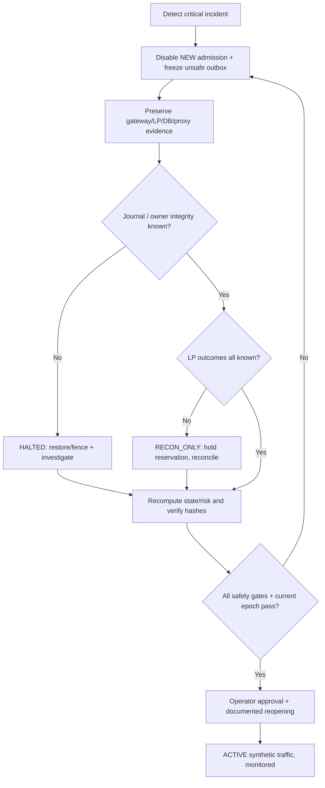

**Incident checklist:**

1. Freeze New/unsafe Replace; keep safe admin and mandatory journaling/reconciliation functions under bounded resource policy; do not reset session/order state to hide unknowns.
2. Capture immutable `run_id`, source/build, DB LSN/timeline, owner_epoch, session sequence heads, LP ledger and snapshot hashes, all accepted command IDs, active reservations and outbox unknown rows.
3. Categorize `known not sent`, `sent unknown`, `LP accepted`, `LP fill confirmed`, `contradicted`; do **not** equate socket/DB ACK to LP execution.
4. Fencing: ensure a single authoritative Gateway owner before network/session resume; old sockets must be closed or proven unable to send.
5. Restore P06 via verified checkpoint/WAL; check all journal and projection invariants; compare per-order and per-ExecID against independent LP truth (only available in lab).
6. Correct discrepancies only through versioned, auditable reconciliation workflow with evidence; never silently write fill ledger manually to match a total.
7. Gate ACTIVE only when applicable P0 and recovery checks pass and incident owner authorizes reopening; if external status unavailable, keep RECON_ONLY.
8. Rerun deterministic reproducer and regression/chaos subset to ensure root cause addressed; attach first failing checkpoint and fixed source commit.

---

## 29. Eight implementation milestones and definition of done

| Milestone | Deliverable | Exit criteria |
|---|---|---|
| M1 | Version-pinned contracts + isolated Compose lab | P01/P02 handshake, schema health, no real endpoint egress |
| M2 | Synthetic CLI and golden FIX fixtures | New/Cancel/Replace + partial fills pass E2E happy paths |
| M3 | Independent oracle + canonical hashes | Per-event ledger/risk/journal diff, model mutation tests detect bug |
| M4 | Scenario DSL + deterministic event scheduler | Same seed replay equivalence; mismatch reproducible/shrinkable |
| M5 | Failpoint adapters + 32 crash windows | Each fault activation proven, state safety assertions pass |
| M6 | Reconciliation, backup/PITR, owner fencing | Restore and failover drills safely gate new traffic |
| M7 | Open-loop benchmark / saturation / soak | Correct complete outcome accounting and valid p99 evidence |
| M8 | 600-case matrix + 40 playbook catalog automated | P0 executed/pass, P1 disposition, signed report + release gate |

**DoD for any implemented scenario:** test source code; setup fixture with stable seed; exact trigger; at least one *independent* oracle; exhaustive relevant assertions; reproducible failure artifact; cleanup verified; CI registration; link to P01–P07 contract and EI invariant; reviewed PASS/FAIL semantics. File alone **does not** fulfill this DoD.

---

## 30. Known limits, open questions and references

### 30.1. What we cannot honestly guarantee from design alone

- 600 scenario names + 40 fault procedures are **planned coverage**, not 600 successful executions; real resilience requires implementation, testing across environments, mutation sensitivity and operational drills.
- No finite matrix covers all timing interleavings, hardware corruption, vendor-specific rules, malicious inputs or human error; bounded model checking, fuzz/chaos random seeds and continuously added regressions expand evidence but do not prove universal survivability.
- A simulator is not a broker: real LP execution semantics, identity scope, cancel/replace behavior, FIX resend/session reset rules, reconciliation APIs and market schedules must be negotiated per RoE.
- Exactly-once **business effect** can be approached with durable identity/dedup + recon under documented assumptions; **exactly-once delivery over TCP** is not promised.
- Recovery after asynchronous replication failover or PITR requires potential data-loss characterization and independent external reconciliation before resuming; 0 RPO is not assumed.
- Latency figures depend on workload, span, hardware, code, DB durability, kernel and network model. The CV p99 310→95 µs is only its stated benchmark setting; P08 makes no claim to reproduce it before measurement.

### 30.2. Questions to resolve before implementing P08

1. Which exact FIX 4.4 dictionary and broker/LP **Rules of Engagement** will be pinned for lab?
2. Do P01 and P04 expose a durable send contract? How does P01 represent unknown transport outcome and sequence state?
3. Is P06 one ACID store for P03/P05/P04 mutation, and how is P01 session persistence synchronized with it?
4. What is the exact idempotency scope for `ClOrdID`, `ExecID`, trading day/session epoch across P02 and P04?
5. Which OrderStatusRequest or execution-history reconciliation operations does P02 emulate?
6. What are account/firm FX conversion, margin proxy, rounding and tick-size policies for P05?
7. What are required RTO/RPO, allowed fail-closed downtime, and operator sign-off procedures?
8. Which benchmark hardware/cgroup/NUMA and DB durability settings can be pinned for fair comparison?
9. What is the policy for unsupported trade bust/correction, multiple LPs and high availability? (Out of MVP unless explicitly implemented.)
10. How is evidence retained/redacted/approved, and which environments may execute fault-injection tools?

### 30.3. Public technical sources (verified for design context; not CV claims)

- FIX Trading Community, [FIX Protocol standards and FIX 4.4 specification listing](https://fixtrading.org/standards/fix-protocol/).
- FIX Trading Community, [Business Area: Trade — OrdStatus vs ExecType and pending state](https://archive.fixtrading.org/online-specification/business-area-trade/).
- FIX 4.4, [Sequence Reset and GapFill semantics](https://fix.dev/organizations/fix-standards/specs/1000001/messages/4), [StandardHeader with PossDup/PossResend fields](https://fix.dev/organizations/fix-standards/specs/1000001/components/StandardHeader).
- PostgreSQL, [WAL asynchronous commit and durability](https://www.postgresql.org/docs/current/wal-async-commit.html) and [continuous archive/PITR](https://www.postgresql.org/docs/current/continuous-archiving.html).
- Docker, [Compose service dependencies and `service_healthy`](https://docs.docker.com/reference/compose-file/services/).
- Linux, [`tc netem` packet impairment and limitations](https://man7.org/linux/man-pages/man8/tc-netem.8.html).
- Prometheus, [histogram practices](https://prometheus.io/docs/practices/histograms/).

**End status:** This document defines architecture, 56 proposed invariants, 32 fault windows, 600 planned what-if cases and 40 planned playbooks. **Implementation/execution status: NOT_RUN for all cases**, until P01–P07 source and the P08 harness are built and verified.
