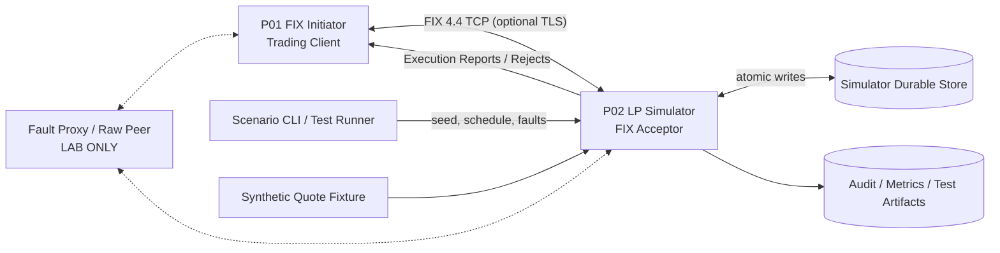
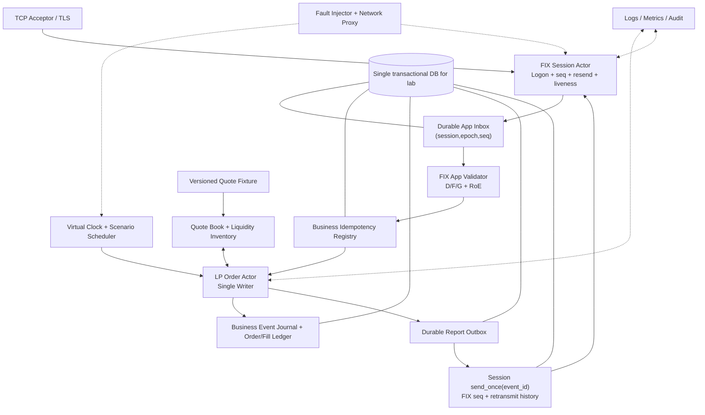
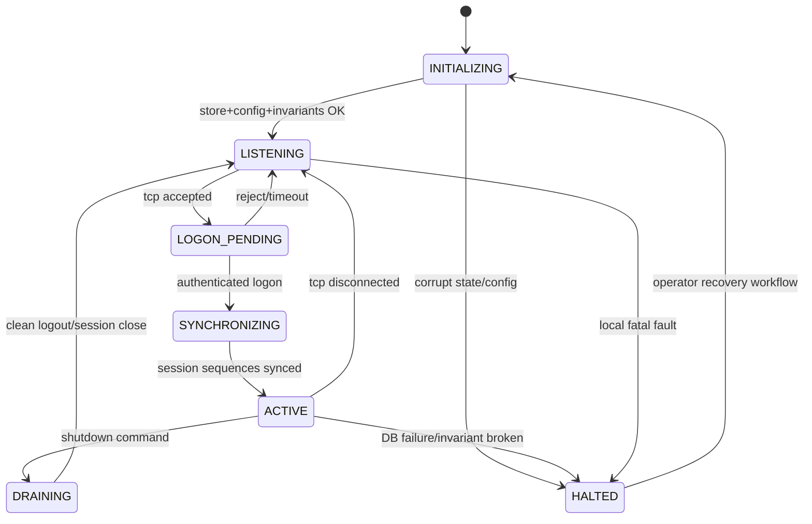
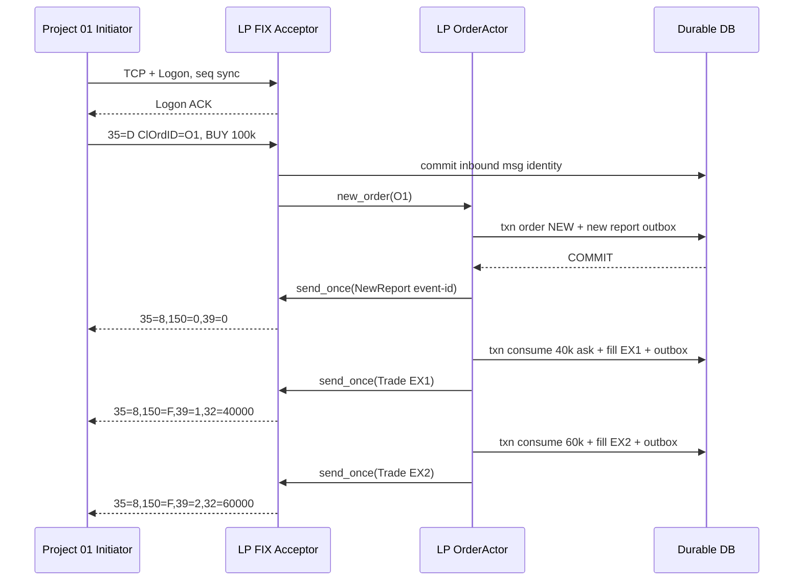
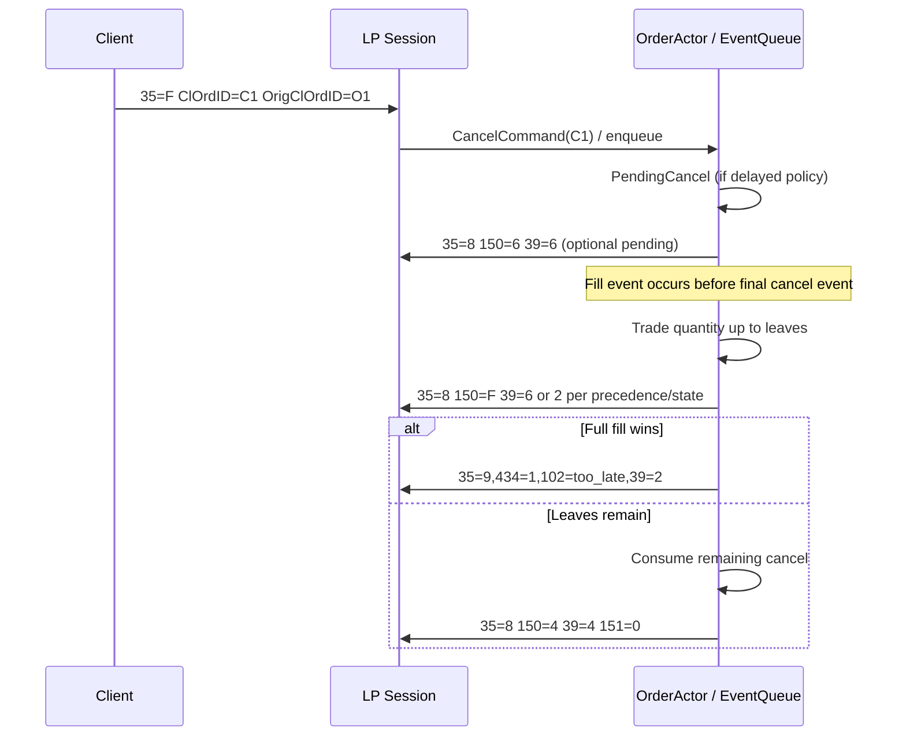
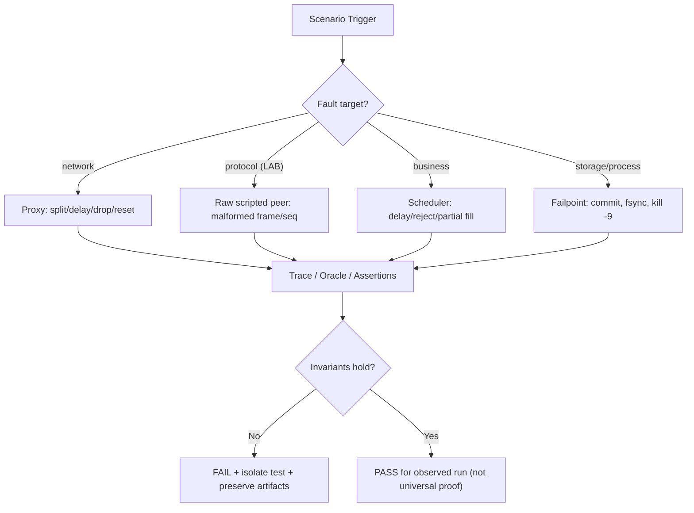
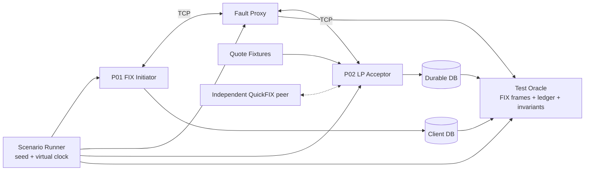

# Project 02 — FX/CFD Liquidity Provider Simulator (FIX 4.4)

> **System Design · Implementation Blueprint · Failure Modeling · What-if Test Plan**  
> **Ngôn ngữ:** Tiếng Việt · **Stack đề xuất:** C++20, Linux, CMake, Docker, SQLite (lab), FIX 4.4  
> **FIX role:** **Acceptor** (LP simulator) ↔ Project 01 là **Initiator** (FIX Session Engine)  
> **Phiên bản tài liệu:** 1.0 · **Ngày:** 2026-10-30 · **Trạng thái:** thiết kế đề xuất, **chưa có source code/chưa chạy test/chưa đo benchmark**  
> **Lab scope:** 1 counterparty / 1 active session identity / 1 LP giả lập; mở rộng nhiều account/symbol theo cấu hình.

## Mục lục

1. [Mục đích, căn cứ và giới hạn](#1-mục-đích-căn-cứ-và-giới-hạn)
2. [Requirements, SLO và bất biến an toàn](#2-requirements-slo-và-bất-biến-an-toàn)
3. [Hợp đồng tích hợp với Project 01 và Rules of Engagement](#3-hợp-đồng-tích-hợp-với-project-01-và-rules-of-engagement)
4. [Context diagram và trust boundaries](#4-context-diagram-và-trust-boundaries)
5. [Kiến trúc logic, ownership và concurrency](#5-kiến-trúc-logic-ownership-và-concurrency)
6. [Domain model, identity và order state](#6-domain-model-identity-và-order-state)
7. [FIX 4.4 application protocol và validation](#7-fix-44-application-protocol-và-validation)
8. [Quote book, pricing, matching và time semantics](#8-quote-book-pricing-matching-và-time-semantics)
9. [Các message flows và race semantics](#9-các-message-flows-và-race-semantics)
10. [Durability, exactly-once giới hạn và recovery](#10-durability-exactly-once-giới-hạn-và-recovery)
11. [Fault injection và deterministic scheduler](#11-fault-injection-và-deterministic-scheduler)
12. [Backpressure, security, limits và deployment](#12-backpressure-security-limits-và-deployment)
13. [C++20 interfaces và cấu trúc repository](#13-c20-interfaces-và-cấu-trúc-repository)
14. [Configuration và example scenario DSL](#14-configuration-và-example-scenario-dsl)
15. [Observability, audit và runbooks](#15-observability-audit-và-runbooks)
16. [Ma trận What-if](#16-ma-trận-what-if)
17. [P0 fault-injection playbooks](#17-p0-fault-injection-playbooks)
18. [Test harness, fuzzing, property/model tests](#18-test-harness-fuzzing-propertymodel-tests)
19. [Acceptance criteria và release gates](#19-acceptance-criteria-và-release-gates)
20. [Implementation roadmap](#20-implementation-roadmap)
21. [Architecture decisions, trade-offs và open risks](#21-architecture-decisions-trade-offs-và-open-risks)
22. [Tài liệu tham chiếu](#22-tài-liệu-tham-chiếu)

---

## 1. Mục đích, căn cứ và giới hạn

### 1.1. Những gì thực sự được xác nhận từ CV

CV mô tả dự án lớn **FX/CFD FIX Gateway and Execution Engine** tại Larion, stack **C++20, FIX 4.4, PostgreSQL, Linux, Docker**, có **liquidity-provider adapters**, FIX logon/heartbeat/reconnect, sequence persistence/resend/gap-fill, xử lý **new/cancel/replace orders** và **execution-report reconciliation**. CV **không** nói đã có một **Liquidity Provider Simulator** độc lập, không xác định matching rules, LP thực, dữ liệu quote hay schema. Project 02 dưới đây **là thiết kế mới để tái dựng, học và kiểm thử**, không được viết như sự thật lịch sử tại công ty.

### 1.2. Quan hệ với 8 mini-project

- **Project 01 — FIX Session Engine:** đóng vai **initiator**; chịu trách nhiệm FIX framing, sequence, session authentication, heartbeat, resend/replay và durable inbound/outbound. Không giao cho LP Simulator "sửa" state client.
- **Project 02 — LP Simulator (tài liệu này):** đóng vai **acceptor**, mô phỏng đối tác khớp lệnh, phát ExecutionReport, chủ động gây lỗi có kiểm soát để kiểm tra Project 01 và các mini-project sau.
- **Project 03:** client-side Order State Machine (không tái sử dụng model của simulator như một test oracle duy nhất).
- **Project 04:** Order Routing/Reconciliation; **Project 05:** Pre-trade Risk; **Project 06:** client journal/recovery; **Project 07/08:** optimization, end-to-end/benchmark.

### 1.3. Mục tiêu chính

1. Làm **đối tác FIX 4.4 độc lập, có thể chạy được** cho Project 01; không cần broker/market thật.
2. Tạo kết quả fill **đúng định dạng, đúng business state** (normal mode); phát hiện client xử lý sai order lifecycle.
3. Tái hiện lỗi **deterministically**: duplicate, delayed ack, partial fill, cancel/replace race, disconnect, replay và crash ở các transaction boundary.
4. Đảm bảo **ledger và scenario có thể kiểm chứng**: không tạo fill trùng hoặc âm thầm thay đổi fill khi restart; chạy lại cùng seed cho cùng logical result.
5. Giữ ranh giới: **không thực hiện giao dịch thật**, không làm matching engine production-grade, không mô phỏng hoàn chỉnh price discovery/margin/CFD funding.

### 1.4. In scope / out of scope

| In scope (v1) | Out of scope (trừ khi mở rộng) |
|---|---|
| TCP FIX 4.4 **acceptor** và FIX session continuity (có thể tái sử dụng codec/state pattern Project 01) | Kết nối sàn/LP thật, real-money execution, broker account |
| NewOrderSingle(35=D), Cancel(35=F), Replace(35=G), ExecutionReport(35=8), OrderCancelReject(35=9) | Full FIX 4.4 message catalog, complex derivatives, allocation, drop-copy |
| Limit DAY orders, EURUSD/GBPUSD giả lập, quote snapshots và partial fills | Complete exchange order book, OTC bilateral pricing thực, multi-leg |
| Optional giai đoạn sau: Market, IOC, FOK; nhiều price levels | GTC carry-over, market data service chuẩn FIX, real margin/risk |
| Fixed-point pricing/qty, single-owner event processing, deterministic event scheduling | HA active-active, geo replication, consensus, zero-downtime upgrade |
| Durable business journal/outbox, restart recovery, inject faults/metrics | External payment, clearing, netting và regulatory reporting |

**Thiết kế hai mode tách biệt:** `conformant` (chỉ gửi FIX hợp lệ, app policies rõ) và `adversarial` (cố ý lỗi protocol/business, **chỉ lab/loopback**, không là bằng chứng RoE production). Fault injection qua proxy ở network; một số FIX corruption cần **scripted raw peer** để không phụ thuộc hành vi nội bộ thư viện FIX.

---

## 2. Requirements, SLO và bất biến an toàn

### 2.1. Functional requirements

| ID | Yêu cầu | Priority | Acceptance oracle |
|---|---|---|---|
| FR-01 | Acceptor FIX 4.4 đúng CompID/Logon/session schedule | MUST | Không app processing trước session `ACTIVE` |
| FR-02 | Inbound D/F/G được validate theo FIX dictionary và business policy | MUST | Malformed không làm thay đổi order/quote state |
| FR-03 | Acknowledge New hoặc Reject bằng 35=8 | MUST | 1 logical decision/order request, `ExecID` unique |
| FR-04 | Tạo partial/full fills từ quote book có tài nguyên hữu hạn | MUST | Không vượt order quantity hay available liquidity |
| FR-05 | Cancel và Replace có kết quả xác định, xử lý pending/race | MUST | Report fields + state tương thích FIX 4.4 |
| FR-06 | Duplicate/new application resend được xử lý idempotently | MUST | Một `ClOrdID` không sinh 2 order chains |
| FR-07 | FIX session replay không kích hoạt lại business execution | MUST | `43=Y` không tạo thêm fill/business event |
| FR-08 | Durable orders/fills/reports/outbox và crash recovery | MUST | Reboot không rollback filled quantity |
| FR-09 | Deterministic fault timeline + seed + event trace | MUST | Cùng input/seed/version → cùng logical event log |
| FR-10 | Backpressure và hard caps cho queue, requests, connections | MUST | Không OOM hoặc tạo fill khi state unknown |
| FR-11 | Observability, audit, scenario replay, seeded fuzz | MUST | Từng fill truy ngược về order/request/quote |
| FR-12 | Conformance và adversarial modes **cô lập** | MUST | Không thể kích hoạt corruption ở public interface |
| FR-13 | Integration test với Project 01 + independent FIX reference | MUST | Cross-implementation FIX tests pass |
| FR-14 | Multi-account / multi-session / live rate generation | LATER | Không ảnh hưởng correctness single-peer v1 |

### 2.2. Safety invariants (I-01 đến I-20)

Các bất biến này được kiểm tra tự động sau **mọi event đã commit** và sau **mọi restart/fault-injection step**:

1. **I-01 — Isolation:** không xử lý New/Cancel/Replace trước FIX Logon hợp lệ, session synchronized, identity authenticated.
2. **I-02 — Single owner:** một canonical order chain được mutate bởi **một event actor**, theo total order của event log; no concurrent writers.
3. **I-03 — No overfill:** `0 <= CumQty <= EffectiveOrderQty`, với profile mặc định **không cho giảm OrderQty dưới CumQty**; `LeavesQty = EffectiveOrderQty - CumQty` khi còn active.
4. **I-04 — Terminal leaves:** `LeavesQty=0` khi order terminal Canceled/Expired/Rejected (kể cả `CumQty < OrderQty`); không áp công thức `OrderQty=CumQty+LeavesQty` bắt buộc cho mọi terminal state.
5. **I-05 — Single execution identity:** mỗi logical fill có **stable unique `ExecID(17)`**; retransmission cùng event không có ExecID mới.
6. **I-06 — No double fill:** cùng business request/trigger hoặc cùng replay không tạo thêm fill; tổng fill ledger = `CumQty` (v1 không hỗ trợ trade bust/correct).
7. **I-07 — Request identity:** `ClOrdID(11)` duy nhất theo counterparty và business namespace của RoE, **chia sẻ namespace D/F/G**; duplicate cùng ID + same semantics → không tạo request thứ hai; cùng ID + different semantics → reject/quarantine.
8. **I-08 — Order chain identity:** `OrderID(37)` ổn định xuyên replace trong v1; `OrigClOrdID(41)` trỏ đến last accepted ClOrdID phù hợp profile.
9. **I-09 — Correct FIX 4.4 fills:** mọi fill dùng `ExecType(150)=F` (Trade), `LastQty(32)>0`, `LastPx(31)` hợp lệ; `OrdStatus(39)` tuân thủ **state precedence** (thường `1/2` nếu không pending, có thể `6/E` trong pending cancel/replace).
10. **I-10 — No phantom trade:** không fill lệnh rejected/unaccepted/terminal, lệnh không marketable, quote stale hoặc liquidity đã hết.
11. **I-11 — Price rule:** BUY fill `price <= limit` và SELL fill `price >= limit` với order Limit, theo snapshot đã được chấp nhận; không fill vượt configured best quote/lot rules.
12. **I-12 — Conserved quote:** mỗi liquidity slice bị tiêu hao tối đa một lần; không âm quantity, không oversubscribe hai order cùng quote.
13. **I-13 — Report lineage:** mỗi ExecutionReport/CancelReject nêu đúng OrderID / chain ID / request ID / event; business reject dùng đúng message type.
14. **I-14 — Durable before external send:** commit order/fill state và outbox intent trước khi tạo original outbound FIX frame trên socket; crash không tạo state khác với report đã có thể phát ra.
15. **I-15 — Stable send-once:** một `outbox_event_id` không được cấp **hai original FIX outgoing sequence numbers** trong cùng session stream; session retransmit sử dụng sequence gốc theo chuẩn.
16. **I-16 — Persistent idempotency:** de-dup ở **hai lớp**: `(session_id, epoch, in_seq)` và business key `(counterparty, business_namespace, ClOrdID)`; FIX seq reset không xóa business dedup.
17. **I-17 — Bounded resources:** queue/buffer/timer/events/FD/DB size đều có quota; full queue phải reject/stop an toàn, không silently drop committed fill.
18. **I-18 — Event reproducibility:** scripted seed/virtual clock/ordering đầy đủ, restart cùng checkpoint → không tự phát thêm random fill.
19. **I-19 — Explicit error policy:** lỗi local durable store, version mismatch, ownership conflict hoặc invariant violation → `HALTED`, no new fill; chỉ operator/recovery hợp lệ được resume.
20. **I-20 — Safety-mode separation:** `conformant` không gửi frame sai có chủ ý; `adversarial` bị hạn chế network/credentials/runner; một fault test không làm ô nhiễm state của test sau.

### 2.3. SLO và workload *đề xuất cho lab*, không phải số đo trong CV

| Metric | Lab target / threshold minh họa | Measurement / gate |
|---|---|---|
| Functional correctness | **100% P0 PASS** và tất cả I-01..I-20 pass | Automated state+wire oracle, zero known critical defects |
| Durability | **0 duplicate fills** trong các crash/replay property tests | Ledger checksum + event ancestry after restart |
| Determinism | Cùng seed + config + fixture → identical canonical event log/hash | 100 repeated runs mỗi fixture quan trọng |
| Memory | Process RSS ≤ 256 MiB ở single-peer test đã xác định | Soak, ASan/LSan, heap trend |
| End-to-end harness | Chạy 1/10/100/1.000 concurrent outstanding orders qua **single session** theo profile | Report throughput + latency p50/p95/p99, không khẳng định performance trước khi đo |
| Loss/dup network | Thử 0–30% packet-drop simulation, reorder/fragment, restart | Session recovery hoặc HALTED có giải thích; không double fill |
| Restart | Khôi phục DB + FIX sync + pending outbox, không silent reset | Script kill/restart tại faultpoints |
| Sustained runs | 1h/6h/24h sandbox soak | Số lượng status, FD, backlog, RSS plateau |

**Không lấy p99 95 µs của dự án lớn làm SLO simulator**: con số CV là latency `receive-to-route` cho hệ thống khác, không đo `request → execution report` hay durability của LP Simulator.

---

## 3. Hợp đồng tích hợp với Project 01 và Rules of Engagement

### 3.1. Session identity và namespace

| Field/concept | Project 01 Initiator | Project 02 Acceptor | Policy |
|---|---|---|---|
| `BeginString(8)` | `FIX.4.4` | `FIX.4.4` | Reject mismatch |
| `SenderCompID(49)` | `TRADER01` | `SIMLP01` | Mỗi bên đảo chiều Sender/Target |
| `TargetCompID(56)` | `SIMLP01` | `TRADER01` | Không chấp nhận peer khác |
| FIX session `epoch` | Persist ở P01 | Persist độc lập ở P02 | Reset phối hợp, **không** khi TCP disconnect |
| `MsgSeqNum(34)` | TX/RX independent | TX/RX independent | Do FIX session layer điều hành |
| `ClOrdID(11)` | Client sinh | LP de-dup | Business namespace không gắn với 34/epoch |
| `OrderID(37)` | Client nhận | LP sinh | Stable across replace (v1 policy) |
| `ExecID(17)` | Client de-dup | LP sinh | Stable per event, unique per report |

### 3.2. Interface contract từ P01

P01 được thiết kế có `IApplicationSink` nhận **app message đã sequencing và durable commit**. P02 sẽ cung cấp một **AcceptorSession** triển khai cùng semantics ở phía đối diện. Hợp đồng xử lý chiều inbound:

```text
Session layer validates FIX + seq
  -> durable inbox keyed (session_id, epoch, msg_seq_num)
  -> deliver business command (at-least-once)
  -> LP business actor deduplicates ClOrdID + commits state/outbox
  -> business delivery ack (may be retried)
```

Chiều outbound cần một API **đề xuất mới**: `send_once(outbox_event_id, payload)` atomically gắn `event_id -> session seq + resend history`. API này **không được khẳng định đã có trong P01**; phải implement/kiểm chứng khi kết nối. **QuickFIX/C++ stock sender không được mặc định có transaction này**. Nếu dùng QuickFIX acceptor ở P02, tính năng này yêu cầu adapter/store bổ sung hoặc document clear limitation. Chưa chứng minh `send_once` ⇒ **chưa được claim crash-safe report emission**.

### 3.3. Rules of Engagement (RoE) — phải pin bằng contract

- Allowed session IDs/IPs, credentials, optional TLS/mTLS và logon schedule; password masked.
- Sequence reset schedule; `ResetSeqNumFlag(141)`/recovery policy; application replay policy; FIX dictionary version và custom tags.
- Business namespace scope của `ClOrdID` (v1: `(sender_firm, business_day, ClOrdID)` cho mọi session identity cùng firm; reset epoch không giải phóng ID trong business day); retention >= configured resend/order reconciliation window.
- Price precision/tick/quantity step per symbol, TradingCalendar/time zone, TIF policy, staleness threshold, throttling, cancel/replace policy.
- Define explicitly response semantics for duplicate `PossResend(97)=Y`, unknown OrigClOrdID, IOC/FOK, expired order, pending cancel/replace, unsupported OrdType/CFD tags.
- Nếu RoE khác với assumptions, **profile config thay đổi**, không lén sửa protocol/runtime behavior.

### 3.4. Session reset ≠ order lifecycle reset

Một FIX session reset có thể làm `NextNumIn/NextNumOut` bắt đầu từ 1 khi có agreement; business orders, fills, IDs và journal **không được xóa** vì logon/reset. Order persistence được quản lý bằng business lifecycle và retention policy riêng.

---

## 4. Context diagram và trust boundaries



**Trust boundaries:**

1. Network byte stream và FIX tags không đáng tin; session layer validate trước khi business side effect.
2. Script/scenario configuration coi là untrusted input; verify schema, quotas, safe paths, seed, allowed fault endpoints.
3. DB snapshot/backup **không mặc định** là fresh/correct; restart phải check schema, state version, uniqueness/consistency.
4. Admin control plane cần permissions riêng, không dùng cùng endpoint với FIX public listener.
5. Fault proxy hoạt động **in-path** khi test (`P01 ↔ Proxy ↔ P02`), sơ đồ trên chỉ minh họa trust boundary; production mode bypass proxy.

---

## 5. Kiến trúc logic, ownership và concurrency



### 5.1. State ownership và execution ordering

- **Session Actor** sở hữu FIX session state, sequence numbers, heartbeat/retransmit, socket generation; không tự quyết order fills.
- **LP Order Actor** sở hữu order chains, quotes, schedule, fill ledger; **một actor** serialize business events. `atomic_input_index` được gán monotonically ở điểm nhận command từ durable inbox/scheduler.
- **DB writer** thực thi transactions trong cùng SQLite database file; có thể là một worker với bounded queue. Không gọi external socket write trong DB transaction.
- **Scenario Scheduler** không gọi trực tiếp order methods từ timer thread; chỉ enqueue `ScheduledEvent` có ordering key `(due_monotonic_time, insertion_index)`. Nếu timestamps bằng nhau, insertion_index quyết định thứ tự, không dùng nondeterministic thread scheduling.
- **Fault Injector** chỉ sửa event scheduling, transport hoặc failpoint được cho phép; mỗi trigger được audit và chỉ thực hiện số lần xác định.

### 5.2. Critical write path

```text
APP_INBOX_COMMITTED
 -> dedup request
 -> validate business policy
 -> mutate order/quote/ledger + assign event_id/ExecID
 -> TXN commit state + business_event(s) + outbox row(s)
 -> async send_once(outbox_event_id, encoded_execution_report)
 -> TXN commit event_id -> outbound FIX seq + retransmit history
 -> write bytes to socket (may be partial/lost)
 -> peer/session layer recovery decides replay, not LP matching engine
```

**No false exactly-once:** cannot know whether peer applied report solely from successful `send()`. Guarantee targets concern **stable LP business effects**, **stable outbound intent identity**, and protocol replay from durable history. Client still needs ExecID-based idempotency + reconciliation.

### 5.3. Runtime states



`LISTENING` là acceptor socket sẵn sàng; **không** có nghĩa app messages được phép xử lý. `HALTED` không reset DB và không tiếp tục tạo fills.

---

## 6. Domain model, identity và order state

### 6.1. Core models (logical fields)

```text
OrderChain:
  firm_id, business_day, order_id, original_cl_ord_id, current_cl_ord_id
  symbol, side, ord_type, tif, original_qty, effective_order_qty
  current_limit_price_ticks, cum_qty_units, leaves_qty_units
  notional_sum_ticks_units, avg_px_ticks, status, pending_request_id
  version, accepted_at, terminal_at

RequestRegistry:
  firm_id, business_day, cl_ord_id (unique across D/F/G)
  request_type, canonical_payload_hash, target_order_id, outcome_event_ids

FillLedger:
  fill_id, exec_id (unique), order_id, quote_version, liquidity_slice_id
  qty_units, price_ticks, event_id, created_at_utc

QuoteSlice:
  symbol, quote_version, bid_ticks, ask_ticks, bid_available_units, ask_available_units
  valid_from, expires_at, source_fixture_id

ReportOutbox:
  event_id (unique), report_type, order_id, canonical_payload, exec_id?
  send_state, outbound_seq?, session_epoch?, created_at_utc
```

### 6.2. Hai tầng identity cần độc lập

| Identity | Key | Dùng để chống lỗi nào? |
|---|---|---|
| FIX inbound identity | `(fix_session_id, epoch, MsgSeqNum)` | FIX retransmission/duplicate frame |
| Business request identity | `(firm_id, business_day, ClOrdID)` | App-level resend khác seq, duplicate commands |
| Order chain | `(firm_id, OrderID)` | Cancel/replace liên quan một chain |
| Fill identity | `ExecID` + `FillLedger.fill_id` | Nhận diện trade/ExecutionReport distinct |
| Outbox event | `event_id` immutable | Re-dispatch sau crash không cấp seq mới |
| Scenario event | `(scenario_run_id, event_index)` | Reproducible fault/quote/fill scheduling |

`PossDupFlag(43)=Y` phản ánh **session retransmission** và original seq, còn `PossResend(97)=Y` là **application resend** có thể mang một seq **mới**. Cần de-dup *cả hai lớp*; không được tự động xem message `97=Y` là order mới.

### 6.3. State transitions (normal v1)

```mermaid
stateDiagram-v2
    [*] --> VALIDATING: NewOrderSingle
    VALIDATING --> REJECTED: invalid / unsupported
    VALIDATING --> NEW: accepted
    NEW --> PARTIALLY_FILLED: trade 0 < cum < qty
    NEW --> FILLED: trade cum=qty
    PARTIALLY_FILLED --> PARTIALLY_FILLED: subsequent trade
    PARTIALLY_FILLED --> FILLED: final trade
    NEW --> PENDING_CANCEL: cancel enqueued
    PARTIALLY_FILLED --> PENDING_CANCEL: cancel enqueued
    PENDING_CANCEL --> CANCELED: cancel succeeds
    PENDING_CANCEL --> PARTIALLY_FILLED: cancel reject; remain active
    PENDING_CANCEL --> FILLED: final fill wins
    NEW --> PENDING_REPLACE: replace enqueued
    PARTIALLY_FILLED --> PENDING_REPLACE: replace enqueued
    PENDING_REPLACE --> NEW: replace accepted; cum=0
    PENDING_REPLACE --> PARTIALLY_FILLED: replace accepted; cum>0
    PENDING_REPLACE --> FILLED: fill wins / request rejected
    NEW --> CANCELED: cancel immediate
    PARTIALLY_FILLED --> CANCELED: cancel immediate
    NEW --> EXPIRED: configured expiration
    PARTIALLY_FILLED --> EXPIRED: configured expiration
```



**Quan trọng:** sơ đồ thể hiện **business internal states**, không đồng nhất 1:1 với `OrdStatus(39)` của *mỗi* report; FIX định nghĩa status precedence khi pending cancel/replace trùng với fills. Sau replace, report `ExecType=5` có thể có `OrdStatus=1` nếu lệnh vẫn partially filled. Không "reset" `CumQty` khi replace.

### 6.4. Quantity và giá

- Quantity v1: **nguyên số đơn vị base currency** (`int64_t`, ví dụ EUR 100,000), bước lô theo symbol cấu hình; không cast từ binary floating point.
- Giá v1: **tick integer** (`int64_t`). Ví dụ `tick_size=0.00001`, `1.08500 ⇒ 108500 ticks`.
- `CumQty := Σ distinct active FillLedger.qty`; `LeavesQty := max(0, EffectiveOrderQty-CumQty)` nếu active, còn terminal → 0.
- `AvgPx` tính từ tổng `Σ(qty × price_ticks) / Σqty` với checked multiplication/`__int128` (nếu supported), rounding policy explicit; test không phụ thuộc floating-point.
- **Quote inventory** trừ atomically theo qty; reserve quote slice trước khi phát fill, tránh over-subscribing.
- Reject replace giảm `OrderQty < CumQty` trong **lab strict profile**. Chuẩn FIX có semantics khác theo RoE (giảm dưới filled có thể hiểu như stop executing); phải đánh dấu rõ khác biệt này, test rejected outcome nếu chọn strict.

---

## 7. FIX 4.4 application protocol và validation

### 7.1. Supported messages

| Direction | MsgType(35) | FIX name | V1 policy |
|---|---|---|---|
| Client → LP | `D` | NewOrderSingle | Accept valid Limit/DAY hoặc 35=8 Rejected |
| Client → LP | `F` | OrderCancelRequest | PendingCancel optional; final 35=8 Canceled hoặc 35=9 |
| Client → LP | `G` | OrderCancelReplaceRequest | PendingReplace optional; final 35=8 Replaced hoặc 35=9 |
| LP → Client | `8` | ExecutionReport | New, Trade, Canceled, Replaced, Rejected, PendingCancel/Replace |
| LP → Client | `9` | OrderCancelReject | Reject cancel/replace; **không dùng 35=8 Rejected để từ chối cancel** |
| Both | `A,0,1,2,3,4,5` | FIX admin | Session protocol module (P01 mirrored acceptor) |
| Client → LP | `H` | OrderStatusRequest | **Optional phase 2**; không giả support nếu chưa implement |

### 7.2. Semantic tags

| Tag | Name | Scope / rule |
|---|---|---|
| 11 | ClOrdID | Globally unique within configured client business namespace for D/F/G |
| 41 | OrigClOrdID | Refers to preceding **accepted** order version for cancel/replace |
| 37 | OrderID | LP-generated stable order-chain identity |
| 17 | ExecID | LP-generated stable unique report identity |
| 55, 54 | Symbol, Side | Whitelist; Side `1` Buy / `2` Sell in v1 |
| 38, 40, 44, 59 | OrderQty, OrdType, Price, TimeInForce | Limit `40=2`, DAY `59=0` (or absent) in MVP |
| 60, 52 | TransactTime, SendingTime | Timestamp validation; different purposes |
| 150, 39 | ExecType, OrdStatus | **FIX 4.4** purpose and current status are distinct |
| 14, 151, 6 | CumQty, LeavesQty, AvgPx | Cumulative across order versions |
| 32, 31 | LastQty, LastPx | Present for trade executions; not on no-fill report |
| 434, 102 | CxlRejResponseTo, CxlRejReason | 35=9 response type/reason |
| 34, 43, 97, 122 | Seq, PossDup, PossResend, OrigSendingTime | 43/122 session replay; 97 app resend |

**Correct FIX 4.4 values:** `150=0` New; `150=F` Trade (partial or final); `150=4` Canceled; `150=5` Replaced; `150=6` PendingCancel; `150=E` PendingReplace; `150=8` Rejected. `39=0` New; `39=1` PartiallyFilled; `39=2` Filled; `39=4` Canceled; `39=6` PendingCancel; `39=8` Rejected; `39=E` PendingReplace. **Không dùng `150=1/2` để báo fill trong FIX 4.4** (đó là mapping cũ ở FIX 4.2).

**FIX validity vs business validity:** malformed header/tags theo session spec → `Reject(35=3)` hoặc Logout/close theo trường hợp; message D hợp lệ ở tầng FIX nhưng vượt lot/unsupported symbol → **ExecutionReport(35=8,150=8,39=8)**; F/G không hợp lệ trong ngữ cảnh order → **OrderCancelReject(35=9)**. Unsupported application MsgType có thể trả `BusinessMessageReject(35=j)` nếu phù hợp profile, không tự dùng session Reject bừa bãi.

### 7.3. ExecutionReport builder — bắt buộc kiểm tra

- Session header 8/9/35/49/56/34/52/10 do session engine serialize, không được hardcode sequence trong business actor.
- Canonical business report chứa `37 OrderID`, `17 ExecID`, `150 ExecType`, `39 OrdStatus`, `55 Symbol`, `54 Side`, `38 OrderQty`, `14 CumQty`, `151 LeavesQty`, `6 AvgPx` và các field có điều kiện theo dictionary, `11 ClOrdID`, `41 OrigClOrdID` khi applicable.
- `ExecType=F` bắt buộc có meaningful `32 LastQty` và `31 LastPx`; `ExecType=0` không được giả trade bằng LastQty>0.
- `ExecID` khác nhau giữa các **logical** reports, nhưng giữ nguyên khi session retransmit. `OrderID` giữ nguyên khi replace; quote/version causality lưu trong internal audit, chỉ ra FIX extension nếu RoE cho phép.
- **Không trộn fill event với một report pending/canceled/replaced**: gửi riêng ExecutionReport cho mỗi event, theo FIX semantics.
- Cập nhật `CumQty/AvgPx` xuyên các version của same chain; sau cancel, `LeavesQty=0` dù đã partial fill; trường `OrdStatus` phản ánh trạng thái có precedence cao nhất.
- `OrderCancelReject(35=9)` phải echo `11` request ID, `41` previous accepted ID (trừ unknown), `39` current state và `434` đúng Cancel/Replace, `102` phù hợp. Với unknown order, `37=NONE` theo FIX profile minh họa; NewOrder rejection cũng phải có `37 OrderID` bắt buộc (dùng `NONE` hoặc ID riêng theo RoE đã pin khi chưa cấp OrderID), không bỏ field bắt buộc.

### 7.4. FIX fixture minh họa (dùng ký hiệu `|` để đọc, byte thực là SOH = 0x01)

```text
CLIENT -> LP: 35=D|11=ORD-001|55=EURUSD|54=1|38=100000|40=2|44=1.08500|59=0|60=...|
LP -> CLIENT: 35=8|37=SIM-1001|11=ORD-001|17=EX-0001|150=0|39=0|55=EURUSD|54=1|38=100000|14=0|151=100000|6=0|
LP -> CLIENT: 35=8|37=SIM-1001|11=ORD-001|17=EX-0002|150=F|39=1|55=EURUSD|54=1|38=100000|14=40000|151=60000|32=40000|31=1.08490|6=1.08490|
LP -> CLIENT: 35=8|37=SIM-1001|11=ORD-001|17=EX-0003|150=F|39=2|55=EURUSD|54=1|38=100000|14=100000|151=0|32=60000|31=1.08500|6=1.08496|
```

**Đây là trích đoạn body minh họa**, không phải FIX wire message hoàn chỉnh: serializer phải bổ sung header/trailer, BodyLength và CheckSum; conditional required fields theo FIX44 dictionary; AvgPx kết quả 1.08496 là chính xác theo quantities/giá của ví dụ. Đừng copy dấu `|` để gửi TCP.

---

## 8. Quote book, pricing, matching và time semantics

### 8.1. MVP deterministic LP fill model

- Synthetic quote book theo `symbol`, với bid/ask, available quantity, quote version, thời hạn hiệu lực; tick/lot size pinned trong config.
- **Fill trigger là một policy độc lập:** `scripted` (default trong các scenario YAML phía dưới: **chỉ** match khi nhận explicit `inject_fill`/`match_now`; không auto-fill khi nhận New hoặc quote) hoặc `auto_on_new_or_quote` (matching tự động, phù hợp load/soak). **Không bật cả hai cùng lúc**: nếu không fixture có thể tự khớp ngay khi New rồi lại cố inject cùng fill. Nếu `scripted`, `inject_fill` vẫn kiểm tra mọi điều kiện marketable/available/active và commit atomic như production-like matching.
- Với BUY limit: chỉ lấy **ask liquidity** có `ask <= limit`. Với SELL limit: chỉ lấy **bid liquidity** có `bid >= limit`.
- V1 **single price level per side** là đủ để chứng minh partial fill: `fill = min(leaves_qty, available_qty)`; multiple levels optional ở phase 2.
- Quote consumption phải **atomic với FillLedger** trong một business transaction. Không "reset" available liquidity khi reconnect; chỉ nạp fixture mới có event riêng.
- **No book simulation fiction:** mô hình này giả lập đối tác LP với giá và available inventory có thể cấu hình, **không** phải matching engine chuẩn exchange với full order book/market priority.

### 8.2. Order type / TIF policies

| Profile | Policy | Outcome khi liquidity thiếu |
|---|---|---|
| MVP `Limit + DAY` | New ack rồi có thể partial fill; leaves chờ update/expire/cancel | Không tạo fake fill |
| Optional `Limit + IOC` | Fill được bao nhiêu ngay lúc nhận rồi cancel remaining | `Trade` report (nếu có) rồi `Canceled`, LeavesQty=0 |
| Optional `Limit + FOK` | Precheck đủ liquidity ở mức giá hợp lệ rồi fill toàn bộ **atomic** | Nếu thiếu, no partial; terminal response theo RoE đã pin |
| Optional `Market` | Rule chống stale quote và max slippage/price guard | Nếu không đủ quote, reject hoặc theo market policy rõ |

**TIF expiry:** DAY dựa vào **configured trading-session calendar**, không mặc định UTC midnight. `virtual_monotonic` được dùng cho elapsed/scheduler; thời gian event trong FIX tags dùng **UTC wall clock** được fake injection và audit. Khi restart, overdue timer events phải được **recovered once** (or explicit quarantine), không chạy lại random matching ngoài journal.

### 8.3. Matching algorithm (pseudo)

```cpp
// all mutations under a single LP OrderActor + one durable transaction
MatchResult match_limit(Order& o, QuoteBook& book, int64_t now_ms) {
    auto& q = book.at(o.symbol);
    if (q.expired(now_ms)) return NoTrade{"stale_quote"};
    auto& side = (o.side == Side::Buy) ? q.ask : q.bid;
    if (!marketable(o.side, side.price_ticks, o.limit_ticks)) return NoTrade{"price"};
    const int64_t qty = checked_min(o.leaves_qty, side.available_qty);
    if (qty <= 0) return NoTrade{"no_liquidity"};
    side.available_qty -= qty;  // persisted in SAME txn as fill + order + outbox
    o.cum_qty = checked_add(o.cum_qty, qty);
    o.leaves_qty = o.effective_qty - o.cum_qty;
    persist_fill_with_stable_exec_id(o, qty, side.price_ticks, q.version);
    return Trade{qty, side.price_ticks};
}
```

**Pseudocode**: chưa phải C++ compile-ready; `marketable`, overflow checks, commit boundary và rollback phải implement/test. Một quote version không tự có liquidity vô hạn.

---

## 9. Các message flows và race semantics

### 9.1. Happy path: New → Partial Fill → Final Fill



### 9.2. Cancel race — fill thắng trước khi cancel commit



**FIX nuance:** pending cancel status có precedence; nếu fill xảy ra khi pending cancel, ExecReport `ExecType=F` với `OrdStatus` theo actual/pending precedence và conformance profile. Nếu full fill thì request có thể bị reject vì quá muộn; testcase phải assert **ledger** trước khi assert exact OrdStatus, rồi check FIX conformance fixture. Không hứa mọi interleaving đều chọn cùng branch: scheduler event order phải **được pin**.

### 9.3. Replace race — fill trong khi pending replace

```mermaid
sequenceDiagram
    participant C as Client
    participant A as LP Actor
    participant S as FIX Session
    C->>A: 35=G ClOrdID=R1 OrigClOrdID=O1 price=new
    A->>S: 35=8 150=E 39=E (pending, if configured)
    Note over A: before replace acceptance: old version remains effective
    A->>A: Trade against old qty/price; cumulative qty grows
    A->>S: 35=8 150=F (old accepted ClOrdID & price)
    alt still valid for replace
      A->>A: Apply version R1, preserve CumQty / OrderID
      A->>S: 35=8 150=5, current OrdStatus
    else cannot replace
      A->>S: 35=9 434=2 current OrdStatus
    end
```

- `OrigClOrdID` của request phải trỏ **last accepted version** (strict v1). Rapid optimistic chaining unsupported trong v1 → reject nêu rõ; hỗ trợ thêm nếu RoE yêu cầu.
- Không cho fill báo parameters của R1 **trước** report Replace accepted.
- Nếu replace làm `OrderQty` tăng, tiếp tục từ **cumulative fills cũ**; không tạo order chain mới/duplicate fill.

### 9.4. Reconnect + retransmission không gây double fill

```mermaid
sequenceDiagram
    participant C as Client
    participant S as Session Actor
    participant B as Business Actor
    participant D as Store
    C->>S: 35=D 11=O1 seq=50
    S->>D: commit inbound seq=50
    S->>B: O1
    B->>D: txn order + fill + report outbox event=E1
    B->>S: send_once(E1)
    S->>D: txn E1 to outbound seq=80
    Note over S,C: Drop ACK / disconnect immediately
    C->>S: reconnect, FIX Logon seq continuity
    C->>S: retransmit seq=50 43=Y
    S->>S: dedup inbound seq=50
    C->>S: (optional) app resend O1 with fresh seq,97=Y
    S->>B: dispatch duplicate business key O1
    B->>D: lookup O1; no new fill or E1
    S-->>C: session replay of original E1 seq=80,43=Y (if requested)
```

**Phân biệt:** khi client app resend O1 bằng new sequence, LP có thể gửi *status/ack response* theo RoE nếu phù hợp, nhưng không được replay execution như một giao dịch mới. Nếu report status mới được tạo, **ExecType/ExecID/event identity phải tách** khỏi original fill.

### 9.5. Fault injection không làm "trôi" business event



---

## 10. Durability, exactly-once giới hạn và recovery

### 10.1. Durable schema (đề xuất cho lab, không phải database công ty)

```sql
CREATE TABLE client_requests (
  firm TEXT NOT NULL, business_day TEXT NOT NULL, cl_ord_id TEXT NOT NULL,
  request_type TEXT NOT NULL, canonical_hash TEXT NOT NULL,
  order_id TEXT, outcome_state TEXT NOT NULL,
  PRIMARY KEY(firm, business_day, cl_ord_id)
);
CREATE TABLE order_chains (
  order_id TEXT PRIMARY KEY, firm TEXT NOT NULL, business_day TEXT NOT NULL,
  current_cl_ord_id TEXT NOT NULL, status TEXT NOT NULL,
  effective_qty INTEGER NOT NULL, cum_qty INTEGER NOT NULL,
  leaves_qty INTEGER NOT NULL, avg_px_ticks INTEGER NOT NULL, version INTEGER NOT NULL
);
CREATE TABLE fill_ledger (
  fill_id TEXT PRIMARY KEY, exec_id TEXT UNIQUE NOT NULL,
  order_id TEXT NOT NULL, quote_version INTEGER NOT NULL,
  liquidity_slice TEXT NOT NULL, qty INTEGER NOT NULL, px_ticks INTEGER NOT NULL,
  event_id TEXT UNIQUE NOT NULL
);
CREATE TABLE report_outbox (
  event_id TEXT PRIMARY KEY, order_id TEXT, report_type TEXT NOT NULL,
  canonical_payload BLOB NOT NULL, dispatch_state TEXT NOT NULL,
  outbound_seq INTEGER, session_epoch INTEGER, created_at_utc TEXT NOT NULL
);
CREATE TABLE session_outbound_mapping (
  session_id TEXT NOT NULL, epoch INTEGER NOT NULL,
  event_id TEXT NOT NULL UNIQUE, msg_seq_num INTEGER NOT NULL,
  original_fix_frame BLOB NOT NULL,
  PRIMARY KEY(session_id, epoch, msg_seq_num)
);
-- Plus: quote_versions, quote_liquidity, scheduled_events, event_journal,
-- session_state, inbound_inbox, owner_fence, scenario_runs, schema_versions.
```

**Schema rút gọn để thiết kế**: các index/check constraints/foreign keys và transaction code chưa viết. `PRAGMA foreign_keys=ON`, WAL và `synchronous=FULL` là baseline cho **local crash testing**, không đủ làm bằng chứng chịu mọi physical power-loss; filesystem/hardware/fsync guarantees phải test riêng. `session_outbound_mapping` và outbound sequence counter phải được commit **atomically**; outbox `event_id` global/namespace ổn định qua restart. Đảm bảo order journal và session journal chung DB (v1) hoặc có protocol trạng thái ràng buộc tương đương.

### 10.2. Transaction boundaries: causal correctness

**TX-A: inbound FIX session commit**: atomic `(session_id, epoch, incoming seq, durable app inbox)`; sau đó may deliver **at least once** đến business.

**TX-B: business decision**: atomic `(request registry, order version, quote inventory, fill ledger, scheduled event resolution, business audit, report outbox rows)`; **không xuất socket trong TX-B**.

**TX-C: original FIX report issuance**: `send_once(event_id, payload)` atomic `(outbox event_id → outbound original seq, exact resend payload / SendingTime, NextNumOut advance)`, commit trước socket write. Nếu event_id đã có sequence → **không** phát hành một original message khác; chỉ FIX replay khi cần.

**TX-D: bookkeeping**: update outbox dispatch status/metrics. TX-D crash không thể khiến TX-C cấp original seq mới. **Không xóa events chưa qua retention/sync policy**.

### 10.3. 10 crash windows phải phân biệt

| Cutpoint | State persisted? | Expected after restart |
|---|---|---|
| W1 Trước TX-A | Không có inbox | Peer/session resend; app không chạy |
| W2 TX-A commit, chưa dispatch | Inbound durable | Dispatch lại, no lost request |
| W3 Đang TX-B | DB rollback hoặc commit atomic | Không half-fill/negative liquidity |
| W4 TX-B commit, chưa enqueue report | Business+outbox durable | Re-dispatch outbox once |
| W5 Trước TX-C | Original FIX seq chưa cấp | Retry dispatch stable event_id |
| W6 TX-C commit, trước socket write | Seq đã cấp + frame journaled | Không cấp seq mới; peer yêu cầu resend thì replay original |
| W7 Đang ghi TCP frame | Zero/partial/full remote bytes uncertain | Không giả ack; session resynchronization |
| W8 Peer nhận report, local vẫn pending TX-D | Report có thể đã apply | Không cấp original seq mới; recovery dựa session retransmission |
| W9 Scheduler pending event persisted | Do not execute twice | Reload/tick once / event index idempotent |
| W10 Quote update/fill concurrent commit | Atomic state version | No double consumption, no phantom fills |

### 10.4. Startup recovery checklist

1. Acquire **exclusive owner/fencing** for configured session identity + business store; nếu owner cũ còn sống → reject second instance.
2. Load DB schema version; validate CRC / consistent event counters; scan quote inventory, fills, order state, request registry, outbox unique keys.
3. Recompute `CumQty` and `AvgPx` from fill ledger; compare with snapshots; mismatch → **HALTED** and generate diagnostic dump.
4. Rebuild scheduled event queue từ durable records, mark already-executed `event_id`, không chạy lại stale events tùy tiện.
5. Restore FIX seq and outbound replay history; no automatic reset. Reconnect/resend peer by session rules.
6. Drain pending outbound outbox via idempotent `send_once`, then allow new commands when session synchronized and storage healthy.
7. If uncertainty remains (disk corruption, stale snapshot, missing report history), quarantine/report and require operator reconciliation.

### 10.5. Limits của guarantee

- Network có thể chia cắt ngay sau khi peer đã xử lý report. Không biết peer nhận hay chưa chỉ qua `send()`; success là **commit durable intent**, not remote acceptance.
- Không có global exactly-once nếu hai phía dùng independent stores và không có business acknowledgement/reconciliation protocol. `ExecID`/`ClOrdID` + FIX session replay là **idempotency tools**, không là distributed transaction.
- Nếu operator restore snapshot cũ thiếu fill/ExecID đã gửi, local DB không tự biết; cần monotonic audit backup/checksum và peer reconciliation.
- Nếu bật `QuickFIX` cho session thay vì custom session store, phải prove property TX-C bằng tests. **Không** gán implementation guarantee cho QuickFIX mà chưa tích hợp được store mapping `event_id -> seq`.

---

## 11. Fault injection và deterministic scheduler

### 11.1. Fault taxonomy (multi-layer)

| Layer | Failure knobs | Safety oracle |
|---|---|---|
| TCP / network | drop, delay, reorder **at proxy chunk level**, split/coalesce, RST, half-open, slow reader | Protocol recovers hoặc halts safely; no duplicate business effects |
| FIX session | bad seq, resend gap, duplicate `43=Y`, malformed admin response, wrong CompID, reset request | No app side effect before session validation |
| App message | missing tag, unknown symbol, corrupt decimal, duplicate ClOrdID, contradictory OrigClOrdID | Correct application reject; unchanged ledger on reject |
| LP business | forced partial fill, pending cancel, fill races, stale/empty quote, no response | No overfill, deterministic outcome, future reconciliation possible |
| Scheduler / clock | equal timestamp, fake wallclock jump, timer overdue, repeat after reboot | Stable event ordering and once-only scheduled effects |
| Store / process | BEGIN fail, commit fail, ENOSPC, corrupt backup, kill -9 at W1…W10 | Atomic journal and stable report identity |
| Resource | backpressure, FD limit, 10k connections, CPU starvation, log full | Bounded memory, don't change business state when uncertain |
| Security | wrong credentials, crafted FIX, oversized frame, abusive scenario script | No unauth app actions, no secret leaks |

### 11.2. Failure mode isolation

1. **Business fault:** intentionally reject/delay/partial fill, but still construct FIX-compliant messages; valid for client integration.
2. **Wire fault:** intentionally corrupt FIX fields/bytes, inject gaps/duplicates via scripted peer. Mark `expected_protocol_violation=true`; **not** mixed with normal conformant tests.
3. **Process fault:** kill simulator, quota disk, simulate commit failures. Use sandbox database per test so no cross-contamination.
4. Fault triggers require `seed`, `one_shot` or bounded repetitions, `allow_hosts=[127.0.0.1]`, explicit opt-in; never `rm -rf` arbitrary path or affect real counterparty.

### 11.3. Deterministic scheduling

- Event ordering canonical key: `(virtual_time_us, priority_class, insertion_seq)` with documented `priority_class`; **do not use wall clock + thread scheduling** to decide cancel-vs-fill races.
- For same-time events run **two explicitly named tests** `FILL_BEFORE_CANCEL` and `CANCEL_BEFORE_FILL` by swapping insertion ordering; test both expected outcomes.
- Pseudorandom generator seed pinned (PCG/Xoshiro version pinned, not unspecified `std::rand()`); record `seed`, PRNG version, config hash, fixture checksum, executable commit id.
- Persist planned event identity before execution; on restart, requeue pending events only, executed events remain idempotent.
- Separate `virtual time` for deterministic unit/property tests and `real time` for soak/end-to-end; do not compare histograms from different clock modes.

---

## 12. Backpressure, security, limits và deployment

### 12.1. Bounded resources

| Resource | Suggested lab cap (configurable) | On breach |
|---|---|---|
| Active sessions | 1 per identity; 2nd socket denied/fenced | Close duplicate, alert |
| Global connections | 8 total; per-IP connection attempt rate | Reject/slowdown, preserve authorized session |
| FIX raw frame | 1 MiB hard max unless profile changes | Protocol reject/close, never huge allocation |
| Inbound app queue | 10,000 events | Pause read/drop *uncommitted* transport by closing session safely; never drop committed app event |
| Scheduled events | 100,000 outstanding | Reject new scenario jobs; keep already committed tasks |
| Orders | 100,000 live orders (lab) | Controlled business reject/rate limit, no OOM |
| Pending reports | 100,000 entries / bytes quota | Stop new fills/orders before unsafe growth; preserve durable outbox |
| Quote history | Size/age budget with replay pin | Do not evict version referred by committed fill/journal |
| Disk free | High/critical watermarks (e.g. 20%/10%) | Block new work on critical, no fake ack |
| CPU time/script | Total tick quota + step limit | Abort misconfigured fault loop, record reason |

Caps là giả định lab, cần hiệu chỉnh bằng đo đạc; **capacity overflow không phải lý do để tạo report sai hoặc xóa fill journal**.

### 12.2. Security & safe lab design

- Listener mặc định chỉ bind **127.0.0.1**, Docker port không publish ra mạng public; non-local chỉ khi explicit allowlist + TLS review.
- Secrets: config env/secret file protected; redacted logs, wire capture scrubbed; no sample real customer data.
- Session comp IDs/credentials policy; failed Logon rate-limited; unauthorized IP không đọc order state.
- Limit scenario path/file loading chống path traversal, oversized JSON/YAML, billion loops, malicious scripts; không dùng `eval`/shell interpolation từ scenario config.
- Conformant/adversarial process split hoặc capability-separated; `--unsafe-wire-faults` chỉ được bật khi tất cả endpoints là loopback + unique lab namespace.
- DB file permission/lock; single process owner; snapshots/checksums; alerts trước khi retention purge.
- Nhất quán thời gian: monotonic cho elapsed, UTC cho FIX `SendingTime/TransactTime`; fake wallclock không đồng nghĩa thay đổi business-day session policy mà không trigger rollover event riêng.

---

## 13. C++20 interfaces và cấu trúc repository

### 13.1. Interfaces (sketch, không phải code compile-ready)

```cpp
struct BusinessKey { FirmId firm; BusinessDay day; ClOrdId cl_ord_id; };
struct OrderKey { FirmId firm; OrderId order_id; };
struct ScenarioEvent { EventId id; VirtualTime due; uint64_t insertion; FaultAction action; };

class IAcceptorSession {
public:
    virtual void on_authenticated_application(const Fix44Message& msg,
                                              InboundIdentity id) = 0;
    // Atomic with session outbound history and NextNumOut; must be tested.
    virtual SendResult send_once(OutboxEventId event_id,
                                 const CanonicalFixBody& payload) = 0;
};

class IBusinessStore {
public:
    virtual Decision commit_command(const InboundBusinessCommand& cmd,
                                    const QuoteSnapshot& quote) = 0;
    virtual std::vector<OutboxReport> pending_outbox() = 0;
    virtual RecoveryState recover_and_verify() = 0;
};

class IOrderActor {
public:
    virtual void dispatch(const NewOrder& event) = 0;
    virtual void dispatch(const CancelOrder& event) = 0;
    virtual void dispatch(const ReplaceOrder& event) = 0;
    virtual void dispatch(const ScheduledFill& event) = 0;
};

class IScenarioScheduler {
public:
    virtual void enqueue_persisted(ScenarioEvent event) = 0;
    virtual void advance_to(VirtualTime t) = 0; // deterministic test mode
};
```

### 13.2. Repository layout

```text
fx-fix-gateway/
├── apps/
│   ├── fix_client/                  # Project 01
│   ├── lp_simulator/                # Project 02 main
│   ├── scenario_runner/
│   ├── raw_fix_peer/                # intentionally invalid wire fixtures, LAB ONLY
│   └── network_fault_proxy/
├── libs/
│   ├── fix_codec/                   # optional shared bytes/parser; validate independently
│   ├── fix_acceptor/
│   ├── lp_domain/                   # orders, fills, registry, fixed-point math
│   ├── lp_quote_book/
│   ├── lp_matcher/
│   ├── lp_event_scheduler/
│   ├── lp_persistence/
│   ├── lp_outbox/
│   └── lp_fault_injection/
├── tests/
│   ├── lp_unit/
│   ├── lp_integration/
│   ├── lp_interop/
│   ├── lp_model/
│   ├── lp_crash_recovery/
│   ├── lp_fuzz/
│   └── lp_soak/
├── scenarios/
│   ├── happy_path.yaml
│   ├── cancel_fill_race.yaml
│   ├── replace_partial.yaml
│   └── crash_after_commit.yaml
├── configs/
├── docs/
│   └── LP_Simulator_System_Design.md
└── docker-compose.yml
```

**Không triển khai 8 microservices.** Một process LP Simulator có nhiều libraries và interfaces, một process P01 client riêng; proxy, raw-peer và test-runner chỉ bật trong lab. Dùng `CMake + CTest`, GoogleTest/Catch2 optional, Address/Undefined/Thread sanitizers ở pipeline riêng (TSan có hạn chế với một số third-party libs).

---

## 14. Configuration và example scenario DSL

### 14.1. Example simulator config (đề xuất, **không** phải syntax QuickFIX)

```yaml
simulator:
  mode: conformant
  instance_id: lp-lab-1
  listen: 127.0.0.1:9898
  fix_version: FIX.4.4
  sender_comp_id: SIMLP01
  target_comp_id: TRADER01
  heartbeat_seconds: 30
  fill_trigger_policy: scripted   # For explicit inject_fill scenarios; never auto-match at New
  session_reset_policy: coordinated_only
  business_day_timezone: UTC     # lab assumption, not real FX trading calendar
  max_outstanding_orders: 100000
  allow_unsafe_wire_faults: false
  store: {driver: sqlite, path: ./var/lp.db, wal: true, synchronous: FULL}
  symbols:
    EURUSD:
      tick_size: '0.00001'
      lot_step_base_units: 1000
      allowed_order_types: [LIMIT]
      allowed_tif: [DAY]
      quote_stale_after_ms: 2000
  fault_limits: {max_scheduled_events: 100000, max_repeats: 10}
```

### 14.2. Example scenario (illustrative DSL, **chưa có parser/scripts chạy được**)

```yaml
scenario_id: lp-cancel-fill-race-v1
seed: 20261030
clock: virtual
fill_trigger_policy: scripted
initial_quote:
  symbol: EURUSD
  bid: '1.08480'
  ask: '1.08490'
  bid_available: 80000
  ask_available: 40000
events:
  - {at_ms: 0, action: expect_logon, from: TRADER01}
  - {at_ms: 10, action: expect_new, cl_ord_id: O1, qty: 100000, side: BUY, limit: '1.08500'}
  - {at_ms: 20, action: inject_fill, order: O1, qty: 40000, price: '1.08490'}
  - {at_ms: 30, action: expect_cancel, cl_ord_id: C1, orig_cl_ord_id: O1}
  - {at_ms: 31, action: inject_quote, ask: '1.08495', ask_available: 20000}
  - {at_ms: 32, action: inject_fill, order: O1, qty: 20000, price: '1.08495'}
  - {at_ms: 35, action: finalize_cancel, request: C1}
assert:
  - 'CumQty(O1) == 60000'
  - 'LeavesQty(O1) == 0'
  - 'OrdStatus(O1) == CANCELED'
  - 'count_distinct_fills(O1) == 2'
  - 'session_and_business_invariants_hold == true'
```

Kịch bản này giả định **fill 20k thắng trước final cancel** (due time 32 < 35). Với `clock=virtual`, timestamp chỉ là input test, không phải latency production. `inject_fill` phải validate book/price/qty, không được dùng để bypass invariants; với test intentionally invalid fill cần sandbox assertion riêng **expect reject**.

---

## 15. Observability, audit và runbooks

### 15.1. Metrics cần có

- **Session:** `lp_fix_sessions_active`, `lp_logon_rejected_total`, `lp_resend_requests_total`, `lp_duplicate_fix_frames_total`, `lp_sequence_divergence_total`.
- **Business:** `lp_orders_accepted_total`, `lp_orders_rejected_total{reason}`, `lp_fills_total`, `lp_filled_qty_units_total`, `lp_cancel_reject_total{reason}`, `lp_replace_reject_total{reason}`, `lp_duplicate_clordid_total`.
- **State/Integrity:** `lp_live_orders`, `lp_fills_ledger_qty_total`, `lp_invariant_violations_total`, `lp_quote_inventory_units`, `lp_state_recovery_failures_total`.
- **Durability:** `lp_store_commit_latency_seconds`, `lp_db_errors_total`, `lp_outbox_pending`, `lp_send_once_conflicts_total`, `lp_history_retention_bytes`.
- **Resource:** `lp_actor_queue_depth`, `lp_scheduled_event_queue_depth`, `lp_process_rss_bytes`, `lp_fd_count`, `lp_scenario_elapsed_virtual_ms`.
- **Latency:** p50/p95/p99 `valid application received → business decision persisted` và `persisted report → FIX outbound write attempted`, **không** trộn với client network RTT.

### 15.2. Structured audit fields

`timestamp_utc`, `virtual_time_us`, `run_id`, `seed`, `session_id`, `epoch`, `connection_generation`, `inbound_seq`, `cl_ord_id`, `orig_cl_ord_id`, `order_id`, `exec_id`, `event_id`, `quote_version`, `order_version`, `cum_qty`, `leaves_qty`, `outbox_seq`, `fault_id`, `decision_reason`.

### 15.3. Alerts and runbooks

| Alert | Symptom | Required action |
|---|---|---|
| `LP_INVARIANT_BROKEN` | Negative leaves, duplicate ExecID, ledger drift | Freeze actor + outbox, preserve DB and trace |
| `LP_OUTBOX_STUCK` | Pending durable reports old > policy | Stop new fills if backlog unsafe; recover sender without new original seq |
| `LP_SEQ_DIVERGENCE` | Repeated resend/gap loops | Quarantine session, compare peer state, no blind seq reset |
| `LP_QUOTE_STALE` | Quote TTL elapsed | Stop matching affected symbol; reject/wait per profile |
| `LP_DISK_CRITICAL` | Free space < critical | Fail closed, preserve ledger, operator action |
| `LP_FAULT_MODE_PUBLIC` | Unsafe mode on non-loopback | Startup must **fail**; critical security finding |
| `LP_SCHEDULE_DRIFT` | Real-time delayed events exceeded budget | Observe/backpressure; never randomly reorder fills |

---

## 16. Ma trận What-if

### 16.1. Cách đọc và cách **chứng minh** PASS

- Các test cases từ **A đến M** là **planned tests** — không có case nào được coi là đã PASS cho tới khi có implementation + test artifacts.
- **P0**: release blocker về integrity, idempotency, durability, session isolation, risk of phantom trade; **P1**: hardening/interop; **P2**: compatibility hoặc optional extension.
- Mỗi case phải có: initial DB/quote/session state; exact incoming FIX frames hoặc business trigger; `seed`; faultpoint; expected **wire messages** (`35,34,11,17,37,39,150,14,151,32,31`...); **DB diff**; **invariants**; resource checks.
- `Expected` là **test oracle** phải assert, không là kết quả đã quan sát; "không crash" **không đủ** nếu state bị sai.
- Profile nào chưa implement (IOC/FOK/Market/TLS/multi-session) phải được ghi `NOT IMPLEMENTED` và **không dùng làm bằng chứng pass**. Một P0 nằm trong scope v1 không được skip để nhận release gate.
- Đối với nhiều interleavings vô hạn: bổ sung **property-based, state-machine model checking, randomized seed sweep, fuzzing, crash-loop và soak**. Không có tập 260 kịch bản hữu hạn nào chứng minh chịu được **mọi** sự cố.

### 16.2. A — Kết nối / FIX acceptor / danh tính phiên

| Test ID | What if? | Expected / PASS oracle | How to inject | Priority |
|---|---|---|---|---|
| `A-01` | TCP accept nhưng chưa Logon | Không xử lý D/F/G; no order side effects | Gửi D trước 35=A | **P0** |
| `A-02` | Logon đúng IDs và sequence | Vào ACTIVE sau sync; accept command | Golden Logon + expected seq | **P0** |
| `A-03` | Wrong SenderCompID | Close/reject; order journal unchanged | Đổi 49 trên 35=A | **P0** |
| `A-04` | Wrong TargetCompID | Close/reject; no ACTIVE | Đổi 56 trên 35=A | **P0** |
| `A-05` | FIX version khác FIX.4.4 | Reject/close, no app state | Logon 8=FIX.4.2 | **P0** |
| `A-06` | Credential không đúng | Logon reject, rate limit, no app events | Password sai/expired | **P0** |
| `A-07` | TCP disconnect sau Logon | Giữ FIX epoch và orders, quay LISTENING | RST sau ACTIVE | **P0** |
| `A-08` | Hai socket cùng một FIX identity | Chỉ một session owner; socket thứ hai rejected/fenced | Mở 2 TCP peers same 49/56 | **P0** |
| `A-09` | Acceptor restart trong session | P01 reconnect + resend; không xóa order ledger | kill -9 acceptor | **P0** |
| `A-10` | Unexpected ResetSeqNumFlag=Y | Không xóa business state; reset theo policy, nếu trái thì reject | 35=A 141=Y không có approval | **P0** |
| `A-11` | High incoming sequence tại Logon | Resend/synchronizing; chưa app side effect | Logon seq expected+5 | **P0** |
| `A-12` | Low incoming seq không PossDup | Logout/close theo FIX policy | Logon seq expected-1 | **P0** |
| `A-13` | Heartbeat interval ngoài RoE | Reject rõ ràng, không hẹn giờ vô hạn | 35=A 108=0 và rất lớn | **P1** |
| `A-14` | Nhiều Logon cùng connection | Theo session spec reject/close, không reset order | Inject 35=A twice | **P1** |
| `A-15` | Actor chưa ready nhưng session nhận D | Durable app inbox/backpressure; không chạy D trước ready | Pause actor before Logon | **P0** |
| `A-16` | Client gửi Logout giữa pending fills | Không xóa fills; outbox giữ, replay sau reconnect | 35=5 lúc chưa phát 35=8 | **P1** |
| `A-17` | TCP half-open nhưng socket chưa lỗi | Liveness timeout; no duplicate business effects | Blackhole traffic không RST | **P1** |
| `A-18` | Wrong session epoch after restart | Không accept orders nếu state mismatch; HALTED/handshake reconcile | Replay old epoch DB | **P0** |
| `A-19` | Connection generation callback cũ | Không resurrect socket/state hoặc gửi report nhầm | Hold callback then reconnect | **P1** |
| `A-20` | Multiple client firms (future) | Explicit NOT IMPLEMENTED hoặc isolated per firm/session | Try second approved firm profile | **P2** |

### 16.3. B — FIX application parse / validation / reject semantics

| Test ID | What if? | Expected / PASS oracle | How to inject | Priority |
|---|---|---|---|---|
| `B-01` | NewOrderSingle thiếu 11 ClOrdID | No order accepted; reject đúng protocol/business layer | Omit 11 from D | **P0** |
| `B-02` | D thiếu Symbol(55) | Không tạo order; response according FIX dictionary | Omit 55 | **P0** |
| `B-03` | D thiếu Side(54) | Không tạo order | Omit 54 | **P0** |
| `B-04` | D thiếu OrdType(40) | Reject; không default tùy tiện | Omit 40 | **P0** |
| `B-05` | Limit order thiếu Price(44) | Reject; không fill | 40=2, omit 44 | **P0** |
| `B-06` | OrderQty(38) bằng 0 hoặc âm | ExecutionReport rejected; ledger unchanged | 38=0 / -1000 | **P0** |
| `B-07` | Decimal price không hợp lệ | Không overflow, không parse thành 0 | 44=abc / NaN / 1e999 | **P0** |
| `B-08` | Tick rounding ambiguity | Reject off-tick hoặc explicit rounding policy; never silent side effect | 44=1.085005, tick=1e-5 | **P0** |
| `B-09` | Qty vượt int64/DB bounds | Reject before arithmetic; no wraparound | 38=9999999999999999999999 | **P0** |
| `B-10` | Unknown/disabled symbol | Reject đúng lý do; không tạo quote/order | 55=UNKNOWN | **P0** |
| `B-11` | Unsupported OrdType | Application reject; no accidental market fill | 40=3 Stop in limit-only MVP | **P1** |
| `B-12` | Unsupported TimeInForce | Reject/explicit fallback theo profile; không silent accept | 59=1 GTC in DAY-only MVP | **P1** |
| `B-13` | Message F thiếu OrigClOrdID | Không cancel bất kỳ order nào | 35=F without 41 | **P0** |
| `B-14` | Message G thiếu OrigClOrdID | Không replace bất kỳ order nào | 35=G without 41 | **P0** |
| `B-15` | FIX header BodyLength sai | Session reject/close; business untouched | Mutate tag 9, valid remaining bytes | **P0** |
| `B-16` | CheckSum(10) sai | Session rejects bad frame; no business dispatch | Flip byte after checksum | **P0** |
| `B-17` | Unsupported application MsgType | BusinessMessageReject/explicit rejection, no app mutation | 35=H in profile v1 unsupported | **P0** |
| `B-18` | Duplicated mandatory business tag | Reject ambiguous payload; do not choose random value | Duplicate 11 / 38 fields | **P1** |
| `B-19` | Non-ASCII or oversized ClOrdID | Reject/tag bound, avoid high memory/log poisoning | 10MB ID or raw control chars | **P1** |
| `B-20` | Well-formed app command sent before sequencing recovery | Session does not deliver to OrderActor | Message seq gap then D | **P0** |

### 16.4. C — New orders / request identity / business idempotency

| Test ID | What if? | Expected / PASS oracle | How to inject | Priority |
|---|---|---|---|---|
| `C-01` | Valid fresh D LIMIT DAY | Exactly one order + New report; no fill without quote trigger | D O1, valid qty/price | **P0** |
| `C-02` | Same D replay with 43=Y original seq | No new chain, no new fill or new original report | FIX Resend of O1 seq=N | **P0** |
| `C-03` | Same ClOrdID resent with 97=Y new seq | Same business order; no second fill/chain | New D seq=N+10,97=Y | **P0** |
| `C-04` | Same ClOrdID different price | Reject/quarantine semantic conflict; no mutation | Replay O1 but change 44 | **P0** |
| `C-05` | Same ClOrdID different quantity | Reject/quarantine semantic conflict; no mutation | Replay O1 change 38 | **P0** |
| `C-06` | Same ClOrdID different side | Reject/quarantine; no accidental trade | Replay O1 change 54 | **P0** |
| `C-07` | D same ID after FIX epoch reset same business day | Dedup business; cannot silently accept as new | Reset coordinated seq, resend O1 | **P0** |
| `C-08` | D same ID from another session same firm/day | Dedup according RoE firm namespace | Open second test session same firm | **P0** |
| `C-09` | D same ID on next business day | Handle only according configured namespace+retention; no silent ambiguity | Rollover business day | **P1** |
| `C-10` | New order accepted but ack delayed | Client resend does not produce duplicate order | Delay ack then send D again | **P0** |
| `C-11` | Ack lost but fill committed | Resend/reconnect recovers original fill; no extra fill | Drop outbound 35=8 then reconnect | **P0** |
| `C-12` | New order rejected then resent same ID | Same decision or status per RoE; no new order | Reject O1, resend identical O1 | **P0** |
| `C-13` | Rejected request ID reused for F/G | Namespace conflict; do not cancel/replace unintended order | D rejected O1 then F ClOrdID=O1 | **P1** |
| `C-14` | OrderID allocation process crash | No duplicate OrderID across restart | kill after reserving OrderID | **P0** |
| `C-15` | 10k unique orders submitted rapidly | Unique IDs, bounded memory, deterministic admission | Burst 10000 D at same virtual time | **P1** |
| `C-16` | Order without supported account | Reject unless explicitly defaulted by RoE | D account unrecognized | **P0** |
| `C-17` | Stale TransactTime(60) | Reject/accept according pinned threshold; deterministic reason | 60 older than configured skew | **P1** |
| `C-18` | Future TransactTime(60) | Reject/accept per threshold; not bypass time checks | 60 +2 days | **P1** |
| `C-19` | Same FIX seq with different business payload (malicious) | Session detects integrity mismatch; no business mutation | Inject seq collision altered D | **P0** |
| `C-20` | Missing durable request registry on restart | Rebuild safely or HALTED; never treat old ID as fresh | Corrupt/delete registry row in snapshot | **P0** |

### 16.5. D — Quotes / matching / price / liquidity

| Test ID | What if? | Expected / PASS oracle | How to inject | Priority |
|---|---|---|---|---|
| `D-01` | BUY limit >= ask with enough ask available | Fill <= remaining qty; buy price <= limit | ask 1.0849, limit 1.0850 | **P0** |
| `D-02` | BUY limit below ask | No fill, order remains pending | ask 1.0851, limit 1.0850 | **P0** |
| `D-03` | SELL limit <= bid | Fill <= bid available, price >= limit | bid 1.0848, sell limit 1.0847 | **P0** |
| `D-04` | SELL limit above bid | No fill, no quote deduction | bid 1.0848, sell limit 1.0849 | **P0** |
| `D-05` | No ask liquidity for BUY | No trade/negative inventory | ask available 0 | **P0** |
| `D-06` | Quote stale past TTL | No fill; stale metric increments | Virtual clock beyond expires_at | **P0** |
| `D-07` | Quote arrives exactly at expiration | Single documented inclusive/exclusive rule | now==quote.expires_at | **P0** |
| `D-08` | Quote has bid greater than ask | Reject bad quote or quarantine; no crossed-book accidental fills | bid 1.0851 ask 1.0850 | **P0** |
| `D-09` | Negative quote available qty | Reject fixture/update, no state corruption | ask_available=-1 | **P0** |
| `D-10` | Fill takes last available unit | Inventory exactly 0, cannot be consumed twice | qty=available last 1000 | **P0** |
| `D-11` | Two BUY orders compete for same liquidity | Sum of fills <= available qty, deterministic priority | Two O1/O2, ask inventory 40000 | **P0** |
| `D-12` | Quote version changes while matching | Actor pins quote version per event; no mixed price | Quote update same due timestamp | **P0** |
| `D-13` | Quote update duplicates version ID | Reject conflicting update, no rewind | Send version 5 twice different price | **P0** |
| `D-14` | Quote arrives older than current version | Reject/ignore according monotonic version policy | Inject version 3 after 4 | **P1** |
| `D-15` | Price tick step change mid-order | Versioned config, no rounding/drift or HALTED | Hot-reload tick config | **P0** |
| `D-16` | Multiple symbols interleave | No cross-symbol inventory consumption | EURUSD and GBPUSD concurrent | **P1** |
| `D-17` | Liquidity restocked after exhaustion | Only explicitly committed new quote makes capacity | Consume all, inject new quote | **P0** |
| `D-18` | Quote stale immediately after restart | Do not reuse unvalidated quote as fresh | Restart after quote TTL | **P1** |
| `D-19` | Overflow in qty*price weighted sum | Checked int128/overflow reject; no corrupt avg | Huge qty and max px fixture | **P0** |
| `D-20` | Same-time quote and order events | Stable ordering `(time, class, insertion)` reproducible | Swap insertion order across seed | **P1** |

### 16.6. E — Partial fills / accounting / ExecutionReport

| Test ID | What if? | Expected / PASS oracle | How to inject | Priority |
|---|---|---|---|---|
| `E-01` | New accepted with no fill | 150=0,39=0,14=0,151=qty,6=0 | O1 without marketable quote | **P0** |
| `E-02` | Single partial fill 40k/100k | 150=F,39=1,14=40000,151=60000 | Ask=40000 at 1.08490 | **P0** |
| `E-03` | Final fill 60k after partial | 150=F,39=2,14=100000,151=0 | Restock ask and inject remaining | **P0** |
| `E-04` | Two fills at different prices | AvgPx exact weighted and rounded per policy | 40k@1.0849 + 60k@1.0850 | **P0** |
| `E-05` | Repeat same ScheduledFill ID | Only one FillLedger row, one ExecID/event | Schedule duplicate event_id | **P0** |
| `E-06` | Repeat same ExecID from stored outbox replay | Client receives same identity; ledger unchanged | FIX retransmit report | **P0** |
| `E-07` | Fill quantity exceeds LeavesQty | Reject planned fill; not clamp silently unless policy | Schedule 110k on 100k order | **P0** |
| `E-08` | Fill quantity equals zero/negative | Reject fixture, no empty trade report | Inject fill 0/-1000 | **P0** |
| `E-09` | Fill at price worse than limit | Reject injected event, never mutate quote | BUY 1.0850, fill 1.0851 | **P0** |
| `E-10` | Fill after order terminal Canceled | Reject; no additional ledger entries | Cancel first, then inject fill | **P0** |
| `E-11` | Fill after order terminal Filled | Reject duplicate/late event | Fill 100k then schedule 1k | **P0** |
| `E-12` | Fill before New accepted | No phantom fill; event remains invalid | Schedule fill before accepted event | **P0** |
| `E-13` | CumQty greater than OrderQty after recovery | HALTED, no outbound business reports | Corrupt cum_qty to > qty | **P0** |
| `E-14` | Duplicate ExecID across two distinct fills | Unique constraint failure & rollback, no partial state | Force counter rollback | **P0** |
| `E-15` | OrderID mismatched in generated ExecutionReport | Report builder invariant fails, do not send | Mutation fixture wrong 37 | **P0** |
| `E-16` | LastQty / LastPx absent for trade report | Builder refuses commit/send malformed report | Generate 150=F without 32/31 | **P0** |
| `E-17` | OrdStatus=Filled but leaves nonzero | Reject output/state, halt on invariant violation | Force 39=2 151=1000 | **P0** |
| `E-18` | No-fill New report carries LastQty>0 | Conformance validation rejects report | Corrupt builder fixture | **P1** |
| `E-19` | AvgPx rounding half-tick boundary | Deterministic explicit rounding, stable after restart | Half-tick VWAP test vectors | **P1** |
| `E-20` | Replay fill event after pending-cancel report | No double trade; pending-status precedence correct | Inject trade while pending cancel then replay | **P0** |

### 16.7. F — Cancel 35=F / OrderCancelReject 35=9

| Test ID | What if? | Expected / PASS oracle | How to inject | Priority |
|---|---|---|---|---|
| `F-01` | Cancel unfilled live order | 150=4/39=4/LeavesQty=0; no later fill | D New, then F | **P0** |
| `F-02` | Cancel partially filled order | CumQty retained; terminal leaves=0 | Partial 40k, then F | **P0** |
| `F-03` | Cancel unknown OrigClOrdID | 35=9 with 434=1 and unknown reason; no mutation | F 41=NO-SUCH-ORDER | **P0** |
| `F-04` | Cancel already Filled order | 35=9 too late; Filled state unchanged | Fill 100%, then F | **P0** |
| `F-05` | Cancel already Canceled order with new request ID | 35=9/explicit idempotent response per RoE; no new cancel | F C2 after C1 accepted | **P0** |
| `F-06` | Duplicate F same ClOrdID and body | No second state transition; deterministic replay/status | F C1 twice, second new FIX seq | **P0** |
| `F-07` | Duplicate F same ID but different OrigClOrdID | Reject/quarantine conflict; no mutation | F C1 retarget order O2 | **P0** |
| `F-08` | Cancel with OrigClOrdID pointing stale accepted version | 35=9 or resolution per RoE; no wrong chain cancellation | Replace O1->R1 then F 41=O1 | **P0** |
| `F-09` | Pending cancel and partial fill occurs | Trade report correct status; CumQty accurate; final cancel uses current leaves | Delay cancel finalize, inject 20k fill | **P0** |
| `F-10` | Pending cancel and full fill occurs | Reject cancel as too late; no Canceled after Filled | Fill last leaves before cancel finalize | **P0** |
| `F-11` | Cancel finalized before scheduled fill | Fill invalidated; no later trade | Cancel at t=10, fill at t=20 | **P0** |
| `F-12` | Pending cancel with second cancel request | Reject second/queue according strict policy; no contradictory terminal reports | F C1 then C2 pending | **P0** |
| `F-13` | Cancel request missing Side/Symbol conditional required | FIX/app reject per dictionary; no side effects | Remove field from F | **P1** |
| `F-14` | Cancel request qty does not match original (if present) | Validate request consistency per profile | F wrong 38 | **P1** |
| `F-15` | Cancel report missing OrigClOrdID when required | Output conformance failure prevents send | Builder omits 41 | **P0** |
| `F-16` | Cancel reject incorrectly emitted as 35=8 Rejected | Contract test catches wrong message type | Force app rejection path for F | **P0** |
| `F-17` | Cancel reject uses stale OrdStatus | 35=9 must show current chain state | Inject fill before cancel reject | **P0** |
| `F-18` | Cancel close to session disconnect | Durable committed result survives and replays safely | RST after cancel commit | **P0** |
| `F-19` | Cancel delayed beyond scenario timeout | No fabricated canceled; pending/timeout policy explicit | Hold final cancel event | **P1** |
| `F-20` | Unknown order with identifier collision across firm | Cannot cancel another firm order | F from firm B references firm A OrderID | **P0** |

### 16.8. G — Replace 35=G / chaining / modifications

| Test ID | What if? | Expected / PASS oracle | How to inject | Priority |
|---|---|---|---|---|
| `G-01` | Valid replace giá khi order chưa fill | 150=5 report, same OrderID, new accepted ClOrdID/price | D O1 then G R1 new limit | **P0** |
| `G-02` | Replace tăng total qty sau partial fill | CumQty giữ nguyên; LeavesQty=newQty-CumQty | Partial 40k of 100k -> qty 150k | **P0** |
| `G-03` | Replace giảm total qty nhưng >= CumQty | Valid theo strict policy, LeavesQty đúng | Partial 40k then replace qty 60k | **P0** |
| `G-04` | Replace qty < CumQty | Reject theo lab strict profile; không negative leaves | Partial 40k then replace qty 20k | **P0** |
| `G-05` | Replace giá khi order Filled | 35=9 CxlRejResponseTo=2; no reopen | Fill all, then G | **P0** |
| `G-06` | Replace unknown OrigClOrdID | 35=9 reason unknown; no new order chain | G R1 orig UNKNOWN | **P0** |
| `G-07` | Replace same price/qty but new ClOrdID | Document accept no-op/reject RoE; stable state | G R1 no fields changed | **P0** |
| `G-08` | Duplicate G same ClOrdID and body | One replace event and version only | Replay G R1 same new seq | **P0** |
| `G-09` | Duplicate G ID with contradictory price | Reject/quarantine conflict | G R1 price 1.0850 then same ID 1.0860 | **P0** |
| `G-10` | Replace R1 after R0 accepted | OrigClOrdID=R0, same OrderID, cumulative fill retained | D O1->G R0->G R1 | **P0** |
| `G-11` | Replace uses stale 41 (not latest accepted) | Reject per strict lab chain policy; no wrong modification | R0 accepted then G R1 41=O1 | **P0** |
| `G-12` | Rapid optimistic chain while R1 pending | Explicit reject/queue policy, no chain corruption | G R1 then G R2 41=R1 before accept | **P0** |
| `G-13` | Replace pending and old-price fill arrives | Fill references old accepted params; cumulative correct | Schedule fill before replace finalize | **P0** |
| `G-14` | Replace pending then order fully fills | Reject replace too late; no extra leaves | Fill last quantity before finalize | **P0** |
| `G-15` | Replace succeeds before queued fill | Fill uses newly accepted price/qty/version | Finalize replace before fill trigger | **P0** |
| `G-16` | Replace pending then cancel request arrives | Serialized precedence; one outcome; no invalid dual terminal | G R1 pending then F C1 | **P0** |
| `G-17` | Cancel pending then replace arrives | Profile rejects conflicting request; no unsafe reopen | F C1 pending then G R1 | **P0** |
| `G-18` | Replace report uses new ClOrdID before acceptance | Builder prevents visibility of unaccepted version in fill report | Delay replace ack; force fill | **P0** |
| `G-19` | Replace changes symbol or side | Reject unsupported immutable attribute | G R1 55=GBPUSD / 54=SELL | **P1** |
| `G-20` | Restart after replace state commit but before report | Recover same order version, emit stable report once | Crash W4/W6 for G R1 | **P0** |

### 16.9. H — Races / event scheduler / time / interleavings

| Test ID | What if? | Expected / PASS oracle | How to inject | Priority |
|---|---|---|---|---|
| `H-01` | Fill and cancel share same virtual timestamp | One deterministic winner by insertion seq; no double terminal | F and fill both t=100, two orderings | **P0** |
| `H-02` | Fill and replace share same timestamp | Old/new params used only per finalized event order | G and fill both t=100, two orderings | **P0** |
| `H-03` | Quote update and fill share timestamp | Version pinned; reproducible consumed quote | Quote/update+fill at t=100 | **P0** |
| `H-04` | Expire and fill share timestamp | Exactly one terminal outcome by scheduling policy | DAY expiry and fill both t=100 | **P0** |
| `H-05` | Cancel and expire share timestamp | Only one final terminal; appropriate reject if too late | Cancel event coincides expiry | **P0** |
| `H-06` | Two fills same order queued concurrently | Actor serializes; CumQty never > effective qty | Schedule 2 fills each 70k of 100k | **P0** |
| `H-07` | Two orders against same quote concurrently | No negative liquidity, deterministic first owner | Simultaneous O1/O2 buy | **P0** |
| `H-08` | Replace and cancel requests interleave across reconnect | No lost pending intent or extra fill | Send F/G then disconnect/relogon | **P0** |
| `H-09` | Timer callback from old connection generation | Old callback fenced; never sends on new socket | Pause callback, reconnect, resume | **P0** |
| `H-10` | Scenario scheduler restarted with pending events | Only unexecuted IDs requeued; no repeated fill | Crash after event commit before mark scheduled ack | **P0** |
| `H-11` | Same scenario seed run twice from clean DB | Canonical business event log identical hashes | Run seed 42 twice | **P0** |
| `H-12` | Same seed but different config hash | Runner flags mismatch, does not pretend same fixture | Change tick size with same seed | **P0** |
| `H-13` | Wall clock jumps backward 1 hour | Monotonic scheduling unaffected; correct 52/60 validation | Fake NTP -3600s | **P1** |
| `H-14` | Wall clock jumps forward 1 day | No automatic business ID reuse or reset without rollover event | Fake NTP +86400s | **P1** |
| `H-15` | Virtual time advanced across several deadlines | All due events once, in stable order | advance_to(t+1h) in one call | **P0** |
| `H-16` | Real-time scheduler delayed by CPU overload | No automatic fill at imaginary earlier quote; policy trace delay | Throttle actor 1s | **P1** |
| `H-17` | Scenario repeats a fault trigger after resume | One-shot semantics honored; no infinite kill loop | Crash during fault arm/mark | **P0** |
| `H-18` | Scenario requests unbounded fault recursion | Reject scenario at validation; bounded step count | A triggers A repeatedly | **P1** |
| `H-19` | Client order race with session not yet ACTIVE | Business event cannot overtake FIX sequencing | Queue D during SYNCHRONIZING | **P0** |
| `H-20` | Restore from snapshot with scheduled future fill referencing terminal order | Revalidation rejects stale event; no trade | Persist fill, cancel order, then restart scheduler | **P0** |

### 16.10. I — FIX resend / application resend / outbound reports

| Test ID | What if? | Expected / PASS oracle | How to inject | Priority |
|---|---|---|---|---|
| `I-01` | LP app output 35=8 lost in network | Business ledger unchanged; recovered by FIX session resend | Drop frame seq=80 | **P0** |
| `I-02` | FIX retransmits inbound D(43=Y) | No new order / fill / business outbox | Resend original seq=N | **P0** |
| `I-03` | App resends D(97=Y) with new seq | No second order, return status per profile | Send D same 11 with 97=Y | **P0** |
| `I-04` | FIX retransmits inbound F(43=Y) | No new cancel intent | Resend original cancel seq | **P0** |
| `I-05` | FIX retransmits inbound G(43=Y) | No duplicate replace version | Resend original replace seq | **P0** |
| `I-06` | LP receives ResendRequest for ExecutionReport | Same original ExecID and sequence, 43=Y/122 present | 35=2 range with report | **P0** |
| `I-07` | LP receives ResendRequest for admin sequence | Proper GapFill; never fabricate ExecutionReport | Request mixed admin/app range | **P0** |
| `I-08` | Outbound report history missing for requested app seq | HALTED/quarantine/manual, no silent business gapfill | Delete history row in isolated DB | **P0** |
| `I-09` | Peer requests overlapping resend ranges repeatedly | Bounded replay, stable seq, no new outbox | 35=2 overlapping [10..20],[15..25] | **P0** |
| `I-10` | Duplicate low inbound seq without 43=Y | Protocol error; never apply business command | D seq=old,43 absent | **P0** |
| `I-11` | Different report payload under same original seq | Integrity violation; HALTED | Mutate stored seq record | **P0** |
| `I-12` | Outbox row resent after TX-C commit | `send_once` returns original seq, never NextNumOut++ again | Force outbox retry after W6 | **P0** |
| `I-13` | Outbox event_ID same but different report payload | Reject with conflict, don't send mutated report | Call send_once same ID two bodies | **P0** |
| `I-14` | Peer sends valid SequenceReset GapFill within session | Advance session expectations only; preserve business dedup | 35=4 123=Y,36=target | **P0** |
| `I-15` | FIX epoch coordinated reset after business trade | Do not reset ExecID allocator/order journal | Explicit reset + resend same ClOrdID | **P0** |
| `I-16` | Session replay two identical EX reports across reconnect | P01 integration dedup; LP no double emit as original | Force resend report twice | **P0** |
| `I-17` | PossResend(97)=Y on never-seen ClOrdID | Treat as first business request per FIX rules/RoE; no blind rejection | Fresh D 97=Y | **P1** |
| `I-18` | PossDup(43)=Y without OrigSendingTime(122) | Session reject/close, no app mutation | Mutate replay header remove 122 | **P1** |
| `I-19` | Pending report outbox while peer offline for long time | Queue bounded and persists; halt admission on quota | Disconnect for simulated 1h | **P0** |
| `I-20` | Peer attempts app resend of cancel with fresh ID after timeout | Treat as new request (may reject too late), not assume prior response | F C2 after C1 canceled | **P1** |

### 16.11. J — Durable DB / crashes / restart / consistency

| Test ID | What if? | Expected / PASS oracle | How to inject | Priority |
|---|---|---|---|---|
| `J-01` | Crash before inbound FIX commit TX-A | No business side effect; resend eventually processes once | kill at W1 | **P0** |
| `J-02` | Crash after TX-A commit before business dispatch | Durable inbox replays exactly one business decision | kill at W2 | **P0** |
| `J-03` | Crash before TX-B commit | All order/quote/fill/outbox effects rollback | kill at W3 before commit | **P0** |
| `J-04` | Crash immediately after TX-B commit | State+outbox survive, no lost response intent | kill at W4 | **P0** |
| `J-05` | Crash before outbound send_once TX-C | Pending event can enqueue safely once | kill W5 | **P0** |
| `J-06` | Crash after TX-C commit before socket write | Same original FIX sequence after restart/resend | kill W6 | **P0** |
| `J-07` | Crash halfway through TCP write | No new original seq; session layer recover | kill W7 with partial socket bytes | **P0** |
| `J-08` | Crash after peer received report before outbox ack | No second original seq/ExecID; replay history stable | kill W8 | **P0** |
| `J-09` | Crash during scheduler event mark | No double scheduled fill on restart | kill W9 | **P0** |
| `J-10` | Crash between quote consumption and fill record write | Atomic TX-B; no orphan consumed liquidity | failpoint W10 inside transaction | **P0** |
| `J-11` | DB returns SQLITE_FULL / ENOSPC | HALTED, no business ack/fill emitted without commit | Write quota exhausted | **P0** |
| `J-12` | DB file locked by another process | Single owner; no split-brain writers | Open same path in 2 instances | **P0** |
| `J-13` | DB corruption in FillLedger | Integrity check fails, HALTED; forensic dump | Flip journal bytes on test copy | **P0** |
| `J-14` | DB rollback from older snapshot | Detect stale highwater/epoch as possible; quarantine/manual | Restore old backup after reports sent | **P0** |
| `J-15` | ExecID counter rolled back | Unique constraint/reconcile, no duplicated ExecID | Alter allocator metadata | **P0** |
| `J-16` | OrderID counter rolled back | No duplicate OrderID; startup HALTED or repair from ledger | Mutate next_order_id | **P0** |
| `J-17` | Report outbox row missing while fill exists | Integrity mismatch HALTED; no silent trade | Delete outbox E1 after fill | **P0** |
| `J-18` | SQLite transaction write acknowledged then power-cut model | Invariant verified under storage emulator; record durability limits | Forced fsync/error simulation | **P0** |
| `J-19` | Schema migration interrupted | Rollback/forward-only migration with no orphan state | kill during ALTER/migrate | **P1** |
| `J-20` | Backup restore onto new host with wrong config/RoE | Refuse startup until identity/profile match | Load snapshot with different sender/precision | **P1** |

### 16.12. K — Transport chaos / bad time / peer stalls

| Test ID | What if? | Expected / PASS oracle | How to inject | Priority |
|---|---|---|---|---|
| `K-01` | Network drops data after client sends D | No duplicate if client resends; reconcile state | Proxy drop inbound D chunk | **P0** |
| `K-02` | Network drops ACK New after LP persisted order | Resend/reconnect returns coherent state | Drop outbound 150=0 report | **P0** |
| `K-03` | Drop last partial fill report | No phantom extra fill on retry/resend | Drop 150=F 39=1 | **P0** |
| `K-04` | Drop final fill report | Ledger remains FILLED; replay recovers original | Drop 150=F 39=2 | **P0** |
| `K-05` | Drop CancelReject report | Cancel state stays unchanged; replay/status recovers | Drop 35=9 | **P0** |
| `K-06` | TCP coalesces 100 FIX frames | Parser delivers each once, in order | Coalesce socket writes via proxy | **P0** |
| `K-07` | TCP splits 1 FIX frame into tiny chunks | Parser reconstructs; no premature business action | Split into 1-byte chunks | **P0** |
| `K-08` | TCP RST just after partial outbound frame | Reconnect + session resend; no garbage business effect | RST mid-frame | **P0** |
| `K-09` | TCP FIN during Logon handshake | Return LISTENING; no order state | FIN before Logon complete | **P1** |
| `K-10` | Peer sends high-sequence data gap | No business app delivery until sequencing safe | Skip seq while injecting D | **P0** |
| `K-11` | Proxy delays old ExecutionReport beyond reconnect | Old connection fenced; no new original seq/report from old socket | Hold outbound old generation | **P0** |
| `K-12` | Latency jitter huge (seconds) | Pending cancel/fill timeline deterministic in virtual mode | Proxy random delay seed | **P1** |
| `K-13` | Packet corruption injected after framing | Session reject/close, no business side effect | Flip checksum bytes | **P1** |
| `K-14` | Peer stops reading output | Outbox+socket buffers bounded, stop admission before OOM | Client read disabled | **P0** |
| `K-15` | Peer continuously sends D while outbox blocked | Backpressure early; no fill for uncommitted commands | Flood 10k D after pause reads | **P0** |
| `K-16` | Clock skew breaks SendingTime validation | Session rejects as configured, no business order | Set P01 clock ±hours | **P1** |
| `K-17` | Heartbeat timeout while quote fill scheduled | No lost fill; durable pending or defer per policy | Blackhole until liveness timeout | **P1** |
| `K-18` | Reconnect storm 10k times | FD/RSS stable, no duplicate report/order | Loop connect/reset 10000 | **P0** |
| `K-19` | Malformed TLS handshake when TLS enabled | Never downgrade plaintext silently | Send random bytes to TLS port | **P1** |
| `K-20` | Network partition and process restart simultaneously | One owner, durable ledger, repair via session replay or HALTED | Pause both peers + kill acceptor | **P0** |

### 16.13. L — Capacity / security / observability / operations

| Test ID | What if? | Expected / PASS oracle | How to inject | Priority |
|---|---|---|---|---|
| `L-01` | 100k outstanding orders hit cap | Controlled business reject/backpressure; RSS bounded | Generate 100001 live orders | **P0** |
| `L-02` | App inbox reaches configured bound | Pause or close safely; never drop committed event | Set cap=10, send 100 commands | **P0** |
| `L-03` | Outbox backlog reaches configured bound | Stop new fills/admission; preserve existing reports | Block sender cap=10 | **P0** |
| `L-04` | Disk free below critical threshold | Fail closed before generating new unjournaled fills | Quota disk at 95% use | **P0** |
| `L-05` | Scenario attempts faults against non-loopback host | Startup rejects unsafe config | proxy target=public IP | **P0** |
| `L-06` | Adversarial wire mode exposed on public bind | Startup fails, no listener | mode=adversarial bind=0.0.0.0 | **P0** |
| `L-07` | Credentials appear in logs or pcap artifacts | Secret redaction mandatory, test grep returns none | Logon password fixture | **P0** |
| `L-08` | Malicious oversized FIX frame | No huge allocation/OOM; session rejected | 9=1000000000 | **P0** |
| `L-09` | Scenario YAML contains cyclic/unbounded action | Fail scenario validation, no runaway CPU | Self-recursive fault rule | **P0** |
| `L-10` | Quote generator has negative or overflow input | Reject generator config; no fill | ask=-1 / available=max+1 | **P0** |
| `L-11` | Metrics exporter blocks actor thread | Business correctness unaffected; metrics asynchronous/bounded | Pause metrics collector | **P0** |
| `L-12` | Log sink saturated / disk log full | Logs bounded; business fail closed if audit durability required | Disable log writer | **P1** |
| `L-13` | Telemetry labels use raw ClOrdID | No cardinality blowup; labels bounded | Unique 100k ClOrdID | **P1** |
| `L-14` | P99 latency spikes under load | No state/invariant fail; report measured distribution | 1k/10k/50k commands per sec sweeps | **P0** |
| `L-15` | CPU affinity changes dynamically | No crash/undefined event order; performance documented | taskset migrate process | **P1** |
| `L-16` | Slow SQL checkpoint/compaction | Backpressure; no acknowledgment before durable commit | Block WAL checkpoint | **P1** |
| `L-17` | Resource leak across reconnects | FD and RSS plateau, no stale session writers | 10k reconnect soak | **P0** |
| `L-18` | Crash dump or trace contains secrets | Scrub or restrict artifacts; security gate | Generate core dump, inspect | **P1** |
| `L-19` | Admin scenario modifies live state outside actor | Reject direct mutation; only event log applies changes | Call admin inject while ACTIVE | **P0** |
| `L-20` | Multi-tenant auth/rate isolation (future) | Explicit NOT IMPLEMENTED until hardened and tested | Simulate tenants A/B | **P2** |

### 16.14. M — Interop / testing quality / reproducibility / release process

| Test ID | What if? | Expected / PASS oracle | How to inject | Priority |
|---|---|---|---|---|
| `M-01` | P01 and P02 share same FIX codec bug | Independent QuickFIX counterpart detects issue | Run interoperability with QuickFIX/C++ | **P0** |
| `M-02` | A test only checks process alive after overfill | State oracle fails on CumQty/quote inventory mismatch | Inject fake overfill without crash | **P0** |
| `M-03` | Test exits before delayed report arrives | Runner awaits deterministic quiescence/deadline | Schedule response after runner return | **P0** |
| `M-04` | Test order depends on previous test DB | Each test uses isolated DB/config/namespace | Run suite shuffled 100 times | **P0** |
| `M-05` | Same event trace yields different output | Deterministic test flags hash mismatch | Replay trace in clean environment | **P0** |
| `M-06` | FIX-wire fixture malformed while test expects acceptance | Golden dictionary validation rejects fixture before exercising business | Mutation of BodyLength/CheckSum | **P0** |
| `M-07` | A P0 test is skipped/xfail | Gate fails; cannot count as PASS | Mark test skip in CI | **P0** |
| `M-08` | Business fault mode silently violates FIX conformance | Separate mode flags and schema audit catches it | Inject malformed report in conformant mode | **P0** |
| `M-09` | Unexpected EOF after report write returns success | No assumption peer processed; resend/reconcile used | Close peer after `send()` | **P0** |
| `M-10` | Test only checks outbound wire, ignores DB | Required DB diff / fill ledger oracle fails | Wire correct but force ledger double fill | **P0** |
| `M-11` | Test only checks DB, ignores FIX tags | Wire oracle catches ExecType=1 instead of F | Corrupt report 150 | **P0** |
| `M-12` | Random seed not logged in failure artifact | CI fails reproducibility requirement | Run fuzz then omit seed | **P1** |
| `M-13` | Test harness clock differs from simulator clock | Deterministic tests fail fast on clock mode mismatch | Use virtual client & wall simulator | **P1** |
| `M-14` | QuickFIX vs custom acceptor differ on optional field | RoE/dictionary version pinned, discrepancy reported | Unknown optional FIX field | **P1** |
| `M-15` | Crash test uses kill after commit window incorrectly | Faultpoint ack proves exact cutpoint; otherwise INVALID | Instrument failpoint marker | **P0** |
| `M-16` | Protocol mismatch at session rollover silently ignored | Gate fails and blocks release | Run coordinated/uncoordinated reset suite | **P0** |
| `M-17` | Soak test shows growing pending outbox | Backpressure alert; no release until explained | 24h peer slow consumption | **P1** |
| `M-18` | Benchmark mixes warmup data with measurement | Report separately warmup/steady/CI/cpu | Use 30s warmup then 3 measured runs | **P1** |
| `M-19` | Optional IOC/FOK tested as if MVP supported | Runner flags NOT IMPLEMENTED; no false PASS | Send 59=3/4 in MVP | **P1** |
| `M-20` | Release build uses stale configuration hash | Fail startup/CI signature or snapshot compatibility | Build version A, config version B | **P0** |

### 16.15. Tổng hợp và kết hợp nhiều lỗi

**Số scenarios định nghĩa:** **260** (P0: **208**; P1: **50**; P2: **2**) trên 13 nhóm A–M. Mỗi scenario là **một test specification**, chưa chứng minh PASS. 

- **Paired fault tests:** lấy P0 của mỗi nhóm, kết hợp 2 yếu tố khác nhau theo risk-based/pairwise sampling (ví dụ `C-03 + J-06`: app resend khi crash sau TX-C; `F-09 + K-03`: cancel pending và partial report bị drop; `G-14 + A-09`: replace race và restart; `D-11 + L-02`: shared liquidity + queue full).
- **Boundary cross-product:** price `below/equal/above limit`; qty `0/1/step-1/step/step+1/max`; state `NEW/PARTIAL/PENDING_CANCEL/PENDING_REPLACE/FILLED/CANCELED`; failure at `W1..W10`; recovery `same epoch/coordinated reset`; transport `none/drop/delay/reconnect`. Không chạy full cartesian product vô tội vạ: dùng pairwise + coverage-guided fuzz, ưu tiên vi phạm invariants.
- **Safety classification:** `recoverable` → tự hồi phục với durable replay; `degraded` → tạm dừng admission/fill nhưng vẫn phục vụ review; `HALTED` → manual unlock after reconciliation. Không cố giữ availability bằng cách phá consistency.

---

## 17. P0 fault-injection playbooks

Mỗi playbook là quy trình kiểm thử **đề xuất**, không có trạng thái PASS cho đến khi chạy thật. Với mọi test, tự động assert **I-01..I-20**, kiểm tra outbox/ledger/quote theo transaction, sanitize wire capture, lưu `seed`, `db_before`, `db_after`, `faultpoint`, `fix_frames` và `trace_hash`. Dùng DB riêng cho từng test; riêng các test crash phải giữ lại DB sau kill.

### PB-01 — Crash sau khi commit fill nhưng trước khi gửi ExecutionReport (`J-04`, `J-05`)

- **Setup:** `O1` BUY 100k, quote hợp lệ có 40k ask; LP nhận D và New ack thành công; scheduler chuẩn bị fill 40k.
- **Inject:** arm failpoint tại `TX-B COMMIT` cho fill, kill `SIGKILL` **sau commit, trước TX-C**; xác minh fault marker thực sự ghi nhận đúng vị trí.
- **Recover:** restart cùng DB/session identity; reconnect client, drain pending outbox; force `ResendRequest` nếu cần.
- **PASS:** `CumQty=40000`, quote ask inventory giảm đúng 40k, chỉ **1 fill ledger**, **1 ExecID**, **1 outbox event_id**. Report eventually sent once as original; không phát sinh trade lần 2. Nếu không chứng minh được TX-C dedup thì FAIL.

### PB-02 — Crash sau cấp outbound FIX seq, trước socket write (`J-06`, `I-12`)

- **Setup:** TX-B đã tạo report `E1`, NextNumOut=N; TX-C gọi `send_once(E1)`.
- **Inject:** after TX-C commit mapping `E1→N`, before socket write; kill process.
- **Recover:** call `send_once(E1)` again, peer requests seq `N`.
- **PASS:** NextNumOut chỉ tăng một lần; original report `E1` **luôn ánh xạ seq N**, original `ExecID` bất biến; replay dùng `34=N,43=Y,122=original 52` theo FIX. Không có `E1→N+1`.

### PB-03 — Peer nhận fill nhưng client acknowledgment/state commit không xảy ra (`I-01`, `K-04`)

- **Setup:** Order O1 filled 100k, simulator đã commit fill và outbound original report.
- **Inject:** network proxy cho peer nhận **full FIX frame** rồi disconnect ngay trước khi client xử lý durable inbox (faultpoint phía P01).
- **Recover:** P01 reconnect, yêu cầu resend; P02 replay original report.
- **PASS:** LP ledger vẫn **100k**, P01 eventually observes **one logical ExecID**; no second LP fill; semantic reconciliation không dựa vào `send()` return.

### PB-04 — Same ClOrdID với new FIX seq và PossResend=Y (`C-03`, `I-03`)

- **Setup:** O1 đã accepted và partial filled 40k; client chưa thấy ack.
- **Inject:** gửi D O1 lần hai, new `34`, `97=Y`, identical semantic payload.
- **PASS:** chỉ 1 OrderID, CumQty giữ 40k, không tiêu hao liquidity thêm, không phát thêm 150=F giả trade. Trả status/duplicate ack theo RoE đã pin và audit mapping.

### PB-05 — Same ClOrdID nhưng payload khác (`C-04`, `C-05`, `C-06`)

- **Setup:** O1 BUY 100k @1.08500 đã accepted.
- **Inject:** app resend cùng ClOrdID với SELL hoặc giá/qty khác, có/không 97=Y.
- **PASS:** request conflict bị reject/quarantine, original O1 và existing ledger không thay đổi; no accidental second chain, no false business accept.

### PB-06 — Cancel khi partial fill đang pending (`F-09`, `H-01`)

- **Setup:** 100k NEW, 40k đã filled; Cancel C1 nhận và báo PendingCancel; quote mới có 20k.
- **Inject:** schedule `fill(20k)` trước `finalize_cancel(C1)`; chạy cả thứ tự đối nghịch bằng hai fixture khác nhau.
- **PASS A (fill wins):** `CumQty=60000`, then Canceled/LeavesQty=0; report sequence reflects pending/trade/cancel per FIX4.4; no later fill.
- **PASS B (cancel wins):** `CumQty=40000`, Canceled/LeavesQty=0; scheduled fill bị invalidated. Chạy lại cùng seed luôn cùng kết quả.

### PB-07 — Cancel khi final fill thắng (`F-10`, `H-01`)

- **Setup:** 40k/100k already filled; Cancel C1 pending.
- **Inject:** fill remaining 60k trước khi cancel finalizes.
- **PASS:** `CumQty=100000`, `OrdStatus=FILLED`, cancel rejected 35=9 với 434=1 và current OrdStatus; **không** phát thêm Canceled terminal. Mọi late timers không đổi state.

### PB-08 — Replace pending, fill phải dùng old accepted parameters (`G-13`, `G-18`)

- **Setup:** Order O1 BUY 100k @1.08500, partial 40k; Replace R1 đổi limit @1.08470 đang pending.
- **Inject:** fill 20k @1.08495 trước khi R1 được chấp nhận, sau đó finalize replace.
- **PASS:** fill dùng accepted order version O1 và có giá 1.08495 ≤ old limit; không được báo giả rằng R1 đã effective. `CumQty=60000`, `OrderID` không đổi; nếu R1 accepted thì subsequent fills theo new limit.

### PB-09 — Two orders compete for one quote slice (`D-11`, `H-07`)

- **Setup:** ask available 50k, O1 and O2 each BUY 40k, both marketable.
- **Inject:** cùng virtual timestamp, choose insertion order O1 then O2, repeat opposite order.
- **PASS:** `sum(fills at quote_version) <= 50000`, no negative liquidity. Khi O1 trước: O1=40k, O2≤10k; khi O2 trước ngược lại; không phụ thuộc OS thread race.

### PB-10 — Replay inbound FIX + app resend cùng lúc (`I-02`, `I-03`, `J-02`)

- **Setup:** O1 event committed, client misses acknowledgement, P01 has durable outbound history.
- **Inject:** force FIX resend O1 `43=Y` original seq rồi application resend O1 `97=Y` new seq while P02 restarts after TX-A.
- **PASS:** Session inbox dedup one original seq; business registry dedup both requests, **one** OrderID/FillLedger. No inconsistent new response from restored sender.

### PB-11 — SQLite `ENOSPC` giữa business commit (`J-11`, `L-04`)

- **Setup:** O1 valid, quote permits partial fill, DB quota near full.
- **Inject:** force error during transaction writing quote depletion+fill+outbox, not just log write.
- **PASS:** TX-B rollback **all** effects or commits **all**; no report/fill from uncommitted state, simulator transitions HALTED/DEGRADED as policy; artifacts show exact DB error.

### PB-12 — Restore stale snapshot + conflict với peer (`J-14`, `J-15`)

- **Setup:** O1 accepted and filled with outbound seq N; durable audit checkpoint contains highwater markers.
- **Inject:** restore a snapshot **before** fill while peer retains state after N; resume with unchanged session identity.
- **PASS:** simulator detects mismatch from audit/highwater/peer reconciliation where available, **HALTED** if not provable safe. **Không** tự cấp ExecID đã dùng hoặc reset FIX numbers để che lỗi. Nếu chỉ còn stale DB không có audit/peer evidence thì không thể bảo đảm detect — ghi rõ giới hạn.

### PB-13 — Resend gap / missing outbound history (`I-07`, `I-08`)

- **Setup:** Multiple reports at seq N..N+4, with admin messages interleaved.
- **Inject:** client asks ResendRequest over N..N+4, then corrupt/remove one required app history record in isolated DB, ask again.
- **PASS:** first run replay app original seq/ExecID + GapFill admin contiguous; second run **HALTED/alert**, not silently gap-fill missing trade. No resend storm unbounded.

### PB-14 — Slow client + queue/outbox pressure (`K-14`, `L-02`, `L-03`)

- **Setup:** P01 stops consuming; P02 starts with bounded queues (`inbound=10`, `outbox=10` for test).
- **Inject:** send 100 valid orders, schedule fills, suppress client reads.
- **PASS:** RSS/FD bounded, no dropped durable report, admission stops before cap, business actor does not produce fill without durable outbox capacity; can restart + drain exact original intentions.

### PB-15 — Fault mode leakage / security controls (`L-05`, `L-06`, `L-07`)

- **Setup:** simulator configured in adversarial mode with wire corruption and injected sample Logon password.
- **Inject:** bind 0.0.0.0 or set proxy to non-loopback; attempt to record raw credentials in logs/artifacts.
- **PASS:** startup refuses unsafe wiring; test log/artifact scans show no plaintext credential. No test sends injected protocol faults to production systems.

### PB-16 — Replay determinism across restarts (`H-10`, `H-11`, `M-05`)

- **Setup:** Seed S and quote fixture F; run mixed new/fill/cancel/replace events; record canonical event log + DB checksum.
- **Inject:** on second run kill after each selected faultpoint W1..W10, restore same initial snapshot and replay pending durable events.
- **PASS:** same **logical** order/fill outcomes and stable IDs/quantity as no-crash reference. Wire-level session timings and retransmit count can differ, nhưng **logical fill ledger** không được khác.

### PB-17 — P0 regression: FIX4.4 Trade semantics (`E-02`, `E-03`, `M-11`)

- **Setup:** O1 qty 100k, partial 40k + final 60k at different prices.
- **Inject:** generator outputs 150=F correct, then mutation build with 150=1, then mutation with 39=2 and leaves 60k.
- **PASS:** valid case accepted; both malformed builders rejected **before outbound commit**. Oracle checks LastQty, LastPx, CumQty, LeavesQty, weighted AvgPx and stable ExecID per event.

### PB-18 — End-to-end cross-project certification-like demo (`A-09`, `M-01`)

- **Setup:** Launch P01 initiator + P02 acceptor, each with separate DB, and independent QuickFIX/C++ client as additional test peer/profile.
- **Inject:** normal logon → D → partial fill → F/G → disconnect → resend; run one second test using independent FIX implementation, not shared FIX codec.
- **PASS:** all session/application conformance assertions hold; no overfill, no duplicate fill, correct OrderID/ExecID, logs/DB reconciled; **not** equivalent to real LP certification.

---

## 18. Test harness, fuzzing, property/model tests

### 18.1. Test topology



**Note:** `QuickFIX` counterpart chạy trong một test suite tách biệt; không đồng thời dùng cùng FIX Session ID nếu không được configuration cho phép.

### 18.2. Test layers

1. **Pure unit tests:** price/qty checked math, parser of business fields, `OrderID`/`ExecID`, request registry, quote conservation, order actor transitions (no socket/DB).
2. **Property-based:** random legal/illegal sequences of `New/Fill/Cancel/Replace/Expire/Quote` with reference model; after each event assert I-02..I-13.
3. **Model-based:** finite model using enum states and bounded qty `{0,1,2}` to **exhaust interleavings** of cancel/fill/replace at small state cardinality; compare SUT against oracle. Model checker `TLA+/PlusCal` or state-exploration harness optional but recommended.
4. **Database transactional tests:** each cutpoint W1..W10 (before/after commit), fsync failures, replay, uniqueness constraints, restore corruption.
5. **Session interop:** FIX 4.4 acceptance, golden frames, duplicate/replay; independent FIX engine helps reveal shared-code bugs.
6. **Network chaos:** proxy chunks, RST, delayed ACK, reconnect; every run must assert business ledger, not just socket recovery.
7. **Fuzzing:** structured mutation on D/F/G fields; AFL++/libFuzzer for FIX app parser (isolated harness); sanitizer + leak check; attack inputs should be sandbox-only.
8. **Soak and benchmark:** 1h/6h/24h, multiple queue caps, CPU/network/disk faults; report p50/p95/p99 with environment specs, test version, warmup and confidence intervals.

### 18.3. Reference model property checker (pseudo-code)

```python
for seed in seeds:
    sut = start_clean_lp(seed=seed, virtual_clock=True)
    model = start_reference_model(seed=seed)
    for event in generate_events(seed):
        model.apply(event)
        sut.inject(event)
        assert sut.snapshot().business_state == model.snapshot().business_state
        assert no_negative_quote(sut)
        assert fill_ledger_unique(sut)
        assert exec_ids_unique(sut)
        assert quantities_and_reports_valid(sut)
        assert no_phantom_trades(sut)
    assert canonical_trace_hash(sut) == canonical_trace_hash(replay(seed))
```

**Independent oracle:** không dùng cùng `LP OrderActor` implementation làm reference model. Với expected FIX messages dùng golden dictionary fixtures/matrices từ standard docs và independent engine. Cần test runner biết `FixSessionRecovered`, `BusinessLedgerReconciled`, `Quiescent/TimedOut` là trạng thái nào.

### 18.4. Coverage criteria

- Mọi P0 map đến **test function, fixture, invariant(s), code owner**, có machine-readable results.
- All unique FIX message types/profile transitions tested; pairwise `state × request × disconnect/crash`; all W1..W10 crash windows.
- Every distinct cancel/replace terminal/race outcome tested in both event orderings; event timeline deterministic.
- Tránh "PASS" giả: skip/xfail/timeout không tính pass; `INCOMPLETE` phải được báo độc lập.
- Store wire capture with SOH rendered safely, `bodylen/checksum`, `Client` and `LP` state before/after, unique event IDs, reject reason, latency histogram and environment metadata.

### 18.5. Command examples — **đề xuất future scripts, chưa tồn tại**

```bash
cmake -S . -B build -DCMAKE_BUILD_TYPE=Debug
cmake --build build -j
ctest --test-dir build --output-on-failure
# After scripts have been implemented:
./scripts/run_lp_matrix.sh --priority P0 --seed 20261030
./scripts/run_lp_crash.sh --cutpoints W1..W10 --repetitions 1000
./scripts/run_lp_interop.sh --client quickfix-cpp
./scripts/run_lp_chaos.sh --profile reconnect-resend
./scripts/run_lp_soak.sh --hours 24
```

---

## 19. Acceptance criteria và release gates

| Gate | Scope | Required evidence | Fail condition |
|---|---|---|---|
| **A** | FIX acceptor interoperability | Logon/Logout/Heartbeat/Resend + correct FIX D/F/G parsing | Business processed pre-ACTIVE or malformed wire passes |
| **B** | Business correctness | Order state, prices, inventory conservation, FIX4.4 report semantics | Overfill/negative inventory/incorrect 150/39 |
| **C** | Idempotency | FIX replay + app resend across day/epoch according RoE | Second OrderID/ExecID/fill for same logical request |
| **D** | Crash/recovery | W1..W10 tests + outbox send_once mapping | Two original FIX seq for same outbox event |
| **E** | Concurrency/races | Cancel/replace/fill two orderings + deterministic hash | Non-deterministic or contradictory terminal reports |
| **F** | Security/resources | Mode confinement, auth, queue/FD/disk limits, leak scans | Unsafe mode exposed, OOM, secret leaked |
| **G** | Integration | P01↔P02 + independent FIX counterpart, complete demo | Unresolved divergence/missing report/unsafe reset |

**Definition of Done (v1):** 100% **in-scope P0** PASS (không skip), I-01..I-20 not violated, documented fixtures + CI + metrics + complete demo. P1 exceptions require documented cause and explicit owner/risk; P2 is deferred. **Đạt gate lab ≠ production-ready hoặc certified LP.**

### 19.1. Demo acceptance transcript (business oracle)

```text
START: virtual time t=0, fill_trigger_policy=scripted; EURUSD ask=1.08490, ask_liquidity=40000
CONNECT: P01 FIX Logon -> P02 ACK -> ACTIVE
NEW: O1 BUY 100000 @1.08500 LIMIT DAY
EXPECT: ExecutionReport New (150=0,39=0,14=0,151=100000)
FILL: 40000 @1.08490
EXPECT: ExecReport Trade (150=F,39=1,14=40000,151=60000)
QUOTE: new ask=1.08495 available=20000
CANCEL: C1 pending
FILL-RACE: 20000 @1.08495 commits before C1 final
EXPECT: CumQty=60000, 2 distinct fill ExecIDs
CANCEL FINAL: C1 accepted
EXPECT: ExecReport Canceled (150=4,39=4,14=60000,151=0)
FAULT: kill P02 after outbox commit for one report
RESTART: same DB, same FIX epoch / proper resend
ASSERT: No new OrderID, no new fill, no second original FIX seq for same event
FINAL: ledger (40000+20000), quote inventory, outbox, client view reconcile
```

---

## 20. Implementation roadmap

| Milestone | Build target | Deliverable | Exit criterion |
|---|---|---|---|
| M01 | `lp_domain` + `lp_event_scheduler` | Order IDs, typed quantities, virtual clock, deterministic queue | Unit/property tests of identity, math, scheduling |
| M02 | `lp_quote_book` + `lp_matcher` | Quote fixture, single level, partial/full fill | Price, inventory, CumQty and AvgPx invariants |
| M03 | `fix_acceptor` | FIX 4.4 Logon/Heartbeat/seq + ApplicationSink | P01↔P02 conformance handshake |
| M04 | `lp_business_validator` + reports | New/Cancel/Replace, 35=8/9 with FIX44 profile | Golden FIX 4.4 report fixtures + race tests |
| M05 | `lp_persistence` + `lp_outbox` | Atomic TX-A/B/C, send_once, crash recovery | W1..W10 P0 pass |
| M06 | `scenario_runner` + `fault_proxy` | Scripted timeline, delay/drop/reset, raw wire mode | Fault playbooks PB01..PB18 reproducible |
| M07 | CI, model fuzz + soak | 260-case matrix mapping, repeatable reports | P0 in-scope gate pass |
| M08 | Integration/benchmark & docs | End-to-end demo with P01, independent FIX peer | Gates A–G pass, versioned artifacts |

**Thứ tự khuyến nghị:** ưu tiên **business domain + deterministic actor** trước, rồi FIX acceptor; crash/durable journal không đợi tới cuối (interfaces và faultpoints thiết kế từ M01). Nếu cần demo sớm, M01–M04 đủ happy path **nhưng không được tuyên bố crash-safe** cho đến M05.

---

## 21. Architecture decisions, trade-offs và open risks

| ADR | Decision | Rationale | Trade-off / missing proof |
|---|---|---|---|
| ADR-01 | P02 là **independent FIX acceptor**, P01 là initiator | Cross-test client/session correctness | Phải implement acceptor session; shared codec bug cần independent peer |
| ADR-02 | Conformant mode tách adversarial/raw wire mode | Normal reports luôn theo FIX4.4; chaos testing không che bugs | More test processes; strict ACL lab |
| ADR-03 | Single-writer LP OrderActor | Deterministic race ordering, easier atomic matching | Scalability limited; scale by symbol/partition sau |
| ADR-04 | Fixed-point qty/price + checked arithmetic | No silent float rounding/overflow | Quote precision/rounding per instrument cần RoE |
| ADR-05 | Lab quote single-level per side with bounded inventory | Simpler than exchange matching; intentional partial fills | Chưa mô phỏng real LP pricing/slippage/regime shifts |
| ADR-06 | Separate FIX seq idempotency & `ClOrdID` business idempotency | Prevent double fill across different replay mechanisms | Requires cross-day retention and explicit firm scope |
| ADR-07 | Single local transactional DB v1 | Can atomically maintain order/quotes/outbox/seq mapping | SQLite fsync latency; not distributed HA |
| ADR-08 | Mandatory `send_once(outbox_event_id)` for claim of original-seq uniqueness | Covers crash after outbox and before socket | Not automatically provided by stock QuickFIX; must implement/prove |
| ADR-09 | No auto sequence reset on reconnect | Preserves FIX recovery/history | Manual RoE coordination after reset/divergence |
| ADR-10 | Reject replace `< CumQty` in strict MVP | Simplifies invariant and test oracle | FIX allows other interpretation by agreement, not a universal protocol rule |
| ADR-11 | DAY Limit first, IOC/FOK/Market later | Verifiable deterministic core | Limits business coverage; tests marked out of scope |
| ADR-12 | Fail closed on integrity/DB/uncertain recovery | Trades must not be fabricated | Availability drops; operator runbook necessary |

### 21.1. What CV không đủ dữ kiện để trả lời

1. LP thực tế là ECN, liquidity provider OTC hay broker internalizer? Quote/matching rules nào?
2. Hệ thống thật có server LP Simulator không, hay chỉ LP adapters kết nối môi trường bên ngoài?
3. Session engine dùng QuickFIX/C++ hay in-house; có durable outbox transaction với session store hay không?
4. `ClOrdID` uniqueness scope, reset schedule, TimeInForce hỗ trợ và modify policy của counterparty là gì?
5. Order quantity unit thực (lots, base units, contracts), tick/decimal precision của FX/CFD, quote TTL bao nhiêu?
6. Người vận hành xử lý trading discrepancy và unknown order status khi disconnect như thế nào?
7. Journal lưu ở PostgreSQL, file local hay khác? Mục tiêu performance và capacity riêng cho LP simulator không được CV nêu.

### 21.2. Residual risks (không thể chứng minh chỉ bằng 260 what-if tests)

- Infinite interleavings và correlated faults (power loss + network partition + backup corruption) không thể exhaustive ở quy mô production.
- Event model v1 không bao gồm microstructure thật, liquidity toxicity, slippage external LP, market volatility, funding/CFD rules.
- External peer may process/order ack with different RoE; interoperability với QuickFIX không thay thế **counterparty certification**.
- Storage guarantee phụ thuộc hardware, filesystem, fsync; faults simulation không chứng minh bảo toàn tuyệt đối khi storage controllers báo commit sai.
- Deadlock/race hiếm trong OS/runtime/dependencies; cần sanitizer, model checking, soak, code review.
- Without distributed consensus/fencing in multi-host scenario, không có HA exactly-once; v1 intentionally single owner / single host.

---

## 22. Tài liệu tham chiếu

### 22.1. Project documents

- `NguyenHoangMinh_CV_Trading.docx`: phần Professional Experience mô tả parent project **FX/CFD FIX Gateway and Execution Engine**; không coi simulator, quote policies hay DB schema nêu trong tài liệu này là dữ kiện đã ghi trong CV.
- `FIX_Session_Engine_System_Design.md`: thiết kế nội bộ đã tạo cho **Project 01**; các concepts sequence persistence, durable inbound, resend/replay và fail closed được dùng làm **integration contract**, nhưng Project 02 có vai trò **Acceptor** và thêm **business matching**.

### 22.2. FIX 4.4 / implementation references (truy cập 2026-10-30)

1. FIX Trading Community — [FIX Session Layer Technical Standard (June 2020)](https://www.fixtrading.org/wp-content/uploads/download-manager-files/FIX_Session_Layer_June_2020.pdf): FIX sequencing, session retransmission, GapFill, Logon/Logout, replay vs resend semantics.
2. FIX Trading Community — [Order State Changes (July 2020)](https://www.fixtrading.org/wp-content/uploads/download-manager-files/Order-State-Changes.pdf): scenarios for New, PartialFill, Cancel, Replace, race and order status precedence.
3. FIX Trading Community — [Trade Business Area](https://archive.fixtrading.org/online-specification/business-area-trade/): ExecutionReport purpose/status and order state precedence.
4. FIX 4.4 — [New Order Single (35=D)](https://fix.dev/organizations/fix-standards/specs/1000001/messages/D): ClOrdID, PossResend, qty/price/time semantics.
5. FIX 4.4 — [Order Cancel Request (35=F)](https://fix.dev/organizations/fix-standards/specs/1000001/messages/F): request identity and cancel response.
6. FIX 4.4 — [Order Cancel/Replace Request (35=G)](https://fix.dev/organizations/fix-standards/specs/1000001/messages/G): replace chaining, pending replace, fills during pending changes.
7. FIX 4.4 — [ExecutionReport (35=8)](https://www.b2bits.com/fixopaedia/fixdic44/message_Execution_Report_8_.html): FIX4.4 report fields and state semantics.
8. FIX 4.4 — [OrderCancelReject (35=9)](https://fix.dev/organizations/fix-standards/specs/1000001/messages/9): unknown/too-late cancel/replace and CxlRejResponseTo.
9. QuickFIX/C++ — [Acceptor and message store configuration](https://quickfixengine.org/c/documentation/getting-started/configuration.html): SocketAcceptPort, FIX session settings and persistence references.
10. QuickFIX/C++ — [Application callbacks](https://quickfixengine.org/c/documentation/getting-started/creating-your-application.html): session/admin/app callback split; **not** a guarantee of custom atomic send_once.

> **Tình trạng tài liệu:** Bản system design + test plan, **chưa là một hệ thống đã triển khai, chưa có PASS report và chưa có benchmark**. Những hạng mục ghi "đề xuất", "policy v1" hoặc "optional" là quyết định thiết kế mới. Không thể liệt kê mọi diễn biến bất tận của thế giới thực; phải dùng thêm formal model, fault injection, stress/soak và đối soát với peer độc lập.

