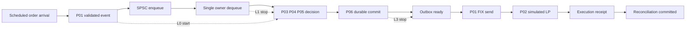
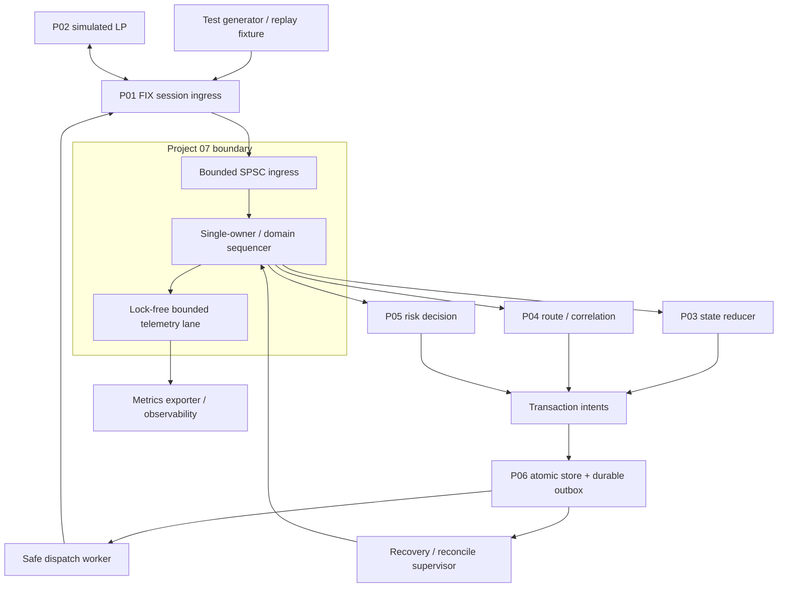
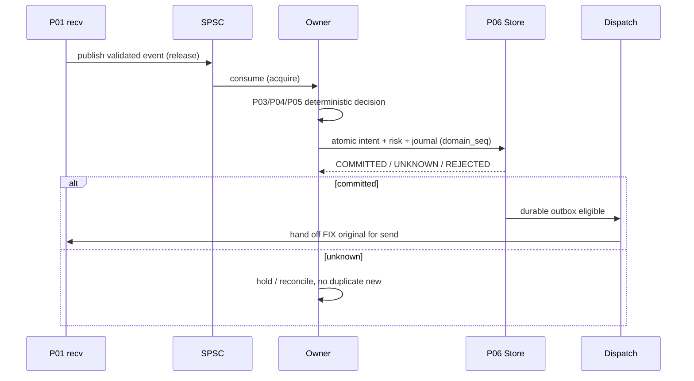
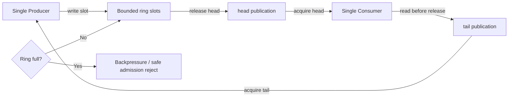
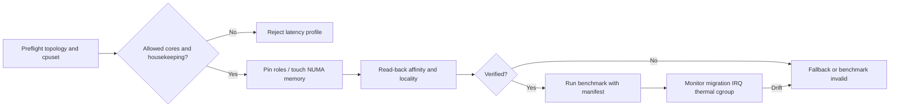
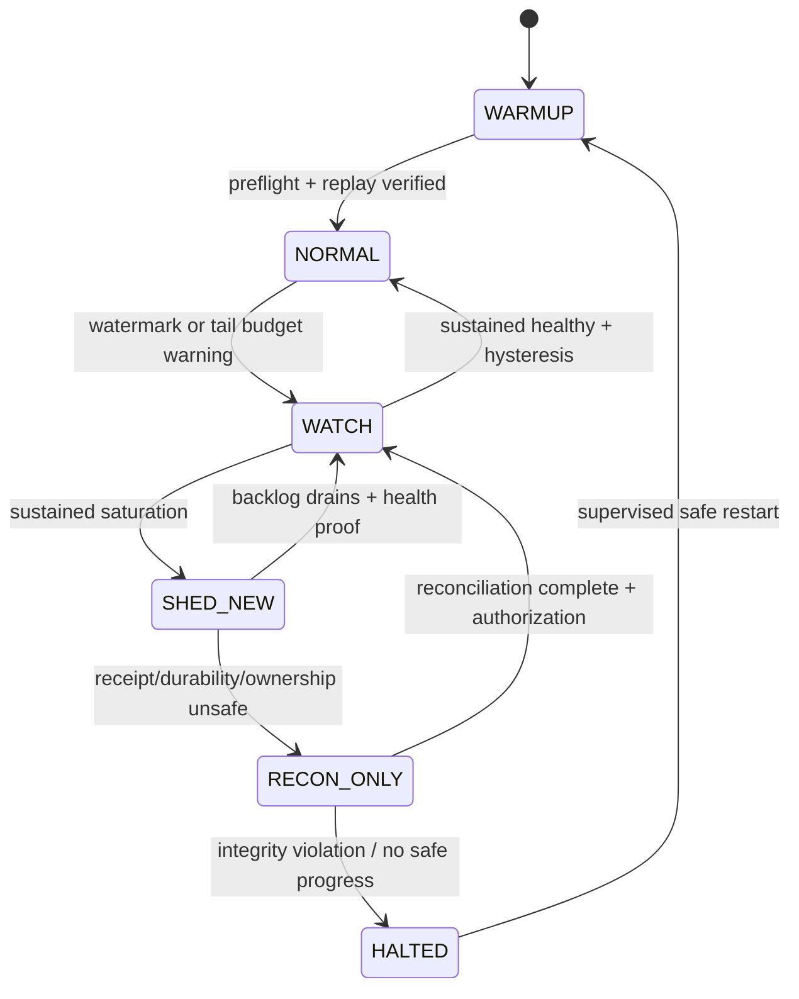
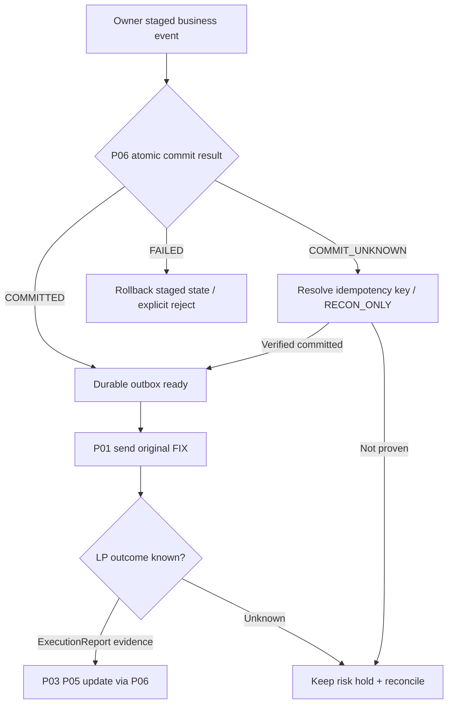
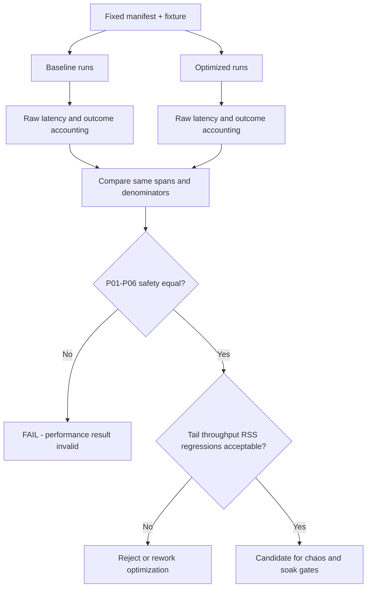
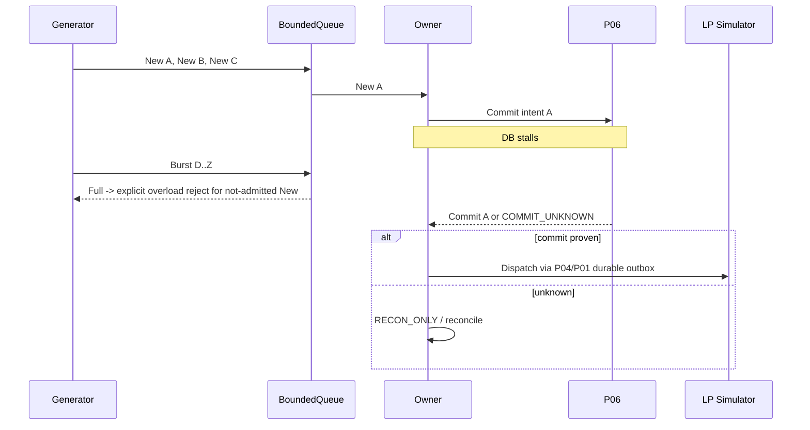
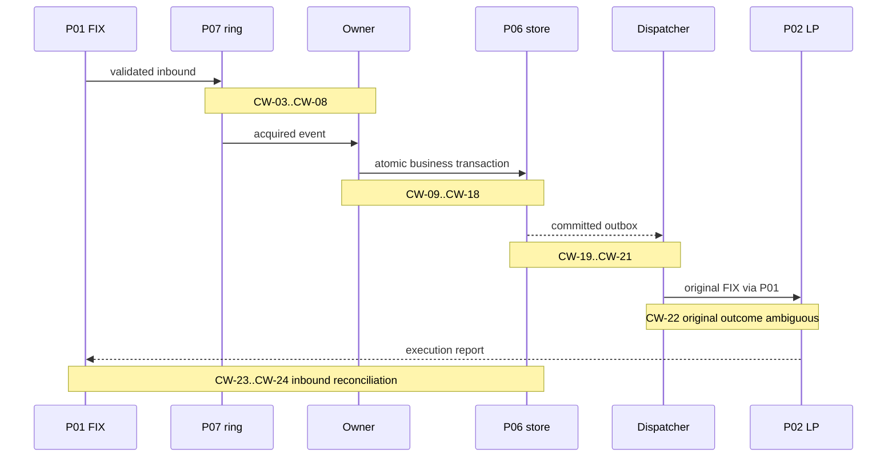

# Project 07 — FX/CFD Low-Latency Execution Engine (C++20 / Linux)

> **System Design · Implementation Blueprint · Performance Engineering · Safety Invariants · What-if & Chaos Test Catalog**  
> **Phiên bản:** 1.0 · **Ngày:** 2026-10-30 · **Trạng thái:** `DESIGN ONLY / NOT IMPLEMENTED / TESTS NOT EXECUTED`  
> **Stack:** C++20 · Linux · CMake · GoogleTest · sanitizers · `perf` · PostgreSQL qua P06 · FIX 4.4 qua P01  
> **Vị trí:** Project **07/08** thuộc hệ thống *FX/CFD FIX Gateway and Execution Engine*  
> **Phụ thuộc:** P01 FIX Session · P02 LP Simulator · P03 Order State Machine · P04 Routing/Reconciliation · P05 Pre-trade Risk · P06 Journal/Recovery · P08 Integration.

**Phạm vi nguồn:** CV mô tả preallocated pools, cache-aligned state, lock-free **SPSC** queues, pinning critical threads và profiling qua `perf`/GDB. Kết quả CV là **p99 receive-to-route: 310 → 95 microseconds tại 50k messages/s**, phép đo **in-process replay trên 8-core Linux**; không chứng minh end-to-end FIX/network/database latency. CV không xác nhận topology threads, queue capacities, cache line, allocator, OS tuning, load-generator, chính sách throttling hay SLO của riêng P07. **Mọi lựa chọn bên dưới đều là thiết kế tái dựng đề xuất**, không phải source code của Larion.

**Triết lý cốt lõi:** `Correctness > Durability/Risk > Bounded Behavior > Tail Latency > Peak Throughput`. Tối ưu không được làm sai P01–P06. Một hệ thống “nhanh” nhưng mất fill/giải phóng risk sớm/gửi New trùng **không đạt**.

**Giới hạn:** Không thể liệt kê hết vô hạn tổ hợp lỗi. Catalog **520 kịch bản what-if có oracle riêng**, **36 fault-injection playbooks**, **24 crash/scheduling windows**, property/model-based tests và nghiệm thu định lượng là một **chiến lược kiểm chứng**, không phải bảo đảm production. Không giao dịch tiền thật trong lab.

## Mục lục

1. Nguồn và mục tiêu; 2. Functional/NFR/SLO; 3. Latency definitions; 4. Failure model; 5. Safety invariants; 6. Context architecture; 7. Thread ownership; 8. SPSC queues; 9. Memory pools/lifetime; 10. Cache/data layout; 11. NUMA/affinity/isolation; 12. Scheduling/backpressure; 13. Atomic commit boundary; 14. Timing/telemetry; 15. Benchmark methodology; 16. Optimizations and tradeoffs; 17. Integration P01–P08; 18. Interfaces C++20; 19. State diagrams/flows; 20. Config/repository; 21. Recovery and failure reactions; 22. Security/ops; 23. Test methodology; 24. 520 What-if cases; 25. 36 fault playbooks; 26. 24 crash windows; 27. Workloads, capacity and soak; 28. Acceptance gates; 29. Roadmap; 30. ADR/open questions; 31. Technical sources; 32. Test execution checklist.

---

## 1. Nguồn, mục tiêu, trách nhiệm và giới hạn

### 1.1. Điều được CV xác nhận

- `C++20`, `Linux`, `FIX 4.4`, `PostgreSQL`, `Docker` là stack của dự án lớn.
- Đã áp dụng **preallocated memory pools**, **cache-aligned state**, **lock-free SPSC queues**, **pinned critical threads**; đã profiling bằng `perf`/GDB.
- CV ghi giảm **p99 receive-to-route 310 µs xuống 95 µs** dưới tải **50k msg/s**, **in-process replay, 8-core Linux**. Không được diễn giải là p99 LP execution, wire-to-wire, hay database transaction latency.

### 1.2. P07 chịu trách nhiệm gì

1. Tổ chức thread ownership, ingress fan-in và bounded message passing cho pipeline tối ưu.
2. Xây `SpscRing`, fixed-size object pools, bounded handles và cache-aware structures.
3. Lập cơ chế latency instrumentation ít overhead với bằng chứng hiệu chỉnh.
4. Kiểm soát backpressure/saturation theo loại event; **không silently drop business evidence**.
5. Thực hiện benchmark/soak/fault test định lượng, so sánh baseline cùng cấu hình.
6. Cung cấp policy CPU placement/NUMA/interrupt tuning có kiểm tra và rollback.
7. Tối ưu có kiểm soát, kèm differential test so với baseline/reference P03–P06.

### 1.3. Không thuộc P07

- Không tự viết FIX session semantics (P01), không thay matching engine LP (P02), không tự thay reducer/order status (P03), không bỏ risk admission (P05), không tự khẳng định external send success (P04), không thay atomic commit contract (P06).
- Không giả định `lock-free` = `wait-free`, không giả định CPU pinning loại hết jitter, không bảo đảm hard real-time.
- Không tự chuyển sang `SCHED_FIFO`/kernel isolation trên host đang dùng chung; nếu thử phải có sandbox, health checks và rollback.

### 1.4. Workload phạm vi v1

`FIX 4.4, một simulated LP, LIMIT/DAY, netting account, fixed-point price/qty`, deterministic replay. Tập trung gateway process xử lý **new/cancel/replace/ExecutionReport**; thị trường thực, production HA hay physical NIC timestamping là mở rộng tùy hạ tầng. Không được bỏ các exception paths chỉ để đạt benchmark.

## 2. Yêu cầu chức năng, NFR và các mục tiêu đo

| ID | Functional requirement | Oracle |
|---|---|---|
| FR-01 | Handoff từ P01 sang order/route owner theo single-writer contract | 0 double-update, 0 mất event accepted |
| FR-02 | Bounded SPSC, push/pop nonblocking đối với queue core | FIFO, 0 phantom, full/empty có tín hiệu |
| FR-03 | Bounded memory pool không cấp phát tùy ý trên hot path đã warm up | malloc tracing = 0 khi workload được hỗ trợ |
| FR-04 | Cache-aware layout với version ABI rõ ràng | correctness như baseline, đo cache misses |
| FR-05 | Affinity/NUMA có preflight, fail-safe, rollback | topology xác minh, không silent mispin |
| FR-06 | Backpressure phân loại FIX-control/inbound proof/new intake | 0 silent loss, 0 unauthorized duplicate send |
| FR-07 | Gating P05/P06 trước khi P04/P01 dispatch | outbox intent + risk đều durable trước send |
| FR-08 | Đo latency từng span với correlation và clock provenance | no-negative, no-hidden-failed-events, traceable counts |
| FR-09 | Replay cùng fixture cho baseline và optimized | equal final projection/ledger/outbox intent |
| FR-10 | P99/p99.9 + throughput/open-loop loss accounting | raw histogram, rejected/timeout counted |
| FR-11 | Fault injection cho thread scheduling, races, faults | reproducible seed + exact PASS oracle |
| FR-12 | Safe deployment: compile flags, policy, CPU map, emergency shutdown | rollback, quorum/evidence unchanged |

**Phân loại mục tiêu (không phải chỉ số đã đạt):**

| Chỉ số | Lab acceptance đề xuất | Chú ý |
|---|---|---|
| Safety | **0** invariant P01–P06 bị vi phạm trong mọi P0 test | Chặn release nếu fail |
| Loss/duplicate | **0** business event bị silently dropped/double applied | Rejected-at-admission có thể >0 và phải đếm |
| Queue/capacity | occupancy không vượt `capacity`; bounded RSS/handles | Có overload state minh bạch |
| Hot-path allocation | **0** dynamic allocation sau prewarm trong measured region | Không ngụ ý toàn process không cấp phát |
| Reproducibility | Ít nhất 5 independent runs, pin workload/config, lưu raw evidence | Mục tiêu ±10% p99 giữa runs là điều kiện lab cần kiểm, không hứa hẹn |
| Throughput | Test sweep đến/sau điểm saturation, có goodput/error/drop breakdown | Không đồng nhất offered load với processed |
| Tail latency | Báo cáo p50,p95,p99,p99.9 và worst + confidence/runs | Không được chỉ chọn run tốt nhất |
| CV reference | 50k msg/s, 8-core in-process, p99 310→95 µs | **Chỉ so sánh nếu span + workload tương đương** |
| End-to-end durability | Đo riêng ingress→P06 COMMIT→send eligibility | Không áp “95 µs” từ CV cho span có DB fsync |

**Strict performance gate:** chỉ chấp nhận cải thiện **nếu correctness tương đương**; đo baseline lặp lại trong môi trường cố định; so sánh theo cùng offered load, same fixture, same percentile algorithm, same CPU/NUMA/clock mode; công bố tradeoff CPU/RSS/idle power/throughput. Đặt ngân sách tail thực tế sau khi có baseline hardware.

## 3. Định nghĩa latency, timestamp boundaries và ambiguity

Các đoạn đo **khác nhau, không được cộng/chia tùy ý**:

| Span | Start | Stop | Dùng để làm gì |
|---|---|---|---|
| `L0` in-process receive→route | FIX event parsed/validated ready tại ingress adapter | Route intent produced/handed to P04 | Có thể so CV nếu fixture tương đương |
| `L1` queue wait | enqueue timestamp | owner dequeues | Phát hiện saturation/scheduler delay |
| `L2` decision compute | owner starts | P03/P04/P05 propose result | CPU/memory optimizations |
| `L3` durable admission | P06 transaction begins | durable COMMIT confirmed | Không được giả vờ loại DB khỏi safety |
| `L4` dispatch eligibility | durable outbox confirmed | P01 has safe-to-send record | **Không phải** LP accepted |
| `L5` application reconciliation | P01 execution receipt | P06 committed P03/P05 update | Fill accounting correctness |
| `L6` simulated end-to-end | order generator timestamp | LP simulator ExecutionReport reconciled | Tổng hợp kiểm thử, không phải wire latency thật |

- `CLOCK_MONOTONIC_RAW`/`CLOCK_MONOTONIC` cho đo thời lượng cùng host; ghi clock choice, resolution, overhead và CPU migration. **Không** dùng `CLOCK_REALTIME` để trừ hai timestamps; không so sánh TSC giữa socket/process nếu chưa validate synchronization.
- TSC/RDTSCP có thể nhanh nhưng phải kiểm invariant/stability, serialization protocol, core migration và fallback; không coi cycles là nanoseconds mà thiếu calibration.
- Timestamp `enqueue` trước publish và đo `dequeue` sau acquire; bỏ measurement và overhead trong hai build variants để kiểm tra observer effect.
- Wall clock/NTP chỉ dùng timestamp log/tracing, không dùng tính latency.
- Báo cáo sample denominator = attempted/success/rejected/expired/timed-out, và per-stage sample counts; negative/outlier phải được điều tra, không im lặng loại.
- **Coordinated omission:** open-loop generator tiếp tục schedule arrival theo rate kể cả khi hệ thống chậm, lưu expected arrival và time-to-outcome; closed-loop chỉ là test bổ sung, không được dùng một mình chứng minh p99 dưới tải.



## 4. Failure taxonomy, threat model và expected reactions

| Failure class | Ví dụ | Phản ứng bắt buộc |
|---|---|---|
| Concurrency/atomic | relaxed publication, 2 producers SPSC, ABA, torn update | **HALT/QUARANTINE** if integrity uncertain; reference replay |
| Memory | pool exhausted, stale handle, fragmentation, cache regression | bounded reject/degrade; never overwrite live object |
| Hardware/OS | NUMA remote access, SMT sibling noisy, IRQ storm, thermal throttle, CPU hotplug | record environment; degrade/reconfigure safely; never bypass P06 |
| Time/metrics | wrong clock, TSC skew, perf multiplexing, missing tail samples | `BENCHMARK_INVALID`; do not claim improvement |
| Queue/saturation | 10x burst, consumer stall, priority inversion, head-of-line blocking | explicit backpressure; no silent business evidence loss |
| Protocol | FIX resend, sequence gap, heartbeat starvation under load | P01 session flow preserved; reconnect/resend/reconcile as needed |
| Business | partial fill vs cancel, duplicate ExecID, risk stale data | P03/P05 oracle unchanged; quarantine contradictions |
| Durability | DB stall, `COMMIT_UNKNOWN`, stale outbox, journal replay | NO original send before durable proof, `RECON_ONLY` if unknown |
| Deployment | wrong compiler flags, ABI mismatch, bad config, hot reload | reject change before unsafe routing; rollback |
| Adversarial | oversized FIX, invalid ownership callback, repeated cancellation storm | reject/contain with bounded CPU/memory |

**Liveness vs safety:** Khi an toàn không còn chứng minh được, chấp nhận giảm throughput, disconnect hoặc `RECON_ONLY`. Không đánh đổi journal/risk correctness lấy p99 đẹp. Hot-path fast fail phải tạo kết quả/audit có thể đối soát.

## 5. Safety/performance invariants — `LI-01..LI-48`

- **LI-01** — P07 không thay semantic `OrderReducer` của P03; cùng event stream → cùng projection, fill ledger và effect decisions.

- **LI-02** — Không enqueue bất kỳ event business vào queue đã full bằng cách overwrite phần tử chưa consume.

- **LI-03** — SPSC có đúng **một producer và một consumer** trong toàn bộ lifetime; nhiều producer phải qua fan-in thích hợp.

- **LI-04** — Mọi slot SPSC được khởi tạo trước release-publication; consumer đọc dữ liệu chỉ sau acquire.

- **LI-05** — Tail chỉ được advance sau khi consumer hoàn tất đọc/copy slot; slot không bị producer tái sử dụng sớm.

- **LI-06** — Capacity, counter wrap và masking không gây out-of-bounds/undefined behavior.

- **LI-07** — `try_push` full và `try_pop` empty trả kết quả hữu hạn, không spin vô hạn trên critical thread.

- **LI-08** — Không có data race, use-after-free, double-free hoặc stale pointer khi handle đi qua queue.

- **LI-09** — Mỗi pool slot có owner/generation hoặc lifecycle proof; `release` không được gọi hai lần.

- **LI-10** — Pool exhaustion gây backpressure/rejection có reason; không fall back sang malloc không giới hạn trên hot path.

- **LI-11** — Không dynamic allocation trong measured steady-state critical region của profile cấu hình được pin.

- **LI-12** — Persistent order/fill/risk/outbox identity vẫn ổn định; memory address không được coi business ID.

- **LI-13** — Per-order event causality được giữ, kể cả khi priority scheduling và sharding.

- **LI-14** — Một owner tại mỗi thời điểm cho cùng order/risk domain; stale epoch/fencing bị từ chối.

- **LI-15** — Bất kỳ optimization/batching nào cũng giữ atomic boundary của P06 trước outbound original send.

- **LI-16** — Không bao giờ phát original New nếu order intent + risk reservation chưa durable-committed.

- **LI-17** — Trường hợp `COMMIT_UNKNOWN` không được suy diễn là `COMMIT_FAILED` để phát lệnh mới.

- **LI-18** — `OUTCOME_UNKNOWN` giữ hold/reconciliation; optimization không tự retry New với key khác.

- **LI-19** — FIX session priority không được bỏ heartbeat/resend/liveness control ngay cả khi business lane đông.

- **LI-20** — Không drop inbound ExecutionReport/business proof đã được P01 coi accepted; nếu không capacity, kích hoạt bounded safe-mode.

- **LI-21** — Mọi drop/reject ở upstream chỉ xảy ra trước durable admission và được gắn reason/metric/audit.

- **LI-22** — Queue overload không gây invisible backlog/unbounded heap hoặc blocking spin mà không có cancel/health path.

- **LI-23** — Graceful stop phải drain hoặc chứng minh durable handoff cho từng accepted event; hard stop phục hồi qua P06/P01.

- **LI-24** — Unbounded logging/tracing/syscalls không chạy trên critical hot path.

- **LI-25** — Timestamp measurement dùng monotonic clock phù hợp, có clock provenance và không chấp nhận negative duration.

- **LI-26** — Mọi histogram chứa số lượng sample đầy đủ hoặc công bố chính xác sampling/loss; không che failed requests.

- **LI-27** — Measured throughput = successful outcomes/elapsed duration, không được dùng offered load làm goodput.

- **LI-28** — Benchmark baseline và variant dùng cùng fixture/capacity/hardware/build env; thay một biến có kiểm soát.

- **LI-29** — Không so CV 95 µs với p99 chứa DB/network/counterparty nếu định nghĩa span khác.

- **LI-30** — No incorrect `std::memory_order_relaxed` publication dù test trên x86 qua; portability cần verify.

- **LI-31** — CPU affinity thực tế được đọc lại từ OS/cgroup; failure phải được log và đổi trạng thái benchmark.

- **LI-32** — Core pinning không được chặn housekeeping/IRQ khiến session/progress bị starvation.

- **LI-33** — NUMA first-touch/allocator policy không làm mất correctness hoặc hết memory cục bộ âm thầm.

- **LI-34** — Cacheline padding không được dùng như thay thế atomic synchronization.

- **LI-35** — Spurious wake/interrupt phải không gây spin starvation hoặc thất thoát event.

- **LI-36** — Priority policy có giới hạn fairness; Cancel không được vượt sự kiện cần thiết theo order lineage.

- **LI-37** — Quality mode DEGRADED/RECON_ONLY/HALTED được ghi và điều khiển trước khi tiếp tục gửi lệnh.

- **LI-38** — Memory footprint, queue slots, replay buffers và metrics buffers đều có budget và số đo minh bạch.

- **LI-39** — Crash/restart cho cùng committed log dẫn đến cùng business state dù runtime scheduling khác.

- **LI-40** — Processor pin/memory policy/optimizations có rollback nếu preflight/health gate fail.

- **LI-41** — Sanitizer/TSAN failure ở supported builds ngăn release dù optimized build benchmark đẹp.

- **LI-42** — Unsafe optimization build flags (`-ffast-math`, UB-sensitive assumptions) không được âm thầm thay domain arithmetic.

- **LI-43** — Config/cacheline/queue-capacity thay đổi phải versioned và được xác thực trước khi nhận lệnh.

- **LI-44** — Metrics aggregation/monitoring không được giấu CPU/IO stalls hoặc che saturation.

- **LI-45** — Các fault injected tạo event sequence và seed reproducible; replay oracle kiểm tra post-state.

- **LI-46** — Không có `exactly-once over network` guarantee giả; idempotency/durability thuộc P01–P06.

- **LI-47** — Late callback từ old owner bị fencing; không write vào freed pool slot hoặc stale aggregate.

- **LI-48** — Không cho phép benchmark/report `PASS` khi thiếu raw samples, checksum reconciliation hoặc system env manifest.

## 6. Context architecture và trust boundaries



**Trust boundaries:** (1) Network/P01 receipt không phải P06 durable receipt; (2) speculative in-memory state không phải committed state; (3) `safe_to_send` chỉ sau durable outbox; (4) session replay ≠ business New retry; (5) benchmark timing event không thay thế business evidence.

**Design constraint:** Nếu P01 runtime có **nhiều network threads**, mỗi ingress thread có SPSC riêng đi đến fan-in single-owner **hoặc** một correct MPSC adapter (ngoài phạm vi tối ưu v1). Không cố sử dụng cùng một SPSC cho N producers. Nếu có nhiều risk domains, shard theo stable risk-domain key, không tách per-order owner khi firm limit P05 vẫn chia sẻ: P05/P06 phải serialize shared-limit authority.

## 7. Thread topology, ownership và causality

| Thread/role | Owns | Allowed | Forbidden |
|---|---|---|---|
| `T0` FIX receive/P01 | TCP/session parser/validated receipts | publish to dedicated bounded queue, session control | mutate P03/P05 state trực tiếp |
| `T1` owner actor | per-domain command ordering, hot domain state | pure reducer, stage intents, read immutable config | block on arbitrary DB socket or bypass risk |
| `T2` persistence/P06 | DB transaction sequencing, outbox durability | durable commit and reconcile evidence | declare LP accepted before ExecReport |
| `T3` dispatch/P04↔P01 | durable outbox handoff | send eligible original FIX, session-level resend | infer loss ⇒ issue new original order |
| `T4` metrics | drain sampled telemetry | aggregate/prometheus out of hot path | block owner waiting for exporter |
| `T5` maintenance | logs, reconfigure, health | cold path changes with epochs | mutate active buffer/owner unsafely |

`T0..T5` chỉ là **role**, không bắt buộc 6 dedicated cores; benchmark cần so topology 1/2/4/8 CPUs theo cpuset. Một per-domain owner có thể gửi P06 asynchronously, nhưng việc commit có thể hoàn thành **khác thứ tự**; dùng `domain_seq`, ordered application/commit, fence, hoặc serialize DB worker. Không phát `READY` cho outbox từ memory intent chưa commit.

**Ví dụ: expected order under delay:** `New(seq10) -> PartialFill(seq11) -> Cancel(seq12)` với P06 commit của `seq11` chậm hơn `seq12` → không cho apply `seq12` vượt trước causal predecessor; phải wait bounded/serialize, hoặc rollback/retry an toàn theo version.

**Sharding rule:** `order owner = hash(stable risk domain)` cho MVP; cross-domain shared firm limit luôn đi qua P05/P06 atomic TX. Chuyển shard lúc runtime phải pause/drain/fence/checkpoint, không hot move raw pointers.



## 8. SPSC queue: correctness, memory order, wrap và full policy

**Contract:** power-of-two `Capacity>=2`; single fixed producer and single fixed consumer; `T` trivially copyable/no-throw, owns no external pointer unless lifetime contract proven. `uint64_t` monotonic counters, integer arithmetic modulo 2^64; `capacity << 2^63`. Công thức occupancy `head-tail` chỉ hợp lệ khi invariant distance luôn <= capacity. Test wrap bằng `uint8_t` counters trong mô hình nhỏ thay vì chờ thật 2^64 ops.

**C++20 reference skeleton** — illustration, phải build + stress/TSAN trên compiler/CPU thực tế trước dùng:

```cpp
#include <array>
#include <atomic>
#include <cstdint>
#include <new>
#include <type_traits>

template <typename T, std::size_t N>
class SpscRing {
  static_assert(N >= 2 && (N & (N - 1)) == 0);
  static_assert(N < (std::size_t{1} << 31));
  static_assert(std::is_trivially_copyable_v<T>);
 public:
  bool try_push(const T& value) noexcept { // called by ONE producer
    const auto h = head_.load(std::memory_order_relaxed);
    const auto t = tail_.load(std::memory_order_acquire);
    if (h - t == N) return false;           // bounded/full: caller decides
    slots_[h & (N - 1)] = value;             // initialize BEFORE publish
    head_.store(h + 1, std::memory_order_release);
    return true;
  }
  bool try_pop(T& out) noexcept {           // called by ONE consumer
    const auto t = tail_.load(std::memory_order_relaxed);
    const auto h = head_.load(std::memory_order_acquire);
    if (h == t) return false;
    out = slots_[t & (N - 1)];              // read BEFORE release slot
    tail_.store(t + 1, std::memory_order_release);
    return true;
  }
 private:
  alignas(std::hardware_destructive_interference_size)
      std::atomic<std::uint64_t> head_{0};
  alignas(std::hardware_destructive_interference_size)
      std::atomic<std::uint64_t> tail_{0};
  std::array<T, N> slots_{};
};
```

- **Chú ý:** `std::hardware_destructive_interference_size` là implementation-defined, **không hardcode “mọi CPU = 64 bytes”**. Layout ABI/cacheline phải ghi manifest; có toolchain không hỗ trợ hằng này, phải đưa fallback có tài liệu + benchmark.
- Đây là implementation *SPSC bounded*, không phải MPMC, không phải queue bảo đảm durability, không thể chống mất ingress nếu P01/P06 receipt contract bị phá.
- `try_push` false khi full **không được bỏ hàng**; upstream phải stop/reject new admission hoặc trigger safe recovery cho accepted business receipts.
- `std::memory_order_release/acquire` bảo đảm publish slot; relaxed trên payload publication là lỗi portability; cache padding **không** sửa memory ordering.
- Head/tail wrap math test bằng reference model; `N` quá lớn phải từ chối khởi tạo trước allocation; slot type POD không chứa dangling view/span/string_ref.
- If event > fixed inline size: dùng bounded pool handle `(pool_id, index, generation)` với handoff/ref-lifetime đã được kiểm chứng; tránh heap pointer lifetime không xác định.
- Không spin vô hạn chờ consumer, tránh CPU burn/heartbeat starvation; có explicit control wake/health khi saturation.



## 9. Fixed-size memory pools, handles, reclamation và ABA

**Design:** Start-up preallocate `M` fixed-size slots; first-touch/touch-all before benchmark; free-list single-owner if possible; no heap fallback trong critical region. Pool handle = `(pool_epoch, slab_id, slot_index, generation)`; stale generation → `INVALID_HANDLE`, count metric. Khi handle publish qua queue, ownership chuyển tại release/acquire boundary; không reinitialize until consumer releases. Cần tránh ABA khi reuse slot, nhất là async DB callback tới sau.

| Risk | Contract |
|---|---|
| Pool exhaustion | `POOL_EXHAUSTED` + bounded admission; không chiếm slot của live order |
| Alignment | `alignof`/object placement hợp chuẩn; đừng `reinterpret_cast` tùy ý |
| Lifetime | `construct_at`/`destroy_at` đúng khi dùng nontrivial type; teardown drains/refcounts |
| Generation wrap | Giữ epoch & generation đủ rộng, test synthetic wrap; nếu không prove safe → retire slot |
| Multi-thread free | single-owner reclaim queue hoặc reclamation scheme formal; không unsynchronized freelist |
| HugePages | Optional A/B, permission/fallback, NUMA effect, page faults; không bật mặc định |
| `mlockall` | Optional lab only; có `RLIMIT_MEMLOCK`/memory limit, lock failure, page fault; không giải quyết OOM |

**Memory budget example (not measured):** `RSS_budget = queues_bytes + pool_slots*slot_size + hot_state + telemetry + persistence_buffers + safety_margin`; chuyển mọi capacity thành config validated, không cho thay đổi online nếu phải remap active pointers. Cụ thể `8192` ring entries chỉ là giá trị khởi đầu trong lab, cần capacity sweep + peak occupancy; **capacity không suy ra từ throughput nếu thiếu worst-case stall time**.

## 10. Cache-aware data layout, false sharing và AoS/SoA

- Tách producer head và consumer tail sang **cachelines độc lập** khi benchmark chứng minh có contention; padding phải đúng alignment và manifest (cacheline size có thể khác 64).
- Đặt hot fields (order ID, owner epoch, qty, status, checksum) liên tiếp nếu truy cập cùng nhau; cold fields (debug description, FIX raw tags, full audit) nằm ngoài critical resident state.
- Không “optimize” `std::unordered_map` nếu aliasing/rehash/pointer stability chưa kiểm; reserve, frozen buckets hoặc stable pool-backed ID map, rồi differential test.
- AoS vs SoA tùy access pattern; mỗi thay đổi phải có cache-miss/branch-miss/working-set evidence chứ không suy luận từ microbenchmark trống.
- Prefetch có thể làm **tăng** tail latency khi workload khác; compile-time toggle + AB results.
- SIMD/branch hints không đụng fixed-point checked arithmetic; **no `-ffast-math`** trong domain business nếu không có compatibility proof.
- Cache padding chỉ là performance tool; synchronization vẫn cần correct atomics.

**Experiment matrix:** baseline map vs stable map; AoS vs SoA; packed vs cache-aligned; ring 256/1024/8192/65536; pool 1x/2x/4x burst footprint; SMT enabled/disabled; per-node vs remote NUMA; opt build vs ASan/TSan (sanitizer runs **not** perf baseline).

## 11. Linux CPU affinity, NUMA, SMT, cgroups, IRQ, scheduler

**Preflight policy before enabling tuning:**

1. Discover `lscpu --extended`, `numactl --hardware` (if present), `/proc/self/status`, `sched_getaffinity`, `cpuset.cpus.effective`, online CPUs, SMT sibling maps, `/proc/irq/*/smp_affinity`, kernel/cgroup version.
2. Build role→CPU plan from **allowed intersection**, not from logical IDs hardcoded to 0..7. Validate at least one housekeeping CPU/core remains, no accidental overlapping critical owners without intent.
3. Set per-thread affinity with `pthread_setaffinity_np`/`sched_setaffinity`, **read back actual mask**, log affinity failure, record task migration and context switch counters.
4. Optional NUMA local allocation using first-touch, `numactl`, `mbind`/`set_mempolicy` only after verifying cpuset/mems; compare local/remote placement.
5. Optional CPU isolation (`isolcpus`, `nohz_full`, IRQ affinity) only on disposable benchmark host; kernel notes imply isolation trades away flexibility and cannot eliminate all interrupt/scheduler noise.
6. Document CPU frequency governor/turbo/thermal/frequency scaling and SMT siblings; run A/B tests not just pinning-on.
7. If cpuset changes/CPU hotplug invalidates mapping, stop benchmark or controlled degrade. **Never ignore EPERM/EINVAL**.

**Important:** `SCHED_FIFO`/`SCHED_RR` can starve OS work; do not set automatically. If experimenting, use bounded critical sections, core housekeeping, watchdog, OS policy review, emergency rollback and host isolation. Docker on shared laptop cannot reproduce dedicated 8-core kernel isolation; report measured topology honestly.



## 12. Admission, queue saturation, fairness, service modes

**No silently dropped accepted evidence.** Hai loại khác nhau: (1) yêu cầu new chưa durable admission có thể reject rõ ràng; (2) receipt/fill đã accepted phải được bảo toàn theo P01/P06 contract, dù phải giảm throughput, stop intake, hoặc khởi động reconciliation. Nếu TCP read bị pause, FIX liveness và resend recovery là trách nhiệm P01; không tự giả định TCP buffer vô hạn.

**Queue classes (logical, not necessarily separate sockets):**

| Lane | Priority | Full policy |
|---|---|---|
| FIX session control (logon/heartbeat/resend) | Must remain serviced | Dedicated reserved processing budget; P01 maintains liveness |
| Accepted execution receipts | Safety-critical | Persist P06 inbox/controlled stop, backpressure; no silent drop |
| Cancel/Replace commands | High but causal | Respect per-order dependencies and P05 reservation |
| New order commands | Admission-controlled | Reject `OVERLOADED` before durable acceptance if insufficient capacity |
| Metrics/logs | Lower | Sample/drop telemetry with `lost_samples` counter; never block trading owner |

**Watermark example (lab policy):** occupancy `< 60% NORMAL`, `60–85% WATCH`, `85–95% SHED_NEW`, `>=95% RECON_ONLY/STOP_ADMISSION` depending persistent backlog and journal health; **not production thresholds**. Trigger based on hysteresis/time and downstream latency, not occupancy alone; avoid oscillation. A `Cancel` cannot be reordered before its New admission or prior fill just because marked high priority.

**Admission credit formula (illustrative):** `free_credits = min(queue_free_slots, pool_free_handles, persistence_inflight_budget, session_send_budget)`; reserve atomically per owner, consume/release once, log reason. Cannot claim `free_credits >0` if downstream P06 is unhealthy; brake upstream.

**Service states:** `WARMUP -> NORMAL -> WATCH -> SHED_NEW -> RECON_ONLY -> HALTED`, rollback only after evidence-based health checks and, for unknown LP outcomes, P06 reconciliation. `SHED_NEW` still admits some safe control work and progress on already-accepted commands if invariants hold.



## 13. Atomic commit and message delivery — DO NOT optimize away P06

**Chốt kiến trúc:** business decision có thể tính trên hot actor nhanh, nhưng outbound `35=D/F/G` chỉ được eligible sau transaction commit với P06 ghi atomically: `inbox/dedup` (nếu inbound), `journal`, `order projection`, `fill ledger` (nếu có), `risk reservation`, `command intent` và `outbox`. Việc chuyển P06 sang worker async **không** làm giảm thời gian thực tế đến trạng thái durable, chỉ giúp owner thread không bị block; mọi metric phải tách compute/commit/dispatch.

**Transaction sequence safety:** nếu có nhiều in-flight per-domain transactions, guard `domain_seq` và optimistic version; commit out-of-order không được cấp quyền dispatch đảo causal order. Một worker serialized-per-risk-domain đơn giản và an toàn cho v1. Có thể batch independent domains nếu vẫn giữ được atomic per-business-event.

**Outbox ambiguity:** quá trình network send có các điểm không biết LP đã thấy; timeout không phải permission để tạo New với `ClOrdID` mới. P01 session resend theo FIX sequence contract, P04/P06 reconcile business effect. `COMMIT_UNKNOWN` phải resolve bằng transaction ID/idempotency key, không fresh issue.

**Forbidden shortcuts:** in-memory ack thay vì commit; memory-only risk hold; lose journal durability khi latency spike; drop fill/ExecReport; “instant success” trước P06 commit; skip identity validation; reuse pooled pointer across async callback; retry New by changing ID; reinterpret reject as cancel evidence.

**Latency engineering implication:** Có thể tối ưu preallocate, hashing, marshaling, batching P06 I/O, shared buffers; tất cả phải đi qua invariants và 24 crash-window tests. Nếu sync DB durable path không đạt p99 target, **báo số thật**, không thay semantics để đạt 95 µs.



## 14. Time measurement, telemetry, sampling và overhead

**Measurement implementation:** 64-bit monotonic nanoseconds from `clock_gettime(CLOCK_MONOTONIC_RAW)` (Linux) as default process-local source, optionally benchmark `steady_clock` wrapper with validation. For high-frequency samples, instrument only essential points with bounded per-thread buffers; consumer/exporter on cold thread; if buffer full, increment atomic `telemetry_lost`, and **invalidate percentile claims when required coverage incomplete**. Production sampling is allowed if random/unbiased and declared; for release performance test use full valid traces or calibrated histogram.

Store `run_id`, `event_id`, `time_source`, `clock_resolution`, `stage`, `cpu_id`, `epoch`, `build_hash`, `config_hash`, `result_status`. Overflow-checked subtraction; no time arithmetic across unsynchronized hosts. Pin single-process measurement to verified CPU set when attempting cycle timing; TSC stability must be tested, not assumed.

**Perf instrumentation caveats:** PMU counters can be multiplexed: save `time_enabled`, `time_running` and event list; compare counts only with coverage or scaling caveats; perf sampling itself adds overhead. Separate (A) low-intrusion latency runs, (B) CPU profiling runs, (C) sanitizers; do not combine all and claim a single clean p99.

**Histograms:** retain raw counts and bucket bounds, report p50/p95/p99/p99.9/max; sufficient samples for high quantiles and sensitivity to rare events; compare repeated runs using interval/dispersion. Record per-op outcome including overload rejections, business timeouts and unknowns.

## 15. Benchmark design: load generation, statistically defensible evidence

### 15.1. Benchmark axes

| Dimension | Values to sweep | Why |
|---|---|---|
| Offered arrival rate | 1k, 10k, 25k, 50k, 75k, 100k/s + sustainable rate discovery | saturation curve |
| Arrival mode | constant, Poisson, bursty, adversarial correlated, closed-loop diagnostic | coordinated omission |
| Message mix | 100% New, 60% New/20% Cancel/20% fills, fill storm, FIX control burst | tail and correctness |
| Queue cap | 256, 1024, 8192, 65536 (within memory budget) | queuing vs RSS |
| Thread/core layout | 1,2,4,8 eligible CPUs, SMT sibling off/on | contention, topology |
| Memory | malloc baseline / preallocated, local/remote NUMA, RSS limit | allocation and faults |
| Durability | mock in-process deterministic P06 vs real PostgreSQL sync local commit | separate span classes |
| Environment | bare metal, container/cgroup, busy-noise, thermal, disk stall | reproducibility |
| Injection | consumer pause 0.1–1000ms, DB pause, network disconnect, process restart | fail-safe behavior |

### 15.2. Experiment protocol

1. Commit baseline and variant hashes; freeze compiler, optimization/LTO/PGO settings, kernel/microcode, CPU topology, NUMA, container limits, governor, environment manifest.
2. Use fixed simulator fixture/seed; record expected arrival timestamps and outcomes, never count only completed samples.
3. Prewarm pools/threads/pages/connection; verify buffers and SPSC ownership; run benchmark with output side effects checked against oracle.
4. Repeat independent runs; randomize A/B ordering or interleave to reduce drift; report **all** runs, not best.
5. Capture histograms and offered vs accepted vs completed rates; include queue occupancy, dropped telemetry, backlog and CPU/RSS/IRQ/thermal readings.
6. Check results vs golden P03/P05/P06 event/hash oracle and `LI-*` invariants; any mismatch invalidates performance result.
7. Conduct long soak and chaos experiments separately from stable microbenchmarks; report both.

### 15.3. Avoid six benchmarking traps

- **Dead-code elimination:** use `benchmark::DoNotOptimize`/final checksum verification; ensure realistic side effects remain.
- **Coordinated omission:** open-loop scheduled arrivals and timeouts, not only “fast completed” samples.
- **Observer effect:** metric collection/perf/TSAN can alter execution; separate profiles.
- **Denominator cheating:** distinguish offered load, admitted commands, completed valid results, timed-out/failed/unknown, and p99 conditional vs unconditional.
- **Unfair comparison:** new allocator with shorter payload or lower persistence settings is not an optimization proof.
- **Causal violation:** simply reporting route intent before P06 COMMIT does not mean earlier send is allowed.

**Statistical note:** p99.9 requires large sample set and repeated windows; small samples (n=1000) do not establish dependable p99.9. Capture histogram integrity/checksum and exception counts.



## 16. Optimization backlog và trade-off verification

| Optimization | Theory | Potential cost / what-if | Measured evidence required |
|---|---|---|---|
| Preallocated pools | reduce alloc jitter | memory waste, pool exhaustion, stale handles | malloc count, p99, RSS, sanitizer |
| Cacheline padding | reduce false sharing | bigger working set, changed ABI | cache misses, p99, data correctness |
| Lock-free SPSC | reduce mutex overhead | wrong SPSC ownership, spin, memory-order bugs | TSAN/model test, queue lag, comparative benchmark |
| Owner actor | consistent per-domain state | hot domain bottleneck, unfairness | state oracle, throughput per domain |
| Thread pinning | reduce migration | SMT/IRQ contention, hotplug | migrations, IRQ, tail percentiles |
| NUMA locality | reduce remote memory traffic | wrong first-touch/cpuset, memory exhaustion | local vs remote runs, throughput/RSS |
| Batching | amortize DB/syscalls | extra head-of-line delay, causal reordering | queue wait/p99 + durable effects |
| Async persistence | owner doesn't block | out-of-order commit, false send eligibility | domain sequence tests + L3 timing |
| Busy spin | reduce wakeup latency | CPU starvation/thermal, liveness failures | power/CPU/IRQ metrics + liveness |
| Adaptive hybrid wait | balance CPU/wake costs | oscillation/tail spikes | per-load A/B + cool-down |
| Prefetch | hide memory stalls | cache pollution under mixed load | LLC miss & p99, adverse mixes |
| CPU isolation | lower OS jitter | service CPU starvation, operational complexity | isolated lab host + system health |

**Optimization rule:** mỗi đề xuất là ADR riêng với initial hypothesis, expected benefit, negative outcomes, test IDs, screenshot/run links, rollback switch. Vì P07 phụ thuộc P06, phần bền vững luôn được benchmark separately; không gộp `mock P06` và real DB để khoe số đẹp.

## 17. Interface contract với Project 01–08

| Project | P07 input | P07 must preserve | Integrated failure oracle |
|---|---|---|---|
| P01 Session | validated FIX events; durable-accepted markers / session control | seq/resend/heartbeat, exact original outbox identity | overload still permits P01 liveness/replay; no business duplicate |
| P02 LP Simulator | deterministic fixtures, delays, faults | expected FIX/RoE semantics | same LP order/fill ledger under optimized runtime |
| P03 Order SM | pure reducer, single owner, fill ledger | causal ordering, fixed point, unknown/quarantine | identical projection hashes/reducer effects |
| P04 Router | command intent, correlation, durable outbox | New/Cancel/Replace lineage, ambiguous send policy | no duplicate originals or misrouted cancels |
| P05 Risk | risk approval/reservation | worst-case exposure/hold until evidence | no risk budget double spend |
| P06 Journal/Recovery | atomic store, event version, commit evidence, fencing | no original send before commit, safe replay | reconstruct same durable state after crash |
| P07 Engine | runtime execution and metrics | bounded work, thread safety, honest latency | all LI invariants and SLA gates |
| P08 Integration | CI, chaos harness, release gates | reproducible operator evidence | end-to-end fault matrix passed |

**Important API questions before coding:**

- Does P01 acknowledge inbound only after durable receipt, and what mechanism triggers ResendRequest upon reconnect?
- Is P06 synchronous per-domain worker or does it allow multiple in-flight TX with ordering logic?
- How is P05 firm-level shared limit serialized across multiple actors?
- What is the only authority for `safe_to_send(original_fix_intent)`? Answer: committed outbox record under current fencing epoch.
- What is P03's `UNKNOWN_OUTCOME` policy under incomplete receipt? Never turn unknown into business success by a timeout.
- Are risk-domain keys and queue ownership stable after hot-reload/failover? Migration requires fencing & drain/replay.

## 18. C++20 APIs và implementation sketch

```cpp
struct EventId { std::uint64_t hi, lo; };
struct PoolHandle { std::uint32_t epoch, slab, slot, generation; };
struct LatencyStamp { std::uint64_t monotonic_ns; std::uint32_t cpu; };

enum class AdmissionOutcome : std::uint8_t {
  AcceptedForProcessing, RejectedOverload, HeldForReconciliation,
  RetryLaterNoAdmission, InvalidInput, EngineHalted
};

enum class ServiceMode : std::uint8_t {
  Warmup, Normal, Watch, ShedNew, ReconOnly, Halted
};

struct IQueueChannel {
  virtual bool try_publish(const InputEnvelope&) noexcept = 0;
  virtual bool try_consume(InputEnvelope&) noexcept = 0;
  virtual std::size_t capacity() const noexcept = 0;
  virtual ~IQueueChannel() = default;
};

struct IAtomicBusinessStore { // P06 owns implementation
  virtual CommitOutcome commit(const DurableBusinessIntent&) = 0;
  virtual ~IAtomicBusinessStore() = default;
};

struct IEngineOwner {
  virtual AdmissionOutcome on_event(const InputEnvelope&) noexcept = 0;
  virtual void on_commit_result(const CommitReceipt&) noexcept = 0;
  virtual ServiceMode mode() const noexcept = 0;
  virtual ~IEngineOwner() = default;
};

struct ILatencySink {
  virtual bool try_sample(const SpanSample&) noexcept = 0;
  virtual std::uint64_t lost_samples() const noexcept = 0;
  virtual ~ILatencySink() = default;
};
```

**Skeleton limitations:** Các types (`InputEnvelope`, `CommitOutcome`, `DurableBusinessIntent`, `CommitReceipt`, `SpanSample`) là contracts đề xuất, **không phải code biên dịch hoàn chỉnh**. Không để virtual dispatch trên hot path nếu benchmark chứng minh overhead và cần optimize; có thể static polymorphism sau khi cố định semantics. `noexcept on_event` yêu cầu mọi code path không throw hoặc xử lý exception rõ ràng (không mặc định nuốt lỗi). DB worker phải tránh `noexcept` swallow khiến accepted event mất.

**Canonical event metadata:** `event_id`, `tenant`, `risk_domain`, `order_id`, `event_type`, `domain_seq`, `journal_version`, `owner_epoch`, `payload_hash`, `accepted_state`, `admission_t`, `dequeue_t`, `commit_t`, `outcome`. Không carry confidential FIX session credentials trong benchmark dumps.

## 19. Detailed flows, races và state ownership

### 19.1. Successful order path

`P01 validated New → P07 bounded queue → owner P03/P05 business decision → P06 atomic durable transaction → P04 outbox ready → P01 send → P02 simulated LP`. Tail measured at each span; there is no side effect eligible while commit is pending.

### 19.2. Consumer pause + producer saturation

- Producer observes ring full → `try_push=false`; if this is *unaccepted New command*, explicit `RejectedOverload`; if it is P01 accepted FIX proof, P01/P06 safe buffering/reconnect protocol required, `RECON_ONLY` otherwise.
- Do not overwrite ring or enqueue into unbounded `std::vector`/thread pool backlog.
- Upon resume, drain FIFO; measure maximum wait latency including time spent paused.

### 19.3. FIX replay versus application duplicate

`P01 ResendRequest` may cause PossDup session replay; P03/P04/P06 business identities still dedup by `ExecID/ClOrdID`/namespace. P07 cannot use pointer identity or ring index as business idempotency key.

### 19.4. Pending cancel while partial fills arrive

Owner preserves actual per-order causal sequence, P03 handles statuses, P05 holds exposure conservatively, P06 journal persists all changes; high priority cancel must not skip fill event already causally preceding it.

### 19.5. Out-of-order DB callback

Assign `domain_seq`, accept commit callbacks only if fencing valid; old/stale callbacks do not release pool/reorder state. If commit order contract is violated, transition to `RECON_ONLY` and replay from P06.

### 19.6. SIGKILL between business mutation and DB commit

Any staged state is non-authoritative; restart reads P06 committed journal/projection/outbox and P01 reconciles sessions. No TCP send before durable outbox evidence. If network outcome unknown after send, P04 reconciliation governs.



## 20. Configuration, repository layout và manifests

```text
fx-fix-gateway/
├── apps/
│   ├── replay_benchmark/
│   └── latency_fault_harness/
├── libs/
│   └── low_latency/
│       ├── include/low_latency/{spsc_ring,pool,owner,telemetry,affinity}.hpp
│       ├── src/{pool,owner,telemetry,affinity,backpressure}.cpp
│       └── CMakeLists.txt
├── tests/
│   ├── unit/{spsc,pool,owner}_test.cpp
│   ├── concurrency/{spsc_stress,actor_fencing}_test.cpp
│   ├── differential/{baseline_vs_optimized}_test.cpp
│   ├── integration/{p01_p06_pipeline,replay_fault}_test.cpp
│   ├── fault/{killpoints,stallpoints,resource_pressure}_test.cpp
│   └── benchmark/{queue,pool,route,db,full_sim}_bench.cpp
├── configs/{lab_1c,lab_8c,container,failclosed}.yaml
├── scripts/{capture_env,run_bench,compare_runs,inject_faults}.sh
├── docs/low_latency/{adrs,runbooks,benchmark_methodology}.md
└── reports/{manifest,raw_samples,histograms,integrity_checks}.json
```

**Example minimal pinned config (illustrative, cannot claim measured):**

```yaml
profile: lab-p07-v1
fix_mode: simulator_only
owner_shards: 1
spsc_capacity: 8192
pool_slots: 32768
owner_cpu: auto_from_allowed_cpuset
telemetry_buffer_per_thread: 8192
allocation_policy: preallocated_hot_path
watermarks: {watch_pct: 60, shed_new_pct: 85, stop_pct: 95}
durability: p06_atomic_store_required
outbox_send_requires: p06_committed_epoch
failure_mode: recon_only_on_unknown_commit
metrics: {clock: monotonic_raw, full_benchmark_samples: true}
```

**Config validation:** capacities power-of-two, `M >= max_queue_references + outstanding async handles + safety margin`, RAM/locked-memory/cgroup constraints, owner shard mapping/risk authority, poll backoff, metrics memory, allowed CPU mask. No forced CPU 3 on machines without that CPU. Every run writes `manifest.json` + SHA-256 fixture/output hash + code/build/config identifiers.

## 21. Failure state matrix, recovery procedures và escalation

| Condition | Immediate mode | Allowed progress | Required evidence to recover |
|---|---|---|---|
| Queue 85% sustained | `SHED_NEW` | accepted receipts, cancel by policy, P01 controls | queue drains, downstream healthy |
| Consumer stalled | `SHED_NEW`→`RECON_ONLY` if business proof at risk | bounded safe control and durable receipt | owner resumed/replay consistent |
| Pool exhausted | `SHED_NEW` | no unchecked new allocation | handles reclaimed; leak scan clean |
| P06 database stall | `RECON_ONLY` | no New dispatch; P01 safe handling | DB commit outcomes resolved |
| COMMIT_UNKNOWN | `RECON_ONLY` | reconcile only | idempotency key query proves status |
| SPSC invariant mismatch / UAF | `HALTED` | diagnostics | root cause + fixed regression suite |
| Clock invalid / migration | `BENCHMARK_INVALID` (not necessarily engine halt) | business processing can continue safely | clock and env validated |
| Affinity pin failure | fallback benchmark invalid / controlled degrade | business continues if safe | role topology read back |
| CPU hotplug after pin | `WATCH`/`SHED_NEW` if tail or progress degraded | safe processing | validated cpuset remap |
| Critical thread starvation | `SHED_NEW`→`RECON_ONLY` | session liveness unaffected by design | probe progress, no missing receipt |
| Recovery journal mismatch | `HALTED` | read-only investigation | P06 integrity/reconciliation sign-off |
| Old owner callback after failover | `RECON_ONLY` if state might be impacted | only current epoch safe path | fencing proof, stale discarded |

**Runbook sequence:** stop new admissions → preserve P06/P01 evidence → snapshot metrics/manifest (not credentials) → determine effect of in-flight writes → restore/replay per P06 → reconcile LP outcomes → rerun deterministic fixture → verify all `LI-*` / P03/P05/P06 checksums → operator authorizes reopening. Never bypass this to improve benchmark success rate.

## 22. Security, operability, data minimization

- Benchmark fixtures use synthetic account/order IDs; scrub SenderCompID credentials, DB secrets, network keys and real client data.
- Restrict `perf_event_open`/kernel tuning capabilities; avoid granting whole container `--privileged` merely for perf in shared environment.
- CPU isolation, IRQ steering, governor, `mlockall` and RT scheduling require explicit operator change plan plus rollback.
- Protect report integrity: SHA-256 of input fixtures, output state and manifest; append reason for dropped telemetry and all outcome counts.
- Metrics exporter, log forwarding and profiling run off critical owner; their failure must be visible but cannot mutate risk/order state.
- When benchmark flags are on, guarantee simulator environment; avoid connecting release-target code accidentally to live LP endpoints.
- Investigate warm-up/first-touch leaks and memory exposure after crash; avoid core dumps containing live credentials in production.
- Track kernel/CPU microcode compiler updates and retest for latency drifts; CPU optimizations are environment-specific.

## 23. Test harness, model oracle, coverage and execution protocol

**Test layers:**

1. **Unit/micro:** ring `try_push/try_pop`, pool lease/free, affinity parser, clocks, histogram; sanitizers & assertions.
2. **Model-based:** state-machine generator alternates enqueue/dequeue/pause/restart/commit resolve; reference model is a plain deque + deterministic P03/P05/P06 effects.
3. **Concurrency:** stress on x86_64 and optionally ARM64 to catch memory-order bugs; TSAN where compatible, C++ UB/ASan separate builds, schedule perturbation.
4. **Differential:** same deterministic event stream into baseline vs optimized pipeline, compare `orders`, `fills`, `risk_hold`, `outbox`, `journal` hash after every committed step and restart.
5. **Fault injection:** deterministic failpoints at queue, pool, ownership, P06 handoff, clock, syscalls, NIC simulation; data + decision oracle.
6. **Performance:** open-loop arrival, repeated runs, percentile histograms, stress/soak with complete outcomes; capture hardware/kernel/config manifest.
7. **Security/ops:** wrong privilege, bad config, bad owner epoch, loss telemetry, concurrent maintenance under backpressure.

**Required per-case artifact:** `(test_id, run_id, seed, build_hash, config_hash, workload_hash, cpu_topology, initial_state, fault_trigger, expected_oracle, actual_outcome, final_state_hash, duration, metrics_path, PASS/FAIL)`. Any case missing test evidence is `NOT_RUN`, never `PASS`.

**Oracle shorthand used in catalog:**

| Code | Meaning of required PASS check |
|---|---|
| `Q` | queue FIFO/count/ownership/capacity + no silent drop |
| `M` | no leak/UAF/ABA, bounded memory/pool, correct handles |
| `C` | P03 order, fill and event causality equal reference |
| `R` | P05 exposure/reservation and admission equal reference |
| `D` | P06 journal/projection/outbox atomic and replay-equal |
| `F` | P01 FIX session & resend semantics correct |
| `P` | performance evidence valid: same span, raw samples/counts, timing/env manifest |
| `S` | safety mode/overload response explicit and correct |
| `O` | operational/config/affinity/security behavior and audit valid |

**Result types:** `PASS`, `FAIL`, `NOT_RUN`, `BLOCKED` (dependency absent), `INCONCLUSIVE` (e.g., perf PMU unavailable/clock invalid); no automatic pass from a simulator test that never exercised the failpoint. For external protocol semantics P01 and persistence P06 adapters must be implemented before enabling integrated release gates.

## 24. Ma trận 520 tình huống what-if (26 nhóm × 20)

**Format:** `LL-xxx | P0/P1 | What if stimulus | Expected PASS oracle | Tags`. Các oracle là tiêu chí cần assert (không phải kết quả đã chạy). Để báo PASS phải thực thi stimulus, kiểm side effects, state hashes và required artifacts theo §23. Một case không chỉ kiểm stopwatch: `P` phải có result counters + environment manifest; business cases bắt buộc so reference model. `P0` chặn release; `P1` vẫn cần được xử lý trước tuyên bố đủ độ ổn định theo scope.

### Nhóm 01: 01 — Contract, ownership và admission

**Oracle liên quan:** `C,R,D,Q,S`. **Tổng:** 20; **P0:** 20; **P1:** 0. Các case kiểm tra cả side effects/state hash và counters theo §23.

| Test ID | Pri | What-if / kích hoạt | PASS oracle cụ thể | Tags |
|---|---|---|---|---|
| `LL-001` | **P0** | New command chưa durable được đẩy qua fast path phát FIX ngay | Không có outbound FIX trước committed outbox; incident flag nếu vi phạm | `C,R,D,Q,S` |
| `LL-002` | **P0** | Owner A và B cùng xử lý một `order_id` | Fencing chỉ cho một owner effect; state/journal equal oracle | `C,R,D,Q,S` |
| `LL-003` | **P0** | Producer thứ hai publish vào SPSC đang dùng | Startup/runtime contract từ chối hoặc fan-in chuyển đổi đúng; không corruption | `C,R,D,Q,S` |
| `LL-004` | **P0** | Một owner bị block trong callback logger | Owner throughput vẫn bounded; logs đi cold lane hoặc explicit degraded mode | `C,R,D,Q,S` |
| `LL-005` | **P0** | Admission nhận invalid symbol dưới tải cao | Không cấp risk, không xuất FIX, reject có reason | `C,R,D,Q,S` |
| `LL-006` | **P0** | New order tới trong `RECON_ONLY` | Không issue original; audit rejected/held đúng policy | `C,R,D,Q,S` |
| `LL-007` | **P0** | Metrics exporter treo ngay khi intake | Business state không đổi; telemetry loss được đếm | `C,R,D,Q,S` |
| `LL-008` | **P0** | P03 reducer trả contradiction | Quarantine order; không optimize skip validation | `C,R,D,Q,S` |
| `LL-009` | **P0** | P05 risk reservation bị từ chối sau compute | Không issue outbox send; staged intent discarded safely | `C,R,D,Q,S` |
| `LL-010` | **P0** | P06 transaction rollback sau khi owner đã tính state | Committed state trước/sau equal; không dùng staging làm authoritative | `C,R,D,Q,S` |
| `LL-011` | **P0** | `domain_seq=12` callback tới trước `11` | Dừng progression hoặc reorder đúng; không dispatch lệch causal | `C,R,D,Q,S` |
| `LL-012` | **P0** | Config đổi owner shard lúc có lệnh đang xử lý | Drain/fence/restore hoặc reject config; one writer proof | `C,R,D,Q,S` |
| `LL-013` | **P0** | New/cancel cùng order vào hai ingress queues | Causal sequencer định tuyến chính xác; reference state equal | `C,R,D,Q,S` |
| `LL-014` | **P0** | High-priority Cancel bỏ qua New chưa admitted | Không phát cancel không lineage; preserve relation | `C,R,D,Q,S` |
| `LL-015` | **P0** | Owner callback cũ sau failover chạm state | Token cũ bị chặn; không journal mutation hay send | `C,R,D,Q,S` |
| `LL-016` | **P0** | Double processing cùng accepted `event_id` do wake duplicate | Dedup identity, đúng một effect | `C,R,D,Q,S` |
| `LL-017` | **P0** | Pool slot reused nhưng owner vẫn giữ handle | Generation mismatch; không đọc/ghi stale slot | `C,R,D,Q,S` |
| `LL-018` | **P0** | Restart với order pending nhưng actor cache rỗng | P06 replay/reconcile mới mở intake; không assume empty | `C,R,D,Q,S` |
| `LL-019` | **P0** | Process startup chưa warmup và load generator bắt đầu | Gate WARMUP; không đo như stable/không leak lệnh | `C,R,D,Q,S` |
| `LL-020` | **P0** | `try_push=false` nhưng caller ignore | Required test FAIL/guard rejects; không silent business loss | `C,R,D,Q,S` |

### Nhóm 02: 02 — SPSC FIFO, boundary và wrap

**Oracle liên quan:** `Q,M`. **Tổng:** 20; **P0:** 20; **P1:** 0. Các case kiểm tra cả side effects/state hash và counters theo §23.

| Test ID | Pri | What-if / kích hoạt | PASS oracle cụ thể | Tags |
|---|---|---|---|---|
| `LL-021` | **P0** | Ring empty và consumer pop | Trả false hữu hạn; không đọc slot chưa publish | `Q,M` |
| `LL-022` | **P0** | Ring full và producer push | Trả false, head không nhảy, không overwrite | `Q,M` |
| `LL-023` | **P0** | N=2 và push/pop xen kẽ 10 triệu lần | FIFO hash/count đúng; không phantom | `Q,M` |
| `LL-024` | **P0** | N=8192 producer burst rồi consumer drain | Output sequence đúng, occupancy không vượt capacity | `Q,M` |
| `LL-025` | **P0** | N không phải power-of-two | Static/config validation từ chối trước allocate | `Q,M` |
| `LL-026` | **P0** | N=0 hoặc N=1 | Không compile/không khởi tạo ring hợp lệ | `Q,M` |
| `LL-027` | **P0** | Counters gần wrap 2^64 bằng test seam | Index và occupancy đúng theo modular arithmetic | `Q,M` |
| `LL-028` | **P0** | Consumer tạm dừng 100 ms sau đọc slot trước tail release | Producer không overwrite slot chưa release | `Q,M` |
| `LL-029` | **P0** | Producer tạm dừng trước head release | Consumer không thấy payload chưa hoàn chỉnh | `Q,M` |
| `LL-030` | **P0** | Producer tạm dừng sau head release | Consumer nhận đúng payload một lần | `Q,M` |
| `LL-031` | **P0** | Many alternating full/empty cycles | Head/tail delta bất biến; no duplicates | `Q,M` |
| `LL-032` | **P0** | Bursts of 1 and N-1 item alternating | Ordering and capacity đúng mọi bước | `Q,M` |
| `LL-033` | **P0** | Slots chứa ID gần UINT64_MAX | Không nhầm event ID overflow với ring index | `Q,M` |
| `LL-034` | **P0** | Consumer startup muộn hơn producer | Full policy minh bạch; không mất admitted work | `Q,M` |
| `LL-035` | **P0** | Producer shutdown khi còn pending slots | Drain đúng hoặc contract P06 replay được chứng minh | `Q,M` |
| `LL-036` | **P0** | Consumer shutdown và producer tiếp tục thử push | Bounded full response, no infinite spin | `Q,M` |
| `LL-037` | **P0** | Ring reset khi còn items | Reset rejected hoặc migration/drain có proof | `Q,M` |
| `LL-038` | **P0** | Ring moved/copied giữa threads | Type/ownership API cấm unsupported copy; no second consumer | `Q,M` |
| `LL-039` | **P0** | Two rings share same raw slots by aliasing | Ownership guard/config validation reject | `Q,M` |
| `LL-040` | **P0** | Queue counter corrupted bằng failpoint | HALTED/quarantine; không tiếp tục với false occupancy | `Q,M` |

### Nhóm 03: 03 — Memory ordering, atomics và race detection

**Oracle liên quan:** `Q,M,C`. **Tổng:** 20; **P0:** 20; **P1:** 0. Các case kiểm tra cả side effects/state hash và counters theo §23.

| Test ID | Pri | What-if / kích hoạt | PASS oracle cụ thể | Tags |
|---|---|---|---|---|
| `LL-041` | **P0** | Head publication đổi release thành relaxed trong mutant | Portability test/model checker phát hiện; mutant không được pass gate | `Q,M,C` |
| `LL-042` | **P0** | Consumer head load đổi acquire thành relaxed trong mutant | Sanitizer/litmus/checker test flags; optimized code giữ acquire | `Q,M,C` |
| `LL-043` | **P0** | Tail publish trước khi copy payload xong | Mutant phát hiện duplicated/corrupt payload | `Q,M,C` |
| `LL-044` | **P0** | Producer reads tail non-atomically | TSAN flags data race; release blocked | `Q,M,C` |
| `LL-045` | **P0** | Consumer reads head non-atomically | TSAN flags data race; release blocked | `Q,M,C` |
| `LL-046` | **P0** | Two threads write same non-atomic order field | Single-owner enforcement hoặc TSAN fail | `Q,M,C` |
| `LL-047` | **P0** | Compiler LTO reorders adjacent loads/stores | Stress + differential oracle stable qua build variants | `Q,M,C` |
| `LL-048` | **P0** | Clang vs GCC optimized build khác behavior | Reference state hashes equal, no UB | `Q,M,C` |
| `LL-049` | **P0** | x86 passes nhưng ARM64 stress fail | Build not portable; block ARM64 release, fix memory order | `Q,M,C` |
| `LL-050` | **P0** | `std::atomic_ref` points to misaligned memory | Validation reject; no undefined behavior | `Q,M,C` |
| `LL-051` | **P0** | Atomic generation overflows synthetic width | Slot retire/restart strategy prevents ABA | `Q,M,C` |
| `LL-052` | **P0** | Stale `memory_order_relaxed` on config epoch | Fencing validation detects stale owner | `Q,M,C` |
| `LL-053` | **P0** | One thread reads pool object after destruction | ASan/TSAN or generation guard detect, no business effect | `Q,M,C` |
| `LL-054` | **P0** | Consumer observes `head` new but payload old | Integrity assertion detects; no commit wrong value | `Q,M,C` |
| `LL-055` | **P0** | ABA in CAS free-list under high reuse | Generation-safe reclaim; no double assignment | `Q,M,C` |
| `LL-056` | **P0** | Race between stop flag and queue drain | Drain/replay decision deterministic; no dangling worker | `Q,M,C` |
| `LL-057` | **P0** | Concurrent telemetry reads counters under load | Atomic/snapshot safe, no owner data race | `Q,M,C` |
| `LL-058` | **P0** | Destructor frees ring while consumer alive | Join/drain lifecycle prevents UAF | `Q,M,C` |
| `LL-059` | **P0** | Thread cancellation mid-event mutation | P06 committed-only authority and replay-equal result | `Q,M,C` |
| `LL-060` | **P0** | Spurious wake triggered repeatedly | Bounded retry/wake, no duplicate consumption | `Q,M,C` |

### Nhóm 04: 04 — Bounded queues và backpressure

**Oracle liên quan:** `Q,S,F,D`. **Tổng:** 20; **P0:** 20; **P1:** 0. Các case kiểm tra cả side effects/state hash và counters theo §23.

| Test ID | Pri | What-if / kích hoạt | PASS oracle cụ thể | Tags |
|---|---|---|---|---|
| `LL-061` | **P0** | Offered load = 2x sustainable rate for 60s | Bounded occupancy/RSS; explicit reject/lag metrics | `Q,S,F,D` |
| `LL-062` | **P0** | Burst 10x rate trong 10ms | Full transitions correct; no accepted execution proof loss | `Q,S,F,D` |
| `LL-063` | **P0** | Burst 100x rate trong 1ms | No OOM, loss only counted pre-admission rejects | `Q,S,F,D` |
| `LL-064` | **P0** | Consumer pause 1ms khi queue 90% | SHED_NEW; no overwrites | `Q,S,F,D` |
| `LL-065` | **P0** | Consumer pause 1s với inbound ExecutionReports | P01/P06 safe hold/reconnect; no silent drop | `Q,S,F,D` |
| `LL-066` | **P0** | P06 DB stall trong khi queue nhanh | Credits reduce; no precommit original send | `Q,S,F,D` |
| `LL-067` | **P0** | High watermark oscillates 84–86% | Hysteresis avoids rapid mode flapping | `Q,S,F,D` |
| `LL-068` | **P0** | Pool free count=0 nhưng queue còn slot | Credit min forces reject; no hidden malloc fallback | `Q,S,F,D` |
| `LL-069` | **P0** | Metrics ring full trước business ring | Telemetry loss count; business throughput unaffected | `Q,S,F,D` |
| `LL-070` | **P0** | FIX heartbeat due trong New-order flood | P01 liveness path serviced, no heartbeat starvation | `Q,S,F,D` |
| `LL-071` | **P0** | Large number of Cancel requests after saturation | Order causality respected; no priority corruption | `Q,S,F,D` |
| `LL-072` | **P0** | Producer spins on full ring without sleep budget | Watchdog catches starvation; reject or yield policy | `Q,S,F,D` |
| `LL-073` | **P0** | P01 TCP receive paused do overload | Session response/reconnect semantics preserved; reconcile evidence | `Q,S,F,D` |
| `LL-074` | **P0** | Control lane budget consumed by malformed FIX storm | Rate limit invalid traffic, retain liveness | `Q,S,F,D` |
| `LL-075` | **P0** | Admitted event accepted but not enqueued due race | Durable receipt/retry or fail-safe, not ACK-as-processed | `Q,S,F,D` |
| `LL-076` | **P0** | Counter says free slot but pool handle unavailable | No partial admission leak; explicit error | `Q,S,F,D` |
| `LL-077` | **P0** | Upstream retries overload reject with same command ID | No duplicate durable admission/outbox | `Q,S,F,D` |
| `LL-078` | **P0** | Burst ends, queue drains below watch threshold | Recovery requires healthy downstream and hysteresis | `Q,S,F,D` |
| `LL-079` | **P0** | One hot account occupies whole owner queue | Bounded fairness or separate domains with shared limits safe | `Q,S,F,D` |
| `LL-080` | **P0** | System returns 200/OK although rejected by queue | Test fails; API returns accurate admission status | `Q,S,F,D` |

### Nhóm 05: 05 — Preallocated memory pools và exhaustion

**Oracle liên quan:** `M,Q,S`. **Tổng:** 20; **P0:** 19; **P1:** 1. Các case kiểm tra cả side effects/state hash và counters theo §23.

| Test ID | Pri | What-if / kích hoạt | PASS oracle cụ thể | Tags |
|---|---|---|---|---|
| `LL-081` | **P0** | All pool slots allocated và next lease requested | `POOL_EXHAUSTED`, no allocation fallback | `M,Q,S` |
| `LL-082` | **P0** | Pool free-list contains same slot twice | Integrity guard rejects and HALTED | `M,Q,S` |
| `LL-083` | **P0** | Release called twice on same handle | Second release rejected; no new ownership grant | `M,Q,S` |
| `LL-084` | **P0** | Acquire a slot whose generation mismatches | Return invalid, no stale state use | `M,Q,S` |
| `LL-085` | **P0** | Pool prewarm skipped by misconfiguration | Benchmark invalid; hot-path malloc count flags | `M,Q,S` |
| `LL-086` | **P0** | Allocation hook forces `ENOMEM` during init | Startup fail safely before accept | `M,Q,S` |
| `LL-087` | **P0** | Pool init succeeds but page touch causes OOM | Preflight fails; no admission | `M,Q,S` |
| `LL-088` | **P0** | Hot path unexpectedly calls `operator new` | Allocation counter triggers FAIL | `M,Q,S` |
| `LL-089` | **P0** | Pool resized while live objects exist | Hot resize rejected or safe epoch migration | `M,Q,S` |
| `LL-090` | **P0** | Pool slot alignment < alignof(event) | Config/compile-time reject, no misaligned access | `M,Q,S` |
| `LL-091` | **P0** | Pool capacity < queue capacity + in-flight | Startup validation rejects unsafe budget | `M,Q,S` |
| `LL-092` | **P0** | Large FIX message > inline payload capacity | Bounded external buffer/explicit reject, no overwrite | `M,Q,S` |
| `LL-093` | **P0** | Slot reused after producer publish but before consumer pop | Ownership lifetime test catches UAF/ABA | `M,Q,S` |
| `LL-094` | **P0** | Async DB callback holds handle after owner free | Generation/epoch fencing blocks use | `M,Q,S` |
| `LL-095` | **P0** | Multiple free-list threads race on same slot | Single-owner reclaim or correct concurrent structure | `M,Q,S` |
| `LL-096` | **P0** | `mlockall(MCL_FUTURE)` exceeds memlock limit | Report failure; benchmark invalid/controlled fallback | `M,Q,S` |
| `LL-097` | **P0** | HugePages requested but unavailable | Fallback explicit with manifest; no silent hugepage claim | `M,Q,S` |
| `LL-098` | **P0** | Pool contaminated with stale tenant data on reuse | Reset/privacy invariant; no previous payload visible | `M,Q,S` |
| `LL-099` | **P0** | Long run repeatedly reserves/releases pool slots | RSS stable; no leaks, no amortized growth | `M,Q,S` |
| `LL-100` | **P1** | Slot pointer serialized as business identity | Forbidden design, test rejects non-stable ID | `M,Q,S` |

### Nhóm 06: 06 — Lifetime, ABA, reclamation và teardown

**Oracle liên quan:** `M,C,D`. **Tổng:** 20; **P0:** 20; **P1:** 0. Các case kiểm tra cả side effects/state hash và counters theo §23.

| Test ID | Pri | What-if / kích hoạt | PASS oracle cụ thể | Tags |
|---|---|---|---|---|
| `LL-101` | **P0** | Generation counter wraps in test reduced width | Retire/epoch prevents stale handle becoming valid | `M,C,D` |
| `LL-102` | **P0** | Producer retains pointer after handoff | Ownership checks flag; no unsynchronized access | `M,C,D` |
| `LL-103` | **P0** | Consumer finishes event but telemetry references payload | Copy immutable fields; telemetry never UAF | `M,C,D` |
| `LL-104` | **P0** | Shutdown starts while DB transaction in flight | Commit outcome resolved/recovered; resources stay valid | `M,C,D` |
| `LL-105` | **P0** | SIGTERM between dequeue and staged decision | No fake durable state; restart replay-safe | `M,C,D` |
| `LL-106` | **P0** | SIGKILL between staged decision and DB call | P06 is source of truth; no external side effect | `M,C,D` |
| `LL-107` | **P0** | Consumer thread dies with borrowed pool slot | Restart owner reconstructs; no silent reuse on live process | `M,C,D` |
| `LL-108` | **P0** | Two owners share same pool slot from bug | Slot lease audit detects unique-owner violation | `M,C,D` |
| `LL-109` | **P0** | Async timeout callback arrives after slot recycled | Generation mismatch; no order mutation | `M,C,D` |
| `LL-110` | **P0** | Cancel callback references old order version | Lineage/version check; no stale mutation | `M,C,D` |
| `LL-111` | **P0** | Structure move invalidates pointer held by ring | Static/stable storage or API prohibition | `M,C,D` |
| `LL-112` | **P0** | Ring destructor begins while producer publishes | Lifecycle gate/join; no freed access | `M,C,D` |
| `LL-113` | **P0** | Pool reset on reconnect without draining accepted events | Reject reset until safe handoff/replay | `M,C,D` |
| `LL-114` | **P0** | Exception thrown during business event copy | Use nonthrow POD/rollback; no partially published slot | `M,C,D` |
| `LL-115` | **P0** | A stale `std::span` references freed FIX buffer | Copy or validated immutable lifetime; no UAF | `M,C,D` |
| `LL-116` | **P0** | Two callbacks try release same lease concurrently | Exactly one successful release | `M,C,D` |
| `LL-117` | **P0** | One handle used after owner epoch changed | Fencing invalidates stale handle effect | `M,C,D` |
| `LL-118` | **P0** | Cold metrics thread outlives live engine allocator | Join/ownership; no UAF | `M,C,D` |
| `LL-119` | **P0** | High turnover creates pointer alias identity collisions | Stable semantic event IDs and generations | `M,C,D` |
| `LL-120` | **P0** | Continuous restart cycles leak file descriptors/mappings | Resource count returns baseline after each cycle | `M,C,D` |

### Nhóm 07: 07 — Cache layout, cacheline/ABI và branch behavior

**Oracle liên quan:** `M,P,C`. **Tổng:** 20; **P0:** 12; **P1:** 8. Các case kiểm tra cả side effects/state hash và counters theo §23.

| Test ID | Pri | What-if / kích hoạt | PASS oracle cụ thể | Tags |
|---|---|---|---|---|
| `LL-121` | **P0** | Producer and consumer counters share cacheline | A/B detects contention; semantics identical | `M,P,C` |
| `LL-122` | **P0** | Padding enlarged working set beyond LLC | Tail/RSS regression measured; reject optimization if worse | `M,P,C` |
| `LL-123` | **P0** | Assume cacheline=64 but hardware differs | Runtime manifest/portable alignment, no unsupported claim | `M,P,C` |
| `LL-124` | **P0** | `alignas` insufficient for nested array element layout | Layout assertion and performance check | `M,P,C` |
| `LL-125` | **P0** | AoS to SoA migration swaps quantity and price offsets | Differential reducer detects wrong values | `M,P,C` |
| `LL-126` | **P0** | Prefetch out-of-range next slot near ring boundary | No invalid access; bounded prefetch | `M,P,C` |
| `LL-127` | **P0** | Prefetch causes cache pollution at 10k msg/s | A/B compare p99 across mixes; revert if worse | `M,P,C` |
| `LL-128` | **P0** | Hot/cold field split changes serialized hash | Canonical business hash unchanged | `M,P,C` |
| `LL-129` | **P0** | `unordered_map` rehash invalidates pointers | Stable handle mapping or no pointer use after rehash | `M,P,C` |
| `LL-130` | **P0** | Static branch hint favors wrong traffic mix | Perf evidence across mixes; no reliability change | `M,P,C` |
| `LL-131` | **P0** | LTO inlines new code but creates UB aliasing | Sanitizers/differential gate and code review | `M,P,C` |
| `LL-132` | **P0** | Vectorization uses float for fixed-point price | Correctness mismatch detected; reject | `M,P,C` |
| `LL-133` | **P1** | False sharing disappears but queue waits increase | Report full stage breakdown, not single metric | `M,P,C` |
| `LL-134` | **P1** | Wide struct exceeds preallocated pool slot | Build/config validation and alignment checks | `M,P,C` |
| `LL-135` | **P1** | Struct packing causes unaligned atomic access | Compile/static tests reject unsafe packing | `M,P,C` |
| `LL-136` | **P1** | Cold logs accidentally read entire hot object | Measure extra cache misses and tail regression | `M,P,C` |
| `LL-137` | **P1** | NUMA-local cache warmed on wrong CPU | A/B affinity/first-touch measurement shows impact | `M,P,C` |
| `LL-138` | **P1** | Multiple symbols with uneven locality | Per-symbol p99/working-set reported | `M,P,C` |
| `LL-139` | **P1** | Cacheline contention from metrics counters | Per-thread counters/padding tested; no hot shared bottleneck | `M,P,C` |
| `LL-140` | **P1** | Branch prediction attacks from adversarial message mix | Throughput and correctness stable or explicit saturation | `M,P,C` |

### Nhóm 08: 08 — Affinity, cpuset, SMT và CPU hotplug

**Oracle liên quan:** `O,P,S`. **Tổng:** 20; **P0:** 12; **P1:** 8. Các case kiểm tra cả side effects/state hash và counters theo §23.

| Test ID | Pri | What-if / kích hoạt | PASS oracle cụ thể | Tags |
|---|---|---|---|---|
| `LL-141` | **P0** | Configured CPU 7 không tồn tại | Preflight rejects pin; no misleading 8-core benchmark | `O,P,S` |
| `LL-142` | **P0** | Container cpuset excludes requested owner CPU | Read-back detects restriction; fallback/benchmark invalid | `O,P,S` |
| `LL-143` | **P0** | `sched_setaffinity` returns EPERM | Log errno, safe policy; no silent success | `O,P,S` |
| `LL-144` | **P0** | `sched_setaffinity` returns EINVAL | Config rejected or remapped only by explicit policy | `O,P,S` |
| `LL-145` | **P0** | Hotplug offlines owner CPU mid-run | Controlled degrade/re-pin; no state corruption | `O,P,S` |
| `LL-146` | **P0** | CPU available set changes after start | Monitor topology drift, benchmark invalid/revalidate | `O,P,S` |
| `LL-147` | **P0** | Owner and busy log writer share physical SMT siblings | Measure tail difference and report interference | `O,P,S` |
| `LL-148` | **P0** | CPU pin plan leaves no housekeeping CPU | Reject isolation plan before applying | `O,P,S` |
| `LL-149` | **P0** | Actual affinity silently narrower than requested mask | Read-back/manifest reflects actual allowed set | `O,P,S` |
| `LL-150` | **P0** | Two critical threads pinned to same one-core cpuset | Report overload/topology; no hidden concurrency assumptions | `O,P,S` |
| `LL-151` | **P0** | Thread migrates despite requested affinity under cgroup change | Migration captured, benchmark invalid/review | `O,P,S` |
| `LL-152` | **P0** | Signal interrupts owner repeatedly | Tail accounted; business processing preserved | `O,P,S` |
| `LL-153` | **P1** | Perf profiling thread steals owner CPU | Profiling run separated from clean latency run | `O,P,S` |
| `LL-154` | **P1** | Container quota throttles owner for 100ms | CFS throttle counter links spike; no false p99 conclusion | `O,P,S` |
| `LL-155` | **P1** | SMT disabled mid-benchmark | Config drift detected; rerun with stable topology | `O,P,S` |
| `LL-156` | **P1** | CPU 0 handles interrupts by policy but owner pinned there | IRQ interference measured; replan/reject setting | `O,P,S` |
| `LL-157` | **P1** | System scheduler changes RT priority unexpectedly | Detect effective policy, watchdog and rollback | `O,P,S` |
| `LL-158` | **P1** | `SCHED_FIFO` starves heartbeat or DB workers | Watchdog returns to safe scheduler/halting intake | `O,P,S` |
| `LL-159` | **P1** | Kernel CPU isolation boot flags missing | Report non-isolated profile, no claim of isolated measurement | `O,P,S` |
| `LL-160` | **P1** | Two benchmark runs have different CPU microcode | Manifest mismatch prevents direct performance comparison | `O,P,S` |

### Nhóm 09: 09 — NUMA memory locality và page faults

**Oracle liên quan:** `M,O,P`. **Tổng:** 20; **P0:** 13; **P1:** 7. Các case kiểm tra cả side effects/state hash và counters theo §23.

| Test ID | Pri | What-if / kích hoạt | PASS oracle cụ thể | Tags |
|---|---|---|---|---|
| `LL-161` | **P0** | Owner on NUMA node 1 but pool first-touched node 0 | Remote-access penalty measured or affinity corrected | `M,O,P` |
| `LL-162` | **P0** | NUMA mempolicy denied by cpuset.mems | Failure visible; no silent local-memory claim | `M,O,P` |
| `LL-163` | **P0** | Local node exhausts available pages | Explicit allocation failure/fallback policy; no OOM surprise | `M,O,P` |
| `LL-164` | **P0** | `numactl` missing in container | Benchmark records locality unknown; no fake NUMA result | `M,O,P` |
| `LL-165` | **P0** | Transparent HugePages changes between A/B | Manifest mismatch, rerun or stratify results | `M,O,P` |
| `LL-166` | **P0** | Hugepages unavailable at startup | Safe fallback with actual page mode recorded | `M,O,P` |
| `LL-167` | **P0** | Page fault burst occurs during measured warmup | Warmup tagged/discarded, start gated | `M,O,P` |
| `LL-168` | **P0** | Unexpected major page faults in stable hot path | Track counter; investigate/invalidate clean latency claim | `M,O,P` |
| `LL-169` | **P0** | `mlockall` succeeds but later stack grows past limit | Config excludes unsafe future lock or handles failure safely | `M,O,P` |
| `LL-170` | **P0** | NUMA auto-balancing migrates pages mid-soak | Track NUMA distribution; report latency shift | `M,O,P` |
| `LL-171` | **P0** | Memory pressure invokes reclaim/swap on host | Stable benchmark invalidated; chaos correctness remains | `M,O,P` |
| `LL-172` | **P0** | Pool reclaim/reinit migrates pages to remote node | Ownership and locality rechecked after reuse | `M,O,P` |
| `LL-173` | **P0** | Queue producer CPU is node 0, consumer node 1 | Compare cross-socket transfer latency; no semantic change | `M,O,P` |
| `LL-174` | **P1** | Cgroups memory.max lowered under live load | Bounded fail-closed/no accepted work loss by normal protocol | `M,O,P` |
| `LL-175` | **P1** | COW snapshot/fork triggers first-write page faults | Tail effects recorded; benchmark variation explicit | `M,O,P` |
| `LL-176` | **P1** | Page cache drop affects P06 commit latency | L3 and durable spans separate from L0, no fake optimization | `M,O,P` |
| `LL-177` | **P1** | Kernel THP collapse causes latency spikes | Attribution recorded, A/B THP if authorized | `M,O,P` |
| `LL-178` | **P1** | Memory bandwidth saturated by co-tenant | Report contention and degraded throughput, no correctness error | `M,O,P` |
| `LL-179` | **P1** | Page allocation changes physical alignment after restart | Correct alignment checked, performance baseline per run | `M,O,P` |
| `LL-180` | **P1** | NUMA topology reported single node on VM | Do not invent multi-node locality claim | `M,O,P` |

### Nhóm 10: 10 — Scheduler, IRQ, syscalls và jitter

**Oracle liên quan:** `P,O,S,F`. **Tổng:** 20; **P0:** 12; **P1:** 8. Các case kiểm tra cả side effects/state hash và counters theo §23.

| Test ID | Pri | What-if / kích hoạt | PASS oracle cụ thể | Tags |
|---|---|---|---|---|
| `LL-181` | **P0** | NIC IRQ storm coincides with order peak | Spike attributed; FIX liveness preserved | `P,O,S,F` |
| `LL-182` | **P0** | Noisy neighbor compiles code on owner CPU | Perf run stratified/noise measured; no hidden best-case claim | `P,O,S,F` |
| `LL-183` | **P0** | High-rate POSIX signals to critical thread | No lost queue events, bounded degraded behavior | `P,O,S,F` |
| `LL-184` | **P0** | Owner enters accidental blocking DNS/system call | Hot path detector flags blocking call | `P,O,S,F` |
| `LL-185` | **P0** | Logging syscall writes slow disk during route | Offload logging; throughput not held by disk output | `P,O,S,F` |
| `LL-186` | **P0** | Spin poll consumes all cores and starves P06 | Watchdog/credit backpressure blocks unsafe dispatch | `P,O,S,F` |
| `LL-187` | **P0** | CFS throttling after cgroup quota reached | Counters prove throttle; result not misattributed to queue | `P,O,S,F` |
| `LL-188` | **P0** | CPU thermal throttling mid-run | Record frequency/temp change, rerun clean baseline | `P,O,S,F` |
| `LL-189` | **P0** | Governor switches performance→powersave | Manifest drift/invalidation and A/B reported | `P,O,S,F` |
| `LL-190` | **P0** | IRQ affinity change routes storage interrupts to owner | Spike captured and reversible tuning | `P,O,S,F` |
| `LL-191` | **P0** | `nohz_full` not effective because multiple tasks on core | Environment check rejects isolated-core assertion | `P,O,S,F` |
| `LL-192` | **P0** | RT thread starves process watchdog | Supervisory safety path survives on housekeeping CPU | `P,O,S,F` |
| `LL-193` | **P1** | Time spent waiting kernel mutex dominates p99 | perf/contention evidence; report as real latency | `P,O,S,F` |
| `LL-194` | **P1** | Context switch rate jumps after changing sleep strategy | Capture voluntary/involuntary switches; compare p99 | `P,O,S,F` |
| `LL-195` | **P1** | High page-fault count from cold function invocation | Prewarm or explain; measured stage remains complete | `P,O,S,F` |
| `LL-196` | **P1** | File descriptor soft limit hit in telemetry exporter | Business safe, missing sample counters visible | `P,O,S,F` |
| `LL-197` | **P1** | NIC receive queue overloaded under adversarial FIX input | P01 protocol/recovery safe, no hidden dropped execution | `P,O,S,F` |
| `LL-198` | **P1** | Scheduler stalls cause several heartbeat intervals missed | P01 disconnect/reconnect; P04/P06 reconciliation safe | `P,O,S,F` |
| `LL-199` | **P1** | Rogue process pinned to same isolated core | Detect task placement, mark perf environment invalid | `P,O,S,F` |
| `LL-200` | **P1** | Watchdog itself generates jitter under extreme probes | Compare monitoring-on/off; never hide safety alerts | `P,O,S,F` |

### Nhóm 11: 11 — Clocks, timestamps và ordering

**Oracle liên quan:** `P,O`. **Tổng:** 20; **P0:** 16; **P1:** 4. Các case kiểm tra cả side effects/state hash và counters theo §23.

| Test ID | Pri | What-if / kích hoạt | PASS oracle cụ thể | Tags |
|---|---|---|---|---|
| `LL-201` | **P0** | NTP steps wall clock backward 5 seconds | Latency monotonic nonnegative; log wall clock independent | `P,O` |
| `LL-202` | **P0** | NTP slews wall clock frequency | Raw monotonic measurements not corrupted; correct metadata | `P,O` |
| `LL-203` | **P0** | `CLOCK_REALTIME` accidentally used for delta | Static/config validator rejects benchmark result | `P,O` |
| `LL-204` | **P0** | TSC frequency calibration wrong by 2% | Cross-check raw clock; cycle latency invalidated | `P,O` |
| `LL-205` | **P0** | TSC unsynchronized across sockets | Cross-core delta rejected/fallback to monotonic clock | `P,O` |
| `LL-206` | **P0** | Thread migrates between timestamps | CPU IDs recorded; cycle conversion only if proven stable | `P,O` |
| `LL-207` | **P0** | `clock_gettime` returns same timestamp twice | Zero duration allowed; no negative/false precision | `P,O` |
| `LL-208` | **P0** | Timer sampling delay after event | Timestamp point fixed; estimate observer effect | `P,O` |
| `LL-209` | **P0** | Timestamp counter overflows synthetic width | Saturating/checked diff, no negative count | `P,O` |
| `LL-210` | **P0** | Clock syscall returns error via failpoint | `BENCHMARK_INVALID`, business processing unaffected | `P,O` |
| `LL-211` | **P0** | CPU hotplug changes effective TSC behavior | Detect config drift; calibrated run invalid | `P,O` |
| `LL-212` | **P0** | Two processes record monotonic timestamp in different time namespaces | Cross-process comparison tagged/incompatible | `P,O` |
| `LL-213` | **P0** | Leap second changes wall clock formatting | No latency artifact; logs remain sorted by event ID | `P,O` |
| `LL-214` | **P0** | Clock source changes during run | Environment change flagged, rerun controlled test | `P,O` |
| `LL-215` | **P0** | Histograms mix nanoseconds and cycles | Unit-tag validation rejects merge | `P,O` |
| `LL-216` | **P0** | Timestamp entry overwritten by second event before telemetry drain | Lost-samples count/invalidate p99 if completeness required | `P,O` |
| `LL-217` | **P1** | Real and simulated timestamps mixed in replay | Separate domains; report correct clock and event order | `P,O` |
| `LL-218` | **P1** | Elapsed duration exceeds uint64 nanosecond safe range synthetic | Checked arithmetic/error, not wrap distortion | `P,O` |
| `LL-219` | **P1** | Timer resolution coarser than latency under test | Precision warning; do not report unsupported granularity | `P,O` |
| `LL-220` | **P1** | Pre/post timestamp instrumentation clocks from different CPUs | Define one valid cross-thread domain or reject span | `P,O` |

### Nhóm 12: 12 — Metrics integrity, percentiles và coordinated omission

**Oracle liên quan:** `P,O,S`. **Tổng:** 20; **P0:** 14; **P1:** 6. Các case kiểm tra cả side effects/state hash và counters theo §23.

| Test ID | Pri | What-if / kích hoạt | PASS oracle cụ thể | Tags |
|---|---|---|---|---|
| `LL-221` | **P0** | Only successful fast requests entered histogram | Missing outcomes detected; report FAIL/incomplete | `P,O,S` |
| `LL-222` | **P0** | 10% telemetry samples dropped at saturation | `lost_samples` and coverage reported; p99 full-coverage gate fails | `P,O,S` |
| `LL-223` | **P0** | Offered 50k/s but accepted 35k/s | Goodput=35k/s, explicit rejection; cannot claim 50k processed | `P,O,S` |
| `LL-224` | **P0** | Closed-loop generator waits for each response | Label closed-loop, do not use as sole saturation evidence | `P,O,S` |
| `LL-225` | **P0** | Open-loop generator stalls due to its own CPU saturation | Offered arrival schedule deviation measured, run invalid | `P,O,S` |
| `LL-226` | **P0** | p99 calculated with only 100 samples | Quantile reliability flagged; no confident p99 claim | `P,O,S` |
| `LL-227` | **P0** | p99.9 computed with insufficient tail observations | Sample adequacy gate fails; collect more | `P,O,S` |
| `LL-228` | **P0** | Negative latency sample from timestamp bug | Investigate/reject, never silently clamp | `P,O,S` |
| `LL-229` | **P0** | Histogram integer overflow under 24h soak | Saturation/overflow detection; no wrap | `P,O,S` |
| `LL-230` | **P0** | Outlier 4 seconds removed manually | Raw samples preserved; outlier reported/attributed | `P,O,S` |
| `LL-231` | **P0** | Comparing mean latency instead of tails | Gate requires p99/p99.9 + worst and rates | `P,O,S` |
| `LL-232` | **P0** | Different bucket precision in baseline and variant | Shared histogram config or comparability gate | `P,O,S` |
| `LL-233` | **P0** | Metrics counter increment races and loses rejects | Cross-check attempted=all outcome categories | `P,O,S` |
| `LL-234` | **P0** | Sampling only every 100th deterministic event aligns with bursts | Randomized/unbiased sampling or full capture | `P,O,S` |
| `LL-235` | **P1** | Telemetry exporter writes to slow network | Business owner nonblocking; exporter lag visible | `P,O,S` |
| `LL-236` | **P1** | Perf PMU events multiplexed at high count | time_running/time_enabled evidence; caveated numbers | `P,O,S` |
| `LL-237` | **P1** | Perf event counters unavailable due permission | Profile INCONCLUSIVE, not zero cache misses | `P,O,S` |
| `LL-238` | **P1** | Instrumentation itself doubles p99 | Observer effect measured in A/B and disclosed | `P,O,S` |
| `LL-239` | **P1** | Percentile computed per-second then averaged | Reject invalid aggregation; calculate from merged raw counts | `P,O,S` |
| `LL-240` | **P1** | Benchmark output lacks fixture/hash/cpu topology | `BENCHMARK_INVALID`; no performance release claim | `P,O,S` |

### Nhóm 13: 13 — Microbenchmark validity và comparability

**Oracle liên quan:** `P,C,D`. **Tổng:** 20; **P0:** 12; **P1:** 8. Các case kiểm tra cả side effects/state hash và counters theo §23.

| Test ID | Pri | What-if / kích hoạt | PASS oracle cụ thể | Tags |
|---|---|---|---|---|
| `LL-241` | **P0** | Compiler optimizes away order processing loop | Final checksum/DoNotOptimize catches lack of work | `P,C,D` |
| `LL-242` | **P0** | Variant skips P05 risk checks while baseline includes them | Workload parity gate rejects comparison | `P,C,D` |
| `LL-243` | **P0** | Variant skips P06 commit while baseline writes DB | Separate span class; not a fair improvement claim | `P,C,D` |
| `LL-244` | **P0** | Baseline includes FIX parsing but variant starts post-parse | Reject unequal start boundary | `P,C,D` |
| `LL-245` | **P0** | Input payload lengths differ between A/B | Fixture hash mismatch invalidates result | `P,C,D` |
| `LL-246` | **P0** | Different CPU/core count across runs | Manifest mismatch; no direct p99 comparison | `P,C,D` |
| `LL-247` | **P0** | Benchmark binary built with sanitizer in only one branch | Run classes separated; cannot compare clean vs TSan | `P,C,D` |
| `LL-248` | **P0** | Debug symbols removed in one build only | Build flags documented, avoid confounding | `P,C,D` |
| `LL-249` | **P0** | `-O3` versus `-O0` labeled as algorithm gain | Reject attribution; rerun same flags | `P,C,D` |
| `LL-250` | **P0** | Only single fastest run selected from 10 | Report full distribution, confidence/variance | `P,C,D` |
| `LL-251` | **P0** | Prewarm applied only to optimized implementation | Repeat fair warmup and show cold-start separately | `P,C,D` |
| `LL-252` | **P0** | PMU contention from simultaneous profiler sessions | Profiling results flagged/inconclusive | `P,C,D` |
| `LL-253` | **P1** | Load generator shares owner CPU in one variant | Correct topology or disclose contamination | `P,C,D` |
| `LL-254` | **P1** | Result exporter blocks measured code path | Replace with buffered/async trace; evidence overhead measured | `P,C,D` |
| `LL-255` | **P1** | Synthetic Noop event used instead of full order fixture | Labeled microbench, not trading-engine claim | `P,C,D` |
| `LL-256` | **P1** | P06 mock returns instant commit but output labeled durable | Label in-process mock; real DB metric separate | `P,C,D` |
| `LL-257` | **P1** | CPU frequency locked only in optimized run | Rerun fair A/B or stratify | `P,C,D` |
| `LL-258` | **P1** | Latency units displayed microsecond but samples nanosecond | Unit conversion exact; checksum verified | `P,C,D` |
| `LL-259` | **P1** | Virtualized host noisy burst influences one variant | Repeated interleaved A/B and env monitoring | `P,C,D` |
| `LL-260` | **P1** | Source code changed between repeat runs without hash | Run invalid, rebuild/relabel | `P,C,D` |

### Nhóm 14: 14 — Throughput, bursts, queueing và saturation knee

**Oracle liên quan:** `P,Q,S`. **Tổng:** 20; **P0:** 14; **P1:** 6. Các case kiểm tra cả side effects/state hash và counters theo §23.

| Test ID | Pri | What-if / kích hoạt | PASS oracle cụ thể | Tags |
|---|---|---|---|---|
| `LL-261` | **P0** | Offered load 1k/s for 5min | All completed outcomes tallied, baseline p99 stable | `P,Q,S` |
| `LL-262` | **P0** | Offered 10k/s for 5min | Throughput/latency curve complete, no invariant error | `P,Q,S` |
| `LL-263` | **P0** | Offered 25k/s for 5min | Counters equal, queue pressure characterized | `P,Q,S` |
| `LL-264` | **P0** | Offered 50k/s in-process 8-core fixture | Report genuine p99/L0 and comparability with CV, not promise pass 95us | `P,Q,S` |
| `LL-265` | **P0** | Offered 75k/s on same hardware | Goodput/reject/backlog measured, no hidden loss | `P,Q,S` |
| `LL-266` | **P0** | Offered 100k/s overload for 30s | Explicit degraded mode, bounded memory, reconciliation safe | `P,Q,S` |
| `LL-267` | **P0** | Burst of 1000 New at same timestamp | Deterministic schedule/order causal, counted rejects if full | `P,Q,S` |
| `LL-268` | **P0** | Burst of 10k fills from P02 | No already-accepted fill silently dropped | `P,Q,S` |
| `LL-269` | **P0** | Poisson arrivals vs constant arrivals equal average | Tail changes reported by distribution | `P,Q,S` |
| `LL-270` | **P0** | Pareto/heavy-tail bursts | Saturation stability measured; no unbounded lag | `P,Q,S` |
| `LL-271` | **P0** | Periodic 1ms microbursts synchronized with scheduler tick | Outliers included and attributed | `P,Q,S` |
| `LL-272` | **P0** | Traffic ramps 1k→100k/s over 2min | Knee/throughput drop identified, modes hysteretic | `P,Q,S` |
| `LL-273` | **P0** | Traffic drops 100k→1k/s quickly | Queue drains, mode recovery safe | `P,Q,S` |
| `LL-274` | **P0** | Two hot symbols alternate large batches | Fairness and per-symbol latency reported | `P,Q,S` |
| `LL-275` | **P1** | One order produces many partial fills | State correctness and per-event wait bounded by policy | `P,Q,S` |
| `LL-276` | **P1** | Long-running db slowness and continued intake | Credit gating, no indefinite outbox growth | `P,Q,S` |
| `LL-277` | **P1** | All message sizes at max FIX frame allowed | Memory bound and parser correctness preserved | `P,Q,S` |
| `LL-278` | **P1** | P01 control-message flood while business active | Session control and business have explicit scheduling budget | `P,Q,S` |
| `LL-279` | **P1** | Test run duration too short for tail events | Gate flags insufficient observations | `P,Q,S` |
| `LL-280` | **P1** | Queue delay dominates compute under overload | Stage decomposition truthful, no p99 misattribution | `P,Q,S` |

### Nhóm 15: 15 — Fairness, priorities và tail latency interference

**Oracle liên quan:** `Q,C,S,P`. **Tổng:** 20; **P0:** 17; **P1:** 3. Các case kiểm tra cả side effects/state hash và counters theo §23.

| Test ID | Pri | What-if / kích hoạt | PASS oracle cụ thể | Tags |
|---|---|---|---|---|
| `LL-281` | **P0** | Cancel arrives after partial fill already queued | Causal ordering preserves fill before cancel | `Q,C,S,P` |
| `LL-282` | **P0** | New flood causes old accepted order to wait seconds | Queue wait SLA/safety escalation triggers, no silent starvation | `Q,C,S,P` |
| `LL-283` | **P0** | Priority policy always serves cancels, never New | Fairness quotas prevent unbounded accepted New starvation | `Q,C,S,P` |
| `LL-284` | **P0** | Cancel of order B prioritized over independent New A | Allowed only when per-order causality preserved | `Q,C,S,P` |
| `LL-285` | **P0** | All events belong to one risk domain shard | No hidden claim of parallel speedup; hot-shard p99 reported | `Q,C,S,P` |
| `LL-286` | **P0** | Two independent accounts share firm-level P05 limit | Shared risk authority serializes, no budget race | `Q,C,S,P` |
| `LL-287` | **P0** | Large batch in queue blocks tiny session control event | Separate P01 control path remains live | `Q,C,S,P` |
| `LL-288` | **P0** | One large FIX message parse exhausts owner budget | P01 parsing bounded; owner handoff remains safe | `Q,C,S,P` |
| `LL-289` | **P0** | P06 commit for one account is slow, another is fast | Per-domain fairness measured; shared limits intact | `Q,C,S,P` |
| `LL-290` | **P0** | Metrics flush scheduled at same priority as trading owner | Metrics moved cold lane, no critical starvation | `Q,C,S,P` |
| `LL-291` | **P0** | Unbounded spin on empty high priority queue | Hybrid wait/watchdog; CPU burn bounded by policy | `Q,C,S,P` |
| `LL-292` | **P0** | Frequent mode switching SHED_NEW↔WATCH | Hysteresis test prevents oscillation | `Q,C,S,P` |
| `LL-293` | **P0** | Paused low-priority event holds pool slot needed for fill | Reserve capacity/reclaim policy, no silent fill loss | `Q,C,S,P` |
| `LL-294` | **P0** | Cancel rejected due stale order state during load | Correct reject/reconcile, not interpreted as successful cancel | `Q,C,S,P` |
| `LL-295` | **P0** | Old owner queue remains after failover | Fence/drop-or-replay with durable evidence; no double state apply | `Q,C,S,P` |
| `LL-296` | **P0** | Event aged beyond configured deadline | Visible timeout/outcome, no hidden sample exclusion | `Q,C,S,P` |
| `LL-297` | **P0** | Large account input forces all accounts to SHED_NEW | Scope-specific throttling where safe, firm risk always global | `Q,C,S,P` |
| `LL-298` | **P1** | Fairness algorithm reorders two replaces same order | Reject reorder; accepted version chain correct | `Q,C,S,P` |
| `LL-299` | **P1** | Zero new admissions but high fill rate | Full receipt path safe without relying on New credits | `Q,C,S,P` |
| `LL-300` | **P1** | Latency tails shift when priority weights changed | Per-type histograms and correctness comparison | `Q,C,S,P` |

### Nhóm 16: 16 — Network/P01 inbound path và TCP behavior

**Oracle liên quan:** `F,Q,D,S`. **Tổng:** 20; **P0:** 20; **P1:** 0. Các case kiểm tra cả side effects/state hash và counters theo §23.

| Test ID | Pri | What-if / kích hoạt | PASS oracle cụ thể | Tags |
|---|---|---|---|---|
| `LL-301` | **P0** | TCP packet splits one FIX header across reads | P01 reassembles; P07 sees validated full event once | `F,Q,D,S` |
| `LL-302` | **P0** | TCP coalesces ten FIX frames in one read | All frames enqueued in sequence, no loss | `F,Q,D,S` |
| `LL-303` | **P0** | Partial FIX body followed by read timeout | P01 framing state/reconnect; no fake business event | `F,Q,D,S` |
| `LL-304` | **P0** | FIX message larger than configured max frame | Bounded reject/logout by RoE, no pool overwrite | `F,Q,D,S` |
| `LL-305` | **P0** | TCP connection closes between validation and queue publish | Receipt persistence/replay policy resolves uncertainty | `F,Q,D,S` |
| `LL-306` | **P0** | Read loop throttled and heartbeat deadline passes | P01 session reconnect/recover, no duplicate business effect | `F,Q,D,S` |
| `LL-307` | **P0** | Client reconnects while owner still draining stale session events | Session epoch tags prevent miscorrelation | `F,Q,D,S` |
| `LL-308` | **P0** | New connection uses same CompIDs but unexpected sequence | P01 session contract protects from unauthorized reset | `F,Q,D,S` |
| `LL-309` | **P0** | Inbound message passes P01 but is duplicate FIX PossDup | P03/P06 business dedup; no double fill | `F,Q,D,S` |
| `LL-310` | **P0** | Resend gap discovered while queue near full | Reserve control budget, reconcile missing messages | `F,Q,D,S` |
| `LL-311` | **P0** | FIX SequenceReset GapFill during active replay | P01 applies sequence semantics, no fabricated ExecutionReport | `F,Q,D,S` |
| `LL-312` | **P0** | TCP buffer filled during downstream DB stall | No unbounded app memory, safe disconnect/resend strategy | `F,Q,D,S` |
| `LL-313` | **P0** | Network interface goes down after committed outbound | Unknown outcome retained, no fresh New issue | `F,Q,D,S` |
| `LL-314` | **P0** | Out-of-order packet delivery on simulated transport | TCP abstraction orders or P01 detects parse/session errors | `F,Q,D,S` |
| `LL-315` | **P0** | P01 parser callback writes owner mutable state directly | Ownership tests reject bypass | `F,Q,D,S` |
| `LL-316` | **P0** | Inbound FIX includes malformed checksum under load | Drop/reject per P01, no business enqueue | `F,Q,D,S` |
| `LL-317` | **P0** | Simultaneous FIX heartbeat and ExecutionReport | Control liveness + event causal flow preserved | `F,Q,D,S` |
| `LL-318` | **P0** | FIX Logout received while accepted fills still queued | Drain/replay contract; avoid pretending all complete | `F,Q,D,S` |
| `LL-319` | **P0** | TLS or socket reconnection increases CPU jitter | Report P01 overhead in proper latency span | `F,Q,D,S` |
| `LL-320` | **P0** | Kernel TCP receive queue drops segment in fault simulation | Resend/reconciliation path, not silent fill loss | `F,Q,D,S` |

### Nhóm 17: 17 — FIX resend, gaps và session replay under optimization

**Oracle liên quan:** `F,C,D`. **Tổng:** 20; **P0:** 20; **P1:** 0. Các case kiểm tra cả side effects/state hash và counters theo §23.

| Test ID | Pri | What-if / kích hoạt | PASS oracle cụ thể | Tags |
|---|---|---|---|---|
| `LL-321` | **P0** | Resent ExecutionReport identical `ExecID` | P03/P06 apply exactly once business effect | `F,C,D` |
| `LL-322` | **P0** | Same ExecID but conflicting business content | Quarantine conflicting identity, no choose-first silently | `F,C,D` |
| `LL-323` | **P0** | Sequence gap arrives after several valid messages buffered | P01 gap policy; P07 preserves deferred ordering | `F,C,D` |
| `LL-324` | **P0** | PossDup replay arrives concurrently with live fill | Dedup/causal handling, not duplicate exposure | `F,C,D` |
| `LL-325` | **P0** | Original New send result unknown after socket write | No new ClOrdID retry; reconcile original via P04/P06 | `F,C,D` |
| `LL-326` | **P0** | ResendRequest flood saturates session-control lane | Bounded control processing and safe disconnect policy | `F,C,D` |
| `LL-327` | **P0** | SequenceReset new expected value lower than durable state | P01 rejects/ROE governs, no silent reset | `F,C,D` |
| `LL-328` | **P0** | FIX Logon unexpectedly requests reset | Policy version and manual approval if unsupported | `F,C,D` |
| `LL-329` | **P0** | Heartbeats flood while busy owner | Control path not starved; no business mutation from heartbeat | `F,C,D` |
| `LL-330` | **P0** | TestRequest challenge during 10x burst | Appropriate heartbeat generated or safe reconnect | `F,C,D` |
| `LL-331` | **P0** | Resent message carries `OrigSendingTime` changed | P01 session validation; business dedup unchanged | `F,C,D` |
| `LL-332` | **P0** | Duplicate session-level `MsgSeqNum` without PossDupFlag | P01 rejects or reconciles per ROE | `F,C,D` |
| `LL-333` | **P0** | A GapFill skips application message not previously applied | Recovery detects missing evidence, RECON_ONLY | `F,C,D` |
| `LL-334` | **P0** | P01 replay sends old report after order terminal | Historical dedup and state consistency maintained | `F,C,D` |
| `LL-335` | **P0** | Session replay interleaves with Replace pending | P03 version lineage unchanged | `F,C,D` |
| `LL-336` | **P0** | Two sessions have overlapping MsgSeqNum ranges | Namespace includes session identity; no cross-session dedup collision | `F,C,D` |
| `LL-337` | **P0** | Reconnect occurs while P07 is in SHED_NEW | Session safety path still works and accepted history reconciles | `F,C,D` |
| `LL-338` | **P0** | Session store has newer sequence than recovered P06 order state | Cross-layer consistency check gates trading | `F,C,D` |
| `LL-339` | **P0** | P01 reconnect backoff expires while P06 unhealthy | No New dispatch, retry bounded and audited | `F,C,D` |
| `LL-340` | **P0** | P01 session accepted event not yet P06 committed before crash | Request recovery/resend/reconcile, no fake ACK-as-business-complete | `F,C,D` |

### Nhóm 18: 18 — P03 state machine, fills và cancel/replace races

**Oracle liên quan:** `C,Q,D`. **Tổng:** 20; **P0:** 20; **P1:** 0. Các case kiểm tra cả side effects/state hash và counters theo §23.

| Test ID | Pri | What-if / kích hoạt | PASS oracle cụ thể | Tags |
|---|---|---|---|---|
| `LL-341` | **P0** | New followed by two partial fills | CumQty/LeavesQty/AvgPx same reference reducer | `C,Q,D` |
| `LL-342` | **P0** | Partial fill processed just before Cancel request | Hold remaining until cancel evidence, ledger correct | `C,Q,D` |
| `LL-343` | **P0** | Cancel arrives while final fill is processing | P03 precedence outcome correct, no negative leaves | `C,Q,D` |
| `LL-344` | **P0** | Replace increase arrives during partial fill | Accepted vs proposed versions handled; no overfill | `C,Q,D` |
| `LL-345` | **P0** | Replace decrease below already CumQty | Valid policy reject/quarantine, no negative LeavesQty | `C,Q,D` |
| `LL-346` | **P0** | Two fills same ExecID arrive on different queues | Dedup exactly once by canonical identity | `C,Q,D` |
| `LL-347` | **P0** | Fill events same order arrive reversed due priority scheduler | Causal sequence guard/reconciliation, no wrong state | `C,Q,D` |
| `LL-348` | **P0** | Order accepted then rejected after staged commit | Contradiction handled P03 policy, not auto rollback past fill | `C,Q,D` |
| `LL-349` | **P0** | Cancel ACK delayed after full fill | Correct final state and historical event trail | `C,Q,D` |
| `LL-350` | **P0** | Replace ACK arrives after cancel reject | Version chain and request linkage preserved | `C,Q,D` |
| `LL-351` | **P0** | New ACK lost; execution fill arrives | Correlation works via P04/P03; no unknown erased | `C,Q,D` |
| `LL-352` | **P0** | Duplicate cancel request with same ClOrdID | Idempotent status/outbox effect | `C,Q,D` |
| `LL-353` | **P0** | Two rapid replaces of one order | Version lineage ordered, no mixed price/qty | `C,Q,D` |
| `LL-354` | **P0** | Fill with quantity > LeavesQty under high load | Quarantine; no overfill projection | `C,Q,D` |
| `LL-355` | **P0** | Fill with impossible price/zero qty | Validation, no corrupted average calculation | `C,Q,D` |
| `LL-356` | **P0** | Large CumQty near max int64 fixed-point | Checked arithmetic, no overflow business mutation | `C,Q,D` |
| `LL-357` | **P0** | Cancel high priority cuts ahead of accepted fill | Scheduler rejects causal reorder; state equals baseline | `C,Q,D` |
| `LL-358` | **P0** | Order owner migrates while fill in flight | Fence + replay, no double fill | `C,Q,D` |
| `LL-359` | **P0** | Single-owner optimization bypasses snapshot compare | Differential test detects mismatch | `C,Q,D` |
| `LL-360` | **P0** | Crash during P03 staged state but before P06 commit | Recovery from durable journal, no phantom fill | `C,Q,D` |

### Nhóm 19: 19 — P04 routing/outbox and send ambiguity

**Oracle liên quan:** `C,D,F,S`. **Tổng:** 20; **P0:** 20; **P1:** 0. Các case kiểm tra cả side effects/state hash và counters theo §23.

| Test ID | Pri | What-if / kích hoạt | PASS oracle cụ thể | Tags |
|---|---|---|---|---|
| `LL-361` | **P0** | New intent ready in memory but P06 not committed | No original FIX message sent | `C,D,F,S` |
| `LL-362` | **P0** | P06 commit confirmed then dispatch worker pauses | Outbox remains durable; eventual safe handoff | `C,D,F,S` |
| `LL-363` | **P0** | Network send returns success but LP never ACKs | Unknown outcome, no auto fresh New | `C,D,F,S` |
| `LL-364` | **P0** | Network send returns failure after kernel accepted some bytes | Unknown outcome, reconcile not replay as new business command | `C,D,F,S` |
| `LL-365` | **P0** | Two dispatch workers claim same outbox row | Lease/fencing prevents concurrent original issue policy violation | `C,D,F,S` |
| `LL-366` | **P0** | Cancel follows New while New outcome unknown | Router policy reconciles lineage, no fabricated cancellation | `C,D,F,S` |
| `LL-367` | **P0** | Replace sent with wrong `OrigClOrdID` due pooled ID reuse | Correlation validation rejects and audits | `C,D,F,S` |
| `LL-368` | **P0** | Outbox row marked SENT before send actually attempted | P04/P06 recovery retains ambiguity, no lost intent | `C,D,F,S` |
| `LL-369` | **P0** | DB marked original SEND_PENDING on restart | P04 policy resolves, avoids uncontrolled duplicate issue | `C,D,F,S` |
| `LL-370` | **P0** | Session resend sends FIX message with PossDupFlag | Same original business semantics, no fresh command | `C,D,F,S` |
| `LL-371` | **P0** | Two LP sessions target different providers | Route identity isolated; no wrong counterparty send | `C,D,F,S` |
| `LL-372` | **P0** | Routing cache stale after config update | Version gate; no wrong LP destination | `C,D,F,S` |
| `LL-373` | **P0** | New command rejected overload after durable accepted marker | Inconsistent admission detected; recover safely | `C,D,F,S` |
| `LL-374` | **P0** | Cancel admitted without persisted original order lineage | Reject/hold, no malformed FIX issue | `C,D,F,S` |
| `LL-375` | **P0** | Duplicate P04 correlation callback on same receipt | Exactly one durable business effect | `C,D,F,S` |
| `LL-376` | **P0** | Routing worker queue full after P06 commit | Outbox retains durable work, safe backpressure | `C,D,F,S` |
| `LL-377` | **P0** | P01 disconnects during outbox flush | Unknown outcomes reconciliation, no double issue | `C,D,F,S` |
| `LL-378` | **P0** | Send timestamp sampled before durable eligible event | Measurement semantics validated, P06 barrier not bypassed | `C,D,F,S` |
| `LL-379` | **P0** | LP sends execution for unrecognized order under peak load | Quarantine/reconcile, no fabricated order | `C,D,F,S` |
| `LL-380` | **P0** | Perf variant removes FIX serialization checks | Fidelity guard rejects variant, no unfair benchmark gain | `C,D,F,S` |

### Nhóm 20: 20 — P05 risk reservation and shared limits under speedup

**Oracle liên quan:** `R,C,D,S`. **Tổng:** 20; **P0:** 20; **P1:** 0. Các case kiểm tra cả side effects/state hash và counters theo §23.

| Test ID | Pri | What-if / kích hoạt | PASS oracle cụ thể | Tags |
|---|---|---|---|---|
| `LL-381` | **P0** | Two New orders race for remaining firm budget | Only safe admissions per P05 atomic authority, no over-reserve | `R,C,D,S` |
| `LL-382` | **P0** | P05 risk check is cached while quote became stale | Freshness gate unchanged, reject risk-increasing order | `R,C,D,S` |
| `LL-383` | **P0** | Cancel Pending frees exposure early in optimized code | Differential invariant catches; hold stays until evidence | `R,C,D,S` |
| `LL-384` | **P0** | Partial fill moves working→position exposure | Total conservative exposure invariant holds once | `R,C,D,S` |
| `LL-385` | **P0** | Duplicate fill from FIX replay tries move risk twice | Dedup once, reservation/position equal oracle | `R,C,D,S` |
| `LL-386` | **P0** | Replace increases qty as Cancel pending | Worst-case reservation before dispatch, no undershoot | `R,C,D,S` |
| `LL-387` | **P0** | Risk rejection delayed behind pooled queue | Upstream does not claim accepted; rejection count accurate | `R,C,D,S` |
| `LL-388` | **P0** | `COMMIT_UNKNOWN` encountered during reservation | Keep hold/intent uncertain; no fresh issue | `R,C,D,S` |
| `LL-389` | **P0** | Hot account and cold account share firm budget | Cross-account cap serialized P05/P06 correctly | `R,C,D,S` |
| `LL-390` | **P0** | Two owner shards update same firm limit concurrently | DB constraints/locks enforce no oversubscription | `R,C,D,S` |
| `LL-391` | **P0** | Risk state not loaded into cache after restart | Block admission until verified P06 restore | `R,C,D,S` |
| `LL-392` | **P0** | Pool slot ABA reuses account risk object | Generation/identity prevents cross-account exposure | `R,C,D,S` |
| `LL-393` | **P0** | Price precision truncation in optimized path | Fixed-point risk estimate never rounded unsafe direction | `R,C,D,S` |
| `LL-394` | **P0** | Overflow in notional computation at large qty | Checked failure/reject, not wrap to low exposure | `R,C,D,S` |
| `LL-395` | **P0** | Market gap increases exposure above limit | Detect breach and fail-safe new admissions | `R,C,D,S` |
| `LL-396` | **P0** | One cancel gets reject while risk hold already staged release | No release without valid evidence | `R,C,D,S` |
| `LL-397` | **P0** | Optimization bypasses account kill-switch lookup | Policy version gate catches, no New sent | `R,C,D,S` |
| `LL-398` | **P0** | Time-based risk policy changes mid-queue | Admission uses pinned policy epoch per P05 contract | `R,C,D,S` |
| `LL-399` | **P0** | Risk limit update races with queued New | Atomic policy/version correctness, no stale limit bypass | `R,C,D,S` |
| `LL-400` | **P0** | P05 queue backlog causes New accepted at expired quote | Freshness checked at authoritative decision/commit boundary | `R,C,D,S` |

### Nhóm 21: 21 — P06 atomic journal, DB stalls and durable outbox

**Oracle liên quan:** `D,R,C,S`. **Tổng:** 20; **P0:** 20; **P1:** 0. Các case kiểm tra cả side effects/state hash và counters theo §23.

| Test ID | Pri | What-if / kích hoạt | PASS oracle cụ thể | Tags |
|---|---|---|---|---|
| `LL-401` | **P0** | P06 PostgreSQL commit returns success after owner fast stage | Durable effect matches staged state and outbox | `D,R,C,S` |
| `LL-402` | **P0** | PostgreSQL disconnect before BEGIN | No commit; safe reject/retry idempotently | `D,R,C,S` |
| `LL-403` | **P0** | PostgreSQL disconnect during COMMIT | COMMIT_UNKNOWN path resolves key; no fresh dispatch | `D,R,C,S` |
| `LL-404` | **P0** | P06 transaction deadlock aborts one writer | Idempotent retriable transaction, no partial business effect | `D,R,C,S` |
| `LL-405` | **P0** | WAL fsync stalls 1s | Full L3 latency reported; no premature send | `D,R,C,S` |
| `LL-406` | **P0** | DB disk full while outbox insert pending | Atomic rollback/unknown resolution; no New issue | `D,R,C,S` |
| `LL-407` | **P0** | Journal append succeeded in local RAM but DB rollback | No authoritative journal or outbox effect | `D,R,C,S` |
| `LL-408` | **P0** | Snapshot writer competes with hot transaction | P06 isolation preserves durable stream, p99 impact reported | `D,R,C,S` |
| `LL-409` | **P0** | Outbox queue drains faster than P06 commit | Dispatch gate never outruns durability | `D,R,C,S` |
| `LL-410` | **P0** | Owner batches two independent orders in one TX | Semantics preserving; rollback both or implement correct boundaries | `D,R,C,S` |
| `LL-411` | **P0** | Owner batches conflicting same-domain order changes | Causal/version ordering preserved | `D,R,C,S` |
| `LL-412` | **P0** | Database acknowledged commit but client timeout fired | Confirm by idempotency key, not duplicate effect | `D,R,C,S` |
| `LL-413` | **P0** | Recovery replays events with different reducer optimization build | Same materialized state hash or RECON_ONLY | `D,R,C,S` |
| `LL-414` | **P0** | Read replica is stale during failover | No unsafe dispatch based on stale outbox state | `D,R,C,S` |
| `LL-415` | **P0** | Outbox row appears twice from retry with same command ID | Unique key ensures one original intent | `D,R,C,S` |
| `LL-416` | **P0** | P06 callback reorders domain version 12 before 11 | Fencing/version guards; halt/reconcile not commit unsafe | `D,R,C,S` |
| `LL-417` | **P0** | Metrics process writes slow DB through hot owner thread | Offload; no new bypass of P06 durability | `D,R,C,S` |
| `LL-418` | **P0** | Checkpoint restored but journal tail missing | P06 integrity check blocks trading | `D,R,C,S` |
| `LL-419` | **P0** | P06 batch improves throughput but p99 queue wait increases | Both p99/throughput disclosed; budget gating | `D,R,C,S` |
| `LL-420` | **P0** | P06 `synchronous_commit` changed without benchmark manifest | Durability equivalence gate rejects comparison | `D,R,C,S` |

### Nhóm 22: 22 — Crash windows, replay và restart handoff

**Oracle liên quan:** `D,C,R,F,M`. **Tổng:** 20; **P0:** 20; **P1:** 0. Các case kiểm tra cả side effects/state hash và counters theo §23.

| Test ID | Pri | What-if / kích hoạt | PASS oracle cụ thể | Tags |
|---|---|---|---|---|
| `LL-421` | **P0** | Crash immediately after P01 ingress validation before ring publish | P01 session recovery/reconciliation safe; no false durable ack | `D,C,R,F,M` |
| `LL-422` | **P0** | Crash after publish to ring before owner dequeue | Uncommitted work recovered by FIX/P06 contract; no fake apply | `D,C,R,F,M` |
| `LL-423` | **P0** | Crash after dequeue before P03 decision | Replay produces expected committed state only | `D,C,R,F,M` |
| `LL-424` | **P0** | Crash after P03 decision before P05 reserve | No outbound, staged state not authoritative | `D,C,R,F,M` |
| `LL-425` | **P0** | Crash after P05 reserve intent computed before P06 begin | No durable risk hold; no send | `D,C,R,F,M` |
| `LL-426` | **P0** | Crash after DB BEGIN before journal write | Atomic rollback, no outbox | `D,C,R,F,M` |
| `LL-427` | **P0** | Crash after journal write before risk projection | Atomic rollback/replay, no partial effect | `D,C,R,F,M` |
| `LL-428` | **P0** | Crash after risk projection before outbox insert | Atomic rollback/replay; no unauthorized send | `D,C,R,F,M` |
| `LL-429` | **P0** | Crash after outbox insert before COMMIT | No original eligible unless commit proven | `D,C,R,F,M` |
| `LL-430` | **P0** | Crash during COMMIT TCP timeout | COMMIT_UNKNOWN resolution from DB idempotency key | `D,C,R,F,M` |
| `LL-431` | **P0** | Crash after durable COMMIT before callback to owner | Restore committed state and outbox; do not duplicate | `D,C,R,F,M` |
| `LL-432` | **P0** | Crash after owner receives COMMITTED before dispatch | Durable outbox recoverable; no lost intent | `D,C,R,F,M` |
| `LL-433` | **P0** | Crash while preparing original FIX frame | Session replay/policy safe, unknowns reconciled | `D,C,R,F,M` |
| `LL-434` | **P0** | Crash after socket write but before send-state record | Unknown LP outcome; no fresh New retry | `D,C,R,F,M` |
| `LL-435` | **P0** | Crash after LP execution but before receipt sent | Reconnect/resend/reconcile, no duplicate fill | `D,C,R,F,M` |
| `LL-436` | **P0** | Crash after receipt parsed but before inbox commit | P01 recovery + P06 dedup; no missing ledger | `D,C,R,F,M` |
| `LL-437` | **P0** | Crash after inbox commit but before application callback | Replay sees committed effect exactly once | `D,C,R,F,M` |
| `LL-438` | **P0** | Crash when releasing pooled handle after commit | Lifetime safe on restart; state from P06 | `D,C,R,F,M` |
| `LL-439` | **P0** | Crash during graceful shutdown drain | All committed state reconstructs; no phantom accepted events | `D,C,R,F,M` |
| `LL-440` | **P0** | Rapid crash/restart 100 times under traffic | No increasing state drift/RSS/FD leak; all unknown outcomes reconciled | `D,C,R,F,M` |

### Nhóm 23: 23 — Multiple instances, fencing và failover

**Oracle liên quan:** `D,R,C,O`. **Tổng:** 20; **P0:** 20; **P1:** 0. Các case kiểm tra cả side effects/state hash và counters theo §23.

| Test ID | Pri | What-if / kích hoạt | PASS oracle cụ thể | Tags |
|---|---|---|---|---|
| `LL-441` | **P0** | Two gateway instances both think owner epoch 10 | P06 lease/fence enforces one mutable authority | `D,R,C,O` |
| `LL-442` | **P0** | Old owner network partitioned from P06 but still has socket | No fresh send without current fencing/durable proof | `D,R,C,O` |
| `LL-443` | **P0** | New owner starts while old dispatch thread active | Outbox claim fencing, only one safe original attempt policy | `D,R,C,O` |
| `LL-444` | **P0** | Old owner callback arrives 2 seconds after promotion | Token rejected; no stale mutation or free | `D,R,C,O` |
| `LL-445` | **P0** | Async replica missing last ACKed commit promoted | Failover gate detects RPO evidence gap; RECON_ONLY | `D,R,C,O` |
| `LL-446` | **P0** | Restore backup older than LP latest fill | Reconcile against LP, no order reissue or risk release | `D,R,C,O` |
| `LL-447` | **P0** | Primary DB reconnects after split-brain timeline | Divergence detected; halt until operator resolution | `D,R,C,O` |
| `LL-448` | **P0** | Two process pools reuse same numeric slot index | Pool namespace includes instance epoch, no cross-process handle acceptance | `D,R,C,O` |
| `LL-449` | **P0** | Two instances share same FIX SenderCompID concurrently | P01 session ownership prevents collision or halts | `D,R,C,O` |
| `LL-450` | **P0** | One instance runs old schema while new runs new schema | Version compatibility gate rejects unsafe mixed mode | `D,R,C,O` |
| `LL-451` | **P0** | Failover while an order is pending replace | Version lineage reconstructs, no double replace | `D,R,C,O` |
| `LL-452` | **P0** | Failover while partial fill pending persistence | Dedup/replay restores correct CumQty and risk | `D,R,C,O` |
| `LL-453` | **P0** | Old owner still emits telemetry after fencing | Telemetry marked stale; not business authority | `D,R,C,O` |
| `LL-454` | **P0** | Clock differs between hosts by 500ms | Do not compare unsynced time deltas; logical IDs preserve ordering | `D,R,C,O` |
| `LL-455` | **P0** | NUMA CPU pin config differs across promoted host | Preflight rerun; no inherited invalid mask | `D,R,C,O` |
| `LL-456` | **P0** | New host lacks hugepages needed for profile | Controlled fallback or reject latency profile, business safe | `D,R,C,O` |
| `LL-457` | **P0** | Shared firm risk budget split across two shards on failover | P05/P06 atomic authority prevents double spend | `D,R,C,O` |
| `LL-458` | **P0** | Gateway restart uses stale outbox cache after failover | Read durable current-epoch evidence only | `D,R,C,O` |
| `LL-459` | **P0** | Recovery supervisor opens intake before reconciliation | Release gate blocks traffic until verified | `D,R,C,O` |
| `LL-460` | **P0** | Background diagnostics trigger stale-owner dispatch by mistake | Explicit side-effect capability bound to current fencing epoch | `D,R,C,O` |

### Nhóm 24: 24 — Configuration, build, rollouts và ABI changes

**Oracle liên quan:** `O,P,D,M`. **Tổng:** 20; **P0:** 14; **P1:** 6. Các case kiểm tra cả side effects/state hash và counters theo §23.

| Test ID | Pri | What-if / kích hoạt | PASS oracle cụ thể | Tags |
|---|---|---|---|---|
| `LL-461` | **P0** | Queue capacity changed from 8192 to 10000 | Non-power-of-two config rejected | `O,P,D,M` |
| `LL-462` | **P0** | Pool slots reduced below in-flight handles | Reject reload or drain-and-migrate safely | `O,P,D,M` |
| `LL-463` | **P0** | CPU affinity map contains unavailable CPU | Preflight errors before run, fallback no fake tuning claim | `O,P,D,M` |
| `LL-464` | **P0** | New build changes event struct ABI while old queue memory shared | Versioned migration or reject mixed processes | `O,P,D,M` |
| `LL-465` | **P0** | Compiler flags switch on `-ffast-math` for domain code | Build policy rejects or fixed-point proof required | `O,P,D,M` |
| `LL-466` | **P0** | LTO enabled without repeating correctness suite | Release gate blocks unverified binary | `O,P,D,M` |
| `LL-467` | **P0** | PGO profile taken from unrealistic 100% New workload | Benchmark mixed workloads and disclose profile scope | `O,P,D,M` |
| `LL-468` | **P0** | Sanitizer build result mistaken for release timing baseline | Artifact labels prevent invalid comparison | `O,P,D,M` |
| `LL-469` | **P0** | Schema version P06 upgraded while P07 old binary running | Compatibility gate; no wrong journal projection | `O,P,D,M` |
| `LL-470` | **P0** | Feature flag enables busy-spin without watchdog | Config validation rejects dangerous policy | `O,P,D,M` |
| `LL-471` | **P0** | Hot reload changes watermark without hysteresis | Stable-state checks and rollback | `O,P,D,M` |
| `LL-472` | **P0** | Docker image uses different glibc/compiler despite same app commit | Build manifest identifies ABI variance | `O,P,D,M` |
| `LL-473` | **P0** | Production endpoint accidentally configured in simulator benchmark | Startup refuses non-simulated LP in lab profile | `O,P,D,M` |
| `LL-474` | **P0** | Telemetry sampling rate altered mid-run | Mark interval/version, no merged percentile claim | `O,P,D,M` |
| `LL-475` | **P1** | Kernel isolation flags edited on shared host | Change-plan gate denies unsafe global action | `O,P,D,M` |
| `LL-476` | **P1** | Config hash missing in exported report | Benchmark invalidated, no release | `O,P,D,M` |
| `LL-477` | **P1** | Rollback to old binary cannot parse new event version | Version compatibility/rollback strategy gated | `O,P,D,M` |
| `LL-478` | **P1** | Critical thread count exceeds allowed cpuset capacity | Startup plan rejected or safe unpinned fallback | `O,P,D,M` |
| `LL-479` | **P1** | Unsafe `std::hardware_destructive_interference_size` ABI mismatch modules | Static/runtime layout checks + rebuild | `O,P,D,M` |
| `LL-480` | **P1** | Release candidate passes unit tests but misses P06 chaos cases | Gate refuses performance promotion | `O,P,D,M` |

### Nhóm 25: 25 — Observability, security, operations và invalid input

**Oracle liên quan:** `O,S,P,F`. **Tổng:** 20; **P0:** 11; **P1:** 9. Các case kiểm tra cả side effects/state hash và counters theo §23.

| Test ID | Pri | What-if / kích hoạt | PASS oracle cụ thể | Tags |
|---|---|---|---|---|
| `LL-481` | **P0** | Telemetry endpoint unavailable for 10 minutes | Business processing remains safe; loss alarm and metrics gap visible | `O,S,P,F` |
| `LL-482` | **P0** | Metric tags include raw client secret | Redaction test rejects export, audit records safe metadata | `O,S,P,F` |
| `LL-483` | **P0** | `perf_event_open` denied by kernel permissions | Profiler INCONCLUSIVE; no invented PMU count | `O,S,P,F` |
| `LL-484` | **P0** | Developer uses privileged container to read perf on shared host | Security policy blocks unnecessary privilege | `O,S,P,F` |
| `LL-485` | **P0** | High-cardinality label per order overwhelms metrics store | Bounded cardinality, business owner unaffected | `O,S,P,F` |
| `LL-486` | **P0** | Huge malformed FIX payload attempts pool exhaustion | P01 parser bounded/reject; no unsafe allocate | `O,S,P,F` |
| `LL-487` | **P0** | Intentional send of 10k invalid cancel requests | Rate/admission guard, no risk/order mutation | `O,S,P,F` |
| `LL-488` | **P0** | Panic log writes megabytes from owner thread | Offload logs, sample/check health; no tail hidden | `O,S,P,F` |
| `LL-489` | **P0** | Audit file full while trading continues | P06 critical audit policy fail-safe; not silent loss | `O,S,P,F` |
| `LL-490` | **P0** | Missing log correlation during restart | Event IDs/journal links reconstruct chain and report gap | `O,S,P,F` |
| `LL-491` | **P0** | TLS certificate expiration in simulated network path | Controlled P01 reconnect/fail; no duplicate effect | `O,S,P,F` |
| `LL-492` | **P1** | Exposure of core dump with FIX credentials | Dump policy protects secrets; test config validation | `O,S,P,F` |
| `LL-493` | **P1** | Operator sets CPU governor without admin authorization | Tool refuses privileged OS mutation in default mode | `O,S,P,F` |
| `LL-494` | **P1** | Report files tampered with after benchmark | SHA-256 verification fails, benchmark invalid | `O,S,P,F` |
| `LL-495` | **P1** | Metrics cardinality grows with each event_id | Aggregation/dedicated trace avoids unbounded cardinality | `O,S,P,F` |
| `LL-496` | **P1** | Client sends clock-derived event ID collision | Identity namespace/idempotency conflict rejects | `O,S,P,F` |
| `LL-497` | **P1** | Operator manually restarts gateway 10x amid fills | Recovery gates hold and preserve ledger | `O,S,P,F` |
| `LL-498` | **P1** | Audit tracing races with payload lifetime | Immutable copied trace data; no UAF | `O,S,P,F` |
| `LL-499` | **P1** | Alert flood from saturated queue overwhelms housekeeping CPU | Rate-limited alarms, health signals survive | `O,S,P,F` |
| `LL-500` | **P1** | Error in benchmark script omits test failures | Machine-readable results gate catches incomplete runs | `O,S,P,F` |

### Nhóm 26: 26 — Long soak, compounded failures và operational resilience

**Oracle liên quan:** `C,R,D,Q,M,P,S`. **Tổng:** 20; **P0:** 17; **P1:** 3. Các case kiểm tra cả side effects/state hash và counters theo §23.

| Test ID | Pri | What-if / kích hoạt | PASS oracle cụ thể | Tags |
|---|---|---|---|---|
| `LL-501` | **P0** | 8-hour load 50k/s with fixed fixture and periodic cancels | RSS stable, no invariant violation, complete outcome counts | `C,R,D,Q,M,P,S` |
| `LL-502` | **P0** | 24-hour sustained 25k/s with audit enabled | No progressive latency/FD leak; recovery tested after stop | `C,R,D,Q,M,P,S` |
| `LL-503` | **P0** | 1-hour mixed load plus 100ms consumer pauses every minute | Bounded backlog, mode hysteresis, full accounting | `C,R,D,Q,M,P,S` |
| `LL-504` | **P0** | Random SIGKILL of gateway every 30–120s for 2h | P06 restore/reconcile; no new duplicate issue | `C,R,D,Q,M,P,S` |
| `LL-505` | **P0** | Rapid P01 reconnect every 5s with replay | No duplicate fill, sequence recovery safe | `C,R,D,Q,M,P,S` |
| `LL-506` | **P0** | Crash P06 primary while backlog near 95% | Fail-closed, no precommit send, recovery gate | `C,R,D,Q,M,P,S` |
| `LL-507` | **P0** | Full pool exhaustion followed by DB timeout | No unbounded fallback; both faults counted | `C,R,D,Q,M,P,S` |
| `LL-508` | **P0** | CPU thermal throttle plus IRQ storm plus FIX burst | Correctness holds, performance appropriately degraded | `C,R,D,Q,M,P,S` |
| `LL-509` | **P0** | `COMMIT_UNKNOWN` plus owner failover plus stale callback | One business effect, old epoch fenced | `C,R,D,Q,M,P,S` |
| `LL-510` | **P0** | Delayed fills while risk policy changes and cancel queued | Risk/Order lineage equal oracle | `C,R,D,Q,M,P,S` |
| `LL-511` | **P0** | Snapshot restore plus async replica lag plus LP fill | RECON_ONLY until evidence resolved | `C,R,D,Q,M,P,S` |
| `LL-512` | **P0** | Big-endian/ARM emulator model for memory order stress | Reference equality or unsupported platform marked BLOCKED | `C,R,D,Q,M,P,S` |
| `LL-513` | **P0** | Malformed FIX stream plus telemetry exporter failure | Invalid input contained, business state unchanged | `C,R,D,Q,M,P,S` |
| `LL-514` | **P0** | 100 million SPSC operations with forced tiny counter wrap | FIFO counts and memory safety perfect | `C,R,D,Q,M,P,S` |
| `LL-515` | **P0** | 10 million pool lease/release operations with generation wrap simulation | No ABA/UAF or leaked slots | `C,R,D,Q,M,P,S` |
| `LL-516` | **P0** | Frequent hot-reload attempts during saturation | Unsafe reload rejected, stable config hash in events | `C,R,D,Q,M,P,S` |
| `LL-517` | **P0** | High CPU contention plus `mlockall` permission failure | Safe fallback and truthful benchmark metadata | `C,R,D,Q,M,P,S` |
| `LL-518` | **P1** | Signal storm at same time as graceful shutdown | Ordered stop/drain or P06 recovery, no orphan dispatch | `C,R,D,Q,M,P,S` |
| `LL-519` | **P1** | One year simulated event time accelerated in deterministic replay | No time-window overflow/TTL hidden state corruption | `C,R,D,Q,M,P,S` |
| `LL-520` | **P1** | Chaos campaign repeats exact seeds on baseline and optimized | Same safety outcome; performance differences reported | `C,R,D,Q,M,P,S` |

## 25. 36 P0/P1 fault-injection playbooks — setup → trigger → PASS

**Thực thi:** mỗi playbook chạy trên simulator/dedicated test host, ghi `seed`, `run_id`, `faultpoint`, timestamp, DB state before/after, state hash P03/P05/P06 và expected transition. **Không** đưa các script kill/kernel tuning vào môi trường live. Playbook có thể map nhiều `LL-*`; không được đánh dấu PASS nếu không xác nhận failpoint thực sự kích hoạt.

### FI-01 — SPSC full race

- **Setup:** Pre-fill ring N-1, pause consumer just before `tail` publication.
- **Fault trigger:** Push 2 more items across capacity; resume.
- **PASS:** One safe enqueue and one explicit full; FIFO hash equals reference; LI-02/05/07; LL-021..040.
- **Artifacts:** run manifest, failpoint hit count, ordered event trace, queue/pool counters, P03/P05/P06 state hash, acceptance outcomes, p99 if comparable.

### FI-02 — SPSC incorrect publication mutant

- **Setup:** Use test-only variant with head release downgraded; weak-memory model runner.
- **Fault trigger:** Run randomized producer/consumer schedules under ARM64 or model checker.
- **PASS:** Mutant must be caught by portability test; production code stable; LI-04/30.
- **Artifacts:** run manifest, failpoint hit count, ordered event trace, queue/pool counters, P03/P05/P06 state hash, acceptance outcomes, p99 if comparable.

### FI-03 — Two-producer misuse

- **Setup:** Bind two P01 producer threads to one SPSC under test fence.
- **Fault trigger:** Concurrent publish barriers.
- **PASS:** Ownership guard rejects or correct fan-in; no corrupted payload; LI-03.
- **Artifacts:** run manifest, failpoint hit count, ordered event trace, queue/pool counters, P03/P05/P06 state hash, acceptance outcomes, p99 if comparable.

### FI-04 — Ring counter wrap

- **Setup:** Synthetic 8/16-bit head-tail model near max.
- **Fault trigger:** Repeat enqueue/dequeue across wrap 1000x.
- **PASS:** Never incorrect full/empty/slot, no out-of-range; LI-06.
- **Artifacts:** run manifest, failpoint hit count, ordered event trace, queue/pool counters, P03/P05/P06 state hash, acceptance outcomes, p99 if comparable.

### FI-05 — Pool exhaustion at admission

- **Setup:** Fill pool but leave queue slots free.
- **Fault trigger:** Submit New and fill event.
- **PASS:** New rejected pre-admission; accepted fill path safe/reconnect; no dynamic fallback; LI-09/10/20.
- **Artifacts:** run manifest, failpoint hit count, ordered event trace, queue/pool counters, P03/P05/P06 state hash, acceptance outcomes, p99 if comparable.

### FI-06 — ABA stale callback

- **Setup:** Lease slot X, handoff DB async, free/reassign X to order B.
- **Fault trigger:** Deliver delayed callback for original order A.
- **PASS:** Handle generation invalid; B untouched; LI-08/47.
- **Artifacts:** run manifest, failpoint hit count, ordered event trace, queue/pool counters, P03/P05/P06 state hash, acceptance outcomes, p99 if comparable.

### FI-07 — Pool double free

- **Setup:** Allocate handle H and release once.
- **Fault trigger:** Release H again concurrently.
- **PASS:** Second release refused; no duplicate lease; LI-09.
- **Artifacts:** run manifest, failpoint hit count, ordered event trace, queue/pool counters, P03/P05/P06 state hash, acceptance outcomes, p99 if comparable.

### FI-08 — Metrics ring collapse

- **Setup:** Slow exporter, full metrics buffer.
- **Fault trigger:** Inject 10x load for 60s.
- **PASS:** No business owner stall; telemetry lost accounted, percentile gate invalid if incomplete; LI-24/26.
- **Artifacts:** run manifest, failpoint hit count, ordered event trace, queue/pool counters, P03/P05/P06 state hash, acceptance outcomes, p99 if comparable.

### FI-09 — Consumer pause on high watermark

- **Setup:** Queue at 80%; workload 50k/s.
- **Fault trigger:** Pause owner 100ms.
- **PASS:** SHED_NEW, bounded memory, accepted event integrity; LL-061..080.
- **Artifacts:** run manifest, failpoint hit count, ordered event trace, queue/pool counters, P03/P05/P06 state hash, acceptance outcomes, p99 if comparable.

### FI-10 — FIX heartbeat under business flood

- **Setup:** P01 session ACTIVE with heartbeat timer near expiry.
- **Fault trigger:** Inject 10x New while owner busy.
- **PASS:** P01 keeps session liveness or safe reconnect; no false business progress; LI-19.
- **Artifacts:** run manifest, failpoint hit count, ordered event trace, queue/pool counters, P03/P05/P06 state hash, acceptance outcomes, p99 if comparable.

### FI-11 — Delayed partial fill/cancel race

- **Setup:** New order partially filled, cancel planned.
- **Fault trigger:** Swap arrival timings around owner scheduling.
- **PASS:** P03/P05 projection and risk match oracle, no overfill/no release early; LI-13/18.
- **Artifacts:** run manifest, failpoint hit count, ordered event trace, queue/pool counters, P03/P05/P06 state hash, acceptance outcomes, p99 if comparable.

### FI-12 — Risk shared limit race

- **Setup:** Two accounts, remaining shared capacity equal one order.
- **Fault trigger:** Barrier start 2 New orders on two input queues.
- **PASS:** At most one permitted admission at firm level; LI-14/15.
- **Artifacts:** run manifest, failpoint hit count, ordered event trace, queue/pool counters, P03/P05/P06 state hash, acceptance outcomes, p99 if comparable.

### FI-13 — P06 disk sync stall

- **Setup:** P06 local durable transaction with fsync enabled.
- **Fault trigger:** Delay WAL flush 1000ms using simulator/failpoint.
- **PASS:** No outbound before COMMIT, L3 reports delay, intake brakes; LI-15/16.
- **Artifacts:** run manifest, failpoint hit count, ordered event trace, queue/pool counters, P03/P05/P06 state hash, acceptance outcomes, p99 if comparable.

### FI-14 — P06 ambiguous COMMIT

- **Setup:** One durable order intent with idempotency key K.
- **Fault trigger:** Drop DB response after COMMIT while connection breaks.
- **PASS:** Resolve K; one journal/outbox effect, no second New; LI-17.
- **Artifacts:** run manifest, failpoint hit count, ordered event trace, queue/pool counters, P03/P05/P06 state hash, acceptance outcomes, p99 if comparable.

### FI-15 — P06 rollback after stage

- **Setup:** Owner computes staged P03/P05 updates.
- **Fault trigger:** Force SQL deadlock/rollback before commit.
- **PASS:** No P06 business mutation/outbox effect; staged memory invalidated; LI-15.
- **Artifacts:** run manifest, failpoint hit count, ordered event trace, queue/pool counters, P03/P05/P06 state hash, acceptance outcomes, p99 if comparable.

### FI-16 — Original send ambiguity

- **Setup:** P06 outbox committed and dispatch worker ready.
- **Fault trigger:** Partial TCP send/drop ACK after LP consumed command.
- **PASS:** UNKNOWN_OUTCOME preserved; no new ClOrdID/re-send as fresh order; LI-18/46.
- **Artifacts:** run manifest, failpoint hit count, ordered event trace, queue/pool counters, P03/P05/P06 state hash, acceptance outcomes, p99 if comparable.

### FI-17 — FIX duplicate execution

- **Setup:** LP returned partial fill and P06 committed it.
- **Fault trigger:** Replay same FIX `ExecID` with PossDup.
- **PASS:** One fill and one risk transfer only; LI-01/46.
- **Artifacts:** run manifest, failpoint hit count, ordered event trace, queue/pool counters, P03/P05/P06 state hash, acceptance outcomes, p99 if comparable.

### FI-18 — FIX conflicting execution

- **Setup:** Same ExecID known with canonical fingerprint F.
- **Fault trigger:** Replay same ExecID with payload F2.
- **PASS:** Quarantine, no arbitrary fill update; LI-01.
- **Artifacts:** run manifest, failpoint hit count, ordered event trace, queue/pool counters, P03/P05/P06 state hash, acceptance outcomes, p99 if comparable.

### FI-19 — Owner callback inversion

- **Setup:** Submit domain_seq 11 and 12 commits with controlled callbacks.
- **Fault trigger:** Deliver result 12 before 11.
- **PASS:** No out-of-order causal dispatch; buffer or RECON_ONLY; LI-13/15.
- **Artifacts:** run manifest, failpoint hit count, ordered event trace, queue/pool counters, P03/P05/P06 state hash, acceptance outcomes, p99 if comparable.

### FI-20 — Stale fencing epoch

- **Setup:** Promote owner to epoch E+1 with old callback outstanding.
- **Fault trigger:** Deliver old E callback and attempt dispatch.
- **PASS:** Old write/send refused; current history unchanged; LI-14/47.
- **Artifacts:** run manifest, failpoint hit count, ordered event trace, queue/pool counters, P03/P05/P06 state hash, acceptance outcomes, p99 if comparable.

### FI-21 — NUMA remote first touch

- **Setup:** Two-node dedicated host, memory allocated on remote node.
- **Fault trigger:** Run identical fixture with local vs remote allocations.
- **PASS:** Correctness same; locality and p99 differences reported; LI-33.
- **Artifacts:** run manifest, failpoint hit count, ordered event trace, queue/pool counters, P03/P05/P06 state hash, acceptance outcomes, p99 if comparable.

### FI-22 — CPU hotplug under load

- **Setup:** Pin owner to allowed CPU in disposable test VM.
- **Fault trigger:** Offline CPU or shrink cpuset dynamically.
- **PASS:** Affinity mismatch detected, safe degrade and benchmark invalidation; LI-31/40.
- **Artifacts:** run manifest, failpoint hit count, ordered event trace, queue/pool counters, P03/P05/P06 state hash, acceptance outcomes, p99 if comparable.

### FI-23 — SMT sibling noisy neighbor

- **Setup:** Pin owner and synthetic CPU hog on same core siblings.
- **Fault trigger:** Run stress A/B with hog disabled/enabled.
- **PASS:** p99 difference attributed; no incorrect business effects; LI-32.
- **Artifacts:** run manifest, failpoint hit count, ordered event trace, queue/pool counters, P03/P05/P06 state hash, acceptance outcomes, p99 if comparable.

### FI-24 — IRQs/scheduler storm

- **Setup:** Workload running with clean baseline.
- **Fault trigger:** Create IRQ/signals/context switch noise in test host.
- **PASS:** P99 includes spikes; P01 liveness/recovery correct; LI-32.
- **Artifacts:** run manifest, failpoint hit count, ordered event trace, queue/pool counters, P03/P05/P06 state hash, acceptance outcomes, p99 if comparable.

### FI-25 — Clock step while measuring

- **Setup:** Latency tracer active with monotonic clock.
- **Fault trigger:** Change wall clock in time namespace/test sandbox.
- **PASS:** No negative durations; wall log may jump; LI-25.
- **Artifacts:** run manifest, failpoint hit count, ordered event trace, queue/pool counters, P03/P05/P06 state hash, acceptance outcomes, p99 if comparable.

### FI-26 — TSC skew cross-socket

- **Setup:** Enable cycle-clock measurement mode on 2-socket test machine.
- **Fault trigger:** Force migration/mismatch.
- **PASS:** Cycle metrics rejected or safely calibrated; no fake 95µs; LI-25/29.
- **Artifacts:** run manifest, failpoint hit count, ordered event trace, queue/pool counters, P03/P05/P06 state hash, acceptance outcomes, p99 if comparable.

### FI-27 — Coordinated omission generator

- **Setup:** Saturate service with 200ms stalls.
- **Fault trigger:** Compare closed-loop and open-loop generators.
- **PASS:** Open-loop captures stall-tail and full arrivals; closed-loop labeled; LI-26/27.
- **Artifacts:** run manifest, failpoint hit count, ordered event trace, queue/pool counters, P03/P05/P06 state hash, acceptance outcomes, p99 if comparable.

### FI-28 — Benchmark unfair comparison

- **Setup:** Two binaries compiled with differing durability settings.
- **Fault trigger:** Attempt auto-comparison tool.
- **PASS:** Tool refuses equivalence; no speedup claim; LI-28/29.
- **Artifacts:** run manifest, failpoint hit count, ordered event trace, queue/pool counters, P03/P05/P06 state hash, acceptance outcomes, p99 if comparable.

### FI-29 — Thermal throttling during 50k/s

- **Setup:** Stable fixture 50k/s, start baseline.
- **Fault trigger:** Apply safe CPU stress or simulator throttle.
- **PASS:** Frequency/thermal drift reported, run tagged nonbaseline; LI-31/48.
- **Artifacts:** run manifest, failpoint hit count, ordered event trace, queue/pool counters, P03/P05/P06 state hash, acceptance outcomes, p99 if comparable.

### FI-30 — Database unavailable + queue saturation

- **Setup:** P06 down and queue >90%.
- **Fault trigger:** Send New and ExecutionReport stream.
- **PASS:** No New send, safe FIX/recovery path, bounded RSS; LI-16/20/38.
- **Artifacts:** run manifest, failpoint hit count, ordered event trace, queue/pool counters, P03/P05/P06 state hash, acceptance outcomes, p99 if comparable.

### FI-31 — Crash at outbound boundary

- **Setup:** Journal+outbox committed, LP sim tracks received IDs.
- **Fault trigger:** SIGKILL process just after simulated send but before local recorded completion.
- **PASS:** After restart outcome unknown until reconciliation, one business order; LI-18/39.
- **Artifacts:** run manifest, failpoint hit count, ordered event trace, queue/pool counters, P03/P05/P06 state hash, acceptance outcomes, p99 if comparable.

### FI-32 — Crash after inbox committed

- **Setup:** Execution receipt P06 commit confirmed.
- **Fault trigger:** SIGKILL before callback to P07 owner.
- **PASS:** After replay one fill, one risk movement; no phantom duplicate; LI-39.
- **Artifacts:** run manifest, failpoint hit count, ordered event trace, queue/pool counters, P03/P05/P06 state hash, acceptance outcomes, p99 if comparable.

### FI-33 — Stale replica promotion

- **Setup:** Async standby intentionally lagging acknowledged primary commit.
- **Fault trigger:** Promote lagging DB, restart gateway.
- **PASS:** RECON_ONLY/halting and explicit RPO mismatch; no automatic original send; LI-39.
- **Artifacts:** run manifest, failpoint hit count, ordered event trace, queue/pool counters, P03/P05/P06 state hash, acceptance outcomes, p99 if comparable.

### FI-34 — Hot config reload mid-drain

- **Setup:** Queue ~80%, active owner and P06 transactions.
- **Fault trigger:** Change ring/pool/owner count without shutdown.
- **PASS:** Reject or safe drain+versioned migration; no UAF; LI-43.
- **Artifacts:** run manifest, failpoint hit count, ordered event trace, queue/pool counters, P03/P05/P06 state hash, acceptance outcomes, p99 if comparable.

### FI-35 — 24h soak with periodic fault

- **Setup:** Mixed replay stream at configured sustainable rate.
- **Fault trigger:** Inject pauses/late callbacks every 1–10min.
- **PASS:** No leaks/invariant drift, full accounting and spike metrics; LI-38/48.
- **Artifacts:** run manifest, failpoint hit count, ordered event trace, queue/pool counters, P03/P05/P06 state hash, acceptance outcomes, p99 if comparable.

### FI-36 — Combined chaos: unknown + failover + cancel

- **Setup:** Pending cancel, partial fill, P06 COMMIT_UNKNOWN, old owner active.
- **Fault trigger:** Partition DB, promote owner, deliver delayed LP fill.
- **PASS:** RECON_ONLY until reconciliation; exact ledger/risk/outbox, no duplicate original send; LI-14/18/39.
- **Artifacts:** run manifest, failpoint hit count, ordered event trace, queue/pool counters, P03/P05/P06 state hash, acceptance outcomes, p99 if comparable.

## 26. 24 crash/scheduling windows — exact boundary oracle

**Nguyên tắc test:** Mỗi `CW-*` tạo `pause_at(failpoint)` bằng barrier deterministic, quan sát persisted markers và sau đó `SIGKILL`/restart (hoặc interrupt để thử scheduling). Phân biệt **“chưa có commit bền vững”** và **“COMMIT không rõ”**; cả hai không cấp phép original business send. 24 cửa sổ được chọn theo pipeline P07 + P06; kiểm P06 crash correctness theo hợp đồng đã chốt trong Project 06.

| ID | Injection boundary | PASS / post-restart oracle |
|---|---|---|
| `CW-01` | Before P01 frame complete | No validated business event; no durable-accepted claim; session recovery handles incomplete frame |
| `CW-02` | After P01 validate, before ingress publish | If no durable receipt, recover via P01 FIX resend/reconcile; no phantom state |
| `CW-03` | After pool lease, before queue slot write | Orphan allocation reclaimed on restart; no business effect |
| `CW-04` | After queue slot write, before head release | Consumer must not observe incomplete slot; reboot relies on durable authority |
| `CW-05` | After head release, before consumer acquire | One event in memory only; durable scope determines restart result |
| `CW-06` | After consumer acquire, before tail release | No overwritten slot; restart/rehydrate without double apply |
| `CW-07` | After tail release, before owner P03 reducer | Event cannot be acknowledged as business-completed; P01/P06 recovery valid |
| `CW-08` | After P03 staged change, before P05 risk check | Staging is not authoritative; no outbox/network side effect |
| `CW-09` | After risk calculated, before reservation stage | No durable reservation; no original FIX send |
| `CW-10` | After risk staged, before P06 begin | Memory risk hold invalidated/recomputed on restart |
| `CW-11` | After P06 BEGIN, before inbox dedup write | Atomic rollback and replay safe |
| `CW-12` | After inbox write, before journal event insert | Single transaction rollback or full commit, never half effects |
| `CW-13` | After journal append, before order projection update | No committed journal/projection split |
| `CW-14` | After projection update, before risk row update | No committed projection without risk reconciliation |
| `CW-15` | After risk row update, before outbox insert | No committed reservation without matching intent when policy requires |
| `CW-16` | After outbox insert, before COMMIT call | Outbox not eligible unless commit proven |
| `CW-17` | During COMMIT with lost ACK | Resolve COMMIT_UNKNOWN via idempotency key, no fresh New |
| `CW-18` | After COMMIT confirmed, before owner callback | Durable journal+outbox survives; owner replay-equal |
| `CW-19` | After callback, before outbox claim | Dispatch from durable record with fencing, no lost intent |
| `CW-20` | After outbox claim, before FIX encode | No unsafe duplicate; mark attempt policy and recover ambiguity |
| `CW-21` | After FIX encode, before socket write | Durable original preserved; P01/P04 govern retry semantics |
| `CW-22` | After partial socket write, before local success marker | LP outcome unknown; no new ClOrdID; reconcile |
| `CW-23` | After LP ExecReport parsed, before P06 inbox commit | P01 session recovery/resend and P06 idempotency preserve fill |
| `CW-24` | After inbound P06 COMMIT, before pool handle recycle | Exactly one fill/risk effect; stale pointer cannot overwrite reused slot |



## 27. Capacity planning, load tests, soak và performance reporting

### 27.1. First-order sizing (illustrative, not capacity guarantee)

For an SPSC ring with average admitted arrival rate `λ` and worst measured consumer stall `T_stall`, a **necessary initial bound** is `N >= ceil(λ * T_stall) + burst_margin`, but this is **not sufficient** when arrivals are bursty or producer/consumer rates differ. Example: 50k events/s and 100 ms stall implies at least **5,000 slots just for the stall**, excluding burst margin and other in-flight handles. Selecting `N=8192` is a starting lab assumption, validated by bursts/traffic mixes/receipt safety, not guaranteed production sizing.

Required monitoring: queue max occupancy/age, pool free/live/failed, in-flight P06 transactions, outbox backlog/age, P01 resend/gap counts, listener control lag, committed business effects, accepted/rejected/timed-out/unknown counts, per-domain p99, allocation count, RSS, CPU migrations, context switches, page faults, LLC misses, thermal throttling, DB write sync latency.

### 27.2. Performance report template

| Field | Example / expected format |
|---|---|
| `run_id` | UUID + commit SHA + build flags |
| `hardware` | CPU model, logical/physical cores, SMT, NUMA, cache, RAM |
| `environment` | kernel, compiler, microcode, cpuset, governors, container quotas |
| `workload` | source seed, fixture SHA256, mix, FIX frame sizes |
| `arrival` | open/closed-loop, target/generated/accepted/completed/rejected |
| `latency` | stage L0–L6, p50/p95/p99/p99.9/max, hist raw artifact |
| `queues` | capacity, occupancy quantiles/max, full returns, oldest age |
| `resources` | malloc count, RSS/peak RSS, page faults, CPU/IRQ/PMU notes |
| `correctness` | P03/P05/P06 final hash, invariant violations = 0 |
| `failure` | chaos test IDs, failpoint hit, restored mode & unknown count |
| `verdict` | PASS / FAIL / INCONCLUSIVE and factual justification |

### 27.3. Mandatory workload matrix

| Run set | Duration (proposal) | Goal |
|---|---|---|
| `MICRO-01` | 5 × 2-minute repeat | SPSC/pool overhead + no-ops excluded |
| `SUST-01` | 5 × 5-minute repeat per load | p99, goodput and rate saturation |
| `BURST-01` | 30-minute 1/10/100ms burst sweep | bounded memory and queue wait |
| `DB-01` | 30-minute local durable PostgreSQL | actual atomic commit path, no shortcuts |
| `SOAK-01` | 8h–24h simulated load | resource drift, hot state/replay integrity |
| `CHAOS-01` | repeat deterministic seeds across 36 FI and 24 CW | recovery and safety gates |
| `CROSS-ARCH` | x86_64 + ARM64 where CI hardware permits | memory model portability |

Targets are **planned lab test settings**; no pass is claimed until artifacts exist. For cost-limited hosts, scale duration/rate **and mark coverage reduced**, never claim full scale passed.

## 28. Acceptance criteria, P0 release gates và go/no-go decisions

**Gate 0 — Implemented and reproducible:** `SpscRing`, pools, owner, telemetry, integration adapters compile on supported Linux C++20 toolchain; tests have deterministic seeds, CI scripts and reference fixtures.

**Gate 1 — Correctness (HARD BLOCK):** all **P0 catalog cases** and mapped P01–P06 critical integration tests `PASS`, sanitizer releases clean in supported modes, 0 violations `LI-01..LI-48`, no lost/duplicate committed business effect, final P03/P05/P06 hash matches reference, any LP outcome uncertainty stays held/reconciled.

**Gate 2 — Durability (HARD BLOCK):** complete `CW-01..CW-24` fault boundaries, all required P06 atomic tests, `COMMIT_UNKNOWN` and original send ambiguity remain safe, restart/replay/failed leader fencing verified.

**Gate 3 — Resource bounds (HARD BLOCK):** no silent queue overwrite, 0 untracked hot allocations in configured measured region, pool/queue allocation bounded and leaks absent, overload yields explicit admission result/RECON_ONLY with P01 control preserved.

**Gate 4 — Performance evidence (REPORT + POLICY):** same-span baseline/optimized repeated runs, open-loop plus closed-loop diagnostic, p50/p95/p99/p99.9 incl. failures, full denominator/accounting, CPU/NUMA/kernel/build config manifest and raw data. Optimization accepted only with meaningful improvement and no unacceptable regressions; numerical target budget is set **after actual hardware baseline**. CV 95 µs remains external reference.

**Gate 5 — Operating readiness:** runbooks, authorized kernel change plans, safe rollback, health/degradation alerts, data redaction, reproducible build/artifacts, simulator-only safety.

**Gating algorithm:**

```text
if source/tests are NOT_RUN or required adapter BLOCKED:
    verdict = INCOMPLETE
elif any P0 failed or any LI violated or P06 unknown outcome sent unsafely:
    verdict = NO_GO
elif benchmark manifest missing or sample accounting invalid:
    verdict = NO_PERFORMANCE_CLAIM
elif latency/resource regression violates accepted budget:
    verdict = OPTIMIZATION_REJECTED
else:
    verdict = CANDIDATE_FOR_P08_INTEGRATION
```

**Do not** mark any 520 catalog entries as passed just because this design file includes expected results. `NOT_RUN` remains `NOT_RUN` until runtime evidence exists.

## 29. Milestones, dependency order và deliverables

| Milestone | Work | Done means |
|---|---|---|
| M0 | Freeze P01–P06 contracts, generate baseline golden corpus | agreed event identities, durable gates, state hash oracle |
| M1 | Reference in-memory queue & owner with baseline | correctness green, instrumented L0–L3 definitions |
| M2 | Correct bounded SPSC + stress/memory order | ring wrap/ownership/TSAN tests PASS |
| M3 | Preallocated pools + lifetime/generation handles | hot-path allocation zero, ABA/UAF checks PASS |
| M4 | Backpressure, credits, service modes, P01 control lane | overload and liveness safety PASS |
| M5 | P06 async worker/ordered commits/outbox handoff | crash windows and no precommit send PASS |
| M6 | Cache/NUMA/CPU affinity optimizations A/B | reproducible improvements/no correctness regressions |
| M7 | Metrics, open-loop benchmark and tail reporting | raw histograms/manifest and full outcome accounting |
| M8 | 520 catalog automation, 36 FI, 24 CW and CI | P0 gates green with archived artifacts |
| M9 | P08 end-to-end integration and soak | replay/chaos/report validated on target lab host |

**Implementation sequence:** Start with correctness baseline and observability, then SPSC/pool, then tuning. CPU pinning before a stable model and benchmarks is likely to hide correctness bugs rather than solve them.

**Suggested first PR breakdown:** `PR-001` reference queue+golden tests; `PR-002` SpscRing+FIFO/rollover; `PR-003` pool handle epochs; `PR-004` telemetry schema; `PR-005` owner+P06 commit gate; `PR-006` overload mode; `PR-007` benchmark driver; `PR-008` hardware tuning A/B; `PR-009` fault harness; `PR-010` report+release gates.

## 30. ADR register, tradeoffs và unresolved questions

| ADR | Decision | Alternative rejected / tradeoff |
|---|---|---|
| ADR-01 | Single-owner per risk domain v1 | Arbitrary per-order MPMC mutations increase shared-limit contention/races |
| ADR-02 | Fixed SPSC with explicit full handling | Unlimited queue/heap absorbs bursts but hides risk and OOM |
| ADR-03 | P06 durable commit before original dispatch | Speculative send fastest but unsafe when rollback/crash |
| ADR-04 | Bounded preallocated pool with generations | Raw pointer pool handles risk ABA/UAF |
| ADR-05 | Monotonic clock + transparent span definitions | Wall-clock differences and TSC assumptions give false numbers |
| ADR-06 | Open-loop for offered load; closed-loop diagnostic | Closed-loop-only hides slow-period arrivals |
| ADR-07 | Affinity optional/test-host only by default | Always-on pinning can conflict cpuset/SMT/IRQ/operations |
| ADR-08 | Separate clean perf, profiling and sanitizer builds | One all-in-one run confounds performance interpretation |
| ADR-09 | No auto fresh New on ambiguous send | Treating lost ACK as failed New risks double order |
| ADR-10 | `RECON_ONLY` on integrity/ownership uncertainty | Continuing to trade optimizes availability at safety cost |

**Open design questions requiring implementation proof:**

1. Does current P01 SDK expose a safe synchronous/durable receipt handoff? If not, define explicit read/ACK/resend boundary before integrating P07.
2. Does P06 dispatch outbox ordering require per-session sequence serialization in addition to per-risk-domain ordering? Define ownership once.
3. What is correct owner sharding key with shared firm risk limit? Single shard first; multi-shard only after P05/P06 shared-limit proof.
4. Which CPUs are actually available after cgroups, NUMA, SMT and kernel isolation? No hard-coded assumptions.
5. Which payloads can use trivially-copyable ring slots; which require pool handles and generation rollover safety?
6. Which CPU architectures/compiler versions are supported; how will memory ordering be validated beyond x86?
7. What is acceptable p99 budget **for each span** on the actual machine (including real sync DB)? Decide after baseline, not by copying CV 95 µs.
8. Can P01 process FIX control messages while P07 is fully saturated? If not, P01 redesign needed, not weaker SLA.
9. How will high-quantile measurement handle overload timeouts and uncompleted requests without omission?
10. What equipment supports programmable IRQ/nohz_full without disrupting OS administration or security?

**Explicit exclusions:** Production LP certification, internet-exposed trading, real broker risk formulas, NIC hardware timestamping, hard real-time guarantee, proof of zero loss under unbounded failures, exact CV benchmark reproduction without original fixture/hardware.

## 31. Technical references and fact-vs-design attribution

The links below explain external engineering facts; they do **not** certify this proposed implementation. Only direct CV facts mentioned at top are sourced from the user-provided CV; all architectures, test counts and thresholds in this file are authored design recommendations.

1. **ISO C++ memory ordering (cppreference):** [std::memory_order](https://en.cppreference.com/w/cpp/atomic/memory_order) — acquire/release synchronization contract used in SPSC discussion.
2. **C++ cache interference constants (cppreference):** [std::hardware_destructive_interference_size](https://www.cppreference.com/cpp/thread/hardware_destructive_interference_size) — implementation-defined, not universally 64 bytes.
3. **Linux kernel CPU isolation guide:** [CPU Isolation](https://docs.kernel.org/admin-guide/cpu-isolation.html) — IRQ, housekeeping, full dynticks and isolation tradeoffs.
4. **Linux CPU affinity syscall:** [sched_setaffinity(2)](https://man7.org/linux/man-pages/man2/sched_setaffinity.2.html) — affinities, cgroups and error conditions.
5. **Linux clock_gettime:** [clock_gettime(3)](https://man7.org/linux/man-pages/man3/clock_gettime.3.html) — monotonic vs realtime vs raw semantics.
6. **Linux memory lock:** [mlockall(2)](https://man7.org/linux/man-pages/man2/mlockall.2.html) — memory lock limits and risks.
7. **Linux perf_event_open:** [perf_event_open(2)](https://man7.org/linux/man-pages/man2/perf_event_open.2.html) — time_enabled/time_running and PMU multiplexing.
8. **Linux perf ring buffer docs:** [perf ring buffer](https://docs.kernel.org/userspace-api/perf_ring_buffer.html) — memory ordering in producer/consumer ring synchronization.
9. **Google Benchmark user guide:** [benchmark/docs/user_guide.md](https://github.com/google/benchmark/blob/main/docs/user_guide.md) — repetitions, warmup, output and preventing dead-code optimization.
10. **Linux scheduler API:** [sched(7)](https://man7.org/linux/man-pages/man7/sched.7.html) — scheduler policies and real-time tradeoffs.
11. **Linux cpuset behavior:** [cpuset(7)](https://man7.org/linux/man-pages/man7/cpuset.7.html) — placement constraints and permissions.
12. **Ubuntu CPU/NUMA isolation guidance:** [CPU affinity and isolation](https://ubuntu.com/server/docs/explanation/performance/perf-tune-affinity-numa/) — housekeeping CPUs/SMT and operational precautions.

**Caveat on benchmarking:** Kernel/CPU/toolchain behavior varies; a link documenting a mechanism does not prove a performance number. Benchmark on exact target environment and retain artifacts.

## 32. Execution checklist, catalog integrity and document status

### 32.1. Operator/check-in checklist

- [ ] Pin FIX 4.4 rules of engagement and P01/P02 test fixtures.
- [ ] Confirm P03/P04/P05/P06 contracts, particularly commit eligibility, ownership/fencing, input business identity.
- [ ] Generate/reference golden orders + fill ledger + risk reservation + outbox state.
- [ ] Validate SPSC ownership, ring counters, memory order, capacity, wrap and full policy.
- [ ] Validate pool handle epochs, ABA protections, memory budget, no hidden heap fallback.
- [ ] Verify CPU/cgroup/NUMA read-back and housekeeper cores before any isolation/pinning.
- [ ] Declare latency spans, arrival generation method, histogram denominator and source clock.
- [ ] Run unit, sanitizers, race, model-based, differential tests on supported architectures.
- [ ] Execute ALL P0 `LL-*` with archived seed + failpoint hit + state hashes.
- [ ] Execute required 36 `FI-*` and 24 `CW-*` on simulator/dedicated test infrastructure.
- [ ] Execute A/B benchmark with repeated runs + raw samples + realistic business effects.
- [ ] Execute saturation, backpressure, resource exhaustion and long-soak scenarios.
- [ ] Demonstrate P01 liveness, P04 no duplicate original, P05 conservative risk, P06 atomic recovery under load.
- [ ] Approve go/no-go only from evidence; classify unexecuted tests NOT_RUN.

### 32.2. Document-only validation

Script generation checks: **26 groups × 20 cases = 520 unique `LL-*` test IDs**; **36 unique `FI-*` playbooks**, **24 `CW-*` windows**, **48 `LI-*` invariants**. Priority counts are computed from catalog, not estimated. Markdown fenced code blocks are checked for pairing. **No runtime C++ code and no fault/benchmark test has been executed by creating this document.**

---

**Catalog totals, generated/validated:** `P0=443`, `P1=77`, `total=520`; `FI=36`, `CW=24`, `LI=48`; test status: **ALL NOT_RUN**. No claim of system stability or achieved p99 is made.

