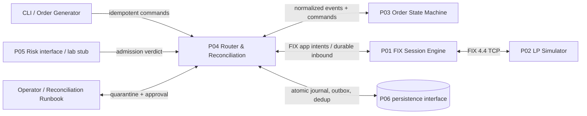
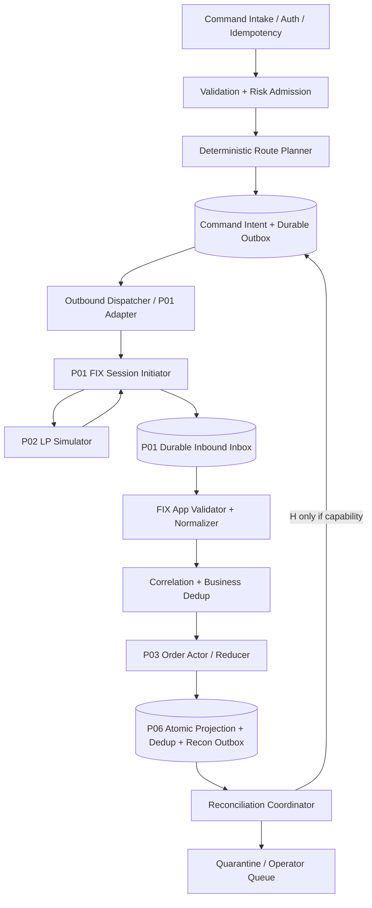
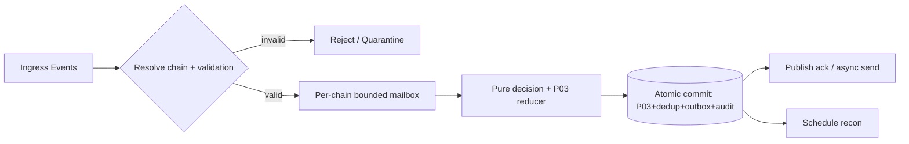
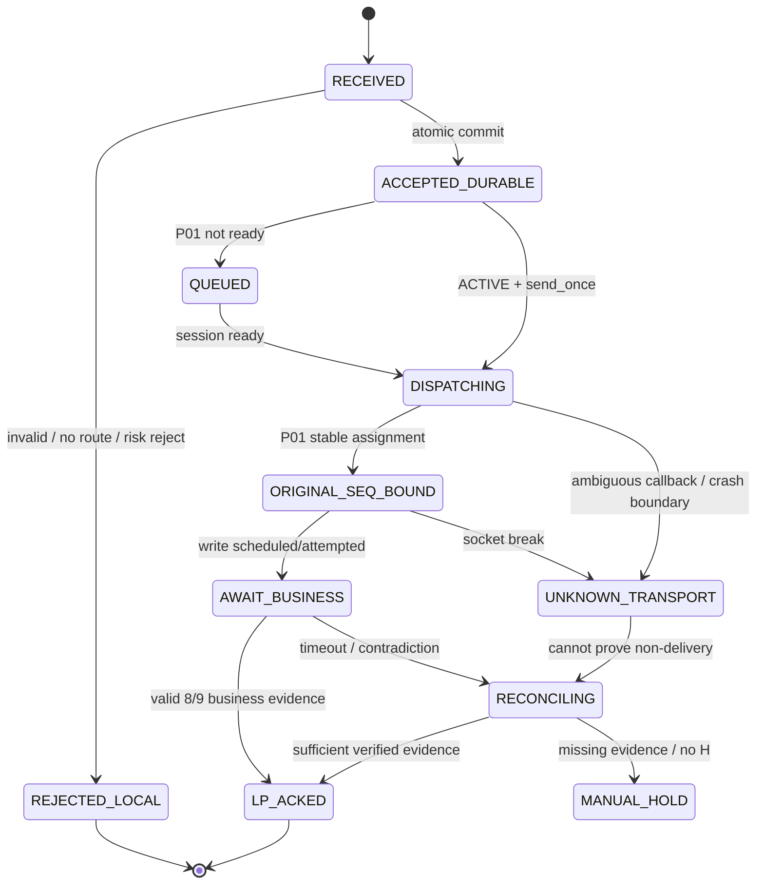
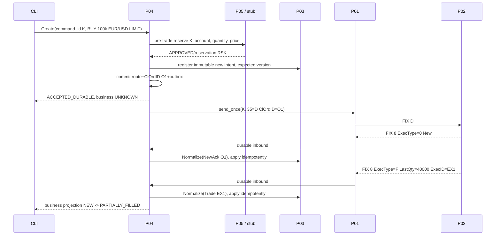
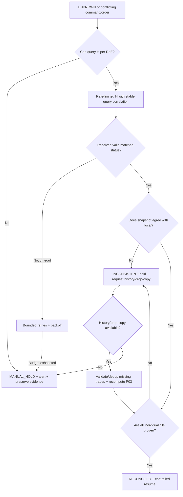

# Project 04 — FX/CFD Order Routing & Execution Reconciliation (FIX 4.4)

> **System Design · C++20 Implementation Blueprint · Safety Invariants · Failure Modeling · What-if Test Plan**  
> **Ngôn ngữ:** Tiếng Việt · **Stack đề xuất:** C++20, Linux, CMake, PostgreSQL/SQLite lab, Docker, GoogleTest, FIX 4.4  
> **Vị trí trong bộ tám dự án:** Project 04/08 — **client-side order router, FIX application adapter, correlation & reconciliation coordinator**  
> **Phiên bản:** 1.0 · **Ngày:** 2026-10-30 · **Trạng thái:** **thiết kế và test plan; chưa triển khai, chưa chạy test hoặc benchmark**  
> **Giới hạn lab:** một LP giả lập P02, một FIX initiator session P01, DAY LIMIT FX/CFD orders, không sử dụng tiền thật.

## Mục lục

1. [Căn cứ, mục tiêu và phạm vi](#1-căn-cứ-mục-tiêu-và-phạm-vi)
2. [Requirements, SLO, safety invariants](#2-requirements-slo-safety-invariants)
3. [Rules of Engagement và FIX 4.4 contract](#3-rules-of-engagement-và-fix-44-contract)
4. [Context và threat boundaries](#4-context-và-threat-boundaries)
5. [Kiến trúc module, state ownership](#5-kiến-trúc-module-state-ownership)
6. [Hợp đồng P01/P02/P03/P05/P06](#6-hợp-đồng-p01p02p03p05p06)
7. [Identity, correlation, lineage và dedup](#7-identity-correlation-lineage-và-dedup)
8. [Command admission, routing policy và risk gating](#8-command-admission-routing-policy-và-risk-gating)
9. [Outbound FIX encoding và validation](#9-outbound-fix-encoding-và-validation)
10. [Outbound durability, delivery states và ambiguous send](#10-outbound-durability-delivery-states-và-ambiguous-send)
11. [Inbound FIX validation, normalization và apply](#11-inbound-fix-validation-normalization-và-apply)
12. [New Order end-to-end workflow](#12-new-order-end-to-end-workflow)
13. [Cancel/Replace workflows và race semantics](#13-cancelreplace-workflows-và-race-semantics)
14. [Reconciliation protocol và UNKNOWN OUTCOME](#14-reconciliation-protocol-và-unknown-outcome)
15. [Crash consistency, replay và persistence](#15-crash-consistency-replay-và-persistence)
16. [Backpressure, concurrency và graceful degradation](#16-backpressure-concurrency-và-graceful-degradation)
17. [Security, audit, operations và observability](#17-security-audit-operations-và-observability)
18. [C++20 interfaces, schema, repository layout](#18-c20-interfaces-schema-repository-layout)
19. [Test methodology và coverage model](#19-test-methodology-và-coverage-model)
20. [Ma trận what-if chi tiết](#20-ma-trận-what-if-chi-tiết)
21. [P0 fault-injection playbooks](#21-p0-fault-injection-playbooks)
22. [Test harness, CI và evidence](#22-test-harness-ci-và-evidence)
23. [Acceptance criteria / release gates](#23-acceptance-criteria--release-gates)
24. [Milestones triển khai](#24-milestones-triển-khai)
25. [ADR, trade-offs, các vấn đề chưa giải quyết](#25-adr-trade-offs-các-vấn-đề-chưa-giải-quyết)
26. [Nguồn kỹ thuật tham chiếu](#26-nguồn-kỹ-thuật-tham-chiếu)

---

## 1. Căn cứ, mục tiêu và phạm vi

### 1.1. Căn cứ từ CV (không được tự nhận đây là source gốc)

CV `NguyenHoangMinh_CV_Trading.docx` mô tả dự án **FX/CFD FIX Gateway and Execution Engine** tại Larion, dùng **C++20 / FIX 4.4 / PostgreSQL / Linux / Docker**; xây LP adapters; **routed new, cancel, replace orders** và **reconciled execution reports**. CV còn nêu single-owner order state machine, partial fills, lost ACKs, cancel/replace races và journaling/recovery. CV **không cung cấp** code/router graph, FIX broker Rules of Engagement, database schema, SLO riêng của Project 04 hay bằng chứng đã kiểm thử những tình huống dưới đây.

### 1.2. Mục tiêu Project 04

Thiết kế một **client-side application router** kết nối các module P01/P02/P03: nhận lệnh có định danh idempotent, kiểm tra đủ điều kiện, tạo bản FIX đúng version/profile, **gửi một command intent ổn định**, tiếp nhận `ExecutionReport(35=8)`/`OrderCancelReject(35=9)`, correlation và normalize đúng, phối hợp với P03 để commit chính xác và điều phối reconciliation khi kết quả chưa rõ.

**Giá trị đầu ra:** mỗi yêu cầu phải có audit trail từ `command_id` → routing decision → outbound session assignment (nếu tồn tại) → inbound receipt → business event → P03 state version / exception; trạng thái mơ hồ **không bị đánh đồng** với reject hoặc cancel.

### 1.3. In scope / Out of scope

| In scope v1 | Out of scope v1 |
|---|---|
| D/F/G; H ở chế độ capability-gated; inbound 8/9; validate profile | Smart order routing nhiều LP, best-price selection, cross-region HA |
| Deterministic single-LP route; bounded queues; idempotent command intake | Exchange connectivity, trade clearing, position accounting |
| Request lineage/ExecID correlation; unknown/out-of-order/orphan handling | Matching/book; order execution thực tế (P02) |
| Durable intent/outbox **khi P06 contract sẵn sàng** | FIX session seq/reconnect semantics nội bộ (P01) |
| Reconciliation state machine, status query adapter, manual escalation | P&L/risk capital chính xác theo thực tế (P05) |
| Fault injection, metrics, test harness, operator runbooks | Tự động hỗ trợ mọi FIX extension/broker policy |

**Lab invariant:** không gửi lệnh đến broker sản xuất; mọi đường network chỉ trỏ tới P02 fixture hoặc peer interop được cấu hình rõ. P04 chỉ áp dụng business event qua P03; không tự mutate `CumQty`, `AvgPx` hay `OrdStatus`.

### 1.4. Ngôn ngữ trạng thái cần phân biệt

- `COMMAND_ACCEPTED_LOCAL`: command hợp lệ và đã được ghi theo contract, **không phải** LP nhận lệnh.
- `ORIGINAL_SEND_ASSIGNED`: có binding ổn định command → original FIX session sequence, **không phải** LP đã xử lý.
- `WRITE_ATTEMPTED`/`UNKNOWN_TRANSPORT`: bytes có thể đã đến LP hoặc chưa, **không được kết luận**.
- `LP_ACKED`/`LP_REJECTED`: có business evidence hợp lệ từ LP.
- `RECONCILIATION_REQUIRED`: còn bất đồng/chưa đủ dữ liệu, không tự retry một New Order mới.

---

## 2. Requirements, SLO, safety invariants

### 2.1. Functional requirements

| ID | Yêu cầu | Xác nhận hoàn thành |
|---|---|---|
| FR-01 | API Create/Cancel/Replace có `command_id` idempotent | Duplicate request cùng payload trả cùng kết quả, khác payload báo conflict |
| FR-02 | Routing deterministic tới LP active đúng account/profile | Không silent cross-account/LP route |
| FR-03 | FIX D/F/G encoder/validator | Đạt golden fixtures, profile reject tests |
| FR-04 | Correlate `ClOrdID`, `OrigClOrdID`, `OrderID`, `ExecID` | Orphan/contradictory reports không silently apply |
| FR-05 | Phân biệt `ExecType(150)` với `OrdStatus(39)` | Correct event normalization, P03 reducer dùng đúng semantics |
| FR-06 | No blind retry sau ambiguous send | UNKNOWN_OUTCOME + recon, không double submit |
| FR-07 | Durable outbox → P01 send-once contract (gated) | Crash matrix không cấp hai original seq cho cùng command |
| FR-08 | P01 durable inbox → atomic P03 apply+dedup (gated) | Restart/replay không double fill |
| FR-09 | Cancel/replace lineage và race sequencing | Fill trong pending được xử lý trên accepted version |
| FR-10 | Reconciliation workflow H/status/history/manual | Không đánh đồng snapshot với missing fill history |
| FR-11 | Bound memory, fairness, overload behavior | Không OOM, cancel không bị bỏ đói bởi New orders |
| FR-12 | Immutable audit, counters, manual quarantine | Mọi HOLD/RECON có reason, trace và owner |
| FR-13 | Session down/sync/circuit breaker policy | Không phát ứng dụng khi P01 chưa ACTIVE |
| FR-14 | Risk admission hook / fail-closed policy | New/replace không bypass risk ngoài test stub rõ ràng |
| FR-15 | Simulated peer contract version pinning | Không auto bật H/resend/side-change ngoài ROE |

### 2.2. Safety invariants (bắt buộc kiểm trước/sau mỗi step)

1. **R-I01 Command identity:** `(tenant, client_command_id)` ánh xạ tối đa một canonical intent; request trùng khác payload → `CONFLICT`, không mutate.
2. **R-I02 Single route:** một accepted command chỉ có một routing decision/LP; không tự failover New sang LP khác khi trạng thái unknown.
3. **R-I03 No implicit success:** timeout/socket ACK/session ACTIVE **không phải** business order ack.
4. **R-I04 Stable ClOrdID:** mỗi D/F/G intent sở hữu một `ClOrdID` bất biến; không tái sử dụng cho intent khác trong configured uniqueness scope.
5. **R-I05 Accepted lineage:** F/G chọn `OrigClOrdID` đúng last **accepted** version theo strict v1; pending replace chưa được làm accepted ID.
6. **R-I06 No double original send:** cùng `command_id` không được tạo hai *original outgoing FIX seq*; resend session giữ sequence cũ theo P01 contract. **Điều này là mục tiêu cần chứng minh, không mặc định P01 đã cung cấp.**
7. **R-I07 Dedup transport + business:** cùng inbound FIX receipt và cùng business execution không tạo hai P03 effects.
8. **R-I08 ExecID policy:** trade `ExecID(17)` dedup trong namespace đã thỏa thuận; `ExecType=I` status (thường `ExecID=0`) không dùng như trade identity.
9. **R-I09 No synthetic fill:** status `ExecType=I`, timeout hoặc reconnect không biến thành `Trade(F)` hay `LastQty` giả.
10. **R-I10 No overfill-by-router:** P04 không tự sửa ledger; các giá trị bất hợp lệ chuyển P03 quarantine, không được tự clamp.
11. **R-I11 No false cancel:** `Pending Cancel`/CancelReject không đánh dấu order đã Canceled.
12. **R-I12 No false replace:** Fills khi pending replace gắn với accepted version trước đó; version mới chỉ hiệu lực sau replace ack.
13. **R-I13 Order identity consistency:** không alias hai order chains khác nhau dù trùng `OrderID` dưới namespace khác; không nối orphan chỉ vì symbol/qty giống.
14. **R-I14 Input provenance:** mọi normalized event giữ `session_identity`, inbound durable key, raw digest, parser/profile version và source timestamp.
15. **R-I15 Atomic apply boundary:** P03 state, applied-event keys, reconciliation intent, downstream effects được commit theo transaction contract; nếu không, chỉ `at-least-once + idempotency`.
16. **R-I16 Ambiguity explicit:** nếu không biết LP có nhận D/F/G hay không, lưu `UNKNOWN_OUTCOME`, không auto tạo `ClOrdID` mới để gửi lại.
17. **R-I17 Reconciliation is evidence-based:** order summary không chứng minh đủ từng fill; thiếu trade history thì giữ mismatch/hold.
18. **R-I18 No cross-tenant leak:** route/report của account/session khác bị cô lập, không được cập nhật chain.
19. **R-I19 Bounded failure:** mọi queue, retry, orphan retention, reconnect backlog, allocator có giới hạn; overflow dẫn `REJECT/HOLD` đúng chính sách.
20. **R-I20 Fail closed on durability:** nếu journal/outbox/dedup store lỗi, dừng New/Replace, không ack durable giả.
21. **R-I21 Source-order preservation:** trong một canonical order chain, effects được serialize theo deterministic order; reordering không được silently bỏ past fill.
22. **R-I22 Operator changes auditable:** force-reconcile/resume/reject/quarantine chỉ qua workflow có quyền, lý do, timestamp, hash/correlation.
23. **R-I23 Consistent time semantics:** durations dùng monotonic clock; FIX TransactTime/SendingTime dùng UTC và validation theo P01/ROE.
24. **R-I24 No irreversible automation on contradiction:** ID conflict, snapshot regression, trade correction/bust không hỗ trợ → HOLD + manual/extended reconciliation.
25. **R-I25 Outbox/inbox non-loss:** crash giữa receipt, commit, send, callback không xóa vĩnh viễn intent hay inbound event chưa xử lý.
26. **R-I26 Capacity isolation:** một account/chain spam hoặc một poison event không làm block toàn bộ session vĩnh viễn; có bounded backpressure và dead-letter/quarantine.

### 2.3. SLO/SLI cho lab (mục tiêu đề xuất; KHÔNG phải benchmark từ CV)

| Loại | Đề xuất MVP | Cách đo |
|---|---|---|
| Correctness | **0** duplicate business fill, orphan silently applied, unauthorized route | Assert invariants + state oracle |
| Durability | **0** durable intent/inbound đã ACK bị mất sau crash có cơ chế recover được chứng minh | Failpoint+fsync/restart |
| Latency | Báo cáo p50/p95/p99: `command admitted → intent persisted`, `durable inbound → P03 commit`, `inbound → routing decision` | Monotonic timestamps, warmup, histogram |
| Throughput | Đo 1k/5k/10k events/s; tăng workload đến saturation để tìm breaking point | Synthetic deterministic replay |
| Queue/RSS | Bounded; default config *lab example*: main queue ≤ 65,536 events, per-chain ≤ 128, orphan quota ≤ 10,000 | Saturation tests, peak RSS |
| Availability | New/Replace fail closed khi session/store không sẵn sàng; Cancels có controlled queue/best-effort theo capability | Failover & policy tests |
| Recovery | Startup phát hiện mọi pending/unknown và vào RECONCILING trước khi resume | Kill at every persistence boundary |

Con số **p99 310 → 95 µs, 50k msg/s / 8-core in-process** trong CV thuộc **hệ thống lớn**, không phải SLO đo cho P04. Ưu tiên correctness trước; latency optimization thuộc P07.

---

## 3. Rules of Engagement và FIX 4.4 contract

### 3.1. Mandatory ROE/configuration snapshot

| Khía cạnh | Policy v1 trong lab | Vì sao phải pin |
|---|---|---|
| FIX version/roles | FIX.4.4, P04 đi qua P01 Initiator, P02 Acceptor | Tránh lệch schema/session |
| Identity | CompIDs, session qualifier, LP namespace, account, tenant | Không cross-account correlation |
| Supported commands | `D`, `F`, `G`; `H` **OFF** cho đến khi P02 bật và integration tests PASS | P02 Project 02 chỉ hứa H ở phase 2 |
| Order types | DAY LIMIT FX/CFD, supported symbols/currency/lot/tick size rõ | Không đoán LP hỗ trợ Market/IOC/GTC |
| Chaining | Strict pessimistic: một pending F/G trên chain, `OrigClOrdID` = last **accepted** | RoE thực có thể cho optimistic chaining, nhưng v1 không |
| Cancel/replace | Không gửi khi terminal/unknown; quantity replace là tổng intended chain quantity | Tránh tính nhầm remaining qty |
| ExecID scope | `lp_namespace + ExecID` hoặc scope được peer hợp đồng; giữ record cho toàn lifecycle | Replay và day-rollover có thể reuse nếu peer định nghĩa khác |
| Status & history | H capability-gated; status chỉ là snapshot, fill history cần interface khác | H không thay thế từng execution event |
| Duplicate handling | P01 FIX session resend; P04 `command_id/ClOrdID/ExecID` business dedup riêng | Không trộn session replay với order resubmit |
| Session reset | Theo P01 store và bilateral schedule, **không tự đổi** `ClOrdID` scope/clear P04 ledger | Tránh duplicate sau daily reset |
| Reject policy | FIX session reject ≠ application business reject ≠ cancel reject | Không tự đổi trạng thái lệnh |
| Secrets/transport | Loopback/test peer in lab; TLS/VPN profile do P01 cung cấp; logs redact | Không exposed live trading credentials |

**Lưu ý chuẩn FIX:** `ExecType(150)=F` đại diện **Trade** trong FIX 4.4 (không dùng các giá trị PartialFill=1, Fill=2 đời cũ cho ExecType). `OrdStatus(39)` biểu diễn **trạng thái hiện tại**. `ExecType=I` là **Order Status**, báo cáo tổng hợp chứ không tạo một fill mới. `OrderCancelReject(35=9)` trả lời từ chối F/G, không phải từ chối **lệnh gốc**. Nguồn: OnixS FIX 4.4 Execution Report/ExecType và Order Cancel Reject (mục 26).

### 3.2. FIX message types phải hỗ trợ

| Chiều | `35` | Message | Business effect |
|---|---:|---|---|
| Client → LP | `D` | NewOrderSingle | Tạo order intent mới; tùy ACK mới biết outcome |
| Client → LP | `F` | OrderCancelRequest | Yêu cầu cancel phần còn lại, **không cancel ngay** |
| Client → LP | `G` | OrderCancelReplaceRequest | Yêu cầu replace; chưa có hiệu lực cho tới khi được accept |
| Client → LP | `H` | OrderStatusRequest | Query, chỉ khi ROE/peer thực sự hỗ trợ |
| LP → Client | `8` | ExecutionReport | New/Trade/Cancel/Replace/Status/Pending/Rejected/Correct/Bust |
| LP → Client | `9` | OrderCancelReject | Báo không xử lý được F/G |
| Session layer | `0/1/2/3/4/5/A`... | Admin | **Chỉ P01 xử lý**, P04 không giả làm session engine |

### 3.3. Pre-interop checklist với P02

- [ ] Hỗ trợ `35=H` hay không? Tần suất tối đa và fields? Nếu chưa: `capability.order_status_query=false`.
- [ ] Với unknown order, peer trả `ExecType=I, OrdStatus=Rejected`/unknown gì? Phải có fixture explicit.
- [ ] `ExecID(17)` uniqueness scope, reuse, `ExecID=0` với status snapshots.
- [ ] Confirm cancel/replace echo `ClOrdID/OrigClOrdID` chính xác, có hỗ trợ pending ACK không.
- [ ] Fill trong pending replace: reports dùng accepted version và cumulative quantities theo chain.
- [ ] Trade Cancel/Correct (`ExecType=H/G`) có thể phát? V1: **quarantine + manual** đến khi P03 reducer hỗ trợ.
- [ ] Có status-only snapshot nhưng không có trade history? Khai báo risk tồn tại rõ, không tự khẳng định reconciled đầy đủ.
- [ ] Profile qty/price units, FX pair formatting, symbol whitelist, timestamp precision.

---

## 4. Context và threat boundaries



**Trust boundaries:** API caller không đáng tin; LP/peer không đáng tin ở tầng business (có thể sai/cũ/trùng); P01 bảo đảm transport policy, không bảo đảm ExecID semantic correctness; database có thể fail/rollback; wall clock có thể skew; operator có thể thao tác sai; metrics/logs có thể làm rò thông tin nhạy cảm. P04 phải validate ở mỗi biên.

### 4.1. Threat / failure inventory

| Boundary | Các lỗi đặc trưng | Chặn lỗi/ứng xử |
|---|---|---|
| Client API | Duplicate, replay, stale intent, spoofed account, malformed price | authn/authz lab, idempotency, quota, schema validation |
| Router ↔ Risk | timeout, old risk verdict, revoked limit, partial reservation | fail closed, reserve ID, version/expiry checking; cancel safety policy |
| Router ↔ P01 | queue reorder, session down, uncertain send, wrong payload hash | durable intent, P01 stable send-once contract **gated** |
| P01 ↔ P02 | disconnect, resend, business duplicate, LP semantic violation | fix session recovery + independent semantic dedup/recon |
| P01 inbox → P04 | at-least-once delivery, poison, reorder, oversized report | strict parse, quarantine, ack after state commit |
| P04 ↔ P03 | stale state snapshot, double apply, mixed chain, unknown correction | single-owner/reducer, optimistic version/CAS, atomic apply |
| P04 ↔ P06 | crash, ENOSPC, disk corruption, commit ACK lost | fail closed, recovery marker, restore/recon |
| Ops/metrics | false alarm, credential leak, unauthorized force resume | RBAC, redaction, immutable audit, two-person review for risky action |

---

## 5. Kiến trúc module, state ownership



### 5.1. Ownership table (không overlap)

| State/Action | Single owner | P04 có được sửa? |
|---|---|---|
| Session `NextNumIn/Out`, resend store, FIX socket | P01 | **Không** |
| LP book/fills và outbound LP reports | P02 | **Không** |
| Order status, accepted version, CumQty/LeavesQty, fill ledger | P03 | **Không**; P04 chỉ cung cấp normalized event |
| Idempotent command/routing plan, audit, pending send intents | **P04** | **Có** qua một actor/serializable transaction |
| Cross-order exposure/reservation | P05 (lab stub trước) | Không tự tính exposure thật |
| Atomic durable journal, transactional inbox/outbox | P06 adapter; dùng fake store khi chưa build | P04 dùng interface; không tuyên bố crash-safe nếu chưa có adapter |
| Recon query schedule, missing reports, operator HOLD | **P04** | Có, phải audit |

**Concurrency:** mỗi `order_chain_id` có một command lane được serialize (single-owner / keyed actor); FIX session outbound có one owner P01. New chains có thể xử lý song song nhưng chặn race do shared risk/account và global session capacity. FIFO trong chain, không tự đảo F/G. Risk reservation phải dùng CAS/idempotent API của P05 (hoặc fail-closed stub).

### 5.2. Event loop và boundaries



**Commit-before-ack:** nếu ghi DB thất bại, không trả `ACCEPTED_DURABLE`; không mutate P03 in-memory canonical state rồi quên khi crash. Side effects chạy sau commit và có idempotent key. Multi-store P01/P06 không có atomic 2PC → phải giải bằng adapter stable `send_once` + outbox polling, không giả sử một transaction xuyên network.

---

## 6. Hợp đồng P01/P02/P03/P05/P06

### 6.1. P01 — Session Engine API đề xuất (cần thực hiện/gate)

```cpp
struct DurableFixInbound {
  SessionIdentity session;
  uint64_t epoch;                     // epoch của storage/session ownership, NOT business ID
  uint64_t msg_seq_num;               // FIX 34
  uint64_t durable_inbox_id;
  Bytes frame;
  Hash raw_sha256;
};

// Chưa phải API có sẵn của P01; P01 phải implement và kiểm thử.
struct StableSendResult {
  enum class State { AssignedOriginalSeq, AlreadyAssigned, NotReady, Unknown, Fatal } state;
  std::optional<uint64_t> original_seq;
};

virtual StableSendResult send_once(
    CommandId command_id, Hash immutable_payload_hash, FixAppMessage msg) = 0;
virtual void ack_inbound_after_commit(uint64_t durable_inbox_id) = 0;
```

**Contract bắt buộc cho `send_once`:** `(session_identity, command_id)` là unique; cùng payload thì trả về cùng original sequence, khác payload → hard conflict; persist mapping+payload trước khi gửi socket; retry từ P04 không cấp seq gốc khác; P01 chỉ làm protocol resend theo session history. Nếu không triển khai được, P04 cần dừng ở **durable-unsent / unknown**, không tuyên bố issue-once sau crash.

### 6.2. P02 — LP Simulator

P02 là independent business oracle/peer: xác nhận FIX application D/F/G, có thể sinh 8/9, inject disconnect/delay/duplicate/contradictions. P02 cung cấp `35=H` **chỉ khi explicit enable** và có fixture/contract. **Không** dùng chung business reducer với P03 để tránh test oracle đồng lỗi với SUT.

### 6.3. P03 — Order State Machine

P04 gửi `NormalizedBusinessEvent` mang `event_id, correlation, normalized ExecType/OrdStatus, quantities, original raw ref` tới P03 reducer. P03 trả `{new_state, emitted_intents, reconcile_required, quarantine_reason}`; **P04 không viết trực tiếp** order status hoặc fill ledger. Trạng thái `UNKNOWN_OUTCOME` do P04 quản lý ở command/transport level, có liên kết P03 order chain.

### 6.4. P05 — Pre-trade Risk

Baseline testing: `IRiskAdmission` fake có responses `APPROVE/REJECT/UNAVAILABLE` và idempotent `reservation_id`; **không được trình bày là risk engine thực**. New và replace tăng risk phải APPROVE trước queue; cancel giảm exposure được phép enqueue theo policy ngay cả khi risk unavailable, nhưng không được bypass store/session safety. Thay đổi risk reservation sau fill/cancel/reject cần đúng transaction/saga đã thiết kế ở P05/P06; chưa có thì báo hạn chế.

### 6.5. P06 — Atomic durable store

P04 yêu cầu `transaction(append_inbound_applied_key, apply_P03_projection, append_outbox, append_audit, reconcile_task)` là nguyên tử trong một storage authority. Nếu P03 có DB khác, phải dùng saga + compensation và chỉ cam kết idempotency **eventually**, không khẳng định atomic end-to-end. SQLite WAL FULL phù hợp lab single-process; PostgreSQL là lựa chọn ứng dụng khi P06 được triển khai và benchmark.

### 6.6. Versioned inter-project contract

| Contract | Producer → Consumer | Version/policy |
|---|---|---|
| `FixInboundV1` | P01 → P04 | ordered, at-least-once durable, with receipt ID |
| `StableSendV1` | P04 → P01 | **proposed / blocked until implemented** |
| `NormalizedReportV1` | P04 → P03 | exact FIX 4.4 semantics, strict validation |
| `OrderStateSnapshotV1` | P03 → P04 | immutable `aggregate_version`, accepted chain ID |
| `RiskDecisionV1` | P05/fake → P04 | expiration + reservation correlation |
| `AtomicApplyV1` | P04/P03 → P06 | atomic state+dedup+outbox, verified failpoints |

---

## 7. Identity, correlation, lineage và dedup

### 7.1. ID namespace và uniqueness

| ID | Nguồn | Scope và cách sử dụng |
|---|---|---|
| `client_command_id` | CLI/API caller | `(tenant, client_command_id)`, stable across HTTP/client retries |
| `order_chain_id` | P03/Router intake | Internal UUID/monotonic ID, immutable across replace |
| `ClOrdID(11)` | Client router | Fresh for **each D/F/G request**, unique within negotiated counterparty scope |
| `OrigClOrdID(41)` | Router F/G | Last accepted order ClOrdID trong strict v1 |
| `OrderID(37)` | LP | Namespace by `lp_id + account` and RoE; stable only if peer contract says so |
| `ExecID(17)` | LP | Uniqueness scope theo RoE; persisted dedup ledger cho execution reports |
| `MsgSeqNum(34)` | P01 | Session stream ordering only; **không phải** business execution ID |
| `durable_inbox_id` | P01 | Durable receipt key; P04 marks applied only after P03 transaction |
| `recon_case_id` | P04 | Một incident/unknown outcome có thể có nhiều status/history probes |

`ExecID=0` hoặc các giá trị được peer quy định cho `ExecType=I` status snapshots là **không đủ** để dedup nhiều status snapshots. Dùng `durable_inbox_id`/response correlation cho status; `ExecID` dedup dành cho business event theo RoE. Cùng `ExecID` nhưng payload khác là **conflict** (quarantine), không ignore im lặng.

### 7.2. Correlation precedence và contradiction policy

1. Session + tenant/account/profile phải match route; sai → SECURITY_QUARANTINE.
2. Tra `ClOrdID(11)` trong `request_id → chain_id` (bao gồm pending cancel/replace IDs). Với response 8 và 9, semantics của ClOrdID/OrigClOrdID phụ thuộc ExecType/response type.
3. Cross-check `OrderID(37)` đã bind vào chain từ LP; mismatch giữa chain và OrderID → HOLD; `OrderID=NONE` chỉ khi RoE/unknown-reject cho phép.
4. Check `OrigClOrdID(41)` theo **last accepted** hoặc exception được ROE pin; không chọn chain bằng symbol/qty vì có thể trùng hợp.
5. Check `ExecID(17)` + content fingerprint cho business report; duplicate đúng → NOOP, conflict → HOLD.
6. Unmatched report → `ORPHAN_QUARANTINE`, retain raw and provenance, schedule bounded review; không thả bỏ không dấu vết và không áp dụng bừa.

### 7.3. Lineage example

```text
Chain C100: D(ClOrdID=O1) → accepted O1 → F(CXL1, Orig=O1) → Reject CXL1
                                  ↘ G(R1, Orig=O1) → accepted R1
                                                   ↘ F(CXL2, Orig=R1)
```

Rejected `CXL1` không làm đổi accepted version; pending `R1` chỉ trở thành accepted sau `ExecType=5` (Replaced). Multiple optimistic replace chained requests không hỗ trợ v1; muốn mở phải có separate contract/test suite.

---

## 8. Command admission, routing policy và risk gating

### 8.1. Admission algorithm

1. **Authenticate/authorize** `tenant + account`; validate actor permissions (lab fixture).
2. Canonicalize payload *strictly* (fixed-point price, qty units, symbol code, timestamp, exact field set); hash canonical bytes.
3. Lookup `(tenant, client_command_id)`; cùng digest trả snapshot cũ, khác digest trả `409 IDEMPOTENCY_CONFLICT`.
4. Validate command kind, accepted chain and version, price/qty precision, max size, symbol allowlist và ROE capability.
5. P05 admission/reservation theo policy; nếu unavailable, New/Replace `RISK_UNAVAILABLE` **không gửi** (Cancel có đường ưu tiên riêng).
6. Resolve một LP+session route theo config snapshot; không gửi sang LP B nếu LP A unknown.
7. Commit `command_intent + routing_decision + fixed ClOrdID + outbox + audit` nguyên tử; chỉ sau commit trả accepted-local.
8. Dispatcher đọc outbox; chỉ gửi khi P01 `ACTIVE`, config/profile version không đổi trong khi pending.
9. Sau gửi, chờ business evidence; timer chỉ chuyển sang reconcile, **không tạo command mới**.

### 8.2. Router policy (MVP)

- Một tài khoản có đúng một `active_lp_route`, không giả lập smart route selection.
- Check `route_version` (config immutability) ở commit; config thay đổi lúc command pending không tự chuyển LP.
- Priority: **Cancel > Recon > Replace > New** ở tầng scheduling, **nhưng vẫn giữ FIFO/dependencies trong từng chain**, không bỏ qua các safety guards.
- `PENDING_REPLACE`/`PENDING_CANCEL` → block conflicting new F/G cùng chain hoặc policy-dependent HOLD.
- `UNKNOWN_OUTCOME` → không gửi lại New với new ClOrdID; không gửi Cancel nếu chưa có đủ identity/ROE cho phép; query/escalate.
- Cancels: có thể nhận vào *durable priority queue* khi session down; hiển thị `PENDING_TRANSPORT` và cảnh báo không đảm bảo cancel kịp, có TTL/cap.

### 8.3. Local command response contract

```json
{
  "command_id": "cmd-100",
  "order_chain_id": "ord-42",
  "route": "LP_SIM_01",
  "state": "ACCEPTED_DURABLE",
  "business_outcome": "UNKNOWN",
  "client_order_id": "O-42-A"
}
```

**Quan trọng:** `202/ACCEPTED_DURABLE` là xác nhận lưu intent cục bộ, **không** hàm ý LP order accepted/filled. Lệnh nguy cơ quá hạn vẫn có thể khớp trước khi cancel được nhận.

---

## 9. Outbound FIX encoding và validation

### 9.1. D/F/G/H mapping

| FIX MsgType | Required/conditionally required *v1 scope* | Quy tắc local |
|---|---|---|
| D New | `11 ClOrdID`, `55 Symbol`, `54 Side`, `60 TransactTime`, `38 OrderQty`, `40 OrdType`, `44 Price` với LIMIT, `59 TimeInForce` DAY theo profile | Fixed point; account/LP/route may supply `1 Account`; FIX session header do P01 |
| F Cancel | `41 OrigClOrdID`, `11 ClOrdID`, `55 Symbol`, `54 Side`, `60 TransactTime`; `37 OrderID` khi được peer yêu cầu | `ClOrdID` của request **mới**; not reused; cancel all *remaining* |
| G Replace | `41`, `11`, `55`, `54`, `60`, `38 total OrderQty`, `40 OrdType`, `44 Price` limit | Re-send intended full order params theo RoE; không truyền `LeavesQty` như `OrderQty` |
| H Status (optional) | `11 ClOrdID`, `Instrument`, `54 Side`; `37 OrderID` optional; `790 OrdStatusReqID` nếu peer hỗ trợ | Gated capability; response `8/150=I` may have `ExecID=0` |

Danh sách FIX wire fields là phần tóm tắt **không thay thế** FIX 4.4 official dictionary và bilateral RoE; phần conditional mandatory validate bằng dictionary/schema pinned. P01 tạo `8/9/10/34/49/52/56`, checksum, session resend flags; P04 không tự gắn `34`.

### 9.2. Serialization safety

- `price` và `qty` trong fixed point; conversion sang ASCII decimal không tràn, không scientific notation, không locale commas.
- Không cho `NaN`, infinity, âm, zero invalid, quan hệ `OrderQty < CumQty` nếu replace chưa có policy; không tự rounding vượt price tick.
- `|` trong tài liệu **chỉ** biểu diễn SOH để đọc; wire thực sử dụng byte `0x01`, check FIX BodyLength/Checksum bằng P01.
- Sử dụng tagged canonical struct rồi encoder; reject field duplication, tag poisoning, invalid UTF-8/free text theo RoE, giới hạn bytes.
- Serializer output hash được pin vào `command_id`; after commit, **không sửa payload** theo giá thị trường mới hoặc config drift.

### 9.3. Golden FIX application fixtures (minh họa, không phải full frames)

```text
D: 35=D|11=O-42-A|1=ACC1|55=EUR/USD|54=1|60=20261030-08:00:00.000|38=100000|40=2|44=1.08500|59=0|
F: 35=F|11=C-42-1|41=O-42-A|55=EUR/USD|54=1|60=20261030-08:01:00.000|
G: 35=G|11=R-42-1|41=O-42-A|55=EUR/USD|54=1|60=20261030-08:01:01.000|38=80000|40=2|44=1.08490|
```

**Không copy-paste** thành TCP wire; còn thiếu standard header/trailer và conditional fields theo dictionary/ROE.

---

## 10. Outbound durability, delivery states và ambiguous send

### 10.1. State machine command/outbox



`UNKNOWN_TRANSPORT` chỉ là bất định ở **transport/delivery**; P03 business state có thể vẫn `NEW`, `PARTIALLY_FILLED`, `PENDING_CANCEL` tùy evidence. Đừng dùng enum này để overwrite canonical P03 state.

### 10.2. Atomicity problem: DB ↔ P01 ↔ socket

```mermaid
sequenceDiagram
  participant API as Client
  participant R as P04 Router
  participant DB as P06 Durable Outbox
  participant S as P01 StableSend
  participant LP as P02 LP
  API->>R: New(command_id=K, ClOrdID=O1)
  R->>DB: TXN persist intent K/payload_hash/outbox
  DB-->>R: COMMIT
  R-->>API: ACCEPTED_DURABLE (not broker ACK)
  R->>S: send_once(K, hash, FIX D)
  S->>S: durable bind K -> original MsgSeqNum N
  S->>LP: FIX D MsgSeqNum=N
  Note over R,LP: Crash may occur before/after write; callback not proof of LP execution
  LP-->>S: FIX 8 ExecType=0/F...
  S->>R: durable inbound receipt
  R->>DB: TXN dedup + P03 apply + outbox
  DB-->>R: COMMIT
  R->>S: ack_inbound_after_commit(receipt)
```

**Impossible guarantee by wishful thinking:** không thể đồng thời biết LP có nhận TCP bytes hay không chỉ dựa trên `send()`/callback. Cần stable original session seq mapping, durable history và **LP business reconciliation**. Nếu P01 không có `send_once`, không được tự retry `D` như một *new* FIX app message sau crash; đưa case sang HOLD, khuyến nghị status query nếu supported.

### 10.3. Ack hierarchy và retry matrix

| Evidence | Cho phép kết luận | Tuyệt đối không kết luận |
|---|---|---|
| Local DB commit | intent không bị mất theo durability contract | LP đã thấy/accepted |
| P01 returned original seq | có stable assignment (nếu API đúng contract) | LP đã nhận bytes |
| TCP write success | kernel chấp nhận bytes | LP processed application |
| FIX session logon/recovery | transport synced | new order chưa/đã khớp |
| `ExecutionReport` valid, correlated | theo ExecType: New/Trade/Cancel/Replace/Reject | toàn bộ lịch sử fill đủ chỉ từ một status snapshot |
| `OrderCancelReject` valid | F/G yêu cầu bị từ chối | order gốc bị từ chối/terminal |
| H response `ExecType=I` | trạng thái tổng hợp LP tại thời điểm snapshot | complete ledger hoặc non-existence nếu status không đủ authoritative |

**Retry P04→P01 RPC:** cùng `command_id + payload_digest` được phép retry `send_once` nếu P01 có stable binding; **business retry** với `ClOrdID` mới **không** được tự động khi unknown. Cơ chế FIX resend do P01 quyết định theo session protocol, không do P04.

---

## 11. Inbound FIX validation, normalization và apply

### 11.1. Validation pipeline

```text
P01 durable inbox (ordered FIX application frame)
  → allowed session/account/LP/protocol profile
  → pinned FIX 4.4 application dictionary + conditional fields
  → MsgType(35) 8/9 + ExecType/OrdStatus semantic checks
  → resolve request lineage, bind/check OrderID, check ExecID scope
  → dedup FIX receipt + business ExecID/payload hash
  → create immutable NormalizedBusinessEvent
  → P03 pure reducer; may request quarantine/reconcile
  → atomic apply: P03 state + applied_event + recon/outbox/audit
  → ack P01 durable inbox receipt *after* COMMIT
```

### 11.2. Normalization rules (critical FIX 4.4 semantics)

| `35/150` | Nội dung | P04 xử lý | Không làm |
|---|---|---|---|
| 8/0 New | New accepted | correlation, P03 `NewAck` | không tạo fill |
| 8/F Trade | Partial/full fill | require `LastQty(32)`+`LastPx(31)`+`ExecID(17)`, apply idempotently | không suy fill chỉ từ `CumQty` |
| 8/6 Pending Cancel | cancel đang xử lý | pending event + timer | không terminal |
| 8/4 Canceled | cancel thành công | P03 canceled + reconcile remaining if needed | không xóa fills trước đó |
| 8/E Pending Replace | replace đang xử lý | giữ accepted version | không kích hoạt new price/qty |
| 8/5 Replaced | replace được accept | P03 accepted version update | không dùng pending version sớm |
| 8/8 Rejected | New/order rejected per correlation | phân loại đúng request/order | không biến thành cancel reject |
| 8/I Order Status | snapshot | compare state, decide evidence gap | không ghi trade mới |
| 8/G or 8/H | Trade Correct / Trade Cancel | **quarantine v1**, extend P03 in phase 2 | không blind decrement ledger |
| 8/D | Restated | **quarantine v1** until RoE/P03 support | không overwrite accepted params |
| 9 | OrderCancelReject | echo F/G `11`, `41`, `434`, reason `102` | không xem original order rejected |

- `OrdStatus` precedence cao (`Pending Cancel`, `Pending Replace`) không phủ định fill; P03 xử lý `CumQty/LeavesQty` nhất quán theo chain.
- Duplicate FIX session resend có thể mang `43=Y` (`PossDupFlag`) nhưng P04 vẫn dedup theo **business execution ID**; `97=Y` (`PossResend`) là tình huống khác và cần ROE.
- Unexpected `35`, missing required tags, negative/overflow qty/price, wrong account/symbol/side, conflicting OrderID đều HOLD/REJECT theo classification đã định, không crash.
- Bất kỳ `ExecType=I` có `ExecID=0` được key theo durable receipt và status query context, **không** làm vô hiệu các status response sau đó.

### 11.3. Commit-after-parse / ack-after-commit

```mermaid
sequenceDiagram
  participant P1 as P01 durable inbox
  participant R as P04 normalize/dedup
  participant O as P03 reducer
  participant DB as Atomic Store
  P1->>R: report receipt_id=501 (might redeliver)
  R->>DB: look up source applied key / ExecID
  DB-->>R: not yet applied
  R->>O: validated immutable event
  O-->>R: state transition / hold / side effect intents
  R->>DB: transaction commit P03 projection + applied key + outbox
  DB-->>R: commit success
  R->>P1: ack receipt_id=501
  Note over P1,R: Crash before ack -> replay; dedup makes business NOOP
```

Nếu P03 reducer reject ambiguous report, vẫn commit **durable quarantine record + applied source receipt key** theo contract để poison không block vĩnh viễn; không coi business effect applied. Sau khi sửa/review, replay qua controlled resolution channel có audit.

---

## 12. New Order end-to-end workflow

### 12.1. Normal successful order



**Acceptance:** `O1` stable, 1 intent/1 routing decision, 0 duplicate EX1, P03 computes CumQty=40000/LeavesQty=60000; P04 never computes ledger by itself. If LP fills before NewAck, P03 handles valid out-of-order business semantics or HOLD according to P03 contract; P04 must not discard fill.

### 12.2. Failure cases

- **No ack:** timer triggers recon case; no new D/ClOrdID. Query `H` only if P02 implements it.
- **Unexpected New reject**: valid `8/8` correlated; release risk reservation according to P05 idempotent effect contract; no phantom accepted order.
- **Fill before ack:** route to P03 with event provenance; never treat late NewAck as regression.
- **Two commands same user `command_id`:** same payload→same local result; changed payload→error with zero side effects.

---

## 13. Cancel/Replace workflows và race semantics

### 13.1. Cancel amid fill

```mermaid
sequenceDiagram
  participant U as CLI
  participant R as P04
  participant P1 as P01
  participant LP as P02
  participant P3 as P03
  U->>R: Cancel C1 for accepted O1
  R->>R: Persist ClOrdID=C1, OrigClOrdID=O1
  R->>P1: send_once(C1, 35=F)
  P1->>LP: FIX F
  LP-->>P1: FIX 8/150=6 PendingCancel
  P1->>R: report
  R->>P3: pending cancel (NOT terminal)
  LP-->>P1: FIX 8/150=F Trade EX2 (40k) while pending
  P1->>R: report
  R->>P3: apply EX2 once under accepted O1
  LP-->>P1: FIX 8/150=4 Canceled
  P1->>R: report
  R->>P3: canceled; remaining 0
```

Cancel can fail even after `Pending Cancel`; a valid `35=9` with `434=1` ends **cancel request** pending state but **không** làm kết thúc lệnh gốc. `CumQty`/fill history vẫn được giữ.

### 13.2. Replace after partial fill

```mermaid
sequenceDiagram
  participant U as CLI
  participant R as P04
  participant P1 as P01
  participant LP as P02
  participant P3 as P03
  U->>R: Replace G R1, Orig=O1, new total Qty=80000
  R->>R: Persist pending replacement; O1 still accepted
  R->>P1: send_once(R1, 35=G)
  P1->>LP: FIX G
  LP-->>P1: FIX 8/150=E PendingReplace
  LP-->>P1: FIX 8/150=F Trade EX3 referencing O1
  P1->>R: both reports in FIX session order
  R->>P3: apply fill EX3 to accepted O1
  LP-->>P1: FIX 8/150=5 Replaced to R1
  R->>P3: accept R1; cumulative chain qty preserved
```

### 13.3. Strict pending policy

- `Cancel` sau replace pending: v1 **HOLD/REJECT_LOCAL** trừ khi ROE rõ ràng, không optimistic chain.
- `Replace` sau cancel pending: v1 HOLD, không đè pending IDs.
- `Replace total OrderQty < already CumQty`: validator HOLD/REJECT theo v1; FIX có bilateral nuances, không tự xử như reduce leaves.
- `Replace` bị `35=9 / 434=2`: rejected request R1 không trở thành accepted ID, quay về O1 theo P03 reducer.
- `F`/`G` timeout: không biết LP đã accept/reject, không tự gửi lại với fresh ClOrdID.

---

## 14. Reconciliation protocol và UNKNOWN OUTCOME

### 14.1. Entry conditions

- P01 socket disconnect đúng lúc P04 dispatch; original seq/payload status ambiguous.
- Không có New/Cancel/Replace business evidence trong ACK timeout (configurable), **không đồng nghĩa thất bại**.
- `ExecID` conflict, wrong `OrderID`/`OrigClOrdID`, orphan ExecutionReport, `CumQty` regression hoặc snapshot mismatch.
- Missing FIX messages đã session recovery nhưng business ledger còn thiếu fill history; restart P04/P01/P06 dẫn thiếu data.
- Unexpected trade correction/bust/restatement ngoài v1, peer claims order unknown trong khi local có evidence.

### 14.2. Reconciliation decision tree



**Critical nuance:** với `ExecType=I`, FIX 4.4 có thể sử dụng `ExecID=0`; đây không phải sự kiện fill duy nhất. Nếu LP status trả `CumQty=100000` nhưng local fill ledger chỉ 40000, **không** tự chèn một fill 60000 không có `ExecID/LastPx`; cần trade history, drop-copy hoặc manual reconciliation. Nếu LP status unknown nhưng local có prior fill/ACK, **không** kết luận order không tồn tại khi chưa có bằng chứng bilateral đáng tin.

### 14.3. Recon states & budgets

`OPEN → STATUS_QUERY_PENDING → STATUS_RECEIVED → HISTORY_REQUIRED → RECONCILED | MANUAL_HOLD | QUARANTINED`. Retention/timeout configurable; example lab initial 1s, exponential 2/4/8s, max 3 probes, max 100 in-flight probes, jitter deterministic seed (không phải broker ROE). Rate limits tránh recon storm khi session hồi sau outage.

### 14.4. Escalation bundle for human/operator

Mỗi case chứa command / chain / LP account identifiers, local state snapshot/version, raw FIX messages đã redact, original `MsgSeqNum` binding if known, last accepted version, reconciliation queries/responses, amount mismatch, dedup ledger summaries, risk reservation state và timestamps. Audit đủ để operator quyết định, không có nút one-click "force filled" không chứng cứ.

---

## 15. Crash consistency, replay và persistence

### 15.1. Crash windows (mọi cửa sổ phải được fault inject)

| CW | Vị trí crash | Hệ thống hồi phục bắt buộc |
|---|---|---|
| CW-01 | trước intent transaction | Không ACK durable, client retry với same ID an toàn |
| CW-02 | trong intent transaction | DB rollback hoặc committed đầy đủ, không half-intent |
| CW-03 | sau intent commit trước local ACK | Retry idempotent trả same intent/ClOrdID |
| CW-04 | sau outbox read trước P01 request | Outbox vẫn pending, no new business intent |
| CW-05 | P01 đã reserve original seq nhưng reply lost | `send_once` lại cùng ID trả **same seq** |
| CW-06 | trước P01 durable original binding | Không socket write, khôi phục tương ứng |
| CW-07 | sau P01 binding trước TCP write | Re-attempt theo P01 session contract, không tạo new seq |
| CW-08 | socket partially written | FIX framer handles bytes, no client-level new D |
| CW-09 | TCP write success nhưng chưa nhận business ACK | UNKNOWN/RECON, not blind resubmit |
| CW-10 | after LP accepted before report visible | Recon/LP persisted reply eventually, no duplicate order |
| CW-11 | P01 inbox committed before P04 sees report | Restart redelivers app receipt |
| CW-12 | after report parse before P03 apply transaction | Re-read inbox, apply once |
| CW-13 | during P03+dedup transaction | All-or-nothing state / no double side effects |
| CW-14 | after P03 commit before P01 inbox ACK | Redelivery is dedup NOOP |
| CW-15 | after commit before risk release/notify | Outbox/saga resumes once via idempotent key |
| CW-16 | during recon status H submit | Stable query intent or bounded dedup; no false business mutation |
| CW-17 | after H response before comparison commit | Reprocess snapshot, no synthetic fill |
| CW-18 | during checkpoint/snapshot pruning | Old journal recovery valid, no dropped pending commands |
| CW-19 | after DB disk-ack lost | Inspect authoritative transaction state; do not assume rollback |
| CW-20 | P01 and P04 restart order inverted | Wait for P01 ACTIVE; rebuild pending/recon from journal |

### 15.2. Persistence design principles

- **Command intent:** stable `command_id + request_hash + ClOrdID + routing_snapshot + admission_snapshot + outbox_id`; snapshot of ROE/capabilities at decision time.
- **Outbound binding:** owned by P01. P04 stores `original_seq` as evidence, not independently assigns/guesses FIX seq.
- **Inbound applied ledger:** `(session identity, session epoch, durable receipt ID)` for transport and `(LP namespace, execution semantic ID, fingerprint)` for trades, with retention policy tied to order lifecycle.
- **P03 projection:** order chain, accepted version, fill ledger/dedup keys and emitted effects in one commit authority.
- **Recon table:** unresolved cases survive restart/backup, never implicitly deleted by expiry/TTL while outcome still unknown.
- **Store failure:** ENOSPC, DB unavailable/corrupt, fsync error, split-brain lock → global New/Replace HALT; existing cancel queue policy configurable but cannot claim durable without storage.

### 15.3. Recovery sequence

1. Acquire exclusive owner lease/fencing locally; deny concurrent active router instances for same route namespace.
2. Verify schema version, journal integrity/checksums, route/session config epoch and pending outbox, cross-project contract versions.
3. Load pending command and P03 projections; reconcile any ambiguous original send with P01 `send_once` binding lookup (not invent new seq).
4. Restore durable inbound in receipt order, idempotently replay into P03; quarantine parse conflicts.
5. Classify unresolved as `UNKNOWN_OUTCOME`, `HISTORY_REQUIRED`, `MANUAL_HOLD` with explicit reason.
6. Wait P01 ACTIVE & sync complete; schedule bounded H probes if peer supports; **do not** immediately send batch of new orders.
7. Resume New/Replace only after safety gates pass; otherwise remain `DEGRADED/HALT`.

---

## 16. Backpressure, concurrency và graceful degradation

### 16.1. Limits và scheduling (tham số ví dụ lab, phải benchmark)

| Resource | Example default | Khi vượt limit |
|---|---:|---|
| Global command queue | 65,536 | HTTP/CLI returns overloaded, no accepted ACK without durable reservation |
| Per-chain mailbox | 128 | Reject/HOLD conflicting new intents, preserve already durable items |
| Unmatched report quarantine | 10,000 entries / 24h lab cap | Stop app drain with explicit ALERT/HALT if durability threatened |
| Status queries in flight | 100 | Rate-limit probes, never suppress true unknown cases |
| Command admission rate per account | 500/s | Backpressure + fairness; cancel priority |
| FIX outbound session | single-writer P01 | No second writer, no manual FIX 34 modification |
| Notification buffer | bounded | Drop noncritical metric events only, not durable business state |
| App payload max bytes | P01 profile cap e.g. 1MiB | Drop/reject oversized before allocation explosion |

**Fairness caveat:** priority cancel cannot violate per-chain sequencing. Across chains use weighted queues with bounded credit, e.g. Cancel 4, Recon 2, Replace 1, New 1; metrics ensure no starvation. No synchronous blocking DB calls on critical actor if performance priority; however durability correctness outranks throughput.

### 16.2. Failure modes / circuit breakers

| Dependency | `OPEN` breaker action | Resume criteria |
|---|---|---|
| P01 session DOWN/SYNCHRONIZING | Stop dispatch; enqueue bounded durable intents; no premature business ACK | ACTIVE plus proven session readiness |
| P06 DB error | Halt New/Replace; preserve known states; critical alert | DB integrity+replay/ops approval |
| P05 risk unavailable | New/Replace block, Cancel potentially enqueue safely | Valid fresh risk verdict |
| P02 business errors storm | Hold affected LP/account, quarantine reports | ROE fix + observed valid probe |
| Operator force change | Require authz and audit; no silent overwrite | Two-person review for irreversible actions |

---

## 17. Security, audit, operations và observability

### 17.1. Security and tamper model

- Authn/authz by tenant/account/order ownership; no cross-tenant cancel; test spoofed CompID/account.
- FIX credentials/Logon belong to P01; redaction mandatory for raw-frame logs, debug traces, exception messages.
- Quote `ClOrdID/ExecID` with printable bounds and sanitized text, no command injection or unbounded metrics label cardinality.
- Immutable append-only audit of admin override, ROE changes, route changes, resume after unknown; actor identity + reason + approval.
- Test-only traffic route allowlist; block production endpoints by config and network ACL in lab.

### 17.2. Metrics và logs

| Metric | Ý nghĩa |
|---|---|
| `router_command_received_total{kind,outcome}` | admission, duplicate, conflict, risk decision |
| `router_outbox_depth{route}` / `oldest_age_seconds` | sức ép outbound |
| `router_unknown_outcome_open` | ambiguous business commands chưa giải quyết |
| `router_reconciliation_open{cause}` | case backlog, H not supported, history missing |
| `router_orphan_reports_total{reason}` | correlation failures/rotten identity |
| `router_duplicate_exec_total{lp}` / `execid_conflicts` | replay/idempotency health |
| `router_fix_business_reject_total{type}` | P02 semantics vs protocol reject |
| `router_inbound_commit_latency_us` p50/95/99 | P01 inbox → P03 durable apply |
| `router_command_to_send_intent_us` p50/95/99 | app latency excluding LP network |
| `router_replay_lag` / `quarantine_age` | restart, poison messages |

Use bounded labels (`cause`, `lp` enum); **không** đưa raw `ClOrdID`/account/Payload vào Prometheus labels. Log structured JSON có `trace_id, command_id, chain_id, inbound_receipt_id, original_seq, reason, state_version`, sanitize PII/secrets. Không log plaintext credentials.

### 17.3. Operational runbooks

| Incident | Immediate action | Recovery proof |
|---|---|---|
| Unknown D after reconnect | Freeze new D for chain, query H if supported, preserve all frames | Correlated status+history proves state; or manual HOLD |
| Massive duplicate Trade | Stop business apply for mismatched fingerprints, check P01 session replay/dedup | Unique fills unchanged, no loss |
| Wrong OrderID/account | Quarantine + security alert, reject cross-chain join | No unauthorized P03 mutation |
| P06 disk full | Disable new durable acceptance, alert; never ack false | Integrity scan and replay validates projections |
| Cancel stuck | Show user cancel is **not confirmed**, try H/escalate within limits | Explicit Cancel report or operator resolution |
| P02 H unsupported | Do not transmit H, mark `MANUAL_HOLD` | Operator has evidence/reconciliation report |
| Regression in CumQty | Stop chain, request trade history, P03 validation | No auto overwrite from snapshot |

---

## 18. C++20 interfaces, schema, repository layout

### 18.1. Core model (illustrative, not compiled API)

```cpp
using CommandId = StrongId<struct CommandTag>;
using OrderChainId = StrongId<struct OrderChainTag>;
using ClientOrderId = StrongId<struct ClOrdIdTag>;
using AccountId = StrongId<struct AccountTag>;

struct NewOrderIntent {
  CommandId command_id;
  AccountId account;
  Symbol symbol;                   // normalized by per-LP profile
  Side side;
  QuantityTicks quantity;          // integer, fixed scale
  PriceTicks limit_price;          // integer, symbol-specific tick
  TimeInForce tif = TimeInForce::Day;
};

struct RouteDecision {
  LpId lp;
  SessionIdentity fix_session;
  uint64_t route_config_version;
  uint64_t roe_profile_version;
};

struct CommandRecord {
  CommandId command_id;
  OrderChainId chain_id;
  ClientOrderId cl_ord_id;         // allocated once at intent commit
  std::optional<ClientOrderId> orig_cl_ord_id;
  Hash payload_hash;
  RouteDecision route;
  CommandDeliveryState delivery;
};

struct NormalizedReport {
  DurableReceiptId source_receipt;
  LpId lp;
  OrderChainId chain_id;
  FixExecType exec_type;
  FixOrdStatus ord_status;
  std::optional<ExecutionId> exec_id;
  std::optional<ExecutionId> exec_ref_id;
  std::optional<QuantityTicks> last_qty;
  std::optional<PriceTicks> last_px;
  QuantityTicks cum_qty;
  QuantityTicks leaves_qty;
  Hash raw_frame_hash;
};

class IOrderRouter {
public:
  virtual Result<AcceptedIntent, RoutingError> submit(CommandEnvelope command) = 0;
};
class IBusinessNormalizer {
public:
  virtual Result<NormalizedReport, ValidationError> parse_and_correlate(
      const DurableFixInbound& inbound, const CorrelationSnapshot& state) = 0;
};
class IReconciliationCoordinator {
public:
  virtual void schedule(ReconciliationCaseId, ReasonCode reason) = 0;
};
```

### 18.2. Atomic store minimum schema (PostgreSQL conceptual DDL)

```sql
CREATE TABLE command_intents (
  tenant_id TEXT NOT NULL,
  command_id TEXT NOT NULL,
  order_chain_id TEXT NOT NULL,
  request_hash BYTEA NOT NULL,
  cl_ord_id TEXT NOT NULL,
  orig_cl_ord_id TEXT,
  kind TEXT NOT NULL,
  lp_id TEXT NOT NULL,
  route_config_version BIGINT NOT NULL,
  profile_version BIGINT NOT NULL,
  delivery_state TEXT NOT NULL,
  PRIMARY KEY (tenant_id, command_id),
  UNIQUE (lp_id, cl_ord_id)
);

CREATE TABLE command_outbox (
  outbox_id BIGSERIAL PRIMARY KEY,
  tenant_id TEXT NOT NULL,
  command_id TEXT NOT NULL,
  payload_hash BYTEA NOT NULL,
  immutable_fix_fields BYTEA NOT NULL,
  state TEXT NOT NULL,
  attempts INT NOT NULL DEFAULT 0,
  UNIQUE (tenant_id, command_id)
);

CREATE TABLE applied_receipts (
  session_key TEXT NOT NULL,
  session_epoch BIGINT NOT NULL,
  durable_receipt_id BIGINT NOT NULL,
  raw_hash BYTEA NOT NULL,
  outcome TEXT NOT NULL,
  PRIMARY KEY (session_key, session_epoch, durable_receipt_id)
);

CREATE TABLE business_exec_keys (
  lp_namespace TEXT NOT NULL,
  semantic_exec_id TEXT NOT NULL,
  payload_fingerprint BYTEA NOT NULL,
  chain_id TEXT NOT NULL,
  PRIMARY KEY (lp_namespace, semantic_exec_id)
);

CREATE TABLE recon_cases (
  case_id TEXT PRIMARY KEY,
  chain_id TEXT NOT NULL,
  command_id TEXT,
  reason TEXT NOT NULL,
  state TEXT NOT NULL,
  attempt_count INT NOT NULL DEFAULT 0,
  last_evidence_hash BYTEA
);
```

**Cảnh báo thiết kế:** schema tối thiểu này **chưa** mô tả toàn bộ P03 ledger/P06 journal; `business_exec_keys` chỉ dành event IDs mà uniqueness scope/format được RoE xác nhận. Status snapshots `ExecID=0` **không** được insert vào uniqueness index này. `UNIQUE(lp_id, cl_ord_id)` phải được mở rộng nếu RoE có scope theo trading day/account; không được tùy tiện bỏ uniqueness để xử lý collision. PostgreSQL tables chưa giải quyết atomic P01 session store ở DB khác: cần StableSend contract đã nêu.

### 18.3. Repository layout

```text
fx-fix-gateway/
├── apps/
│   ├── order_router_cli/
│   ├── order_router_service/
│   └── recon_operator_cli/
├── libs/
│   └── order_router/
│       ├── include/router/{command,route,fix_mapper,normalizer,recon}.hpp
│       ├── src/{admission,router_actor,fix_mapper,normalizer,recon}.cpp
│       └── persistence/{outbox_store,applied_receipts}.cpp
├── tests/
│   ├── unit/router/
│   ├── integration/p01_p02_p03/
│   ├── property/router/
│   ├── fault_injection/router/
│   └── perf/router/
├── fixtures/
│   ├── fix44/{new,cancel,replace,execution,reject,status}/
│   └── scenarios/
├── configs/{roe_lab.yaml,routes_lab.yaml}
├── docs/Order_Routing_Execution_Reconciliation_System_Design.md
└── CMakeLists.txt
```

---

## 19. Test methodology và coverage model

### 19.1. Quan điểm kiểm thử

Không thể liệt kê **mọi** interleaving, mọi lỗi phần cứng, mọi thay đổi ROE trong thế giới thực. Dùng **risk partitioning + property-based state exploration + deterministic scheduler + fault injection** để bao phủ các lớp lỗi có thể lường trước. PASS test matrix chỉ là evidence trong lab; không là chứng nhận production.

### 19.2. Test layers

1. **Contract/unit:** parser, mapper, ClOrdID allocator, idempotency, route decision, impossible-field combinations.
2. **Model-based:** reference P03 reducer và independent P02 business oracle; assert R-I01..R-I26 after each step, not just final state.
3. **Integration:** P01 initiator + P02 acceptor + P03 + fake P05 + in-memory P06, then real P06.
4. **Fault injection:** kill/restart, disk fault, duplicate/out-of-order reports, protocol fuzz, clock skew, queue overflow.
5. **Soak/stress:** scale concurrent chains, high rate, long reconnect storm; report p99/CPU/RSS and number of unknown cases.
6. **Interop:** run golden fixtures against an independent FIX 4.4 implementation / QuickFIX-based peer; do not rely only on custom parser and own simulator.

### 19.3. Coverage axes (cross product có chọn lọc)

| Axis | Representative values |
|---|---|
| Command | D, F, G, H (optional), duplicate, conflict |
| Existing state | created, new, partial, pending cancel, pending replace, filled, canceled, unknown |
| Peer behavior | valid, delayed, duplicate, missing, inconsistent, orphan, restated/corrected |
| Transport | active, flap, reconnection, resend, gapfill, session reset, link blackhole |
| Failure timing | CW-01 .. CW-20, restart order, partial write, ack lost |
| Persistence | commit success, rollback, timeout, fsync error, disk full, corruption |
| Load | 1, 100, 1k, 10k concurrent chains; 1k/5k/10k events/s, saturation |
| Account/identity | same account, cross account, reused IDs, unknown LP, conflicting OrderID |
| Profile | H enabled/disabled, session clock rollover, symbol/tick precision, vendor extension |

**Pairwise** để giảm tổ hợp, rồi dùng directed adversarial sequences cho high-risk interactions: `(replace pending × fill × disconnect × replay × crash)`, `(new unknown × duplicate request × LP processed × no status query)`, `(duplicate ExecID × conflicting payload × reordered report × restore)`, `(risk unavailable × cancel backlog × DB full)`.

### 19.4. PASS oracle

Một scenario PASS khi: expected API response, exact number of original sends, expected command+P03 ledger, count of persisted outbox/inbox/dedup keys, recon/halt reason, audit trail, bounded memory và **toàn bộ R-I invariants** đều đúng. Fault-injected test phải ghi lại **seed, model step, first failing invariant, stack/trace digest, original FIX frames đã redact**. Không được chỉ quan sát process không crash rồi kết luận PASS.

---

## 20. Ma trận what-if chi tiết

**Quy tắc đọc matrix:** Mỗi dòng là **một test độc lập** với *Given/When* ở hai cột đầu, *Then* trong cột PASS; đồng thời toàn bộ **R-I01..R-I26** vẫn phải đúng sau mỗi step. P0 = blocker phải PASS; P1 = reliability/performance/extended coverage có thể chấp nhận exception nếu có risk owner và evidence. **Tất cả hiện ở trạng thái NOT RUN**, không có số PASS giả.

**Quy ước:** Mọi scenario đều dùng deterministic LP P02 + P01/P03 contracts, trừ khi ghi "fake" hoặc "production adapter". Event `8/F` nghĩa `MsgType(35)=8, ExecType(150)=F`, không phải `35=F` OrderCancelRequest. Các test có `P01 StableSend` hoặc `P06 AtomicApply` là **integration-gated**: chỉ chứng minh thuộc tính khi API nền tảng đã được implement/verified. Text `H` chỉ chạy nếu capability explicitly enabled; test unsupported H verify **zero H emitted**.

### A. Command admission, idempotency, risk gate — 20 cases

| Test ID | What if / tình huống | Cách tái hiện / inject | Điều kiện PASS cụ thể | Mức |
|---|---|---|---|---|

| `OR-A-01` | New D hợp lệ lần đầu | Submit K1/ACC1 EUR/USD BUY qty100000 limit1.08500 | Commit đúng một intent/outbox và trả ACCEPTED_DURABLE, chưa business ACK | **P0** |

| `OR-A-02` | Retry cùng command ID và payload | Submit K1 y hệt 100 lần kể cả sau restart | Trả cùng ClOrdID/O1/route, không tạo thêm outbox/send | **P0** |

| `OR-A-03` | Retry cùng ID khác quantity | Submit K1 với qty90000 | IDEMPOTENCY_CONFLICT, không thay đổi accepted intent | **P0** |

| `OR-A-04` | Retry cùng ID khác price | Submit K1 price1.08600 | Reject conflict, không silently cập nhật wire payload | **P0** |

| `OR-A-05` | Cross-tenant giả mạo account | Tenant T2 gửi ACC1 chỉ thuộc T1 | AUTHZ_DENIED; 0 risk reservation và 0 routing | **P0** |

| `OR-A-06` | Zero quantity | New qty0 | VALIDATION_ERROR trước khi allocate ClOrdID/outbox | **P0** |

| `OR-A-07` | Negative quantity | New qty=-1 | VALIDATION_ERROR, không để âm trong P03 | **P0** |

| `OR-A-08` | Integer quantity overflow | Input qty vượt int64 max | FAIL_CLOSED, không cast wrap thành số dương | **P0** |

| `OR-A-09` | Negative/zero price | New LIMIT price0 hoặc -1 | Reject theo configured symbol tick/price rule | **P0** |

| `OR-A-10` | Excess decimal precision | EUR/USD price1.085001 khi tick0.00001 | Reject, không rounding ngầm vượt limit | **P0** |

| `OR-A-11` | Unsupported symbol | New XZY/QQQ ngoài allowlist | UNSUPPORTED_SYMBOL, không chọn fallback LP | **P0** |

| `OR-A-12` | Unauthorized cancel | Caller không sở hữu chain yêu cầu F | DENIED, không lộ OrderID của tenant khác | **P0** |

| `OR-A-13` | Duplicate cancel same command_id | C1 gửi lại 50 lần | 1 F intent/ClOrdID; cùng local receipt và business state | **P0** |

| `OR-A-14` | Replace with stale aggregate version | G request expected_version=7 trong khi P03 ở 9 | STALE_VERSION, không overwrite pending version | **P0** |

| `OR-A-15` | Risk says REJECT | Fake P05 trả limit exceeded | Không phát D, audit rejection và zero send | **P0** |

| `OR-A-16` | Risk timeout | Fake P05 treo > configured timeout | New/Replace fail closed, không tự APPROVE | **P0** |

| `OR-A-17` | Risk reservation duplicate retry | Inject duplicate risk RPC for K1 | P05 stub dùng same reservation key, không reserve hai lần | **P1** |

| `OR-A-18` | Risk verdict expired | Delay after approval vượt valid_until | Hold/recheck trước commit/dispatch theo policy, không dùng stale approval | **P0** |

| `OR-A-19` | Cancel while risk service down | P05 unavailable nhưng Cancel đã xác nhận chain tồn tại | Controlled cancel-priority durable intent được nhận nếu store tốt, không risk bypass cho D | **P0** |

| `OR-A-20` | Admission flood while DB down | ENOSPC + 10k simultaneous new requests | Không accepted-durable giả, không queue vô hạn hoặc OOM | **P1** |


### B. Route policy, Rules of Engagement và configuration — 20 cases

| Test ID | What if / tình huống | Cách tái hiện / inject | Điều kiện PASS cụ thể | Mức |
|---|---|---|---|---|

| `OR-B-01` | Single LP normal routing | ACC1 có một active route LP_SIM_01 | D/F/G pin route LP_SIM_01 cố định qua lifecycle | **P0** |

| `OR-B-02` | No active route | Xóa config route ACC1 trước admit | ROUTE_UNAVAILABLE, không gửi sang random LP | **P0** |

| `OR-B-03` | Two configured routes ambiguous | Cấu hình LP_A và LP_B cùng active/prio tie | Fail config validation, không deterministic random choice | **P0** |

| `OR-B-04` | Route changed after intent commit | K1 pinned LP_A rồi config chuyển LP_B | K1 giữ LP_A; không tự failover sau ambiguous send | **P0** |

| `OR-B-05` | Route version race at commit | Update route_config_version giữa read và insert intent | CAS conflict / retry admission atomic, không mixed config | **P0** |

| `OR-B-06` | Session identity mismatch | Route LP_A trỏ Sender/Target của LP_B | Reject config/stop dispatch, không cross-peer send | **P0** |

| `OR-B-07` | ROE H disabled | Trigger recon while P02 H capability=false | Không emit 35=H, chuyển MANUAL_HOLD với reason | **P0** |

| `OR-B-08` | ROE H enabled but peer reports unsupported | H trả BusinessMessageReject theo fixture | Disable capability/HOLD, không loop infinite queries | **P1** |

| `OR-B-09` | Unsupported OrdType MARKET | User gửi 40=1 trong profile LIMIT only | Explicit local reject, không convert order type | **P0** |

| `OR-B-10` | Unsupported TIF GTC | User gửi 59=1 ngoài DAY profile | Explicit local reject, không tự đổi DAY | **P0** |

| `OR-B-11` | Symbol alias ambiguous | User gửi EURUSD có 2 mapping currency pair | Reject ambiguity trước wire serialize | **P0** |

| `OR-B-12` | FX symbol format mismatch | ROE requires EUR/USD nhưng mapper trả EURUSD | Golden fixture catches mismatch, không gửi | **P0** |

| `OR-B-13` | Tick size change while queue pending | Profile tick0.00001→0.0001 sau commit | Không mutate committed command; hold if incompatible | **P0** |

| `OR-B-14` | Quantity lot size incompatible | GBP/USD min step1000 nhưng qty=1500 | Reject, không round lên/xuống | **P0** |

| `OR-B-15` | Account entitlements change | Revoke ACC1 after intent commit before send | Hold new dispatch and alert according to policy; không override revocation | **P0** |

| `OR-B-16` | Session startup without ROE checksum/version | Mất ROE config hoặc hash mismatch | FAIL_CLOSED, không attempt D/F/G | **P0** |

| `OR-B-17` | Config contains production endpoint | Lab mode URL host broker thật | Startup block bởi endpoint allowlist | **P0** |

| `OR-B-18` | ROE custom tag unknown | Feed noncritical vendor tag in allowed profile | Accept only pinned allowlist, preserve provenance | **P1** |

| `OR-B-19` | Modify route while chain terminal | Operator updates route for *future* chains | Existing historical IDs remain namespaced correctly | **P1** |

| `OR-B-20` | Change of trading day/timezone policy | Roll UTC date across sessions at midnight | ClOrdID uniqueness/dedup scope preserved per configured ROE | **P0** |


### C. ClOrdID, OrigClOrdID, OrderID và identity lineage — 20 cases

| Test ID | What if / tình huống | Cách tái hiện / inject | Điều kiện PASS cụ thể | Mức |
|---|---|---|---|---|

| `OR-C-01` | Unique ClOrdID on new | Generate O1, O2 for two new orders same account | Distinct values, no collision after restart | **P0** |

| `OR-C-02` | Retry same user intent | Replay command K1 after process reboot | Same O1, not O2 | **P0** |

| `OR-C-03` | Cancel uses fresh ID | Accepted O1 then F(C1, Orig=O1) | C1 != O1, lineage recorded and correlated | **P0** |

| `OR-C-04` | Replace uses fresh ID | Accepted O1 then G(R1, Orig=O1) | R1 != O1 và accepted remains O1 until 8/150=5 | **P0** |

| `OR-C-05` | Rejected cancel ID remains historical | Cancel C1 rejected, then new F(C2) | OrigClOrdID(C2)=O1, not C1 | **P0** |

| `OR-C-06` | Rejected replace ID not accepted | R1 rejected, then G(R2) | OrigClOrdID(R2)=O1, not R1 | **P0** |

| `OR-C-07` | Accepted replace version changes | R1 accepted, then F(C2) | OrigClOrdID(C2)=R1, accepted lineage preserved | **P0** |

| `OR-C-08` | Pending replace cannot chain v1 | R1 pending, submit R2 | Block/HOLD, no Orig=R1 optimistic send | **P0** |

| `OR-C-09` | Pending cancel then replace | C1 pending, submit G(R1) | Block/HOLD, no conflicting accepted version | **P0** |

| `OR-C-10` | OrderID bound after LP first New | O1 acknowledged with OrderID LP-77 | Mapping chain↔LP-77 immutable within known ROE | **P0** |

| `OR-C-11` | OrderID reused across LPs | LP_A and LP_B both emit OrderID=77 | Distinct keys by LP, no cross-chain merge | **P0** |

| `OR-C-12` | OrderID clash same LP same account | LP assigns LP-77 to unrelated O2 | Quarantine O2 response and alert | **P0** |

| `OR-C-13` | ExecutionReport wrong ClOrdID | EX1 has ClOrdID=O9 unrelated | No fill to O1; orphan/quarantine | **P0** |

| `OR-C-14` | ExecutionReport wrong OrigClOrdID | Canceled ack references stale/nonaccepted version | Quarantine mismatch, preserve pending and P03 state | **P0** |

| `OR-C-15` | CancelReject 434 mismatches request kind | 35=9 CxlRejResponseTo=2 for pending F | Reject semantic mapping; do not treat as valid F reject | **P0** |

| `OR-C-16` | CancelReject wrong 11 echo | 35=9 11=C-other not pending C1 | No update C1; orphan/conflict | **P0** |

| `OR-C-17` | ClOrdID collision after day rollover | Seed allocator restored with lower counter | Uniqueness index detects; halt allocation/re-seed safely | **P0** |

| `OR-C-18` | Cross-account same ClOrdID from malicious LP | 8 report O1 but Account=ACC2 | Security quarantine; ACC1 chain unchanged | **P0** |

| `OR-C-19` | OrigClOrdID ambiguity due optimistic vendor policy | Peer reports last non-rejected vs last accepted conflict | Strict v1 quarantine, operator review ROE | **P1** |

| `OR-C-20` | OrderID NONE for unknown reject | 35=9 unknown-order reason with 37=NONE | Permit only defined ROE case; never bind NONE as real LP OrderID | **P0** |


### D. FIX 4.4 application encoding, parsing và schema — 20 cases

| Test ID | What if / tình huống | Cách tái hiện / inject | Điều kiện PASS cụ thể | Mức |
|---|---|---|---|---|

| `OR-D-01` | Golden NewOrderSingle D | Encode limit DAY BUY EUR/USD | 11/55/54/60/38/40/44 valid, semantic roundtrip identical | **P0** |

| `OR-D-02` | Golden Cancel F | Encode F with C1 Orig=O1 and symbol/side/time | Field set and correlation correct, no fabricated OrderID | **P0** |

| `OR-D-03` | Golden Replace G | Encode R1 Orig=O1 total OrderQty=80000 | 38=80000 (not leaves), full intended price/params | **P0** |

| `OR-D-04` | Golden optional Status H | H enabled + query chain O1 | 35=H valid required Instrument/Side/11, no unsupported fields | **P0** |

| `OR-D-05` | FIX 4.4 Trade uses ExecType F | Parse report 150=F OrdStatus=1 | Normalize Trade; not legacy 150=1 Partial Fill | **P0** |

| `OR-D-06` | FIX 4.4 Order Status I | Parse report 150=I, 17=0 | Normalize snapshot, no fill, no ExecID ledger uniqueness | **P0** |

| `OR-D-07` | Missing LastQty on Trade | 35=8/150=F without 32 | Schema rejection/quarantine, no invented LastQty | **P0** |

| `OR-D-08` | Missing LastPx on Trade | 35=8/150=F without 31 | Schema rejection/quarantine, no fill apply | **P0** |

| `OR-D-09` | Missing CumQty/LeavesQty/AvgPx | 35=8 missing 14/151/6 per 4.4 profile | Reject malformed report before P03 | **P0** |

| `OR-D-10` | Malformed CancelReject 434 | 35=9 without 434 | Quarantine as invalid, no false original reject | **P0** |

| `OR-D-11` | Invalid ExecType code | Inject 150=Z or deprecated old code 1 | Unsupported/malformed status quarantined, not mapped Trade | **P0** |

| `OR-D-12` | Invalid OrdStatus value | Inject 39=Z | Reject/QUARANTINE, no default New | **P0** |

| `OR-D-13` | Oversized field 11 | ClOrdID contains MB-scale value | Bounded parser reject; no unbounded malloc | **P0** |

| `OR-D-14` | Non-ASCII/control in 58 Text | Peer injects delimiters/tricky strings | Sanitized logs, parser field boundary preserved | **P0** |

| `OR-D-15` | Numeric exponent price | 44=1.085e0 | Strict FIX decimal parser rejects unexpected format per profile | **P0** |

| `OR-D-16` | Comma price locale | 44=1,0850 | Reject, cannot parse as valid rate | **P0** |

| `OR-D-17` | Negative LastQty | 32=-100 on Trade | Reject before reducer; zero ledger change | **P0** |

| `OR-D-18` | Very large CumQty overflow | 14 exceeds integer range | Reject/HOLD, no wraparound | **P0** |

| `OR-D-19` | Forward-compatible optional tag pinned | Report includes agreed custom tag 9001 | Preserve tag in raw/audit, ignore safely if allowed | **P1** |

| `OR-D-20` | Incorrect tag ordering/duplicate | Duplicate tag 11 or repeating group malformed | Reject by dictionary/profile, never use last-write-wins silently | **P1** |


### E. Outbound intent, outbox và original send issue-once — 20 cases

| Test ID | What if / tình huống | Cách tái hiện / inject | Điều kiện PASS cụ thể | Mức |
|---|---|---|---|---|

| `OR-E-01` | Intent committed before send | Inspect DB and socket events for K1 | Outbox row durable before P01 write attempt | **P0** |

| `OR-E-02` | Crash after intent commit before ACK | Kill P04 at CW-03, client retries K1 | Same outbox/ClOrdID, no second original send | **P0** |

| `OR-E-03` | Crash after dequeue before RPC | Kill P04 at CW-04 | Pending outbox resumes with same command key | **P0** |

| `OR-E-04` | Duplicate dispatcher pickup | Two workers race same outbox row | Fencing/claim ensures one logical send reservation | **P0** |

| `OR-E-05` | P01 original seq assigned callback lost | Drop send_once response after seq=N durably assigned | Retry returns N; not N+1 | **P0** |

| `OR-E-06` | P01 mapping exists with same hash | Call send_once(K1,H1) 1,000 times | Same original seq and same FIX body bytes | **P0** |

| `OR-E-07` | P01 mapping exists different hash | Call send_once(K1,H2) after H1 | Fatal conflict; no new seq | **P0** |

| `OR-E-08` | P01 socket write partial | Close socket halfway across FIX frame | No new business intent; reconnect uses P01 protocol semantics | **P0** |

| `OR-E-09` | P01 writes then client times out | Simulate successful peer receipt, timeout P04 RPC | UNKNOWN state/recon, no new D with new ClOrdID | **P0** |

| `OR-E-10` | P01 refuses send while SYNCHRONIZING | P01 ready=false with durable outbox backlog | Backlog persists; no app seq reserved when not permitted | **P0** |

| `OR-E-11` | Outbox payload changes after commit | Mutate price config or command struct in memory | Stored immutable payload hash remains canonical; hash mismatch HOLD | **P0** |

| `OR-E-12` | Outbox worker dies before mark progress | Kill after send_once but before local DB status update | Recover via lookup same send_once mapping, no issue twice | **P0** |

| `OR-E-13` | Original seq persisted but payload missing | Corrupt P01 resend store for seq=N | Fail closed; cannot silently claim successful issue-once | **P0** |

| `OR-E-14` | Retry command after unrelated FIX session reset | Session reset on day boundary then K1 redelivery | Business command ID/ClOrdID still protected from duplicate original order | **P0** |

| `OR-E-15` | Cancel command send ambiguity | F(C1) transmitted, P04 process dies | Restart C1 stays unknown; no fresh F(C2) as automatic retry | **P0** |

| `OR-E-16` | Replace command send ambiguity | G(R1) transmitted, connection drops | Restart R1 unknown; no new G with altered price | **P0** |

| `OR-E-17` | P01 service unavailable | StableSend API fails consistently for 10s | Outbox queued with bounded retries; no accepted business outcome | **P0** |

| `OR-E-18` | Storage claim conflict | Two router processes open same outbox partition | Single owner/fencing prevents double issue-once | **P0** |

| `OR-E-19` | Backfill old outbox schema | Upgrade encounters row lacking payload hash | Hold/repair migration; no issue with blank hash | **P0** |

| `OR-E-20` | Network blackhole long duration | send_once reserved while TCP does not deliver | Unknown/recon and bounded resource; no false LP ACK | **P0** |


### F. Session readiness, resend/reconnect và lifecycle — 20 cases

| Test ID | What if / tình huống | Cách tái hiện / inject | Điều kiện PASS cụ thể | Mức |
|---|---|---|---|---|

| `OR-F-01` | FIX session ACTIVE | P01 Logon complete and seq synchronized | P04 may dispatch durable eligible D/F/G | **P0** |

| `OR-F-02` | Session CONNECTING | New ready intent while TCP connecting | Queue bounded; no FIX app send before ACTIVE | **P0** |

| `OR-F-03` | Session SYNCHRONIZING | New intent while resend gap in progress | No dispatch until P01 confirms ordered app readiness | **P0** |

| `OR-F-04` | Heartbeat timeout | Force P01 down during pending new | Mark transport unknown/recon, do not treat as LP reject | **P0** |

| `OR-F-05` | TCP FIN before order write | Inject FIN before P01 send_once write | Preserve outbox, no new D business retry | **P0** |

| `OR-F-06` | TCP RST after full frame | Inject RST after LP processed D | Reconciliation finds existing order, no duplicate on recovery | **P0** |

| `OR-F-07` | Repeated reconnect flap | 1,000 alternating connects with outbox backlog | Bounded retries/socket handles, no duplicate original seq | **P0** |

| `OR-F-08` | P01 incoming sequence gap | Drop inbound FIX 34=N then deliver N+1 | P01 sequences/recover; P04 never applies N+1 before N contract | **P0** |

| `OR-F-09` | Session retransmits Trade EX1 | Replay raw 8/ExecID=EX1 PossDup=Y | P04 business dedup NOOP, P03 fill remains once | **P0** |

| `OR-F-10` | Business resubmit has new MsgSeqNum | Same 8/ExecID=EX1 arrives as fresh FIX seq | Still business dedup once | **P0** |

| `OR-F-11` | PossResendFlag on peer request | Peer semantic replay independent of 34 | P04 validates ClOrdID/ExecID, not blindly new order | **P0** |

| `OR-F-12` | Session sequence reset daily | P01 reset per bilateral policy, P04 restarts | ExecID/ClOrdID ledger retained under negotiated scope | **P0** |

| `OR-F-13` | Misconfigured ResetOnLogon | Enable unexpected reset that wipes resend history | Startup gate blocks until operator resolves history uncertainty | **P0** |

| `OR-F-14` | P01 session identity changes | Initiator SenderCompID changed under old outbox | Route hash/identity mismatch HOLD | **P0** |

| `OR-F-15` | P01 duplicate owner | Start two P01 actors on same session | P01 lock prevents split brain; P04 rejects competing attachments | **P0** |

| `OR-F-16` | Out-of-session application frame | Inject 8 while P01 not logged on | P01 rejects/quarantines before P04 business apply | **P0** |

| `OR-F-17` | Delayed report after day/session rollover | EX1 previous-day arrives after reset | Correlates by chain + namespace, no silent drop | **P0** |

| `OR-F-18` | Heartbeat traffic flood | 100k admin msgs, few app frames | P01 handles admin; P04 unaffected resource-wise under caps | **P1** |

| `OR-F-19` | Network latency 10 seconds | Delay all responses but session stays active | Timeout creates recon, not business failure claim | **P1** |

| `OR-F-20` | Simulated LP unreachable on startup | P02 offline for 30 min while queue fills | Fail admission appropriately, durable intents preserved, no OOM | **P1** |


### G. New Order lifecycle, acknowledgements và fills — 20 cases

| Test ID | What if / tình huống | Cách tái hiện / inject | Điều kiện PASS cụ thể | Mức |
|---|---|---|---|---|

| `OR-G-01` | New accepted then filled | D O1, 8/0 New, 8/F EX1 qty100000 | Final P03 Filled, exactly one fill and one intent | **P0** |

| `OR-G-02` | New acknowledged only | D O1, 8/0 New, no Trade | P03 New, CumQty=0, P04 doesn't infer fill | **P0** |

| `OR-G-03` | Reject New before ack | D O1, 8/8 Rejected | P03 rejected, pending risk release effect idempotent | **P0** |

| `OR-G-04` | Fill before NewAck | D O1, 8/F EX1 before 8/0 | P03 valid fill wins; late 8/0 no state regression | **P0** |

| `OR-G-05` | Partial fill in two reports | EX1=40000, EX2=60000 | Ledger two unique fills totals 100000, no overfill | **P0** |

| `OR-G-06` | Partial fill duplicate EX1 | EX1=40000 twice (same ExecID/digest) | P03 CumQty only 40000, dedup counter increments | **P0** |

| `OR-G-07` | One order gets late NewAck after Filled | EX1 fills 100k then 8/0 New | No Filled→New regression; audit late ack | **P0** |

| `OR-G-08` | New never acknowledged | D accepted by LP but report suppressed | P04 UNKNOWN/recon, no new O2 automatic send | **P0** |

| `OR-G-09` | New write lost before LP | Force wire drop, no received business evidence | No false REJECT; recon or manual state | **P0** |

| `OR-G-10` | New local accepted but risk verdict reversed | Risk revokes after commit before dispatch | Policy HOLD/alert; no silent send after revocation | **P0** |

| `OR-G-11` | Fill arrives wrong symbol | O1 EUR/USD but report 55=GBP/USD | Reject/quarantine; no money ledger change | **P0** |

| `OR-G-12` | Fill arrives wrong side | O1 BUY but report SELL | Reject/quarantine, not auto convert sign | **P0** |

| `OR-G-13` | Fill arrives wrong quantity fields | Report LastQty=60000 CumQty=10000 inconsistent | P03 invariant contradiction → HOLD | **P0** |

| `OR-G-14` | Fill with zero LastQty | ExecType=F LastQty=0 | Reject unsupported Trade, do not use as status event | **P0** |

| `OR-G-15` | Fill with price off scale | LastPx beyond fixed-point range | Reject overflow, preserve existing state | **P0** |

| `OR-G-16` | New order unknown after client retry | CLI retries K1 while LP had original O1 | P04 returns K1 same O1, never new D | **P0** |

| `OR-G-17` | New with count of 1000 concurrent chains | Submit 1000 distinct valid K IDs | No shared identity collision or lost ack | **P1** |

| `OR-G-18` | LP sends unsolicited rejection after New | 8/8 for O1 after earlier NewAck | P03 checks defined transition; P04 does not discard valid correction/rejection | **P0** |

| `OR-G-19` | New price at tick boundary | LIMIT exactly min/max configured tick | Correct accepted/rejected by explicit rule, no silent rounding | **P1** |

| `OR-G-20` | One account many orders share Symbol/Qty | 100 O IDs all BUY EUR/USD qty100k | Correlate by IDs only, never symbol/qty heuristic | **P0** |


### H. Cancel flow, pending behavior và races — 20 cases

| Test ID | What if / tình huống | Cách tái hiện / inject | Điều kiện PASS cụ thể | Mức |
|---|---|---|---|---|

| `OR-H-01` | Cancel NEW working order | Send F C1 Orig=O1, LP 8/4 Canceled | Mark P03 canceled only after confirmation | **P0** |

| `OR-H-02` | Pending cancel ack | 8/6 pending cancel only | Remains pending, user UI not report canceled | **P0** |

| `OR-H-03` | Cancel rejected too late | 35=9 434=1 reason0 order filled | Close cancel intent as rejected, original remains Filled | **P0** |

| `OR-H-04` | Cancel rejected unknown order | 35=9 reason1 OrderID NONE | Recon original O1; not silently New/Rejected | **P0** |

| `OR-H-05` | Cancel reject missing response type | 35=9 missing 434 | Quarantine; C1 remains unresolved | **P0** |

| `OR-H-06` | Fill while pending cancel | PendingCancel then EX2 Trade 40000 | Apply fill once; cancel pending remains until resolved | **P0** |

| `OR-H-07` | Fill completes before cancel confirm | PendingCancel then full fill then CancelReject | Final Filled, never Canceled | **P0** |

| `OR-H-08` | Cancel report arrives before pending ack | 8/4 then delayed 8/6 | Final Canceled, no regression to pending | **P0** |

| `OR-H-09` | Cancel request duplicate same ID | Retry C1 via API 100 times | 1 F intent/ClOrdID, no extra exposure changes | **P0** |

| `OR-H-10` | Cancel request fresh C2 while C1 pending | Submit F C2 chain O1 | Strict v1 reject/HOLD, no second F | **P0** |

| `OR-H-11` | Cancel after replaced order | O1→R1 accepted, then F C2 | 41=R1 not O1 | **P0** |

| `OR-H-12` | Cancel uses pending replace ID | R1 pending but C2 41=R1 | Local reject/HOLD before wire | **P0** |

| `OR-H-13` | Cancel on terminal Filled order | Request F after known Filled | Local reject/HOLD policy, never claim canceled | **P0** |

| `OR-H-14` | Cancel on terminal Canceled order | Request F again with fresh ID | Return terminal state/explicit rejection, no new unnecessary F | **P0** |

| `OR-H-15` | Cancel queued while session down | F intent durable, P01 offline | Status clearly PENDING_TRANSPORT, alarm and bounded TTL | **P0** |

| `OR-H-16` | Cancel stored but cannot be delivered by deadline | Trigger timeout while offline | Mark TIME_EXCEEDED/UNKNOWN with risk warning, not canceled | **P0** |

| `OR-H-17` | Cancel with wrong account | ACC2 attempts cancel ACC1 O1 | AUTHZ_DENIED, no 35=F | **P0** |

| `OR-H-18` | CancelReject wrong ClOrdID | Response 35=9 11=C9 while C1 pending | No mutate C1, orphan quarantine | **P0** |

| `OR-H-19` | Cancel race with P03 state-version increase | Fill arrives between check O1 and F commit | CAS/readmission ensures explicit decision, no lost fill | **P0** |

| `OR-H-20` | Cancel storm prioritization | 5k D backlog and 20 F pending | F prioritized across chains, bounded fairness and per-chain order preserved | **P1** |


### I. Replace lifecycle, version semantics và race — 20 cases

| Test ID | What if / tình huống | Cách tái hiện / inject | Điều kiện PASS cụ thể | Mức |
|---|---|---|---|---|

| `OR-I-01` | Replace limit price accepted | O1 New then G R1 price1.08490, 8/5 Replaced | Accepted becomes R1 and new price active | **P0** |

| `OR-I-02` | Replace increase qty accepted | O1 partial40k of100k, G R1 total150k | CumQty remains40k, LeavesQty reflects150k total after accepted | **P0** |

| `OR-I-03` | Replace decrease total qty | O1 partial40k, G R1 total80000 | Final leaves40k if LP accepts, no wrong 80000 leaves | **P0** |

| `OR-I-04` | Pending replace ack | 8/E PendingReplace before final report | O1 remains accepted, R1 not active | **P0** |

| `OR-I-05` | Fill under original while pending replace | 8/F EX2 with ClOrdID=O1 during R1 pending | Apply trade O1, maintain cumulative totals | **P0** |

| `OR-I-06` | Replace accepted after fill changed CumQty | Fill adds20k before 8/5 | Accepted R1 with proper CumQty, not reset to previous snapshot | **P0** |

| `OR-I-07` | Replace rejected | 35=9 434=2 for R1 | R1 rejected; accepted stays O1 | **P0** |

| `OR-I-08` | Replace reject after partial fill | 35=9 for R1 with CumQty progressed via trades | Preserve fills and O1 version | **P0** |

| `OR-I-09` | Replace accepted but duplicate acceptance | Same 8/5 delivered twice | Version switch once; no duplicate side effects | **P0** |

| `OR-I-10` | Replace accepted report arrives after Filled | Order fully filled before 8/5 contradictory | Quarantine/validate ROE, no reopen automatically | **P0** |

| `OR-I-11` | Replace pending then cancel request | Submit F while R1 pending | Strict v1 HOLD, no optimistic chaining | **P0** |

| `OR-I-12` | Replace R2 while R1 pending | Submit G(R2 Orig=R1) | Local reject/HOLD, strict pessimistic lineage | **P0** |

| `OR-I-13` | Replace after R1 accepted | G R2 Orig=R1 | Correct ClOrdID lineage even after restart | **P0** |

| `OR-I-14` | Replace quantity less than CumQty | CumQty=40000, proposed OrderQty=30000 | Strict v1 reject/HOLD; no negative leaves | **P0** |

| `OR-I-15` | Replace changes Side | BUY O1, G tries SELL | Unsupported/ROE reject, no side flip | **P0** |

| `OR-I-16` | Replace changes symbol | EUR/USD O1, G symbol USD/JPY | Reject invalid Instrument change | **P0** |

| `OR-I-17` | Replace changes price only but omits qty | G with missing required OrderQtyData | Encoder validation rejects, no wire send | **P0** |

| `OR-I-18` | Replace stale price after config update | R1 queued with immutable price then market changes | No mutate committed intended FIX payload | **P1** |

| `OR-I-19` | Replace acknowledgment lost and user retries | Re-submit same command ID R1 | Same R1 and stable seq; no R2 created | **P0** |

| `OR-I-20` | Replace requested during LP session recovering | P01 SYNCHRONIZING when G queued | Hold dispatch until ACTIVE; accepted version remains O1 | **P1** |


### J. Inbound ExecutionReport/CancelReject validation — 20 cases

| Test ID | What if / tình huống | Cách tái hiện / inject | Điều kiện PASS cụ thể | Mức |
|---|---|---|---|---|

| `OR-J-01` | Valid ExecutionReport New | 8/150=0/39=0 includes 37/17/14/151/6 | Normalize NewAck with no Trade event | **P0** |

| `OR-J-02` | Valid Trade Partial | 8/150=F/39=1 EX1 32=40000 31=1.08500 | Normalize immutable Trade; P03 adds once | **P0** |

| `OR-J-03` | Valid Trade Filled | 8/150=F/39=2 EX2 qty remaining | Normalize Trade and keep terminal semantics in P03 | **P0** |

| `OR-J-04` | Valid PendingCancel with precedence | 8/150=6/39=6 while CumQty increased previously | Pending event, no false canceled | **P0** |

| `OR-J-05` | Valid Replaced while OrdStatus is pending precedence | 8/150=5 OrdStatus possible different per FIX precedence | Validate ExecType for event; status no ad hoc equality assumption | **P0** |

| `OR-J-06` | Valid Order Status report | 8/150=I/17=0/39=1 | Treat as summary only, no LastQty inference | **P0** |

| `OR-J-07` | Valid CancelReject F | 35=9/434=1/11=C1/41=O1 | Correlate pending F, preserve original order state | **P0** |

| `OR-J-08` | Valid CancelReject G | 35=9/434=2/11=R1/41=O1 | Correlate pending G, preserve accepted O1 | **P0** |

| `OR-J-09` | Unexpected 35=3 Session Reject | P01 forwards admin reject incorrectly to app | Not normalized as business reject, incident raised | **P0** |

| `OR-J-10` | Trade report lacks ExecID | 8/150=F absent 17 | Quarantine/report schema violation, never apply fill | **P0** |

| `OR-J-11` | Trade report references unknown order | 8/F EX9 11=O9 no mapping | ORPHAN_QUARANTINE with raw/provenance | **P0** |

| `OR-J-12` | Trade Cancel outside v1 | 8/150=H ExecRefID=EX1 | QUARANTINE and request manual/extended recon, no blind subtract | **P0** |

| `OR-J-13` | Trade Correct outside v1 | 8/150=G ExecRefID=EX1 | QUARANTINE, no self-designed correction math | **P0** |

| `OR-J-14` | Restated outside v1 | 8/150=D with broker changed order fields | QUARANTINE until explicit ROE/P03 support | **P0** |

| `OR-J-15` | ExecutionReport wrong Account | Known O1 ACC1 but 8 Account=ACC2 | Cross-tenant QUARANTINE, no P03 mutation | **P0** |

| `OR-J-16` | ExecutionReport wrong Side | O1 BUY but 8 Side=SELL | Semantic conflict, HOLD | **P0** |

| `OR-J-17` | ExecutionReport wrong Symbol | O1 EUR/USD but 8 Symbol=USD/JPY | Semantic conflict, HOLD | **P0** |

| `OR-J-18` | ExecutionReport impossible Qty relation | 14=50000/151=90000/orderQty=100000 while working | P03 invariant mismatch, HOLD | **P0** |

| `OR-J-19` | ExecutionReport missing optional 41 in NewAck | NewAck 8/0 has no OrigClOrdID | Schema validation context-sensitive, do not reject valid New ack | **P1** |

| `OR-J-20` | ExecutionReport out-of-vocab custom fields | Peer includes unrecognized 9001/9002 | Apply dictionary/profile policy; not crash or silently accept prohibited must-understand semantics | **P1** |


### K. Business dedup, ExecID conflicts và idempotent apply — 20 cases

| Test ID | What if / tình huống | Cách tái hiện / inject | Điều kiện PASS cụ thể | Mức |
|---|---|---|---|---|

| `OR-K-01` | Duplicate Trade same session seq | Inbound receipt redelivered before ack | Applied source key prevents second P03 transition | **P0** |

| `OR-K-02` | Duplicate Trade different FIX seq | Same EX1/digest but new 34 on resend | Business ExecID key dedups independent of seq | **P0** |

| `OR-K-03` | Duplicate Trade after router restart | EX1 persisted before kill, replay after reboot | CumQty/ledger unchanged | **P0** |

| `OR-K-04` | Duplicate Trade after session day reset | 34 restarted, EX1 replay previous-day per ROE | Dedup scope protects existing execution | **P0** |

| `OR-K-05` | Duplicate ExecID with different LastQty | EX1 first qty40000, later qty50000 | Conflict QUARANTINE, no silent overwrite | **P0** |

| `OR-K-06` | Duplicate ExecID with different LastPx | EX1 same qty, changed price | Conflict/HOLD, not price-adjust previous fill | **P0** |

| `OR-K-07` | Duplicate ExecID from different LP | EX1 used by LP_A and LP_B | Separate namespace, no false global dedup | **P0** |

| `OR-K-08` | Duplicate ExecID from different account same LP | Peer scope may be account-based, fixtures explicit | Dedup follows ROE namespace; collision fails closed if ambiguous | **P1** |

| `OR-K-09` | ExecID 0 status replies | H1 and H2 both 8/150=I/17=0 | Both snapshots evaluated; no unique-exec constraint violation | **P0** |

| `OR-K-10` | ExecID 0 used for Trade | Peer 8/150=F/17=0 outside agreed scope | Quarantine unless explicit ROE; not discard all trades by dedup key0 | **P0** |

| `OR-K-11` | Same trade appears via status snapshot | EX1 already applied, then 8/I CumQty=40000 | No second fill, consistency check only | **P0** |

| `OR-K-12` | Status snapshot higher CumQty | Ledger EX1=40000, 8/I CumQty=100000 | HISTORY_REQUIRED; no synthetic 60000 fill | **P0** |

| `OR-K-13` | Status snapshot lower CumQty | Ledger100000 vs status40000 | HOLD/data divergence, do not rollback known fills | **P0** |

| `OR-K-14` | Business event persisted but notification failed | Kill after P03 commit before UI callback | Replay notification intent idempotently; no second fill | **P0** |

| `OR-K-15` | Business event persisted but risk release failed | Inject fake P05 timeout after fill/terminal | Risk saga retries by stable side-effect key, no duplicate reserve/release | **P0** |

| `OR-K-16` | Same ExecID embedded in different order chain | EX1 reported once O1 then maliciously O2 | Identity conflict and quarantine, no double credit | **P0** |

| `OR-K-17` | Same execution with PossDup=Y and changed fields | Replay EX1 with 43=Y but altered LastPx | Fingerprint conflict detected, not auto ignore | **P0** |

| `OR-K-18` | At-least-once P01 inbound delivery | P01 deliberately delivers same receipt 1000x | Exactly one P03 business effect, all retries benign | **P0** |

| `OR-K-19` | Duplicate CancelReject with identical 11/434 | Same 35=9 delivered twice | Cancel request rejected once, no reopening original chain | **P0** |

| `OR-K-20` | Duplicate ReplaceAccepted with same ExecID | Same 8/150=5 seen thrice | Version activation once, one audit decision, no id changes | **P0** |


### L. Ordering, orphan reports, replay và per-chain serialization — 20 cases

| Test ID | What if / tình huống | Cách tái hiện / inject | Điều kiện PASS cụ thể | Mức |
|---|---|---|---|---|

| `OR-L-01` | Sequence N+1 arrives before N | Inject inbound gap in P01 session then deliver N | P04 receives/apply only P01 validated ordered sequence | **P0** |

| `OR-L-02` | Reports re-delivered after ack loss | P01 persisted receipt but missed P04 ack | Idempotent consumed key, no double business effect | **P0** |

| `OR-L-03` | Fill before NewAck | EX1 arrives before 8/0 | Valid fill not dropped; late ack no downgrade | **P0** |

| `OR-L-04` | Cancel confirmation before PendingCancel | 8/4 then 8/6 late | P03 terminal status remains Canceled, contradictory event audited | **P0** |

| `OR-L-05` | Replace acceptance before PendingReplace | 8/5 then 8/E late | Accepted version stays new R1, pending cannot regress | **P0** |

| `OR-L-06` | Orphan Trade arrives before order map committed | Inject 8/F for O1 while P04 intent transaction still in flight | Buffer/quarantine durably; safe correlate after commit, no drop | **P0** |

| `OR-L-07` | Orphan never resolves | Unknown O999 report after TTL | Remains audited manual queue, no silent expiry of business evidence | **P0** |

| `OR-L-08` | Orphan falsely matches symbol/price | Unknown O999 same EUR/USD qty100k as O1 | No heuristic merge, O1 unchanged | **P0** |

| `OR-L-09` | Out-of-order two fills same chain | Trade EX2 CumQty100k before EX1 CumQty40k (session order still valid) | P03 handles defined semantics/HOLD; no blind regression/drop EX1 | **P0** |

| `OR-L-10` | Concurrent two reports same chain | Two worker threads process EX1/EX2 simultaneously | Single-owner serializer or CAS ensures deterministic state and both unique fills | **P0** |

| `OR-L-11` | Concurrent F and fill same chain | Client submits F while EX2 being applied | Correct version snapshot/serialized order, no lost execution | **P0** |

| `OR-L-12` | Concurrent G and F same chain | User submits G/F simultaneously | One accepted intent, other blocked per strict pending policy | **P0** |

| `OR-L-13` | Concurrent New duplicate submit | Two threads submit same K1 simultaneously | Unique constraint yields one stored intent/outbox | **P0** |

| `OR-L-14` | Multiple chains interleaving | O1 EX1, O2 EX2, O1 EX3, O2 EX4 | Each chain accurate independent ledger; fairness preserved | **P0** |

| `OR-L-15` | Message from old session after new session report | Late 8/ExecID=EX1 from preceding session epoch | Correlation/dedup by business provenance, no old↔new alias | **P0** |

| `OR-L-16` | Stale OrderID mapping from snapshot | Restore old mapping, later report uses new peer ID | Detect conflict, reconcile with RoE, do not silent remap | **P0** |

| `OR-L-17` | CancelReject arrives before local pending commit | 35=9 for C1 while commit unresolved | Durable orphan/ordering policy then reconcile after authoritative store check | **P0** |

| `OR-L-18` | Poison inbound event | Invalid 8 repeats after P01 redelivery 100x | Quarantine durable and mark source consumed without business apply; pipeline not blocked forever | **P0** |

| `OR-L-19` | Long FX report after seq gap recovery | GapFill leads to restored stream with 8/F | Apply once based on business ID, no synthetic gap fill | **P0** |

| `OR-L-20` | Fair scheduling under same-chain hot spot | 1 chain 10k reports, 100 other chains 1 report each | Bounded per-chain queue and fairness; no starvation or unbounded memory | **P1** |


### M. Unknown outcome, ambiguous ACK và reconciliation escalation — 20 cases

| Test ID | What if / tình huống | Cách tái hiện / inject | Điều kiện PASS cụ thể | Mức |
|---|---|---|---|---|

| `OR-M-01` | Local send status unknown immediately | P01 send_once times out without result | Store UNKNOWN_TRANSPORT, lookup stable binding/recon, no new D | **P0** |

| `OR-M-02` | Socket close after LP receives D | P02 persists O1 before TCP RST, no 8 ack | Query/recon discovers O1; no duplicate O2 | **P0** |

| `OR-M-03` | Socket close before LP receives D | Packet dropped before P02, send callback ambiguous | Hold until evidence; no automatic resubmit with fresh ClOrdID | **P0** |

| `OR-M-04` | New ACK lost but Trade arrives | Suppress 8/0, deliver 8/F EX1 | Trade evidence applied; no wait-for-NewAck deadlock | **P0** |

| `OR-M-05` | Cancel ACK lost, fill continues | Suppress cancel response, send EX2 Trade | Keep cancel unknown and apply EX2; not assume safe cancel | **P0** |

| `OR-M-06` | Replace ACK lost, later fill uses accepted R1 | Suppress 8/5 then 8/F referencing R1 | Detect missing version acceptance, reconcile; no silent switch | **P0** |

| `OR-M-07` | Cancel timeout with status still New | H snapshot says New after timeout | Cancel outcome still uncertain until confirmed reject/canceled or authoritative peer policy | **P0** |

| `OR-M-08` | Unknown original order and no H | P02 H disabled, D send ambiguous | MANUAL_HOLD; no automated second New | **P0** |

| `OR-M-09` | Unknown order but local partial fill exists | P02 responds unknown to H while EX1 already persisted | Contradiction escalates, never erase fill | **P0** |

| `OR-M-10` | Unknown order confirmed by trusted history | P02 independent audit proves no O1 and no fills, operator approves | Controlled resolution with evidence; not blind timeout heuristic | **P0** |

| `OR-M-11` | Business ACK delayed beyond TTL | ACK arrives 10s after recon scheduled | Close case only with valid correlation; don't double submit | **P0** |

| `OR-M-12` | Two independent recon cases one chain | D unknown plus F unknown created by ops | Merge/serialize per-chain cases with audit, no conflicting actions | **P0** |

| `OR-M-13` | Repeated recon timeout | H no response for 3 tries | Budget exhaust → MANUAL_HOLD, no infinite request storm | **P0** |

| `OR-M-14` | Status query reply mismatched OrderID | H response for another chain O2 | Ignore as proof for O1, quarantine | **P0** |

| `OR-M-15` | Status query reply mismatched account | H response ACC2 for ACC1 | SECURITY_HOLD; no cross-account evidence | **P0** |

| `OR-M-16` | History contradicts status snapshot | H says CumQty100k, trade history sums40k | HISTORY_REQUIRED/HOLD, not resolved | **P0** |

| `OR-M-17` | Status snapshot stale event timestamp | Older H response arrives after newer Trade | Do not overwrite newer canonical state; keep both evidence | **P0** |

| `OR-M-18` | Status reports terminal but missing ExecID fills | H says Filled, ledger empty | Do not create synthetic trades, raise missing fill history | **P0** |

| `OR-M-19` | Operator forcibly marks resolved without evidence | Unauthorized CLI force-resolve | Deny; maintain MANUAL_HOLD | **P0** |

| `OR-M-20` | Operator resolves with signed evidence package | Approve via RBAC+audit+hash, multi-step | State transition records user/reason/evidence; no auto fabricated fill | **P0** |


### N. OrderStatusRequest H và data-completeness policy — 20 cases

| Test ID | What if / tình huống | Cách tái hiện / inject | Điều kiện PASS cụ thể | Mức |
|---|---|---|---|---|

| `OR-N-01` | H disabled by default | P02 fixture only supports D/F/G/8/9 | Router emits zero H and returns feature-not-supported/manual | **P0** |

| `OR-N-02` | H enabled with valid request | Enable P02 H fixture, query known O1 | Message H includes 11/Instrument/Side and durable query ID | **P0** |

| `OR-N-03` | H response uses ExecType I | 8/150=I/17=0 replies with CumQty40k | Snapshot compared, no fill ledger insertion | **P0** |

| `OR-N-04` | H response references OrdStatusReqID | Send H 790=Q1, response echoes Q1 per agreed profile | Correlate exact recon case Q1 | **P0** |

| `OR-N-05` | H response omits 790 when not agreed | Peer responds H without echo 790 | Use safe alternate chain correlation per ROE; reject ambiguous match | **P0** |

| `OR-N-06` | Two H queries same order concurrently | Q1 then Q2 outstanding, responses reversed | Match by query/correlation and snapshot times, no stale override | **P0** |

| `OR-N-07` | H response for unknown ClOrdID | Peer replies unknown under explicit profile | Do not assume nonexistence if local business evidence conflicts | **P0** |

| `OR-N-08` | H reports New while local Partial | Status CumQty0 but local EX1 qty40k | Contradiction HOLD, require history | **P0** |

| `OR-N-09` | H reports Partial with same CumQty | Local EX1 qty40k vs H CumQty40k | Consistency yes, but still verify no holes in fills if known transport gap | **P0** |

| `OR-N-10` | H reports Filled but local partial ledger | H CumQty100k vs local40k | HISTORY_REQUIRED, no artificial EXID fill | **P0** |

| `OR-N-11` | H reports Canceled with missing Trade | Status canceled CumQty60k, ledger CumQty40k | HISTORY_REQUIRED; preserve cancel evidence and gap | **P0** |

| `OR-N-12` | H response contains wrong Side | Query BUY response SELL | Quarantine incorrect status | **P0** |

| `OR-N-13` | H response references wrong symbol | Query EUR/USD response GBP/USD | Quarantine, no chain update | **P0** |

| `OR-N-14` | H status duplicated 100 times | Replay 8/150=I/ExecID=0 | Bounded processing + no false unique-key collisions | **P0** |

| `OR-N-15` | H rate limit 429/BusinessMessageReject | Peer rejects too many H | Exponential backoff and manual hold threshold | **P0** |

| `OR-N-16` | H status request timeout | No H response before deadline | No conclusion about original order, retry bounded | **P0** |

| `OR-N-17` | H query on terminal chain | Operator requests status for Filled for audit | Read-only comparison; no status regression | **P1** |

| `OR-N-18` | H query after daily session reset | Reconnect/reset FIX session and query O1 | Correct chain correlation and identity scope | **P1** |

| `OR-N-19` | H points to stale OrderID | Peer changed 37 after GT restatement unsupported | HOLD; do not bind different OrderID heuristically | **P1** |

| `OR-N-20` | History/drop-copy unavailable | All snapshots agree but missing EXEC records after gap | Not full reconciliation; explicit manual unresolved state | **P1** |


### O. Crash consistency, database faults và recovery — 20 cases

| Test ID | What if / tình huống | Cách tái hiện / inject | Điều kiện PASS cụ thể | Mức |
|---|---|---|---|---|

| `OR-O-01` | Crash CW-01 before intent commit | Kill before INSERT/COMMIT command K1 | Client retry may create exactly one intent, no false ACK | **P0** |

| `OR-O-02` | Crash CW-02 during intent transaction | Kill while writing command+outbox+route | Atomic rollback/commit, no partial row set | **P0** |

| `OR-O-03` | Crash CW-03 after commit before API ACK | Kill immediately after DB COMMIT | Retry K1 returns same O1/outbox | **P0** |

| `OR-O-04` | Crash CW-04 before P01 RPC | Kill after outbox claim, before send_once | Replay sends same command K1 only once logically | **P0** |

| `OR-O-05` | Crash CW-05 after P01 stable seq binding | P01 binds seq N, reply lost and P04 dies | Restart lookup yields N, no N+1 original seq | **P0** |

| `OR-O-06` | Crash CW-06 before P01 binding durable | Kill before mapping commit | No socket write if P01 contract holds; safe recover | **P0** |

| `OR-O-07` | Crash CW-07 after binding before write | Kill P01 after seq=N persisted | Session replay/dispatch uses same N, no new D | **P0** |

| `OR-O-08` | Crash CW-08 during partial wire write | Kill socket mid-frame while P02 reading | P02 parser handles incomplete frame; no business duplication | **P0** |

| `OR-O-09` | Crash CW-09 after full write before ACK | LP processes O1 but router dies | UNKNOWN/recon, no blind resubmit | **P0** |

| `OR-O-10` | Crash CW-10 LP after accept before report | Kill P02 post-order commit/pre-report | P02 outbox recovery emits report, P04 applies once | **P0** |

| `OR-O-11` | Crash CW-11 P01 inbox commit | Kill P04 before consuming EX1 receipt | P01 redelivery after restart, no event lost | **P0** |

| `OR-O-12` | Crash CW-12 after normalization pre-P03 commit | Kill at reducer call boundary | Replay raw receipt and apply once | **P0** |

| `OR-O-13` | Crash CW-13 midway P03+dedup txn | Kill after state write before dedup write | Atomic rollback or full commit, no double fill | **P0** |

| `OR-O-14` | Crash CW-14 after P03 commit pre-inbox ACK | Kill after DB commit and before P01 ack | Redelivery NOOP business, ack safely | **P0** |

| `OR-O-15` | Crash CW-15 after commit pre-risk side effect | Kill before P05 release/reserve adjustment | Durable effect key replays once when P05 returns | **P0** |

| `OR-O-16` | Crash CW-16 during H dispatch | Kill after recon outbox created but before P01 send | Stable query intent/resend, no false execution | **P0** |

| `OR-O-17` | Crash CW-17 after H reply pre-comparison commit | Kill while comparing H summary with P03 | On replay same evidence, no synthetic fill | **P0** |

| `OR-O-18` | Crash CW-18 during snapshot prune | Kill while compacting P06 journal/dedup | Restore valid state+history, no loss of unknown commands | **P0** |

| `OR-O-19` | DB commit acknowledgement lost | COMMIT succeeded but client sees timeout | Re-query transaction using authoritative keys; no duplicate intent | **P0** |

| `OR-O-20` | Disk full/corruption after startup | ENOSPC or checksum failure during active orders | Halt new/replace, preserve audit and alert; never send uncommitted intent | **P0** |


### P. Load, fairness, saturation, resource exhaustion — 20 cases

| Test ID | What if / tình huống | Cách tái hiện / inject | Điều kiện PASS cụ thể | Mức |
|---|---|---|---|---|

| `OR-P-01` | 5k new commands per second | 60s sustained unique D inputs with LP simulator | Record throughput/latency; no invariant violation or memory leak | **P1** |

| `OR-P-02` | 10k reports per second | Replay valid 8/F from 1k chains | Exactly-once business effects and bounded latency/RSS | **P1** |

| `OR-P-03` | Burst 100k commands | Push 100k inputs into bounded queue in 1s | Overload response, accepted entries durable, no OOM | **P0** |

| `OR-P-04` | Global queue reaches 65536 | Stop P01 and enqueue beyond cap | Reject/backpressure, no silent drop of durable command | **P0** |

| `OR-P-05` | Per-chain mailbox overflow | Inject 1k events same chain with per-chain cap128 | Hold/backpressure, serialized correctness intact | **P0** |

| `OR-P-06` | Cancel priority under New flood | 50k New pending, 100 Cancel from other chains | Cancel scheduling meets fairness policy without FIFO violation | **P0** |

| `OR-P-07` | Recon priority under F backlog | 5k unknown cases while Cancel priority live | Bounded budget, avoid recon storm and starvation | **P1** |

| `OR-P-08` | Slow database fsync | Inject 50ms commit latency for 5m | Backpressure and no ACK-before-commit; no thread explosion | **P0** |

| `OR-P-09` | Slow P03 reducer | Artificially delay reducer each event 10ms | Bounded inbound queue, applied receipt not ACKed prematurely | **P0** |

| `OR-P-10` | Slow P01 dispatcher | Sleep 100ms per send while input 10k/s | Outbox grows to cap, no duplicate or speculative ack | **P0** |

| `OR-P-11` | Slow P02 report generator | Delay broker response 30s | ACK timers lead recon not duplicate D | **P0** |

| `OR-P-12` | CPU starvation | Pin actor to overloaded single core | No data races, acceptable overload handling documented | **P1** |

| `OR-P-13` | Memory allocator failure | Inject bad_alloc in payload codec/state alloc | Fail safely, no partially committed route | **P0** |

| `OR-P-14` | Thread pool exhausted | Saturate all worker threads | Cancel/health/critical fail-closed paths remain available where configured | **P0** |

| `OR-P-15` | File descriptor exhaustion | Open sockets/files until EMFILE | New admission fail closed, audit/alert, no invalid routing | **P0** |

| `OR-P-16` | Transient network high RTT | 1ms→500ms→5s RTT latency steps | p99 reported and unknown rate bounded, no claim of rejected orders | **P1** |

| `OR-P-17` | Long-running soak 24h | 24h deterministic mix with reconnects | No increasing RSS/FD/unknown leak; 0 duplicate fills | **P1** |

| `OR-P-18` | Hot-chain vs cold-chain fairness | One chain 100k events, 100 chains sparse | Per-chain order preserved, cold chains not starved | **P1** |

| `OR-P-19` | Many active orphan reports | Inject 12k unknown 8/F vs cap10k | Quarantine/durable overflow policy triggers HALT, zero evidence silently lost | **P0** |

| `OR-P-20` | Saturation recovery | Restore P01 after 1h outage with huge backlog | Controlled drain without route change/duplicate/CPU cliff | **P1** |


### Q. Security, audit, administrative actions, observability — 20 cases

| Test ID | What if / tình huống | Cách tái hiện / inject | Điều kiện PASS cụ thể | Mức |
|---|---|---|---|---|

| `OR-Q-01` | Caller spoofs another tenant | T2 creates or cancels ACC1 order | Authz DENY, no cross-tenant chain access | **P0** |

| `OR-Q-02` | Peer CompID spoofing | Inject FIX report from unexpected SenderCompID | P01 rejects/isolates; P04 never applies | **P0** |

| `OR-Q-03` | Peer account spoofing | Valid FIX CompIDs but Account=ACC2 for ACC1 chain | P04 SECURITY_QUARANTINE and alert | **P0** |

| `OR-Q-04` | Replay API stolen command ID across users | T2 sends K1 originally from T1 | Namespace+authorization blocks information leak | **P0** |

| `OR-Q-05` | Log injection via Text tag58 | 58 contains newline/control chars/JSON escapes | Logs structured/sanitized, no forged audit entries | **P0** |

| `OR-Q-06` | Credential leakage via raw FIX log | Enable debug and include 35=A password-like tag | Secrets redacted, no plaintext in persisted logs | **P0** |

| `OR-Q-07` | Route update by unauthorized user | Operator without admin permission changes LP endpoint | DENY with audit trail | **P0** |

| `OR-Q-08` | Forced unknown resolution without evidence | Unauthorized force-close recon case | DENY, case remains open | **P0** |

| `OR-Q-09` | Two operator approvals for risky action | Force manual resolution high risk | Audit shows two approvers/reason/evidence digest per policy | **P0** |

| `OR-Q-10` | Audit write failure | Disable audit DB while accepting New intents | Fail closed if audit atomic requirement cannot hold | **P0** |

| `OR-Q-11` | Metrics cardinality explosion | Send 1M unique ClOrdIDs | No high-cardinality ID labels, resource bounded | **P1** |

| `OR-Q-12` | Trace ID collision | Feed same trace ID for two unrelated commands | Correlation relies authoritative IDs, not trace only | **P0** |

| `OR-Q-13` | Clock skew > threshold | Shift wall clock minutes relative to peer | P01 rejects/alerts per ROE; no silent timestamp forgery | **P0** |

| `OR-Q-14` | Monotonic timer unaffected by NTP jump | Jump wall clock back an hour | Retry/timeout durations remain monotonic | **P0** |

| `OR-Q-15` | Operator query of raw FIX | Request audit bundle without privileges | Raw payload/secrets withheld; sanitized view only | **P0** |

| `OR-Q-16` | Config downgrade to plaintext production | Change TLS requirement false on forbidden peer | Startup/connection policy rejects downgrade | **P0** |

| `OR-Q-17` | Malicious unsupported FIX extension | Inject 9001 field unexpectedly with business-critical meaning | Quarantine/halt per profile; no unknown semantic effect | **P0** |

| `OR-Q-18` | Audit chain tamper detection | Edit a persisted event hash in test DB | Integrity validation reports tampering and HALT | **P0** |

| `OR-Q-19` | Panic logging storm | Inject 100k identical malformed reports | Rate-limit logs without dropping durable quarantine/metrics counters | **P1** |

| `OR-Q-20` | Rotated logs + restart | Rotate log file during active FIX traffic | No business state loss, trace correlation recoverable via durable DB | **P1** |


### R. End-to-end, model checking, interop và adversarial combinations — 20 cases

| Test ID | What if / tình huống | Cách tái hiện / inject | Điều kiện PASS cụ thể | Mức |
|---|---|---|---|---|

| `OR-R-01` | E2E D→New→Trade→Filled | Run P01/P02/P03/P04 in docker-compose | Exact order lineage, 1 intent, correct CumQty/AvgPx and audit | **P0** |

| `OR-R-02` | E2E D→Partial→F→Canceled | P02 fills40k, accepts F for remaining60k | Preserve fill40k, terminal canceled, leaves0 | **P0** |

| `OR-R-03` | E2E D→Partial→G→Trade→Replace | Replace pending while old O1 gets new fill | P03 lineage cumulative and no phantom price change | **P0** |

| `OR-R-04` | E2E cancel reject after fill race | LP fills before processing F, sends 35=9 | Final Filled, F rejected, no false cancel | **P0** |

| `OR-R-05` | E2E reconnect after full write | P02 receives D then drop P01 connection before ack | Same order only once after recon/restart | **P0** |

| `OR-R-06` | E2E crash at all CW windows | Test CW-01 through CW-20 individually | 0 lost accepted intent/0 double original send/0 double fill | **P0** |

| `OR-R-07` | E2E duplicate ExecID different FIX seq | Replay EX1 on fresh 34 after reconnect | P03 one execution; P04 audit duplicate | **P0** |

| `OR-R-08` | E2E status-only recovery missing fills | H reports filled but trade events suppressed | HISTORY_REQUIRED, no fake fills | **P0** |

| `OR-R-09` | E2E unsupported H path | P02 H capability false with D unknown | Manual hold; zero H on wire | **P0** |

| `OR-R-10` | E2E risk unavailable during reconnect | New blocked, Cancel queue from existing working order | No risk bypass, cancel not falsely confirmed | **P0** |

| `OR-R-11` | E2E DB outage during burst | Inject ENOSPC then restore \| no external commits beyond durable boundaries | HALT then integrity/replay proof before resume | **P0** |

| `OR-R-12` | E2E two competing router instances | Spawn same route owner twice against DB lock | One active owner, zero second original seq | **P0** |

| `OR-R-13` | Property random state transitions | Generate 1e6 D/F/G/8/9 events with seed | R-I01..R-I26 checked each step; minimized counterexample on fail | **P1** |

| `OR-R-14` | Property ID collision injection | Randomly force ClOrdID/ExecID/OrderID collisions | Cross-chain/cross-account safety, conflicts quarantined | **P0** |

| `OR-R-15` | Property arithmetic boundary | Random qty/price near int64 boundaries | No overflow/wrap, P03 math invariant stays true | **P0** |

| `OR-R-16` | FIX interop with independent engine | QuickFIX-based acceptor cross-check golden D/F/G/H | Parsed fields/protocol behavior match ROE, no own-parser confirmation bias | **P0** |

| `OR-R-17` | Network chaos replay combination | Mix packet loss, disconnect, reorder, delay, 50% duplicates for 1h | No business duplicates and bounded backlog | **P1** |

| `OR-R-18` | Snapshot/replay equivalence | Run same event sequence via live apply and snapshot+replay | Resulting state/event hashes equal (except explicit nondeterministic audit timestamps) | **P0** |

| `OR-R-19` | Security+load stress cross boundary | 10k req/s plus wrong account/CompID and malformed 8s | No unauthorized mutation, bounded metrics/logging/queue | **P0** |

| `OR-R-20` | Long soak with adversarial rate | 24h randomized deterministic simulation with seed retention | No unexplained unknowns, no invariant violation, repeatable minimal traces | **P1** |


### 20.1. Coverage-to-invariant traceability

| Requirement / invariant | Nhóm test chính | Các playbooks kiểm chứng sâu |
|---|---|---|
| R-I01/R-I04/R-I05 command/lineage | A, C, G, H, I | PB-05, PB-10, PB-11 |
| R-I02/R-I13/R-I18 route/cross-account | B, C, J, Q | PB-15, PB-20 |
| R-I06 original send once (gated) | E, F, O | PB-01, PB-02, PB-03, PB-04, PB-19 |
| R-I07/R-I08/R-I14 semantic dedup/provenance | J, K, L, O | PB-06, PB-07, PB-16, PB-17 |
| R-I09/R-I10/R-I11/R-I12 FIX business semantics | G, H, I, J | PB-08, PB-09, PB-10, PB-11, PB-24 |
| R-I15/R-I20/R-I25 atomicity/fail-closed | E, O, R | PB-05, PB-16, PB-17, PB-18, PB-28 |
| R-I16/R-I17/R-I24 unknown/recon | M, N | PB-02, PB-12, PB-13, PB-14 |
| R-I19/R-I21/R-I26 queue/ordering | L, P, R | PB-20, PB-22, PB-26 |
| R-I22/R-I23 audit/time | Q, R | PB-23, PB-25, PB-29 |

---

## 21. P0 fault-injection playbooks

### 21.0. Common fixture và evidence rule

**Fixture chuẩn:** ACC1 có quyền trên `EUR/USD`, tick size 0.00001, qty step 1000, LP `SIM01`, P01 session ACTIVE, P03 state/ledger initialized, risk fake `APPROVE` và stable deterministic clock; có tắt/mở explicit H support. Các flow cố định dùng order `O1` BUY 100,000 @ 1.08500, `EX1` fill 40,000 @ 1.08500 và replace/cancel IDs `R1`/`C1`, trừ khi test ghi khác. **Mỗi playbook** phải reset DB/LP fixture hoặc dùng isolated namespace, có seed và faultpoint.

**Evidence bắt buộc:** dump sanitized event log, `command_intents`, `command_outbox`, `P01 original_seq mapping`, durable inbound/applied keys, P03 order/fill ledger, recon cases, metrics delta, assert các R-I invariants ngay sau từng step, và snapshot sau process restart. Không có evidence → test `NOT_RUN` hoặc `INCONCLUSIVE`, không `PASS`.

### PB-01 — CW-05: P01 đã gán original seq, P04 mất response

**Links:** `OR-E-05`, `OR-E-06`, `OR-O-05`. **Given:** Outbox K1/ClOrdID O1 đã commit; P01 StableSendV1 có quyền issue-once.

**Kích hoạt:** Gọi `send_once(K1,H1,D(O1))`. Sau khi P01 persist mapping `K1→N`, faultpoint drop RPC response và kill P04. Restart, dispatcher gọi lại cùng K1/H1.

**PASS:** P01 trả **N**; chỉ một mapping original `N`; không có D(O1) được tạo như original seq `N+1`; P03 chưa tự kết luận New khi chưa có 8.

**Evidence cần lưu:** P01 seq mapping trước/sau; outbox retry count; raw payload digest H1; command state UNKNOWN/awaiting evidence.

### PB-02 — LP nhận New rồi ACK mất trước reconnect

**Links:** `OR-F-06, OR-G-08, OR-M-02, OR-O-09`. **Given:** P02 durable order book rỗng; P01/P04 healthy; K1/O1 prepared.

**Kích hoạt:** Cho P02 nhận FIX D(O1) và commit order, chặn ExecutionReport New, inject TCP RST. Restart P04/P01; kích hoạt H chỉ khi P02 hỗ trợ.

**PASS:** P02 có **một** order O1; P04 không sinh O2; UNKNOWN→recon; khi có correlated New/status evidence thì ghi nhận, nếu thiếu lịch sử phải MANUAL_HOLD.

**Evidence cần lưu:** P02 order count; P01 seq history; router ID mapping; recon query/response; event hashes.

### PB-03 — P01 thiếu StableSendV1: enforce integration gate

**Links:** `OR-E-19, OR-O-07, OR-R-05`. **Given:** Tắt/mock `send_once`, chỉ còn legacy `sendToTarget` không bảo đảm stable binding.

**Kích hoạt:** Tạo K1 durable, đánh dấu crash tại ranh giới legacy send callback; restart với original delivery ambiguous.

**PASS:** Router không tuyên bố crash-safe issue-once; không blind replay D với ClOrdID mới; chuyển UNKNOWN/MANUAL_HOLD, test capability gate báo blocked.

**Evidence cần lưu:** Capability manifest, audit `STABLE_SEND_UNAVAILABLE`, zero new D after restart.

### PB-04 — Partial TCP write / protocol framing under crash

**Links:** `OR-E-08, OR-F-05, OR-O-08`. **Given:** FIX D payload lớn qua P01, P02 TCP parser nhận theo chunk.

**Kích hoạt:** Chỉ ghi một phần byte của frame rồi kill P01/network; reconnect và cho P01 session recovery theo sequence journal.

**PASS:** P02 không khớp partial frame; P04 không tự gửi D mới; nếu P01 replay original thì giữ mapping; P02 xử lý lệnh tối đa một lần.

**Evidence cần lưu:** Captured pcap sanitized/byte offset, P02 parsed message count, original seq mapping.

### PB-05 — Idempotent command API sau commit nhưng trước ACK

**Links:** `OR-A-02, OR-E-02, OR-O-03`. **Given:** K1/New O1 commit cùng outbox trong P06 transactional store.

**Kích hoạt:** SIGKILL ngay sau DB commit, trước local API response. Client retry K1 bằng same bytes, sau đó bằng altered quantity.

**PASS:** Same bytes→same O1, 1 intent/1 outbox; altered bytes→CONFLICT; zero second LP request.

**Evidence cần lưu:** Unique indexes, request hashes, outgoing FIX count, API responses.

### PB-06 — Trade EX1 replay khác FIX seq / duplicate persistence

**Links:** `OR-F-10, OR-K-02, OR-K-03, OR-K-18`. **Given:** D O1 New; EX1 valid fill40k đã commit P03.

**Kích hoạt:** Gửi lại EX1 giống hệt với FIX seq khác và thêm replay sau router restart; inject `PossDupFlag=Y` và `PossResend=Y` theo fixture.

**PASS:** P03 CumQty=40k, đúng một fill ledger row, duplicate metrics tăng, raw receipts vẫn được audit.

**Evidence cần lưu:** Ledger keyed ExecID; source receipt IDs; `duplicate_exec_total` before/after.

### PB-07 — ExecID conflict: cùng ID nhưng khác last price

**Links:** `OR-K-06, OR-J-16, OR-L-18`. **Given:** EX1 qty40k @1.08500 đã applied và stored fingerprint.

**Kích hoạt:** Inject report EX1 qty40k @1.09000 trên 34 mới, lặp lại 100 lần.

**PASS:** P04 detects fingerprint conflict, quarantine durable, không rewrite EX1 hoặc tạo mới; poison input không block các chain độc lập.

**Evidence cần lưu:** Conflict audit, P03 immutable ledger hash, quarantine 1 logical case.

### PB-08 — Cancel pending, fill, final cancel

**Links:** `OR-H-02, OR-H-06, OR-H-01`. **Given:** O1 New qty100k; F C1 Orig=O1 được gửi.

**Kích hoạt:** P02 phát 8/6 PendingCancel; sau đó 8/F EX1 fill40k; sau đó 8/4 Canceled. Mỗi report chịu duplicate replay một lần.

**PASS:** Không terminal trước 8/4; CumQty40k exactly once; final Canceled và LeavesQty0; C1 lineage giữ O1.

**Evidence cần lưu:** P03 transition timeline, duplicate count, cancel outcome audit.

### PB-09 — Cancel too late / order becomes Filled

**Links:** `OR-H-03, OR-H-07, OR-R-04`. **Given:** O1 New qty100k; F C1 đang pending.

**Kích hoạt:** P02 xử lý full fill EX2 và sau đó trả 35=9/434=1/CxlRejReason=0. Delay CancelReject cho tới sau reconnect.

**PASS:** P03 Filled theo trade evidence; C1 rejected (không phải lệnh gốc Rejected/Canceled); không double release risk.

**Evidence cần lưu:** Order state, cancel request state, 35=9 correlation, reservation saga effect key.

### PB-10 — Replace pending, fill theo accepted old ID rồi accepted new ID

**Links:** `OR-I-04, OR-I-05, OR-I-06, OR-R-03`. **Given:** O1 partially filled40k, G R1 Orig=O1 new total80k.

**Kích hoạt:** LP phát 8/E; tiếp 8/F EX2 qty20k referencing O1; tiếp 8/5 replacing to R1; replay EX2.

**PASS:** Before ack accepted version O1; after ack R1; CumQty60k, LeavesQty20k; EX2 counted once; price only changes on ack.

**Evidence cần lưu:** Accepted-version lineage history, pre/post transition snapshots, fill ledger.

### PB-11 — Replace bị từ chối, giữ original accepted version

**Links:** `OR-I-07, OR-I-08, OR-C-06`. **Given:** O1 New; G R1 Orig=O1 pending; EX1 fill40k arrives.

**Kích hoạt:** P02 gửi 35=9/434=2/11=R1/41=O1; sau đó client gửi G R2.

**PASS:** R1 rejected, O1 remains accepted; R2 must Orig=O1; cumulative fill40k untouched.

**Evidence cần lưu:** R1/CxlRejResponseTo, P03 version chain, serialized G R2 fields.

### PB-12 — Status says Filled, local fill history missing

**Links:** `OR-M-18, OR-N-10, OR-N-20, OR-R-08`. **Given:** Local ledger EX1=40k, LP đã có EX2=60k nhưng P01 inbound test suppresses EX2 persist under fault.

**Kích hoạt:** H query (only enabled) returns `8/150=I/17=0/39=Filled/CumQty=100k`, no individual EX2.

**PASS:** P04 does not invent 60k fill or AvgPx; `HISTORY_REQUIRED`/MANUAL_HOLD until missing ExecID/price recovered.

**Evidence cần lưu:** Fill ledger hashes, recon case reason, status snapshot raw digest, no fake ExecID rows.

### PB-13 — H capability unsupported + ambiguous New

**Links:** `OR-B-07, OR-M-08, OR-N-01, OR-R-09`. **Given:** P02 H support disabled by default, K1 D(O1) transport ambiguous.

**Kích hoạt:** Trigger recon timer and wait 10s; attempt to coax scheduler to emit H by repeated user retries.

**PASS:** Zero H emitted, only bounded manual escalation; no fresh New D; pending command remains traceable.

**Evidence cần lưu:** P01 outbound MsgType counters, recon state/reason, outbox depth.

### PB-14 — Order Status `ExecID=0` repeated/changed

**Links:** `OR-D-06, OR-K-09, OR-N-14`. **Given:** P02 H enabled; O1 ledger40k; operator requests status Q1 and Q2.

**Kích hoạt:** Send two status reports with `ExecID=0`, first CumQty40k, second CumQty100k; replay both.

**PASS:** Both snapshots examined, second causes HISTORY_REQUIRED not overwritten/discarded due to `ExecID=0`, zero extra fills.

**Evidence cần lưu:** Status history/receipt IDs, business_exec_keys (no key 0 for status), recon history.

### PB-15 — Orphan/cross-account report quarantine

**Links:** `OR-C-18, OR-J-15, OR-L-08, OR-Q-03`. **Given:** ACC1 O1 New; another ACC2 exists with same symbol/qty; P02 sends EX9 for unknown O9 and EX1 for O1 with Account ACC2.

**Kích hoạt:** Inject both reports in a valid P01 FIX ordered stream; repeat 10 times.

**PASS:** Neither mutates O1/ACC1; both have immutable quarantine reason; no symbol/qty matching; alert for potential account spoof.

**Evidence cần lưu:** P03 state hashes for both tenants, quarantine records, security metrics.

### PB-16 — Atomic P03 apply + dedup: crash in transaction

**Links:** `OR-O-13, OR-O-14, OR-K-01`. **Given:** O1 New, EX1 fill40k pending P01 durable inbox receipt501.

**Kích hoạt:** Inject failpoint after writing P03 projection but before applied_receipts/exec keys COMMIT; restart and redeliver receipt501.

**PASS:** Transaction is full rollback or full commit; after replay exactly one EX1 application and once-only downstream effect intent.

**Evidence cần lưu:** DB transaction log, state hash, receipt501 applied count, P03 version and risk outbox.

### PB-17 — P01 inbox committed but P04 worker dies before processing

**Links:** `OR-O-11, OR-L-02, OR-R-06`. **Given:** P01 durable inbox contains valid 8/F EX1 at receipt501, not ACKed by P04.

**Kích hoạt:** Kill P04 before parse; restart P04 while P01 stays alive; then kill after P03 commit before ACK and restart again.

**PASS:** Both deliveries preserved, business fill once, durable inbound eventually ACKed after commit; neither lost nor double applied.

**Evidence cần lưu:** P01 inbox backlog before/after, applied receipt unique key, P03 ledger.

### PB-18 — DB full during command burst

**Links:** `OR-A-20, OR-O-20, OR-R-11`. **Given:** P06 store healthy; 1k valid New requests being admitted.

**Kích hoạt:** Inject ENOSPC at write+fsync during command_outbox commit, continue 10k requests then restore disk.

**PASS:** No success ACK for uncommitted requests; no wire send for uncommitted intents; New/Replace HALT; controlled integrity/replay before resume.

**Evidence cần lưu:** Count API ACK vs committed intents; P01 outbound count; DB integrity report; ops alert.

### PB-19 — P02 accepts order then crashes before ExecReport

**Links:** `OR-O-10, OR-M-02, OR-F-06`. **Given:** P02 durable business journal/outbox enabled; D(O1) successfully parsed.

**Kích hoạt:** Faultpoint immediately after LP order commit and before LP report outbox send; restart P02 and P01.

**PASS:** LP emits original business report from durable outbox once logically; P04 correlates O1, no duplicate order or EXID.

**Evidence cần lưu:** P02 order+outbox table, P01 inbound, P04 command/ledger.

### PB-20 — Concurrent router instances / split brain

**Links:** `OR-E-18, OR-R-12, OR-C-01`. **Given:** Two P04 binaries target same LP route, DB and P01; both start at same time.

**Kích hoạt:** Force simultaneous dequeue K1 and attempted dispatch under local/DB advisory lock fencing.

**PASS:** Only one active route owner; duplicate process cannot assign original FIX seq or mutate outbox beyond verified lease.

**Evidence cần lưu:** Owner epoch/fence token, seq mapping, process logs, DB claim history.

### PB-21 — Risk unavailable but cancel is safety-critical

**Links:** `OR-A-16, OR-A-19, OR-R-10`. **Given:** O1 working, P05 fake unavailable, P01 offline; clients submit New K2 and Cancel C1.

**Kích hoạt:** Disable risk 30s, then restore P01, inspect admission and delivery states.

**PASS:** New K2 fails closed; Cancel C1 may durable-queue under explicit exception but is **never** reported canceled until 8/4; no OOM.

**Evidence cần lưu:** Risk decision trail, cancel priority queue, session state, P03 status timeline.

### PB-22 — Large New backlog and cancel fairness

**Links:** `OR-P-04, OR-P-06, OR-H-20`. **Given:** Router global queue near cap with New orders from 1k chains; 100 live order cancels arrive.

**Kích hoạt:** Suspend P01 for 5s, enqueue 50k D + 100 F, re-enable; instrument scheduled dispatch order.

**PASS:** No per-chain FIFO break; Cancel gets configured priority across independent chains; no starvation, no memory cap violation.

**Evidence cần lưu:** Queue depth time series, per-chain event order, latency percentiles, RSS.

### PB-23 — Clock jump during timeout/recon

**Links:** `OR-Q-13, OR-Q-14, OR-F-19`. **Given:** K1 awaiting business ACK, H recon timer 3s based on monotonic clock.

**Kích hoạt:** Step system wall clock backward 1h and forward 2h using namespace/mock clock, keep monotonic time controlled.

**PASS:** Timeout/backoff uses monotonic elapsed time, no replay storm or negative scheduling; FIX SendingTime policy remains P01.

**Evidence cần lưu:** Timer trace, retries count, UTC timestamps, monotonic schedule offsets.

### PB-24 — Trade correction/bust outside MVP must fail closed

**Links:** `OR-J-12, OR-J-13, OR-M-18`. **Given:** O1 with applied EX1=40k, source reference persisted.

**Kích hoạt:** Inject valid FIX 4.4 `8/150=G` Trade Correct and `8/150=H` Trade Cancel referencing EX1.

**PASS:** Explicit QUARANTINE+HISTORY_REQUIRED without decrementing ledger; not silently ignoring unhandled economic events; production enable requires P03 extended reducer.

**Evidence cần lưu:** P03 ledger unchanged, recon/audit includes ExecRefID, alert severity.

### PB-25 — Session reset/day rollover with reused FIX seq

**Links:** `OR-F-12, OR-C-17, OR-K-04`. **Given:** O1/EX1 persisted under previous session epoch, P01 resets session seq per ROE.

**Kích hoạt:** After midnight send valid new order O2 and replay old EX1 with fresh 34 under permitted session replay.

**PASS:** No ClOrdID collision or old fill double apply; same MsgSeqNum across epochs not confused with business identity.

**Evidence cần lưu:** Session/epoch identifiers, allocator checkpoint, ExecID dedup scope ledger.

### PB-26 — Property-based 100k steps with targeted race seed

**Links:** `OR-R-13, OR-R-14, OR-R-18`. **Given:** Independent reference model, deterministic event/fault scheduler and P02 oracle enabled.

**Kích hoạt:** Generate New/Partial/Cancel/Replace/8/9/duplicates/reconnect/crash sequences; force a seed containing R1 pending+EX1+client retry+disk fault; shrink failing traces.

**PASS:** Every step satisfies R-I01..R-I26; live and replay result hashes equivalent; failure yields minimal reproducible seed+trace.

**Evidence cần lưu:** Seed, trace, invariant checks, shrinked counterexample, P03 state hashes.

### PB-27 — Interop with independently implemented FIX 4.4 peer

**Links:** `OR-D-01, OR-D-02, OR-D-03, OR-R-16`. **Given:** Build P01+P04 against independent QuickFIX-based or commercially certified test peer configured with strict FIX.4.4 dictionary.

**Kích hoạt:** Exercise D/F/G, 8/9 and optional H; assert standard required fields, conditional fields and cancel-replace chaining; compare raw wire to golden fixtures.

**PASS:** No protocol rejects for supported subset; any ROE divergence results explicit config adjustment/test, not hidden parser workaround.

**Evidence cần lưu:** Peer FIX logs, reject tags, dictionary profile hash, test replay artifacts.

### PB-28 — Snapshot vs journal replay equivalence under failures

**Links:** `OR-O-18, OR-R-18, OR-R-06`. **Given:** 100k valid events across 1000 chains, with duplicate EX1/status I and outstanding recon cases.

**Kích hoạt:** Run once in a single process; once with periodic SIGKILL, snapshots, DB reopen and replay from durable inbox/outbox.

**PASS:** Same P03 projections/fill keys/command bindings/recon case states modulo expected nondeterministic audit fields; no missing or extra fills.

**Evidence cần lưu:** Normalized deterministic state digest, snapshot IDs, journal offset, replay counters.

### PB-29 — Operator override requires auditable evidence

**Links:** `OR-M-19, OR-M-20, OR-Q-08, OR-Q-09`. **Given:** One UNKNOWN D order with conflicting LP status; manual HOLD record exists.

**Kích hoạt:** Attempt force-resolve as unprivileged user; then privileged operator supplies evidence hash and required approvals.

**PASS:** Unprivileged denied; privileged path records evidence/operator/approval/time; **does not create synthetic trade**; chain resumes only if proven consistent.

**Evidence cần lưu:** RBAC results, append-only audit hash, before/after state and recon ticket.

---

## 22. Test harness, CI và evidence

### 22.1. Deterministic test runner

```text
TestDirector(seed, virtual_clock)
  ├── CLI generator (K IDs, account, valid/invalid user commands)
  ├── P04 Router + P03 Order State Machine
  ├── P01 FIX Initiator + fault-injected StableSend adapter
  ├── P02 independent LP Simulator with deterministic fills
  ├── P05 fake risk verdict (Approve/Reject/Unavailable)
  ├── P06 in-memory/SQLite/PostgreSQL atomic store adapter
  ├── FailureInjector (kill, fsync, disk-full, socket split, duplicate, delay)
  └── Oracle (R-I01..26 + FIX4.4 dictionary + persisted business ledger)
```

**Critical independence:** model oracle không dùng cùng reducer implementation với P03 hay cùng FIX parser với P01; việc cả hai có cùng bug sẽ làm false PASS. Golden FIX frames chạy qua một FIX implementation độc lập. Fault scheduling nên có virtual clock, deterministic seeds, step-based failpoints thay vì dựa `sleep(100ms)` race-prone.

### 22.2. Test scenario YAML example

```yaml
scenario: OR-H-06_CANCEL_FILL_RACE
seed: 42006
roe_profile: fix44_lab_v1
capabilities:
  order_status_request: false
initial:
  lp: SIM01
  account: ACC1
  order: { cl_ord_id: O1, qty: 100000, price_ticks: 108500, status: NEW }
actions:
  - { at_ms: 0, kind: submit_cancel, command_id: C1, orig_cl_ord_id: O1 }
  - { at_ms: 1, kind: lp_report, exec_type: PENDING_CANCEL, ord_status: PENDING_CANCEL }
  - { at_ms: 2, kind: lp_trade, exec_id: EX1, last_qty: 40000, last_px_ticks: 108500 }
  - { at_ms: 3, kind: lp_report, exec_type: CANCELED, ord_status: CANCELED }
  - { at_ms: 4, kind: replay_inbound, exec_id: EX1 }
assert:
  order_state: CANCELED
  cum_qty: 40000
  leaves_qty: 0
  unique_fill_count: 1
  canceled_only_after_report: true
  invariants: [R-I01, R-I04, R-I07, R-I11, R-I21]
```

Các tick values/ROE trong fixture này là ví dụ; kiểm tra rằng `1.08500` và scale config tương ứng trước khi sinh FIX wire thực.

### 22.3. Test commands đề xuất (không phải commands đã chạy)

```bash
cmake -S . -B build -DCMAKE_BUILD_TYPE=Debug -DENABLE_ASAN=ON
cmake --build build -j
ctest --test-dir build --output-on-failure

# Suggested custom commands after writing the runner:
./build/bin/router_test --suite unit --seed 42
./build/bin/router_test --suite model --seed 42006 --steps 100000
./build/bin/router_test --suite fault --faultpoint CW-13
./build/bin/router_test --suite integration --scenario OR-H-06_CANCEL_FILL_RACE
./build/bin/router_bench --rate 5000 --duration 60s --output report.json
```

Không trình bày các lệnh minh họa như đã tồn tại hoặc đã chạy thành công; đây là target interface cho implementation.

### 22.4. CI pipeline đề xuất

| Gate | Runs | Output evidence |
|---|---|---|
| PR | Formatting, compiler warnings as errors, unit contract tests, fixed seed P0 | JUnit + invariant log |
| Nightly | All P0, P1, ASAN/UBSAN, FIX fuzz, 100 seeds model tests | Coverage matrix, failure bundles |
| Weekly | 24h soak, crash windows CW-01..20, interop + chaos | p99/RSS/FD, replay/dedup proof |
| Release | 100% P0 + manual review of P1 exceptions + ROE diff + operator recovery drill | Signed release gate checklist |

### 22.5. Evidence artifact checklist

- `results.json`: scenario ID, priority, status (NOT_RUN/PASS/FAIL/INCONCLUSIVE/BLOCKED), seed, git SHA, compiler/OS details.
- `fix_capture.redacted.bin` + `fix_capture_summary.json` validated by dictionary; do not leak credentials.
- `state_before.json`, `state_after.json`, `state_replay.json` with deterministic hashes and state version.
- `commands.csv`, `outbox.csv`, `session_seq_bindings.csv`, `inbox_applied.csv`, `fill_ledger.csv`, `recon_cases.csv`.
- `latency.hdr`, `rss_fd.csv`, `alerts.json`, JUnit/XML, sanitizer results, PR/ROE version hashes.

---

## 23. Acceptance criteria / release gates

### 23.1. MVP feature gates (ordering)

- [ ] **G1 Core**: D/F/G mapping + strict `ClOrdID`/lineage; accepted-local vs LP business outcome separated.
- [ ] **G2 Inbound**: 8/9 validation/normalization; no double fill; unknown report/quarantine durable.
- [ ] **G3 P01 Interop**: session readiness and durable inbox ACK-after-commit, plus `send_once` contract **actually implemented** or explicit blocked/unknown policy.
- [ ] **G4 P03 Correctness**: all normalized events reduce via P03 one owner; P04 no order ledger mutation.
- [ ] **G5 Durable P06**: command+outbox and P03 state+dedup atomic transactions/failpoints confirmed.
- [ ] **G6 Reconciliation**: H capability gating, missing fills cannot be synthesized, operator manual hold and evidence packet.
- [ ] **G7 Resilience**: all **20 crash windows** tested, no ambiguous send blind retry, bounded queues and owner fencing.
- [ ] **G8 Security & Operations**: cross-account isolation, audit, redaction, alert thresholds and operator approval.

### 23.2. Required quantitative release evidence

1. **100% P0 PASS** (not just written), no critical unresolved scenario; P1 PASS or documented/approved exception with risk owner.
2. **Zero** duplicate business fills, zero accepted durable intents silently lost, zero incorrect route/tenant correlation across deterministic stress and fault matrix.
3. If claiming **stable original-send once**: proof P01 `send_once` stores original binding before wire, recovers same mapping after crashes; if P01 lacks API, feature remains **BLOCKED / NOT PROVEN**.
4. **No artificial fill** generated from `ExecType=I` status or missing report; missing history always visibly escalated.
5. Crash replay equivalence: expected P03 state hash + command/outbox mapping + recon state equals reference across all relevant CW windows.
6. Load test documents saturation point, p50/95/99 command↔commit latency, queue depth/RSS/FD over time; no unexplained memory growth.
7. Operator recovery drill: at least one incident with unknown D, one with pending F/fill race, and one with missing Trade history resolved or properly held.
8. Lint/compile/sanitizer/model tests with source SHA and repeatable seeds, independent FIX 4.4 peer interop.

**Không có `PASS` nào được khẳng định trong file này:** đây là blueprint / risk assessment / test backlog. Mục tiêu P0 là *release gate dự kiến* chứ không phải trạng thái đã đo được.

---

## 24. Milestones triển khai

| Milestone | Thành phẩm nhỏ có thể test độc lập | Exit gate |
|---|---|---|
| M1 — Contracts | `CommandId`, `ClOrdID` generator, ROE pinning, per-account auth/idempotency | A/B/C unit P0 |
| M2 — FIX App Adapter | D/F/G FIX mapper, 8/9 strict parser/normalizer + golden fixtures | D/J unit + peer interop |
| M3 — P03 integration | P04 actor + correlation+dedup → P03 reducer | G/H/I/K/L correctness suites |
| M4 — Outbox and P01 | Immutable outbox, P01 ACTIVE gate, stable-send binding adapter | E/F/O crash evidence (or explicit BLOCKED) |
| M5 — P06 durability | Atomic state+dedup+outbox, quarantine and operator audit | CW-01..20 + DB fault tests |
| M6 — Reconciliation | UNKNOWN workflow, capability-gated H, history-needed cases | M/N/PB-12..PB-15 |
| M7 — Chaos & performance | Deterministic scheduler, fuzz, large load, safety dashboard | P/Q/R suites and release gate |

**Demo bản đầu:** `New O1 100k → LP New → Trade EX1 40k → Cancel C1 → LP Canceled → P03 CumQty40k, LeavesQty0`; sau đó chạy lại cùng kịch bản với `SIGKILL` ngay sau commit và replay EX1, kết quả phải giống hoàn toàn theo semantic hash.

---

## 25. ADR, trade-offs, các vấn đề chưa giải quyết

### 25.1. Architecture Decision Records

| ADR | Quyết định | Lý do | Hạn chế/chi phí |
|---|---|---|---|
| ADR-01 | Monorepo module P04, không tách nhiều microservices ngay | Giảm atomicity/hops, dễ deterministic tests | Cần tách boundary rõ để mở rộng |
| ADR-02 | Một active LP route per account v1 | Giảm ambiguity khi lost ACK | Không smart route/multi-LP failover |
| ADR-03 | Strict pessimistic F/G chaining | Đúng với P02 strict profile và dễ chứng minh | Bỏ optimistic replace throughput v1 |
| ADR-04 | Command intent + immutable payload hash | Client retries không đổi nghĩa lệnh | Config changes có thể làm pending intent cần HOLD |
| ADR-05 | P01 issue-once **integration gate** | Không phát minh exactly-once cross socket | Cần sửa P01 hoặc chấp nhận UNKNOWN/manual |
| ADR-06 | Applied inbound source+ExecID dedup | FIX resend không tạo fill trùng | Namespace/retention phụ thuộc ROE |
| ADR-07 | P03 là owner order state | Không phân tán logic correctness | Router không tự trả kết quả business trước commit |
| ADR-08 | Status snapshots are not fill ledgers | Tránh P&L/position reconciliation giả | Cần history/drop-copy/manual khi gap |
| ADR-09 | Quarantine unknown corrections/restatements v1 | Không tự sáng tác correction math | Có thể dừng chain cần vận hành xử lý |
| ADR-10 | Cancel priority but per-chain FIFO | Giảm risk trong congestion | Priority scheduling cần bounded fairness |
| ADR-11 | Fail-closed on store/risk uncertainties | Không phát order không chứng minh được | Giảm availability khi dependency lỗi |
| ADR-12 | SQLite test/P06 PostgreSQL later | Dễ chạy độc lập và fault inject | Không tự suy tương đương về durability/sync |
| ADR-13 | Capability-gated H | P02 bản đầu chưa hỗ trợ H | Manual hold nhiều hơn khi ACK mơ hồ |
| ADR-14 | Explicit `UNKNOWN_OUTCOME` command state | Không trộn local send với LP execution | Nhiều cases phải recon thay vì tự retry |

### 25.2. Open questions phải khóa trước production-like certification

1. **P01** có thật sự cung cấp durable `send_once` với atomic original sequence binding không? Session store và P04 outbox có thể bị split-brain trên hai DB không?
2. **P02/LP ROE** có hỗ trợ H, cancel/replace optimistic chain, query rate limits, duplicate `PossResend` behavior và order report retention không?
3. `ExecID` và `ClOrdID` có uniqueness scope theo session/LP/account/day nào? Nếu reused, namespace + dedup TTL cụ thể?
4. `OrderID` có đổi sau replace/restart/day rollover không? Nếu đổi, authoritative mapping source nào?
5. Cách lấy individual trade history/drop-copy để giải quyết status snapshot có CumQty cao hơn ledger? Nếu không có, manual process nào chấp nhận economic risk?
6. Trade Correct/Cancel, restatements và GT orders có phát thật không? Nếu có, P03 reducer phải mở rộng trước khi production-like readiness.
7. P05 có cần reservation trước khi *new intent* commit hay trước socket send? Xử lý atomic/saga khi risk verdict expired, risk service down?
8. Có yêu cầu HA failover 2 instances không? External fencing và owner epoch qua host restart? Local file lock không đủ đa host.
9. Data retention/audit/privacy quy định theo broker/regulator nào? Không mặc định một TTL chung.
10. Bảo mật session FIX: TLS/mTLS/VPN, ip allowlist, compID rotation, password lifecycle, time skew policy?
11. Latency/throughput SLO thực tế dưới workload nào? CV 95µs không suy ra p99 cho P04 hoặc end-to-end LP.
12. Ai có quyền `MANUAL_HOLD → RECONCILED` và loại evidence nào đủ mạnh để chứng minh không có missing fills?
13. `Cancel` khi risk unavailable/store degraded có được enqueue trong memory không? **Không** nếu muốn claim durable; cần policy explicit.
14. Nếu user yêu cầu đổi LP khi D unknown trên LP cũ, làm sao tránh double execution? V1 **không** tự động thực hiện.
15. Clock/trading day identity dựa timezone nào? Những session reset và report late-day đụng dedup retention ra sao?

### 25.3. Limitations của bộ what-if

Bộ kịch bản phía trên là **finite risk-based test set**, không phải chứng minh hệ thống không thể có lỗi. Không kiểm thử hết power loss/controller cache corruption, Byzantine broker state, mọi interleaving hoặc tất cả RoE vendor. Thêm formal invariants/model checking, continuous chaos testing, independent peer certification, security review và operator drills nếu muốn hướng đến production. Một số safety properties phụ thuộc chưa xây xong P01/P03/P05/P06, vì vậy phải theo dõi trạng thái **BLOCKED** rõ ràng thay vì tick PASS giả.

---

## 26. Nguồn kỹ thuật tham chiếu

### 26.1. User-provided project context

- `NguyenHoangMinh_CV_Trading.docx` — FX/CFD FIX Gateway and Execution Engine: route New/Cancel/Replace, reconcile execution reports, single-owner order state, durable journal, latency metric thuộc hệ thống tổng.
- `FIX_Session_Engine_System_Design.md` — P01: FIX 4.4 session initiator, durable ordered inbound, resend/gap-fill; **StableSendV1 là extension P04 đề xuất chứ không assume đã có**.
- `LP_Simulator_System_Design.md` — P02: acceptor, deterministic fills, duplicate/F/G/cancel races, H optional phase 2.
- `Order_State_Machine_System_Design.md` — P03: pure reducer, accepted-version chain, fixed-point, idempotent fill ledger, quarantine/correctness.

### 26.2. Technical references (đối chiếu 2026-10-30)

1. OnixS FIX 4.4 — [NewOrderSingle (`35=D`)](https://www.onixs.biz/fix-dictionary/4.4/msgtype_d_68.html): standard intent, `ClOrdID`, price, qty, `PossResend` business validation.
2. OnixS FIX 4.4 — [OrderCancelRequest (`35=F`)](https://www.onixs.biz/fix-dictionary/4.4/msgtype_f_70.html): cancel remaining qty, new `ClOrdID` for request, response semantics.
3. OnixS FIX 4.4 — [OrderCancelReplaceRequest (`35=G`)](https://www.onixs.biz/fix-dictionary/4.4/msgtype_g_71.html): full intended order fields; optimistic vs pessimistic chaining; strict ROE need.
4. OnixS FIX 4.4 — [ExecutionReport (`35=8`)](https://www.onixs.biz/fix-dictionary/4.4/msgtype_8_8.html): ExecType vs OrdStatus, status precedence, cumulative order quantities, trade correct/cancel.
5. OnixS FIX 4.4 — [ExecType (`150`)](https://www.onixs.biz/fix-dictionary/4.4/tagnum_150.html): Trade=F, Replaced=5, PendingCancel=6, PendingReplace=E, OrderStatus=I.
6. OnixS FIX 4.4 — [OrderStatusRequest (`35=H`)](https://www.onixs.biz/fix-dictionary/4.4/msgtype_h_72.html): `ClOrdID`, Instrument, Side, optional `OrdStatusReqID`.
7. FIX standards browser — [OrderCancelReject (`35=9`)](https://fix.dev/organizations/fix-standards/specs/1000001/messages/9): `ClOrdID`, `OrigClOrdID`, `CxlRejResponseTo` and current `OrdStatus`.
8. QuickFIX/C++ — [Application callbacks](https://quickfixengine.org/c/documentation/getting-started/creating-your-application.html): session/application callback boundary. **Không** xác nhận stock QuickFIX có atomic cross-DB send-once.

> **Final document status:** chỉ là thiết kế/case catalog + fault injection instructions. Mọi testcase mặc định **NOT_RUN**, performance chưa đo, chưa có C++ application implementation. Gắn version/hash của Rules of Engagement trước khi chạy interop.

