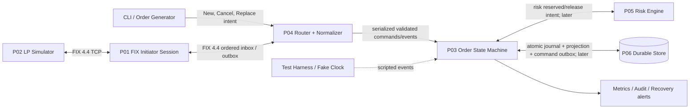
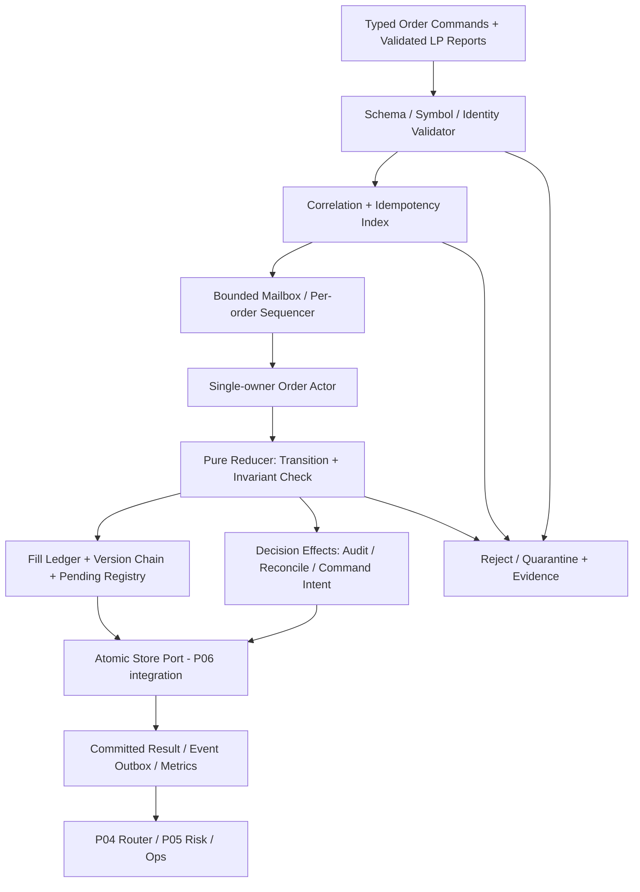
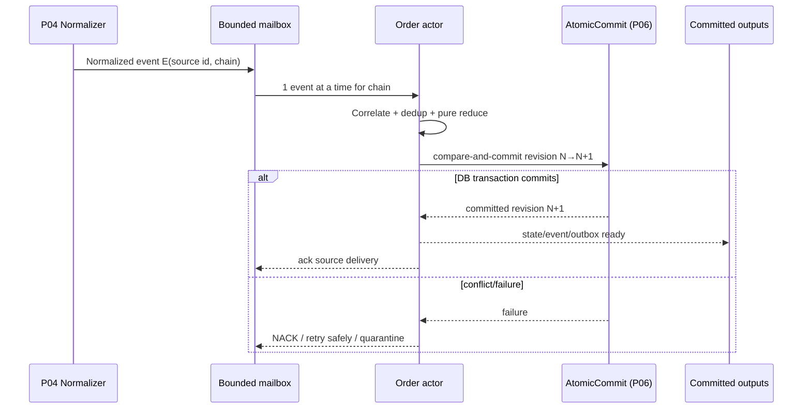
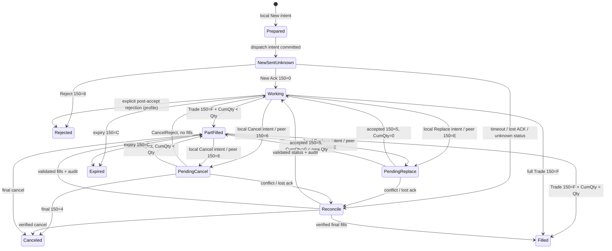
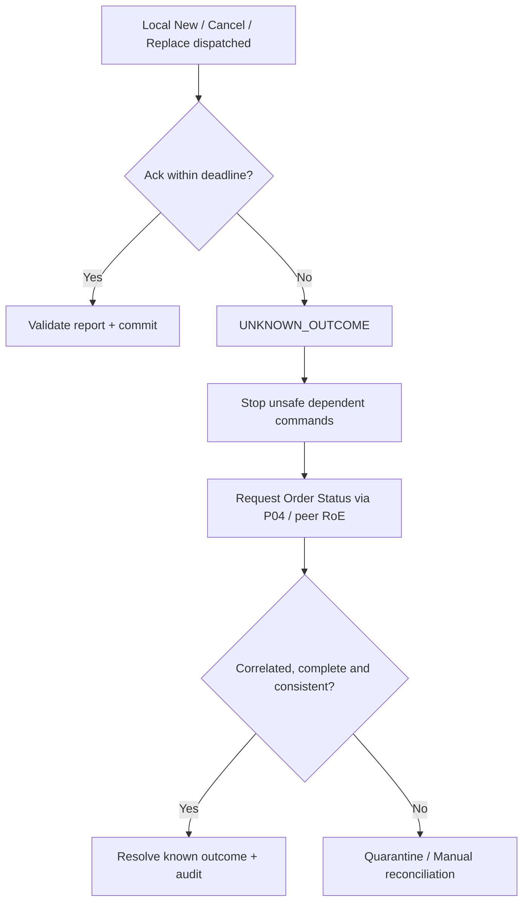

# Project 03 — FX/CFD Order State Machine (C++20 / FIX 4.4)

> **System Design · Implementation Blueprint · Formal Invariants · Adversarial What-if & Fault-Injection Test Plan**  
> **Ngôn ngữ:** Tiếng Việt · **Stack đề xuất:** C++20, Linux, CMake, GoogleTest/Catch2, property-based test, Docker (integration)  
> **Vai trò:** Client-side **Order State Machine / Order Aggregate**; tiêu thụ *normalized business events*, **không** phải FIX session engine hoặc LP matching engine.  
> **Version:** 1.0 · **Ngày thiết kế:** 2026-10-30 · **Trạng thái:** **đề xuất, chưa triển khai/chưa chạy test/chưa benchmark**.  
> **Phạm vi lab:** FIX 4.4, FX/CFD limit DAY orders, một LP giả lập (Project 02), mở rộng nhiều account/symbol theo contract; không kết nối tài khoản thật.

## Mục lục

1. [Mục đích, căn cứ và giới hạn](#1-mục-đích-căn-cứ-và-giới-hạn)
2. [Yêu cầu, NFR/SLO và các bất biến](#2-yêu-cầu-nfrslo-và-các-bất-biến)
3. [Phạm vi FIX 4.4 và Rules of Engagement](#3-phạm-vi-fix-44-và-rules-of-engagement)
4. [Context, trust boundaries và phụ thuộc P01/P02/P04/P05/P06](#4-context-trust-boundaries-và-phụ-thuộc-p01p02p04p05p06)
5. [Logical architecture và data flow](#5-logical-architecture-và-data-flow)
6. [Single-owner concurrency và event ordering](#6-single-owner-concurrency-và-event-ordering)
7. [Domain model, ID và order-version chain](#7-domain-model-id-và-order-version-chain)
8. [FIX 4.4 state semantics so với internal state](#8-fix-44-state-semantics-so-với-internal-state)
9. [Fixed-point quantity, price và fill ledger](#9-fixed-point-quantity-price-và-fill-ledger)
10. [Transition contract và reducer algorithm](#10-transition-contract-và-reducer-algorithm)
11. [Cancel/Replace races và event timelines](#11-cancelreplace-races-và-event-timelines)
12. [Idempotency, late events và reconciliation](#12-idempotency-late-events-và-reconciliation)
13. [Durability boundary, journal và crash recovery](#13-durability-boundary-journal-và-crash-recovery)
14. [Backpressure, limits và resource isolation](#14-backpressure-limits-và-resource-isolation)
15. [C++20 interfaces và implementation sketch](#15-c20-interfaces-và-implementation-sketch)
16. [Repository layout, config và observability](#16-repository-layout-config-và-observability)
17. [What-if coverage model và kiểm thử tổ hợp](#17-what-if-coverage-model-và-kiểm-thử-tổ-hợp)
18. [Ma trận What-if chi tiết](#18-ma-trận-what-if-chi-tiết)
19. [Fault-injection playbooks ưu tiên P0](#19-fault-injection-playbooks-ưu-tiên-p0)
20. [Model-based testing, fuzzing và test harness](#20-model-based-testing-fuzzing-và-test-harness)
21. [Acceptance criteria và release gates](#21-acceptance-criteria-và-release-gates)
22. [Implementation roadmap](#22-implementation-roadmap)
23. [ADR, trade-offs và open risks](#23-adr-trade-offs-và-open-risks)
24. [Tài liệu tham khảo](#24-tài-liệu-tham-khảo)

---

## 1. Mục đích, căn cứ và giới hạn

### 1.1. Nền tảng thực sự từ CV

CV nêu dự án lớn **FX/CFD FIX Gateway and Execution Engine** (C++20, FIX 4.4, PostgreSQL, Linux, Docker) với **single-owner order state machine**, **fixed-point prices**, **pre-trade exposure reservations**, **durable journaling/recovery** cho **partial fills, lost acknowledgments và cancel/replace races**. CV còn có FIX LP adapters, order/execution routing và cải thiện p99 receive-to-route 310 → 95 µs trong replay in-process 50k msg/s / Linux 8 cores. **CV không cung cấp code, cấu trúc state, schema, rate/latency riêng của mini-project này hoặc policy LP thật.** Các lựa chọn dưới đây là thiết kế **mới** để tái dựng chứ không phải mô tả hiện trạng lịch sử.

### 1.2. Tích hợp với tám mini-project

- **P01 — FIX Session Engine:** session protocol, sequence-gap recovery, ordered durable inbound *FIX frames*; P03 **không** xử lý `MsgSeqNum(34)` ở tầng TCP.
- **P02 — LP Simulator:** mô phỏng sell-side, phát `ExecutionReport(35=8)` và `OrderCancelReject(35=9)`; **không dùng chung reducer** với P03 để tránh lỗi giống nhau ở cả SUT và oracle.
- **P03 — tài liệu này:** canonical client-side order state, command intent, accepted version, executions, pending, quarantine, idempotency. Pure reducer + single owner, không trực tiếp `send()`.
- **P04 — Routing & Reconciliation:** validate FIX app schema, correlate FIX IDs, normalize events và phát commands/outbox, hỏi trạng thái LP; dự án này có trách nhiệm tổ chức khi P03 phát `ReconciliationRequired`.
- **P05 — Pre-trade Risk:** riêng biệt; các reservation/tín dụng account phải là transaction/contract tích hợp rõ, **P03 không tự phát minh số exposure**.
- **P06 — Durable Journal & Recovery:** cung cấp triển khai thật `IAtomicCommit`/projection/outbox. P03 dùng *in-memory test store* trước; **chỉ được claim crash-safe khi P06 chứng minh commit nguyên tử**.
- **P07/P08:** low latency và E2E/failure tests, không tối ưu trước khi các bất biến đúng.

### 1.3. Mục tiêu và không mục tiêu

**Mục tiêu:** duy trì trạng thái **nhất quán và giải thích được** cho từng *order chain*, chính xác theo từng phiên bản `ClOrdID`, tránh tính fill trùng khi FIX resend, không coi timeouts là cancel/fill, hỗ trợ kiểm tra invariant sau mọi event, khôi phục deterministic từ journal (khi P06 được triển khai).

**Không thuộc P03 v1:** TCP/FIX serializer; matching engine; risk pricing/margin; production order entry UI; multi-LP smart routing; trade bust/correct **tự động**; allocation/clearing; real-money gateway. Khi gặp sự kiện ngoài scope ảnh hưởng quyền sở hữu quantity, **quarantine + reconciliation**, không lờ đi và vẫn cho lệnh tiếp tục chạy.

**Phân biệt:** *đã nhận một FIX message* ≠ *đã chấp nhận tác động nghiệp vụ* ≠ *đã commit vào durable store* ≠ *LP đã thực sự hủy/khớp lệnh*. P03 lưu *known* và *unknown* tách biệt.

---

## 2. Yêu cầu, NFR/SLO và các bất biến

### 2.1. Functional requirements

| ID | Requirement | Must-pass oracle |
|---|---|---|
| FR-01 | New intent tạo 1 chain, 1 initial version; pending initial acknowledgment | Unique internal order ID, không giả định LP accepted |
| FR-02 | Hợp thức hóa New/Reject/Trade/Cancel/Replace/CancelReject/Status | Event không hợp lệ không được âm thầm mutate |
| FR-03 | `single-owner` mutate một aggregate tại một thời điểm | Không lost updates/race/double-apply |
| FR-04 | Track cumulative fills/last fill/order quantities bằng fixed-point | `CumQty`, `LeavesQty`, `AvgPx` chính xác |
| FR-05 | Track accepted version và một pending mutation intent trong v1 | Pending ≠ accepted; correct `ClOrdID` lineage |
| FR-06 | Idempotency `ExecID` và request-id, phân biệt session replay với business reissue | Duplicate không làm thêm fill |
| FR-07 | Validate/report `OrdStatus(39)` precedence trong pending cancel/replace | Không suy luận canceled từ `6` hoặc replaced từ `E` |
| FR-08 | Timeout/disconnect/lost ack → `UNKNOWN_OUTCOME` + reconcile | Không blind retry tạo order mới |
| FR-09 | `ExecutionReport` cumulative fields được so với fill ledger | Conflicts → quarantine hoặc verified snapshot workflow |
| FR-10 | Terminal states xử lý đúng `LeavesQty=0` dù `CumQty<OrderQty` | Không ép công thức active lên terminal |
| FR-11 | Deterministic replay cùng events/policy/schema version → cùng state hash | Repeatable test oracle |
| FR-12 | Tách storage/outbox side effects khỏi pure reducer | Crash tests có thể tách commit/send |
| FR-13 | Bounded mailbox, dedup/index retention, metrics + audit | Không OOM dưới malformed/flood |
| FR-14 | Hợp đồng integration P01/P02/P04/P06 kèm adverse tests | Test độc lập từ raw FIX đến normalized events |
| FR-15 | Correct/bust theo explicit policy thay vì âm thầm cộng/trừ | V1 quarantine; v2 cần ledger reversible |
| FR-16 | Input validation accounts/symbols/scale/session mapping | Không cross-account misattribution |

### 2.2. 24 safety invariants (I01–I24)

**Áp dụng sau mỗi *accepted event*, và sau recovery. Với event bị từ chối/quarantine, không được publish state giả là confirmed.**

1. **I01 Single-writer:** chỉ một owner thay đổi mỗi `OrderChain`; có thứ tự xử lý tổng rõ ràng theo event commit index.
2. **I02 Unique chain:** một `internal_order_id` không thể map tới hai bản ghi canonical; không có hai chain cho cùng accepted initial request identity.
3. **I03 Identity isolation:** `(firm, business namespace, ClOrdID)` không map hai chain/request khác nhau; kiểm tra account, symbol, side, currency khi correlate.
4. **I04 Accepted version:** chỉ `ExecType=0/5` (hoặc accepted event được policy cho phép) mới thay đổi accepted version; **`Pending Replace` chỉ là trạng thái pending**.
5. **I05 Quantity bounds:** `0 <= committed_cum_qty <= accepted_order_qty` trong v1/no corrections; reject/hold bất kỳ event nào làm overfill.
6. **I06 Active leaves:** nếu accepted order còn working, `leaves = accepted_qty − committed_cum_qty` (đơn vị integer), không âm.
7. **I07 Terminal leaves:** khi `Canceled/Expired/Rejected/DoneForDay` không còn working, `leaves=0` theo profile này dù order chưa fill hết; `cum` không tự động về 0.
8. **I08 Filled status:** `Filled` chỉ khi `cum=accepted_qty` và đã reconcile; pending precedence có thể làm `OrdStatus=6/E` trong report trong lúc trade xảy ra.
9. **I09 Dedup fill:** cùng `(counterparty, business namespace, ExecID)` + canonical fingerprint → **apply một lần**; cùng key, khác payload → quarantine.
10. **I10 ExecID uniqueness scope:** ExecID cho *report*, không phải `MsgSeqNum`; fix-session replay không tạo additional execution.
11. **I11 Fill conservation:** mỗi fill đã commit tương ứng đúng một active ledger record; `cum == sum(effective fill qty)` (v1 không tự áp trade corrections).
12. **I12 Monetary precision:** no `double/float` cho price/qty/notional; kiểm tra overflow khi nhân quantity×price và tính weighted AvgPx.
13. **I13 Decimal/Tick validity:** input phù hợp tick/qty step và scale được pin theo order version; không tự round silent.
14. **I14 Pending semantics:** cancel/replace intent, in-flight, peer pending và final accepted/rejected là các pha khác nhau; timeout **không** là final cancel/replace.
15. **I15 Canonical lineage:** `OrigClOrdID` cancel/replace trỏ đúng accepted version theo Rules of Engagement; original and pending IDs không bị overwrite.
16. **I16 Cancel result:** chỉ valid final cancel confirms `Canceled`; một CancelReject chỉ thay đổi trạng thái request, không reset ledger fills.
17. **I17 Replace result:** chỉ valid replace ack thay `effective_order_qty/price/ClOrdID`; `CumQty` xuyên version luôn tích lũy, không reset.
18. **I18 No false terminal:** nếu không chắc LP đã nhận hủy hoặc xử lý lệnh, trạng thái phải giữ **unknown/reconciliation required**, không báo lệnh chắc chắn an toàn.
19. **I19 Snapshot vs trade:** status-only hoặc status snapshot **không được tạo fill mới**; cumulative mismatch không âm thầm ghi đè ledger.
20. **I20 Provenance:** mỗi mutation có `source`, origin ID, event ID, policy version, order revision; phải audit được raw/reference metadata (không nhất thiết giữ payload trên hot path).
21. **I21 Atomicity boundary:** nếu chọn durability mode, state + applied-event keys + pending command/outbox intent cần cùng atomic commit; nếu không hỗ trợ, không publish `confirmed` bên ngoài.
22. **I22 Determinism:** cùng ordered normalized input + config/policy version + starting snapshot → cùng state hash (bỏ timestamps quan sát không thuộc business state).
23. **I23 Bounded resources:** tất cả ingress, per-chain queues, dedup/window indexes và snapshots có hard limit; quá tải không làm mất correctness âm thầm.
24. **I24 Fail-closed on contradictions:** unknown events, conflicting fills/IDs, schema mismatch, invalid math, corrupted journal → quarantine/halt affected chain, không blind action.

### 2.3. Các target lab (đề xuất, **chưa đo thực tế**)

| Metric | Release target | Cách đo/giới hạn |
|---|---|---|
| Correctness | **100% P0 pass**; 0 invariant violation trong fuzz/model tests | deterministic regression + seeded random |
| Replay determinism | 100% stable canonical state hash trên cùng trace | restart/replay compare |
| Correctness under load | 0 duplicated applied fill / lost acknowledged state across failure tests | ledger + oracle độc lập |
| Runtime capacity | đo 1k/10k/50k normalized events/s (không hứa đạt) | replay runner, pinned hw spec |
| Tail latency | báo cáo p50/p95/p99 **normalized event → state commit** | không đánh đồng receive-to-route CV |
| Memory | queue/index bounded, RSS plateau trong soak 30–60 phút | memory sanitizer/heap profiler |
| Recoverability | 0 silent status flip/overfill khi injected crash | P06 end-to-end |
| Isolation | 0 cross-chain/account contamination trong cross-account tests | unique correlation/taint IDs |

### 2.4. Thứ tự ưu tiên an toàn

1. **Không gửi lệnh/khẳng định cancel thành công nếu trạng thái outcome chưa biết**.
2. **Bảo tồn sự thật về fill đã được chứng minh**, giữ lineage và audit.
3. **Không mất tính độc lập của account/order chain**.
4. **Hiệu suất chỉ tối ưu sau correctness**.

---

## 3. Phạm vi FIX 4.4 và Rules of Engagement

### 3.1. Các FIX messages liên quan

| MsgType | Tên | Vai trò với P03 | Normalization nằm ở |
|---|---|---|---|
| `35=D` | NewOrderSingle | Client command intent (do P04 gửi) | P04 |
| `35=F` | OrderCancelRequest | Client cancel intent (do P04 gửi) | P04 |
| `35=G` | OrderCancelReplaceRequest | Client replace intent (do P04 gửi) | P04 |
| `35=8` | ExecutionReport | New/Reject/Trade/Cancel/Replace/Pending/Status; **không luôn là fill** | P04 validates, P03 reduces |
| `35=9` | OrderCancelReject | Cancel/replace failure, không phải fill | P04 validates, P03 reduces |
| `35=H` | OrderStatusRequest | Reconciliation query command | P04 |
| Session `34/43/97/122` | seq / PossDup / PossResend / OrigSendingTime | P01 xử lý FIX replay/session; P03 vẫn dedup by semantic IDs | P01 + P04 |

**FIX 4.4 semantics quan trọng:** `OrdStatus(39)` mô tả trạng thái order tại thời điểm report, có precedence; `ExecType(150)` cho biết *vì sao* report được gửi. Với FIX 4.4, **trade là `150=F`**; `150=G` là Trade Correct, `150=H` là Trade Cancel (không dùng cách diễn giải FIX 4.2 cũ `ExecType=1/2` cho partial/full fill). **`OrdStatus(39)=5` Replaced không còn là cách biểu diễn state hiện tại FIX 4.4; `ExecType=5` báo replacement event**.

### 3.2. FIX status precedence cần preserve (đừng viết switch `status=ExecType`)

| Precedence (cao → thấp) | `OrdStatus(39)` | Ý nghĩa |
|---:|---|---|
| 11 | `6` Pending Cancel | Cancel request đang chờ; order **chưa được xác nhận canceled** |
| 10 | `E` Pending Replace | Replace đang chờ; order **chưa replaced** |
| 9 | `3` Done For Day | Không tiếp tục thực thi trong ngày |
| 8 | `B` Calculated | Đã tính thông tin phí/settlement cho ngày |
| 7 | `2` Filled | CumQty đạt quantity của accepted version |
| 6 | `7` Stopped | Stopped by venue |
| 5 | `9` Suspended | Đình chỉ |
| 4 | `4` Canceled, `C` Expired | Không còn active theo policy |
| 3 | `1` Partially Filled | Có fill, vẫn còn quantity |
| 2 | `0` New, `8` Rejected, `A` Pending New | Theo loại event/profile |
| 1 | `D` Accepted for bidding | Ngoài scope v1 |

Bảng là **precedence của trường FIX**; P03 lưu riêng `lifecycle`, `pending_operation`, `outcome_confidence` và `reconciliation_flag`. Một report `150=F,39=6` có thể biểu diễn **fill trong lúc pending cancel**. Hãy update fill ledger nhưng **không kết luận cancel đã thành công**.

### 3.3. RoE/assumptions phải pin trước integration

- Client `ClOrdID(11)` duy nhất trong `(firm, business_day, ClOrdID)` *xuyên D/F/G*, không gắn trực tiếp vào session seq; P02 giả lập chính sách này. Account không được dùng để cho phép trùng client-ID trong cùng namespace.
- `OrigClOrdID(41)` tham chiếu **last accepted version** cho cancel/replace (v1 strict). `ClOrdID` của pending replace không trở thành accepted cho đến khi có ack.
- `ExecID(17)` unique theo configured counterparty/business namespace; **P02 sinh ExecID riêng từng logical report**, resend giữ nguyên.
- `OrderID(37)` LP-supplied, có thể ổn định theo chain trong simulator; trong thực tế scope/format/stability tùy peer: **không dùng riêng OrderID làm key duy nhất**.
- Qty theo integer base units; decimal price theo per-symbol fixed tick; FX symbol, side, account, currency do adapter pin; v1 limit DAY, policy replace dưới CumQty: **simulator v1 reject và quarantine conflicts**; ngoài thực tế tùy RoE có thể coi là yêu cầu stop executing/cancel.
- State snap/recovery chỉ nhận theo response đã authenticated/correlated, version/watermark hợp lệ; không tự suy luận từ arrival wall-clock order.
- `150=G/H` trade correct/bust: default **unsupported → quarantine & reconcile**, không xem như duplicate/ignore; phase v2 implement compensation with independent executable oracle.
- Session `ResetSeqNumFlag(141)` không xóa business idempotency, order statuses hay client ledger; trading day turnover phải có rule rõ.
- Unknown status/vendor extensions phải có compatibility policy, không normalize thành `New` mặc định.

---

## 4. Context, trust boundaries và phụ thuộc P01/P02/P04/P05/P06



**Trust boundaries:** network FIX bytes chưa tin cậy, session ordered delivery chưa chứng minh business idempotency, normalized event phải qua schema/identity validation, store có thể crash/corrupt; không bất kỳ module nào được gọi trực tiếp `OrderAggregate::mutable_state()` bỏ qua reducer.

### 4.1. Contract dữ liệu ranh giới

```text
P01: DurableFixInbox{session_key, seq, raw_message, replay_flags}
   → P04: ValidatedBusinessEvent{source_key, message_type, correlation,
                                  source_inbox_id, event_fingerprint, parsed_fields}
   → P03: OrderEvent{type, chain_key, exec_id?, request_id?, quantities?, ...}
   → P03 reduce(old_state, event) = {new_state, applied_key, audit, intents}
   → P06 atomic_commit(state_revision, applied_key, audit, intents)
   → P04 delivery/outbox only after commit (no socket writes inside reducer)
```

**ACK ở ranh giới P01→P04→P03:** chỉ đánh dấu inbox event consumed sau khi transaction chứa state, dedup key và output intents đã commit. Nếu pipeline ban đầu chưa có transaction chung, tài liệu bắt buộc nêu **at-least-once + idempotent projection**, không được tuyên bố exactly-once.

---

## 5. Logical architecture và data flow



### 5.1. Bắt buộc tách command path và report path

- **Local command intent**: `SubmitNew`, `RequestCancel`, `RequestReplace` — thay đổi **local pending**, không tự đổi LP-acknowledged state.
- **Remote report**: `NewAck`, `Trade`, `PendingCancel`, `CanceledAck`, `ReplaceAck`, `CancelReject`, `OrderRejected`, `StatusSnapshot`, `TradeCorrect`, `TradeCancel`.
- **System events**: `AckTimeout`, `TransportDisconnected`, `ReconcileStarted`, `ReconcileResolved`, `StorageFailed` — đánh dấu *uncertainty* và workflow, không tự tạo fill/cancel.
- **Effects**: `RouteNew/Cancel/Replace`, `RiskReserve/Adjust/Release`, `QueryOrderStatus`, `Alert`, `CommitJournal` — **intents** để orchestration xử lý, không gọi network từ reducer.

### 5.2. Mutation protocol (pseudo)

```text
validate_normalized_event(e)
order_id = correlate(e) or create_chain_only_if_authorized_new_intent(e)
if duplicate_key && same canonical fingerprint: return DUPLICATE_NOOP
if duplicate_key && conflicting fingerprint: quarantine(CONFLICT_ID)
if ordering_watermark_not_safe: hold_bounded_or_quarantine(GAP)
proposed = reducer(copy(current), e)  // pure and deterministic
if proposed.violates_invariants(): quarantine(reason, evidence)
atomic_commit(expected_revision, proposed.state, dedup_key, audit, effects)
if commit_success: publish confirmed revision + committed effects
else: no externally confirmed state, retry with CAS or fail closed
```

**Không** external `send()`/risk side effects trong reducer. Async intent delivery chỉ sau commit; đảm bảo crash-safe intent/outbox sẽ được hoàn thiện và chứng minh tại P06.

---

## 6. Single-owner concurrency và event ordering

### 6.1. Actor scheduling



- **V1**: một order-actor thread + bounded command queue cho toàn bộ lab. Sau này shard theo stable `internal_order_id` và consistent hash; mỗi chain chỉ một owner. Shard migration đòi fencing/version CAS, không chỉ thay queue pointer.
- **Source order**: P01 đảm bảo FIX session sequence, nhưng event cross-session/reconciliation snapshot có thể chồng lấn; P03 dùng per-chain `ingest_event_index`, `source_cursor`, `state_revision`, `accepted_version` và `reconciliation_generation` để không mù quáng xem arrival order là truth.
- **Multi-order/account risk**: P03 đơn lẻ không thể đảm bảo available exposure của account khi orders khác nhau cùng chạy; P05 cần serialization/transaction ở cấp account.
- **Timeout**: fake monotonic clock; timeout đánh dấu `unknown`/reconcile, **không** tạo event ack giả.

### 6.2. Capacity/admission policy

`max_inflight_events`, `max_pending_events_per_chain`, `max_chain_count`, `max_exec_ids_retained`, `max_pending_commands`, `max_outstanding_reconciliation`, `max_event_size`, `max_trace_bytes`. Ingress full → reject local command / backpressure input; đối với inbound FIX business event không thể drop im lặng: P01 durable inbox phải ngừng ACK/advance consumption và tăng backlog có hard cap; vượt ngưỡng tiến đến fault/stop intake có kiểm soát.

---

## 7. Domain model, ID và order-version chain

### 7.1. Aggregate (logical, not exact persisted schema)

| Entity | Field quan trọng | Quyền sở hữu |
|---|---|---|
| `OrderChain` | internal_order_id, firm, account, symbol, side, lifecycle, outcome confidence, revision, risk_ref | P03 single owner |
| `OrderVersion` | version_index, accepted_clordid, accepted_qty_units, limit_price_ticks, tick_scale, accepted_at_event_id | Append only accepted versions |
| `PendingRequest` | command kind, new_clordid, orig_clordid, desired changes, dispatch id/state, accepted/rejected/unknown | At most 1 mutation pending v1 |
| `FillLedgerEntry` | counterparty, ExecID, qty_units, price_ticks, event source, active/corrected ref | Stable identities; append-only audit |
| `SeenBusinessEvent` | semantic id key, hash, ingest source cursor, retained timestamp/policy | Durable dedup index |
| `ReconciliationCase` | incident, unknown reason, attempt/generation, last query result, manual resolution | No automatic buy/sell retries |

**Identity hierarchy:**

```text
internal_order_id (local immutable UUID / 128-bit stable key)
  ├── firm + business_day + initial ClOrdID
  ├── LP OrderID aliases (verified, not unique globally)
  ├── accepted version v0 [ClOrdID O1, Qty 100k, Price 1.08500]
  ├── accepted version v1 [ClOrdID R1, Qty 120k, Price 1.08510]
  ├── pending request [C1 or R2, OrigClOrdID=R1]
  └── fill ledger [ExecID X1: 40k, ExecID X2: ...]
```

**Không dùng `MsgSeqNum(34)` hoặc IP address làm business key.**

### 7.2. Identity and uniqueness indices

| Key | Purpose | Collision behavior |
|---|---|---|
| `(firm, business_day, ClOrdID)` | Một request D/F/G, account scope theo RoE | cùng fingerprint → duplicate; khác payload → quarantine |
| `(peer_id, business_namespace, ExecID)` | Mỗi logical execution/event report | duplicate same payload → NOOP; conflict → quarantine |
| `(peer, order_id_alias)` | Correlation supplementary | không overwrite nếu alias va chạm |
| `(source_session, session_epoch, inbox_seq)` | Transport provenance | P01 controls session dedup, P03 preserves provenance |
| `(internal_order_id, revision)` | CAS on state commit | mismatch → retry with fresh state, never overwrite |

### 7.3. Local lifecycle ≠ FIX OrdStatus

- `LOCAL_PREPARING`, `NEW_SENT_UNKNOWN`, `ACKNOWLEDGED_WORKING`, `PENDING_CANCEL`, `PENDING_REPLACE`, `DONE`, `RECONCILIATION_REQUIRED`, `QUARANTINED` là **view nội bộ**.
- Lưu **hai lớp**: `accepted_business_state` (known fills/versions) và `operational_uncertainty` (pending local/peer, no acknowledgment, conflicting snapshot); không ép mọi trường hợp phức tạp thành duy nhất một enum.
- `DONE` có lý do `FILLED/CANCELED/EXPIRED/REJECTED/DONE_FOR_DAY`; `QUARANTINED` không có nghĩa LP ngừng execution.
- **Terminal không tuyệt đối bất biến** nếu peer sau đó báo trade bust/correct hoặc prior execution đến muộn; v1 **quarantine & reconcile** trước khi thay đổi terminal state/quantity.

---

## 8. FIX 4.4 state semantics so với internal state



**Đây là diagram tổng quan, không phải toàn bộ transition graph.** Mỗi `Trade` trong `PendingCancel/PendingReplace` update quantity nhưng **giữ pending** nếu chưa có kết quả final; diagram rút gọn bằng reducer rules dưới đây. `Working` sau accepted replace có thể có partial fills từ trước, nên khi `CumQty>0` sẽ là `PartFilled`.

### 8.1. Transition table chuẩn hoá (các tình huống chính)

| Input type | Preconditions | Action nếu valid | Nếu không hợp lệ |
|---|---|---|---|
| `LocalNewIntent` | no same firm/day/ClOrdID | create initial chain `PREPARED`, pending New | reject/conflict |
| `NewDispatched` | prepared and commit recognized | dispatch status `SENT_UNKNOWN`; **không** mark accepted | quarantine unexpected |
| `NewAck (150=0)` | correlated chain, no conflicting accepted version | mark acknowledged, install accepted v0 | reconcile mismatched IDs |
| `OrderReject (150=8)` | reject is legitimate for chain & snapshot consistent | terminal rejected; zero leaves | quarantine fills already committed unless supported RoE |
| `Trade (150=F)` | valid ExecID, qty>0, valid execution lineage | append ledger, update cum/notional/avg, preserve pending ops | quarantine overfill/invalid arithmetic |
| `PendingCancel (150=6)` | known request or valid unsolicited policy | mark peer pending, **not canceled** | reconcile unknown request |
| `CancelAccepted (150=4)` | matched F request and valid order state | mark canceled, leaves=0, retain fills | reconcile stale/conflicting report |
| `CancelReject (35=9)` | correct `ClOrdID`, `OrigClOrdID`, `434=1` | resolve pending request; order stays active/known state | quarantine unmatched/malformed |
| `PendingReplace (150=E)` | matched G request | keep old accepted version, mark peer pending | reconcile unknown/new version |
| `ReplaceAccepted (150=5)` | matched G request, fields/qty consistent | append new accepted version; retain cumulative fills | quarantine qty below cum/unknown chain |
| `ReplaceReject (35=9)` | matched G request, `434=2` | clear pending, retain old accepted version | quarantine mismatches |
| `OrderStatus (150=I)` | correlated response/snapshot + watermark policy | reconcile status without synthesizing fills | quarantine mismatched cum/alias |
| `AckTimeout` | a specific pending/request dispatch | mark outcome unknown, create reconcile effect | must not cancel/fill |
| `TradeCorrect (150=G)`, `TradeCancel (150=H)` | v1 policy unsupported | quarantine affected chain, trigger reconciliation | NEVER silently ignore |
| `UnknownExecType` | no configured adapter handler | quarantine unknown order + audit | no state mutation |

**Trade after terminal:** không tự động áp dụng, không âm thầm bỏ qua; phân biệt prior legitimate fill bị delay vs impossible/post-terminal trade bằng session/source cursor và peer reconciliation. Nếu không chứng minh causality, quarantine chain + manual/automated status resolution.

---

## 9. Fixed-point quantity, price và fill ledger

### 9.1. Data representation

- Quantity: `int64_t units` (ví dụ EURUSD Qty 100,000 → `100000`, chỉ khi contract định nghĩa integer base units); nếu broker cho fractional lots, **chọn per-symbol `qty_scale` và `qty_step`** rõ, không double.
- Price: `int64_t ticks` với per-symbol `tick_size`. Ví dụ EURUSD tick=0.00001 → `1.08500 = 108500 ticks`. Reject price precision mismatch, never silent rounding.
- Money/notional: **`__int128` hoặc checked multiprecision** cho `qty_units * price_ticks`, overflow detection; plain `int64` intermediate không đủ khi scale lớn.
- `AvgPx`: `sum(fill_qty * fill_price_ticks) / sum(fill_qty)` biểu diễn rational/checked rounding **chỉ tại serialization boundary**; không round sau từng fill rồi lấy average lặp.

### 9.2. Worked example, thay giá để thấy sai số nếu double

```text
Order O1: BUY EURUSD, limit=1.08500 (108500 ticks), qty=100000 units
Fill X1: qty=40000, px=1.08490 (108490 ticks)
Accepted order CumQty = 40000; LeavesQty = 60000
Fill X2: qty=60000, px=1.08495 (108495 ticks)
Final CumQty = 100000; LeavesQty = 0
Weighted average ticks = (40000*108490 + 60000*108495)/100000 = 108493
AvgPx = 1.08493
```

Giá thực thi này ≤ buy limit; đó là ví dụ toán học, **không** xác nhận LP thật cho phép pricing rule đó. Với P03, thẩm định giá/tick/currency là một phần của policy hợp đồng, không phải thay matching engine.

### 9.3. Không được làm

- `CumQty += ExecReport.CumQty` (cumulative snapshot không phải LastQty).
- Dùng `double avg = (prevAvg*prevQty + lastPx*lastQty)/...` qua nhiều lần rounding.
- Luôn suy `LeavesQty=OrderQty-CumQty` cho **Canceled/Expired/Rejected**.
- Sau replace, reset CumQty thành 0.
- Xem `LastQty=0` trong non-trade/status là fill hoặc bỏ qua TradeCancel.
- Tin `AvgPx(6)`/`CumQty(14)` như lượng fill mới nếu chưa kiểm đối chiếu với ledger.

### 9.4. Ledger và verification

`FillLedgerEntry` có `exec_id`, `source_report_id`, `qty`, `price_ticks`, `accepted_version_seen`, `effective=true`, `correction_chain_id?`, provenance hash; mỗi accepted `150=F` → append once; duy trì cached `cum`/`notional` nhưng **replay/recompute phải ra cùng kết quả**. Nếu LP gửi cum không khớp với effective ledger (hoặc report đi sau gap), **không tự gán lại cached cum**. Trong v1: quarantine/reconciliation; trong v2: thiết kế trade correct/cancel riêng theo FIX.

---

## 10. Transition contract và reducer algorithm

### 10.1. Five-step reducer

1. **Find + validate** firm namespace, chain, account, symbol, side, `OrigClOrdID`, current/pending version, source policy.
2. **Semantic dedup** theo `(peer, namespace, ExecID)` hoặc `(firm, business_day, ClOrdID)`; giữ canonical fingerprint không phụ thuộc FIX fields `34/52` trong resend.
3. **Preconditions** status/mutation, exec lineage và quantities. Nếu contradict: **quarantine incident**, không publish giả `OK`.
4. **Pure projection** apply event to copy, update state+ledger+pending+reconciliation needed; evaluate invariants.
5. **Commit** state revision + dedup + audit + effect outbox atomically (P06), rồi mới report acceptance/trigger routed commands.

### 10.2. Decision outcomes

| Result | Ý nghĩa | State external |
|---|---|---|
| `APPLIED` | Event mới, hợp lệ, committed | `confirmed`/`pending` tương ứng |
| `DUPLICATE_NOOP` | Đã thấy cùng key + fingerprint | Không thay business quantities |
| `HELD_FOR_CAUSALITY` | Thiếu một tiền đề có khả năng đến sau, buffer bounded | Không xác nhận cuối |
| `QUARANTINED` | Mâu thuẫn dữ liệu/identity/overflow/unsupported mutation | Lock risky writes, initiate reconciliation |
| `RETRY_COMMIT` | CAS/store conflict trước commit | Không publish effects |
| `REJECT_LOCAL_COMMAND` | Local command illegal hoặc resource limit | Không gửi FIX |

**P03 không tự tạo application reject FIX** đối với LP messages. P04 quyết định FIX BusinessMessageReject/session action theo dictionary/RoE; P03 cung cấp decision + reason/evidence.

---

## 11. Cancel/Replace races và event timelines

### 11.1. Fill xảy ra khi đang Pending Cancel

```mermaid
sequenceDiagram
    participant CLI as Command producer
    participant ST as P03 State Machine
    participant RT as P04 Router
    participant LP as P02 LP Simulator
    CLI->>ST: Cancel intent C1, Orig=O1
    ST-->>RT: durable cancel outbox intent
    RT->>LP: 35=F C1
    LP-->>RT: 35=8 150=6 / 39=6 (Pending Cancel)
    RT->>ST: PendingCancel(C1)
    LP-->>RT: 35=8 150=F / 39=6 Fill X2 qty=20000
    RT->>ST: Trade(X2) correlated to O1
    Note over ST: Update CumQty + keep pending operation
    LP-->>RT: 35=8 150=4 / 39=4 final Canceled
    RT->>ST: CancelAccepted(C1)
    Note over ST: Leaves=0, retain CumQty; no more routing
```

### 11.2. Fill xảy ra khi đang Pending Replace

```mermaid
sequenceDiagram
    participant C as Client
    participant ST as P03 State Machine
    participant LP as P02 LP
    C->>ST: RequestReplace R1, Orig=O1, newQty=120000
    ST-->>LP: Route G via P04
    LP-->>ST: 150=E / 39=E Pending Replace
    LP-->>ST: 150=F fill X2 on old accepted ClOrdID O1
    Note over ST: CumQty grows; accepted price/qty remain O1
    LP-->>ST: 150=5 Replace accepted (R1)
    Note over ST: Install accepted version R1; CumQty preserved
```

### 11.3. Fill thắng Cancel/Replace race

- Nếu order đạt **fully filled trước khi cancel final**: LP có thể reject pending cancel/replace hoặc phát các trạng thái theo RoE. P03 không backdate cancel, không giảm fill.
- Nếu cancel accepted trước fill nhưng fill report đến **sau** theo wall-clock: cần kiểm tra FIX causal order, source cursor, session recovery và report reference. Nếu dữ liệu contradict mà không chứng minh fill xảy ra trước cancel → quarantine.
- Nếu client **mất ACK gửi New**: không tự gửi thêm `35=D` với `ClOrdID` mới. Có thể cần status request, repeat *same request identity* theo RoE, hoặc manual reconciliation.
- Nếu replace đến khi `new_qty < CumQty`, v1 reject local/prevent dispatch nếu biết; nếu peer vẫn báo accepted với giá trị không hỗ trợ → quarantine (FIX thực tế có interpretation riêng, đã ghi RoE).

### 11.4. Rapid command policy (v1)

| Situation | Decision |
|---|---|
| Cancel khi Replace đang pending | Queue intent bounded (chưa gửi) hoặc reject local theo cấu hình; mặc định **reject with explicit PENDING_MUTATION** |
| Replace khi Cancel đang pending | Reject local; không chồng mutation |
| Replace R2 tham chiếu R1 chưa accepted | Reject local; không optimistic chaining |
| Cancel khi order unknown after lost ACK | Tạo reconciliation case trước; chỉ gửi khi matched accepted ClOrdID + RoE permits |
| Cancel đã final, request cancel lần 2 | Reject local/duplicate; không gửi second distinct cancel |
| Terminal Filled → Replace | Reject (v1); nếu LP có exception, chỉ hỗ trợ qua compatibility extension |

---

## 12. Idempotency, late events và reconciliation

### 12.1. Hai lớp duplicate khác nhau

**Transport duplicate**: FIX retransmission `43=Y`, identical `MsgSeqNum` trong session recovery — P01 durable inbox đảm bảo at-least-once to P04, có thể vẫn forward lại sau crash. **Business duplicate**: execution/reports dùng `ExecID` và request identity; có thể đến với **sequence number mới** (status refresh/reissue). P03 phải bảo vệ cả hai.

| Situation | P03 response |
|---|---|
| Same ExecID, same normalized payload | `DUPLICATE_NOOP`; no extra fill |
| Same ExecID, different LastQty/Price/OrderID | `QUARANTINED` + high-severity alert |
| New ExecID, same CumQty, `ExecType=I` | Status-only, no new trade |
| New ExecID, `150=F`, LastQty valid but source later than terminal | Investigate causal history; quarantine if unproven |
| Duplicate CancelReject same request ID | No change on second delivery |
| Unknown `OrderID` but verifiable ClOrdID/peer chain | Bounded correlation policy; audit alias once |
| Same `ClOrdID` reused for a distinct order | Reject collision; no implicit new order |
| `PossResend(97)=Y` business resubmission | Dedup by semantic ID, independent of FIX session epoch |

### 12.2. Lost acknowledgement is not a business decision



- Timeout chỉ là observable fact, **không** chứng minh LP chưa khớp lệnh.
- Không bao giờ tự động `New Order` với một ID mới để 'thử lại' unknown order.
- Nếu status response chỉ báo `CumQty` tăng nhưng **thiếu execution identities** để lập fill ledger, v1 không giả mạo các fill. Hold & request trade history/manual reconciliation; profile v2 có snapshot reconciliation workflow với proof distinct.

### 12.3. Recovery reconciliation protocol đề xuất

1. P06 phục hồi durable journal/snapshot và tính deterministic state hash.
2. P01 đồng bộ FIX session, P04 resume durable inbox trước khi cho phép downstream commands.
3. Với mỗi chain unknown/pending → issue status query `35=H`/RoE, có generation ID.
4. Validate counterparty, firm, ClOrdID/OrderID, last accepted version, snapshot timestamp/watermark, cumulative figures vs ledger.
5. Resolve only if proof complete; nếu contradictory hoặc missing fill details → quarantine và manual decision có audit.
6. Tất cả outbox intents có idempotency keys; không phát hành route New hai lần nếu cannot prove original disposition.

---

## 13. Durability boundary, journal và crash recovery

**Scope thật:** P03 định nghĩa state/event schema và atomic contract; P06 triển khai durable journal. In-memory P03 tests có thể chứng minh pure reducer, **không** chứng minh crash-safe hệ thống hoàn chỉnh.

### 13.1. Transaction sketch

```sql
-- Logical sketch, PostgreSQL schema sẽ hoàn thiện ở P06
BEGIN;
SELECT revision FROM order_aggregate WHERE internal_order_id = :id FOR UPDATE;
-- compare expected_revision; abort on mismatch
INSERT INTO inbound_applied_key(scope, semantic_key, payload_hash, order_id)
  VALUES (:scope, :key, :hash, :id);
INSERT INTO order_event(order_id, event_index, schema_version, event_payload_hash, source_ref)
  VALUES (:id, :next_index, :schema_ver, :hash, :source_ref);
UPDATE order_aggregate
  SET revision = revision + 1, state_payload = :canonical_state
  WHERE internal_order_id = :id AND revision = :expected_revision;
INSERT INTO effect_outbox(event_id, effect_kind, payload, published)
  VALUES (:stable_event_id, :kind, :payload, false);
COMMIT;
```

Cần **constraint UNIQUE**, foreign key, immutable event hashes, partitioning/retention; logic transaction này chỉ illustrative (đặc biệt `rowcount`, constraint violations và atomic effects). DB write thành công chưa chứng minh đã giao FIX request; đó là vấn đề outbound issue-once của P01/P04/P06.

### 13.2. Crash windows phải test riêng

| Window | Faultpoint | Recovery expected |
|---|---|---|
| W00 | Trước parse/normalization | Source durable inbox còn, sẽ redeliver |
| W01 | Sau parse, trước correlation | Không new chain committed |
| W02 | Sau correlation, trước dedup lookup | Không mutate uncommitted indexes |
| W03 | Sau dedup lookup, trước reducer | Replay returns same decision |
| W04 | Sau mutate memory, trước DB transaction | Memory discarded; replay from durable state |
| W05 | Sau bắt đầu TX, trước journal insert | Rollback transaction |
| W06 | Sau insert dedup key, trước state update | Rollback cả dedup key, không mất event |
| W07 | Sau update state, trước outbox insert | Rollback toàn transaction; không publish partial result |
| W08 | Sau outbox insert, trước COMMIT | Rollback, no outbox phantom |
| W09 | Sau COMMIT, trước ACK durable inbox | Redelivery becomes `DUPLICATE_NOOP` (no second effect) |
| W10 | Sau COMMIT, trước dispatch outbox | Effect được P06 replay with same stable event ID |
| W11 | Sau dispatch network, trước mark outbox sent | P01/P04 idempotent issue-once or reconcile, không blind original re-send |
| W12 | Khi flush/fsync bị chặn, return ambiguous | Refuse publish; inspect tx outcome / fail closed |
| W13 | Trong snapshot/checkpoint compaction | Last committed event log remains replayable |
| W14 | Trong schema migration | Startup validates version; halt on incomplete/non-idempotent migration |
| W15 | Trong recovery replay after half of journal | Replay resumes or restarts deterministically, no double-applied events |

### 13.3. Recovery and storage guarantees

- Sử dụng **append-only event log + checkpoint snapshot + dedup key retention**; trạng thái replay phải trùng với reference projection.
- Snapshot không phải source of truth nếu journal chưa consistent; lưu `snapshot_event_index`, `schema_version`, `policy_version`, digest, commit watermark.
- **Never garbage-collect dedup identity** trước khi tất cả FIX retry/reconciliation/retention windows đóng; retention dựa trên RoE và operational policy, không chỉ TTL arbitrary.
- PostgreSQL synchronous commit semantics, WAL/fsync guarantees, filesystem/host power-failure cần test riêng; không hứa hoàn toàn miễn lỗi hardware.
- Khi checksum corruption/data loss/unknown schema: **do not trade**; quarantine, backup restore + peer reconciliation, operator signoff.

---

## 14. Backpressure, limits và resource isolation

| Resource | Suggested baseline lab | Fail-safe response |
|---|---:|---|
| `max_chain_count` | 100,000 (tunable) | Reject local New; preserve existing chains |
| `max_queue_events` | 65,536 | Backpressure inbound consumer, never discard accepted reports |
| `max_pending_per_chain` | 64 | Quarantine chain if unresolvable causal gap |
| `max_parallel_mutations` | 1 per order chain (v1) | Explicit local reject of second mutation |
| `max_exec_id_bytes` | 128 | Reject malformed normalized event; preserve raw evidence |
| `max_idempotency_entries` | bounded by time/retention, disk-backed | Eviction requires safe-watermark proof, else fault |
| `max_snapshot_size` | 4 MiB per aggregate (lab) | No partial snapshot; halt/reconcile |
| `max_reconcile_attempts` | 5 in backoff cycle | Escalate manual, do not mark success |
| `max_event_payload` | 64 KiB normalized | Reject/quarantine raw reference; no expensive unbounded parse |

**NFR caveat:** conformance/correctness vượt giới hạn kiểm thử không chứng minh deterministic latency; memory growth được kiểm bằng soak + heap profiling. Không drop `ExecutionReport` để giữ throughput. Monitor ingress high-water, queue stall, head-of-line blocking, quarantined orders, dedup hit and conflict, uncertain state age, DB commit latency, event-to-commit p99.

---

## 15. C++20 interfaces và implementation sketch

**Đây là interface sketch, chưa phải mã hoàn chỉnh/compile-ready.** Thiết kế chú trọng immutable input, explicit results, checked arithmetic, no exceptions across hot event loop, no network I/O trong reducer.

```cpp
using OrderId = StrongId<OrderIdTag, uint64_t>;
using RequestId = StrongId<RequestIdTag, std::string>;
using ExecId = StrongId<ExecIdTag, std::string>;

struct Quantity { int64_t units; };
struct Price { int64_t ticks; uint32_t scale_id; };
struct Fill { ExecId exec_id; Quantity last_qty; Price last_px; };

struct AcceptedVersion {
    uint32_t version;
    std::string cl_ord_id;
    Quantity order_qty;
    Price limit_px;
};

struct PendingRequest {
    enum class Kind { New, Cancel, Replace } kind;
    std::string cl_ord_id;
    std::string orig_cl_ord_id;
    uint64_t dispatch_intent_id;
    enum class Phase { Prepared, SentUnknown, PeerPending, Resolved } phase;
};

struct OrderAggregate {
    OrderId id;
    uint64_t revision;
    std::vector<AcceptedVersion> accepted_versions; // bounded, persistence tier for older
    std::optional<PendingRequest> pending;
    int64_t cum_qty_units;
    __int128 total_fill_price_ticks_x_qty;
    std::unordered_map<std::string, Fill> exec_ledger; // prod: bounded cache + store
    bool quarantine;
    // Peer status, operational uncertainty, source watermarks and other fields...
};

// OrderEvent is a std::variant<LocalNew, NewAck, Trade, PendingCancel,
// CancelAck, CancelReject, PendingReplace, ReplaceAck, ReplaceReject,
// OrderRejected, StatusSnapshot, AckTimeout, TradeCorrect, TradeCancel>.

struct Reduction {
    OrderAggregate next;
    std::vector<EffectIntent> intents;
    std::vector<InvariantViolation> violations;
    Decision decision;
};

Reduction reduce(const OrderAggregate& previous,
                 const OrderEvent& event,
                 const Policy& pinned_policy);

struct IAtomicCommit {
    virtual CommitResult commit(OrderId id, uint64_t expected_revision,
        const Reduction& reduction, const EventIdentity& idempotency_key) = 0;
    virtual ~IAtomicCommit() = default;
};
```

**Implementation detail:** `__int128` là extension thông dụng GCC/Clang trên Linux, không ISO portable C++20; có thể dùng Boost.Multiprecision/checked int128 abstraction. Không giữ tất cả `ExecID` vô hạn trong RAM; storage index persist. `unordered_map` và `vector` ở đây là minh họa, không phải benchmarked low-latency layout.

---

## 16. Repository layout, config và observability

```text
fx-fix-gateway/
├── libs/order_core/
│   ├── include/order_core/{types,ids,events,aggregate,reducer,invariants,
│   │                        version_chain,fill_ledger,policy,ports}.hpp
│   └── src/{reducer,transitions,math,correlation,validation}.cpp
├── apps/order_lab_cli/
├── tests/order_core/
│   ├── unit/{new,fill,cancel,replace,duplicate,status,math}_test.cpp
│   ├── property/{invariants,model_replay}_test.cpp
│   ├── model/{reference_model,transition_generator}.cpp
│   ├── integration/{lp_simulator,fix_session,atomic_store}_test.cpp
│   ├── failure/{crashpoints,malformed,backpressure}_test.cpp
│   └── fixtures/{fix44,trace_golden,incident_repros}/
├── tools/order_trace_replay/
└── docs/Order_State_Machine_System_Design.md
```

**Example config (new proposal, not CV config):**

```yaml
order_core:
  fix_version: "4.4"
  business_namespace: "FIRM-DEMO:2026-10-30"
  mode: "strict_v1"
  max_pending_mutations_per_chain: 1
  reject_qty_below_cum_on_replace: true
  trade_corrections: "quarantine"
  status_snapshot_policy: "validate_no_synthetic_fill"
  conflicting_exec_id_policy: "quarantine"
  duplicate_request_policy: "same_payload_noop_else_quarantine"
  qty_unit: "base_currency_unit"
  symbol_specs:
    EURUSD: {tick_numerator: 1, tick_denominator: 100000, qty_step: 1000}
  max_ingress_queue: 65536
  max_pending_per_chain: 64
  safe_recovery_requires_p06: true
```

### 16.1. Structured audit per accepted / rejected event

`trace_id, chain_id, source_inbox_id, source_session_id, source_seq, fix_exec_id, fix_clordid, old_revision, new_revision, decision, policy_version, reconciliation_generation, before_hash, after_hash, commit_txid, elapsed_ns, reason_code`.

**PII/security:** không dump credentials/FIX Logon secrets; limit `Text(58)` logging; redact account if required; logs cannot be only persistence of critical fills. OpenTelemetry/Prometheus optional, not part of correctness.

---

## 17. What-if coverage model và kiểm thử tổ hợp

### 17.1. “Tất cả what if” không thể liệt kê hữu hạn cho mọi môi trường

Các combination gồm event interleavings, transport reorder, partial fills, clocks, process kill, overflow, schema versions và external LP deviations là **không giới hạn**. Vì vậy dùng **ba lớp bằng chứng**:

1. **Scenario catalog** bên dưới với mỗi ID có trigger và **oracle** cụ thể (không chỉ hỏi tu từ).
2. **Model checking / exhaustive state-space có giới hạn**: số order, số fill, số pending, crashpoints nhỏ; kiểm **mọi interleaving khả dĩ trong bound**.
3. **Property fuzz + differential testing + soak/stress** dùng seeds/traces độc lập, Linux sanitizers, faultpoints DB/network.

### 17.2. Risk matrix

| Priority | Meaning | Gate |
|---|---|---|
| **P0** | Có thể sai fill/cum/accepted version, leak account, mất business truth, risk of sending unsafe orders, crash inconsistency | **100% pass trước integration**; 0 silent corrections |
| **P1** | Correctness của extensions/operational resilience, observability, resource ceilings, compatibility | 100% applicable P1 pass trước release tương ứng hoặc có documented exclusion |
| **P2** | Extended profiles/scale, ngữ nghĩa ngoài v1; phải explicit unsupported | not blocking MVP nếu fail closed |

**Oracle conventions dùng trong matrix:**

- `NOOP`: state revision/business totals không tăng; duplicate audit metric có thể tăng.
- `QUARANTINE`: lệnh bị cô lập + issue `ReconciliationRequired`, không route yêu cầu nguy hiểm, raw evidence retained.
- `REJECT_LOCAL`: không emit order-routing outbox command, có reason code.
- `HOLD`: bounded buffer, không update confirmed business state khi chưa đủ causality.
- `VALID_COMMIT`: state revision/dedup/audit/intents commit atomically; reducer invariants all true.
- `CRASH_RECOVER`: replay từ durable cursor ra cùng state/ledger, không issue duplicate business effect.

### 17.3. Coverage dimensions cần cross-product

| Dimension | Giá trị tối thiểu |
|---|---|
| Order size | 0, 1 step, 1 unit below/above max, large near overflow |
| Order phase | prepared, unknown ack, working, partial, filled, canceled, expired, quarantine |
| Pending | none, New, Cancel, Replace, lost ACK, status reconciliation |
| Event kind | NewAck, Reject, Trade, PendingCancel, CancelAck, CancelReject, PendingReplace, ReplaceAck, ReplaceReject, Status, bust/correct |
| Delivery | once, exact duplicate, same ID mutated, delayed, reordered, gap, replay, cross-session |
| Crash | W00–W15; process kill + DB fail + restart |
| Correlation | valid, missing, mismatched, duplicate, different account, alias collision |
| Math | tick step, qty step, weighted avg, int64/128 boundaries, fractional display |
| Concurrency | sequential, 2 threads same chain, cross-chain, migration, queue saturated |
| Peer policy | strict conformant, status-only snapshots, unsupported extension, adversarial P02 |

**Pairwise coverage is not exhaustive**: thêm targeted 3-way/4-way cho `partial fill × pending cancel × replay × crash`; và bounded exhaustive cho những nhóm critical.

---

## 18. Ma trận What-if chi tiết

> **Mỗi dòng là một test case duy nhất**. `Kích hoạt` nêu lỗi/biến cố; `Điều kiện PASS / oracle` nói rõ state/effect cần quan sát. Mã ID cố định để mapping sang test automation; priority phải được tính bằng script, không đoán.  
> **Những trường hợp unsupported phải PASS bằng fail-closed, không phải bằng việc tự động xử lý sai chuẩn.**

### A. New order, first ACK và reject — 20 scenarios

| ID | P | What if / kích hoạt | Điều kiện PASS / oracle |
|---|---|---|---|
| **A-01** | P0 | Local New hợp lệ với ClOrdID O1 lần đầu | Tạo đúng 1 chain PREPARED, qty/price normalized, chưa báo LP accepted |
| **A-02** | P0 | Submit New cùng key/payload hai lần trước dispatch | Một request-id, một effect intent; lần hai NOOP |
| **A-03** | P0 | Submit New cùng ClOrdID nhưng khác quantity | REJECT_LOCAL collision, không cấp second order ID |
| **A-04** | P0 | New quantity bằng 0 | REJECT_LOCAL INVALID_QTY, không tạo order/outbox |
| **A-05** | P0 | New quantity âm | REJECT_LOCAL; không cast âm sang uint64 |
| **A-06** | P0 | New price limit bằng 0 với profile chỉ price dương | REJECT_LOCAL; không có accepted version |
| **A-07** | P0 | New side không nằm BUY/SELL | REJECT_LOCAL INVALID_SIDE |
| **A-08** | P0 | New thiếu symbol/firm/account | REJECT_LOCAL, audit field missing; không generic default |
| **A-09** | P0 | New với symbol chưa được cấu hình scale | REJECT_LOCAL; không tự đặt tick size |
| **A-10** | P0 | New hợp lệ, dispatch intent commit trước network | State NEW_SENT_UNKNOWN; không tự đổi Working |
| **A-11** | P0 | New ACK hợp lệ 150=0/39=0/ClOrdID=O1 | VALID_COMMIT v0 accepted, no fill, CumQty=0 |
| **A-12** | P0 | New ACK đến trước local dispatch callback nhưng đã có durable intent | Correlate theo identity; không tạo chain thứ hai |
| **A-13** | P0 | New ACK với account khác account của request | QUARANTINE; không thay chain khác |
| **A-14** | P0 | New ACK với symbol khác | QUARANTINE; giữ symbol đã submit |
| **A-15** | P0 | New ACK có OrderID rỗng trái FIX profile | QUARANTINE; không accepted thiếu mandatory identity |
| **A-16** | P0 | OrderRejected 150=8 trước New ACK và không fill | Terminal Rejected, Leaves=0, reason audit |
| **A-17** | P0 | OrderRejected sau khi có recorded fill, không có RoE exception | QUARANTINE; fill ledger không bị xóa |
| **A-18** | P0 | New timeout khi chưa nhận xác nhận | UNKNOWN_OUTCOME + ReconciliationRequired; không auto resend New ID mới |
| **A-19** | P0 | New ACK xuất hiện sau timeout, identity đầy đủ | Resolve uncertainty, accept exactly once, close pending query if safe |
| **A-20** | P0 | New ACK trả về CumQty khác 0 nhưng không có trade details | HOLD/QUARANTINE ledger gap, không tự sinh fake fills |

### B. Lifecycle, OrdStatus precedence và transition invariants — 20 scenarios

| ID | P | What if / kích hoạt | Điều kiện PASS / oracle |
|---|---|---|---|
| **B-01** | P0 | Report 150=F,39=1 cho partial fill | Fill ledger cập nhật, lifecycle PartFilled nếu không pending |
| **B-02** | P0 | Report 150=F,39=2 cho full fill | CumQty bằng accepted qty, Leaves=0, lifecycle Filled |
| **B-03** | P0 | Report 150=F,39=6 khi pending cancel | Cộng đúng fill, giữ PendingCancel chưa final |
| **B-04** | P0 | Report 150=F,39=E khi pending replace | Cộng fill, giữ accepted version cũ |
| **B-05** | P0 | Report 150=6,39=6 nhưng không có cancel-final | Không chuyển sang Canceled |
| **B-06** | P0 | Report 150=E,39=E nhưng chưa có replace-final | Không đổi accepted qty/price/ClOrdID |
| **B-07** | P0 | Report 150=5,39=1 và đã fill từ bản cũ | Append version, CumQty giữ nguyên, state PartFilled |
| **B-08** | P0 | Report 150=4,39=4 khi cancel hợp lệ | Canceled, Leaves=0, giữ CumQty |
| **B-09** | P0 | Report 150=C/39=C Expired với partial fill | Expired, Leaves=0, không xóa fills |
| **B-10** | P0 | Report 150=3/39=3 DoneForDay | Không working cho ngày; Leaves=0 theo profile |
| **B-11** | P0 | Report 150=8/39=8 Rejected, CumQty=0 | Rejected, Leaves=0 |
| **B-12** | P0 | Report 39=5 Replaced (obsolete FIX 4.4 state) | QUARANTINE unsupported OrdStatus, không map thành accepted version |
| **B-13** | P0 | Report 150=1 hoặc 2 kiểu FIX 4.2 partial/full | QUARANTINE: FIX 4.4 không dùng các ExecType đó cho trade |
| **B-14** | P0 | Report 150=I status-only khớp canonical state | Không thêm fill; cập nhật metadata/status query |
| **B-15** | P0 | Report 150=I báo Filled nhưng thiếu chứng cứ executions | QUARANTINE/reconcile; không tổng hợp synthetic fill |
| **B-16** | P0 | Report OrdStatus=6 nhưng không có cancel intent/peer pending reason | HOLD/QUARANTINE unexpected pending, không tự động mark canceled |
| **B-17** | P0 | Filled đã verified nhận New Ack đến muộn | Không regress về New; duplicate hoặc quarantine theo timeline |
| **B-18** | P0 | Canceled đã verified nhận PendingCancel cũ | Không regress về PendingCancel; audit late report |
| **B-19** | P1 | Received Calculated status (`39=B`) ngoài profile v1 | Quarantine/explicit unsupported, không xóa ledger |
| **B-20** | P1 | Received Suspended/Stopped status ngoài profile v1 | Quarantine hoặc validated extension; never map to Working mặc định |

### C. Fill math, quantities, rounding và conservation — 20 scenarios

| ID | P | What if / kích hoạt | Điều kiện PASS / oracle |
|---|---|---|---|
| **C-01** | P0 | Một fill LastQty=OrderQty | CumQty=Qty, Leaves=0, notional exact, Filled |
| **C-02** | P0 | Hai fill 40k+60k trên Qty=100k | CumQty=100k, weighted AvgPx, không double count |
| **C-03** | P0 | Ba fill tổng nhỏ hơn order qty | Leaves=Qty−Cum, CumQty bằng sum ledger |
| **C-04** | P0 | Fill LastQty=0 trong ExecType=F | QUARANTINE INVALID_LAST_QTY, không tăng cum |
| **C-05** | P0 | Fill LastQty âm | QUARANTINE; no underflow on cast |
| **C-06** | P0 | Fill LastQty > accepted leaves | QUARANTINE OVERFILL, no partial mutate |
| **C-07** | P0 | Fill cuối đúng bằng số còn lại | Filled, Leaves=0, no rounding in units |
| **C-08** | P0 | Report CumQty smaller than locally committed sum | QUARANTINE cumulative regression, preserve ledger |
| **C-09** | P0 | Report CumQty larger than sum ledger though LastQty consistent | QUARANTINE missing execution evidence, do not synthesize fill |
| **C-10** | P0 | Report LeavesQty > OrderQty | QUARANTINE and keep committed state |
| **C-11** | P0 | Report LeavesQty < 0 hoặc overflow encoding | QUARANTINE; checked parsing |
| **C-12** | P0 | Report total Qty=0 while previous fill exists | QUARANTINE unless explicit supported correction workflow |
| **C-13** | P0 | Average price 2 fills có weighted denominator không chia hết | Rational retained, display rounding deterministic once |
| **C-14** | P0 | Average price tính từ unrounded accumulated notional | Recompute ledger matches cached notional/AvgPx to configured tolerance |
| **C-15** | P0 | Overflow khi sum CumQty gần INT64_MAX | Detect before addition, QUARANTINE, no wrap |
| **C-16** | P0 | Overflow khi tính qty×ticks bằng int64 | Checked wide intermediate; no corrupted notional |
| **C-17** | P0 | Một fill 1 unit ở lower valid boundary | CumQty chính xác, no inadvertent discard |
| **C-18** | P0 | Fill qty không chia hết qty_step theo RoE | QUARANTINE invalid lot step |
| **C-19** | P0 | Filled report đồng thời có nonzero LeavesQty | QUARANTINE/report mismatch, no acceptance of fake terminal |
| **C-20** | P0 | Canceled with CumQty < OrderQty, LeavesQty=0 | Accepted as terminal exception; do not assert Qty=Cum+Leaves |

### D. Fixed-point prices, symbol scales và precision — 20 scenarios

| ID | P | What if / kích hoạt | Điều kiện PASS / oracle |
|---|---|---|---|
| **D-01** | P0 | EURUSD 1.08500 với tick=0.00001 | Parse thành đúng 108500 ticks, serialize roundtrip exact |
| **D-02** | P0 | EURUSD 1.08501 với tick=0.00001 | Parse thành 108501 ticks, no floating loss |
| **D-03** | P0 | Price 1.085001 với tick=0.00001 | Reject off-tick precision, no silent round |
| **D-04** | P0 | Negative price tại symbol price-positive | REJECT_LOCAL/QUARANTINE theo nguồn |
| **D-05** | P1 | Price text có scientific notation khi RoE cấm | Reject noncanonical format |
| **D-06** | P0 | Price text là NaN/Inf | Reject; no float conversion |
| **D-07** | P0 | Price text có dấu phẩy decimal 1,08500 | Reject ambiguous locale; no locale-dependent parse |
| **D-08** | P0 | Price text có nhiều dấu chấm | Reject malformed decimal string |
| **D-09** | P0 | Price text chứa whitespace/control chars | Reject canonical parser, no injection |
| **D-10** | P0 | Price 1e50 làm overflow ticks | Checked parse rejects, no truncation |
| **D-11** | P0 | Tick scale của symbol thay đổi giữa phiên bản khi pending replace | Keep pinned old scale until accepted; validate explicit new config |
| **D-12** | P0 | Symbol EURUSD và USDJPY khác tick scale | Independent scale IDs, no cross-symbol reuse |
| **D-13** | P0 | Feed/event thông báo tick_scale unknown | QUARANTINE; không default 5 digits |
| **D-14** | P0 | Order BUY limit nhận execution price cao hơn limit và contract không cho phép | QUARANTINE policy mismatch; preserve evidence |
| **D-15** | P0 | Order SELL limit nhận execution price thấp hơn limit | QUARANTINE price violation |
| **D-16** | P0 | Price đổi hợp lệ qua Replace accepted | New version px installed, old fills retain execution price |
| **D-17** | P0 | Price thay đổi trong PendingReplace chưa ack | Existing accepted px immutable |
| **D-18** | P1 | Fixed-point rounding ties-even tại output boundary | Same deterministic rounding on replay/different thread counts |
| **D-19** | P0 | Converting rational AvgPx không phụ thuộc trình tự cộng associative | Total wide integer notional identical under replay order that preserves fills |
| **D-20** | P0 | Very large qty và price hợp lệ individually nhưng product overflows chosen wide type | QUARANTINE on checked multiply or use multiprecision; no wrap |

### E. Request identity, order lineage và correlation — 20 scenarios

| ID | P | What if / kích hoạt | Điều kiện PASS / oracle |
|---|---|---|---|
| **E-01** | P0 | Duplicate initial ClOrdID trong cùng firm/business day | REJECT_LOCAL collision cho second chain |
| **E-02** | P0 | Same ClOrdID khác account trong cùng firm/business day | REJECT_LOCAL vì namespace không tách theo account v1 |
| **E-03** | P0 | Same ClOrdID ở firm khác và session distinct | Two chains independent nếu RoE cho phép |
| **E-04** | P0 | Same ClOrdID qua ngày mới, previous order vẫn unresolved | Không evict key/không tạo chain nếu uniqueness window còn active |
| **E-05** | P0 | Cancel C1 với OrigClOrdID trỏ O1 accepted | Pending Cancel references correct version |
| **E-06** | P0 | Cancel C1 với OrigClOrdID trỏ R1 chưa accepted | REJECT_LOCAL lineage mismatch |
| **E-07** | P0 | Replace R1 với OrigClOrdID trỏ last accepted O1 | Pending Replace created, accepted remains O1 |
| **E-08** | P0 | Replace R2 với OrigClOrdID initial O1 sau R1 accepted | REJECT_LOCAL stale orig, no route |
| **E-09** | P0 | CancelReject 35=9 có ClOrdID là unknown Cx | QUARANTINE unmatched request, no chain mutation |
| **E-10** | P0 | CancelReject 35=9 OrigClOrdID sai | QUARANTINE request lineage conflict |
| **E-11** | P1 | ExecReport OrderID mới nhưng verified ClOrdID và peer policy supports alias | Alias added once with audit; not create new chain |
| **E-12** | P0 | ExecReport OrderID trùng trên hai chain khác firm | Scope alias by peer/firm/session; no cross-attach |
| **E-13** | P0 | ExecReport OrderID trùng cho hai chain cùng peer nhưng distinct ClOrdID | QUARANTINE alias collision, no reassignment |
| **E-14** | P0 | ExecReport account mismatch với correct ClOrdID | QUARANTINE even if OrderID matches |
| **E-15** | P0 | ExecReport symbol mismatch với correct OrderID | QUARANTINE symbol mismatch |
| **E-16** | P0 | ExecReport side mismatch với same ExecID | QUARANTINE side identity mismatch |
| **E-17** | P0 | Unknown ClOrdID + unknown OrderID ExecutionReport | Quarantine orphan, do not create ghost order |
| **E-18** | P0 | Known ClOrdID + unknown OrderID after reconnect | HOLD for correlation rule/validated alias, no blind mutating other chains |
| **E-19** | P1 | Mixed-case ClOrdID e.g. o1 vs O1 | Treat byte-distinct unless explicit RoE normalization, no silent casefold |
| **E-20** | P0 | Empty/too-long ClOrdID or ExecID in normalized event | Validation rejects before map operations or allocations |

### F. Business dedup, replay và idempotency — 20 scenarios

| ID | P | What if / kích hoạt | Điều kiện PASS / oracle |
|---|---|---|---|
| **F-01** | P0 | Same 150=F ExecID X1 delivered twice identical | Second is DUPLICATE_NOOP; CumQty unchanged |
| **F-02** | P0 | Same ExecID X1 with different LastQty | QUARANTINE conflict, first committed fill preserved |
| **F-03** | P0 | Same ExecID X1 with different LastPx | QUARANTINE conflict, no second notional |
| **F-04** | P0 | Same ExecID X1 with different ClOrdID/OrderID | QUARANTINE conflict, never map X1 to another chain |
| **F-05** | P0 | Same ExecID X1 with changed SendingTime/MsgSeqNum due replay | Canonical fingerprint ignores transport fields, NOOP |
| **F-06** | P0 | Replay after FIX session ResetSeqNumFlag | Semantic dedup persists, no double fill |
| **F-07** | P0 | Retry New O1 using same FIX business ID but new seq | No second local chain or route effect |
| **F-08** | P0 | Retry New O1 using a *new* ClOrdID O2 after lost ack | REJECT_LOCAL unsafe blind retry until reconciled |
| **F-09** | P0 | Duplicate Cancel C1 local intent before first dispatch | One effect ID, no second cancel request |
| **F-10** | P0 | Duplicate Replace R1 local intent before first dispatch | One effect ID, no second replace request |
| **F-11** | P0 | Duplicate final CancelAccepted event with same ExecID | NOOP; no additional lifecycle mutation |
| **F-12** | P0 | Duplicate ReplaceAck with same report ExecID | NOOP; accepted version count unchanged |
| **F-13** | P0 | Duplicate CancelReject 35=9 with same request+payload | NOOP, no extra derived command |
| **F-14** | P0 | Duplicate `150=I` snapshot and new ExecID but same snapshot | No fill; reconciliation generations handle repeated status query |
| **F-15** | P0 | Two ExecIDs representing actual separate partial fills | Both applied exactly once when ledger validates cum |
| **F-16** | P0 | Two reports same CumQty but one is a new Trade ExecID with positive LastQty | Detect contradiction with expected cum; QUARANTINE, not simply NOOP |
| **F-17** | P0 | ExecID dedup index evicted before replay horizon | Must reject GC/extend retention; cannot allow double fill |
| **F-18** | P0 | Concurrent duplicate delivery on two threads | Single-owner/CAS yields one committed fill, second NOOP |
| **F-19** | P0 | Duplicated status report after chain terminal | No lifecycle regression, status-only idempotent |
| **F-20** | P0 | Same outbox effect redelivered after crash with stable effect ID | Send port dedup or reconcile; no new New order with new identity |

### G. Ordering, gaps, causal watermarks và late messages — 20 scenarios

| ID | P | What if / kích hoạt | Điều kiện PASS / oracle |
|---|---|---|---|
| **G-01** | P0 | Received report for seq N+1 before N within P01 inbox | P01 holds until gap filled; P03 never processes N+1 prematurely |
| **G-02** | P0 | P04 manually injects app event with missing source cursor | HOLD/QUARANTINE provenance; no silent bypass |
| **G-03** | P0 | Trade X2 arrives before New Ack due independent data path | HOLD bounded until initial correlation established, then apply once |
| **G-04** | P0 | CancelAccepted arrives before PendingCancel report | Resolve final if correlated, later pending must not regress |
| **G-05** | P0 | ReplaceAccepted arrives before PendingReplace report | Resolve final if correlated; late pending ignored/audited |
| **G-06** | P0 | CancelReject arrives before local send callback after outbox committed | Correlate by committed request key and resolve correctly |
| **G-07** | P0 | Report `150=F` arrives before a gap on same session | P01 ordering guarantee blocks ahead events; no double application |
| **G-08** | P0 | Delayed Trade on old accepted version while replace pending | Apply to old version ledger, preserve pending replace |
| **G-09** | P0 | Delayed Trade on old version after replace confirmed | Check source causality and exec lineage; HOLD/QUARANTINE if uncertain |
| **G-10** | P0 | Snapshot from older reconciliation generation after newer one | Ignore stale snapshot/flag audit, no status regression |
| **G-11** | P0 | Status snapshot timestamp older but generated later | Version/cursor rules used, not naive wall-clock order |
| **G-12** | P0 | Source network clock moves backwards | Logical commit sequence determines state, no backward transition |
| **G-13** | P0 | Same event with different session epoch and identical semantic ID | NOOP semantic dedup, source metadata retained |
| **G-14** | P0 | Two sessions deliver reports for same chain in parallel (unexpected) | Gate by authorized source/ordering watermark, quarantine ambiguous dual source |
| **G-15** | P0 | Status report preceding unobserved fills claims CumQty increased | HOLD/QUARANTINE missing fill evidence, no synthesis |
| **G-16** | P0 | Late New Ack after Filled report already reconciled | No regression; event classified duplicate/late/inconsistent |
| **G-17** | P0 | Late CancelReject after CancelAccepted | Quarantine contradiction if same request, do not reopen order |
| **G-18** | P0 | Late ReplaceReject after ReplaceAccepted | Quarantine contradiction, accepted version retained |
| **G-19** | P0 | Delayed Expired report after an already recorded Fill terminal | Quarantine unless documented compatible state change, no loss of fill |
| **G-20** | P0 | Endless gap never recovers and buffer reaches max | Bounded hold → quarantine/alert, no unbounded memory |

### H. Cancel flow, reject và terminal semantics — 20 scenarios

| ID | P | What if / kích hoạt | Điều kiện PASS / oracle |
|---|---|---|---|
| **H-01** | P0 | Working order cancel C1 valid | Local PendingCancel/dispatch intent; not terminal yet |
| **H-02** | P0 | PartFilled order cancel C1 valid | Keep CumQty; request remaining LeavesQty, not reverse executed fills |
| **H-03** | P0 | Cancel request after Filled | REJECT_LOCAL terminal, no route |
| **H-04** | P0 | Cancel request after Canceled | REJECT_LOCAL/duplicate, no second cancel |
| **H-05** | P0 | Cancel request while initial New ACK unknown | REJECT_LOCAL unsafe dependent action, reconcile first |
| **H-06** | P0 | Peer PendingCancel 150=6 arrives | Mark peer pending, no 0 leaves assumption |
| **H-07** | P0 | Peer final Canceled 150=4 arrives with CumQty=0 | Terminal Canceled, leaves=0 |
| **H-08** | P0 | Peer final Canceled arrives with partial CumQty | Terminal Canceled, partial fills retained, leaves=0 |
| **H-09** | P0 | CancelReject with 434=1 valid and last accepted Orig | Request resolves rejected; order remains working/partial |
| **H-10** | P0 | CancelReject 434=2 for a Cancel command | QUARANTINE response-to mismatch |
| **H-11** | P0 | CancelReject Reason=UnknownOrder when local order exists | UNKNOWN/QUARANTINE + status reconciliation; never assume safe-to-resend |
| **H-12** | P0 | Cancel request 2 while C1 is pending | REJECT_LOCAL PENDING_MUTATION, no second FIX F |
| **H-13** | P0 | Fill arrives while cancel peer pending | Apply fill once, pending cancel remains until final |
| **H-14** | P0 | Fill exhausts quantity while cancel pending | Filled possible; pending cancel disposition must still be reconciled |
| **H-15** | P0 | Cancel timeout with no ack | UNKNOWN_OUTCOME; do not mark Canceled |
| **H-16** | P0 | Cancel ACK `150=4` with wrong ClOrdID Cx | QUARANTINE, no unrelated chain terminal |
| **H-17** | P0 | Cancel ACK with inconsistent CumQty regression | QUARANTINE; preserve ledger |
| **H-18** | P0 | Cancel ACK with LeavesQty>0 under profile terminal | QUARANTINE field inconsistency |
| **H-19** | P0 | CancelReject arrives without any C1 outstanding | QUARANTINE unmatched response; working state unchanged |
| **H-20** | P1 | Peer sends `35=8 150=8` Reject as response to Cancel where 35=9 required | QUARANTINE protocol mismatch, no mark canceled/rejected chain |

### I. Replace flow, accepted versions và CumQty preservation — 20 scenarios

| ID | P | What if / kích hoạt | Điều kiện PASS / oracle |
|---|---|---|---|
| **I-01** | P0 | Working order Replace R1 tăng qty 100k→120k | Pending Replace; accepted qty vẫn 100k trước final ack |
| **I-02** | P0 | Working Replace R1 giảm qty 100k→80k (Cum=0) | Accepted version chỉ cập nhật khi 150=5 |
| **I-03** | P0 | PartFilled Cum=40k Replace qty 100k→120k | New version qty=120k, Cum=40k, Leaves=80k sau ack |
| **I-04** | P0 | PartFilled Cum=40k Replace qty 100k→70k | After ack Leaves=30k, Cum preserved |
| **I-05** | P1 | PartFilled Cum=40k Replace qty 100k→40k | Policy decision explicit at boundary; v1 reject if configured due zero working leaves |
| **I-06** | P0 | PartFilled Cum=40k Replace qty 100k→30k | REJECT_LOCAL v1 below Cum, no new version |
| **I-07** | P0 | Replace price only on Working order | New price only after final 150=5; pre-ack uses old price |
| **I-08** | P0 | Replace price only on PartFilled | Old fills retain old price, later fills use accepted new price |
| **I-09** | P0 | Replace R1 command references wrong OrigClOrdID | REJECT_LOCAL stale version |
| **I-10** | P0 | Peer PendingReplace 150=E reports desired fields not yet accepted | Do not update accepted qty/px/ClOrdID |
| **I-11** | P0 | Peer final Replaced 150=5 valid | Append exactly one accepted version and resolve pending |
| **I-12** | P0 | Peer ReplaceReject 35=9 434=2 | Pending resolved, accepted version unchanged |
| **I-13** | P0 | Replace ACK carries qty < CumQty when policy prohibits | QUARANTINE, do not commit impossible version |
| **I-14** | P0 | Replace ACK wrong price tick or symbol scale | QUARANTINE; current accepted version unchanged |
| **I-15** | P0 | Replace ACK references unknown pending R9 | QUARANTINE; no spontaneous version change |
| **I-16** | P0 | Replace R2 sent before R1 accepted | REJECT_LOCAL optimistic chaining disabled |
| **I-17** | P0 | Replace while Cancel already pending | REJECT_LOCAL one-mutation-at-a-time |
| **I-18** | P0 | Replace timeout after dispatch | UNKNOWN_OUTCOME, retain old accepted version until proved otherwise |
| **I-19** | P0 | Fill arrives before replace ACK and uses old accepted ClOrdID | Increment Cum on old version, append new version only on ack |
| **I-20** | P0 | Fill after replace ACK with cumulative qty across versions | CumQty not reset; ledger sum/order total consistent |

### J. Adversarial interleavings: fill × cancel × replace — 20 scenarios

| ID | P | What if / kích hoạt | Điều kiện PASS / oracle |
|---|---|---|---|
| **J-01** | P0 | Cancel intent then fill then PendingCancel then CancelAck | Apply fill once, final Canceled retains Cum, Leaves=0 |
| **J-02** | P0 | PendingCancel then partial fill then CancelReject | Fill remains, pending cleared, PartFilled working |
| **J-03** | P0 | PendingCancel then full fill then CancelReject | Filled remains, pending resolved without reopening |
| **J-04** | P0 | PendingCancel then full fill then CancelAck | Check contradictory late final; no rollback of fill, reconcile if inconsistent |
| **J-05** | P0 | CancelAck then delayed trade on old order version | QUARANTINE if causal proof missing; never silent post-cancel fill |
| **J-06** | P0 | Replace intent then fill then ReplaceAck | Fill old version, new version cum preserved |
| **J-07** | P0 | PendingReplace then multiple fills then ReplaceReject | Old accepted version remains, all valid fills retained |
| **J-08** | P0 | PendingReplace then full fill then ReplaceAck to higher Qty | Validate RoE + ordering; quarantine unsupported v1 if filled terminal cannot replace |
| **J-09** | P0 | ReplaceAck then duplicate old pending replace report | No downgrade to PendingReplace |
| **J-10** | P0 | ReplaceAck then late old-version fill with earlier source cursor | Recover causal order or quarantine; no unverified double fill |
| **J-11** | P0 | Cancel and Replace local commands from concurrent producers | Exactly one pending mutation admitted; loser REJECT_LOCAL |
| **J-12** | P0 | Two Cancel commands with different IDs same microsecond | Single-owner ordering; one sent, other rejected |
| **J-13** | P0 | Two Replace commands with different IDs same microsecond | Single-owner ordering; one accepted pending, other rejected |
| **J-14** | P0 | Trade and CancelAck arrive at same wall-clock instant | Deterministic source commit order; no wall-clock tie ambiguity |
| **J-15** | P0 | Trade and ReplaceAck at same instant | Consistent version semantics by source order; replay same hash |
| **J-16** | P0 | CancelReject and ReplaceAck with overlapping pending metadata | QUARANTINE inconsistent responses; do not mutate two versions |
| **J-17** | P0 | Disconnected during pending cancel, reconnect with fills and cancel ACK | Resume dedup+causal ordering, final conserved CumQty |
| **J-18** | P0 | Disconnected during pending replace, delayed ACK + duplicate fill | One version append and one fill apply, no extra commands |
| **J-19** | P0 | Status snapshot says Canceled before missing Trade report is replayed | Hold status and reconcile missing execution, no synthetic adjustment |
| **J-20** | P0 | Crash between trade and cancel result commits | Recovery matches serial oracle and same terminal/ledger |

### K. Trade cancel/correct, restatement và unsupported events — 20 scenarios

| ID | P | What if / kích hoạt | Điều kiện PASS / oracle |
|---|---|---|---|
| **K-01** | P0 | 150=G TradeCorrect references existing ExecID, v1 mode | QUARANTINE + reconcile; no accidental second fill |
| **K-02** | P0 | 150=H TradeCancel references existing ExecID, v1 mode | QUARANTINE + reconcile; no silent subtraction |
| **K-03** | P0 | 150=G with missing ExecRefID | QUARANTINE invalid correction lineage |
| **K-04** | P0 | 150=H with missing ExecRefID | QUARANTINE invalid bust lineage |
| **K-05** | P0 | 150=G referring unknown original execution | QUARANTINE missing ledger reference |
| **K-06** | P0 | 150=H referring unknown original execution | QUARANTINE missing ledger reference |
| **K-07** | P0 | TradeCorrect changes LastPx only for a fill | v1 fail closed, no overwrite immutable prior fill |
| **K-08** | P0 | TradeCorrect changes LastQty and hence CumQty | v1 fail closed; no blind delta-correction |
| **K-09** | P0 | TradeCancel attempts to reverse trade after Filled | v1 quarantines; terminal not assumed immutable physical truth |
| **K-10** | P0 | TradeCancel after Canceled with prior partial fills | v1 quarantines; no resurrection without peer proof |
| **K-11** | P0 | Duplicate TradeCancel same ExecID | First quarantine incident retained; second duplicate no new compensation |
| **K-12** | P0 | Duplicate TradeCorrect same ExecID with changed values | Detect conflict; no second mutation |
| **K-13** | P0 | Correction chain X1→X2→X3 requested by peer | v1 explicit unsupported; never chase chain via ad hoc recursion |
| **K-14** | P1 | TradeCancel references a TradeCancel report | Reject invalid reference; no recursive cancel-of-cancel |
| **K-15** | P1 | TradeCorrect references a canceled execution | v1 quarantine; no attempt to reinstate without separate trade as policy |
| **K-16** | P1 | ExecutionRestated 150=D with known restatement reason | v1 quarantine unless approved extension and proof |
| **K-17** | P0 | ExecutionRestated with missing required reason by policy | QUARANTINE malformed restatement |
| **K-18** | P0 | Status correction after historical dedup retention deleted | Startup must block unsafe retention; require reconciliation |
| **K-19** | P0 | LP simulator sends both original trade and corrected trade as separate positive fills | v1 quarantine correction path; no overcount |
| **K-20** | P1 | New broker schema enables v2 correction engine but old snapshots are v1 | Explicit migration/replay with schema version and independent oracle, else halt |

### L. Durability, crash windows và replay recovery (P06 integration) — 20 scenarios

| ID | P | What if / kích hoạt | Điều kiện PASS / oracle |
|---|---|---|---|
| **L-01** | P0 | Crash W00 before parse of durable inbox message | Inbox redelivered, no committed state lost |
| **L-02** | P0 | Crash W01 after parse before correlation | No phantom chain; replay builds same state |
| **L-03** | P0 | Crash W02 after correlation before dedup lookup | No committed alias leak; deterministic replay |
| **L-04** | P0 | Crash W03 after dedup lookup before reduce | Old committed state intact; event reprocessed once |
| **L-05** | P0 | Crash W04 after in-memory reduce before DB txn | Discard volatile state; replay committed journal only |
| **L-06** | P0 | Crash W05 inside transaction before journal insert | Entire transaction rolls back; input retry safe |
| **L-07** | P0 | Crash W06 after dedup insert before aggregate update | Dedup and state both rollback or both commit atomically |
| **L-08** | P0 | Crash W07 after aggregate update before effect outbox insert | No state-without-intent partial commit |
| **L-09** | P0 | Crash W08 after effect outbox insert before commit | No phantom outbound effect visible to dispatcher |
| **L-10** | P0 | Crash W09 after commit before ACK inbound source | Redelivery NOOP; no duplicated effect IDs |
| **L-11** | P0 | Crash W10 after commit before outbox dispatch | Outbox eventually dispatched with stable ID, no lost command |
| **L-12** | P0 | Crash W11 after outbox network send before sent marker | Integration P01/P04 issue-once or reconcile; no blind new-ID order |
| **L-13** | P0 | DB commit returns uncertain after fsync stall | Do not publish success; recover/check txn identity then retry safely |
| **L-14** | P0 | WAL disk full during write | Fail closed, preserve previous committed state, no order route side effect |
| **L-15** | P0 | Journal CRC/hash corruption on startup | Halt/quarantine, never silently skip corrupt fills |
| **L-16** | P0 | Snapshot behind event log by 100 events | Replay remaining events exactly once, resulting hash equals full replay |
| **L-17** | P0 | Snapshot ahead of committed journal watermark | Reject invalid snapshot, recover from valid base or halt |
| **L-18** | P0 | Crash halfway through deterministic snapshot rebuild | Restart rebuild produces identical state, no duplicate fills |
| **L-19** | P0 | Schema migration crashes mid-upgrade | Version guard prevents old/new writer running, rollback/resume safely |
| **L-20** | P0 | Process restarts 100 times while same input replayed | Same CumQty/versions/exec identities and stable state hash |

### M. Multi-account, per-order isolation và risk boundary — 20 scenarios

| ID | P | What if / kích hoạt | Điều kiện PASS / oracle |
|---|---|---|---|
| **M-01** | P0 | Hai order cùng firm nhưng account A/B và distinct IDs | Independent state/ledger, account tags never swapped |
| **M-02** | P0 | Hai order cùng symbol/side nhưng distinct ClOrdID | One chain each; fills cannot cross-apply |
| **M-03** | P0 | Two accounts reuse same ClOrdID within firm/day namespace | Collision rejected (strict RoE), no alias by account |
| **M-04** | P0 | ExecutionReport account A incorrectly labeled account B | QUARANTINE, no cross-account fill |
| **M-05** | P0 | ExecID X1 reused by another account under same peer namespace | QUARANTINE global event-key collision unless RoE scopes differently |
| **M-06** | P0 | OrderID 37 reused by another LP with different peer ID | Allow separate alias scopes; no cross-peer data |
| **M-07** | P0 | Same OrderID returned for 2 chains same LP | QUARANTINE alias conflict; do not overwrite mapping |
| **M-08** | P0 | Reconcile response for account B delivered to chain A | Reject correlation, no mutation |
| **M-09** | P0 | Risk reservation already exists, New ACK is duplicate | Exactly one downstream risk commit signal, no double reservation |
| **M-10** | P0 | Partial fill adjusts risk reservation in P05, P03 retries effect after crash | Stable effect ID, P05 idempotent apply or reconcile |
| **M-11** | P0 | CancelRejected when risk layer already provisionally released reservation | Compensate via defined P05 transaction/reconciliation; no unreserved working order |
| **M-12** | P0 | CancelAck before risk release effect dispatch | Order canceled only after state commit; risk release intent durable, delayed effect observable |
| **M-13** | P0 | Fill while risk service temporarily unreachable | Record fill first, queue risk update with bounded durable outbox, alert |
| **M-14** | P0 | Risk service returns stale revision | No overwrite of order state; retry/correct risk via effect protocol |
| **M-15** | P0 | Account configured with a new base currency mid-order | Preserve pinned config/version; quarantine incompatible mutation |
| **M-16** | P0 | Symbol accidentally removed from config while order working | Existing order retains pinned scale; reject new commands until safe reload |
| **M-17** | P0 | One chain quarantined, other chains healthy | Isolate affected chain; other chains continue within risk/global limits |
| **M-18** | P0 | Global DB fails during account A commit | Fail closed affected writes; no chain publishes uncommitted status |
| **M-19** | P0 | Cross-chain event delivered to wrong actor shard | Correlation rejects before reducer, no wrong-chain mutation |
| **M-20** | P1 | One account at limit while many orders in P03 | P03 does not claim enforcement; P05 account-serialized reservation required |

### N. Concurrency, races, mailbox, pressure và liveness — 20 scenarios

| ID | P | What if / kích hoạt | Điều kiện PASS / oracle |
|---|---|---|---|
| **N-01** | P0 | Two threads deliver same trade simultaneously to one chain | One single-owner commit, other dedup NOOP |
| **N-02** | P0 | Two actors accidentally own same chain after rebalance | Revision CAS/fencing prevents simultaneous conflicting commits |
| **N-03** | P0 | Actor crashes after popping event but before commit | Durable source retries, no lost acknowledged work |
| **N-04** | P0 | Mailbox full while receiving peer trade | Backpressure durable consumer; do not drop trade |
| **N-05** | P0 | Mailbox full while local New produced | REJECT_LOCAL resource exhausted, no partial order intent |
| **N-06** | P0 | One chain receives 100k duplicates, flooding dedup | Bounded CPU/memory under configured admission, no duplicate fills |
| **N-07** | P0 | One chain receives unresolved gap events > max pending | Quarantine chain, no unbounded HOLD memory |
| **N-08** | P0 | Slow DB commit blocks actor beyond timeout | Timeout metric records delay but never claims cancellation/fill |
| **N-09** | P0 | Thread scheduling reordered local Cancel and remote Trade | Single-owner commit order deterministic for replay; invariants hold |
| **N-10** | P1 | CPU affinity changes while work pending | No changes in canonical state, only performance |
| **N-11** | P0 | Graceful shutdown with nonempty mailbox | Stop ingress, finish/leave durable unacked events, resume without loss |
| **N-12** | P0 | SIGKILL with nonempty mailbox | Source redelivery and durable outbox guarantee no silent lost event |
| **N-13** | P0 | Queue counter wraps 32-bit after long soak | Use checked 64-bit indices or safe ring wrap, no stale event reuse |
| **N-14** | P0 | Shared map invalidation under rehash by another thread | No unsynchronized mutation, verified TSan/actor ownership |
| **N-15** | P0 | Order actor processing > event deadline | Deadline affects monitoring, not trade result; no time-based fake state |
| **N-16** | P0 | Heartbeat transport stalls but inbound durable queue still has old trade | Stop new unsafe dependent commands until catch-up watermark |
| **N-17** | P1 | Burst of 50k events/s for 1 min with bounded queue | System backpressures/throttles; exact accepted events preserved |
| **N-18** | P1 | Soak 1 hour with steady event load | Memory RSS reaches stable ceiling, no leak or growing pending registry |
| **N-19** | P1 | Reducer processing pathological huge version chain | Bound versions/cache or move old versions to indexed store; no quadratic unbounded path |
| **N-20** | P0 | Quarantine storm from malformed messages | Bounded incident store/rate-limited logs; core critical state remains safe |

### O. Malformed FIX-derived events, adversarial input và security — 20 scenarios

| ID | P | What if / kích hoạt | Điều kiện PASS / oracle |
|---|---|---|---|
| **O-01** | P0 | ExecutionReport missing ExecID 17 on Trade | P04 rejects/quarantines, P03 never applies anonymous fill |
| **O-02** | P0 | ExecutionReport missing ClOrdID with no verified OrderID alias | QUARANTINE insufficient identity |
| **O-03** | P0 | Report with duplicate tag 14 contradictory values | P04 fails parsing, P03 receives no accepted event |
| **O-04** | P0 | Report malformed decimal `LastQty=abc` | Reject normalization; no default zero fill |
| **O-05** | P0 | Report `LastQty=99999999999999999999999` | Checked parse rejects overflow without crash |
| **O-06** | P0 | Report `LastPx=nan` or nondecimal bytes | Reject normalization; no float input |
| **O-07** | P0 | Report side tag 54 with unsupported code | QUARANTINE invalid side, no fallthrough BUY |
| **O-08** | P0 | Report `150=F` with wrong `OrdStatus=8` inconsistent with fill | QUARANTINE conflict, no commit |
| **O-09** | P0 | Report `150=5` replace accepted missing pending identity | QUARANTINE missing request lineage |
| **O-10** | P0 | Report `35=9` with missing 434 CxlRejResponseTo | QUARANTINE; do not resolve ambiguous request |
| **O-11** | P1 | Huge `Text(58)` field/UTF-8 invalid content | P04 size bound/redact; no log injection, no OOM |
| **O-12** | P0 | Injected null bytes in ClOrdID | Reject canonical bytes, no truncated equality |
| **O-13** | P1 | Unicode homoglyph in ClOrdID against ASCII profile | Reject or compare raw canonical bytes per RoE, no spoofed alias |
| **O-14** | P0 | Corrupted FIX CheckSum/BodyLength | P01 rejects before P03; zero state effects |
| **O-15** | P0 | Wrong SenderCompID/TargetCompID report | P01 session auth/identity rejects; zero state effects |
| **O-16** | P0 | Message authentic but refers order belonging to other session/peer | P03 correlation rejects cross-peer mutation |
| **O-17** | P1 | Extremely deep/nested untrusted extension payload in normalizer | P04 recursion/size budget, no stack overflow |
| **O-18** | P0 | Unknown vendor FIX tag changes price interpretation | Fail closed unless configured mapping and version pin |
| **O-19** | P0 | Status report triggers error path but throws C++ exception in reducer | Catch at event boundary, quarantine; no partial commit/terminate |
| **O-20** | P1 | Fuzz random byte sequence 1M samples into P01→P04→P03 | No UB/crash/state corruption under sanitizers; only valid normalized events mutate |

### P. Config, version upgrades, compatibility và lifecycle controls — 20 scenarios

| ID | P | What if / kích hoạt | Điều kiện PASS / oracle |
|---|---|---|---|
| **P-01** | P0 | Hot reload qty step while order O1 active | Existing version keeps pinned scale, new orders get new policy version |
| **P-02** | P0 | Hot reload FX price tick while pending replace | Old version remains old scale; accept replace only with explicit new version |
| **P-03** | P0 | Enable trade corrections v2 without schema migration | Reject startup/config activation until migration certified |
| **P-04** | P0 | Change ExecID uniqueness namespace in place | Reject if dedup index not migrated/reconciled |
| **P-05** | P0 | Change business-day rollover while prior order unresolved | Preserve prior namespace and retention, prevent key reuse |
| **P-06** | P0 | App starts with unknown event schema version | Halt/quarantine replay; never silently cast old payload |
| **P-07** | P0 | App starts with unknown snapshot version | Ignore snapshot and safe replay or halt; no reinterpretation blindly |
| **P-08** | P1 | P02 conformance mode vs adversarial mode | Same valid event traces yield same P03 state; invalid trigger quarantine |
| **P-09** | P0 | P01 reestablishes FIX session after restart with session seq reset | P03 business state/dedup not reset |
| **P-10** | P0 | OrderActor binary upgraded during pending Cancel | Reload durable request identity/accepted version, no duplicate Cancel intent |
| **P-11** | P0 | OrderActor binary upgraded during pending Replace | Preserve old accepted version and desired pending version, no premature apply |
| **P-12** | P0 | Config contains duplicate symbol specs for EURUSD | Startup validation fails loudly, no arbitrary last-wins |
| **P-13** | P0 | Config has `qty_step=0` | Startup rejects invalid configuration before trading |
| **P-14** | P0 | Config tick_numerator/tick_denominator zero or overflow | Startup rejects unsafe math configuration |
| **P-15** | P1 | Config changes per-peer ID case sensitivity | Require explicit namespace migration, not silent collision |
| **P-16** | P0 | Retention shortened below pending FIX resend horizon | Reject retention setting/GC action |
| **P-17** | P0 | Manual override attempts to mark unknown order Canceled with no evidence | Deny without dual-control audit reconciliation workflow |
| **P-18** | P0 | Manual replay command reprocesses old source cursor | Semantic idempotency persists; state stable |
| **P-19** | P0 | Rollback binary to older code that cannot read event types | Halt startup, require compatible schema or recover plan |
| **P-20** | P1 | Cross-version differential test same standard trace | Identical business state for unchanged contract; approved differences documented |

### Q. Observability, runbooks, SLOs và adversarial performance — 20 scenarios

| ID | P | What if / kích hoạt | Điều kiện PASS / oracle |
|---|---|---|---|
| **Q-01** | P0 | Every commit includes before/after hash + revision + source reference | Trace can reconstruct state causality |
| **Q-02** | P0 | Duplicate event detected | Audit dedup reason but no new business effect; counters increment |
| **Q-03** | P0 | Quarantined overfill event occurs | Alert identifies chain/ExecID/expected vs reported quantities |
| **Q-04** | P0 | Lost Ack timeout occurs | Metric unknown_outcome increments, query intent created once |
| **Q-05** | P0 | DB commit timeout occurs | Alert storage health, no confirmed revision published |
| **Q-06** | P0 | Recovery replay produces different state hash | Startup blocks trading, emit critical incident with first divergent event |
| **Q-07** | P0 | Backpressure saturation threshold reached | Queue depth/watermark visible, safe throttling applied |
| **Q-08** | P1 | Event-to-commit p99 measured without including TCP receive | Metric labeled correctly, separate end-to-end latency |
| **Q-09** | P1 | Benchmark rerun with same seed and hardware pinned | Report per-run distributions + config; never claim unmeasured CV figure |
| **Q-10** | P1 | Benchmark run induces > configured tail latency | Correctness holds; performance failure reported distinctly |
| **Q-11** | P1 | Memory usage grows continuously under stable workload | Soak gate fails at preset RSS slope/ceiling; no silent pass |
| **Q-12** | P1 | Actor starvation for one chain from hot order | Per-chain lag monitored, fairness/bounded workload assessed |
| **Q-13** | P0 | Operator manually releases quarantine without evidence | API rejects or requires signed documented decision + replay test |
| **Q-14** | P1 | Audit log retention shorter than dedup retention by misconfig | Startup/config validation fails due inability to investigate |
| **Q-15** | P1 | Metrics sink unavailable during trades | Core commit continues if metrics best-effort; audit durability requirement preserved |
| **Q-16** | P0 | Trace contains FIX credentials or raw secrets | Security test detects and fails; redact before emission |
| **Q-17** | P1 | SLO violation under injected 10k reconnects | No FD/thread leak; report measured recovery time distribution |
| **Q-18** | P0 | Invariant check fails in production build under real event | Chain halted/quarantined, no fake success; core dump/evidence retained safely |
| **Q-19** | P0 | Test runner reports 100% tests but skipped 20 P0 | Release gate rejects missing/skipped P0 cases |
| **Q-20** | P0 | Failover split brain in extended multi-writer deployment | Extension must prove fencing; v1 explicitly unsupported → refuse second writer |

### 18.1. Tổng hợp độ bao phủ của catalog

- **Tổng cộng: 340 kịch bản**, 17 nhóm, mỗi nhóm 20 ca.
- **P0: 308**, **P1: 32**, **P2: 0**.
- Mỗi ID phải có automated test hoặc artifact ghi rõ lý do chưa áp dụng; P0 không được đánh dấu pass chỉ vì bỏ qua.
- Định nghĩa scenario là checklist thiết kế, **không có nghĩa đã chạy đạt kết quả**.

---

## 19. Fault-injection playbooks ưu tiên P0

> **Runbook template chung:** Setup (snapshot + seed) → Inject tại faultpoint → Restart/Reconcile nếu có → Assert oracle độc lập (ledger sums, revisions, dedup, outbox) → Save `case_id, seed, binary SHA, config SHA, trace, before/after state hash`. Các playbook dưới đây có thể map thẳng thành integration tests trong `tests/order_core/failure/`.

### PB-01 — New ACK lost; don't resend as a new order

- **Case IDs:** `A-18`, `F-08`, `G-03`. Setup: O1 `NewSentUnknown`, LP đã accepted O1 nhưng client chưa nhận báo cáo.
- **Inject:** drop ExecutionReport New; trigger AckTimeout; reconnect and send status response for O1.
- **PASS:** P03 enters `UNKNOWN_OUTCOME`, produces one status query, **zero** O2 New request; verified New ACK resolves same chain.

### PB-02 — Duplicate trade across resend + new session epoch

- **IDs:** `F-01`, `F-05`, `F-06`, `L-09`. Setup: O1 qty100k, X1 fill40k committed.
- **Inject:** replay X1 same FIX seq with PossDup, then replay identical business event on new seq after reconnect/reset; crash at W09.
- **PASS:** CumQty remains 40k, ledger has one X1, no duplicate risk effect/outbox; restart identical hash.

### PB-03 — Same ExecID, altered quantity

- **IDs:** `F-02`, `O-08`. Setup: accepted X1 qty20k.
- **Inject:** X1 with LastQty25k, different payload hash, potentially different FIX seq.
- **PASS:** quarantine; committed X1 qty20k preserved; conflict alert contains both fingerprints; no extra fill.

### PB-04 — Cancel × Fill race (fill wins)

- **IDs:** `H-13`, `J-01`. Setup: O1 qty100k, CumQty20k, pending Cancel C1.
- **Inject:** LP sends pending cancel, fill X2 qty30k with `39=6`, then final cancel.
- **PASS:** CumQty50k, terminal Canceled, Leaves=0, both X1/X2 retained; no false early cancel.

### PB-05 — Cancel rejected after full fill

- **IDs:** `H-14`, `J-03`. Setup: O1 qty100k, CumQty60k, C1 pending.
- **Inject:** fill remaining40k, then `35=9` CxlReject C1.
- **PASS:** CumQty100k, final Filled, pending C1 resolved rejected, no reopen.

### PB-06 — Cancel timeout / disconnected wire

- **IDs:** `H-15`, `J-17`. Setup: C1 outbound committed, LP decision unknown.
- **Inject:** sever link before ack and restart FIX session.
- **PASS:** uncertain pending intent preserved; no second new Cancel ID, no premature Canceled; status reconciliation required.

### PB-07 — Replace × old-version partial fill

- **IDs:** `I-19`, `J-06`. Setup: O1 qty100k price1.08500, CumQty20k, R1 requests Qty120k price1.08510.
- **Inject:** pending replace report, old-version X2 fill20k, final accepted replace.
- **PASS:** accepted version R1 qty120k, cumulative 40k, leaves80k, old X2 is not migrated to a fake new-version execution.

### PB-08 — Replace rejected while multiple fills are pending

- **IDs:** `I-12`, `J-07`. Setup: O1 qty100k, pending R1.
- **Inject:** 2 fills totalling40k then `35=9` ReplaceReject.
- **PASS:** O1 accepted qty/price retained, CumQty40k, R1 rejected and not installed.

### PB-09 — Replace new qty smaller than executed quantity

- **IDs:** `I-06`, `I-13`. Setup: O1 qty100k, CumQty60k.
- **Inject:** local R1 Qty50k; separately force LP malformed accepted replace Qty50k.
- **PASS:** local intent REJECT_LOCAL; adversarial peer report QUARANTINE; never `Leaves=-10k`.

### PB-10 — `PendingCancel` is not `Canceled`

- **IDs:** `B-05`, `H-06`. Setup: O1 Working, local C1 sent.
- **Inject:** LP returns only 150=6/39=6 and stays silent.
- **PASS:** no release of entire remaining exposure under false final cancel; `pending/unknown`, not canceled.

### PB-11 — Filled/terminal receives late execution

- **IDs:** `G-09`, `J-05`, `K-09`. Setup: O1 terminal canceled/filled.
- **Inject:** delayed trade/report with unknown causality, then a trade cancel.
- **PASS:** preserve historical confirmed fill; quarantine and query peer rather than automatically reopen/overfill.

### PB-12 — Crash after dedup insert but before aggregate write (W06)

- **IDs:** `L-07`. Setup: accepted O1, X1 pending apply.
- **Inject:** SIGKILL/DB abort immediately after dedup row insert but before state update.
- **PASS:** both dedup insert and state mutation rolled back; replay X1 commits once.

### PB-13 — Crash after state update but before effect outbox (W07)

- **IDs:** `L-08`. Setup: command intent C1 triggers outbox.
- **Inject:** kill before outbox insert.
- **PASS:** no committed C1 without outbox; recovery restores prior state and safely replays intent.

### PB-14 — Crash after commit before durable source ack (W09)

- **IDs:** `L-10`, `F-20`. Setup: accepted report X1 with committed fill and risk intent.
- **Inject:** kill before P01/P04 marks message consumed, then redeliver.
- **PASS:** identical state hash, no duplicate fill, stable risk effect ID; source eventually acked.

### PB-15 — Crash after outbox dispatch before mark sent (W11)

- **IDs:** `L-12`. Setup: `35=D` New O1 effect durable, P04/P01 send-once path.
- **Inject:** kill after bytes written but before dispatch ack; restart.
- **PASS:** original identity reused safely via issue-once contract or reconciliation; **never** generate O2 just to resolve ambiguity. If issue-once not implemented, test must **FAIL/BLOCK release** for crash-safe claim.

### PB-16 — Corrupt snapshot with valid journal

- **IDs:** `L-16`, `P-07`. Setup: journal+snapshot at revision 100.
- **Inject:** corrupt snapshot checksum, leave full verified journal.
- **PASS:** reject corrupted snapshot, full replay yields exact state hash; if insufficient history, halt.

### PB-17 — Conflicting OrderID / ClOrdID alias

- **IDs:** `E-13`, `M-07`. Setup: 2 separate chains O1 and O2.
- **Inject:** send report using O1 ClOrdID but O2 OrderID.
- **PASS:** quarantine conflicting report; neither chain gets a fill.

### PB-18 — Cross-account spoofed execution

- **IDs:** `E-14`, `M-04`, `O-16`. Setup: account A chain, account B chain.
- **Inject:** report from B peer/account claimed as A's ClOrdID/ExecID.
- **PASS:** zero state mutation in both accounts; high-priority identity anomaly.

### PB-19 — Missing fill evidence in status snapshot

- **IDs:** `A-20`, `G-15`, `B-15`. Setup: client has CumQty20k with X1.
- **Inject:** status-only report claims CumQty80k but sends no X2/exec history.
- **PASS:** no synthetic 60k fill; reconciliation case remains open until verified event history.

### PB-20 — FIX 4.4 ExecType compatibility trap

- **IDs:** `B-13`, `K-01`, `K-02`. Setup: accepted order O1.
- **Inject:** send `ExecType=1` and `ExecType=2` (obsolete), then correct `ExecType=F`, then `150=G/H`.
- **PASS:** only valid `F` adds fill; `1/2/G/H` no silent positive fill; G/H quarantine in v1.

### PB-21 — Numeric boundary and tick mismatch

- **IDs:** `C-16`, `C-17`, `D-03`, `D-20`. Setup: large qty/price near boundaries.
- **Inject:** valid max, off-tick price, int64 addition overflow, product overflow.
- **PASS:** exact values for valid inputs; invalid cases reject with no wrapped quantity/notional, sanitizer clean.

### PB-22 — Actor split-brain or duplicate commit

- **IDs:** `N-01`, `N-02`, `Q-20`. Setup: two actor workers accidentally routed same chain.
- **Inject:** deliver same fill and two competing revise commands concurrently.
- **PASS:** CAS/fencing establishes one canonical revision order; second writer rejected; **no** double-applied fill.

### PB-23 — Queue overflow under LP burst

- **IDs:** `N-04`, `N-07`, `N-17`. Setup: bounded queue with durable inbound backlog.
- **Inject:** 50k events/s generator + DB stall, exceed high-water.
- **PASS:** backlog bounded/backpressured; no silent dropped committed report; memory ceiling enforced; performance target recorded separately.

### PB-24 — Multi-source reconciliation collision

- **IDs:** `G-10`, `G-14`, `P-18`. Setup: pending unknown order after reconnect.
- **Inject:** status query generation2 resolves, then late generation1 and old replay arrives from alternate session.
- **PASS:** stale snapshot ignored/audited; no rollback or cross-session fill, final hash stable.

### PB-25 — DB disk full and ambiguous commit

- **IDs:** `L-13`, `L-14`, `Q-05`. Setup: P06 durable store with fill intake.
- **Inject:** fill disk / stall fsync between event journal and commit ack.
- **PASS:** state never externally confirmed without known commit; recover from WAL truth; no outgoing dangerous follow-up while unknown.

### PB-26 — Manual incident override protection

- **IDs:** `P-17`, `Q-13`. Setup: QUARANTINED O1 with conflicting execution proof.
- **Inject:** operator attempts direct patch `status=Canceled` via CLI without signed evidence.
- **PASS:** command denied, audit appended, no book/ledger mutation; controlled reconciliation requires explicit audited workflow.

---

## 20. Model-based testing, fuzzing và test harness

### 20.1. Three-layer oracles (không dùng cùng một reducer)

1. **Independent mathematical ledger oracle:** rebuild CumQty/total-notional/weighted average từ fill event identities, không dùng cached fields của SUT.
2. **Reference state model:** phiên bản đơn giản, độc lập về code (ví dụ Python/functional spec), triển khai action semantics/precedence từ FIX docs và pinned RoE.
3. **External peer oracle:** P02 simulator report ledger và scenario trace; so sánh kết quả sau FIX reconnect/replay. **Không dùng P02 làm oracle duy nhất** vì hai hệ thống có thể mắc cùng lỗi.

### 20.2. Bounded exhaustive state exploration

`MAX_ORDER=2, QTY∈{1,2,3}, FILL_QTY∈{1,2}, MAX_EVENT_DEPTH=8, pending∈{none,cancel,replace}, fault∈{none,crash_before_commit,crash_after_commit}, delivery∈{once,duplicate,delayed}`. Khám phá toàn bộ interleavings **trong bound**, memoize state `(order_state_hash, queue, expected_peer_ledger, journal_head)` và assert **I01–I24** after each step. Số bound ví dụ, không phải bằng chứng mọi trường hợp unbounded. Giảm false oracle bằng fixed deterministic fake clock / event IDs.

### 20.3. Property-based test specification

```text
ForAll generated valid event sequence S and any safe replay partition P:
    project(S) == project(replay_from_snapshot(P) ++ suffix(S, P))

ForAll accepted fills F without trade corrections:
    cum == Σ(unique_exec_id_fill_qty)
    notional == Σ(unique_exec_id_fill_qty × price_ticks)
    0 <= cum <= accepted_order_qty

ForAll duplicate delivery maps D preserving semantic identities:
    state(project(S)) == state(project(duplicate_some_events(S, D)))

ForAll interrupted transactions t at W00..W15:
    committed_state_after_recovery is either before(t) or after(t), never partial(t)

ForAll two legal serial event histories with fixed causal order:
    run_single_thread(trace) == run_actors_with_injection(trace)  // same state hash
```

**Dấu `==` ở đây so sánh canonical business state, không so `ingest time`, log counters, queue depth.** Với corrections G/H unsupported, property là quarantine + no silent mutations, không phải sum của invalid fills.

### 20.4. Scenario DSL and deterministic faults

```yaml
case_id: J-01
seed: 10429
policy: strict_v1
initial:
  cl_ord_id: O1
  qty_units: 100000
  price_ticks: 108500
  accepted: true
  fills: [{exec_id: X1, qty: 20000, price_ticks: 108490}]
steps:
  - command: {cancel: {cl_ord_id: C1, orig_cl_ord_id: O1}}
  - report: {exec_id: P1, exec_type: '6', ord_status: '6'}
  - report: {exec_id: X2, exec_type: 'F', ord_status: '6', last_qty: 30000, last_px_ticks: 108495, cum_qty: 50000}
  - report: {exec_id: CACK, exec_type: '4', ord_status: '4', cum_qty: 50000, leaves_qty: 0}
assert:
  lifecycle: CANCELED
  cum_qty_units: 50000
  leaves_qty_units: 0
  unique_fills: [X1, X2]
  pending_cancel: none
  invariant_violations: 0
```

### 20.5. Build, sanitizers và CI commands (minh hoạ)

```bash
cmake -S . -B build-debug -DCMAKE_BUILD_TYPE=Debug -DORDER_CORE_ENABLE_TESTS=ON
cmake --build build-debug -j
ctest --test-dir build-debug --output-on-failure

# CI matrix should separately build with ASan+UBSan, TSan, release benchmarks.
# Do not run ASan and TSan in the same binary; treat TSan environment limits explicitly.
./build-debug/tools/order_trace_replay --case J-01 --seed 10429
./build-debug/tools/order_model_check --max-orders 2 --max-depth 8
```

**Những command trên là CLI mong muốn**, chỉ chạy được sau khi apps/tests được triển khai. Không nhầm lệnh minh họa với source đã tồn tại.

### 20.6. Coverage reporting / artifact contract

Mỗi test lưu `case_id`, source scenario file, build SHA, seed, host/kernel, policy SHA, terminal state, before/after hashes, ledger totals, outbox IDs, restart count, sanitizer log và `PASS/FAIL/SKIP`. CI phải đối chiếu tập ID từ catalog với test registry và fail nếu thiếu hoặc bỏ qua P0. Crashpoint tests yêu cầu fault injection có trigger xác định; không đánh dấu pass nếu faultpoint chưa thực sự bắn.

---

## 21. Acceptance criteria và release gates

### 21.1. G0 — Design review

- [ ] Freeze v1 Rules of Engagement với P02/P04: `ClOrdID`/`ExecID` scope, accepted-version chaining, tick/qty policy, unsupported events.
- [ ] Sign off I01–I24 và incident/quarantine semantics.
- [ ] Traceable API contract for P01 ordered inbox, P04 normalizer, P06 atomic commit/outbox.
- [ ] Golden FIX 4.4 traces reviewed against official Order State Changes; no FIX 4.2 `ExecType` behavior leaked.

### 21.2. G1 — Pure reducer correctness

- [ ] All applicable **P0 tests** `A–K` pass.
- [ ] Fixed-point boundary tests + no overflow UB under ASan/UBSan.
- [ ] Independent ledger oracle matches all valid events; 0 false terminal decisions.
- [ ] Model checker explores all bounded states with zero invariant violation.

### 21.3. G2 — Integration with P01/P02/P04

- [ ] Normalized events from FIX frames preserve ID/source/causal metadata.
- [ ] Duplicate FIX replay, `PossResend`, partial/cancel/replace race E2E repeatable.
- [ ] Unknown status/unsupported corrections always fail closed.
- [ ] No false claim of exactly-once across independent network/storage domains.

### 21.4. G3 — Durable recovery, when P06 implemented

- [ ] 16 windows W00–W15 tested, **trigger confirmed by faultpoint logs**.
- [ ] 100 restarts same trace yield same canonical hash, ledger and output effect identity.
- [ ] Journal/snapshot schema migrations, checksum corruption and storage failures stop unsafe routing.
- [ ] No outgoing original order command is emitted twice on uncertain commit/send boundaries without issue-once/reconciliation proof.

### 21.5. G4 — Capacity and release

- [ ] **100% P0 scenarios pass; no skipped P0**.
- [ ] P1 cases applicable to release tested and documented; P2 can be unsupported only if fail closed and RoE declares it.
- [ ] 30–60 min soak with memory ceiling, backlog and p99 report saved, **target only** not unverified marketing.
- [ ] Security review (mTLS/VPN credentials at P01, secrets, malformed reports, audit data), recovery runbook, manual escalation plan.
- [ ] Explicit **lab-only** deployment; production requires additional risk/HA/peer certification.

### 21.6. Concrete release-blocker checklist

**Block release immediately** if any: overfill; duplicate effective fill; accepted version changes on pending replace; auto-confirm cancel on pending; `UnknownOutcome` converted to rejection/success without evidence; cross-account fill; wrong FIX 4.4 ExecType; untracked journal effects; same order issued with a new ClOrdID after lost ACK; silent event drop under backpressure; unreadable/corrupt journal ignored; skipped P0 tests marked passed.

---

## 22. Implementation roadmap

| Milestone | Deliverables | Demo / DoD | Dependency |
|---|---|---|---|
| M1 | Strong types, checked fixed-point math, symbols/ticks | Unit test arithmetic/boundary | None |
| M2 | Order aggregate + version chain + pure reducer (New/Ack/Reject) | First lifecycle golden trace | M1 |
| M3 | Fill ledger + ExecID idempotency + invariant checker | Partial/full fills, duplicate replay | M2 |
| M4 | Pending cancel + 35=9 reject handling | Pending cancel fill race | M3 |
| M5 | Pending replace + accepted-version rules + concurrent commands | R1 accepted/rejected without CumQty reset | M4 |
| M6 | Status, UnknownOutcome, Quarantine + reconciliation intents | Lost ACK/demo fail closed | M5 |
| M7 | P01/P02/P04 integration, independent model oracle + scenario runner | Run A–K golden + fuzz | M6 |
| M8 | P06 atomic commit, W00–W15 crash injection, CI/release gates | Restart/replay hash identical; catalog automated | M7 + P06 |

**MVP cho Project 03:** hoàn thành M1–M6; pure library có thể chạy unit tests độc lập. **Crash-safe integration chỉ được claim sau M8**.

---

## 23. ADR, trade-offs và open risks

| Decision | Chọn cho lab | Rationale | Đánh đổi / risk |
|---|---|---|---|
| ADR-01 | Pure reducer + single owner per chain | Deterministic, audit-friendly | Serial bottleneck; shard later with fencing |
| ADR-02 | Internal lifecycle separate FIX status | Pending precedence + uncertainty | Data model phức tạp hơn 1 enum |
| ADR-03 | Integer quantity + price ticks + checked wide notional | No floating drift | Per-symbol scale and conversion rules mandatory |
| ADR-04 | ExecID/request semantic dedup persisted | Survive FIX replay/session reset | Storage/index growth and retention policy |
| ADR-05 | At most one cancel/replace mutation pending | Simplify correctness/races v1 | Reject rapid chained commands/ROE extensions |
| ADR-06 | Unsupported G/H correction → quarantine | Avoid silent wrong positions | Less functional completeness than production |
| ADR-07 | Status-only cannot create fill | Ledger traceability | Requires trade-history reconciliation for lost fills |
| ADR-08 | P06 owns transaction/outbox | Honest boundary of guarantees | Cannot claim P03 standalone crash safety |
| ADR-09 | Strict source/correlation validation | Prevent cross-account / spoofed events | Need per-LP compatibility mappings |
| ADR-10 | P02 independent oracle plus third reference model | Reduce common-mode bugs | More test implementation work |

### Open questions trước real counterparties

1. `ClOrdID`, `OrderID`, `ExecID` uniqueness scope qua business days/session reset/alternate LP paths?
2. LP supports post-terminal fills, unsolicited restatements, trade corrections/busts, cancel on unknown order như thế nào?
3. Broker có hỗ trợ cancel/replace chaining khi request trước chưa ACK? Nếu có cần broaden state model.
4. Replace Qty nhỏ hơn CumQty được coi là cancel hoặc reject theo chính sách nào? v1 strict rejection chỉ là giả định lab.
5. TIF=DAY giao dịch xuyên timezone/session schedule/holiday được định nghĩa ra sao? v1 expiration event đến từ LP, không tự tính ngày.
6. Lost fill detail trong status snapshot: cơ chế historical trade / drop-copy / order status query nào được peer hỗ trợ?
7. Cần lượng history/dedup retention bao lâu? Điểm snapshot/backup có quyền xóa trade event không?
8. Exposure reservation được cập nhật theo event nào, transaction với P05 thế nào nếu P05 down?
9. Một chain có thể chạy qua failover sang LP session khác không? Nếu có duplicate/order ID scope phải có explicit mapping.
10. API nào đảm bảo **durable original outbound issue-once** giữa P04/P01/P06? Nếu chưa có, không thể chứng minh không gửi lặp ở ranh giới crash.
11. Target latency/CPU/RSS và replay workload nào đại diện thực tế? CV 95µs là receive-to-route của dự án tổng, không phải con số sẵn có cho P03.
12. Khi trade correction/bust làm CumQty giảm, terminal order có thể reopen không? Phải tuân theo FIX state matrices và peer policy, không hack trực tiếp `cum -= n`.

---

## 24. Tài liệu tham khảo

**Tài liệu dự án đã được người dùng cung cấp (nền tảng ngữ cảnh):**

- `NguyenHoangMinh_CV_Trading.docx` — mục *FX/CFD FIX Gateway and Execution Engine* (trang 1), nêu single-owner state, fixed-point prices, pre-trade reservations, recovery và p99 replay benchmark.
- `FIX_Session_Engine_System_Design.md` — Project 01, contract session durable inbox, replay/session sequence.
- `LP_Simulator_System_Design.md` — Project 02, FIX acceptor, report identities, outbox, fill/cancel/replace scenario, default strict v1.

**Nguồn kỹ thuật công khai đã tham khảo để đối chiếu semantics, không phải thông tin từ CV:**

1. FIX Trading Community, **Order State Changes** (as of EP258, July 2020), official PDF: https://www.fixtrading.org/wp-content/uploads/download-manager-files/Order-State-Changes.pdf (đặc biệt OrdStatus precedence, cancel/replace sequencing, corrections).
2. OnixS FIX Dictionary 4.4, **ExecutionReport (35=8)**: https://www.onixs.biz/fix-dictionary/4.4/msgtype_8_8.html
3. OnixS FIX Dictionary 4.4, **ExecType (150)**: https://www.onixs.biz/fix-dictionary/4.4/tagNum_150.html
4. OnixS FIX Dictionary 4.4, **OrdStatus (39)**: https://www.onixs.biz/fix-dictionary/4.4/tagNum_39.html
5. OnixS FIX Dictionary 4.4, **OrderCancelReject (35=9)**: https://www.onixs.biz/fix-dictionary/4.4/msgtype_9_9.html
6. OnixS FIX Dictionary 4.4, **ExecRefID (19)**: https://www.onixs.biz/fix-dictionary/4.4/tagNum_19.html

**Đọc tài liệu chuẩn và Rules of Engagement của LP thực trước khi đổi mode lab → production.** Chưa có kết quả implementation, benchmark hoặc pass/fail thực đo trong tài liệu này.
