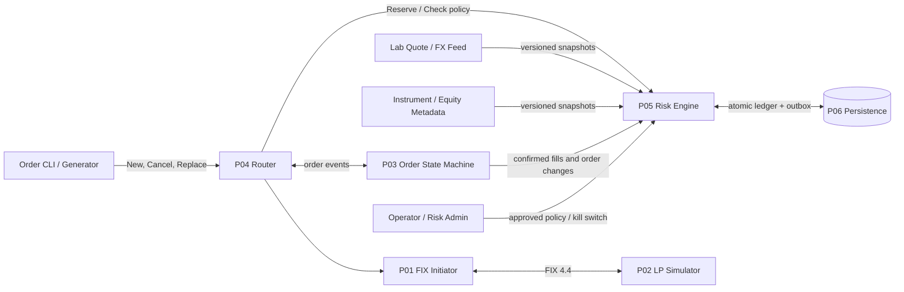
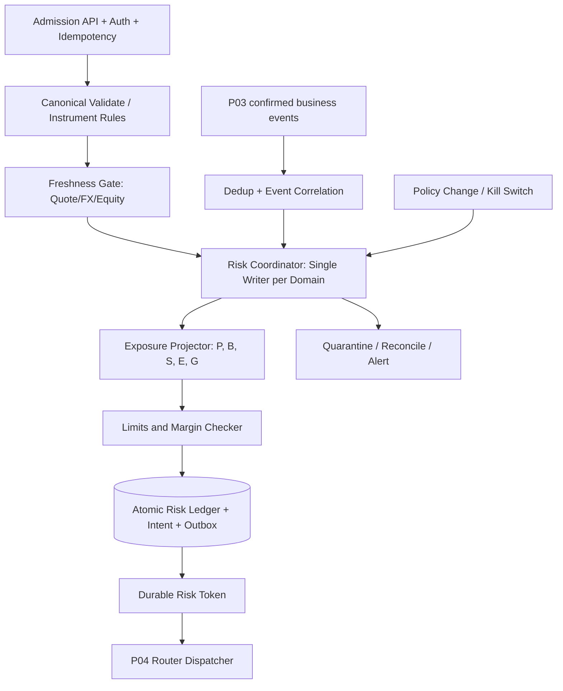
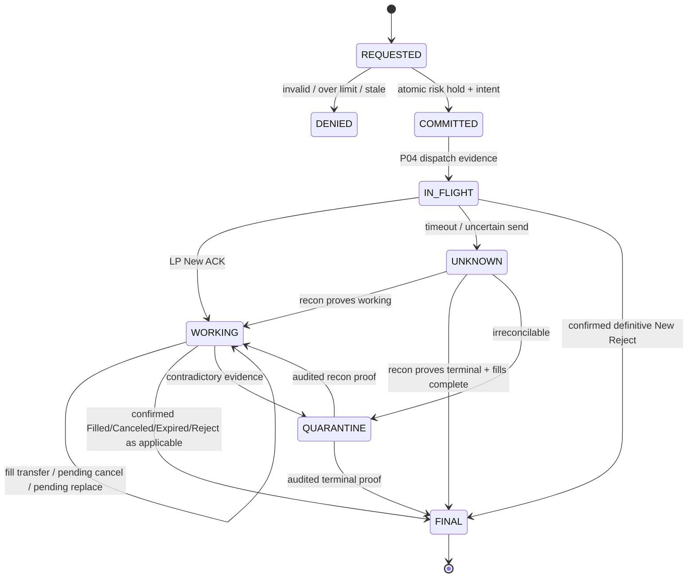
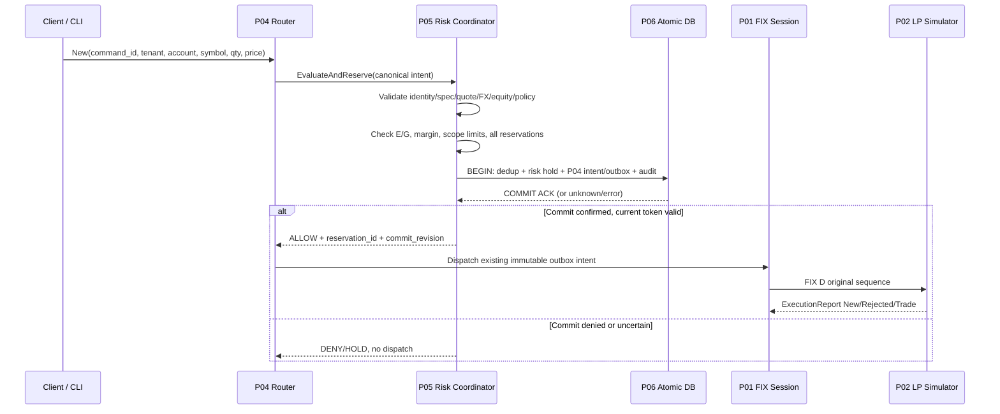
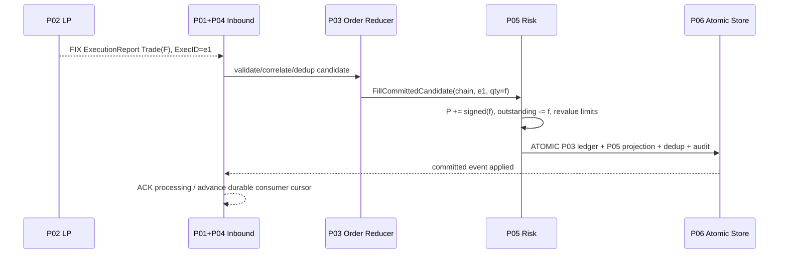
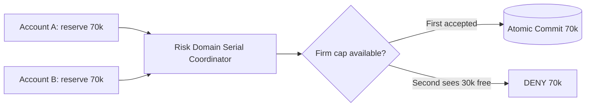
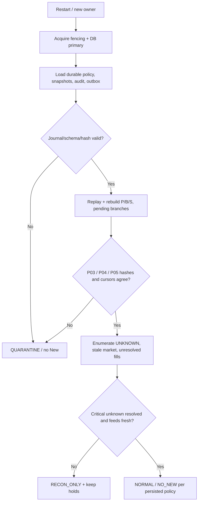
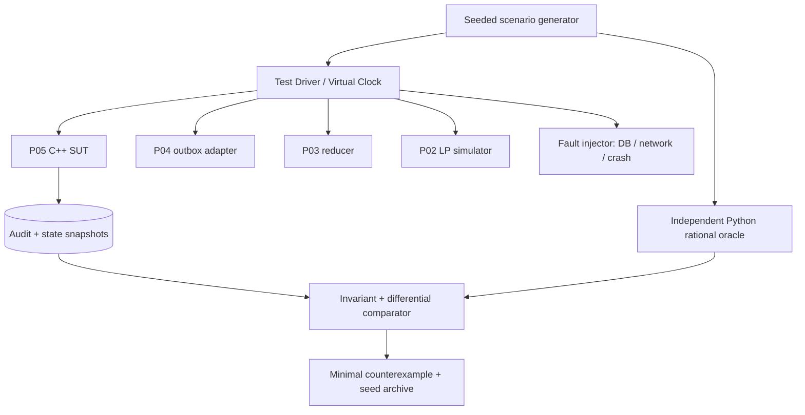

# Project 05 — FX/CFD Pre-trade Risk & Exposure Reservation Engine

> **System Design · C++20 Implementation Blueprint · Safety Invariants · Threat/Failure Modeling · What-if Test Plan**  
> **Ngôn ngữ:** Tiếng Việt · **Stack đề xuất:** C++20, Linux, CMake, PostgreSQL (P06), Docker, GoogleTest/rapidcheck, Prometheus/OpenTelemetry  
> **Vị trí:** Project **05/08** trong bộ *FX/CFD FIX Gateway and Execution Engine*  
> **Phiên bản:** 1.0 · **Ngày:** 2026-10-30 · **Trạng thái:** tài liệu thiết kế & test plan; **chưa triển khai source code, chưa chạy stress test, chưa đạt chứng nhận production**.  
> **Môi trường:** LAB/simulator, một LP (P02), FIX 4.4, account `NETTING`, DAY LIMIT orders theo P04; **không dùng tiền thật**.

**Cảnh báo chính xác:** Không có thiết kế nào chứng minh chịu được *mọi* tình huống. Tài liệu là một mô hình đe dọa có thể mở rộng, tập trung vào safety property, những lỗi có thể chứng minh bằng test và những giới hạn cần kiểm chứng khi tích hợp. Phân biệt rõ **đề xuất** với các chi tiết thực tế được CV xác nhận.

## Mục lục

1. [Nguồn gốc, mục tiêu và giới hạn](#1-nguồn-gốc-mục-tiêu-và-giới-hạn)
2. [Yêu cầu, mục tiêu kiểm thử và safety invariants](#2-yêu-cầu-mục-tiêu-kiểm-thử-và-safety-invariants)
3. [Thuật ngữ risk, giả định bắt buộc](#3-thuật-ngữ-risk-giả-định-bắt-buộc)
4. [Context diagram và threat boundaries](#4-context-diagram-và-threat-boundaries)
5. [Logical architecture và state ownership](#5-logical-architecture-và-state-ownership)
6. [Hợp đồng tích hợp P01–P04 và P06–P08](#6-hợp-đồng-tích-hợp-p01p04-và-p06p08)
7. [Risk policy, scopes và cấu hình phiên bản](#7-risk-policy-scopes-và-cấu-hình-phiên-bản)
8. [Instrument, currency, decimal và quantity model](#8-instrument-currency-decimal-và-quantity-model)
9. [Pricing, FX conversion, freshness và margin](#9-pricing-fx-conversion-freshness-và-margin)
10. [Exposure envelope và toán học bảo toàn](#10-exposure-envelope-và-toán-học-bảo-toàn)
11. [Reservation lifecycle, state machine](#11-reservation-lifecycle-state-machine)
12. [New order: atomic admission và durable handoff](#12-new-order-atomic-admission-và-durable-handoff)
13. [Fill, partial fill, cancel, reject và unknown](#13-fill-partial-fill-cancel-reject-và-unknown)
14. [Replace: tăng/giảm quantity, giá và race](#14-replace-tănggiảm-quantity-giá-và-race)
15. [Shared limits, concurrency và multi-writer](#15-shared-limits-concurrency-và-multi-writer)
16. [Persistence schema, transaction và crash recovery](#16-persistence-schema-transaction-và-crash-recovery)
17. [Backpressure, overload và failure isolation](#17-backpressure-overload-và-failure-isolation)
18. [Security, audit, observability và runbooks](#18-security-audit-observability-và-runbooks)
19. [C++20 interfaces, repository layout và config](#19-c20-interfaces-repository-layout-và-config)
20. [Test oracle, fixtures và coverage model](#20-test-oracle-fixtures-và-coverage-model)
21. [Ma trận what-if chi tiết](#21-ma-trận-what-if-chi-tiết)
22. [P0 fault-injection playbooks](#22-p0-fault-injection-playbooks)
23. [Crash windows và distributed consistency test](#23-crash-windows-và-distributed-consistency-test)
24. [Property-based, model-based, fuzzing, concurrency testing](#24-property-based-model-based-fuzzing-concurrency-testing)
25. [Performance, saturation và soak test](#25-performance-saturation-và-soak-test)
26. [Acceptance criteria / release gates](#26-acceptance-criteria--release-gates)
27. [Milestones và implementation backlog](#27-milestones-và-implementation-backlog)
28. [ADR, trade-offs, hạn chế và open questions](#28-adr-trade-offs-hạn-chế-và-open-questions)
29. [Nguồn kỹ thuật tham chiếu](#29-nguồn-kỹ-thuật-tham-chiếu)
30. [Checklist sử dụng tài liệu](#30-checklist-sử-dụng-tài-liệu)

---

## 1. Nguồn gốc, mục tiêu và giới hạn

### 1.1. Thông tin thực sự có trong CV

CV mô tả dự án lớn *FX/CFD FIX Gateway and Execution Engine* dùng **C++20, FIX 4.4, PostgreSQL, Linux, Docker** và có **pre-trade exposure reservations** trong một **single-owner order state machine**, đi kèm durable journaling/recovery cho partial fills, lost acknowledgments, cancel/replace races. CV **không cho biết** định nghĩa exposure, margin formula, credit policy, database schema, FX conversion algorithm, benchmark riêng cho risk engine hay hệ thống production thực tế. Tất cả chi tiết kỹ thuật bên dưới là **phương án tái dựng cho mục đích học tập**.

### 1.2. Mục tiêu P05

- Trước khi P04 được phép phát `35=D` hoặc `35=G` tăng rủi ro, phải nhận được kết quả admission kèm **durable reservation** (hoặc quyết định từ chối có lý do).
- Sau partial fills, cancel/replace, reject và reconnect, **position exposure + outstanding commitment không được bị tính thiếu hoặc tính hai lần**.
- Giới hạn account, symbol và firm/global được kiểm tra **trên cùng một snapshot nhất quán**, bao gồm lệnh đồng thời nhiều account.
- Khi thiếu bằng chứng (stale quote, missing fill, unknown outcome, DB failure), hệ thống **fail closed cho lệnh tăng rủi ro**; không tự giải phóng hạn mức hoặc tự đóng trạng thái `UNKNOWN`.
- Có model oracle, tests deterministic, fault injection và workload để đo correctness, safety, recovery và saturation.

### 1.3. Scope v1 và những gì cố tình loại trừ

| In scope | Out of scope / phải làm riêng |
|---|---|
| Một LP FIX giả lập; nhiều account/symbol trong một risk domain | Broker margin/netting thực, regulatory leverage, real-money execution |
| LIMIT BUY/SELL, DAY, account `NETTING`, per-order quantity, notional, gross/net-envelope limits | Market, stop, OCO, trailing stop, orders spanning sessions chưa pin policy |
| Fixed-point value/quantity; FX conversions với mock feed và policy version | Pricing engine thực, portfolio VaR, Monte Carlo, options Greeks |
| Atomic reservation + order intent/outbox contract | FIX session engine (P01), matching LP (P02), order reducer (P03), router (P04) |
| Partial fill transfer, cancel/reject/release, pending replace exposure | Hedging accounts, cross-margin, correlated offsets, cross-asset Greeks |
| Global/account/symbol scope, kill switch, idempotent events, replay | Auto-liquidation, claim of broker-side risk equivalence |
| SQLite/in-memory adapter **chỉ cho lab đơn node**; PostgreSQL + P06 hợp đồng durability | Active-active/multi-region production HA |

**Nguyên tắc vận hành:** v1 **không** dùng số liệu rủi ro từ một tài khoản broker thật; không cho phép auto gửi vào LP production; mọi risk-policy phải phù hợp đơn vị/lot/currency được pin tại runtime.

### 1.4. Risk ≠ guarantee của LP

`RISK_ACCEPTED` nghĩa là **risk budget được dành tại client**; không chứng minh LP sẽ nhận hoặc thực hiện lệnh. `LP_ACK` không chứng minh số dư tài khoản hay margin thực ở broker. P05 là *client-side conservative admission layer*, **không thay thế** margin check và reconciliation tại broker.

---

## 2. Yêu cầu, mục tiêu kiểm thử và safety invariants

### 2.1. Functional requirements

| ID | Requirement | Acceptance oracle |
|---|---|---|
| FR-01 | `EvaluateAndReserve(New)` idempotent theo `(tenant, account, command_id)` | Một command chỉ có một quyết định bền vững; payload khác -> conflict |
| FR-02 | Scope order / account / account-symbol / firm | Không aggregate nhầm tenant/account, không vượt shared cap |
| FR-03 | Fixed-point qty, price, notional, margin | Không NaN, drift rounding, signed overflow; upper bound không bị làm tròn xuống |
| FR-04 | Conservative data freshness cho quote, FX, equity, instrument specs | Missing/expired/conflicting data -> DENY/HOLD cho tăng risk |
| FR-05 | Atomic risk hold + P04 intent/outbox | Không gửi FIX nếu reserve/intent chưa commit thành công |
| FR-06 | Partial fill: move `working` -> `confirmed position` | Không double count/double release, replay stable |
| FR-07 | Cancel `pending` không phải cancel `confirmed` | Hold còn nguyên cho tới khi có business evidence |
| FR-08 | Replace quantity/price delta reserve trước send | Increase có hold mới, decrease không giải phóng sớm |
| FR-09 | Timeouts, unknown outcomes, missing fills và trade correct/bust | `HOLD/RECONCILE`, không tự đoán final exposure |
| FR-10 | Dynamic limits, kill switch, policy epoch | Thay đổi policy không bypass; breach được phát hiện và cô lập |
| FR-11 | Cross-account atomic limits, fencing token, multi-instance prevention | Không double-spend shared firm budget |
| FR-12 | Append-only audit, dedup, reconciliation markers | Tất cả transition truy vết được và khôi phục deterministic |
| FR-13 | Explicit backpressure và bounded resources | Khi saturation reject/hold thay vì mất reservation |
| FR-14 | Test harness deterministic, fuzz, failpoints, metrics | Mỗi P0 có test repeatable và state oracle |
| FR-15 | Operational override có RBAC, reason, audit và 2-person review | Không có chức năng `force release` âm thầm |

### 2.2. Non-functional targets **đề xuất để kiểm thử lab**, KHÔNG phải benchmark CV

| SLI | Lab target (giả định, phải đo) | Phương pháp |
|---|---|---|
| Correctness | **0** sai lệch invariant trong toàn bộ P0 tests | So với reference model sau từng committed event và restart |
| Double reservation / fill | **0** khi replay same `command_id`/`ExecID` | So state + journal/outbox counts |
| Durability | **0** loss của committed hold/payload sau crash test | Kill `SIGKILL`, restart, reconcile, compare durable hash |
| Invariant under concurrency | 1, 8, 64, 256 writers; **không** oversubscribe firm cap | Barrier-start, CAS/serializable/fencing |
| Tail latency | Báo cáo p50/p95/p99/p99.9 `risk call -> commit` theo DB mode | Histogram monotonic và fixed hardware |
| Capacity | Đo 1k / 10k / 50k **risk events/s** ở cấu hình lab | Không suy diễn bằng p99 receive-to-route của hệ thống lớn |
| Memory | Plateau RSS/heap dưới config ví dụ 256 MiB/instance | Leak/heap profiling + 24h soak |
| Bounded backlog | Input/outbox/recon queue có caps rõ | Saturation → fail closed, không silent drop |
| Recovery | Replay deterministic; không resume New trước successful recon gate | Restart tại mọi failpoint |
| Audit | 100% mutation có event key, policy version, reason, timestamp | Cross-check audit/ledger/events |

### 2.3. Safety invariants `RI-01` → `RI-32`

Các điều kiện này phải đúng **sau mỗi transaction đã commit và sau recovery**. Khi event chưa đủ tin cậy, trạng thái được đánh dấu `HOLD/QUARANTINE`, không tạo exposure thấp giả.

1. **RI-01 – Reservation-before-send:** không có New/G tăng risk được xuất P04/P01 nếu không có `COMMITTED` hold cùng `command_id` và policy hash.
2. **RI-02 – Stable command identity:** `(tenant, account, command_id)` ánh xạ tối đa một canonical payload; same ID/different payload → CONFLICT.
3. **RI-03 – Single accounting:** cùng fill `ExecID` không điều chỉnh `P`, `B`, `S` lần thứ hai, kể cả session resend và restart.
4. **RI-04 – No early cancel release:** pending cancel, timeout, TCP disconnect không tự giảm working commitment.
5. **RI-05 – No early replace release:** giảm quantity/giá khi replace pending không giảm hold cho tới business acceptance hợp lệ.
6. **RI-06 – Conservative pending replace:** với proposal tăng exposure, reserve mức **max** giữa accepted branch và proposed branch (bao gồm giá/valuation) trước khi gửi.
7. **RI-07 – No double count on fill:** fill hợp lệ chuyển quantity *atomically* từ outstanding order sang confirmed position; không để khoảng trống nhìn như exposure đã giải phóng.
8. **RI-08 – Net envelope:** `E_symbol = max(|P+B|, |P-S|)` với netting account và cùng đơn vị quantity; B,S>=0, P signed từ ledger tin cậy.
9. **RI-09 – Gross fallback:** gross proxy `G_symbol=|P|+B+S` được đánh giá cùng net envelope; không net giữa account/tenant trừ khi policy minh thị.
10. **RI-10 – Monotone bounding:** mọi round `notional/margin` theo hướng bảo thủ (ceil về đơn vị tiền nhỏ nhất), không tự làm thấp risk.
11. **RI-11 – No unbounded market:** nếu không tính được upper bound giá/FX thì không accept lệnh tăng risk.
12. **RI-12 – No stale data admission:** quote, FX rates, equity và instrument spec phải còn hiệu lực và có version pin khi phê duyệt.
13. **RI-13 – Checked arithmetic:** mọi cộng/nhân/chuyển scale kiểm overflow; overflow → REJECT/HOLD, không wrap thành giá trị nhỏ.
14. **RI-14 – Identity isolation:** reservation ràng buộc tenant/account/symbol/order_chain, không chuyển account bằng sửa payload.
15. **RI-15 – Limit sum:** cap account/symbol/firm được kiểm trên cùng serialized committed state, không read-then-write race.
16. **RI-16 – Deterministic policy:** `(state, event, policy_version, market_snapshot)` cố định → cùng quyết định và state hash.
17. **RI-17 – Rejected New release:** chỉ LP business reject hoặc local definitive no-send theo audited workflow được giải phóng; ambiguous send → HOLD.
18. **RI-18 – Terminal after proof:** chỉ final cancel/expire/filled được correlate + dedup có thể giải phóng outstanding, giữ position fills.
19. **RI-19 – Idempotent event effects:** same canonical event với fingerprint giống nhau → no-op; cùng key khác payload → QUARANTINE.
20. **RI-20 – Snapshot isn't a fill:** trạng thái `CumQty`/status snapshot không được tự tạo synthetic fill; mismatch → recon.
21. **RI-21 – Correct/bust gate:** `ExecType=G/H` chưa hỗ trợ tự động → HOLD và xác minh lại; không âm thầm rollback ledger.
22. **RI-22 – No risk bypass:** P04 chỉ gửi D/G sau khi xác minh reservation token, policy epoch, hash và expiry theo contract; không chấp nhận boolean `approved=true` từ caller.
23. **RI-23 – Commit atomicity:** risk ledger, order identity, P04 intent/outbox, applied-event dedup và audit marker commit cùng boundary khi P06 tích hợp.
24. **RI-24 – Fail closed on persistence:** lỗi commit, ENOSPC, uncertain ACK, corruption → không cấp thêm budget; outcome unknown được điều tra.
25. **RI-25 – No split brain:** một risk domain có tối đa một writer hợp lệ; stale writer bị fence ở storage boundary.
26. **RI-26 – No silent auto-release:** TTL, reconnect, reboot, đổi ngày không xóa reservation của order unknown/working.
27. **RI-27 – Breach policy:** mark-to-market/limit decrease gây breach → chặn risk-increasing, phát cảnh báo; không giả vờ đã giảm vị thế.
28. **RI-28 – Kill switch semantics:** kill switch chặn New/G tăng risk; cancel/reconciliation vẫn có đường ưu tiên phù hợp policy.
29. **RI-29 – No double margin debit:** một commitment chỉ xuất hiện một lần trong conservative margin projection; move sang position không nhân đôi charge.
30. **RI-30 – Versioned data:** mọi decision/audit ghi version `risk_policy`, `instrument`, `quote`, `FX`, `equity`, `ledger_revision`.
31. **RI-31 – Bounded faults:** queue, retries, memory, journal, CPU, locks có caps/timeouts; overload không làm silently drop critical events.
32. **RI-32 – No unchecked recovery:** startup không mở admission trước khi journal hash/replay + unknown/recon gates đạt điều kiện an toàn.

**Safety ưu tiên availability.** `DENY` là từ chối có bằng chứng, `HOLD` là tạm dừng khi chưa biết outcome; **không** được chuyển `HOLD` thành `DENY` rồi quên command đã có thể đến LP.

---

## 3. Thuật ngữ risk, giả định bắt buộc

| Thuật ngữ | Định nghĩa dùng trong thiết kế |
|---|---|
| `P` | Confirmed signed net position theo **base-unit** của một symbol/account, từ fill ledger P03 đã commit |
| `B`/`S` | Tổng outstanding *risk-effective* BUY/SELL units, gồm pending New và pending replace branch bảo thủ; không giảm vì cancel request |
| Reservation | Bản ghi cam kết khả năng tăng exposure của command/order-chain, **không** phải tiền thật bị phong tỏa tại broker |
| Net envelope `E` | Worst-case abs signed net inventory nếu outstanding BUY/SELL fills diễn ra bất kỳ thứ tự nào |
| Gross proxy `G` | Conservative activity/commitment metric `|P|+B+S`, cao hơn net envelope khi lệnh hai chiều cùng tồn tại |
| Notional | `quantity × conservative risk-price × contract multiplier × FX conversion`, rounded up |
| Margin proxy | Notional × **lab** margin rate (đơn giản hóa; không dựa trên margin của broker) |
| `UNKNOWN_OUTCOME` | Không thể chứng minh LP đã/không nhận/khớp/cancel/replace; hold duy trì và cần reconciliation |
| `QUARANTINE` | Dữ liệu mâu thuẫn, integrity/rules violation; chặn release và escalation |
| `policy epoch` | Snapshot immutable của config/limits/reference data áp dụng cho decision |
| `risk domain` | Tập account/symbol sử dụng shared firm/global cap; v1 single-writer per domain |

**Giả định được pin (MVP):** mọi order v1 đều là LIMIT; currency, symbol, lot size, multiplier, qty step, tick size, price collar, margin rate do mock metadata cung cấp; quote/FX/equity có authority, phiên bản và TTL; netting account duy nhất; no broker dynamic leverage; no netting cross-account; no trade bust/correction auto; không có giảm rủi ro bằng cách chấp nhận market order không giới hạn slippage.

---

## 4. Context diagram và threat boundaries



**Biên tin cậy:** user/API có thể giả mạo tenant, LP có thể phát duplicate/malformed reports, feed có thể stale/poisoned, DB có thể commit uncertain, cache có thể stale, operator có thể sửa limits sai, hệ thống có thể bị phân vùng mạng, clock có thể lệch; mặc định **không tin input nào chỉ vì đi qua một service nội bộ**.

| Nguồn lỗi | Biện pháp cơ bản | Khi không khắc phục được |
|---|---|---|
| Malformed API/unauthorized | Canonical schema, authorization, per-client quota, idempotency | REJECT trước reservation |
| LP reports inconsistent | P04 normalize + P03 ledger validity + P05 cross-check | QUARANTINE account/order |
| Feed mark/FX poisoned hoặc stale | Trust provenance, sequence/version, freshness, conservative bounds | `RISK_DATA_UNAVAILABLE`, fail closed |
| DB rollback/partition | Transaction, CAS revision, fencing, durability gate | HOLD + block new admission |
| Split brain router/risk | Storage fencing token; no lease-only trust | FENCE stale writer và audit |
| Wrong operator policy | Signed audit, staged deployment, dual approval for high-impact | Stop admission, rollback policy (không rollback trades) |
| Time drift | Monotonic TTL, external UTC for trace, versioned event order | HOLD nếu source freshness không chứng minh được |

---

## 5. Logical architecture và state ownership



**State owner v1:** `RiskCoordinator` sở hữu canonical domain state (một writer), không cho P04 hay API caller chỉnh số reserved. Policy và price snapshots immutable trong từng decision. `RISK_VIEW` chỉ là read replica; không được dùng replica để commit risk decision. **Không tách mỗi account thành actor độc lập** khi firm cap dùng chung nếu chưa có global serialized allocator.

**Dữ liệu tối thiểu:**

- `RiskDomainState`: tenant, domain, commit revision, risk-policy epoch, writer fencing, kill switch, data readiness, aggregate limits.
- `AccountRiskState`: account, positions per symbol, working reservations per order chain, equity snapshot ref, per-account cap/counter.
- `Reservation`: stable reservation ID, command/order identity, accepted/proposed branch, side, original qty, cumulative executed qty, price snapshot risk bound, state, policy hash, issued-at + revision.
- `RiskLedgerEvent`: immutable event ID/type, origin/provenance, applied revision, state hash, snapshot refs, reason.

---

## 6. Hợp đồng tích hợp P01–P04 và P06–P08

| Project | P05 nhận / cung cấp | Giới hạn trách nhiệm |
|---|---|---|
| P01 FIX Session | Không trực tiếp nhận FIX raw/sequence; P04 cung cấp business events đã validated | `MsgSeqNum` resend không bảo đảm business exactly-once |
| P02 LP Simulator | Nguồn `ExecReport`/CancelReject thông qua P01/P04/P03; dùng để gây lỗi | P05 không dùng P02 như oracle cho true account equity |
| P03 Order State Machine | `AppliedFill`, `OrderAccepted`, `Canceled`, `Rejected`, `ReplaceAccepted`, `Unknown`, `ReconcileConfirmed` với `chain_id`, `event_id`, cumulative verified state | P03 duy trì canonical fill ledger, P05 duy trì **risk projection**; cross-check trong atomic transaction |
| P04 Router | `ReserveNew/ReserveReplace` → decision + immutable token/intent; `Cancel` đi luồng ưu tiên; callback event normalized sau commit | P04 **không** retry New khi unknown, không bypass P05; risk token không tự chứng minh đã gửi FIX |
| P06 Journal & Recovery | `commit(risk_projection + dedup + order_intent/outbox + audit)` atomic; snapshots/replay, revision CAS, fencing | Không được tự claim crash safe khi P06 chưa triển khai; distributed dual-write cấm |
| P07 Low latency | Profiles memory/p99, cache & queue optimizations | Không giảm fsync/correctness để lấy latency benchmark đẹp |
| P08 E2E | Integration, chaos/soak, simulated LP scenarios | Phải kiểm chứng route→LP→report→risk ledger end-to-end |

**Cross-project integration gate quan trọng:** cho tới khi P06 có **một transaction boundary** vừa commit risk hold vừa tạo P04 intent/outbox, chỉ được demo `in_memory_lab`. Hai DB độc lập không có commit phối hợp không đáp ứng RI-01/RI-23. Trong thử nghiệm connector tách rời, yêu cầu *fail closed* và thủ tục replay/reconciliation, tuyệt đối không gọi là atomic.

---

## 7. Risk policy, scopes và cấu hình phiên bản

### 7.1. Limit hierarchy (trừ phi rule được cấu hình khác, tất cả đều phải pass)

| Scope | Hard limit | Input |
|---|---|---|
| Per request | Max qty, max notional, price collar, max quantity step | Candidate command và metadata |
| Per chain | Max cumulative order quantity / active exposure | P03 accepted version + P05 pending branch |
| Account-symbol | Gross proxy, net envelope (notional), max working count | `P`, `B`, `S` cho account-symbol |
| Account | Tổng sum-of-symbol gross/net caps, margin utilization, equity floor | Versioned equity/margin + positions |
| Firm/global | Tổng account conservative notional, total pending order counts | Single risk domain ownership |
| Rate | Requests/s, cancellations/s (cách xử lý riêng), burst window | Monotonic counters/token buckets |
| Emergency | Kill switch / no-new / cancel-only / reconcile-only | Operator-signed policy epoch |

**Không có net giữa account** trong v1; account A long 100 và B short 100 vẫn chiếm firm gross và net-envelope budget theo tổng dương. Không coi hedge của khách hàng khác là miễn phí rủi ro cho broker.

### 7.2. Policy update transaction

1. Validate full config bundle (schema, currencies, units, instruments, limit relationships, source signature).
2. Đăng `policy_version = N+1`, pin ruleset và authorizer vào immutable audit trong cùng boundary domain owner.
3. Revalue `P/B/S` hiện tại bằng snapshot risk pricing còn hiệu lực.
4. Nếu new limits < current envelope, đánh dấu `BREACHED` và stop risk-increasing; **không tự xóa reservation hoặc giả định LP đã cancel**.
5. Replay/version rollback có audit; rollback configuration **không** undo fills hoặc intents đã phát.

### 7.3. Kill switch and close-only

- `NORMAL`: New/G tăng khi tất cả checks pass.
- `NO_NEW`: New/G bị chặn, Cancel và reconciliation ưu tiên; fills vẫn apply.
- `CANCEL_ONLY`: không cấp token increase; cancel pending không giải phóng hold.
- `RECON_ONLY`: chỉ nhận evidence/recovery, quarantine/ops.
- **Reduce-only New**: OFF trong MVP. Nếu bật phải chứng minh có authoritative position + LP enforce close-only và reserve worst-case cho race; không mở exception bằng kiểm tra `Side` đơn thuần.

---

## 8. Instrument, currency, decimal và quantity model

| Field | Kiểu lab | Điều kiện |
|---|---|---|
| `symbol` | Canonical string (e.g. `EURUSD`) | Namespace + whitelist; không suy pair chỉ từ text |
| `base_currency`, `quote_currency` | ISO 4217 code | Có source metadata, account reporting currency pinned |
| `qty_unit` | `int64` minimal tradable base unit | >0, chia hết step; **không** mặc định all symbols có cùng lot |
| `price_ticks` | `int64` ticks | >0, giá hợp lý, tick format pinned |
| `tick_size` | Rational `num/den` | >0, giảm phân số hoặc checked scale |
| `contract_multiplier` | Rational | >0; CFD có thể không giống 1 đơn vị underlying |
| `currency_minor` | ISO scale config | Đổi scale phải kiểm version, làm tròn lên |
| `notional_minor` | Checked integer / `__int128` accumulator hoặc multiprecision | Không float; kiểm range trước narrowing |

`__int128` là GNU/Clang extension, **không** phải ISO C++20; nếu portability bắt buộc, dùng checked multiprecision type. Cho ví dụ môi trường GCC/Clang trên Linux, có thể dùng `__int128` với overflow guards và compile flags, không giả định mọi compiler hỗ trợ.

**Rounding:** `ceil_positive(numerator / denominator)` cho risk charge/nonnegative amount. Các adjustment làm giảm risk chỉ dựa trên evidence đã commit; không tạo “credit” từ phép chia âm hoặc rounding sai dấu. Định nghĩa rõ `quantity` là base units, không lẫn lot/contract với FIX `OrderQty(38)`.

---

## 9. Pricing, FX conversion, freshness và margin

### 9.1. Quote/FX freshness gates

- Record: `(source_id, instrument_id, bid, ask, event_time_utc, ingest_monotonic_time, sequence, version, ttl)`.
- `bid<=ask`, prices>0, no gap/replay/duplicate conflict; clock drift source ngoài ngưỡng → mark invalid.
- Không đánh giá freshness dựa duy nhất trên wall clock; dùng elapsed monotonic trong process, đồng thời làm gate sau restart nếu nguồn không được refresh/validated lại.
- Conversion path `quote_currency → account_currency` là đồ thị có whitelist cạnh, version/TTL, tránh vòng lặp và đường giá inconsistent. V1 pin một canonical path hoặc deny khi ambiguous.
- Conservative conversion phải chọn hướng/bound bất lợi để **không làm giảm** notional; không dùng midprice/last như hard upper bound. Spread buffer và stress haircut minh bạch trong policy.

### 9.2. Price policy (LIMIT-only)

- Reject price ngoài collar policy; không dựa vào việc `LIMIT` là guaranteed max risk for both sides nếu thiếu instrument-specific semantics.
- Dùng conservative `risk_price_upper` >= observed/allowed risk-value upper + buffer cho notional, với explicit instrument model. Với SELL, price collar và risk upper vẫn xác định mức notional bound; model cố ý có thể over-reserve.
- Giá mới của pending replace được định giá ở **max(current branch risk, proposed branch risk)**; sau confirm dùng branch mới và revalue theo snapshot còn hiệu lực.
- Price/FX/mark drift sau admission **không làm reservation biến mất**; revalue trước mọi admission mới và khi price feed update; nếu breach thì close gate.

### 9.3. Margin proxy và equity

`margin_proxy_minor = ceil(gross_notional_minor × configured_margin_rate)` với lab simple model; **không được đồng nhất** với broker margin/collateral hoặc regulatory leverage. `available_buffer = equity_minor - existing_broker_margin_obligation_minor - margin_proxy_minor` chỉ khi dữ liệu tương thích được reconcile và cùng currency/epoch; v1 có thể dùng conservative `margin_budget_minor` độc lập để giảm phụ thuộc external equity. Equity/position snapshot stale → STOP NEW, không tận dụng con số cũ.

Một số broker có hedge offsets/margin discounts; **v1 không áp dụng**. Tính rủi ro theo gross là lựa chọn bảo thủ, không tối ưu capital efficiency.

---

## 10. Exposure envelope và toán học bảo toàn

### 10.1. Toán học cho account `NETTING`, một symbol

Định nghĩa:

- `P`: signed confirmed net position, positive=long, negative=short.
- `B`: **nonnegative** aggregate outstanding BUY units có thể được fill (đã tính tăng risk pending New/G).
- `S`: **nonnegative** aggregate outstanding SELL units có thể được fill.
- Vì bất kỳ tập con BUY/SELL có thể fill trước, inventory thuộc đoạn `[P-S, P+B]`.

**Worst-case net exposure (units):**

```text
E_net_units = max(abs(P + B), abs(P - S))
G_gross_units = abs(P) + B + S
E_net_notional = ceil(E_net_units * risk_price_upper * multiplier * fx_upper)
G_gross_notional = ceil(G_gross_units * risk_price_upper * multiplier * fx_upper)
```

`E_net_units` là max chính xác theo mô hình khả năng fill độc lập trên một symbol với NETTING positions; `G` là proxy bảo thủ, không phải position accounting chính thức. Giới hạn account/firm tính tổng **nonnegative** `E/G` sau quy đổi, không net chéo account.

**Nếu có multiple orders cùng side:** `B = Σ risk-effective buy outstanding`, `S = Σ risk-effective sell outstanding`; mỗi `risk-effective` dùng max branch accepted/proposed khi replace pending. B không chỉ là `LeavesQty` cuối cùng nếu branch tăng chưa accepted nhưng đã gửi.

### 10.2. Ví dụ tái lập bằng số nguyên

- Account USD, `EURUSD` price upper `1.10000 USD/EUR`, multiplier=1, price/FX snapshot valid.
- `P=+10,000 EUR`, BUY pending `40,000`, SELL pending `20,000`.
- `E=max(|10k+40k|, |10k-20k|)=50,000 EUR` → 55,000 USD.
- `G=|10k|+40k+20k=70,000 EUR` → 77,000 USD.
- Nếu margin proxy 5% gross ⇒ 3,850 USD (không đại diện margin broker thật).
- Khi BUY fill 15,000: `P=25,000`, `B=25,000`, `S=20,000`; `E=50,000`, `G=70,000` không đột nhiên giảm do *transfer*.
- Khi yêu cầu Cancel BUY được gửi nhưng chưa confirmed: giữ nguyên hold. Chỉ final cancel hợp lệ mới loại bỏ working BUY còn lại.

### 10.3. Chứng minh cốt lõi và giới hạn

Với fill BUY lượng `f`, position và pending chuyển `P' = P+f`, `B'=B-f` cùng transaction. Vì `P'+B'=P+B`, một nhánh envelope không đổi; không có “credit” giả chỉ từ việc chuyển book. SELL đối xứng `P'=P-f`, `S'=S-f`. `G` có thể giảm thật khi fill đóng vị thế (offset), nhưng phải phản ánh **đồng thời** cả thay đổi position và pending, không được release trước commit.

**Giới hạn toán học:** nếu instrument là CFD với leverage, inverse contracts, quanto/multi-leg, hedging accounts, settled financing hay cross-currency risk ngoài mô hình, công thức above có thể **không đúng**. Những sản phẩm đó bị deny cho tới khi bổ sung model/fixtures chuyên biệt, không được “xấp xỉ” để pass gate.

---

## 11. Reservation lifecycle, state machine



**State không thay thế quantity ledger.** Mỗi reservation giữ effective working qty + branch versions và committed risk projection; không chuyển `COMMITTED → FINAL` qua local timeout. Mọi `FINAL` kèm reason+event ID, không xóa audit/dedup.

| Event | Hold/position change | Safety condition |
|---|---|---|
| Local admission reject before send | Không có hold | Definitive no-send; audit |
| New accepted locally | Hold vào `B/S` | Commit cùng intent/outbox |
| LP New accepted | Hold giữ nguyên | Không duplicate |
| Trade fill | outstanding giảm, `P` tăng/giảm tương ứng | Atomic P03/P05 apply + `ExecID` dedup |
| Cancel sent/pending | **Không release** | Cancel không phải final |
| Cancel accepted final | Outstanding remaining →0 | Only correlated legitimate final report |
| Cancel rejected | Hold giữ nguyên | Order vẫn có thể fill |
| Replace pending reduce | Hold cũ vẫn giữ | Không dựa vào proposed nhỏ để release |
| Replace pending increase | Add worst-case *before send* | Snapshot policy/price valid, atomic |
| Replace accepted | Switch accepted branch; revalue | Respect fills during pending |
| Replace rejected | Drop proposed branch; accepted remains | Không reset cumulative fills |
| Unknown reconnect/crash | Hold giữ nguyên | Reconcile required |
| Trade correct/bust unsupported | Freeze + quarantine | Không giảm fill ledger tự phát |

---

## 12. New order: atomic admission và durable handoff



### 12.1. Check ordering (strict)

1. Verify authenticated tenant/account + RBAC; canonical serialize request and compute fingerprint.
2. Look up idempotency **on primary/owner**: same key+fingerprint returns original decision, same key+different payload is `CONFLICT`.
3. Resolve instrument, `qty step`, tick, account currency, policy epoch, kill switch, mark/FX/equity bound.
4. Build candidate branch; revalue all affected scopes on same versioned projection.
5. Validate limits and sufficient headroom; no `double`/int overflow.
6. Single atomic transaction: insert `risk_commands`, `reservations`, `risk_events`, update `risk_projection` and P04 `order_intents/outbox`, commit fencing/revision.
7. **Only after COMMIT ACK**, return immutable `reservation_token` to P04 and mark dispatch-eligible. DB outcome ambiguous → query by command ID on recovery; **không gửi** cho tới khi được xác nhận.
8. P01 session readiness không làm mất durable hold. Dispatcher chỉ tiêu thụ outbox sau khi risk token và stable identity được validate.

### 12.2. Admission decision contract

| Result | Ngữ nghĩa | Hành động P04 |
|---|---|---|
| `ALLOW_COMMITTED` | Ledger/intents durably committed, có token nhất quán | Có thể dispatch outbox stable intent |
| `DENY_DEFINITIVE` | Chắc chắn không reserve/send, reason typed | Trả reject caller, không tạo FIX D |
| `HOLD_RETRYABLE` | Không chắc data/store, **chưa có bằng chứng gửi**; may have partial commit | Không dispatch cho tới verified command status |
| `CONFLICT` | Same id, different semantic payload | 409 kiểu lab, điều tra; không sửa hold cũ |
| `QUARANTINED` | State/account/market evidence inconsistent | Stop account/chain, escalate |

**Token scope:** `(tenant, account, command_id, reservation_id, commit_revision, policy_epoch, fingerprint, expiry_of_decision_if_applies, HMAC/signature or internal authenticated DB proof)`. Việc *hết TTL của token* chỉ làm hết quyền **được dispatch**, **không giải phóng** reservation đã commit. Nếu token hết hạn khi intent chưa chắc đã gửi: query durable state/reconcile; không phát New khác.

---

## 13. Fill, partial fill, cancel, reject và unknown



**Fill idempotency:** P04/P03 event identity là từ verified LP `ExecID` với agreed namespace (không chỉ `MsgSeqNum`, không chỉ `ClOrdID`); P05 `risk_events` key là stable `applied_fill_id` từ P03, chứa content hash, quantity, side, symbol, chain revision. Replay same key+same hash → no-op; same key+different bytes → quarantine. Khi fill vượt accepted qty/unknown chain, **không âm thầm clamping**: block admit trong account, require reconciliation.

**Partial fill on pending cancel:** accepted order vẫn có thể fill đến trước confirm cancel; P05 cập nhật position và giảm remaining cùng transaction, giữ reservation tương ứng. `Pending Cancel`/`Pending Replace` là trạng thái đang chờ, không phải business terminal. `ExecType(150)=F` là Trade trong FIX 4.4; `OrdStatus(39)` có precedence riêng.

**Terminal release:**

- `New Reject` có tương quan rõ chain + no execution → release working hold; một reject đến sau fills là suspicious, quarantine không tự xóa confirmed position.
- `Canceled`, `Expired`, `Filled` final có business evidence + cumulatives verified → release only **unfilled working commitment**, giữ position/filled exposure.
- `CancelReject` → vẫn working hold. `OrderStatus(ExecType=I)` không tự tạo fills từ `CumQty`.
- Unknown send/final reports chưa đầy đủ → retain worst-case hold; nếu stale holding gây blocking, cần **audited** reconciliation không xóa thủ công do timeout.

### 13.1. Unknown / reconciliation ladder

1. Freeze New/G risk increasing cho affected chain/account nếu cần.
2. Query P03/P04 pending intents và durable inbox/outbox; P01 session recovery không phải evidence of business outcome.
3. Query P02 status/history **nếu fixture hỗ trợ**; status-only không chứng minh tất cả fills; áp dụng verified fills theo `ExecID`.
4. Cross-check P03 fill ledger, P05 projection, account/symbol totals and risk reservations + latest trusted account state.
5. Evidence đầy đủ → audited `ReconcileResolved` event, thay state atomically; thiếu evidence → KEEP HOLD/QUARANTINE và alert operator.

---

## 14. Replace: tăng/giảm quantity, giá và race

### 14.1. Accepted vs proposed versions

Giả sử accepted total=`Q_old`, cumulative verified fill=`C`, replace proposed total=`Q_new`.

```text
r_old = max(0, Q_old - C)
r_new = max(0, Q_new - C)    # only if Q_new>=C and ROE accepts; otherwise reject/hold
r_effective_pending = max(r_old, r_new)
```

Tổng actual committed exposure trong account được tính với position `P` đã cập nhật từ fills. Đối với price/FX, mỗi branch có conservative bounded valuation: evaluate accepted branch và proposed branch với cùng snapshot hợp lệ rồi reserve upper bound của relevant limit metrics. Với nhiều orders có thể chọn **componentwise bound** để giữ an toàn nhưng có thể over-reserve; không được cộng hai branch như hai orders độc lập. **Không dùng `r_new` thay `r_old` ngay khi gửi G.**

```mermaid
sequenceDiagram
  participant C as Client
  participant P4 as P04 Router
  participant P5 as P05 Risk
  participant P6 as P06 Store
  participant LP as P02 LP
  C->>P4: Replace(G, Qnew, Pnew, stable command_id)
  P4->>P5: ReserveProposedVersion
  P5->>P5: old branch + proposed branch worst-case
  P5->>P6: atomic commit added headroom + replace intent
  P6-->>P4: allowed + token
  P4->>LP: FIX G
  opt Fill arrives before Replace ACK
    LP-->>P4: Trade(F) on accepted version
    P4->>P5: atomically update P and both remaining branches
  end
  alt Valid Replace ACK
    LP-->>P4: ExecType=5 Replace
    P4->>P5: promote proposed; revalue+release conservative difference
  else Replace Reject
    LP-->>P4: OrderCancelReject 35=9
    P4->>P5: discard proposed; accepted unchanged; keep fills
  else Timeout / disconnected
    P4->>P5: UNKNOWN; keep max branch reservation
  end
```

### 14.2. Edge cases cần chốt với P02/ROE

- `Q_new < C` có thể được LP xử lý thành stop/cancel theo ROE, nhưng v1 **không sử dụng** cách này thay Cancel; deny request hoặc require explicit `F`.
- P02 có thể reject G nếu order already filled/terminal. P05 chỉ giải phóng proposed increment sau evidence.
- Replace accepted khi mức risk *cao hơn* reservation đã commit (do stale quote/spec/extra fill) → quarantine; không âm thầm grant thêm credit.
- Hai G cùng chain: v1 max một pending modification; request thứ hai `BUSY`/queue bounded, không cho optimistic chains.
- Cancel vs replace race: v1 không phát cả hai cùng lúc; event đến chậm vẫn phải map đúng `ClOrdID` lineage.
- Pending price decrease có thể làm notional/margin giảm, nhưng không release cho tới replace accepted và revaluation hợp lệ.

---

## 15. Shared limits, concurrency và multi-writer

### 15.1. Phản ví dụ read-then-write không an toàn

Firm available risk `100,000 USD`; Account A đồng thời reserve `70,000`, Account B reserve `70,000`. Nếu hai threads đọc snapshot `available=100,000` rồi commit độc lập, cả hai pass và tổng `140,000` **vượt cap**. Lock theo account riêng không giải quyết firm cap.



### 15.2. Implementation v1: one writer per risk domain

- Có owner queue deterministic, đọc/commit state bằng domain revision; mọi update ảnh hưởng shared caps được serialize theo **durable commit index**, không theo clock/client arrival.
- P03 fill, policy update, quote revaluation và New admissions đều đi cùng domain commit stream. Cancel send được ưu tiên về scheduling nhưng final release chỉ từ verified event.
- Nếu nhiều process được triển khai, dùng PostgreSQL serializable / row locking + revision CAS + **fencing token enforced on writes**; lease từ Redis/memory **một mình không đủ**. Deadlock/serialization failure thì retry **toàn bộ transaction** bằng *same command id*, có bounded retries/backoff, không phát FIX từ transaction đang retry.
- `SERIALIZABLE` giúp tránh serialization anomalies khi mọi relevant writes/reads được đặt trong consistent transaction, nhưng **không thay thế** dedup, fencing, delivery semantics hay auditing.

### 15.3. Scale path

P07 có thể shard theo **risk domain không share cap**; global cap đòi atomic allocator/escrow formal proof. Không chuyển sang eventual consistency chỉ vì benchmark; thiết kế khác cần proof chống double spending.

---

## 16. Persistence schema, transaction và crash recovery

### 16.1. Schema phác thảo PostgreSQL (dùng chung contract P06)

```sql
CREATE TABLE risk_domains (
  tenant_id text NOT NULL,
  domain_id text NOT NULL,
  revision bigint NOT NULL,
  fencing_token bigint NOT NULL,
  policy_version bigint NOT NULL,
  mode text NOT NULL,
  PRIMARY KEY (tenant_id, domain_id)
);
CREATE TABLE risk_commands (
  tenant_id text NOT NULL,
  account_id text NOT NULL,
  command_id text NOT NULL,
  canonical_hash bytea NOT NULL,
  decision text NOT NULL,
  reason text,
  reservation_id text,
  commit_revision bigint NOT NULL,
  PRIMARY KEY (tenant_id, account_id, command_id)
);
CREATE TABLE risk_reservations (
  reservation_id text PRIMARY KEY,
  tenant_id text NOT NULL,
  domain_id text NOT NULL,
  account_id text NOT NULL,
  order_chain_id text NOT NULL,
  instrument_id text NOT NULL,
  side text NOT NULL,
  accepted_total_units bigint NOT NULL,
  cum_units bigint NOT NULL,
  proposed_total_units bigint,
  state text NOT NULL,
  policy_version bigint NOT NULL,
  valuation_version bigint NOT NULL,
  revision bigint NOT NULL,
  CHECK (accepted_total_units > 0),
  CHECK (cum_units >= 0)
);
CREATE TABLE risk_applied_events (
  tenant_id text NOT NULL,
  source_namespace text NOT NULL,
  event_id text NOT NULL,
  canonical_hash bytea NOT NULL,
  applied_revision bigint NOT NULL,
  PRIMARY KEY (tenant_id, source_namespace, event_id)
);
CREATE TABLE risk_account_symbol_projection (
  tenant_id text NOT NULL,
  account_id text NOT NULL,
  instrument_id text NOT NULL,
  position_units bigint NOT NULL,
  pending_buy_units bigint NOT NULL,
  pending_sell_units bigint NOT NULL,
  revision bigint NOT NULL,
  PRIMARY KEY (tenant_id, account_id, instrument_id)
);
CREATE TABLE risk_audit_events (
  tenant_id text NOT NULL,
  domain_id text NOT NULL,
  commit_revision bigint NOT NULL,
  event_ordinal int NOT NULL,
  event_type text NOT NULL,
  command_id text,
  policy_version bigint NOT NULL,
  payload_hash bytea NOT NULL,
  state_hash bytea NOT NULL,
  PRIMARY KEY (tenant_id, domain_id, commit_revision, event_ordinal)
);
-- P04 order_intents/outbox và P03 fill_ledger MUST nằm trong atomic
-- commit boundary được P06 định nghĩa; không phải schema rời vận hành độc lập.
```

**Quan trọng:** Schema trên là **conceptual**, chưa tự đủ để chứng minh consistency; cần foreign keys, RLS/auth, indexes, check constraints trên quantity/currency, provenance, `request lineage`, `outbox` và commit boundaries P06. Một bảng snapshot projection không thay thế immutable journal.

### 16.2. Atomic reservation transaction pseudo-steps

```text
BEGIN (SERIALIZABLE or owner + locked domain revision)
  validate fencing_token and expected risk_domain.revision
  read canonical command and dedup
  lock/validate account, instrument, policy, FX/equity snapshot version
  calculate candidate E/G/working/margin with checked integers
  assert all limits and authorization
  upsert canonical risk command + reservation + projection
  insert risk audit event + immutable P04 order_intent/outbox
  increment risk_domain.revision only if fencing token matches
COMMIT
AFTER confirmed commit only: return dispatch-eligible reservation token
```

### 16.3. Startup recovery algorithm



**Important:** Snapshots có thể giảm thời gian replay, nhưng chỉ được sử dụng khi checksum, schema version và journal tail verified. Không tự `DELETE FROM risk_reservations` khi restore snapshot cũ hoặc migrate schema. Trạng thái đã commit nhưng ACK mất được giải quyết bằng idempotent read theo command ID; không chủ quan assume rollback.

---

## 17. Backpressure, overload và failure isolation

| Resource | Bound/lab default tham khảo | Khi chạm hard cap |
|---|---|---|
| Admission queue | 32,768/domain | New/G → `BUSY` hoặc durable HOLD theo khả năng; không commit partial |
| Inbound risk event queue | 65,536/domain | Dừng New; ưu tiên durable receipt/consume + replay, không drop fills |
| Per-order pending modifications | **1** | Reject/queue capped; không tạo branch thứ ba |
| Unknown/recon backlog | 10,000 account-level records | Stop new affected scope + alert, không expire holds |
| Cache entries | Configured LRU with bounded memory | Cache evict chỉ copies; canonical ledger vẫn ở DB |
| DB retry | Ví dụ 3 attempts, exponential capped | Stop new admissions nếu persistent failures |
| Log/audit spool | Disk quota + dedicated partition | Audit unavailable → stop risk-increasing writes |
| Work per event | Max affected scopes/symbols, timeout | Reject unsupported complexity/oversized batch |

**Priority lanes**: LP fill/reconciliation và confirmed cancels không được starvation bởi New spam. Chống priority inversion bằng quotas/fairness, nhưng terminal release vẫn cần validation và transaction. Cancel command không nhất thiết tạo thêm risk reservation; nếu store của P04 unavailable cũng không được giả báo canceled.

**Fail closed không đồng nghĩa block recovery:** nếu risk is `NO_NEW`, vẫn phải cho phép apply verified fill/cancel/reject, bổ sung evidence và xử lý lệnh tồn tại; nếu DB hoàn toàn unavailable, giữ dữ liệu ở durable inbox P01 và không ACK falsely.

---

## 18. Security, audit, observability và runbooks

### 18.1. Security controls

- RBAC `risk_admin`, `trader`, `operator`, `auditor`, scoped by tenant/account. Trade user không được sửa firm caps/kill switch.
- Validate account ownership trước khi lookup idempotency (tránh oracle leak cross-tenant); canonical payload hash và HMAC của risk token.
- Secrets trong environment/secret store; không log FIX passwords, session credentials, client PII; network loopback hoặc mTLS và principle-of-least-privilege.
- Policy updates/quarantine release cần operator reason/approval, immutable audit, replayable evidence; dual approval cho thay đổi ảnh hưởng hard cap.
- Endpoint `force_release` **không tồn tại** trong v1; chỉ `ReconcileWithEvidence` ghi event bền vững.
- Reject malformed/huge UTF-8 IDs, SQL injection, path traversal, invalid Unicode normalization và tenant identity spoofing.

### 18.2. Audit fields và metrics

**Audit record:** commit time UTC + monotonic trace, domain revision, fencing, event ID, account/order/reservation, `old_state_hash/new_state_hash`, accepted/proposed version, market/policy/equity refs, canonical intent hash, decision/reason, reporter identity, order reconciliation marker, component build version.

**Metric names đề xuất:**

```text
risk_admission_total{decision,reason,scope}
risk_admission_commit_seconds_bucket{mode}
risk_risk_budget_used_minor{tenant,domain,scope}  # cardinality controlled
risk_outstanding_units{symbol,side}
risk_unknown_outcome_count{scope}
risk_reconciliation_pending_total
risk_limit_breach_total{scope,policy_version}
risk_quote_stale_total{source}
risk_fencing_reject_total
risk_queue_depth{lane}
risk_event_dedup_total{result}
risk_restore_failure_total{reason}
```

Tránh per-order IDs dưới Prometheus labels vì cardinality explosion; trace/audit chỉ trong hệ thống có retention và access control.

### 18.3. Operator runbooks

| Sự cố | Hành động đầu tiên | Điều kiện mở lại |
|---|---|---|
| `RISK_DATA_STALE` | NO_NEW, refresh/verify quote + FX + equity | Valid snapshots + audited revaluation |
| `DB_COMMIT_UNKNOWN` | Stop dispatch, query by command id on primary, recover outbox | Exact committed state known and fencing valid |
| `EXECUTION_MISMATCH` | Account HOLD, reconcile P03 fills/P04 reports/LP | All `ExecID`s and quantities evidenced |
| `LIMIT_BREACH` | NO_NEW, accept fills/cancels, escalate risk owner | Safe aggregate under new policy or approved corrective procedure |
| `SPLIT_BRAIN` | Fence all stale nodes, stop new risk commands | Primary ownership+revision restored, audit/replay clean |
| `PARTITION / RESTART` | Recover journal and accepted/pending versions | Reconcile every unknown, fresh market snapshots |
| `CANCEL_PENDING_LONG` | Keep reservation; re-query LP state if supported | Verified cancel/fill/working evidence; no TTL release |

---

## 19. C++20 interfaces, repository layout và config

### 19.1. Core types (API sketch; illustrative, not compiled)

```cpp
// Linux C++20 pseudo-interface. Check arithmetic and serialize canonical IDs.
using AccountId = std::string;
using CommandId = std::string;
using OrderChainId = std::string;
using SymbolId = std::string;

struct Quantity { std::int64_t units; };    // validated positive or signed per context
struct MoneyMinor { std::int64_t units; }; // currency + scale carried separately
struct Rational { std::int64_t num, den; };
struct Version { std::uint64_t value; };

struct RiskSnapshotRef {
  Version policy, instrument, quote, fx, equity, ledger;
  std::string digest;
};
struct NewRiskIntent {
  std::string tenant_id;
  AccountId account_id;
  CommandId command_id;
  OrderChainId order_chain_id;
  SymbolId symbol;
  std::string side;        // enum in real code
  Quantity total_qty;
  std::int64_t limit_price_ticks;
  std::string canonical_hash;
};
enum class RiskDecision { AllowCommitted, DenyDefinitive, HoldRetryable,
                          Conflict, Quarantined };
struct ReservationToken {
  std::string reservation_id, canonical_hash, signature;
  Version policy_epoch, commit_revision;
  std::uint64_t fencing_token;
};
struct RiskResult {
  RiskDecision decision;
  std::string reason_code;
  std::optional<ReservationToken> token;
};
struct VerifiedOrderEvent {
  std::string tenant_id, account_id, chain_id;
  std::string event_id, source_namespace, canonical_hash;
  std::string kind; // Fill, ReplaceAccepted, CancelAccepted, ...
  Quantity delta_fill_units;
  Version p03_order_revision;
};

struct IRiskEngine {
  virtual ~IRiskEngine() = default;
  virtual RiskResult reserve_new(const NewRiskIntent&) = 0;
  virtual RiskResult reserve_replace(const NewRiskIntent& new_version) = 0;
  virtual RiskResult apply_verified_order_event(const VerifiedOrderEvent&) = 0;
  virtual RiskResult reconcile_with_evidence(std::string_view chain_id,
                                             std::string_view evidence_id) = 0;
};
```

`apply_verified_order_event` **không thể** commit độc lập nếu P03 state đã/đang update: P06 unit of work phải gộp P03+P05. Với `__int128`, define checked conversion và deterministic serialization; không serialize trực tiếp internal alignment/endianness của structs.

### 19.2. Repo layout đề xuất

```text
fx-fix-gateway/
  libs/risk_engine/
    include/risk/{risk_engine.hpp, money.hpp, exposure.hpp, policy.hpp}
    src/{risk_coordinator.cpp, valuation.cpp, reservation.cpp, recovery.cpp}
  libs/order_core/          # P03
  libs/order_router/        # P04
  libs/journal/             # P06
  apps/risk_cli/
  apps/risk_simulator/
  tests/risk/{unit,property,model,integration,chaos,performance}/
  configs/{risk_policy.lab.yaml,instrument_profiles.lab.yaml}
  docs/Project_05_Risk_System_Design.md
  CMakeLists.txt
```

### 19.3. Risk policy YAML lab example

```yaml
risk_policy_version: 1
mode: NORMAL
account_mode: NETTING
order_types: [LIMIT]
time_in_force: [DAY]
instruments:
  EURUSD:
    base_currency: EUR
    quote_currency: USD
    quantity_step_base_units: 1000
    min_qty_base_units: 1000
    max_qty_base_units: 100000
    tick_size: "1/100000"
    contract_multiplier: "1/1"
    quote_ttl_ms: 500
    risk_price_upper_buffer_bps: 100
    max_price_deviation_bps: 500
account_currency: USD
fx_ttl_ms: 500
equity_ttl_ms: 1000
limits:
  max_order_notional_minor: 10000000
  max_account_symbol_net_minor: 20000000
  max_account_symbol_gross_minor: 30000000
  max_account_total_gross_minor: 50000000
  max_firm_gross_minor: 100000000
  min_margin_buffer_minor: 500000
margin_proxy_rate: "5/100"
queues:
  admission_cap: 32768
  event_cap: 65536
  recon_cap: 10000
safety:
  require_atomic_outbox: true
  abort_on_stale_data: true
  allow_market_orders: false
  allow_reduce_only_new: false
  auto_release_on_timeout: false
  max_pending_modify_per_chain: 1
```

**Số liệu YAML hoàn toàn là ví dụ lab, không phải policy có thật, không phải mức vốn/lãi lỗ khuyến nghị.**

---

## 20. Test oracle, fixtures và coverage model

### 20.1. Definition của một test case

Mỗi case `RISK-XX-YYY` có: `fixture_id`, `seed`, `policy+instrument+feed versions`, initial `P/B/S`/reservations/ledger, sequence events, failpoint/clock control, expected decision, expected state hash, expected outbox count, expected audit count, invariant IDs và **post-restart equivalence**. Cột PASS trong bảng là **minimum must-assert**, không thay thế toàn bộ oracle.

**Evidence bắt buộc:** trace of inputs, commit indices, decision reason, P03 & P05 state hashes, DB transaction trace, generated FIX commands count, dedup event IDs, invariants before/after. Một test chỉ “không crash” là **không đủ**.

### 20.2. Bộ fixture chuẩn

| Fixture | Ý nghĩa | Điều kiện |
|---|---|---|
| `F0_EMPTY` | No positions, fresh quotes/FX/equity, normal policy | All caps under budget |
| `F1_AT_LIMIT` | Firm/account cap vừa đủ + 1 đơn vị | Tối ưu boundary testing |
| `F2_PARTIAL` | Order BUY 100k, confirmed fill 40k, remaining 60k | P03 fill ledger matches P05 |
| `F3_PENDING_CANCEL` | F sent but no final response | Hold remains 60k |
| `F4_PENDING_REPLACE_UP` | New proposed total > accepted qty, G in-flight | Hold max branches |
| `F5_PENDING_REPLACE_DOWN` | New proposed total < accepted qty, G in-flight | Hold old branch |
| `F6_UNKNOWN_NEW` | D possibly received, ACK lost | Worst-case hold intact |
| `F7_MULTI_ACCOUNT` | Two accounts contend same firm budget | Serializable owner/domain |
| `F8_STALE_FEED` | Quote/FX/equity TTL expired | No risk-increasing admission |
| `F9_CRASH_POINT` | Fail before/after commit/send/receive | Recovery, at-most-one intent |
| `F10_BAD_EXEC` | Same ExecID different qty/side | Quarantine |
| `F11_BREACHED` | Revaluation reduces capacity below usage | NO_NEW; fills/cancels processed |

### 20.3. Priority and semantic categories

- **P0:** correctness/safety violations, accounting inconsistencies, unauthorized admission, dangerous race/crash, fail closed hoặc recovery.
- **P1:** availability/performance/degradation, observability/operability, secondary negative paths, robust error messages.
- Mỗi case có Oracle cụ thể; các tình huống multi-fault áp dụng **cross-product sampling** thay vì tuyên bố 400 trường hợp là toàn bộ khả năng.
- Chạy cùng seed 100 lần, random seeds nhiều đợt, và fault scheduler có khả năng enumerate interleavings tại mỗi commit point.

---

## 21. Ma trận what-if chi tiết

**Tổng đúng 400 case** = **326 P0** (critical safety/correctness/recovery) + **74 P1** (resilience, observability, performance). Trong mỗi nhóm 20 case, `P0` gồm N dòng đầu theo số ghi ở tiêu đề; phần còn lại `P1`. Mỗi hàng nêu trigger + oracle tối thiểu, cần chạy kèm invariants `RI-01..RI-32`, state-hash và durable-side-effect assertions từ §20. **Đây là test specifications, không phải kết quả đã PASS.**

### 21.1. G01 — Identity, authentication, command canonicalization — 16 P0 / 4 P1

| Test ID | Priority | What if / Fault trigger | PASS / expected invariant |
|---|---|---|---|
| `RISK-01-001` | P0 | F0: Client gửi New hợp lệ đúng tenant và account | ALLOW có reservation_id và audit user/account, chỉ 1 outbox intent khi transaction commit. |
| `RISK-01-002` | P0 | Caller tenant A khai account B thuộc tenant khác | DENY_AUTH, không đọc/ghi exposure của B và không tạo entry idempotency làm rò identity. |
| `RISK-01-003` | P0 | Caller không có quyền trade gọi ReserveNew | DENY_AUTH, current P/B/S, counters và outbox không đổi. |
| `RISK-01-004` | P0 | Dùng token xác thực hết hạn trước admission | DENY_AUTH, không hold dù quote và limit còn tốt. |
| `RISK-01-005` | P0 | Cùng command_id, cùng payload gửi 100 lần | Cùng decision/reservation_id; 1 canonical risk_commands row và tối đa 1 outbox original. |
| `RISK-01-006` | P0 | Cùng command_id nhưng quantity khác lần trước | CONFLICT, giữ hash/hold cũ, không tạo reservation thứ hai. |
| `RISK-01-007` | P0 | Cùng command_id nhưng đổi account_id | Không alias key; bắt buộc account-level authorization và không đánh cắp hold của account cũ. |
| `RISK-01-008` | P0 | Cùng command_id nhưng đổi symbol sau accept | CONFLICT ở canonical identity đã dùng, old reservation projection không đổi. |
| `RISK-01-009` | P0 | Cùng command_id nhưng đổi giá LIMIT ở request thứ hai | CONFLICT nếu đã accepted; không được silently replace initial New. |
| `RISK-01-010` | P0 | Client gửi command_id rỗng/whitespace | DENY_SCHEMA, không tạo journal/outbox. |
| `RISK-01-011` | P0 | Client gửi command_id cực dài vượt max bytes | DENY_SCHEMA, không allocate/parse không giới hạn, queue vẫn có bound. |
| `RISK-01-012` | P0 | Payload có Unicode tương đương nhưng byte khác | Canonicalization theo profile cố định; không tạo hai intent do encoding aliases. |
| `RISK-01-013` | P0 | Payload lặp fields qty/price không nhất quán | DENY_SCHEMA, không chọn ngẫu nhiên một field. |
| `RISK-01-014` | P0 | Request có account path traversal hoặc control chars | DENY_SCHEMA, không tạo log injection hoặc account khác. |
| `RISK-01-015` | P0 | Đổi case instrument `eurusd` khi profile chỉ nhận `EURUSD` | Canonicalize theo explicit rules hoặc DENY, không sinh hai symbol budgets. |
| `RISK-01-016` | P0 | Authorization bị thu hồi giữa validate và commit | Commit check chính sách authz/version; DENY nếu version stale, không dispatch. |
| `RISK-01-017` | P1 | Thử dùng reservation token của command khác | P04 verifier từ chối hash/command mismatch và không phát FIX D/G. |
| `RISK-01-018` | P1 | Token hợp lệ nhưng tenant khác dùng lại | P04 từ chối tenant/account binding, audit security; P/B/S không đổi. |
| `RISK-01-019` | P1 | Token hết dispatch TTL nhưng hold đã commit | Không dispatch không bằng chứng, giữ hold, chuyển HOLD/QUERY chứ không giải phóng theo TTL. |
| `RISK-01-020` | P1 | Tạo hàng chục triệu distinct command IDs vượt quota | Bounded queue/index, `BUSY`/rate deny, không OOM và không bypass caps. |

**Group 01 summary:** 16 critical cases, 4 secondary cases. Dùng fixtures tương ứng trong §20 và lưu kết quả CI theo Test ID.

### 21.2. G02 — Instrument metadata, lot, ticks, product mode — 16 P0 / 4 P1

| Test ID | Priority | What if / Fault trigger | PASS / expected invariant |
|---|---|---|---|
| `RISK-02-001` | P0 | EURUSD qty 1000 chia hết step=1000, LIMIT price đúng tick | Valid price/qty được định giá và check limits trước ALLOW. |
| `RISK-02-002` | P0 | Quantity nhỏ hơn min trade unit | DENY_QTY, không có zero-sized reservation. |
| `RISK-02-003` | P0 | Quantity lớn hơn max order size | DENY_QTY trước store/outbox và counters không mutate. |
| `RISK-02-004` | P0 | Quantity bằng 0 dù valid symbol | DENY_QTY và không thay đổi P/B/S. |
| `RISK-02-005` | P0 | Quantity âm trên BUY request | DENY_QTY; không quy âm thành SELL. |
| `RISK-02-006` | P0 | Quantity không chia hết quantity_step | DENY_STEP; không tự round qty lên/xuống silent. |
| `RISK-02-007` | P0 | Price LIMIT bằng 0 | DENY_PRICE trước bất kỳ attempt gửi D. |
| `RISK-02-008` | P0 | Price âm với instrument không cho phép negative price | DENY_PRICE; bảo vệ overflow và giá trị sai. |
| `RISK-02-009` | P0 | Price khác tick lattice một phần nhỏ | DENY_TICK; không dùng floating tolerance đánh lừa. |
| `RISK-02-010` | P0 | Instrument chưa nằm whitelist dù valid FIX symbol | DENY_INSTRUMENT, không tự nhận model rủi ro chung. |
| `RISK-02-011` | P0 | Instrument metadata version đổi multiplier khi order pending | Revalue bằng version được audit; gate New và không xóa pending hold. |
| `RISK-02-012` | P0 | Metadata bỏ symbol đang có outstanding lệnh | Chặn New symbol, giữ reserved legacy chain và phải migrate/reconcile có bằng chứng. |
| `RISK-02-013` | P0 | Config lot size thay đổi nhưng FIX OrderQty chưa convert | Unit mismatch test báo fail loud, không được 10x/100x undercount. |
| `RISK-02-014` | P0 | Request `CFD` inverse contract nhưng engine chỉ hỗ trợ linear | DENY_UNSUPPORTED_PRODUCT, không dùng linear notional formula. |
| `RISK-02-015` | P0 | Account mode HEDGING trong khi project v1 NETTING-only | DENY_UNSUPPORTED_ACCOUNT, không dùng signed P giả. |
| `RISK-02-016` | P0 | Instrument CFD có multiplier=0 | Config invalid, risk domain NO_NEW, không tính notional 0. |
| `RISK-02-017` | P1 | Instrument có base/quote currency trùng sai metadata | Reject config khi không hợp instrument policy, audit rõ version lỗi. |
| `RISK-02-018` | P1 | Symbol đổi tên mapping giữa restart | Stable instrument_id giữ lineage; chưa migration được thì HOLD không release budget. |
| `RISK-02-019` | P1 | Instrument quote currency không có conversion route | Data unavailable; DENY/HOLD risk increasing, giữ positions. |
| `RISK-02-020` | P1 | Instrument quá nhiều components/legs vượt configured complexity | DENY_UNSUPPORTED_PRODUCT; không tạo partial reservations cho first leg. |

**Group 02 summary:** 16 critical cases, 4 secondary cases. Dùng fixtures tương ứng trong §20 và lưu kết quả CI theo Test ID.

### 21.3. G03 — Price feeds, freshness, source integrity — 16 P0 / 4 P1

| Test ID | Priority | What if / Fault trigger | PASS / expected invariant |
|---|---|---|---|
| `RISK-03-001` | P0 | Valid best bid/ask và risk upper còn TTL | ALLOW chỉ khi risk upper, collar và limits pass; lưu quote_version. |
| `RISK-03-002` | P0 | Bid lớn hơn Ask trên snapshot | REJECT_FEED, domain NO_NEW, không dùng giá mid từ feed đảo. |
| `RISK-03-003` | P0 | Bid=0 hoặc Ask=0 | REJECT_FEED và không làm notional bằng 0. |
| `RISK-03-004` | P0 | Ask âm trong market record | REJECT_FEED, không silently absolute-value. |
| `RISK-03-005` | P0 | Quote TTL vượt 1 ms sau limit | DENY_STALE; không chấp nhận vì rounding to seconds. |
| `RISK-03-006` | P0 | Quote vừa chạm TTL boundary | Policy `age<=ttl` deterministic; exactly boundary test có cùng result mọi replay. |
| `RISK-03-007` | P0 | Feed sequence nhảy lùi | Reject stale update, giữ last validated version; admission theo freshness gate hiện hành. |
| `RISK-03-008` | P0 | Same quote sequence nhưng payload price khác | QUARANTINE source và stop New, không tùy tiện chọn price thấp. |
| `RISK-03-009` | P0 | Feed sequence nhảy gap lớn chưa recover | Mark gap/untrusted, stop New cho symbols affected. |
| `RISK-03-010` | P0 | Một symbol quote stale còn symbol khác fresh | Chặn affected symbol; không đóng băng mọi account nếu không share conversion dependency. |
| `RISK-03-011` | P0 | Clock wall bị chỉnh ngược 2 giờ | Monotonic freshness không gia hạn; restart gate yêu cầu refresh snapshot. |
| `RISK-03-012` | P0 | Snapshot có future event_time lớn bất thường | Reject feed hoặc quarantine source, không coi future time là fresh vô hạn. |
| `RISK-03-013` | P0 | Feed disconnect sau khi New đã commit | Giữ reservation, stop later admissions; không retract original intent đã commit sai cách. |
| `RISK-03-014` | P0 | Price spike làm current E/G > hard cap | Mark `BREACHED`, stop increases, giữ outstanding/cancel/recon hoạt động. |
| `RISK-03-015` | P0 | Price drop về dưới cap sau breach | Chỉ resume sau verified snapshot + policy gate; không tự xóa breach bằng single untrusted tick. |
| `RISK-03-016` | P0 | Price collar 500bps: order vượt 501bps | DENY_PRICE_COLLAR, không rounding sai khiến pass. |
| `RISK-03-017` | P1 | Price collar biên đúng 500bps | Chấp nhận nếu tất cả checks khác pass; assert exact fixed-point comparison. |
| `RISK-03-018` | P1 | Two price feeds đưa upper bounds mâu thuẫn | Pin trusted source hierarchy; fail closed nếu không có consensus policy. |
| `RISK-03-019` | P1 | Reorder quote and order intents tại cùng commit index | Serial order xác định; expected risk policy version được ghi, replay stable. |
| `RISK-03-020` | P1 | Feed flood 100k updates/s làm starve fill events | Apply bounded coalescing cho quotes, ưu tiên fills; admission stop khi valuation lag beyond TTL. |

**Group 03 summary:** 16 critical cases, 4 secondary cases. Dùng fixtures tương ứng trong §20 và lưu kết quả CI theo Test ID.

### 21.4. G04 — FX conversion path, direction and missing currency — 16 P0 / 4 P1

| Test ID | Priority | What if / Fault trigger | PASS / expected invariant |
|---|---|---|---|
| `RISK-04-001` | P0 | EURUSD account USD với quote USD và multiplier 1 | Notional USD đúng qty×price, no unnecessary FX cross. |
| `RISK-04-002` | P0 | EURUSD account VND với configured USDVND valid path | Conversion sử dụng conservative upper và ceil; lưu từng hop version. |
| `RISK-04-003` | P0 | JPY account và two-hop EURUSD→USDJPY | Bound nhân theo canonical chain, không đảo bid/ask thiếu lý do. |
| `RISK-04-004` | P0 | Conversion rate bằng 0 | Reject snapshot, không coi margin bằng 0. |
| `RISK-04-005` | P0 | Conversion rate âm | Reject snapshot và stop affected admission. |
| `RISK-04-006` | P0 | Currency pair inversion có wrong reciprocal direction | Reference oracle so upper bound; không được undervalue notional. |
| `RISK-04-007` | P0 | Bid/ask spread rất rộng | Conservative upper có thể DENY_LIMIT, không dùng midpoint để pass. |
| `RISK-04-008` | P0 | FX conversion TTL expired còn instrument quote fresh | DENY_STALE_FX; không lấy last valid rate vô hạn. |
| `RISK-04-009` | P0 | FX feed tạm mất nhưng account symbol không cần conversion | Chỉ chặn khi đường valuation thật phụ thuộc expired FX rate. |
| `RISK-04-010` | P0 | FX path USD→JPY→USD tạo cycle | Reject path/graph loop, không tự multiply vòng vô hạn. |
| `RISK-04-011` | P0 | Có hai đường USD→EUR khác nhau đáng kể | Dùng pinned canonical policy hoặc HOLD_CONFLICT, không pick thấp nhất. |
| `RISK-04-012` | P0 | Missing instrument quote currency metadata | DENY_INSTRUMENT_DATA và không tạo wrong-currency reservation. |
| `RISK-04-013` | P0 | FX currency scale 2 decimals chuyển sang JPY 0 decimals | Ceil theo destination minor units, kiểm chứng bằng rational arithmetic. |
| `RISK-04-014` | P0 | FX conversion numerator lớn làm vượt 64-bit trước chia | Checked wide arithmetic hoặc reject, không wrap to zero. |
| `RISK-04-015` | P0 | FX update after reservation khiến margin tăng | Revalue current commitments và mark breach; không thu hồi executed fills. |
| `RISK-04-016` | P0 | FX update giảm exposure dưới cap | Chỉ future admission theo fresh version, không tự release working qty vì price giảm. |
| `RISK-04-017` | P1 | Swap EURUSD sides và invert same numeric FX pair | Unit/type validation phát hiện incompatible currency dimension. |
| `RISK-04-018` | P1 | Mất một hop FX trong 2-hop path giữa evaluate và commit | Version verification failed → retry check hoặc HOLD, không commit price cũ. |
| `RISK-04-019` | P1 | Source A khai USD rate version trùng nhưng payload khác | Hash conflict → QUARANTINE feed, audit; không cherry-pick favourable rate. |
| `RISK-04-020` | P1 | Một account EUR và một account USD cùng firm cap USD | Mỗi account chuyển sang firm currency riêng rồi sum nonnegative, không net khác account. |

**Group 04 summary:** 16 critical cases, 4 secondary cases. Dùng fixtures tương ứng trong §20 và lưu kết quả CI theo Test ID.

### 21.5. G05 — Integer precision, rounding, overflow — 18 P0 / 2 P1

| Test ID | Priority | What if / Fault trigger | PASS / expected invariant |
|---|---|---|---|
| `RISK-05-001` | P0 | Qty=1 step nhỏ với giá/tick rational chính xác | Notional rational được round-up đúng minor unit, không float drift. |
| `RISK-05-002` | P0 | Nhân qty×price vừa chạm int64 maximum | Checked intermediate không overflow; nếu result ngoài range → reject deterministic. |
| `RISK-05-003` | P0 | Nhân qty×price vượt int64 nhưng nằm trong int128 | Wide checked calculation đúng, narrowing bị chặn nếu >representable. |
| `RISK-05-004` | P0 | Giá trị > int128 maximum qua multiplier/FX chain | DENY_OVERFLOW, không wrap âm hoặc pass cap. |
| `RISK-05-005` | P0 | `abs(INT64_MIN)` trong signed position test | Checked absolute rejects unsupported magnitude, không undefined behavior. |
| `RISK-05-006` | P0 | Tổng BUY B qua 1000 orders overflow int64 | DENY_OVERFLOW/QUARANTINE projection, không âm hóa B. |
| `RISK-05-007` | P0 | Tổng SELL S overflow khi replace pending | DENY_OVERFLOW và không dispatch G. |
| `RISK-05-008` | P0 | Money minor rounding 0.01 thành 0.00 qua floor | Assert ceil-positive giữ 0.01, không tạo zero-risk intent. |
| `RISK-05-009` | P0 | Bán quyền số lượng âm trong input `-0` / string signed | Canonical parser từ chối invalid representation hoặc normalize theo spec, không có state âm. |
| `RISK-05-010` | P0 | Tick size rational numerator=0 | Config invalid; không chia 0/mở admission. |
| `RISK-05-011` | P0 | Tick denominator=0 | Config invalid; domain NO_NEW. |
| `RISK-05-012` | P0 | Fraction tick equivalent `10/100` vs `1/10` | Canonicalization stable, same policy hash theo normalization được khai báo. |
| `RISK-05-013` | P0 | Non-normalized decimal `1.1000` vs `1.1` | Same economic value chỉ khi string parser profile định nghĩa; deterministic hash. |
| `RISK-05-014` | P0 | Margin rate `5/100` và `1/20` | Bằng nhau trong reference math, không có rounding chênh khi canonicalize. |
| `RISK-05-015` | P0 | Margin rate âm hoặc > configured permitted bound | Reject policy, không tạo negative hold. |
| `RISK-05-016` | P0 | P+B trong signed wide type overflow | Checked addition, NO_NEW; không lấy truncated E. |
| `RISK-05-017` | P0 | Gross proxy `abs(P)+B+S` vượt wide range | Reject/HOLD and alarm, never compare overflowed value to limit. |
| `RISK-05-018` | P0 | FX-rate reciprocal integer division truncates to 0 | Validator/golden math bắt rounding hướng bảo thủ; fail incorrect path. |
| `RISK-05-019` | P1 | Test random Q/P/multiplier against Python Fraction oracle 100k cases | Tất cả result equal hoặc intentional ceiling bound; không lower than exact rational. |
| `RISK-05-020` | P1 | Same inputs build GCC/Clang different optimization | State hash/decision identical; UBSan/ASan clean trên supported toolchain. |

**Group 05 summary:** 18 critical cases, 2 secondary cases. Dùng fixtures tương ứng trong §20 và lưu kết quả CI theo Test ID.

### 21.6. G06 — Account, symbol, firm/global limit hierarchy — 18 P0 / 2 P1

| Test ID | Priority | What if / Fault trigger | PASS / expected invariant |
|---|---|---|---|
| `RISK-06-001` | P0 | F0: New BUY khiến account-symbol net envelope đúng bằng cap | ALLOW nếu all other caps pass; equality boundary no false rejection. |
| `RISK-06-002` | P0 | New BUY vượt account-symbol net cap đúng 1 minor unit | DENY_LIMIT_SYMBOL_NET, unchanged budget and 0 outbox. |
| `RISK-06-003` | P0 | Account-symbol gross cap chặt hơn net cap | DENY_GROSS dù net envelope trong cap, không sử dụng một rule thay rule khác. |
| `RISK-06-004` | P0 | Per-order notional vượt cap nhưng account còn room | DENY_ORDER_NOTIONAL, không bypass per-order rule. |
| `RISK-06-005` | P0 | Account total gross vượt cap do symbols cộng lại | DENY_ACCOUNT_GROSS, không xét riêng symbol làm pass. |
| `RISK-06-006` | P0 | Firm global cap vượt do two accounts mỗi account hợp lệ | Chỉ serial committed winner, second DENY_FIRM_LIMIT; no oversubscription. |
| `RISK-06-007` | P0 | Tenant A và B có independent domain caps | Tenant B không lấy hoặc xóa budget của A, unless explicitly shared domain policy. |
| `RISK-06-008` | P0 | Global limit thay đổi trong lúc evaluation | Compare pinned epoch at commit; retry/revalue hoặc deny, không commit outdated candidate. |
| `RISK-06-009` | P0 | Account gross limit zero khi account đã có position | Mark breached/no New, giữ current P và verified events. |
| `RISK-06-010` | P0 | Account net cap có cùng số với current exposure | Risk increasing request DENY, Cancel/recon allowed. |
| `RISK-06-011` | P0 | Account has long position và pending sell opposite direction | Net envelope đánh giá both endpoints; không assume sell sẽ fill trước BUY khác. |
| `RISK-06-012` | P0 | Two opposing pending orders equal sizes at P=0 | Gross proxy nonzero và firm gross limit bảo vệ dù net inventory hiện tại 0. |
| `RISK-06-013` | P0 | Position `P=-10k`, BUY `B=50k` và SELL `S=40k` | Net bound max(\|-10+50\|,\|-10-40\|)=50k units; both branches included. |
| `RISK-06-014` | P0 | Một account bị breach do quote cập nhật nhưng other account không | Shared firm cap revalue đúng; affected account NO_NEW, independent account obey global headroom. |
| `RISK-06-015` | P0 | Risk cap bằng số âm trong policy | Reject config; no New rather than wrapping to huge unsigned. |
| `RISK-06-016` | P0 | Firm margin buffer thiếu 1 minor unit | DENY_MARGIN, không để round-down lách limit. |
| `RISK-06-017` | P0 | Account margin budget available đúng bằng required proxy | ALLOW theo `<=` policy, resulting free buffer equals specified floor. |
| `RISK-06-018` | P0 | Cumulative filled position vẫn chiếm exposure sau Filled terminal | Projection keeps P; no artificial credit once B=0. |
| `RISK-06-019` | P1 | Dời order giữa LP namespaces nhưng cùng account risk domain | P04 route change requires new approved intent; old unknown hold không biến mất. |
| `RISK-06-020` | P1 | Không có policy cho firm scope shared multiple accounts | Reject configuration or conservative default no new; không tự đặt unlimited firm cap. |

**Group 06 summary:** 18 critical cases, 2 secondary cases. Dùng fixtures tương ứng trong §20 và lưu kết quả CI theo Test ID.

### 21.7. G07 — New admission, idempotency, risk verdict — 18 P0 / 2 P1

| Test ID | Priority | What if / Fault trigger | PASS / expected invariant |
|---|---|---|---|
| `RISK-07-001` | P0 | Normal New valid on F0 | Single COMMITTED hold, correct ledger revision, same outbox command ID. |
| `RISK-07-002` | P0 | Risk evaluation `DENY_LIMIT` trước commit | No P/B/S mutation, no original FIX D. |
| `RISK-07-003` | P0 | Quote stale ngay trước final check | Deny/HOLD and no outbox even if preflight had ALLOW. |
| `RISK-07-004` | P0 | Risk mode NO_NEW trước request | Deny without reservation; existing fills/cancels still accepted. |
| `RISK-07-005` | P0 | Dữ liệu instrument missing trong evaluate | Structured DENY_INSTRUMENT_DATA, no partial hold. |
| `RISK-07-006` | P0 | Evaluating same New concurrently by two threads | One canonical hold/outbox, second returns identical persisted result after await. |
| `RISK-07-007` | P0 | First attempt crash before risk transaction begins | Retry same ID produces at most one commit and one original intent. |
| `RISK-07-008` | P0 | First attempt crash after local computation before BEGIN | No durable hold, retry valid with current policy/data. |
| `RISK-07-009` | P0 | Client times out waiting for ALLOW while DB committed | Re-query same ID returns committed reservation, not double hold. |
| `RISK-07-010` | P0 | HTTP/API caller retries New with new command ID intentionally | Treated as different intent; must independently pass risk cap, never reuse old budget. |
| `RISK-07-011` | P0 | Client supplies preapproved=true flag | Flag ignored; authoritative P05 evaluates and reserves. |
| `RISK-07-012` | P0 | Bị rate limited sau valid market data lookup | DENY_RATE with no hold or enqueue durable outbox. |
| `RISK-07-013` | P0 | Order collar pass nhưng account notional fail | DENY_ACCOUNT_NOTIONAL, audit both inputs, do not partially allocate. |
| `RISK-07-014` | P0 | Request có side invalid enum | DENY_SCHEMA, no accidental short position. |
| `RISK-07-015` | P0 | P04 calls ReserveNew again after P01 reconnect | Same command returns same immutable token/identity; no fresh reserve. |
| `RISK-07-016` | P0 | Order accepted locally nhưng P01 not ACTIVE | Hold persists in outbox; dispatch waits, not released on session wait timeout. |
| `RISK-07-017` | P0 | P01 reconnect after 30 min with quote now stale | Explicit dispatch readiness policy; do not create a replacement original New or release hold implicitly. |
| `RISK-07-018` | P0 | Accepted token from test stub lacking P06 commit proof | Integration gate fails, P04 refuses production-like dispatch. |
| `RISK-07-019` | P1 | Risk decision calls reused with differing policy epoch cached in P04 | P04 validates current token/intent proof, no stale grant fabricated. |
| `RISK-07-020` | P1 | Bounded admission `BUSY` before allocating command ID internally | No partial reservation; caller retry must reuse provided command ID. |

**Group 07 summary:** 18 critical cases, 2 secondary cases. Dùng fixtures tương ứng trong §20 và lưu kết quả CI theo Test ID.

### 21.8. G08 — Durable intent, outbox and dispatch boundary — 18 P0 / 2 P1

| Test ID | Priority | What if / Fault trigger | PASS / expected invariant |
|---|---|---|---|
| `RISK-08-001` | P0 | Risk hold committed cùng outbox then P04 dispatch | Exactly one original intent and reserved budget recorded before FIX message. |
| `RISK-08-002` | P0 | Risk hold committed nhưng outbox insert fails in transaction | Transaction rolls back both, no token and no original send. |
| `RISK-08-003` | P0 | Outbox insert thành công nhưng risk ledger write fails | Whole transaction rollbacks, no unprotected original message. |
| `RISK-08-004` | P0 | DB commit returns error before execution | No outbox dispatch; lookup command status before any retry. |
| `RISK-08-005` | P0 | DB commit ACK lost after successful COMMIT | Lookup by ID finds committed hold/outbox; no duplicate insert/send. |
| `RISK-08-006` | P0 | Dispatcher sees committed outbox with invalid token hash | Quarantine intent, zero original FIX D, audit token mismatch. |
| `RISK-08-007` | P0 | Dispatcher sees outbox row missing reservation_id | Refuse dispatch and alert P06 atomic-contract failure. |
| `RISK-08-008` | P0 | Dispatcher restart reads same undelivered row | Stable command/outbox ID; no second original FIX message assignment under P01 contract. |
| `RISK-08-009` | P0 | Two P04 consumers race same outbox row | Claim with CAS/fence; only one active original send attempt per stable intent. |
| `RISK-08-010` | P0 | P01 takes message then connection resets before socket write | Send status unknown unless durable P01 evidence; keep risk hold and reconcile. |
| `RISK-08-011` | P0 | P01 socket write succeeds but ACK lost | No new NewOrderSingle with fresh ClOrdID/seq; retain hold and wait for replay/recon. |
| `RISK-08-012` | P0 | P01 original FIX sequence persisted but app callback crashes | Preserve original seq binding and reservation through restart. |
| `RISK-08-013` | P0 | Outbox poison message malformed FIX payload on dispatch | Quarantine and preserve risk hold until definitive no-send proof. |
| `RISK-08-014` | P0 | Outbox grows past hard capacity | Stop new reservations; do not commit hold for intent that cannot be durably enqueued. |
| `RISK-08-015` | P0 | Outbox worker receives stale fencing epoch | DB rejects transition/send claim; old worker must not dispatch. |
| `RISK-08-016` | P0 | Reserved token expired before dispatcher accepts it | Dispatch denied, hold still committed; safe manual resolve/resubmit policy needed. |
| `RISK-08-017` | P0 | Mark `SENT` before actual socket write, then crash | Status remains ambiguous, not treated as LP rejection; no release. |
| `RISK-08-018` | P0 | Mark `SENT` after socket write, then crash before mark | Recovery finds ambiguous outcome; do not allocate second original. |
| `RISK-08-019` | P1 | P06 replaces outbox with different DB instance without shared commit | Integration safety gate fails until atomicity re-established. |
| `RISK-08-020` | P1 | Replay original command from backup twice | Dedup canonical hash avoids double hold and double original outbox. |

**Group 08 summary:** 18 critical cases, 2 secondary cases. Dùng fixtures tương ứng trong §20 và lưu kết quả CI theo Test ID.

### 21.9. G09 — Fills, partial fills and event dedup — 18 P0 / 2 P1

| Test ID | Priority | What if / Fault trigger | PASS / expected invariant |
|---|---|---|---|
| `RISK-09-001` | P0 | F2: BUY 100k filled 40k, `ExecID=e1` | P increases 40k, outstanding decreases 40k atomically; ledger/equity versions consistent. |
| `RISK-09-002` | P0 | Same e1 report replay 100 times | P/B/S unchanged after first event, applied-event count=1. |
| `RISK-09-003` | P0 | Same e1 ID but different LastQty | QUARANTINE, no second fill and no release. |
| `RISK-09-004` | P0 | Same e1 ID but different account | Quarantine/report identity mismatch; never mutate another account. |
| `RISK-09-005` | P0 | Two unique fills 30k and 70k complete 100k order | P=100k, B=0, exactly two fills and one final working release. |
| `RISK-09-006` | P0 | Fill 0 qty `ExecType=F` | Reject invalid business event, no P/B mutation. |
| `RISK-09-007` | P0 | Negative LastQty | Reject/quarantine, no subtraction/credit. |
| `RISK-09-008` | P0 | Fill qty exceeds verified leaves | Quarantine overfill; don't clamp or mutate P to meet risk cap. |
| `RISK-09-009` | P0 | Fill comes before LP New ACK | P03 chronology policy validates; P05 can apply verified fill while order local hold exists, no duplicate. |
| `RISK-09-010` | P0 | Fill arrives while Cancel pending | Transfer position/working, cancel hold not fully released until final proof. |
| `RISK-09-011` | P0 | Fill arrives while Replace pending up | Update P and both branch remains; no double-count increase reservation. |
| `RISK-09-012` | P0 | Fill arrives while Replace pending down | Update P and retain old worst-case branch until final acceptance. |
| `RISK-09-013` | P0 | Fill appears after Filled terminal with new ExecID | Quarantine status inconsistency; no blind increase/reduction. |
| `RISK-09-014` | P0 | Duplicate `ExecID` after session seq reset | Still no extra P move; business key scope persisted independently. |
| `RISK-09-015` | P0 | Fill on unknown order chain `ExecID` valid-looking | Do not guess order by symbol/price; orphan quarantine and account safety gate. |
| `RISK-09-016` | P0 | Status report cumulative 80k but only 40k fills evidenced | Do not synthesize 40k fill; HOLD/reconcile ledger mismatch. |
| `RISK-09-017` | P0 | Execution report `ExecType=I` Order Status on working order | No fill event; working unchanged except legitimate audited order-state evidence. |
| `RISK-09-018` | P0 | Risk apply event P03 had committed but P05 fails before commit | Shared atomic unit rolls back P03 or blocks consumer; no partial externally observed state. |
| `RISK-09-019` | P1 | Cross-account two identical ExecIDs with different LP namespace | Dedup keys include agreed namespace; no accidental shared fill or cross-account mutation. |
| `RISK-09-020` | P1 | Fill `LastPx` outside risk price collar but LP evidence valid | Apply confirmed fill first (not ignore), detect breach/revalue and alert; do not lose actual exposure. |

**Group 09 summary:** 18 critical cases, 2 secondary cases. Dùng fixtures tương ứng trong §20 và lưu kết quả CI theo Test ID.

### 21.10. G10 — Cancel, terminal state, unknown outcome — 18 P0 / 2 P1

| Test ID | Priority | What if / Fault trigger | PASS / expected invariant |
|---|---|---|---|
| `RISK-10-001` | P0 | F3: Cancel F sent but no response | Remaining BUY reservation intact, state pending cancel not terminal. |
| `RISK-10-002` | P0 | FIX Pending Cancel ExecutionReport received | Reservation unchanged; no cancellation credit. |
| `RISK-10-003` | P0 | Final Cancel received with CumQty 40k | P keeps 40k, remaining 60k released once after reconcile. |
| `RISK-10-004` | P0 | CancelReject(35=9) received | Retain accepted working reservation and clear only pending request state. |
| `RISK-10-005` | P0 | Duplicate final Cancel ExecutionReport | Idempotent terminal event, no double release. |
| `RISK-10-006` | P0 | CancelReject comes after final Cancel out of order | Quarantine/ignore stale via lineage; never re-add old working blindly. |
| `RISK-10-007` | P0 | Order terminal Expired with signed provenance | Release unfilled working only, retain confirmed filled position. |
| `RISK-10-008` | P0 | Order terminal Filled | B/S=0 and confirmed filled P preserved; no unaccounted exposure. |
| `RISK-10-009` | P0 | Final Cancel says `CumQty=90k` but P03 ledger=40k | HOLD, do not release difference without fill history proof. |
| `RISK-10-010` | P0 | New Reject received but first Fill already committed | Quarantine contradiction, keep actual filled P and do not reset. |
| `RISK-10-011` | P0 | P01 disconnect after Cancel Request send | Outstanding hold remains, no timer-based release. |
| `RISK-10-012` | P0 | Reconnect shows no order via weak status query only | Require sufficient broker evidence/manual recon; don't assume no fill from absent status. |
| `RISK-10-013` | P0 | Cancel confirmation arrives without matching `ClOrdID` lineage | Quarantine, no release unrelated reservation. |
| `RISK-10-014` | P0 | Cancel confirmed twice with different `OrderID` | Validate LP namespace/chain evidence; mismatch holds account until reconciled. |
| `RISK-10-015` | P0 | Cancel never reaches LP due TCP offline | Hold until authoritative no-send and verified order outcome, not request creation time. |
| `RISK-10-016` | P0 | User tries to force release pending cancel after 5 sec TTL | DENY_OVERRIDE (no force-release endpoint), emit audit. |
| `RISK-10-017` | P0 | LP status Pending Cancel persists 2 hours | No time expiry of hold; escalate and stop growing risk if budget exhausted. |
| `RISK-10-018` | P0 | Confirmed cancel of BUY while SELL pending opposite side | Recompute both E and G from P/B/S, don't release SELL commitment. |
| `RISK-10-019` | P1 | Terminal event and new admission arrive same instant | Serialize commit order; New sees either before/after terminal release but never double grant. |
| `RISK-10-020` | P1 | Final status due DoneForDay with broker profile uncertain | Follow pinned ROE for terminal/no further fills; if unclear HOLD, not assume canceled. |

**Group 10 summary:** 18 critical cases, 2 secondary cases. Dùng fixtures tương ứng trong §20 và lưu kết quả CI theo Test ID.

### 21.11. G11 — Replace increases/decreases, price and race semantics — 18 P0 / 2 P1

| Test ID | Priority | What if / Fault trigger | PASS / expected invariant |
|---|---|---|---|
| `RISK-11-001` | P0 | F4: Replace BUY total from 100k to 150k after fill 40k | Reserve proposed remaining 110k vs old 60k before G; P unchanged. |
| `RISK-11-002` | P0 | F5: Replace BUY total 100k→50k after fill 40k | Keep 60k old working until replace ACK; proposed remaining 10k not released early. |
| `RISK-11-003` | P0 | Price-only Replace to larger risk upper at same quantity | Reserve increased risk margin before FIX G even if quantity unchanged. |
| `RISK-11-004` | P0 | Price-only Replace to lower limit price | Do not release until valid replace ACK; pending branch uses accepted worst case. |
| `RISK-11-005` | P0 | Replace request when confirmed CumQty=100k fully filled | Deny/hold according to ROE; no hidden re-opening of filled chain. |
| `RISK-11-006` | P0 | Replace `Q_new` less than CumQty | Explicitly deny in v1 or route approved Cancel; no naive negative LeavesQty calculation. |
| `RISK-11-007` | P0 | Replace qty increase while account has 0 headroom | DENY_LIMIT; existing accepted order and fills unaffected, no G sent. |
| `RISK-11-008` | P0 | Replace qty decrease from 100k→20k while 40k filled | Deny unsupported change, do not make P negative or release hold. |
| `RISK-11-009` | P0 | Replace ACK after partial fill during pending | Use latest C when promote proposed; not stale C from request time. |
| `RISK-11-010` | P0 | ReplaceReject after fills while pending | Discard proposed branch only; confirmed P/fills remain exactly once. |
| `RISK-11-011` | P0 | Timeout of G while LP may have accepted | Keep max old/proposed risk branch, mark UNKNOWN until evidence. |
| `RISK-11-012` | P0 | Two simultaneous G for same chain | One pending modification max, second deterministic BUSY/REJECT, no third branch and no overreserve. |
| `RISK-11-013` | P0 | Cancel F requested while G pending | MVP rejects/queues based policy, no premature credit due optimistic terminal. |
| `RISK-11-014` | P0 | Replace G requested while Cancel F pending | MVP rejects/queues, no assumption Cancel will succeed. |
| `RISK-11-015` | P0 | Replace from BUY to SELL in-place | DENY_UNSUPPORTED_SIDE_CHANGE, require explicit approved new order semantics. |
| `RISK-11-016` | P0 | Replace changes account_id/tenant | DENY_IDENTITY_CHANGE, does not move reservation to another account. |
| `RISK-11-017` | P0 | Replace proposed price outside collar while old order valid | DENY_PRICE_COLLAR; old reservation and order remain active. |
| `RISK-11-018` | P0 | Replace accepted report contains old version `OrigClOrdID` inconsistent | Quarantine and retain conservative hold; never promote guessed branch. |
| `RISK-11-019` | P1 | Price shock during G pending exceeds cap | Mark breach but keep both branch guarantees, still process verified ACK/fills. |
| `RISK-11-020` | P1 | Replace ACK arrives twice after restart | Promote proposed once, no repeated budget release or double application of changed order version. |

**Group 11 summary:** 18 critical cases, 2 secondary cases. Dùng fixtures tương ứng trong §20 và lưu kết quả CI theo Test ID.

### 21.12. G12 — Concurrency, serialization, fencing, ABA — 17 P0 / 3 P1

| Test ID | Priority | What if / Fault trigger | PASS / expected invariant |
|---|---|---|---|
| `RISK-12-001` | P0 | F7: Two accounts each reserve 70k against firm cap 100k at same time | Exactly one ALLOW 70k, other DENY; committed total never >100k. |
| `RISK-12-002` | P0 | 100 threads same command_id concurrent | Exactly one hold/outbox, all identical hashes receive same durable verdict. |
| `RISK-12-003` | P0 | 64 threads different orders against account cap | Count accepted reservations strictly respects account cap, no lost updates. |
| `RISK-12-004` | P0 | Fill and New on same account arrive concurrently | Deterministic serial order, no momentary wrong free budget across commits. |
| `RISK-12-005` | P0 | Cancel final and New race on same domain | New may use released headroom only after verified final release commits. |
| `RISK-12-006` | P0 | Replace up and another New race for firm budget | One serialization order, no shared cap double spending. |
| `RISK-12-007` | P0 | Policy limit decrease and New race | Commit pinned new/old policy correctly; no stale commit violating new epoch after activation. |
| `RISK-12-008` | P0 | Quote revaluation and New race | New checks effective valuation epoch at its commit, not preloaded stale snapshot. |
| `RISK-12-009` | P0 | Two risk process instances claim same domain | DB fencing permits one writer, other rejects writes and cannot dispatch intents. |
| `RISK-12-010` | P0 | Old leader pauses beyond lease then resumes | Monotonic fencing token blocks late writes despite old in-memory state. |
| `RISK-12-011` | P0 | ABA: domain revision 41→42→41 due restore bug | Revision invariant detects rollback; no new admission until verified repair. |
| `RISK-12-012` | P0 | Postgres serializable failure SQLSTATE 40001 | Retry *whole transaction* same command ID, no partial grant/outbox leaks. |
| `RISK-12-013` | P0 | Postgres deadlock SQLSTATE 40P01 on multi-row scope locks | Rollback+bounded retry consistent lock order, no double hold. |
| `RISK-12-014` | P0 | DB connection timeout while row lock held | No indefinite hang; caller gets HOLD, domain health trips, stale txn rolled back. |
| `RISK-12-015` | P0 | Owner queue processes two events with same commit index due bug | Unique commit key/DB constraint fails; no silently conflicting revisions. |
| `RISK-12-016` | P0 | Cross-domain accounts actually share global cap due config migration | Disable parallel owners until common serialized allocator installed, never independent allow. |
| `RISK-12-017` | P0 | Concurrent trader commands and operator kill switch | Kill switch commit order explicit, no token issued after switch activation revision. |
| `RISK-12-018` | P1 | External fill event arrives while risk actor constructor restores snapshot | Event kept in durable inbox; replay before opening New gate. |
| `RISK-12-019` | P1 | Unbounded optimistic retry under heavy contention | Max attempts/backoff, no CPU spin; system returns BUSY/HOLD safely. |
| `RISK-12-020` | P1 | Read replica lags domain revision and reports free budget | Replica result advisory only; primary coordinator authoritative for admission. |

**Group 12 summary:** 17 critical cases, 3 secondary cases. Dùng fixtures tương ứng trong §20 và lưu kết quả CI theo Test ID.

### 21.13. G13 — Database failures, durability and transaction atomicity — 18 P0 / 2 P1

| Test ID | Priority | What if / Fault trigger | PASS / expected invariant |
|---|---|---|---|
| `RISK-13-001` | P0 | DB read fails before risk evaluation | HOLD_STORAGE, no reservation/outbox, preserve current orders. |
| `RISK-13-002` | P0 | DB write fails on risk_reservations row | Full rollback; no P04 intent committed. |
| `RISK-13-003` | P0 | DB write fails on order_intents row after risk projection update | Atomic rollback; no hold without outbox. |
| `RISK-13-004` | P0 | DB write fails on risk_applied_events dedup row | Whole fill/P03/P05 transaction rollback; durable inbound replay later. |
| `RISK-13-005` | P0 | DB write fails on audit event row | Full transaction rollback or stop new; no committed unaudited risk mutation. |
| `RISK-13-006` | P0 | Disk ENOSPC during WAL write | No new admission; uncertain outcomes verified before dispatch. |
| `RISK-13-007` | P0 | Postgres process crash before COMMIT record durable | Restore previous revision; no token/dispatch for uncommitted intent. |
| `RISK-13-008` | P0 | Postgres process crash after COMMIT durable before ACK | Query same command_id resolves committed hold/outbox; no duplicate. |
| `RISK-13-009` | P0 | Network partition to primary during COMMIT | Mark unknown, no New dispatch until primary status known. |
| `RISK-13-010` | P0 | Stale replica claims command was rolled back | Don't trust replica to release/deny; query elected authoritative primary. |
| `RISK-13-011` | P0 | DB statement timeout before transaction COMMIT | Rollback confirmed or hold uncertain; no guessed release. |
| `RISK-13-012` | P0 | Data checksum corrupted in risk snapshot | Reject restore, load journal or quarantine; no resume from corrupted projection. |
| `RISK-13-013` | P0 | Journal tail missing after restore from older backup | Detect cursor/hash gap and enter RECON_ONLY, no low-risk reset. |
| `RISK-13-014` | P0 | Outbox durable but risk ledger absent due manual SQL damage | Safety reconciliation catches mismatch and blocks dispatch. |
| `RISK-13-015` | P0 | Risk ledger exists but outbox absent | Detect contract inconsistency, no message send, manual/repair workflow. |
| `RISK-13-016` | P0 | DB migration changes integer scale silently | Migration checksum/schema gate fails, no low exposure projection accepted. |
| `RISK-13-017` | P0 | Connection pool exhausted while fills arrive | Preserve P01 inbound durable records, stop New, replay after capacity returns. |
| `RISK-13-018` | P0 | Database WAL fsync artificially disabled for benchmark | Release gate FAIL: cannot claim crash durability; must revert safe settings. |
| `RISK-13-019` | P1 | Risk read-modify-write without expected revision guard | Concurrency property test detects lost updates; implementation rejected. |
| `RISK-13-020` | P1 | Large audit table vacuum/compaction impacts latency | Timeouts bounded and no consistency shortcut; backlog handled without silent loss. |

**Group 13 summary:** 18 critical cases, 2 secondary cases. Dùng fixtures tương ứng trong §20 và lưu kết quả CI theo Test ID.

### 21.14. G14 — Crash, restart, replay, reconciliation — 17 P0 / 3 P1

| Test ID | Priority | What if / Fault trigger | PASS / expected invariant |
|---|---|---|---|
| `RISK-14-001` | P0 | SIGKILL before admission BEGIN | No hold/outbox on restart; same ID retry safe. |
| `RISK-14-002` | P0 | SIGKILL after insert hold but before COMMIT | Transaction rollback; no committed hold and no dispatch. |
| `RISK-14-003` | P0 | SIGKILL after COMMIT before response | Reservation restored exactly once, same token on idempotent query. |
| `RISK-14-004` | P0 | SIGKILL after outbox picked but before socket write | Unknown send status resolved via P01/P04 contract; hold intact. |
| `RISK-14-005` | P0 | SIGKILL after socket write before LP ACK | UNKNOWN_OUTCOME, no new original send or automatic release. |
| `RISK-14-006` | P0 | SIGKILL after LP ACK inbox durable but before P03/P05 apply | Replay inbox once, consistent accepted state after restart. |
| `RISK-14-007` | P0 | SIGKILL after P03+P05 fill commit before consumer ACK | Replay duplicate no-op; P and B/S same as once. |
| `RISK-14-008` | P0 | SIGKILL during final cancel transaction before COMMIT | Hold retained and later verified cancel event replayed. |
| `RISK-14-009` | P0 | SIGKILL after final cancel commit before application response | Release only once; retry terminal event no-op. |
| `RISK-14-010` | P0 | SIGKILL during replace-up risk reservation before COMMIT | Old hold kept; no G outbox without new headroom. |
| `RISK-14-011` | P0 | SIGKILL after replace-up commit but before G dispatch | Proposed increment persists; eventual stable intent or audited no-send resolution. |
| `RISK-14-012` | P0 | Restore from snapshot N with journal tail N+1...M | Rebuild exact state hash M, no orphan reservation/fill loss. |
| `RISK-14-013` | P0 | Restore with missing N+2 journal event | Detect gap, quarantine domain, don't skip ahead to a lower exposure. |
| `RISK-14-014` | P0 | Replay same event log twice into empty state | Same canonical state hash and one effect per event ID. |
| `RISK-14-015` | P0 | Replay events with different scheduling but same committed ordering | Same state hash, decisions/outbox IDs replay stable. |
| `RISK-14-016` | P0 | Reboot changes wall clock/time zone/DST | Unknown holds persist; fresh quote/equity required before New. |
| `RISK-14-017` | P0 | Restart after kill switch enabled | Kill switch persisted; no brief NORMAL window before policy loads. |
| `RISK-14-018` | P1 | Restart with pending G and new fill at ingress | Replay dedup order/pending branch, no double reservation/release. |
| `RISK-14-019` | P1 | Runtime loses last FX conversion snapshot after restart | NO_NEW until refresh, positions/holds not erased. |
| `RISK-14-020` | P1 | Repeated crash loop at startup validation | Stops admission, increments alert, avoids bootstrap that discards journal. |

**Group 14 summary:** 17 critical cases, 3 secondary cases. Dùng fixtures tương ứng trong §20 và lưu kết quả CI theo Test ID.

### 21.15. G15 — Position projection, equity, margin and reconciliation — 15 P0 / 5 P1

| Test ID | Priority | What if / Fault trigger | PASS / expected invariant |
|---|---|---|---|
| `RISK-15-001` | P0 | Trusted P03 fill ledger shows long 40k, P05 position 0 | Detect divergence and HOLD account; don't permit headroom based on 0. |
| `RISK-15-002` | P0 | P03 ledger replays to same position as P05 projection | State hash/revision compare passes, admission may resume if all data valid. |
| `RISK-15-003` | P0 | External broker snapshot reports CumQty higher than fill history | Reconcile rather than synthetic P update; keep conservative hold. |
| `RISK-15-004` | P0 | External broker snapshot reports position lower than P03 | Quarantine mismatch, no automatic overwrite of confirmed fills. |
| `RISK-15-005` | P0 | Equity snapshot TTL expired at admission | STOP NEW if equity-based limits enabled; existing fills/cancels continue. |
| `RISK-15-006` | P0 | Equity snapshot updates lower after a margin charge | Revalue and breach/no New; no negative phantom credit. |
| `RISK-15-007` | P0 | Equity snapshot unexpectedly becomes negative | Stop increasing risk; preserve commitments, alert. |
| `RISK-15-008` | P0 | Equity snapshot from wrong account | Reject source bind and do not combine balances across accounts. |
| `RISK-15-009` | P0 | Equity snapshot has different currency scale | Reject without explicit checked conversion/version match. |
| `RISK-15-010` | P0 | Margin budget=5k and projected margin proxy=4.9k | Admit only candidate leaving configured min buffer; audit math. |
| `RISK-15-011` | P0 | Margin requirement rate updates mid-session | Revalue positions+reservations; mark breach if needed, do not release holds. |
| `RISK-15-012` | P0 | A fill closes existing long via SELL order | Atomic P/S transfer allows true risk reduction under netting model; no double margin charge. |
| `RISK-15-013` | P0 | A SELL fill overshoots long into short | Signed P crosses zero correctly, E/G recompute; no sign/abs overflow. |
| `RISK-15-014` | P0 | Hedging account sends opposite side order that might open separate position | Account unsupported → DENY, no erroneous netting or margin discount. |
| `RISK-15-015` | P0 | Broker fee/swap changes equity while quotes constant | Versioned equity revalue, no use of stale margin buffer. |
| `RISK-15-016` | P1 | Two account currencies differ but firm margin in USD | Convert using conservative FX upper and sum no net; reject missing FX. |
| `RISK-15-017` | P1 | Reconciliation marks missing 20k fill after timeout | No new synthetic fill without ExecID; HOLD and request further evidence. |
| `RISK-15-018` | P1 | Manual verified journal correction to position | Audited explicit adjustment with evidence + P03/P05 atomic event, no direct DB UPDATE. |
| `RISK-15-019` | P1 | Position accounting projection lags fills by 1 event | Stop New or include conservative outstanding until atomically caught up; no false free capacity. |
| `RISK-15-020` | P1 | Daily margin utilization counter resets but open positions persist | Daily counter reset doesn't zero P/B/S or exposures. |

**Group 15 summary:** 15 critical cases, 5 secondary cases. Dùng fixtures tương ứng trong §20 và lưu kết quả CI theo Test ID.

### 21.16. G16 — Dynamic policy, kill switch, approvals and limits — 16 P0 / 4 P1

| Test ID | Priority | What if / Fault trigger | PASS / expected invariant |
|---|---|---|---|
| `RISK-16-001` | P0 | Operator bật NO_NEW trước admission | New/G tăng risk DENY, Cancel/fill/recon allowed; mode persisted. |
| `RISK-16-002` | P0 | Operator bật kill switch khi order có pending BUY | Hold không giải phóng, fill reports vẫn apply. |
| `RISK-16-003` | P0 | Operator tắt kill switch nhưng quote stale | NO_NEW do data gate, không bypass bằng mode NORMAL. |
| `RISK-16-004` | P0 | Limit giảm từ 100k xuống 50k khi dùng 80k | Mark BREACHED, no New, no forced delete of 30k exposure. |
| `RISK-16-005` | P0 | Limit tăng từ 50k lên 100k khi state already breached | Require authorized policy and fresh revaluation; then controlled resume. |
| `RISK-16-006` | P0 | Policy version N+1 có syntax invalid | Reject complete bundle, keep N effective, audit rejection. |
| `RISK-16-007` | P0 | Policy signature/approval missing | No activation; trader cannot raise caps. |
| `RISK-16-008` | P0 | Two operators race conflicting policy updates | Serialize effective version, preserve audit order; no split policy epochs. |
| `RISK-16-009` | P0 | Rollback from N+1 to N after New committed | Does not remove New reservation or undo fills; re-evaluate limits. |
| `RISK-16-010` | P0 | Per-symbol max qty lowered below working order qty | Don't retroactively alter LP order, flag breach and deny increases. |
| `RISK-16-011` | P0 | Account disabled while cancel pending | Keep hold, allow safety cleanup via approved cancel/recon lane. |
| `RISK-16-012` | P0 | Emergency `RECON_ONLY` activated after DB integrity alert | No new admission until audit/projection proven, not normal on restart. |
| `RISK-16-013` | P0 | `cancel_only` user tries New labelled `reduce_only` | Without verified reduce-only capability DENY, no policy bypass. |
| `RISK-16-014` | P0 | Policy change effective_at timestamp in ambiguous timezone | Reject/normalize UTC with explicit offset; deterministic epoch transitions. |
| `RISK-16-015` | P0 | Limit rule missing entirely for new instrument | Fail closed, do not treat missing value as infinity. |
| `RISK-16-016` | P0 | Policy file contains negative margin rate | Config rejected atomically; previous safe policy retained. |
| `RISK-16-017` | P1 | Canary deployment new policy to one account sharing firm cap | Firm budget evaluated consistently across policy namespaces; no cap oversubscribe. |
| `RISK-16-018` | P1 | Dynamic revalue triggered by extreme price feed while NO_NEW | Breach audit emitted, no duplicate policy transition or release. |
| `RISK-16-019` | P1 | Admin override API requests direct quantity release without evidence | DENY_UNSUPPORTED_OVERRIDE, log user/time/reason. |
| `RISK-16-020` | P1 | Policy rollback after migration changes instrument multiplier | Keep old position commitment + verified conversion until new consistent projection built. |

**Group 16 summary:** 16 critical cases, 4 secondary cases. Dùng fixtures tương ứng trong §20 và lưu kết quả CI theo Test ID.

### 21.17. G17 — Backpressure, overload, queue fairness and resource caps — 14 P0 / 6 P1

| Test ID | Priority | What if / Fault trigger | PASS / expected invariant |
|---|---|---|---|
| `RISK-17-001` | P0 | Admission queue reaches cap 32768 | New returns BUSY or durable HOLD before partial commit, no OOM. |
| `RISK-17-002` | P0 | Inbound risk event queue fills under burst fill reports | Stop New, preserve durable inbound, replay without losing executions. |
| `RISK-17-003` | P0 | Cancel priority lane full while New spam continues | New throttled; verified cancel events receive priority without bypassing checks. |
| `RISK-17-004` | P0 | One account spams 1M invalid orders | Per-account quota limits memory/CPU, other accounts retain service according to configured fairness. |
| `RISK-17-005` | P0 | One symbol generates 100k quote updates/s | Coalesce allowed snapshots while ensuring freshness/version, never coalesce distinct fills. |
| `RISK-17-006` | P0 | Risk actor CPU at 100% from expensive valuation graph | Time budget/watchdog trips NO_NEW; does not spin forever. |
| `RISK-17-007` | P0 | PostgreSQL pool exhausted while 1000 New submitted | Backpressure with bounded retries; no falsely committed tokens. |
| `RISK-17-008` | P0 | Audit disk quota full | No unaudited risk-increasing transaction; report HOLD_STORAGE. |
| `RISK-17-009` | P0 | Metrics exporter unavailable | Trading correctness not affected unless audit-critical sink unavailable; queue telemetry bounded. |
| `RISK-17-010` | P0 | Max unknown reconciliation records reached | Affected risk domain stops further New and alerts; existing unknown holds preserved. |
| `RISK-17-011` | P0 | Allocator fails for a new reservation structure | No partial mutation, failure converted into safe decision/termination policy. |
| `RISK-17-012` | P0 | Outbox worker speed slower than admission for 1 hour | At cap stop New; keep committed work, no row drops. |
| `RISK-17-013` | P0 | Extreme counter-label cardinality from command IDs | High-cardinality labels rejected; no Prometheus memory blow-up. |
| `RISK-17-014` | P0 | Graceful shutdown receives SIGTERM with backlog | Stop New, flush committed state/cursors bounded; crash recovery remains safe if forced kill. |
| `RISK-17-015` | P1 | Unexpected executor exception during event apply | Roll back atomic unit, quarantine poison event, no silent partial P/B/S. |
| `RISK-17-016` | P1 | Poison LP event blocks FIFO lane | Quarantine with durable marker, process unaffected independent chains under safe ordering contract. |
| `RISK-17-017` | P1 | Queue reordering due priority scheduling | Preserve per-chain and domain commit constraints; final P/B/S identical to valid serial order. |
| `RISK-17-018` | P1 | Rate limit configuration burst=0 with valid user | Deterministic deny, no divide-by-zero or unlimited allowance. |
| `RISK-17-019` | P1 | High read QPS of risk dashboards | Read path isolation/quotas avoid starving critical state commits; no stale reads used for New. |
| `RISK-17-020` | P1 | 24-hour load causes RSS steady increase | Fail soak gate if unbounded growth; no claim leak-free until measured. |

**Group 17 summary:** 14 critical cases, 6 secondary cases. Dùng fixtures tương ứng trong §20 và lưu kết quả CI theo Test ID.

### 21.18. G18 — Security, isolation, audit and tamper resistance — 16 P0 / 4 P1

| Test ID | Priority | What if / Fault trigger | PASS / expected invariant |
|---|---|---|---|
| `RISK-18-001` | P0 | Authenticated trader attempts to update firm cap | DENY_RBAC, no policy epoch change. |
| `RISK-18-002` | P0 | Account A queries Account B reservation ID | Access denied; no detail leakage in error payload. |
| `RISK-18-003` | P0 | Risk token HMAC signature modified 1 byte | Dispatcher rejects token; no FIX original send. |
| `RISK-18-004` | P0 | Risk token copied from staging to production namespace | Environment/profile binding rejects token, no cross-environment order. |
| `RISK-18-005` | P0 | Replay API with stale bearer token | DENY_AUTH, no risk budget change. |
| `RISK-18-006` | P0 | SQL injection via symbol/order ID | Parameterized queries, no schema manipulation or extra records. |
| `RISK-18-007` | P0 | CRLF/control bytes inside audit reason | Sanitize/encode, logs remain parseable and no forged audit entries. |
| `RISK-18-008` | P0 | User sends overlarge JSON nesting/arrays | Parser depth/size caps reject before blocking risk owner. |
| `RISK-18-009` | P0 | Malformed UTF-8 symbol/account input | Reject early; no inconsistent canonical keys. |
| `RISK-18-010` | P0 | Attacker sends huge request rate from single IP | Connection/API limits, other authorized accounts not starved beyond agreed SLO. |
| `RISK-18-011` | P0 | Risk admin attempts direct `UPDATE risk_reservations` via app role | DB permissions deny raw mutation, require audited procedure. |
| `RISK-18-012` | P0 | Audit record hash mismatch during startup | Recovery quarantines, does not resume New with unverifiable history. |
| `RISK-18-013` | P0 | Dual approval workflow only one approver for raised global cap | Cannot activate; unchanged policy. |
| `RISK-18-014` | P0 | Two approvals originate same operator via separate sessions | Treat as same principal, reject dual-control completion. |
| `RISK-18-015` | P0 | Secrets accidentally embedded in FIX rejection reason | Redaction tests ensure no credential in metric/log/audit payload. |
| `RISK-18-016` | P0 | Malicious LP `ExecID` includes path delimiters or 5MB string | Validate bounded identifiers, quarantine without resource exhaustion. |
| `RISK-18-017` | P1 | Cross-account orphan fill tries to match by same symbol/price | P04/P03/P05 reject ambiguous association; no risk ledger mutation. |
| `RISK-18-018` | P1 | Forged `ReconcileResolved` without evidence proof | Deny operator action; unknown hold persists. |
| `RISK-18-019` | P1 | Backup encryption/key unavailable during recovery | No plaintext log/unsafe fallback; hold admissions until secure recovery. |
| `RISK-18-020` | P1 | Operator edits system clock to expire hold/reconciliation timer | Monotonic time and audited event identity, no auto-release. |

**Group 18 summary:** 16 critical cases, 4 secondary cases. Dùng fixtures tương ứng trong §20 và lưu kết quả CI theo Test ID.

### 21.19. G19 — Temporal semantics, lifecycle, operational edge cases — 12 P0 / 8 P1

| Test ID | Priority | What if / Fault trigger | PASS / expected invariant |
|---|---|---|---|
| `RISK-19-001` | P0 | Application restarts on different timezone UTC+7 | Risk policy dates and event ordering stay UTC/versioned; pending holds survive. |
| `RISK-19-002` | P0 | DST starts/ends in broker session timezone | Do not reset risk reservations by local wall date; policy epoch explicit. |
| `RISK-19-003` | P0 | System clock jumps backward during TTL evaluation | Monotonic elapsed prevents stale quote reuse. |
| `RISK-19-004` | P0 | System clock jumps forward 24 hours | No auto-release pending holds, freshness gate invalidates outdated data safely. |
| `RISK-19-005` | P0 | Risk daily rate counter resets while in-flight orders remain | Counter epoch changes only, P/B/S and margin unchanged. |
| `RISK-19-006` | P0 | Weekends: quote feed stops and positions remain | NO_NEW after freshness expiry, reservations retained until verified terminal evidence. |
| `RISK-19-007` | P0 | FIX session daily sequence reset (P01) | Risk command/ExecID dedup namespace still persists independent of FIX SeqNum. |
| `RISK-19-008` | P0 | Broker maintenance window with status queries unavailable | Unknown orders remain on HOLD, no speculative cancel release. |
| `RISK-19-009` | P0 | LP simulator restarts and loses its memory (non-durable test mode) | Client risk does not trust empty LP state as evidence of no order. |
| `RISK-19-010` | P0 | Delayed fill from previous trading day arrives | Correlate stable chain/ExecID, preserve position effects; quarantine if unsupported lifecycle. |
| `RISK-19-011` | P0 | Instrument symbol delisted while existing position nonzero | Block New, retain valuation conservative fallback and require manual model. |
| `RISK-19-012` | P0 | Contract multiplier changes on calendar rollover | Snapshot pin/revalue; if position migration unclear quarantine. |
| `RISK-19-013` | P1 | Account equity updated after midnight with stale event_time | Reject replayed stale snapshot even if ingest timestamp fresh. |
| `RISK-19-014` | P1 | Event timestamps identical for two fills | Use durable commit order and ExecID, not wall-time ordering as uniqueness. |
| `RISK-19-015` | P1 | Command cancel deadline elapsed while TCP unavailable | No auto-confirm cancel; reservation persists and ops alert escalates. |
| `RISK-19-016` | P1 | Operator performs planned system shutdown while unknown orders exist | Do not clear holds, persist recovery manifest and reconciliation checklist. |
| `RISK-19-017` | P1 | NTP leap second or smeared UTC source | Time parser normalized, critical decisions use monotonic and versioned records. |
| `RISK-19-018` | P1 | Database backup restored with old policy epoch | Detect audit/version gap before resume, no policy rollback by accident. |
| `RISK-19-019` | P1 | Market-data delayed tick arrives after newest valid price | Reject/regress according to seq/version; do not lower risk upper bound from stale tick. |
| `RISK-19-020` | P1 | Health check passes TCP while risk domain in QUARANTINE | Readiness for New remains false despite process liveness true. |

**Group 19 summary:** 12 critical cases, 8 secondary cases. Dùng fixtures tương ứng trong §20 và lưu kết quả CI theo Test ID.

### 21.20. G20 — Chaos, capacity, performance, combined failure tests — 11 P0 / 9 P1

| Test ID | Priority | What if / Fault trigger | PASS / expected invariant |
|---|---|---|---|
| `RISK-20-001` | P0 | 1000 New orders burst exactly as firm cap fills | Total admitted exposure <= cap with atomic serialized ordering; no oversubscription. |
| `RISK-20-002` | P0 | 10k sequential partial fills across 100 chains | P/B/S equals reference oracle, zero duplicate effect, no negative remaining. |
| `RISK-20-003` | P0 | Random 10% reports duplicated and 5% reordered | After business reconciliation, ledger equals clean replay; mismatches quarantined. |
| `RISK-20-004` | P0 | Network flaps every 100ms during 1k New | No second original intents for same command; unknown holds remain, bounded queue/memory. |
| `RISK-20-005` | P0 | Kill process at random transaction failpoint in 1000 runs | Every restart yields committed-or-rolled-back state, never half-reserve/half-intent. |
| `RISK-20-006` | P0 | Simultaneous DB ENOSPC + feed expiry + cancel pending | NO_NEW, preserve pending holds and durable events; alert all root causes. |
| `RISK-20-007` | P0 | Simultaneous LP delayed ACK + G replace + market gap | No early release or under-valuation; unknown branch bound survives. |
| `RISK-20-008` | P0 | Simultaneous split brain + firm limit decrease | Storage fencing disallows stale writes, new cap enforced after policy commit. |
| `RISK-20-009` | P0 | 24h sustained 1k risk events/s with 1% duplicates | No invariant violations, bounded RSS/FD/queue, measured p99 and disk growth. |
| `RISK-20-010` | P0 | 48h chaos with random restart, delayed reports, clock jumps | No loss of committed ledger, no early release, reference hash converges after evidence replay. |
| `RISK-20-011` | P0 | Performance p99 measured at 1k/10k/50k events/s | Report hardware, queueing, DB fsync, saturation point, not an invented production guarantee. |
| `RISK-20-012` | P1 | DB moves to readonly while fills continue at LP | P01 durable inbox retains reports; P05 NO_NEW and replays when write restored. |
| `RISK-20-013` | P1 | One tenant sends bad policy while another tenant loads 100k fills | Fault isolation prevents bad policy becoming active; independent domains stable. |
| `RISK-20-014` | P1 | 100k order chains with sparse fills test dedup/ledger index | Memory and query latency measured, no O(N^2) pathological lock hold unbounded. |
| `RISK-20-015` | P1 | Input fuzz of rational values, symbol strings and event order | Process survives or fails closed; no UBSan/ASan finding or invalid silent allow. |
| `RISK-20-016` | P1 | Global allocator near its max size with huge order IDs | Hard caps trigger safe reject, no memory exhaustion before validation. |
| `RISK-20-017` | P1 | CPU core affinity changed under load | Correctness invariant unaffected; performance may degrade with recorded SLI. |
| `RISK-20-018` | P1 | Postgres failover to new primary under 100 concurrent admissions | Fenced old primary, unknown commits resolved; no double headroom granted. |
| `RISK-20-019` | P1 | After disabling fsync intentionally, crash durability check fails | Release gate correctly catches regression instead of claiming safe system. |
| `RISK-20-020` | P1 | Combined model-check schedule of fills, G, F, New on same chain | No early release, no double P transfer; unknown states require evidence. |

**Group 20 summary:** 11 critical cases, 9 secondary cases. Dùng fixtures tương ứng trong §20 và lưu kết quả CI theo Test ID.

## 22. P0 fault-injection playbooks

**30 playbooks** dưới đây mô tả cách tái hiện failure path bằng deterministic fixture, failpoint và post-recovery assertions. Chạy ở chế độ *sandbox*, cô lập PostgreSQL/LP simulator; không thử phá lỗi trên broker thật. Quy trình thống nhất:

1. Reset isolated DB và deterministic seed; nạp fixture, policy, quote/FX/equity versions.
2. Record `pre_state_hash`, per-account `P/B/S`, risk caps, unique command/outbox IDs.
3. Thực thi `inject` chính xác tại named failpoint hoặc controlled scheduler barrier.
4. Nếu crash: restart P01–P06 với same durable DB, recover journal và đối chiếu state.
5. Assert `expected`, all invariants trong mục 2, tất cả outbound original `D/G` và `ExecID` counts; lưu log/trace/DB dump bất biến.

### PB-01: Two-account global budget double-spend

- **Setup / fixture:** F7; firm cap 100k; A/B order 70k each; 64 concurrent writers.
- **Inject / steps:** Barrier-start all requests on same domain; reorder scheduler before lock/CAS and retry serialization failures.
- **PASS (observable):** At most one ALLOW for 70k in this 2-order subcase; firm commitment <=100k at every committed revision; no phantom outbox.
- **Invariant trọng tâm:** RI-01, RI-15, RI-23, RI-25. **FAIL** nếu state hash/reference oracle lệch, có original message không có committed hold hoặc một pending/unknown reservation biến mất thiếu evidence.

### PB-02: Same New command 10,000 times

- **Setup / fixture:** F0; same tenant/account/command_id/identical canonical hash.
- **Inject / steps:** Run 10k parallel client retries; inject P04 worker restarts and API response loss.
- **PASS (observable):** Exactly one durable reservation and one immutable original command/outbox; all responses point to same canonical ID, no duplicate risk spend.
- **Invariant trọng tâm:** RI-02, RI-22, RI-23. **FAIL** nếu state hash/reference oracle lệch, có original message không có committed hold hoặc một pending/unknown reservation biến mất thiếu evidence.

### PB-03: Conflicting same ID semantics

- **Setup / fixture:** F0; accepted New hash H1.
- **Inject / steps:** Replay same command ID with higher quantity/price/symbol/account then call dispatch.
- **PASS (observable):** Return CONFLICT; unchanged P/B/S, no new outbox; P04 cannot forge token from modified payload.
- **Invariant trọng tâm:** RI-02, RI-14, RI-22. **FAIL** nếu state hash/reference oracle lệch, có original message không có committed hold hoặc một pending/unknown reservation biến mất thiếu evidence.

### PB-04: Stale quote just before commit

- **Setup / fixture:** F0; valid quote at preflight, expiry at database validation checkpoint.
- **Inject / steps:** Freeze virtual clock at TTL boundary; advance one millisecond before commit validation.
- **PASS (observable):** Risk-increasing command DENY/HOLD; no token and no original FIX D; existing holds unchanged.
- **Invariant trọng tâm:** RI-11, RI-12, RI-16. **FAIL** nếu state hash/reference oracle lệch, có original message không có committed hold hoặc một pending/unknown reservation biến mất thiếu evidence.

### PB-05: FX conversion unavailable mid-evaluation

- **Setup / fixture:** F0 with EUR→USD→VND path.
- **Inject / steps:** Drop last FX edge after preflight; force version change between read and commit.
- **PASS (observable):** No stale FX budget decision committed; either safe recompute on new path or HOLD; outbox count unchanged.
- **Invariant trọng tâm:** RI-10, RI-12, RI-30. **FAIL** nếu state hash/reference oracle lệch, có original message không có committed hold hoặc một pending/unknown reservation biến mất thiếu evidence.

### PB-06: Conservative valuation after price spike

- **Setup / fixture:** F2; pending orders under cap at upper price before jump.
- **Inject / steps:** Inject quote +20% and firm limit lower by 10% at a controlled commit index.
- **PASS (observable):** Revalue all P/B/S and mark BREACHED; no further increases; valid fills/cancels continue; outstanding holds not erased.
- **Invariant trọng tâm:** RI-08, RI-09, RI-27, RI-28. **FAIL** nếu state hash/reference oracle lệch, có original message không có committed hold hoặc một pending/unknown reservation biến mất thiếu evidence.

### PB-07: Quantity notional overflow

- **Setup / fixture:** F0; big int quantity, tick, multiplier and FX numerator.
- **Inject / steps:** Fuzz at 2^63 and wide-accumulator boundaries; compile UBSan; compare Python Fraction oracle.
- **PASS (observable):** No signed overflow, wraparound or false allow; reject large candidates with typed reason and unchanged state.
- **Invariant trọng tâm:** RI-10, RI-13. **FAIL** nếu state hash/reference oracle lệch, có original message không có committed hold hoặc một pending/unknown reservation biến mất thiếu evidence.

### PB-08: Postgres commit ACK loss on reserve

- **Setup / fixture:** F0; New ID=cmd-ack-lost.
- **Inject / steps:** Commit transaction, drop server→client COMMIT response before P05 returns to P04.
- **PASS (observable):** P05 HOLD until primary lookup confirms commit; same ID resolves one hold and outbox; no duplicate send.
- **Invariant trọng tâm:** RI-01, RI-02, RI-23, RI-24. **FAIL** nếu state hash/reference oracle lệch, có original message không có committed hold hoặc một pending/unknown reservation biến mất thiếu evidence.

### PB-09: SIGKILL between risk write and outbox insert

- **Setup / fixture:** F0; New ID=cmd-half-write.
- **Inject / steps:** Intercept after risk reservation/projection SQL insert, SIGKILL before insert into P04 outbox/COMMIT.
- **PASS (observable):** DB rolls back whole unit; no visible hold, no outbox, no P01 original D; retry same ID safe.
- **Invariant trọng tâm:** RI-01, RI-23, RI-24. **FAIL** nếu state hash/reference oracle lệch, có original message không có committed hold hoặc một pending/unknown reservation biến mất thiếu evidence.

### PB-10: SIGKILL after durable commit before dispatcher

- **Setup / fixture:** F0; New ID=cmd-after-commit.
- **Inject / steps:** Commit hold+outbox+audit, SIGKILL before API ACK and P04 dispatch.
- **PASS (observable):** Restart replays one durable hold/outbox, same reservation ID; no second risk charge or new command identity.
- **Invariant trọng tâm:** RI-01, RI-02, RI-23, RI-32. **FAIL** nếu state hash/reference oracle lệch, có original message không có committed hold hoặc một pending/unknown reservation biến mất thiếu evidence.

### PB-11: Risk/outbox missing counterpart due corruption

- **Setup / fixture:** F0; manually corrupt isolated lab backup by deleting one side only.
- **Inject / steps:** Restore inconsistent backup with risk hold but no outbox, then vice versa.
- **PASS (observable):** Recovery detects mismatch; no admission/dispatch, operator reconciliation required; never reconstruct as false free capacity.
- **Invariant trọng tâm:** RI-23, RI-24, RI-32. **FAIL** nếu state hash/reference oracle lệch, có original message không có committed hold hoặc một pending/unknown reservation biến mất thiếu evidence.

### PB-12: P01 ambiguous original send

- **Setup / fixture:** F6; D assigned original seq, peer receive may/may not occur.
- **Inject / steps:** Cut TCP exactly after socket write, before application ACK; restart P01 and P04.
- **PASS (observable):** Keep risk hold and UNKNOWN; do not create second D with new ClOrdID/seq; require evidence from P01/LP.
- **Invariant trọng tâm:** RI-01, RI-17, RI-26. **FAIL** nếu state hash/reference oracle lệch, có original message không có committed hold hoặc một pending/unknown reservation biến mất thiếu evidence.

### PB-13: Duplicate fill after resend/reconnect

- **Setup / fixture:** F2; fill e1 persisted in P03/P05.
- **Inject / steps:** Resend e1 1,000 times with new session seq where allowed for lab; restart between batches.
- **PASS (observable):** Only one fill movement P+=f, B-=f, one applied event, no double margin release; state hash unchanged after duplicates.
- **Invariant trọng tâm:** RI-03, RI-07, RI-19. **FAIL** nếu state hash/reference oracle lệch, có original message không có committed hold hoặc một pending/unknown reservation biến mất thiếu evidence.

### PB-14: Same ExecID with contradictory LastQty

- **Setup / fixture:** F2; original fill e1 qty 40k.
- **Inject / steps:** Send e1 again with qty 60k or opposite side, otherwise plausible FIX header.
- **PASS (observable):** Mark QUARANTINE, no P/B/S mutation from conflicting report, alert and preserve original verified event.
- **Invariant trọng tâm:** RI-03, RI-19, RI-20. **FAIL** nếu state hash/reference oracle lệch, có original message không có committed hold hoặc một pending/unknown reservation biến mất thiếu evidence.

### PB-15: Fill races pending cancel

- **Setup / fixture:** F3; remaining BUY 60k and Cancel F in-flight.
- **Inject / steps:** Schedule Trade(F) 30k just before/between pending-cancel and final cancel ACK; randomize arrival order.
- **PASS (observable):** Position increases 30k exactly once, remaining adjusted, final release only unfilled verified remainder; no early release.
- **Invariant trọng tâm:** RI-04, RI-07, RI-18. **FAIL** nếu state hash/reference oracle lệch, có original message không có committed hold hoặc một pending/unknown reservation biến mất thiếu evidence.

### PB-16: Replace up with fill before ACK

- **Setup / fixture:** F4; accepted qty100k, cum40k, proposed150k.
- **Inject / steps:** Reserve G increase, send G, inject fill20k before Replace ACK; then accept replace.
- **PASS (observable):** Risk bound sufficient before G; after fill, P=60k and remaining proposed 90k; no extra hold or missing debit.
- **Invariant trọng tâm:** RI-06, RI-07, RI-09. **FAIL** nếu state hash/reference oracle lệch, có original message không có committed hold hoặc một pending/unknown reservation biến mất thiếu evidence.

### PB-17: Replace down rejected after partial fill

- **Setup / fixture:** F5; accepted100k, cum40k, proposed50k.
- **Inject / steps:** Send G; inject verified fill20k; then OrderCancelReject.
- **PASS (observable):** Old accepted total remains100k, cum60k, remaining40k; proposed branch discarded; no premature release or P rollback.
- **Invariant trọng tâm:** RI-05, RI-07, RI-18. **FAIL** nếu state hash/reference oracle lệch, có original message không có committed hold hoặc một pending/unknown reservation biến mất thiếu evidence.

### PB-18: Price-only replace lower while unknown

- **Setup / fixture:** F2; accepted price high, proposed price low.
- **Inject / steps:** Send G lowering risk price; drop G ACK and disconnect; delayed fill arrives.
- **PASS (observable):** Keep conservative accepted price branch until verified replace; no risk budget credit on timeout.
- **Invariant trọng tâm:** RI-05, RI-06, RI-26. **FAIL** nếu state hash/reference oracle lệch, có original message không có committed hold hoặc một pending/unknown reservation biến mất thiếu evidence.

### PB-19: Final cancel cumulative mismatch

- **Setup / fixture:** F3; P03 ledger cum40k but LP Cancel report cum70k.
- **Inject / steps:** Inject valid-looking Cancel confirm without missing 30k individual fill history.
- **PASS (observable):** No synthetic fill, no unverified release; HOLD + reconciliation request, account risk increasing blocked.
- **Invariant trọng tâm:** RI-18, RI-20, RI-32. **FAIL** nếu state hash/reference oracle lệch, có original message không có committed hold hoặc một pending/unknown reservation biến mất thiếu evidence.

### PB-20: Unknown/orphan execution on another account

- **Setup / fixture:** F0; same symbol/price open on two accounts.
- **Inject / steps:** LP emits fill with unknown ClOrdID and reused OrderID; brute-force match by symbol would be tempting.
- **PASS (observable):** Do not attach to either account, quarantine orphan, preserve reservations and report security/correlation alert.
- **Invariant trọng tâm:** RI-14, RI-19, RI-20. **FAIL** nếu state hash/reference oracle lệch, có original message không có committed hold hoặc một pending/unknown reservation biến mất thiếu evidence.

### PB-21: Old leader wakes after failover

- **Setup / fixture:** F7; primary owner token=31, replacement token=32.
- **Inject / steps:** Suspend old owner; elect new owner; resume old owner with cached free budget and pending SQL.
- **PASS (observable):** DB rejects stale fencing writer, zero outbox original from old owner, shared cap remains safe.
- **Invariant trọng tâm:** RI-15, RI-23, RI-25. **FAIL** nếu state hash/reference oracle lệch, có original message không có committed hold hoặc một pending/unknown reservation biến mất thiếu evidence.

### PB-22: Serializable retry storm

- **Setup / fixture:** F7; 256 concurrent writers against same firm/account rows.
- **Inject / steps:** Force SQLSTATE 40001/40P01 at fixed attempts; restart one worker mid-retry.
- **PASS (observable):** Whole tx retried same command ID, capped backoff, no outbox/hold duplication; bound p99 separately.
- **Invariant trọng tâm:** RI-02, RI-15, RI-31. **FAIL** nếu state hash/reference oracle lệch, có original message không có committed hold hoặc một pending/unknown reservation biến mất thiếu evidence.

### PB-23: Disk ENOSPC during audit/WAL commit

- **Setup / fixture:** F9; configured PostgreSQL safe WAL mode.
- **Inject / steps:** Fill disk to trigger ENOSPC at audit event/WAL write, then recover capacity and restart.
- **PASS (observable):** No risk-increasing dispatch without durably committed hold+audit; persisted previous state remains reconstructible.
- **Invariant trọng tâm:** RI-23, RI-24, RI-32. **FAIL** nếu state hash/reference oracle lệch, có original message không có committed hold hoặc một pending/unknown reservation biến mất thiếu evidence.

### PB-24: Kill switch vs New linearization

- **Setup / fixture:** F0; New ready at preflight; signed operator kill command.
- **Inject / steps:** Barrier-start kill-switch policy update and New commit in both linearization orders.
- **PASS (observable):** If policy kill commits first, New DENY; if New commits first, original hold preserved and later sends obey explicit dispatcher policy.
- **Invariant trọng tâm:** RI-16, RI-27, RI-28. **FAIL** nếu state hash/reference oracle lệch, có original message không có committed hold hoặc một pending/unknown reservation biến mất thiếu evidence.

### PB-25: Policy downgrade with live orders

- **Setup / fixture:** F2; current usage80k, new account cap50k.
- **Inject / steps:** Commit lower limit while fills and cancels happen; attempt New/Replace up/down.
- **PASS (observable):** BREACHED/no increasing risk, verified fills/cancels still commit, held quantities not deleted to fake compliance.
- **Invariant trọng tâm:** RI-18, RI-27, RI-28. **FAIL** nếu state hash/reference oracle lệch, có original message không có committed hold hoặc một pending/unknown reservation biến mất thiếu evidence.

### PB-26: Old snapshot with missing journal tail

- **Setup / fixture:** F9; snapshot revision100, journal tail to105.
- **Inject / steps:** Restore revision100 but remove event102 and set fake cursor105.
- **PASS (observable):** Chain hash/cursor detection forces RECON_ONLY; no risk budget created from rollback exposure.
- **Invariant trọng tâm:** RI-23, RI-24, RI-32. **FAIL** nếu state hash/reference oracle lệch, có original message không có committed hold hoặc một pending/unknown reservation biến mất thiếu evidence.

### PB-27: Equity snapshot wrong account or currency

- **Setup / fixture:** F0; two accounts currencies USD and EUR.
- **Inject / steps:** Inject valid signed equity record with wrong account ID or incorrect minor-unit scale.
- **PASS (observable):** Reject snapshot, affected admission fail closed; no cross-account equity reuse or negative margin proxy.
- **Invariant trọng tâm:** RI-12, RI-14, RI-30. **FAIL** nếu state hash/reference oracle lệch, có original message không có committed hold hoặc một pending/unknown reservation biến mất thiếu evidence.

### PB-28: Clock rollback and stale rates

- **Setup / fixture:** F8; FX/quote just expired; pending unknown order.
- **Inject / steps:** Shift wall clock backwards 3 hours, restart process, then submit New.
- **PASS (observable):** No false-fresh rate admission and no timeout-based release; require fresh source version.
- **Invariant trọng tâm:** RI-12, RI-26, RI-32. **FAIL** nếu state hash/reference oracle lệch, có original message không có committed hold hoặc một pending/unknown reservation biến mất thiếu evidence.

### PB-29: Backpressure plus poison event

- **Setup / fixture:** F0; fill inbox near cap, one conflicting ExecID.
- **Inject / steps:** Flood admission queue while producing malformed fill plus 10k legitimate fills; allow store slowdown.
- **PASS (observable):** Stop New at hard cap, quarantine poison with durable cursor, preserve and later apply valid fills exactly once.
- **Invariant trọng tâm:** RI-03, RI-19, RI-31. **FAIL** nếu state hash/reference oracle lệch, có original message không có committed hold hoặc một pending/unknown reservation biến mất thiếu evidence.

### PB-30: Compound chaos: G + F + feed + DB failover

- **Setup / fixture:** F4; G pending, F pending disallowed by v1; feed shock.
- **Inject / steps:** Randomize fill, replace ACK/Reject, cancel attempt, SQL primary failover and feed stale within 100 seeded runs.
- **PASS (observable):** At every commit E/G bounds hold, no unsupported concurrent modify, no phantom release; after recovery hash matches model or stays QUARANTINE.
- **Invariant trọng tâm:** RI-04, RI-06, RI-15, RI-23, RI-32. **FAIL** nếu state hash/reference oracle lệch, có original message không có committed hold hoặc một pending/unknown reservation biến mất thiếu evidence.

## 23. Crash windows và distributed consistency test

### 23.1. Named failpoints — 20 cửa sổ cần chứng minh

| Window | Vị trí chèn crash/failure | PASS sau restart / recovery |
|---|---|---|
| `CW-01` | Trước xác thực tenant/authz | Không reserve/outbox; request không tạo side effect. |
| `CW-02` | Sau authz, trước canonical idempotency lookup | Retry same ID chỉ có một canonical command. |
| `CW-03` | Sau đọc policy/quote/equity, trước tính E/G | Không dùng snapshot đã hết hiệu lực tại commit. |
| `CW-04` | Sau tính E/G, trước lock domain | Không reserve dựa trên free budget cũ nếu concurrent writer commit. |
| `CW-05` | Sau acquire lock, trước transaction BEGIN/SQL write | Lock không kẹt mãi; no durable mutation. |
| `CW-06` | Sau `risk_commands` insert, trước `risk_reservations` | Whole transaction rollback; no partial command/hold. |
| `CW-07` | Sau reservation insert, trước update `risk_projection` | Không có hold với projection thiếu; tx rollback. |
| `CW-08` | Sau projection update, trước audit insert | Không có committed unaudited risk increase. |
| `CW-09` | Sau audit insert, trước P04 order_intent/outbox insert | Atomic rollback, không có hold orphan. |
| `CW-10` | Sau outbox insert, trước domain revision/fencing CAS | No dispatch, no stale-writer commit. |
| `CW-11` | Sau CAS, trước COMMIT record | Rollback all-or-nothing; no visible token. |
| `CW-12` | Sau durable COMMIT, trước COMMIT ACK đến P05 | Idempotent query phục hồi 1 hold/1 outbox. |
| `CW-13` | Sau P05 ALLOW, trước P04 outbox claim | Reservation vẫn giữ; dispatcher resume stable ID. |
| `CW-14` | Sau P04 claim, trước P01 durable sequence assignment | No second original command; status may be pending/unknown. |
| `CW-15` | Sau P01 original FIX seq persist, trước socket write | Stable FIX intent mapping, no blind reissue. |
| `CW-16` | Sau TCP socket write, trước LP business ACK | UNKNOWN giữ hold; query/reconcile, no auto release. |
| `CW-17` | Sau P01 inbound report durable, trước P03/P05 apply | Replay inbox; apply once on restart. |
| `CW-18` | Sau P03 fill ledger mutation staged, trước P05 position move COMMIT | Whole atomic transaction rollback; no double P/B/S. |
| `CW-19` | Sau P03+P05 commit, trước durable inbox cursor ACK | Duplicate replay no-op and state hash same. |
| `CW-20` | Sau cancel/replace final risk release COMMIT, trước API/operator ACK | Release/promote exactly once, no false remaining hold/credit. |

**Crash test oracle:** tại mỗi `CW-*`, quan sát state pre-restart, kill, restart, wait for recovery gate (timeout bounded), check invariant `RI-01..RI-32`, replay same event, check full state hash, compare original P01 assignment & LP effects. `COMMIT_ACK_LOST` không được diễn giải là DB rollback.

### 23.2. Dual-write counterexample

```mermaid
sequenceDiagram
  participant R as P04 Router
  participant K as P05 Risk DB
  participant Q as P04 Outbox DB
  participant L as LP
  R->>K: Reserve 70k
  K-->>R: COMMITTED
  R-xQ: Write order intent (DB outage)
  Note over R,K: Hold stuck without command; availability fault
  R->>L: WRONG: direct FIX send without outbox
  Note over R,L: Nếu code 'best effort', crash làm impossible to prove exactly which effect occurred
```

**Design choice:** không thực hiện flow trong sơ đồ như production path. Cần **một DB transaction** cho hold+intent+outbox hoặc một protocol riêng có formal compensation/fencing đã chứng minh (ngoài scope). Sự cố outbox write fail phải rollback risk hold. Với socket TCP, không thể có atomic distributed commit cùng LP; dùng durable outbox + idempotency + reconciliation, **không** tuyên bố exactly-once trade execution.

### 23.3. Pending cancel vs pending replace correctness

| Accepted qty | Cum verified | Modification | Risk-effective remainder trước proof | Sau valid proof |
|---:|---:|---|---:|---:|
| 100k | 40k | Cancel request F | 60k | Cancel accepted → 0k; CancelReject →60k |
| 100k | 40k | Replace G total 150k | max(60k,110k)=110k | ACK →110k trừ fills sau đó; reject →60k trừ fills sau đó |
| 100k | 40k | Replace G total 50k | max(60k,10k)=60k | ACK →10k trừ fills sau đó; reject →60k trừ fills sau đó |
| 100k | 80k | G total 50k (unsupported) | Không được dùng `50k−80k` âm để release | DENY policy/explicit cancel workflow theo ROE |

**Sau fill trong pending window**, `Cum verified` phải là dữ liệu **mới nhất**, không phải snapshot thời điểm gửi F/G. Ví dụ khi accepted100k / cum40k → G150k / fill20k, thì `P` tăng thêm20k, `r_old=40k`, `r_new=90k`, effective=90k; không thêm lần thứ hai reservation50k cho fill.

---

## 24. Property-based, model-based, fuzzing, concurrency testing

### 24.1. Reference oracle độc lập

**Không chia sẻ code reducer với SUT**, tránh cùng bug khiến cả hai đều trả một kết quả sai. Viết reference model bằng Python `fractions.Fraction` + arbitrary precision integers hoặc một formal spec TLA+/PlusCal; SUT là C++20. Reference là *not production margin formula*, chỉ đại diện đúng **lab model** trong §10.

```python
from fractions import Fraction

def env(position: int, buys: int, sells: int) -> tuple[int,int]:
    assert buys >= 0 and sells >= 0
    return max(abs(position + buys), abs(position - sells)), abs(position) + buys + sells

def ceil_fraction(value: Fraction) -> int:
    assert value >= 0
    return (value.numerator + value.denominator - 1) // value.denominator

# Postcondition after BUY fill f (with accepted outstanding f):
# P_new == P_old + f; B_new == B_old - f; S unchanged.
# After SELL fill f: P_new == P_old - f; S_new == S_old - f.
```

### 24.2. Model-based event alphabet

```text
NewCommand          NewDenied          NewCommitted
NewAck              NewReject          TradeFill(exec_id, qty, price)
CancelRequested     CancelPending      CancelAccepted       CancelRejected
ReplaceRequested    ReplacePending     ReplaceAccepted     ReplaceRejected
Disconnect          Reconnect          SessionResend       QuoteUpdate
FXUpdate            EquityUpdate       LimitChange         KillSwitch
DBCommitFail        CommitAckLost       Crash               Restart
StatusSnapshot      ConflictingExecID  ReconcileEvidence   UnknownOutcome
```

**Generator constraints:** create only legal events in `conformant_mode`; allow impossible/malformed events in `adversarial_mode`, where PASS is **quarantine/fail closed**, not state mutation. Shrinker must preserve causality references (ClOrdID/ExecID/command ID) enough to reproduce. Replay same trace/seed must yield same canonical hash and same journal effect count.

### 24.3. Property suite

| Property | Assert after every accepted event |
|---|---|
| P-01 | `E=max(abs(P+B),abs(P-S))`, `G=abs(P)+B+S`; all P/B/S units in same dimension |
| P-02 | `B>=0`, `S>=0` and zero confirmed fill duplicated under same canonical ExecID |
| P-03 | No ACKed durable hold without P04 stable intent (given P06 integrated) |
| P-04 | `pending_cancel` does not reduce B/S; `pending_replace` uses conservative max branch |
| P-05 | When P increases by f on BUY, corresponding working decreases by f **same commit** |
| P-06 | Commit revision strictly increases, fenced writer cannot update after losing ownership |
| P-07 | Every ALLOW has policy/quote/FX/equity/instrument refs and all scopes passed at commit |
| P-08 | Every DENY before send has zero new original FIX D/G side effects |
| P-09 | Duplicate same key/hash no side effect; duplicate key/different hash enters quarantine |
| P-10 | `unknown/timeout/reconnect/day-rollover` cannot automatically reduce outstanding |
| P-11 | No pending modification count >1 per chain in v1 |
| P-12 | No synthetic fill from status-only `ExecType=I` |
| P-13 | Every state after restart equivalent to replay of committed events up to safe cursor |
| P-14 | `notional_minor` >= rational exact value rounded up, never underestimation |
| P-15 | No cross-account budgeting under same key; no hidden gross/net offset between accounts |
| P-16 | Resource caps enforced, no unbounded retry/spin/leak |

### 24.4. Fault scheduler + concurrency harness



- TSan cho race-oriented build khi dependency supports; ASan/UBSan cho parser/arithmetics; Valgrind/perf cho heap/tail latency. Không chạy TSan và ASan trong cùng binary nếu không supported.
- Concurrency test dùng barriers và schedule perturbation, không chỉ sleep/race-by-chance; repeat seeds, log event order and lock contention.
- Fuzz `qty`, rationals, conversion paths, policy YAML/JSON, command identity, protobuf/mock RPC, event sequence; malformed input có thể DENY/HOLD/QUARANTINE nhưng **không được ALLOW bất hợp lệ**.
- Test pairwise/triple combinations `feed-stale × DB-fail × cancel-pending`, `market-shock × replace-up × fill`, `two writers × kill-switch × global-limit`, `restart × outbox-ack-loss × duplicate ExecID`.

### 24.5. Deterministic scenario DSL đề xuất

```yaml
scenario_id: RISK-G11-REPLACE-FILL-CRASH
seed: 92305
fixture: F4_PENDING_REPLACE_UP
policy_version: 7
steps:
  - { action: reserve_new, command_id: new-1, order_qty: 100000 }
  - { action: lp_fill, exec_id: e-1, qty: 40000 }
  - { action: reserve_replace, command_id: repl-1, new_total_qty: 150000 }
  - { action: assert, effective_buy_remaining: 110000 }
  - { action: failpoint, name: CW-16 }
  - { action: lp_fill, exec_id: e-2, qty: 20000 }
  - { action: restart, components: [router, risk] }
  - { action: lp_replace_accept, command_id: repl-1 }
assert:
  confirmed_cum_qty: 60000
  effective_buy_remaining: 90000
  duplicate_exec_effects: 0
  additional_original_replace_messages: 0
  all_risk_invariants: true
```

**Lưu ý:** YAML DSL, code và CLI trong file là **đặc tả đề xuất**, không phải script đã tạo/chạy. Test double/injected LP fill phải có fixtures và verified events đúng P02/P03/P04 contracts.

---

## 25. Performance, saturation và soak test

### 25.1. Bench matrix (lab target, not promise)

| Workload | Rates cần đo | Key metrics | Gate |
|---|---|---|---|
| Empty/single-account reserve | 1k, 10k, 50k req/s offered | p50/95/99/99.9 end-to-end incl. DB commit | No safety violation; publish throughput at saturation |
| 100-account firm shared cap | 1k, 5k, 10k req/s | lock wait, abort retries, fairness | Firm cap never exceeded at any commit |
| 100k working orders | 100/1k fills/s | projection rebuild, hash, memory | No O(N²) path beyond accepted constraints |
| Mixed traffic 60% New, 20% fill, 10% Cancel, 10% Replace | 1k/10k events/s | backlog, fill priority, fail-close reasons | Correctness first; no drops |
| DB fsync + recovery | 10k events plus 100 random crash points | crash-to-ready and journal consistency | No phantom free budget on restore |
| Quote storm | 100k updates/s synthetic | coalescing lag, freshness, CPU | No false stale/false fresh decisions |
| 24h/48h soak | Offered load ramp & plateau | RSS, FD, WAL size, retries, p99 | Bounded or documented sustainable bound |
| Chaos | 1–5% partition/clock/DB failpoint | unknown hold count, recon completion | Fail-closed; no false release |

### 25.2. Điều kiện để benchmark có ý nghĩa

Record CPU model, cores/pinning, RAM, kernel, compiler version/flags, PostgreSQL version, storage device/fsync setting, docker/container resource limits, warmup, fixture scale, error/retry rate, accepted vs offered throughput, sample count and histogram bucket method. P99 **chỉ đo accepted-fast-path** sẽ che giấu overload; báo cáo đồng thời deny/hold/error rates và time spent waiting for commit.

**Không lấy trực tiếp** `p99 310→95 µs @50k msg/s` trong CV làm mục tiêu hay kết quả của P05: số đó đo receive-to-route trong replay in-process của hệ thống lớn, không bao gồm transaction risk commit PostgreSQL mà ta đề xuất.

### 25.3. Chỉ số dừng kiểm thử sớm

- Một invariant RI-* fail, một hold biến mất mà không có evidence hoặc phát D/G trước confirmed risk commit → **STOP và release gate FAIL ngay**.
- P03 ledger/P05 projection lệch không phát hiện, DB/clock corruption dẫn false ALLOW → **P0 blocker**.
- Memory/queue vượt hard cap hoặc watchdog không tự vô hiệu hóa New khi domain không đảm bảo integrity → **P0 blocker**.

---

## 26. Acceptance criteria / release gates

| Gate | Điều kiện tối thiểu | Evidence artifact |
|---|---|---|
| G0 — Mathematical core | All fixed-point, rounding, limit, E/G oracle tests pass | Golden rational comparisons, sanitizer report |
| G1 — In-memory deterministic | Every P0 for P05 pure model/core passes across randomized seeds | State hashes, event traces, shrinked failures |
| G2 — Atomic admission | No route without confirmed durable hold and P04 intent/outbox; P06 contract tests pass | DB logs/CW-01..CW-13 outputs |
| G3 — Fill/release | Partial fill, Cancel, Replace and ExecID replay have no double effect/early release | P03/P04/P05 cross-hash fixtures |
| G4 — Crash/fencing | 20 crash windows and 30 playbooks repeatably pass; stale writer fenced | Recovery manifests, failpoint IDs |
| G5 — Security/policy | Authz, kill-switch, policy version, audit and quarantine have no bypass | Negative tests, review approvals |
| G6 — Capacity/overload | Config hard caps respected; publish p99 and failure rates, no safety violation at saturation | Benchmark environment + raw histogram |
| G7 — E2E integration | P01–P06+P02 LP simulator demonstrate New→partial fill→G/F→reconnect→reconcile→restart | Replay bundle, DB snapshots, original FIX IDs |

**Release rules:** 326/326 P0 phải **được chạy** và pass (không tính `SKIP` là PASS); P1 failures cần tracked issues & conscious risk acceptance trước internal lab release. Unimplemented P06 contract means **G2/G4/G7 blocked**, dù core P05 tests pass. Tài liệu này không thay thế external FIX/broker integration certification, market risk validation hay production security review.

**Proof-of-safety limits:** Không thể bao phủ toàn bộ tổ hợp network/LP/market/schedule; 400 case là bắt đầu. Continuous chaos, code review, property proof, production dry-run và external control review vẫn cần nếu nâng cấp thực tế.

---

## 27. Milestones và implementation backlog

| Mốc | Deliverable + test | Dependencies | Definition of done |
|---|---|---|---|
| M0 | Risk glossary, unit scale, policy schema and strict scope | P03/P04 IDs | Fixture F0–F11 and canonical types locked |
| M1 | Checked arithmetic + Rational pricing + FX path | Mock quote/FX feed | G02–G05, G15 math tests + oracle pass |
| M2 | Exposure projector E/G and hierarchical limits | M1 | G06 + property suite passes, per-account state hash |
| M3 | In-memory single-writer reservation + idempotency | M2 | G01/G07/G12 deterministic core tests pass |
| M4 | Partial fill transfer, Cancel/Replace conservative branches | P03 event contract, M3 | G09–G11 pass incl. races |
| M5 | P06 atomic DB adapter + P04 durable outbox integration | P04/P06 | CW-01..CW-20; no dual-write / no stale writer |
| M6 | Unknown outcomes, reconciliation, recovery + operator runbooks | P01/P02/P03/P04/P06 | PBs + G13/G14; restart equivalent to journal replay |
| M7 | Policy changes, kill switch, security, observability | M5/M6 | G16/G18/G19 + audit-negative tests |
| M8 | P08 chaos/soak and P07 profiling | All above | G20 + benchmark report, all release gates green |

### M0→M3 trước khi có P06

Chỉ được đánh dấu `IN_MEMORY_LAB`. Chạy tests với fake `IAtomicUnitOfWork` có rollback logic, nhưng **không** tuyên bố crash-safe hoặc send FIX production-like. P04 dispatcher dưới integration test cần `require_atomic_outbox=true`, không giả lập token như đã commit.

### Chia PRs nhỏ để code-review

1. `risk/types`: Quantity, Rational, CheckedMoney, CurrencyUnits, canonical `SymbolId`.
2. `risk/valuation`: quote validity, FX conversion, conservative notional, margin.
3. `risk/exposure`: P/B/S projection, net/gross envelope, limit checker.
4. `risk/reservation`: New/Replace token, single-owner reducer, dedup.
5. `risk/events`: fills/cancel/reject/unknown reconciliation in-memory adapter.
6. `risk/persistence`: CAS revision, fencing, durable events, atomic P04 outbox.
7. `risk/recovery`: journal replay, snapshots, failure manifest.
8. `risk/chaos`: crash windows, 400 what-if scenarios and seed-driven playback.

---

## 28. ADR, trade-offs, hạn chế và open questions

### 28.1. Architecture Decision Records (proposed)

| ADR | Chọn | Lợi ích | Cost/trade-off |
|---|---|---|---|
| ADR-01 | Single-writer per shared risk domain | Loại read-then-write oversubscription khi có firm caps | Throughput bounded by owner/DB commit rate |
| ADR-02 | Net envelope **and** gross proxy | Bảo thủ với các lệnh đối ứng chưa fill | Over-reservation, capital inefficiency |
| ADR-03 | LIMIT-only / NETTING-only v1 | Model toán học có thể kiểm chứng | Không hỗ trợ nhiều chiến lược/CFD types |
| ADR-04 | Fixed-point checked integers, rational rates | Không silent precision loss | Có chi phí arithmetic/scale complexity |
| ADR-05 | Unknown retains hold | Không giả giải phóng exposure khi LP outcome mơ hồ | Có thể kẹt budget cần ops reconciliation |
| ADR-06 | Pending G reserved at max branches | Tránh tăng risk mà không có headroom | Tạm thời giữ budget lớn hơn cần thiết |
| ADR-07 | Atomic P03/P05/P04 writes via P06 | Không có dual-write gap giữa risk và order send | DB coupling, p99 write latency |
| ADR-08 | Versioned market, policy, instrument snapshots | Reproducible decisions/audits | Storage/provenance overhead |
| ADR-09 | Explicit HOLD/QUARANTINE, no TTL release | Safety under missing evidence | Lower availability until verified recovery |
| ADR-10 | Firm cap sums nonnegative account usage | Không net account của khách khác | Less efficient, easy correctness oracle |
| ADR-11 | Fail-closed when stale FX/equity | No admission with unknown valuation | False rejects during feed outages |
| ADR-12 | Nonproduction mock LP/quotes | Repeatable faults and test control | Not validated against real broker margin/market behavior |

### 28.2. Mối nguy chưa thể loại bỏ chỉ bằng P05

- Một LP thực thi giao dịch khi client chưa nhận ACK: FIX session & reconciliation giảm tác hại chứ không giải quyết TCP/business exactly-once.
- Source quote/FX có thể hợp lệ về format nhưng sai thị trường hoặc bị thao túng; cần nguồn độc lập, risk upper bounds và human oversight.
- Broker margin/leverage thực khác mô hình lab; P05 không bảo đảm không bị liquidation hay margin call.
- Firm cap đa domain hay geo-distributed nếu dùng eventual consistency cần thuật toán cấp hạn mức khác, **chưa** được chứng minh.
- Snapshot cuối cùng có thể bị storage-corruption / external writer; recovery muốn tin cậy cần chain of custody, backups verification, operator review.
- Automated external cancels/close-only orders trong sự cố cũng tạo rủi ro thực thi; v1 không tự làm điều đó.

### 28.3. Questions cần khóa trước khi tăng scope

1. Account `NETTING` hay `HEDGING`? Nếu hedging, có separate long/short ledgers và broker margin offsets thật không?
2. Quantity và price unit theo từng FX pair/CFD instrument là gì? `ContractMultiplier` và cross-currency mark source?
3. Exposure hard cap: delta position, gross notional, client/firm credit hay margin? Cần policy model rõ, tránh cùng tên khác nghĩa.
4. Equity snapshot thực từ nguồn nào và có authoritative realtime/version/freshness/validation không?
5. Replace `Q_new < CumQty`, status/history query, cancel/replace handling của LP theo ROE cụ thể?
6. Multi-LP, multi-account, shared firm credits và business ExecID namespace được định nghĩa thế nào?
7. P06 transactional boundary có thể gộp P03 fill ledger, P05 risk projection, P04 outbox như đề xuất không?
8. Chính sách khi unknown status kéo dài nhiều ngày: escalation, capital hold, manual evidence requirements, audit owners?
9. Các account/symbol nào được phép giữ risk qua session reset, weekend và instrument corporate actions?
10. Ngưỡng SLO/SLI và hardware nào đủ để vừa fsync an toàn vừa đáp ứng latency mục tiêu?

---

## 29. Nguồn kỹ thuật tham chiếu

**Căn cứ gốc:** `NguyenHoangMinh_CV_Trading.docx`, mục *FX/CFD FIX Gateway and Execution Engine*. Các chi tiết về exposure formula/margin ở đây là lựa chọn thiết kế mới, **không phải** trích thông số từ CV.

- FIX 4.4 *Execution Report* (cumulative quantities, pending cancel/replace, precedence): https://www.b2bits.com/fixopaedia/fixdic44/message_Execution_Report_8_.html
- FIX 4.4 *Order Cancel/Replace Request G* (khác Order Cancel F): https://www.onixs.biz/fix-dictionary/4.4/msgtype_g_71.html
- FIX 4.4 `ExecType`/`OrdStatus` differences: https://fixtags.dev/docs/fix-execution-report/
- PostgreSQL *Transaction Isolation / Serializable*: https://www.postgresql.org/docs/current/transaction-iso.html
- PostgreSQL *Explicit Locking, advisory lock limits*: https://www.postgresql.org/docs/current/explicit-locking.html
- PostgreSQL *Serialization Failure Handling*: https://www.postgresql.org/docs/current/mvcc-serialization-failure-handling.html
- GoogleTest introduction (proposed): https://google.github.io/googletest/
- Clang Sanitizer documentation (proposed): https://clang.llvm.org/docs/AddressSanitizer.html

Nguồn FIX ở trên hỗ trợ **FIX business event semantics**, không định nghĩa chính sách margin/broker risk của hệ thống. PostgreSQL docs hỗ trợ transaction/lock assumptions; **không có tài liệu nguồn nào** chứng minh hệ thống được mô tả đã qua kiểm thử.

---

## 30. Checklist sử dụng tài liệu

- [ ] Tạo issue riêng cho 8 milestones và 20 groups của 400 what-if tests.
- [ ] Hoàn thiện golden model cho `P/B/S/E/G` và fixed-point before coding adapters.
- [ ] Pin profile LIMIT-only/NETTING-only và boundaries with P03/P04/P06.
- [ ] Đánh dấu mọi P0 chưa có test implementation là `NOT_IMPLEMENTED`, không `PASS`.
- [ ] Đọc đầy đủ DB outbox/commit contract trước khi bật `dispatch`.
- [ ] Chạy seed-deterministic tests, sanitizer, crash matrix và full audit hash diff.
- [ ] Không nhập credentials/account tiền thật và không trỏ tới production LP.
- [ ] Ghi lại SLI, raw trace, state hashes và reproducible seeds vào CI artifacts.
- [ ] Chỉ chuyển từ `IN_MEMORY_LAB` sang `DURABLE_INTEGRATION_LAB` sau khi gates G2–G4 pass thật.
- [ ] Nếu mở rộng instrument/hedging/cross-margin, viết **model/invariants/tests mới**; không gắn nhãn “đã hỗ trợ” chỉ bằng thay đổi YAML.

**Kết luận kiến trúc:** Project 05 an toàn không vì luôn dự đoán đúng thị trường, mà vì **không cấp thêm hạn mức khi thiếu chứng cứ**, **không tự giải phóng reservation khi kết quả lệnh còn mơ hồ**, **kiểm tra shared caps tại ranh giới transaction**, và **tính cùng một exposure từ phiên bản dữ liệu, fill ledger và audit mà có thể kiểm chứng sau crash**.

